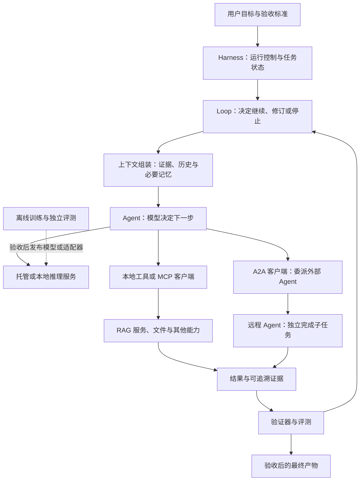

# AI Agent 工程学习导航

从能调用工具的模型，走向能够检索证据、连接外部能力、协作交付，并在约束内持续运行的系统。

这份导航基于本项目已整理的课程、文章、研究笔记与概念页重新编排。主线覆盖 **AI Agent → RAG → MCP → Harness Engineering → Loop Engineering → A2A 协作**，上下文、记忆、Skills 与评测贯穿其中。新增四个专项：**主流框架（LangChain/LangGraph/LlamaIndex）、开放权重模型本地部署、推理优化、模型微调**。框架在最小实现后学习，本地推理与微调构成可按需求深入的模型工程路线。顺序、练习和验收门槛是教学设计；资料中已有的案例结论不自动推广到所有系统。

先完成一个可检查的小系统，再根据失败类型增加组件。每个阶段都留下可运行产物和实验记录。

## 目录

1. [概念地图与学习目标](#概念地图与学习目标)
2. [贯穿项目与学习方式](#贯穿项目与学习方式)
3. [阶段零：准备基础与评测集](#阶段零准备基础与评测集)
4. [阶段一：最小 AI Agent](#阶段一最小-ai-agent)
5. [阶段二：可追溯的 RAG](#阶段二可追溯的-rag)
6. [专题 A：主流框架与工程抽象](#专题-a主流框架与工程抽象)
7. [阶段三：MCP 与能力接入](#阶段三mcp-与能力接入)
8. [阶段四：上下文、记忆与 Skills](#阶段四上下文记忆与-skills)
9. [阶段五：Harness Engineering](#阶段五harness-engineering)
10. [阶段六：Loop Engineering](#阶段六loop-engineering)
11. [阶段七：A2A 与多 Agent 协作](#阶段七a2a-与多-agent-协作)
12. [阶段八：评测与受控改进](#阶段八评测与受控改进)
13. [专题 B：开放权重模型的本地部署](#专题-b开放权重模型的本地部署)
14. [专题 C：推理机制与性能优化](#专题-c推理机制与性能优化)
15. [专题 D：模型微调与任务适配](#专题-d模型微调与任务适配)
16. [时间安排与最短阅读路线](#时间安排与最短阅读路线)
17. [按问题查资料](#按问题查资料)
18. [完成标准与下一步方向](#完成标准与下一步方向)
19. [资料目录](#资料目录)

## 概念地图与学习目标

### 各个概念分别负责什么

| 主题 | 主要问题 | 学习时应交付的产物 |
| --- | --- | --- |
| AI Agent | 如何依据目标和观察决定下一步行动？ | 模型、工具执行器与状态组成的最小执行循环 |
| Function Calling | 模型怎样提出结构化工具请求？ | 工具定义、参数校验、调用结果与错误处理 |
| RAG | 如何找到外部证据并用于回答？ | 数据处理、检索、上下文组织、引用与分层评测管线 |
| MCP | 应用如何以共同协议连接工具、数据和提示模板？ | 可被客户端发现和调用的能力服务 |
| Context Engineering | 每次调用应该读取、保留和省略什么？ | 上下文组装与信息预算策略 |
| Memory | 哪些事实、状态与经验需要跨调用或跨任务保存？ | 有来源、生命周期和更新规则的存储 |
| Skills | 如何复用一类任务的做法和辅助资源？ | 明确输入、步骤、输出与检查方法的任务包 |
| Harness Engineering | 如何支撑和约束整个 Agent 的运行？ | 工具执行、状态、权限、追踪、验证与恢复机制 |
| Loop Engineering | 如何根据反馈继续、修订、暂停或停止？ | 有状态转换、停止条件和预算的控制回路 |
| A2A | 独立 Agent 服务怎样发现彼此、委派任务与交换成果？ | 能力描述、任务生命周期与交付协议 |
| Evaluation | 如何证明任务完成或系统变好了？ | 固定任务集、验证器、失败分类与对照报告 |
| 应用框架 | 如何把数据流和控制流组织为可维护组件？ | 框架实现、抽象映射、版本与选型记录 |
| 本地推理 | 如何在自管硬件上运行模型并接入系统？ | 模型服务、硬件档案与兼容性检查 |
| 推理优化 | 如何在质量要求下改善延迟、吞吐和资源占用？ | 可重复压测、瓶颈分析与配置对照 |
| 模型微调 | 如何用训练适配稳定任务行为？ | 数据集、适配器、评测与部署回归 |

这是学习用的职责地图，各层有重叠。Harness 与 Loop 的术语边界也并非统一行业标准。Agent 与 RAG 的基础关系见 [R01]、[R03]；Harness 与循环关系见 [R08]、[R10]；协议定位见 [P01]、[P04]。

框架组织应用逻辑，推理引擎运行模型，训练工具产出可部署参数；三者分别处于不同位置。它们与 MCP/A2A 等接入协议也不能互相替代。[F01]、[F03]、[D03]、[T02]

### 把它们放进同一个系统

图中为教学组合架构，不要求每个项目都部署全部模块。普通 RAG 可以使用固定管线，单 Agent 可以使用本地函数；只有需要标准化接入或跨服务协作时，才引入对应协议。

### 学完应能回答的六个问题

- 哪部分由模型决定，哪部分由程序保证？
- 答案依赖哪些文档、版本和具体证据？
- 一次工具请求如何经过校验、授权、执行和结果回传？
- 中断后，系统如何核对环境并恢复进度？
- 一轮循环为什么继续，为什么停止？
- 增加检索、重排、记忆或远程 Agent 后，收益是否超过额外成本？

## 贯穿项目与学习方式

### 项目：基于当前文档库的学习研究助手

输入一个学习问题，例如“RAG、MCP 与 A2A 如何配合？”，输出一份包含概念解释、原文证据、阅读顺序和未知事项的 Markdown 报告。

用已有 `sources/` 目录做语料，先抽取 30–50 份相关文档。保留标题、来源路径、内容哈希、版本或整理日期。全文合集用于阅读，检索索引优先使用分篇原文，避免合集重复正文影响排名。

| 版本 | 新增能力 | 代表性结果 |
| --- | --- | --- |
| V0 | 固定搜索与文件读取 | 从本地文件找到证据位置 |
| V1 | 单 Agent 选择只读工具 | 自主搜索、读取并解释结果 |
| V2 | RAG 与引用 | 生成可回溯到片段的答案 |
| V3 | MCP 封装 | 同一知识服务被兼容客户端调用 |
| V4 | Harness 与恢复 | 有日志、检查点、预算和故障处理 |
| V5 | 验证与修订 Loop | 依据证据缺口进行有限轮修订 |
| V6 | A2A 协作 | 委派独立服务完成引用核对或专项检索 |
| V7 | 受控改进 | 用留出任务判断新版本能否保留 |
| V8 | 框架实现与选型 | 同任务比较 LangChain、LangGraph 与 LlamaIndex 的职责 |
| V9 | 本地模型后端 | 对比本地/托管服务及工具调用兼容性 |
| V10 | 推理优化 | 用质量、延迟、吞吐与内存验证优化 |
| V11 | 微调与部署 | 在留出集验证 LoRA，再回归完整 Agent/RAG |

V6 是进阶练习，只有出现跨应用、跨团队或独立部署需求时，才作为实际系统组件保留。版本号表示能力增量；实际阅读时专题 A 接在 RAG 后，V9–V11 在具备固定评测后展开。

### 每轮学习留下四件东西

1. 一张架构或数据流图。
2. 一个可以重复运行的最小例子。
3. 一份失败案例与定位记录。
4. 一份与旧版本使用相同任务比较的结果表。

可以让 AI 编写实现、测试和分析脚本。学习者负责明确目标、理解关键机制、检查证据并决定验收。协作方法可参考 [R02]。

## 阶段零：准备基础与评测集

**目标：** 能读懂一次模型请求、一次工具调用和一次答案验证。

准备 HTTP、JSON、基础 Python 或 TypeScript、文件读写、错误处理，以及 token、上下文窗口、结构化输出和相似度的基本概念。先只选一门实现语言和一种模型接入方式。

从第一天建立 30 个问题的种子集：10 个单篇事实问题、5 个术语或版本问题、5 个跨文档问题、5 个没有答案的问题、5 个涉及歧义或相互冲突资料的问题。每题记录答案要点、原始证据位置和允许的拒答方式。

这些数量用于学习起步。开发集与留出集按来源文档或问题家族隔离，避免同一问题的改写版本落入两边。

**产物：** `task-spec.md`、语料清单、种子评测集、一次无检索回答的基线结果。

**通过标准：** 能区分格式正确、事实正确、有证据支持和任务完成；能够解释一题答对是否真的依赖检索。

**阅读：** [R01] 建立 Agent 概念；[R03] 建立 RAG 数据流；[R05]、[R15] 学习评测数据与结果判定。

## 阶段一：最小 AI Agent

**目标：** 理解“模型提出下一步”如何变成程序实际执行。

### 必学内容

- 对话、固定工作流与动态 Agent 的控制流区别。
- 指令、工具描述、参数 Schema、工具返回值和工具错误。
- ReAct 所强调的行动与观察反馈；不要求记录模型隐藏的推理过程。
- 调用 ID、执行结果关联、最大轮数，以及成功与失败出口。

### 实践

提供 `search_documents` 和 `read_document` 两个只读工具。先做固定“搜索→读取→回答”管线，再允许模型选择下一步，比较两种方式。

跟踪一个问题：模型为什么搜索、读了什么、获得了哪些新证据、为什么结束。工具执行器应能拒绝无效参数与越界路径。

**通过标准：** 可从日志重建行动顺序；工具报错能回传为观察；达到预算会退出；模型说“完成”之后仍检查交付物。

**阅读：** [R01] → [R04]；结合本阶段的工具接口练习理解调用与观察，持久化机制后续配读 [R10]。

**进入下一阶段前：** 能清楚指出“模型请求执行”和“工具已经执行”的边界。

## 阶段二：可追溯的 RAG

**目标：** 能定位一个错误发生在解析、检索、排序、上下文还是生成阶段。

### 必学内容

| 层次 | 优先学习 | 暂缓到有需求时 |
| --- | --- | --- |
| 数据 | 结构保留、去重、文档版本与证据位置 | 复杂 PDF、OCR 和多模态解析 |
| 分块 | 标题/段落分块、片段元数据与父文档关系 | 多种语义分块的组合 |
| 检索 | BM25、精确向量检索、相关性标注 | 规模化 ANN 与检索训练 |
| 排序 | 候选去重、混合检索、重排对照 | 复杂融合与多向量检索 |
| 生成 | 证据选择、引用、冲突处理与拒答 | 图谱与多轮自主检索 |

RAG 的定义不要求向量数据库。先保留 BM25 和精确向量检索基线；只在错误分析显示需要时引入混合检索、reranker 或查询改写。[R03]

### 实践

固定语料、问题、生成模型和上下文预算，对比无检索、BM25、向量检索，再按需求加入混合检索与重排。逐题检查证据是否进入候选、是否进入最终上下文、是否被正确引用。

检索指标先用证据命中率或明确标注口径的 Recall@K；生成侧分别检查答案正确性、证据忠实度、引用支持和拒答。分块变化后要重新映射证据标签。

**通过标准：** 任意引用能回到原文位置；至少分析三种不同层次的失败；无答案问题可以合理拒答；能解释质量收益及延迟、成本变化。

**阅读：** [R03] 的 RAG 各阶段介绍；[R05] 用于设计检索自测；[R06] 用于理解证据如何进入上下文。

**进阶条件：** 只有单轮检索缺少必要证据时，才增加 Agentic RAG；先与有界固定多步工作流比较。

## 专题 A：主流框架与工程抽象

**学习位置：** 完成最小 Agent 与 RAG 后开始；LangGraph 的恢复与状态部分结合阶段五、六深入。

**目标：** 能把已理解的数据流和控制流映射到框架，保留定位错误和替换组件的能力。

### LangChain、LangGraph 与 LlamaIndex

| 框架 | 优先研究的职责 | 应掌握的抽象 | 对应本导航 |
| --- | --- | --- | --- |
| LangChain | 组织模型、工具和可配置 Agent 行为 | 模型接口、工具、Agent、结构化输出、middleware | 阶段一、三、四 |
| LangGraph | 显式管理有状态工作流与 Agent 执行 | State、节点、边、检查点、中断与恢复 | 阶段五、六、七 |
| LlamaIndex | 组织数据接入、检索与基于数据的应用 | Document、Node、索引、Retriever、Query Engine、Workflow | 阶段二、四及 Agentic RAG |

LangChain 的 Agent 构建于 LangGraph 之上；需要更细的状态流与恢复控制时，再直接学习 LangGraph。LangSmith 属于追踪与评测工具，不是本地实现这些能力的唯一选择。[F01]、[F02]

LlamaIndex 同时提供 Agent 和 Workflow 能力，LangChain 也能构建 RAG。表格体现本路线的学习侧重，不是排他的能力划分。[F01]、[F03]

### 建议的比较练习

1. 保留阶段一、二的朴素实现作为基线。
2. 用 LangChain 实现同一个只读研究 Agent，检查模型输入、工具参数和输出验证。
3. 用 LlamaIndex 实现同一份语料的接入、检索和引用，检查 Node 元数据与原始证据位置。
4. 结合 Harness 阶段，用 LangGraph 表达“检索→生成→验证→补充检索或结束”的状态流。
5. 选一个主要框架继续。仅在明确需要时，才组合 LangGraph 编排与 LlamaIndex 检索等组件。

比较时固定语料、问题、模型、分块、召回数量及生成预算。框架默认参数不同造成的收益，不能直接归因于框架本身。

### 需要检查的集成边界

- 谁维护对话、任务状态和检查点？避免两个框架各自认为自己是状态真相来源。
- 模型适配器是否保留工具调用、流式输出与结构化结果的语义？
- 检索分数、Node/chunk ID、文档版本与来源能否穿过封装？
- 外部动作恢复时，哪些节点可能重跑，哪些操作必须幂等？
- MCP 是接入协议，A2A 是协作协议；引入框架不代表已完成协议互操作。

**产物：** 三种实现的职责映射表、同题评测结果、框架版本锁定记录及选型说明。

**通过标准：** 能画出实际调用链；框架故障可定位到模型、检索、状态或工具层；能解释选择理由和迁移代价。恢复行为必须在所选持久化配置下实际验证。

**阅读：** [F01] → [F03]，再按状态控制需求深入 [F02]。先学数据流，再读相应版本的示例和 API；不要求同时精通三套框架。

## 阶段三：MCP 与能力接入

**目标：** 将已验证的本地能力封装为可复用接口，并看清协议与模型调用的边界。

### 学习重点

MCP 区分 Host、Client 与 Server；服务端可提供 Tools、Resources 与 Prompts，分别对应可执行能力、上下文数据和提示模板。[P01]

Function Calling 负责模型提出工具请求的交互；MCP 负责应用与能力服务之间的协议接入。应用需要把发现的能力转换成模型可使用的工具，并负责执行控制与结果回传。[P01]、[P02]

能力发现、参数约束、传输、错误和授权需要分别理解。协议版本、SDK 版本与双方支持的能力必须对齐；旧版握手示例不应与新版发现流程拼接使用。[P03]

### 实践

把已有 `search_documents`、`read_document` 封装为一个 MCP 知识服务。先验证客户端发现和调用，再让 Agent 使用；固定输入与 V2 的本地工具比较结果。

测试四种情况：合法搜索、参数缺失、服务不可用、读取不允许的文档。授权范围由应用和服务端落实，不能依赖模型主动遵守。

**通过标准：** 能从一次调用追踪 Host→Client→Server→结果回传；可以区分协议错误与业务无结果；封装后检索质量没有无故变化。

**阅读：** [P01] → [P02] → [P03]；以官方规范核对协议角色、工具调用与版本兼容。

**版本记录：** 本导航在 2026-10-15 打开的 MCP `latest` 规范指向 `2026-07-28`。示例应注明所用版本，未来按双方实际支持情况选取。

## 阶段四：上下文、记忆与 Skills

**目标：** 控制每次输入的信息，并让跨轮状态保持可解释。

| 信息类型 | 示例 | 维护原则 |
| --- | --- | --- |
| 对话历史 | 模型请求、工具结果 | 保留执行关联，按需压缩 |
| 任务状态 | 待办、已验证步骤、阻塞原因 | 独立于自然语言摘要维护 |
| 检索证据 | 原文片段、版本与来源 | 当前问题按需加载 |
| 长期记忆 | 用户偏好、经验证的复用经验 | 记录来源、适用范围、更新与删除规则 |
| Skill | 研究报告的执行步骤与检查表 | 显式加载，明确输入与产出 |

文件落盘只是存储方式；长期记忆还需要写入、检索、冲突处理与遗忘规则。向量索引也不能替代任务状态。[R06]、[R07]

### 实践

为报告任务设计一个 Skill：检索→读取原文→列出主张与证据→生成报告→检查引用。将格式要求与事实证据分开，避免把生成摘要作为原始来源。

比较全量历史、摘要历史、任务状态加按需读取三种输入方式。检查上下文压缩后是否遗漏否定条件、版本差异或尚未解决的问题。

**通过标准：** 给出上下文组成和取舍依据；过期记忆可以更新；重启后不会仅凭旧摘要把未验收步骤视为完成。

**阅读：** [R06]、[R07]、[R11]；Skills 入门参考 [R12]。

## 阶段五：Harness Engineering

**目标：** 让 Agent 的实际执行可限制、可追踪、可恢复。

### 最小运行支撑体系

| 组件 | 最小职责 | 故障练习 |
| --- | --- | --- |
| 任务契约 | 目标、交付物、约束与验收证据 | 用户要求含糊或发生变化 |
| 工具执行器 | 参数、权限、超时与结构化错误 | 工具超时、无效参数 |
| 状态与持久化 | 检查点、产物版本、下一步 | 进程中断与旧状态冲突 |
| 预算 | 调用、时间、token 或费用限制 | 任务无法收敛 |
| 验证器 | 结构、引用与需求覆盖检查 | 漏项或错误引用 |
| 追踪 | 请求、行动、证据、结果与版本 | 找出失败发生的环节 |

### 实践

把报告生成分成可恢复的小阶段。模拟“文件已写入但状态未保存”“工具超时但可能已执行”“文档索引更新后仍读取旧版本”。对结果不确定的动作先核对状态，再决定重试。

对于有副作用的操作，幂等、去重或补偿机制必须落实在应用和下游服务中。重放日志有助于诊断，但外部环境变化时，不保证再次执行得到相同结果。[R08]、[R10]

**通过标准：** 可以停止并恢复；状态与产物一致；能定位失败；有副作用的重试不会靠提示词碰运气。

**阅读：** [R08] → [R09]；实现案例配读 [R13] 的双角色、跨会话进度与运行边界。

## 阶段六：Loop Engineering

**目标：** 根据检查结果选择下一步，而不是无限重复生成。

### 区分三类循环

| 循环 | 改变什么 | 什么时候算成功 |
| --- | --- | --- |
| 执行循环 | 当前行动与任务状态 | 当前任务满足交付要求 |
| 验证与修订循环 | 当前候选答案或产物 | 缺陷被修复，且回归检查通过 |
| 系统改进循环 | 提示、工具、检索或运行机制 | 后续独立任务表现可重复改善 |

输出被修订不等于模型权重更新；持续运行也不自动意味着学习或 RSI。[R10]、[R14]

### 为每轮规定五项内容

1. 本轮要解决的缺口。
2. 允许的动作与输入证据。
3. 预期新增的产物或观察。
4. 判定是否改善的方法。
5. 继续、成功、暂停、失败和预算耗尽的条件。

### 实践

为研究报告增加引用检查和覆盖检查：遗漏关键概念时补充检索，引用不支持主张时修订或删除该主张；证据本身不存在时说明未知。连续没有新证据时退出并报告缺口。

保留每轮差异，比较一次生成与有限轮修订。生成者不能通过修改固定验收题目或隐藏失败让分数变高。

**通过标准：** 每轮继续都有具体原因；能处理无进展、工具失败和预算耗尽；退出状态与交付质量分开报告。

**阅读：** [R02] 的实现与验证步骤、[R10] 的检查点和恢复机制、[R09] 的生成与评审分工；结合本节规则组装完整循环。

## 阶段七：A2A 与多 Agent 协作

**目标：** 在确有独立服务协作需求时，理解如何委派、跟踪并验收另一 Agent 的结果。

### A2A 的适用边界

同一程序中的子 Agent 可以使用内部函数或框架编排。A2A 关注独立 Agent 应用之间的互操作：双方不必暴露各自内部模型、记忆或工具实现。一个远程 Agent 也可以在内部通过 MCP 使用能力服务。两种协议可以配合。[P04]

选择协议时看交互契约：你是在请求一个明确能力，还是向独立服务委派有后续交互的任务。不能简单按“同步/异步”划线；MCP 也存在面向长任务的扩展，具体依版本与双方支持能力而定。[P01]、[P04]

### 必学概念

| 概念 | 需要理解的内容 |
| --- | --- |
| Agent Card | 描述身份、能力、服务接口与认证要求，支持发现 |
| Message / Part | 交互消息及文本、文件或结构化数据等内容 |
| Task | 具有标识和生命周期的工作单元 |
| Artifact | 任务产生的具体交付物 |
| Context | 关联相关交互的上下文标识；不代表共享内部记忆 |

上述概念参考 [P05]。Agent Card 中的 skill 是能力描述，不能直接等同于本地 `SKILL.md` 任务包。

### 实践

新增一个独立的“引用核对 Agent”服务。研究助手发送报告中的主张、必要证据及验收要求；远端返回核对结果和 Artifact，主 Agent 验证来源与覆盖后再合并。

先练习即时 Message，再练习有状态 Task。Task 可报告进展、请求补充输入或进入终态；轮询、流式更新与通知按实际声明能力选择。[P06]

故意模拟以下场景：需要补充证据、远端执行失败、客户端断线后重新查询、重复提交、提出取消但还没有确认。应用自行明确任务关联、去重、结果验收和责任边界。

**通过标准：** 区分“请求已接收”“远端已完成”和“主任务验收通过”；不把请求取消视为已取消；远端结果仍需验证；授权不会因为 Agent 之间协作而自动扩大。

**阅读：** [P04] → [P05] → [P06]。本地基础资料不足以构成完整 A2A 教程，因此以官方文档为主，实施时固定协议与 SDK 版本。

## 阶段八：评测与受控改进

**目标：** 能用证据解释一次组件调整是否值得保留。

### 统一评测面板

| 维度 | 记录内容 |
| --- | --- |
| 检索 | 证据命中、相关片段覆盖、不同问题类型的失败 |
| 回答 | 正确性、忠实度、引用支持、适当拒答 |
| Agent | 任务验收、选错工具、无效参数、无效重复行动 |
| Harness / Loop | 恢复结果、停止正确性、状态一致性、越界拦截 |
| MCP / A2A | 兼容性、失败分类、任务关联、交付物校验 |
| 效率 | 总耗时、调用次数、token/费用、人工介入 |

**实践：** 一次只修改一个主要因素，例如分块、reranker、工具描述、上下文策略或评审分工。保留基线、配置和失败轨迹，在开发集调整，再在固定留出集检验。随机性较大时重复运行，记录波动。

评审模型可以辅助检查，但要与人工标注或确定性检查校准。报告“模型评分提高”时，同时检查任务是否真正完成。[R03]、[R10]、[R15]

**通过标准：** 能提交一份包含收益、代价、失败类型和回退决定的实验报告；未观察到提升时能说明为何不保留新增复杂度。

**研究拓展：** 有完整评测后，再读 [R14] 的自修改与基准验证案例，区分受限系统改进与更开放的 RSI。先限定可修改对象，隔离评价器与测试集，再研究更开放的系统改进。

## 专题 B：开放权重模型的本地部署

**学习位置：** 能运行最小 Agent/RAG 并建立评测后即可开始，不要求先完成 A2A。

**目标：** 将模型从托管 API 替换为自己控制的推理服务，并验证 Agent/RAG 能力是否保持。

这里的“本地部署”包括个人电脑与自管服务器。开放权重不自动意味着符合所有开源定义，也不表示允许任意商用、再分发或训练；选型时核对具体模型卡和许可证。

### 先建立模型与硬件档案

| 项目 | 必须记录的问题 |
| --- | --- |
| 模型身份 | 权重来源、精确 revision、Base/Instruct 类型、tokenizer 与 chat template |
| 任务能力 | 中文、长文、工具调用、结构化输出、embedding/reranker 是否分别满足需求 |
| 硬件 | CPU/GPU 型号、显存或统一内存、驱动与可用空间 |
| 运行配置 | 引擎版本、精度/量化、上下文上限、并发、输入输出长度 |
| 使用范围 | 权重和数据的授权条件、访问边界及日志保存方式 |

以硬件可承受且匹配任务的模型建立基线，分别测生成、embedding 和 reranker。三者可以是不同模型和服务。

### 部署路线

| 路线 | 学习用途 | 重点检查 |
| --- | --- | --- |
| Ollama | 快速管理和运行本地模型，接入应用验证 | 模型配置、上下文与并发带来的内存变化 [D01] |
| llama.cpp | 研究 GGUF、量化、CPU/GPU 卸载与本地服务 | 权重格式、后端支持、设备与内存分配 [D02] |
| vLLM | 研究面向服务的吞吐、调度与资源配置 | 模型/硬件支持、服务参数、批处理与指标 [D03] |
| MLX-LM | Apple Silicon 上的生成与微调练习 | 对应模型支持、统一内存、量化与适配器 [D04] |
| Transformers | 理解权重/tokenizer 加载与直接生成的参考路线 | generation 配置、设备放置、模板与输出行为 [T01] |

这是按学习目标划分的候选路线，不是性能排名。先运行一个适配当前硬件的引擎，再做跨引擎比较；没有相应 GPU 时，可以完成 CPU/Apple Silicon 练习，将多卡服务列为后续专项。

### 显存与内存估算

权重的理想存储近似为：`参数量 × 每参数位数 ÷ 8`。例如 8B 参数按 4 bit 计约为 4 GB（十进制），仅能估算权重主体。

实际还要计算量化元数据、KV Cache、激活/工作区、运行时及并发开销。权重文件能放下不等于目标上下文与并发能运行；训练还涉及梯度、优化器和保存的激活，不能套用推理占用。

### 实践

让 AI 协助整理部署配置，在安装前核对官方支持矩阵。启动模型服务后，用既有应用的模型适配层切换后端，保留原来的检索与工具契约。

先测短文本，再测引用回答、工具调用、无答案拒答及长输入。单独验证流式工具参数、结束标记、JSON 格式和 chat template；“API 兼容”不代表所有参数和模型能力完全相同。

最后关闭不必要的外部调用，在预期离线条件下运行一次。模型服务在本机不代表 embedding、遥测或其他依赖都在本机。

**产物：** 模型与硬件档案、可复现服务配置、兼容性测试及与托管基线的差异报告。

**通过标准：** 能解释模型格式和精度；重启可复现；Agent/RAG 任务有真实验证；明确本地资源、质量及延迟边界。

## 专题 C：推理机制与性能优化

**前提：** 专题 B 已有稳定可运行的服务和质量评测。先确认瓶颈，再选优化手段。

### 理解性能的来源

- **Prefill：** 处理输入并建立后续生成需要的状态。
- **Decode：** 自回归生成输出；逐 token 生成与请求调度影响用户等待。
- **KV Cache：** 复用注意力相关状态，消耗会随序列、并发和模型结构变化。
- **排队与调度：** 总响应时间既包含模型计算，也包含服务排队和其他步骤。

vLLM 的调优文档提供资源与调度视角；其他引擎的具体机制、开关及支持范围需要分别核对。[D05]

### 优化技术地图

| 技术 | 学习的取舍 | 建议实验 |
| --- | --- | --- |
| 减少无关上下文与无效循环 | 同时降低输入计算和调用次数，需防止证据丢失 | 相同任务比较证据覆盖、调用数及总时间 |
| 权重量化 | 存储/带宽与数值误差；速度收益依赖硬件和内核 | 比较可运行的两种精度及任务质量 |
| KV Cache 管理或量化 | 并发容量、长上下文内存和数值误差 | 增加输入长度与并发，测失败和延迟 |
| 连续批处理 | 聚合请求提高利用率，同时关注单请求和尾延迟 | 固定请求分布，改变并发与到达率 |
| Prefix Caching | 复用共享前缀的计算，不是缓存整个答案 | 分开测共享/不共享前缀、冷/热缓存 [D06] |
| 高效 Attention、算子与编译优化 | 内存访问和计算效率；支持范围受后端限制 | 对比受支持配置，记录预热和稳定阶段 |
| Speculative Decoding | 草稿与校验的额外成本、接受率和负载取舍 | 在支持组合中比较实际 decode 延迟 [D07] |
| 张量/流水线并行与副本 | 模型容量、跨设备通信和吞吐之间的取舍 | 有多卡资源后再比较部署拓扑 |

量化、Prefix Caching 和 Speculative Decoding 解决不同瓶颈，不能承诺叠加后必然加速。缓存前缀需要满足引擎的匹配和隔离规则；结果缓存还要考虑语料版本、用户权限与失效机制。[D05]、[D06]、[D07]

### 压测与验收

固定硬件、模型 revision、tokenizer、采样配置、输入/输出长度分布和质量任务。先预热，再分别记录冷启动及稳定服务；包含中文与工具调用等实际负载。

至少记录：首 token 延迟（TTFT）、输出 token 间延迟（ITL）、端到端 p50/p95、聚合输出 token/s、请求完成率、峰值内存/显存，以及同一评测集的任务质量。输出速度要注明是单请求还是聚合吞吐，不能混用。

压测增加输入长度、输出长度和并发时分别控制变量。每次优化都检查引用、工具调用和拒答是否退化，不以更短但漏项的答案制造“加速”。

**产物：** 压测脚本或配置、资源与延迟曲线、质量回归表、推荐工作点和回退方案。

**通过标准：** 能定位内存、prefill、decode、排队或应用步骤的瓶颈；优化收益在目标负载成立，且代价可解释。无法运行的技术保留为机制阅读，不声称完成性能验证。

## 专题 D：模型微调与任务适配

**前提：** 任务和标签稳定，有独立测试集；已排查检索、提示词、工具与运行控制的问题，并能部署和评测基础模型。

**目标：** 用可控训练改善明确行为，完成从数据到适配器再到部署的闭环。

### 先判断是否需要训练

| 观察到的问题 | 优先尝试 | 什么时候考虑微调 |
| --- | --- | --- |
| 私有事实缺失、内容频繁更新 | RAG、数据更新与证据追踪 | 同时存在稳定的表达或任务行为缺口 |
| 输出字段、语气或分类规则不稳定 | Schema、提示词、少量示例和验证 | 有一致标注、反复出现且可度量的失败 |
| 工具选择或参数生成长期不足 | 工具契约、反馈与模型能力评测 | 有高质量工具轨迹和针对性测试 |
| 延迟或成本过高 | 推理优化、路由与较小模型基线 | 小模型适配或蒸馏有望保留目标能力 |
| 领域术语和表达理解持续不足 | 语料、embedding/reranker 和提示方案 | 足够领域数据且已有明确对照实验 |

微调可能改变知识表现，但不能保证可追溯、及时更新或精确删除，因此不替代 RAG 的数据治理。RAG 与微调可以组合，实验时分开控制两个变量。

### 方法与训练工具

| 方法 | 改变什么 | 学习顺序 |
| --- | --- | --- |
| SFT | 用输入与目标输出学习任务行为 | 首个训练实验；理解监督目标与数据格式 [T02] |
| LoRA | 训练选定模块的低秩适配参数 | 理解 rank、target modules 与适配器 [T03] |
| QLoRA | 在量化基座上训练 LoRA 等适配参数 | 显存受限时比较质量与资源；不是全量更新低比特权重 [T04] |
| 全参数微调 | 更新全部或大部分基座参数 | 资源、数据与训练稳定性有明确需求后深入 |
| DPO 等偏好优化 | 利用同一输入下的偏好回答对 | 已具备可信偏好标签后研究 [T05] |
| 蒸馏 | 从教师行为或分布构造学生学习目标 | 作为独立的数据与训练设计专题，验证迁移效果 |
| 领域继续预训练 | 在领域语料上继续语言建模 | 与指令 SFT 分开理解，通常作为深入专项 |

SFT/DPO 描述学习目标，LoRA/QLoRA 描述参数适配和资源策略，二者不是互斥方案。训练后 loss 下降不等于 Agent 任务成功率上升。

入门可用 Transformers + TRL + PEFT 理解组件职责；Apple Silicon 可参考 MLX-LM 的 LoRA/QLoRA 说明。选择一个匹配硬件、模型和数据格式的栈，不把所有工具都作为必修。[T01]、[T02]、[T03]、[T04]、[T06]

### 数据工程：先做数据，再跑训练

1. **明确目标：** 先选一个能验收的行为，例如证据约束问答、结构化报告或工具路由。
2. **建立来源：** 保存输入、证据、目标回答、标签依据和数据版本；确认使用权限与敏感内容处理。
3. **控制质量：** 删除冲突和低质量样本，检查缺字段、错误引用与幻觉；保留无答案、澄清和失败恢复样本。
4. **拆分数据：** 按原始文档、时间或任务家族隔离训练/验证/测试，去除近重复；不能随机拆开同一文章的问答改写。
5. **核对模板：** tokenizer、chat template、角色、工具消息、EOS 和截断长度必须符合基座与训练器约定。
6. **检查学习位置：** 理解 loss mask、assistant-only/completion-only 监督及 packing 行为，实际抽查哪些 token 参与训练。[T02]、[T07]

学习实验可从人工核对的数百条样本开始，先在极小数据上验证训练与加载管线，再扩大；这不是保证效果的数据量门槛。测试集和评分器不能回流为训练样本。

### 首个 SFT + LoRA 实验

固定一个能够部署的 Instruct 基座与数据版本。先保存原始模型的提示词基线，再训练一个小型 LoRA；记录学习率、有效 batch、序列长度、epoch/steps、rank、target modules、随机种子与依赖版本。

核对可训练参数，观察训练与验证 loss、显存和时间；检查工具轨迹中的执行结果是否由真实工具产生。没有执行过的模型猜测不能直接当作成功轨迹。

在相同推理条件下比较：基础模型、基础模型 + 改进提示词、微调模型。若要比较 RAG，则额外加入两组共享同一检索管线的基础/微调模型。

### 训练后部署与回归

保留基础模型 revision、tokenizer、chat template、adapter 配置及权重、训练数据版本和评测报告。加载 Adapter 与合并权重是不同发布方式；能否合并、量化或转为 GGUF/其他格式，取决于模型、方法和目标引擎，不能默认兼容。[T03]、[T04]

在目标引擎重新检查质量、工具协议和资源占用，再比较量化前后版本。保留基础模型及旧服务配置，验证回退；QLoRA 训练省下显存不代表部署必然更快。

**通过标准：** 在隔离测试集上改善目标行为；通用回答、拒答、引用和工具调用没有不可接受回归；训练可追踪、部署可复现、回退可执行。

**产物：** 数据卡、训练配置与日志、适配器/模型卡、离线与端到端评测、部署兼容性及回退说明。

## 时间安排与最短阅读路线

### 八周应用主线

适用于已有 API 与基础编程经验、每周约 8–12 小时的学习者。目标是跑通小规模系统并学会诊断；框架先选一个，完整的本地部署、推理优化和微调另按后续专项安排，不压缩进这八周。RAG 规模化、分布式运行和协议生产部署也需要继续深入。

| 周次 | 学习重点 | 主要产物 |
| --- | --- | --- |
| 1 | 基础、任务契约、最小 Agent | 只读工具循环、种子评测集、执行日志 |
| 2 | RAG 数据与基线 | 可追溯分块、BM25/向量对照 |
| 3 | 检索优化与引用 | 按失败类型改进的检索管线、引用检查 |
| 4 | MCP 与上下文/Skills | MCP 知识服务、上下文策略、报告 Skill |
| 5 | Harness 与恢复 | 检查点、预算、权限与故障记录 |
| 6 | Loop 与验证修订 | 有限轮报告改进及停止原因 |
| 7 | A2A 协作 | 独立核对服务、任务与产物验收 |
| 8 | 回归、留出集与交付 | 对照报告、架构说明、可复现演示 |

缺少编程或检索基础时，先延长阶段零和 RAG 部分。RAG 专项可沿 [R03] 的加载、索引、查询、存储和评测主题继续深入；已有成熟 RAG 时，可从阶段三开始，补齐运行与互操作部分。

### 扩展为十六周：应用系统与模型工程

| 周次 | 重点 | 验收产物 |
| --- | --- | --- |
| 1–3 | Agent、RAG 与检索评测基线 | 有证据和固定测试的最小系统 |
| 4 | 专题 A：LangChain/LlamaIndex，对照朴素实现 | 框架抽象映射、选型与版本记录 |
| 5–8 | MCP、上下文、Harness、Loop、A2A 与回归 | 可恢复、可验证的研究助手；按需配读 LangGraph |
| 9–10 | 专题 B：本地推理与适配 | 一套可复现模型服务及兼容性报告 |
| 11–12 | 专题 C：机制、压测与单项优化 | 瓶颈诊断、质量与性能对照 |
| 13 | 专题 D：数据与训练设计 | 隔离的数据集、基座及提示词基线 |
| 14–15 | SFT + LoRA/QLoRA 小实验 | 训练记录、留出集收益及回归 |
| 16 | 微调模型部署、端到端比较与回退 | 模型卡、部署配置、综合交付 |

这是每周约 8–12 小时、已有基础者的小规模实践安排。DPO、蒸馏、继续预训练、多卡推理和大规模检索只建立概念与实验入口；深入任何一项都应另留时间。

### 先读这八组

1. [R01]：建立 Agent、模型、工具与目标的概念地图。
2. [R04]：理解一次实际 Agent 执行循环。
3. [R03]：建立 RAG 分层与评测基线。
4. [P01]、[P02]：理解 MCP 如何接入现有能力。
5. [R06]：理解上下文选择与跨轮信息管理。
6. [R08]、[R09]：理解运行支撑与长任务恢复。
7. [R02]、[R10]：分别学习验证流程与持久化，再用本导航阶段六连接修订和停止。
8. [P04]、[P05]、[P06]：增加独立 Agent 协作视角。

阅读时先回答本阶段问题，再进入拓展材料；不必先通读全部归档文章。

新增专项的最短路线：**[F01] → [F03] → 按需 [F02] → 选择 [D01]/[D02]/[D03]/[D04] 一条部署路线 → [D05] → [T02] → [T03]/[T04]**。先做基础与提示词对照，再训练。

## 按问题查资料

| 遇到的问题 | 优先检查 | 资料入口 |
| --- | --- | --- |
| 模型选错工具或参数 | 工具描述、输入约束与执行反馈 | [R04]、[P02] |
| 找不到本来存在的证据 | 解析、分块、召回、过滤和排名 | [R03] |
| 检索到了仍然答错 | 上下文选择、版本冲突与主张引用 | [R03]、[R06] |
| MCP 接入失败 | 双方版本、能力支持、传输与认证 | [P01]、[P03] |
| 多轮后忘记目标 | 任务状态、检查点、上下文压缩 | [R06]、[R10] |
| 任务重复运行或无法恢复 | 幂等、状态持久化与环境核对 | [R08]、[R13] |
| 一直修订但没有进步 | 新增证据、验证器与停止规则 | [R10] |
| 多 Agent 增加费用却没提高质量 | 分工必要性、交接与统一验收 | [R09]、[R10] |
| 远端结果无法合并 | Task/Artifact 关联、输入输出约定 | [P05]、[P06] |
| 新版只在熟悉题上变好 | 留出集、泄漏、评分器偏差与回归 | [R03]、[R10]、[R15] |
| 框架封装后难以定位错误 | 原始输入、Node 元数据、状态与执行轨迹 | [F01]、[F02]、[F03] |
| 本地模型能聊天却不能用工具 | chat template、工具解析、结构化能力与适配器 | 专题 B、[D01]、[D03] |
| 长上下文或并发导致内存不足 | 权重、KV Cache、工作区与调度限制 | 专题 B/C、[D05] |
| tokens/s 高但用户仍觉得慢 | TTFT、排队、总时延、输出长度与无效调用 | 专题 C |
| 微调 loss 降低但任务变差 | 数据质量、loss mask、过拟合与端到端回归 | [T02]、专题 D |
| Adapter 在目标引擎无法加载 | 基座 revision、模块、格式、量化与引擎支持 | [T03]、[T04] |

## 完成标准与下一步方向

完成导航时，应能交付以下内容：

- [ ] 解释 Agent、RAG、MCP、A2A、Harness 和 Loop 在项目中的职责。
- [ ] 展示一个从目标到工具调用、证据、检查与报告的完整轨迹。
- [ ] 将答案引用定位到正确原文及版本。
- [ ] 给出检索与端到端质量的分层评测结果。
- [ ] 演示 MCP 能力发现、调用及至少一种失败处理。
- [ ] 演示中断恢复、预算耗尽和无进展停止。
- [ ] 说明记忆、任务状态和 Skill 的区别及维护方式。
- [ ] 在进阶协作演示中区分 A2A 的消息、任务与交付物。
- [ ] 对比一个优化前后版本，并说明是否保留该改动。

模型工程扩展完成后，还应具备：

- [ ] 解释 LangChain、LangGraph、LlamaIndex 的职责及选择依据。
- [ ] 用固定任务比较朴素实现和所选框架，保留证据和状态追踪。
- [ ] 复现一个本地模型服务，并验证结构化输出和工具调用。
- [ ] 给出 TTFT、尾延迟、吞吐、内存和质量的联合对照。
- [ ] 解释为何采用提示词、RAG 或微调，分别控制实验变量。
- [ ] 交付隔离数据、训练配置、LoRA/QLoRA 产物和部署回归。

随后选择一个专项继续：检索质量与数据工程、Agent 运行时、跨服务协作、本地推理性能、任务微调，或评价驱动的受控改进。以明确失败和业务需求决定下一步，不要求把所有组件都装进一个系统。

## 资料目录

### 公开 GitHub 核心资料

以下 R01–R15 均指向已核对存在的公开 GitHub 文件，固定到核对时的提交，阅读不要求登录。R06、R09、R12 为与本地归档内容一致的原文；其余 12 项是按学习目标选择的公开替代阅读，**不是原本地文件的在线副本**。未发布私有材料，未改变仓库可见性。

替代材料的框架示例用于理解机制；本导航中的实践顺序、实验安排和验收规则仍属于教学设计，不表示这些规则全部出自某一篇外部文档。GitHub 中的 MDX 会显示源码和组件标记，可按标题阅读正文。

- **R01**：[Hugging Face：什么是智能体（中文）](https://github.com/huggingface/agents-course/blob/3c469e773ec04e5f338b727ff20e3a6ea823ff81/units/zh-CN/unit1/what-are-agents.mdx)（公开替代阅读）：Agent 的目标、模型、工具与行动边界。
- **R02**：[Anthropic：Coding Agent 执行与验证提示模板](https://github.com/anthropics/claude-quickstarts/blob/9ec32b91df50b0d4906cae64b13c6298055ff40d/autonomous-coding/prompts/coding_prompt.md)（公开替代阅读）：需求核对、回归验证、逐项实现及进度交接的案例模板。
- **R03**：[LlamaIndex：Introduction to RAG](https://github.com/run-llama/llama_index/blob/619d74664e8404612038bc15a1a40c686037277c/docs/src/content/docs/framework/understanding/rag/index.mdx)（公开替代阅读）：数据加载、索引、查询、存储与评测的基础地图。
- **R04**：[Hugging Face：思考—行动—观察循环（中文）](https://github.com/huggingface/agents-course/blob/3c469e773ec04e5f338b727ff20e3a6ea823ff81/units/zh-CN/unit1/agent-steps-and-structure.mdx)（公开替代阅读）：用动作和工具观察理解执行循环；不要求获取模型隐藏推理。
- **R05**：[LlamaIndex：检索评测用法](https://github.com/run-llama/llama_index/blob/619d74664e8404612038bc15a1a40c686037277c/docs/src/content/docs/framework/module_guides/evaluating/usage_pattern_retrieval.md)（公开替代阅读）：用查询、标准证据与检索指标建立自测。
- **R06**：[AI 智能体的有效上下文工程](https://github.com/mrbear1024/Articles/blob/09ec7a87b7ccf3cc9ffc25d56cbb5e52cf49bf5d/AI%E6%8A%80%E6%9C%AF/AI%E6%99%BA%E8%83%BD%E4%BD%93%E7%9A%84%E6%9C%89%E6%95%88%E4%B8%8A%E4%B8%8B%E6%96%87%E5%B7%A5%E7%A8%8B.md)（归档原文）：按需读取、压缩与跨轮上下文管理。
- **R07**：[Deep Agents：文件式长期记忆](https://github.com/langchain-ai/docs/blob/d1f86e4cb91261778387119bf551ab4bd3ecde00/src/oss/deepagents/memory.mdx)（公开替代阅读）：文件后端、按需读取与记忆维护。
- **R08**：[Deep Agents：Agent Harness 能力概览](https://github.com/langchain-ai/docs/blob/d1f86e4cb91261778387119bf551ab4bd3ecde00/src/oss/deepagents/overview.mdx)（公开替代阅读）：工具、文件系统、上下文、记忆与子任务的运行支撑案例。
- **R09**：[长时运行应用开发的 Harness 设计笔记](https://github.com/mrbear1024/Articles/blob/09ec7a87b7ccf3cc9ffc25d56cbb5e52cf49bf5d/Articles/AI%E6%8A%80%E6%9C%AF/%E9%95%BF%E6%97%B6%E8%BF%90%E8%A1%8C%E5%BA%94%E7%94%A8%E5%BC%80%E5%8F%91%E7%9A%84Harness%E8%AE%BE%E8%AE%A1-%E5%AD%A6%E4%B9%A0%E7%AC%94%E8%AE%B0.md)（归档原文）：长任务及生成、评审分工案例。
- **R10**：[LangGraph：Persistence](https://github.com/langchain-ai/docs/blob/d1f86e4cb91261778387119bf551ab4bd3ecde00/src/oss/langgraph/persistence.mdx)（公开替代阅读）：检查点、线程状态、长期存储与恢复；循环验收方法见本导航阶段六。
- **R11**：[LangChain：Context Engineering in Agents](https://github.com/langchain-ai/docs/blob/d1f86e4cb91261778387119bf551ab4bd3ecde00/src/oss/langchain/context-engineering.mdx)（公开替代阅读）：模型调用、工具执行与上下文控制；不是原三层工程文章。
- **R12**：[Skill 从入门到精通大纲](https://github.com/mrbear1024/Articles/blob/09ec7a87b7ccf3cc9ffc25d56cbb5e52cf49bf5d/AI%E6%8A%80%E6%9C%AF/Skill%E4%BB%8E%E5%85%A5%E9%97%A8%E5%88%B0%E7%B2%BE%E9%80%9A-%E5%AE%8C%E6%95%B4%E5%A4%A7%E7%BA%B2.md)（归档原文）：Skill 的组织与复用入口。
- **R13**：[Anthropic：Autonomous Coding Agent Demo](https://github.com/anthropics/claude-quickstarts/blob/9ec32b91df50b0d4906cae64b13c6298055ff40d/autonomous-coding/README.md)（公开替代阅读）：初始化与执行角色、跨会话进度及运行边界的可运行案例。
- **R14**：[Darwin Gödel Machine：项目说明](https://github.com/jennyzzt/dgm/blob/a565fd2d1dca504ef5104a7cc0f3bdc4ab9b4fd2/README.md)（公开替代阅读）：代码自修改与基准验证的研究案例；不代表开放式 RSI 已解决。
- **R15**：[OpenAI Evals：Building an Eval](https://github.com/openai/evals/blob/8eac7a7de5215c907fbddc30efdaf316913eccdd/docs/build-eval.md)（公开替代阅读）：数据集、评测类、运行与结果判定的设计入口。

### 补充官方协议资料

MCP 与 A2A 页面于 **2026-10-15** 打开核对。这里提供概念与阅读入口；具体字段、方法、状态枚举和 SDK 调用应使用匹配版本的规范。

- **P01**：[MCP 规范：2026-07-28](https://modelcontextprotocol.io/specification/2026-07-28)：角色、能力与扩展边界。
- **P02**：[MCP Tools](https://modelcontextprotocol.io/specification/2026-07-28/server/tools)：工具描述、发现与调用。
- **P03**：[MCP Versioning and Compatibility](https://modelcontextprotocol.io/specification/2026-07-28/basic/versioning)：版本与兼容性。
- **P04**：[A2A and MCP](https://a2a-protocol.org/latest/topics/a2a-and-mcp/)：互补关系与交互边界。
- **P05**：[A2A Core Concepts](https://a2a-protocol.org/latest/topics/key-concepts/)：Agent Card、Task、Message、Part 与 Artifact。
- **P06**：[A2A Life of a Task](https://a2a-protocol.org/latest/topics/life-of-a-task/)：消息响应、任务生命周期与后续交互。

### 框架、本地推理与微调官方资料

以下入口于 **2026-10-15** 核对；学习目标和实验安排为本导航设计，未在本文中执行部署、压测或训练。实施时记录精确依赖版本、模型 revision 与硬件，不依赖动态文档中的默认配置。

| 编号 | 官方入口 | 阅读重点 |
| --- | --- | --- |
| F01 | [LangChain Overview](https://docs.langchain.com/oss/python/langchain/overview) | Agent、模型、工具、middleware 与生态职责 |
| F02 | [LangGraph Overview](https://docs.langchain.com/oss/python/langgraph/overview) | 状态编排、持久化、中断与恢复 |
| F03 | [LlamaIndex Framework](https://developers.llamaindex.ai/python/framework/) | 数据接入、Nodes、检索、Query Engine 与 Workflow |
| D01 | [Ollama FAQ](https://docs.ollama.com/faq) | 本地运行、内存、上下文与并发 |
| D02 | [llama.cpp 官方仓库](https://github.com/ggml-org/llama.cpp) | GGUF、量化、后端与本地服务 |
| D03 | [vLLM 官方文档](https://docs.vllm.ai/en/stable/) | 服务、模型支持与推理功能 |
| D04 | [MLX-LM 官方仓库](https://github.com/ml-explore/mlx-lm) | Apple Silicon 的生成、量化与训练入口 |
| D05 | [vLLM Optimization and Tuning](https://docs.vllm.ai/en/stable/configuration/optimization/) | 资源、调度与服务性能取舍 |
| D06 | [vLLM Automatic Prefix Caching](https://docs.vllm.ai/en/stable/features/automatic_prefix_caching/) | 前缀复用的条件和适用负载 |
| D07 | [vLLM Speculative Decoding](https://docs.vllm.ai/en/stable/features/speculative_decoding/) | 草稿、校验及支持范围 |
| T01 | [Transformers Text Generation](https://huggingface.co/docs/transformers/llm_tutorial) | 模型加载、生成与模板相关问题 |
| T02 | [TRL SFT Trainer](https://huggingface.co/docs/trl/sft_trainer) | SFT 配置、数据格式、监督位置与训练 |
| T03 | [PEFT LoRA](https://huggingface.co/docs/peft/developer_guides/lora) | LoRA 参数、适配器与相关限制 |
| T04 | [PEFT Quantization](https://huggingface.co/docs/peft/developer_guides/quantization) | 量化基座上的参数高效训练 |
| T05 | [TRL DPO Trainer](https://huggingface.co/docs/trl/dpo_trainer) | 偏好对、训练目标与评测 |
| T06 | [MLX-LM LoRA/QLoRA](https://github.com/ml-explore/mlx-lm/blob/main/mlx_lm/LORA.md) | Apple Silicon 训练、数据与适配器 |
| T07 | [TRL Dataset Formats](https://huggingface.co/docs/trl/dataset_formats) | 会话、prompt-completion 与偏好样本格式 |

### 更多公开阅读入口

- [Hugging Face Agent 中文课程目录](https://github.com/huggingface/agents-course/tree/3c469e773ec04e5f338b727ff20e3a6ea823ff81/units/zh-CN/unit1)
- [LlamaIndex RAG 文档目录](https://github.com/run-llama/llama_index/tree/619d74664e8404612038bc15a1a40c686037277c/docs/src/content/docs/framework/understanding/rag)
- [公开文章仓库](https://github.com/mrbear1024/Articles)

本地归档索引和全文合集继续保留在工作目录，未将其作为本导航的在线阅读依赖。

[R01]: https://github.com/huggingface/agents-course/blob/3c469e773ec04e5f338b727ff20e3a6ea823ff81/units/zh-CN/unit1/what-are-agents.mdx
[R02]: https://github.com/anthropics/claude-quickstarts/blob/9ec32b91df50b0d4906cae64b13c6298055ff40d/autonomous-coding/prompts/coding_prompt.md
[R03]: https://github.com/run-llama/llama_index/blob/619d74664e8404612038bc15a1a40c686037277c/docs/src/content/docs/framework/understanding/rag/index.mdx
[R04]: https://github.com/huggingface/agents-course/blob/3c469e773ec04e5f338b727ff20e3a6ea823ff81/units/zh-CN/unit1/agent-steps-and-structure.mdx
[R05]: https://github.com/run-llama/llama_index/blob/619d74664e8404612038bc15a1a40c686037277c/docs/src/content/docs/framework/module_guides/evaluating/usage_pattern_retrieval.md
[R06]: https://github.com/mrbear1024/Articles/blob/09ec7a87b7ccf3cc9ffc25d56cbb5e52cf49bf5d/AI%E6%8A%80%E6%9C%AF/AI%E6%99%BA%E8%83%BD%E4%BD%93%E7%9A%84%E6%9C%89%E6%95%88%E4%B8%8A%E4%B8%8B%E6%96%87%E5%B7%A5%E7%A8%8B.md
[R07]: https://github.com/langchain-ai/docs/blob/d1f86e4cb91261778387119bf551ab4bd3ecde00/src/oss/deepagents/memory.mdx
[R08]: https://github.com/langchain-ai/docs/blob/d1f86e4cb91261778387119bf551ab4bd3ecde00/src/oss/deepagents/overview.mdx
[R09]: https://github.com/mrbear1024/Articles/blob/09ec7a87b7ccf3cc9ffc25d56cbb5e52cf49bf5d/Articles/AI%E6%8A%80%E6%9C%AF/%E9%95%BF%E6%97%B6%E8%BF%90%E8%A1%8C%E5%BA%94%E7%94%A8%E5%BC%80%E5%8F%91%E7%9A%84Harness%E8%AE%BE%E8%AE%A1-%E5%AD%A6%E4%B9%A0%E7%AC%94%E8%AE%B0.md
[R10]: https://github.com/langchain-ai/docs/blob/d1f86e4cb91261778387119bf551ab4bd3ecde00/src/oss/langgraph/persistence.mdx
[R11]: https://github.com/langchain-ai/docs/blob/d1f86e4cb91261778387119bf551ab4bd3ecde00/src/oss/langchain/context-engineering.mdx
[R12]: https://github.com/mrbear1024/Articles/blob/09ec7a87b7ccf3cc9ffc25d56cbb5e52cf49bf5d/AI%E6%8A%80%E6%9C%AF/Skill%E4%BB%8E%E5%85%A5%E9%97%A8%E5%88%B0%E7%B2%BE%E9%80%9A-%E5%AE%8C%E6%95%B4%E5%A4%A7%E7%BA%B2.md
[R13]: https://github.com/anthropics/claude-quickstarts/blob/9ec32b91df50b0d4906cae64b13c6298055ff40d/autonomous-coding/README.md
[R14]: https://github.com/jennyzzt/dgm/blob/a565fd2d1dca504ef5104a7cc0f3bdc4ab9b4fd2/README.md
[R15]: https://github.com/openai/evals/blob/8eac7a7de5215c907fbddc30efdaf316913eccdd/docs/build-eval.md
[P01]: https://modelcontextprotocol.io/specification/2026-07-28
[P02]: https://modelcontextprotocol.io/specification/2026-07-28/server/tools
[P03]: https://modelcontextprotocol.io/specification/2026-07-28/basic/versioning
[P04]: https://a2a-protocol.org/latest/topics/a2a-and-mcp/
[P05]: https://a2a-protocol.org/latest/topics/key-concepts/
[P06]: https://a2a-protocol.org/latest/topics/life-of-a-task/

[F01]: https://docs.langchain.com/oss/python/langchain/overview
[F02]: https://docs.langchain.com/oss/python/langgraph/overview
[F03]: https://developers.llamaindex.ai/python/framework/
[D01]: https://docs.ollama.com/faq
[D02]: https://github.com/ggml-org/llama.cpp
[D03]: https://docs.vllm.ai/en/stable/
[D04]: https://github.com/ml-explore/mlx-lm
[D05]: https://docs.vllm.ai/en/stable/configuration/optimization/
[D06]: https://docs.vllm.ai/en/stable/features/automatic_prefix_caching/
[D07]: https://docs.vllm.ai/en/stable/features/speculative_decoding/
[T01]: https://huggingface.co/docs/transformers/llm_tutorial
[T02]: https://huggingface.co/docs/trl/sft_trainer
[T03]: https://huggingface.co/docs/peft/developer_guides/lora
[T04]: https://huggingface.co/docs/peft/developer_guides/quantization
[T05]: https://huggingface.co/docs/trl/dpo_trainer
[T06]: https://github.com/ml-explore/mlx-lm/blob/main/mlx_lm/LORA.md
[T07]: https://huggingface.co/docs/trl/dataset_formats
