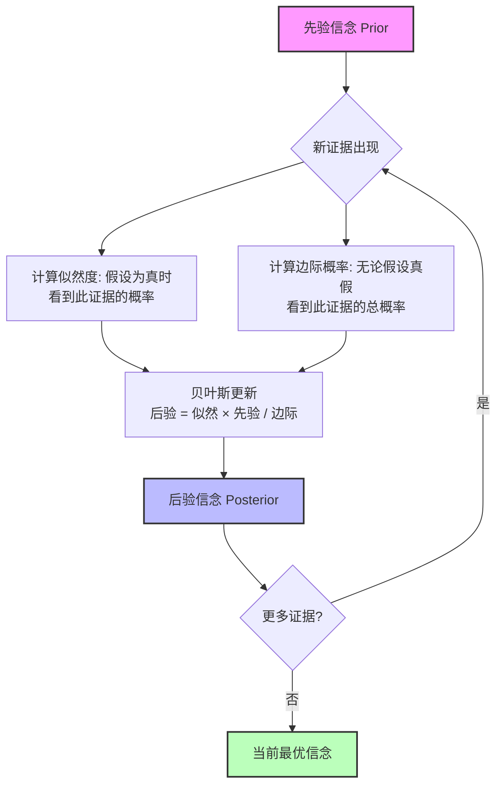
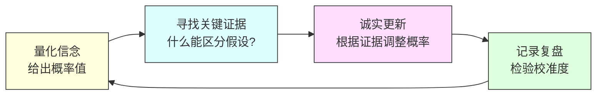
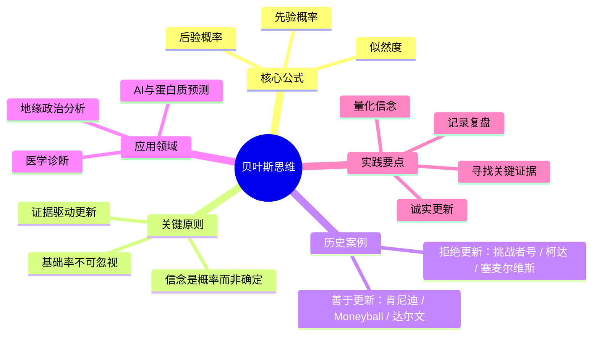

# 贝叶斯：世界的底层更新机制

> 导语：世界不是确定的，认知是需要不断校准的，而每一条新信息都是校准的机会。贝叶斯定理就是这个校准过程的数学表达。

## 核心概念

1763 年，英国长老会牧师托马斯·贝叶斯去世了。他生前写了一篇关于概率的论文，由朋友理查德·普莱斯整理后发表。这篇论文在当时几乎无人问津，但两百多年后，它成了人工智能、医学诊断、金融风控、军事情报、甚至哲学认识论的核心工具。

贝叶斯定理的核心思想极其简单：**你对世界的认识不是非黑即白的，而是一个概率值，这个概率值应该随着新证据的出现而不断更新。**

大多数人的认知模式是"下结论—捍卫结论"：一旦形成观点，后续所有信息都被用来证明自己是对的。相反的证据？忽略。模糊的信号？往有利于自己的方向解读。这种模式叫确认偏误（Confirmation Bias），它是人类最顽固的认知缺陷。

贝叶斯思维要求你反过来——**把每一个判断都当作临时假设，随时准备被新证据修正。**

这里面有三个关键概念：

- **先验概率（Prior）**：在看到新证据之前，你对某个假设的初始信念。来自经验、直觉或历史数据。
- **似然度（Likelihood）**：如果假设为真，你观察到当前证据的概率有多大？
- **后验概率（Posterior）**：综合了先验和新证据之后，你应该持有的新信念。

贝叶斯公式用数学语言表达：

$$P(H|E) = \frac{P(E|H) \times P(H)}{P(E)}$$

但真正重要的不是公式本身，而是它背后的思维方式——**根据新证据，更新你对事情的相信程度。** 下面我们用一系列著名案例来说明，"会不会更新认知"这件事，如何决定了成败甚至生死。

---

## 真实故事：AlphaFold——贝叶斯思维最壮观的技术胜利

2018 年，DeepMind 创始人德米斯·哈萨比斯（Demis Hassabis）做了一个疯狂的决定：用 AI 解决生物学界五十年来最棘手的难题——蛋白质折叠预测。

蛋白质是生命的基本分子机器，它的三维结构决定了它的功能，但从氨基酸序列推断三维结构极其困难，传统方法需要数年实验才能解出一个蛋白质的结构。

哈萨比斯团队开发的 AlphaFold 系统，其核心思路正是贝叶斯式的：系统首先基于已知蛋白质结构数据库建立"先验分布"——对氨基酸之间距离和角度关系的初始概率估计。然后通过多轮迭代不断用新的计算证据来更新这些概率，每一轮都让预测的置信度变得更精确。

2020 年 11 月，在第 14 届蛋白质结构预测关键评估（CASP14）大赛上，AlphaFold2 以碾压性优势夺冠，预测精度达到了实验测量级别。2022 年，DeepMind 公开发布了超过两亿个蛋白质的结构预测，几乎涵盖了所有已知生命体的蛋白质组。2024 年，诺贝尔化学奖授予哈萨比斯和他的同事约翰·江珀（John Jumper）。

这是贝叶斯思维在真实世界中的巅峰时刻——**不是靠一次天才的灵感，而是靠不断用证据更新信念的系统化过程，解开了生命科学的密码。**

---

## 原理解析：一个颠覆直觉的医学案例

让我用一个经典例子来说明贝叶斯更新是如何运作的。

假设你是一位医生，有一种疾病在人群中的发病率是 1%（先验概率）。现在有一种检测方法：如果病人真的得了病，检测呈阳性的概率是 95%（真阳性率）；如果病人没得病，检测也呈阳性的概率是 5%（假阳性率）。一个病人检测呈阳性了，他真的得病的概率是多少？

大多数人的直觉是 95%。但贝叶斯告诉我们，答案大约只有 **16%**。

为什么？在 1000 个人中，真正得病的只有 10 人，其中约 9.5 人检测阳性；而没得病的 990 人中，也有约 49.5 人检测阳性。所以阳性结果中，真正得病的比例是 9.5 / (9.5 + 49.5) ≈ 16%。

这揭示了一个深刻的道理：**先验概率至关重要。** 如果你忽略了基础率（base rate），仅凭单一证据就下结论，你几乎一定会犯错。这就是"基础率忽视"，人类最常犯的思维错误之一。

贝叶斯更新是一个永不停止的循环——每一轮新证据都会让你的信念变得更准确，**前提是你愿意真诚地面对证据，而不是选择性地忽略那些与你的预期不符的信息。**

---

## 现实案例

### 拒绝更新的代价

**挑战者号：被忽略的工程师警告**

1986 年 1 月 28 日，"挑战者号"航天飞机升空 73 秒后爆炸，7 名宇航员全部遇难。

Morton Thiokol 公司的工程师 Roger Boisjoly 在发射前一晚就发出了明确警告：O 型密封圈在低温下会失去弹性，导致燃气泄漏。当天佛罗里达气温只有零下 2°C，远低于此前任何一次发射温度。

但 NASA 管理层拒绝更新判断。他们的先验信念是"航天飞机系统是安全的"，加上巨大的发射进度压力，面对工程师提供的新数据，他们没有上调风险估计，反而要求工程师"拿出密封圈一定会失效的证据"——把举证责任倒置了。

用贝叶斯的语言说：他们给自己的先验赋予了无限大的权重，以至于任何新证据都无法撼动它。**当新信息与既有判断冲突时，他们选择攻击信息，而不是修正判断。**

**柯达：亲手发明了杀死自己的技术**

1975 年，柯达工程师 Steve Sasson 发明了世界上第一台数码相机。管理层的回应是："这很可爱，但不要告诉任何人。"

柯达当时占据全球胶卷市场 90% 的份额。管理层的先验信念很简单：人们会永远需要胶卷。从 1975 年到 2000 年的 25 年间，数码技术每年都在进步，价格每年都在下降，市场信号越来越明确。但柯达高管始终没有真正更新判断。2012 年，柯达申请破产保护。

**新信息每年都在敲门，但没有人开门。**

**塞麦尔维斯：被真相毁掉的医生**

1847 年，匈牙利产科医生塞麦尔维斯（Ignaz Semmelweis）发现：医生接生的产妇死亡率高达 10%，助产士接生的只有 4%。原因是医生直接从解剖室走到产房，手上带着"尸体微粒"。他要求医生用漂白粉洗手，死亡率立刻降到 1% 以下。

这本应是医学突破。但当时的权威医生们认为"绅士的手不可能是肮脏的"，拒绝接受证据。塞麦尔维斯被解雇、被排斥，最终精神崩溃，1865 年死在精神病院——讽刺的是，死因是感染。

直到 20 年后巴斯德和科赫的细菌理论被接受，他才被追认为"感染控制之父"。那 20 年间，有多少产妇因为医生不肯洗手而死去？**当整个群体拒绝校准认知时，付出代价的不仅是拒绝者，还有无数无辜的人。**

### 善于更新的力量

**古巴导弹危机：肯尼迪的 13 天**

1962 年 10 月，侦察机发现苏联在古巴部署了核导弹。军事顾问们几乎一致建议立即空袭。他们的先验假设是：赫鲁晓夫在故意挑衅，只有强硬回击才能阻止他。

肯尼迪没有锁定在这个判断上。他持续收集新信息：赫鲁晓夫的私人信件语气、苏联外交官在联合国的表现、导弹的作战状态。随着信息涌入，他逐步更新判断：赫鲁晓夫可能在冒险试探，但并不真的想打核战。如果给他台阶，危机可以和平解决。

最终选择海上封锁而非空袭，通过秘密外交做了交易。事后解密文件显示，如果当时空袭，古巴苏军已获授权使用战术核武器反击。**肯尼迪不断校准判断，可能避免了一场核战争。**

**Moneyball：用数据推翻百年直觉**

2002 年，奥克兰运动家队总经理比利·比恩（Billy Beane）预算只有洋基队的三分之一。棒球界有一整套延续了一个世纪的球探直觉：好球员该跑得快、长得壮、挥棒漂亮。

比恩和分析师保罗·德波斯塔用数据检验这些直觉，发现传统球探最看重的指标和赢球的相关性，远不如一个被忽视的指标——上垒率（OBP）。他们签下一批被传统球探"看不上"的球员，整个棒球界都在嘲笑。

结果：运动家队拿下美联最长的 20 连胜，以联盟最低薪资之一杀入季后赛。**先验假设遇到了强有力的新数据，比恩选择更新假设而非捍卫传统。** 这场数据革命改变了整个职业体育。

**达尔文：用 20 年推翻自己的世界观**

达尔文登上贝格尔号时，是一个虔诚的基督徒，相信物种由上帝分别创造。在 5 年环球航行中，他不断遇到无法解释的现象：加拉帕戈斯群岛上每个岛的雀鸟喙型不同；南美洲化石显示灭绝物种与现存物种有连续的形态过渡；地理隔离的区域有截然不同但功能相似的物种。

每一个新观察都是一次校准机会。达尔文没有忽略这些异常，也没有强行塞进旧框架。他让证据慢慢改变信念——从最初的动摇，到形成自然选择假说，再到花 20 年收集更多证据来检验和完善。

1859 年《物种起源》发表时，他的认知已从出发时移动了 180 度。**他没有一瞬间的顿悟，而是经历了无数次微小的贝叶斯更新，每一次都离真相更近一步。**

---

## 思维工具实践

如何在日常生活中应用贝叶斯思维？四步法：

**第一步：量化你的信念**

不要说"我认为 A 会发生"，说"我认为 A 发生的概率是 70%"。好处有二：它提醒你这是不确定的判断；当新信息出现时，你可以明确调整数字（"现在 85%"或"降到 40%"），而不是陷入"我到底对不对"的二元纠结。

菲利普·泰特洛克（Philip Tetlock）研究中的超级预测者——预测准确率远超专家和情报机构的普通人——最核心的共同特征就是：**频繁地、小幅度地更新概率估计。**

**第二步：寻找关键证据**

什么样的证据最能区分你的假设和替代假设？主动去找那种证据。查理·芒格把这叫"反转思维"（Inversion）：不要只想如何成功，先想如何确保失败，然后避开那些路径。

每当你有了明确判断，花 5 分钟认真想：**如果我错了，最可能是因为什么？**

**第三步：诚实地更新**

看到证据后，问自己——如果假设为真，看到这个证据的概率多大？如果替代假设为真呢？据此调整。大多数人会低估那些与现有信念矛盾的证据的分量，这需要刻意练习来克服。

**第四步：记录和复盘**

写下判断和理由，标上日期。三个月后回头看。你会发现：你没有自己以为的那么准；你最大的失误几乎都来自于拒绝更新已有判断。

---

## 深度思考

### 为什么我们天然不擅长校准

大脑有几个出厂设置在作梗：

**确认偏误**——主动寻找支持自己观点的信息，忽略反面信息。这是大脑的节能策略：处理相符信息的认知成本远低于处理矛盾信息。

**沉没成本效应**——在一个判断上投入越多，就越难承认它是错的。柯达高管整个职业生涯建立在胶卷业务上，承认数码是未来，等于否定自己的人生。

**身份绑定**——当观点变成身份的一部分（"我是一个相信 X 的人"），修改观点就等于修改自我。政治观点、宗教信仰和饮食哲学特别难更新，因为它们和"我是谁"纠缠在一起了。

**社会成本**——改变观点常被视为"不坚定""善变""打脸"。但贝索斯说过："如果一个人几乎不改变观点，那说明他很少思考。"

### 先验可以强，但不能无限强

2022 年俄乌冲突爆发前，美国情报部门之所以准确预判，正是采用了贝叶斯式分析框架——不断收集卫星图像、通信情报、外交信号，持续更新"俄罗斯是否会动手"的概率。

而很多欧洲领导人误判，恰恰因为先验太强——"在 21 世纪的欧洲，大规模入侵不可能发生"——以至于大量反面证据都无法撼动信念。

教训是：**任何信念都应该有一个"可证伪"的阈值。超过这个阈值就必须更新。** 没有什么先验应该强到对所有证据免疫。

### 贝叶斯与科学革命

从科学方法论的角度看，贝叶斯思维为"科学革命"提供了一个优雅的解释：范式转换不是一夜之间发生的，而是科学家群体在大量异常证据的累积下，逐渐将后验概率从旧范式转移到新范式的过程。库恩描述的突变式革命，其实是贝叶斯更新达到临界点后的"相变"。

有趣的是，量子力学似乎也站在贝叶斯一边。量子贝叶斯主义（QBism）直接宣称：量子态就是观测者的信念状态，而非物理实在。如果这种解释成立，贝叶斯定理就不仅仅是认知工具，而是描述物理世界的基本语言。

---

## 本章小结

挑战者号的管理层收到了工程师的数据，但拒绝更新；柯达拿到了数码相机的原型，但拒绝更新；维也纳的医生们看到了洗手后死亡率骤降的数据，但拒绝更新。

与此同时，肯尼迪根据不断涌入的情报调整策略，避免了核战争；比恩根据统计数据推翻百年直觉，用三分之一预算打进季后赛；达尔文用 20 年持续观察，一点一点修正了整个世界观；AlphaFold 通过系统化的证据更新，解开了生命科学的密码。

区别只有一个：**面对新信息时，你是选择更新，还是选择防御？**

贝叶斯定理的核心教导是：不要追求确定性，而要追求更好的概率估计。真正的理性不是"我是对的"，而是"根据当前证据，这个假设的概率是多少，我应该如何行动"。

校准永远不会结束。这恰恰是好消息——它意味着无论你现在的认知多么偏颇，**下一条新信息就是你的修正机会。**

