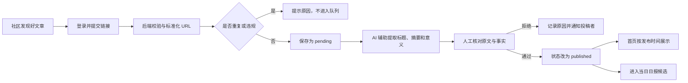
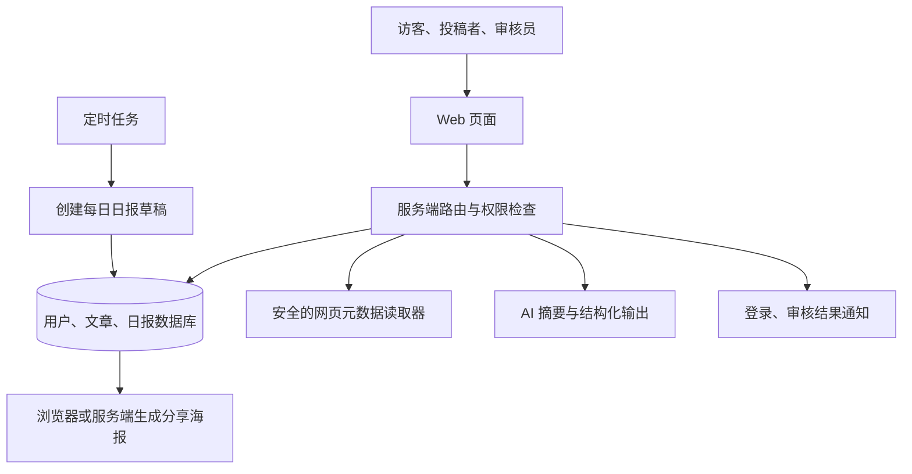

# AI Building Everything：案例驱动的 AI 开发实战课

> 一门面向零基础和初级开发者的实践优先课程。先看一个真实产品，马上让 AI 帮你动手；遇到具体问题时再学习必要知识，最后把九个项目中的经验收束成一套系统的 AI Building Everything 能力。

---

## 一、课程定位

### 这门课解决什么问题

很多人已经能让 AI 生成一个页面，却仍然做不出真正可用的产品。常见卡点不是“不会写某一行代码”，而是：

- 不知道如何把模糊想法变成明确需求。
- UI 做出来了，但没有统一的设计规则，越改越乱。
- 不理解前端、后端、数据库、HTTP 和 API 如何协作。
- 一次让 AI 改太多，出错后不知道从哪里排查。
- 只验证了正常情况，没有测试权限、支付、失败和边界情况。
- Web 能运行，却不知道如何迁移到小程序和 App。
- 把“代码生成完成”误认为“产品开发完成”。

这门课通过九个逐级进阶的项目，让学员反复练习同一套开发流程，并逐步加入数据库、浏览器扩展、第三方 API、用户系统、支付、AI 驱动 UI 设计、多端适配、Android 自动化和产品发布。

课程不会先用数小时完整讲完编程语言、框架、数据库和网络原理，再让学员开始第一个项目。每个知识点都必须由案例中的真实任务触发：要保存文章时再理解数据库，要读取 YouTube 页面时再理解 DOM 和插件权限，要接语音服务时再理解 HTTP 和 API，要处理支付结果时再理解 Webhook 和幂等。

### 核心判断

> 学员先在 AI 的帮助下做出可运行结果，再从遇到的问题中学习知识，最后通过复盘把局部经验连接成完整系统。

实践先于理论，不等于不要理论。先动手让每个概念拥有具体上下文，随后再解释原理、边界和迁移方法，学员才知道知识为什么有用、什么时候使用，以及离开当前案例后如何复用。课程不要求学员先成为传统程序员，也不鼓励“只说一句话就让 AI 做完整个项目”。

### 目标学员

- 想独立开发 Web、浏览器插件、小程序、App 或 AI 自动化工具的产品经理、设计师、运营和创业者。
- 会使用电脑，但没有系统编程经验的零基础学员。
- 能做简单页面，想补齐后端、API、支付和上线能力的初级开发者。
- 已经在使用 Cursor、Claude Code、Codex 等工具，但开发过程不稳定的人。

### 前置要求

- 能安装和使用桌面软件。
- 能按引导注册开发平台账号。
- 愿意阅读 AI 的解释，并对最终结果进行人工验收。
- 不要求提前掌握编程语言、数据库或命令行。

### 课程完成后的能力

学员完成课程后，应该能够：

1. 使用“需求对齐—方案收敛—原型验证—设计系统—小步开发—人工验收—AI 修正—部署迭代”的基本流程，把一个想法推进为可用软件。
2. 让 AI 生成 UI 原型、设计系统和可执行的开发计划。
3. 看懂前端、后端、数据库、HTTP、API、Web、浏览器插件、小程序和 App 的基本关系。
4. 用 TypeScript 为主的技术栈完成一个带数据库的 Web 产品。
5. 开发一个遵守最小权限原则、可以本地安装的 Chrome 插件。
6. 安全接入语音、LLM、登录、支付等第三方能力。
7. 将同一业务迁移到小程序和 React Native App。
8. 用 AI 完成信息架构、设计系统、组件和状态设计，并开发一款专注学习与工作的 App。
9. 为自有 Android 模拟器或测试设备构建有边界、可审计的 AI 自动化。
10. 让 AI 编写并运行测试、检查改动、管理版本和辅助排错。
11. 完成部署、监控、发布和第一次真实用户验证。

这些能力最终组成 AI Building Everything 的完整闭环：

> 发现问题 → 与 AI 对齐需求 → 确认功能、UI、交互和技术方案 → 完成最小原型与设计系统 → 开发最小功能闭环 → 人工验收 → AI 修正与回归验证 → 部署发布 → 获取反馈 → 进入下一版本

### 课程边界

这不是一门算法、计算机科学或某种语言的系统课。课程会解释完成独立产品所需的最小技术概念，但不会深入编译器、操作系统、复杂分布式架构或底层性能优化。

支付资格、浏览器扩展商店和应用商店审核、隐私合规及平台规则会随地区、主体类型和时间变化。课程讲清工作原理、接入流程和风险检查，但不承诺每位学员都能以个人身份开通所有能力，也不保证提交后一定通过平台审核。

Android 自动化主线只面向自有模拟器、测试设备和白名单测试应用。课程不教授绕过设备安全、操作他人账号、批量制造平台行为或无人监督的敏感操作，也不把开发测试工具描述成可直接上架的通用手机控制应用。

---

## 二、课程结构

课程采用“八个跟做项目 + 一个独立结课项目”的结构。前八节由老师提供默认需求和验收标准，第九节由学员选择自己的问题独立完成。

| 实战课 | 项目 | 新增难度 | 核心产出 |
| --- | --- | --- | --- |
| 第一节 | [AI 软件开发关键流程：今日三件事](<AI 开发案例驱动课-第一节-AI 软件开发关键流程.md>) | 需求、原型、设计系统、最小闭环、验收与版本 | 可部署的任务小应用 + 完整产出物链 |
| 第二节 | 个人博客系统 | 数据库、内容管理、审核、SEO | 可发布的博客 + 可复刻的内容社区方案 |
| 第三节 | YouTube 字幕提取 Chrome 插件 | Manifest V3、页面脚本、权限、商店发布 | 可本地安装的字幕提取插件 |
| 第四节 | 语音转文字 Web 应用 | 外部 API、登录、支付 | 可收费的语音工具 |
| 第五节 | AI 口语练习小程序 | 小程序运行环境、LLM、微信能力 | 可完成口语练习的小程序 |
| 第六节 | AI 口语练习 App | React Native、原生设备能力、上架 | iOS/Android 测试版本 |
| 第七节 | FocusFlow 专注学习与工作 App | AI 驱动 UI、设计系统、计时、通知、本地数据 | 可安装的专注效率 App |
| 第八节 | AI 控制 Android 手机完成自动化 | Appium、UiAutomator2、Agent 循环与安全策略 | 可审计的 Android 自动化 Agent |
|        |                                                              |                                            |                                     |

这九个项目不是九套互不相关的知识。它们共同练习同一条实践优先主线：

> 先看案例 → 马上做出第一个结果 → 遇到真实问题 → 学习必要知识 → 继续完成产品 → 测试与发布 → 复盘并连接知识

测试不只出现在开发结束后。每完成一个可观察的小功能，就要让 AI 运行相应检查，并由学员亲自体验关键路径。

### 每节课如何做到“先实践，后理论”

每节实战课按同一个节奏展开：

| 阶段 | 学员在做什么 | 教师讲什么 |
| --- | --- | --- |
| 1. 先看成品 | 亲自操作最终案例，明确要做出的结果 | 用户问题、核心流程和第一版边界 |
| 2. 马上动手 | 在前 15 分钟内运行项目或完成第一次可见修改 | 只讲完成当前动作所需的信息 |
| 3. AI 带着做 | 把任务拆小，让 AI 修改、检查并解释 | 示范如何给上下文、确认计划和验收结果 |
| 4. 问题触发知识 | 遇到数据、权限、网络、状态或平台问题 | 补充与问题直接相关的最小知识点 |
| 5. 继续完成产品 | 使用刚学的知识解决问题并完成里程碑 | 正常、失败和边界情况下如何判断成功 |
| 6. 项目复盘 | 解释本节做了什么、为什么这样做 | 把零散知识连接到统一系统地图 |
| 7. 迁移挑战 | 把能力改造成另一个小功能或产品 | 说明哪些可以复用，哪些必须重新设计 |

每节课的前 15 分钟必须出现可观察结果。第一节让“今日三件事”起始应用运行，并完成第一次任务修改；后续可以是博客首页成功运行、插件弹窗第一次打开、语音 API 返回第一段文字或 Android 自动化完成第一次受控点击，不能只完成账号注册、环境介绍或概念讲解。

知识讲解采用三层递进：

1. **当下够用**：先讲完成眼前任务必须知道的 20%。
2. **问题出现后补深**：在错误、边界和真实业务中解释原因。
3. **案例结束后系统化**：把本节知识放回完整架构，形成可迁移的理解。

这样做不是降低知识要求，而是改变知识出现的顺序。结课时仍然要求学员系统掌握产品、AI 驱动 UI、设计系统、前端、后端、数据库、API、AI、Agent、自动化、测试、安全、部署、增长和多端开发之间的关系。

---

## 第一节实战课：AI 软件开发关键流程——完成第一个 Build–Verify Loop

### 1.1 本节目标

用一个足够小、但可以真实运行和部署的“今日三件事”应用，完整走过一次 AI 软件开发流程。学员先做出可见结果，再理解需求、原型、设计系统、最小功能闭环、验收、回归和版本迭代各自解决什么问题。

这一节不追求复杂技术。重点是建立今后每个项目都会重复的工作节奏：

> 先定义本轮目标 → 让 AI 完成一个小闭环 → 人工验收 → 用证据反馈 → AI 修正并回归 → 保存稳定版本

### 1.2 最终成品

“今日三件事”第一版包含：

- 添加一至三件今天要完成的事。
- 将任务标记为完成或恢复为未完成。
- 删除不再需要的任务。
- 刷新页面后仍保留任务和完成状态。
- 空内容不能提交，并显示清楚的错误提示。
- 在手机和电脑浏览器中都可以正常使用。
- 通过公开网址访问。

同时保存一条完整产出物链：

```text
Product Brief
  → MVP 范围与验收标准
  → 用户流程与页面草图
  → 设计规则
  → 开发计划
  → 可运行代码
  → 测试与验收证据
  → 版本说明与线上地址
```

### 开场 15 分钟：先得到第一个可见结果

学员打开老师提供的起始项目，让 AI 阅读项目说明并运行预览，然后完成三个动作：

1. 把页面标题改成“我的今日三件事”。
2. 新增一条示例任务，并在页面上显示出来。
3. 让 AI 检查改动，自己刷新页面并确认应用仍能打开。

这时不先讲框架、组件或状态管理。学员已经获得“我提出一个明确改动，AI 实现，我来验收”的第一次短循环，再从实际问题进入方法学习。

### 1.3 MVP 边界

第一版必做：

- 单页面、单用户、本地使用。
- 任务的新增、完成、删除和本地持久化。
- 空状态、输入错误和基础移动端适配。
- 静态部署。

第一版不做：

- 登录、多人协作和云端数据库。
- AI 自动拆解任务、日历同步和提醒通知。
- 标签、统计、积分和复杂动画。
- 同时开发 Web、小程序和 App。

边界的目的不是降低质量，而是让第一轮在一节课内形成可以运行、可以测试、可以发布的闭环。

### 1.4 第一次完整走过八个阶段

| 阶段 | 本节要做的事 | 必须留下的产出物 |
| --- | --- | --- |
| 1. 需求对齐 | 明确用户、使用场景、核心任务和不做什么 | 一页 Product Brief、MVP 清单、验收标准 |
| 2. 方案收敛 | 确认页面、交互、数据和默认技术方案 | 用户流程、数据字段、技术决策记录 |
| 3. 最小原型 | 用假数据画出输入、任务列表和完成状态 | 页面草图、原型图片或原型代码 |
| 4. 设计系统 | 确认字体、颜色、间距、圆角和组件状态 | 一页设计规范、组件与状态清单 |
| 5. 小步开发 | 每次只完成一个可观察能力 | 可运行代码、AI 自检结果 |
| 6. 人工验收 | 在浏览器中操作正常、失败和边界路径 | 验收清单、截图或录屏、问题单 |
| 7. 修正与回归 | 用复现步骤让 AI 定位并最小修复 | 代码 diff、修复说明、回归结果 |
| 8. 部署迭代 | 发布公开版本并决定下一轮目标 | 线上地址、版本说明、反馈清单 |

每个阶段结束时，让 AI 把结论写入文件。下一阶段引用已经确认的产出物，不依赖聊天记录重新猜测需求。

### 1.5 第一个最小功能闭环

本节的第一个闭环只有一件事：“输入一条任务并在刷新页面后仍然看到它”。

```text
用户输入任务
  → 点击添加
  → 应用校验内容
  → 保存到浏览器本地存储
  → 页面显示任务
  → 刷新页面
  → 应用读取数据并恢复任务
```

这个闭环同时经过输入、业务规则、状态、数据保存和可见结果，比“先把所有 UI 做完”或“先建完整数据库”更容易验收和排错。

### 1.6 三轮螺旋开发

#### 第一轮：跑通主路径

- 添加一条任务。
- 保存到本地存储。
- 刷新后恢复任务。
- 让 AI 运行基础检查，学员亲自复验。

#### 第二轮：补齐状态和失败路径

- 完成、恢复和删除任务。
- 增加空输入校验、空列表提示和三条任务上限。
- 用验收证据反馈问题，让 AI 做最小修复并回归。

#### 第三轮：统一体验并发布

- 应用设计 Tokens 和组件状态。
- 检查键盘操作、手机宽度和刷新恢复。
- 部署静态站点，保存线上地址和版本说明。
- 只从真实体验中选择一个下一版本目标。

每轮都交付一个稳定版本。不要在上一轮还不能可靠运行时，同时增加登录、数据库和 AI 功能。

### 1.7 验收标准

- [ ] 可以添加合法任务，空内容和超过上限时有明确反馈。
- [ ] 可以完成、恢复和删除任务。
- [ ] 刷新或重新打开页面后，数据和状态保持一致。
- [ ] 无任务时有空状态，按钮的正常、悬停、聚焦和禁用状态清楚。
- [ ] 核心流程可以只用键盘完成。
- [ ] 在常见手机宽度下没有横向滚动和按钮遮挡。
- [ ] AI 已运行项目现有检查，学员已亲自完成正常、失败和边界路径。
- [ ] 线上版本可访问，版本说明记录了本轮功能、已知问题和下一步。

### 1.8 本节基础概念

- **需求不是一句想法**：需求要说明谁在什么场景完成什么任务，以及怎样算成功。
- **MVP 是最小可验证产品**：保留验证核心价值所需的最少能力，而不是做一个低质量半成品。
- **垂直切片**：一个小功能从界面贯穿规则、数据和结果，而不是按技术层横向堆积。
- **状态与持久化**：页面当前显示的数据是状态；关闭或刷新后还能恢复，需要持久化。
- **验收与测试不同**：自动测试负责稳定检查规则，人负责判断产品是否真的好用、是否符合意图。
- **回归验证**：修复新问题后重新检查相关旧功能，避免修好一处、破坏另一处。
- **版本**：每轮结束保存一个可识别、可回退的稳定状态。

### 1.9 常见误区

- 需求还没对齐，就让 AI 一次生成整个产品。
- 把原型当最终设计，或在最小闭环完成前反复美化页面。
- 同时修改很多功能，失败后无法定位是哪次改动造成的。
- 只告诉 AI“有问题”，不给操作步骤、预期、实际结果和证据。
- AI 说“测试通过”就直接接受，自己没有操作关键路径。
- 第一版加入登录、云数据库、AI 助手和多端同步，迟迟得不到可发布结果。

### 1.10 课后作业

选择一个小改动，例如“编辑任务”“一键清空已完成任务”或“显示今日完成数量”，独立完成一轮 Build–Verify Loop：

1. 写清本轮目标、不做内容和验收标准。
2. 让 AI 给出最小实现计划并确认影响范围。
3. 让 AI 开发、运行检查并说明改动。
4. 自己验收正常、失败和边界路径。
5. 用证据反馈问题，完成修正和回归。
6. 保存版本说明，并解释下一轮为什么只选择一个目标。

---

## 第二节实战课：给自己开发一个博客系统

### 2.1 本节目标

完成一个真正可以日常使用的个人博客。它不是静态页面截图，而是一个有数据库、有内容状态、有管理入口、能被搜索和社交平台正确识别的内容系统。

本节在第一节方法课的基础上，第一次把完整流程用于带数据库的 Web 产品。重点是把本地任务应用中学到的最小闭环，迁移到内容创建、保存、发布和公开访问。

### 2.2 最终成品

- 公开首页：展示已发布文章。
- 文章详情页：使用稳定链接访问单篇文章。
- 管理入口：创建、编辑、预览、发布、撤回和删除文章。
- 数据库：保存标题、摘要、正文、封面、状态、链接别名和时间。
- 分享能力：每篇文章拥有正确标题、摘要和 OG 图。
- 基础 SEO：页面元数据、站点地图、robots 和语义化结构。
- 线上地址：通过公开网址访问。

### 开场 15 分钟：先让博客跑起来

学员打开老师提供的起始项目，先让 AI 阅读项目说明并启动预览。看到博客首页后，马上完成三个动作：

1. 把站点名称改成自己的名字。
2. 修改首页一句介绍并替换一张图片。
3. 让 AI 检查改动，确认页面仍能正常打开。

这时不讲 Next.js 路由、组件原理和数据库。学员先获得“我已经改变了一个真实产品”的结果，再从“这段文字在哪个文件里”“为什么修改后页面自动更新”两个具体问题进入页面、组件和开发环境知识。

### 2.3 MVP 边界

第一版必做：

- 单管理员使用。
- 文章草稿和已发布两种状态。
- Markdown 或富文本二选一，不同时做两个编辑器。
- 文章列表、详情和基本管理功能。
- 默认 OG 图，进阶再做动态 OG 图。

第一版不做：

- 多作者协作和复杂角色权限。
- 评论系统、推荐算法和站内消息。
- 自研富文本编辑器。
- 复杂 CMS 插件系统。

### 2.4 核心数据表

`posts` 表建议包含：

- `id`：文章唯一标识。
- `title`：标题。
- `slug`：用于文章网址的稳定标识。
- `summary`：列表和分享摘要。
- `content`：正文。
- `cover_url`：封面地址。
- `status`：`draft` 或 `published`。
- `published_at`：发布时间。
- `created_at`、`updated_at`：创建和更新时间。

如果使用登录系统，再增加 `author_id` 并设置权限。数据库的公开读取权限只允许访问已发布文章；创建、修改和删除只能由管理员完成。

### 2.5 跟做流程

#### 步骤一：把需求写清楚

让 AI 把“我想做一个博客”整理成用户故事、页面清单、数据字段、MVP 边界和验收标准。学员确认文章发布流程，再开始设计。

#### 步骤二：设计页面与设计系统

先做首页、文章详情、编辑页三个核心页面。确定内容宽度、字号层级、代码块、引用、图片和移动端阅读体验。

#### 步骤三：让 AI 制定技术计划

计划至少拆成：项目外壳、数据库、公开读取、管理权限、文章 CRUD、元数据与 OG 图、测试、部署。

#### 步骤四：连接数据库

由 AI 生成数据表方案和迁移，学员确认不会覆盖已有数据后再执行。先插入一篇示例文章，验证公开页面能正确读取。

#### 步骤五：完成文章 CRUD

CRUD 分别表示创建、读取、更新和删除。按“列表 → 新建 → 编辑 → 发布 → 删除”逐步完成，每一步都检查成功和失败状态。

#### 步骤六：完成分享和 SEO

为每篇文章生成标题、摘要、规范链接和 OG 图。用社交平台调试工具或页面元数据检查工具确认分享预览，而不是只看浏览器页面。

#### 步骤七：测试与部署

让 AI 至少验证：

- 草稿不会出现在公开列表。
- 发布后可通过稳定链接访问。
- 重复 `slug` 会得到清楚提示或自动处理。
- 未授权用户不能进入写作接口。
- 删除前有确认，删除后链接返回合理状态。
- 首页和文章页在手机尺寸下可阅读。

### 2.6 验收标准

- 学员可以创建一篇草稿并预览。
- 发布后，文章出现在公开首页。
- 修改文章后，公开页面显示新内容。
- 未登录或非管理员不能修改文章。
- 分享链接能显示正确标题、摘要和图片。
- 线上地址在桌面和手机上都能打开。

### 2.7 本节基础概念

- 页面、组件和路由。
- 前端与后端的边界。
- 数据库表、字段和记录。
- CRUD。
- 身份认证与权限。
- SEO、元数据、OG 图和社交分享。
- 部署、域名和环境变量。

### 2.8 常见误区

- 把管理入口藏起来就当作权限控制。
- 在前端代码里放数据库高权限密钥。
- 用标题直接当网址，修改标题后导致旧链接失效。
- 只做编辑成功，不处理保存失败和重复提交。
- 误以为有一张封面图就自动拥有正确的社交分享预览。
- 博客第一版就加入评论、推荐、订阅和多作者，导致主流程无法完成。

### 2.9 课后作业

发布三篇真实文章；邀请一位同学分别从手机和电脑打开；记录一个阅读体验问题并完成一次小迭代。

### 2.10 进阶案例：中文 Hacker News（ZHN）是如何搭建的

个人博客解决的是“作者如何发布自己的文章”，中文 Hacker News 解决的是另一个更复杂的问题：如何让社区共同发现好文章，同时通过编辑审核控制信息质量。

ZHN 的价值不在于复制 Hacker News 的界面，也不在于把英文标题自动翻译成中文。它把一篇外部文章整理成四层信息：原文链接、中文标题、事实摘要和“为什么值得关注”。这使读者不打开每一个链接，也能快速判断是否值得继续阅读。

#### 从公开页面可以确认什么

截至 2026 年 7 月，ZHN 公开页面可以确认以下产品能力：

- 首页展示人工智能、编程、创业与科技文章，包含中文标题、来源域名、摘要、“意义”和投稿者。
- 注册用户可以提交文章链接、标题和简短介绍。
- 投稿不会直接公开，而是先进入人工审核，通过后按发布时间出现在首页。
- 支持邮箱密码注册登录，也提供“使用 ChatGPT 登录”的入口。
- 首页支持分页，另有关于页、投稿页和每日日报。
- 每日日报从当日内容中选择若干条目，生成适合分享和保存为 PNG 的海报。
- 公开 HTML 包含标题、描述、Canonical、Open Graph、Twitter Card、结构化数据、`robots.txt` 和站点地图。

从站点响应头和公开 HTML 还能观察到：当前前端使用 Vinext/Vite 的 React Server Components 构建产物，并通过 Cloudflare 提供服务。但数据库、密码散列、会话存储、AI 模型和内部审核工具没有公开，不能只凭浏览器页面猜测。

下面讲的是一套可以复刻 ZHN 核心体验的课程实现，不声称还原其未公开的私有代码和基础设施。

#### 一句话产品定位

> 帮助中文技术读者从大量信息中快速发现经过人工筛选、事实表述清楚、值得深入阅读的 AI、编程、创业与科技文章。

它的核心指标不是“每天抓取多少篇”，而是：读者能否更快找到值得阅读的内容，投稿者能否顺利推荐文章，审核者能否用可控成本维持质量。

#### 三类用户与权限

| 角色 | 可以做什么 | 不可以做什么 |
| --- | --- | --- |
| 访客 | 浏览首页、翻页、打开原文、查看日报 | 提交文章、进入审核后台 |
| 注册用户 | 提交链接、查看自己的投稿状态 | 直接发布、修改他人投稿、审核内容 |
| 审核员/管理员 | 补充摘要、审核、拒绝、发布、生成日报 | 绕过操作记录、把密钥暴露给前端 |

不要通过“隐藏后台链接”实现管理员权限。每一次读取待审核内容、修改状态和发布文章，都要在后端验证当前用户角色。

#### 核心业务流程



这里最重要的设计是“AI 辅助，人工发布”。AI 可以压缩原文、规范标题和指出文章意义，但不能代替审核者确认来源是否可信、摘要是否遗漏限定条件、厂商声明是否被写成客观事实。

#### 页面与信息架构

第一版只需要七类页面：

| 页面 | 主要任务 |
| --- | --- |
| 首页 `/` | 展示已发布文章和分页入口 |
| 日报 `/daily` | 按日期查看精选条目和分享海报 |
| 投稿 `/submit` | 提交链接及可选说明 |
| 登录 `/login` | 恢复用户身份，并返回原来页面 |
| 注册 `/register` | 创建投稿账户 |
| 关于 `/about` | 解释内容范围和审核机制 |
| 审核后台 `/admin/submissions` | 查看队列、编辑摘要、批准或拒绝 |

其中审核后台是课程实现建议，具体内部路径不是公开事实。第一版不必复制 Hacker News 的评论、投票、Karma、用户主页和复杂排序算法。

#### 最小数据模型

`users`：

- `id`：用户唯一标识。
- `email`、`password_hash`：邮箱登录所需信息；数据库不保存明文密码。
- `display_name`：首页显示的投稿者名称。
- `role`：`member`、`reviewer` 或 `admin`。
- `created_at`：注册时间。

`stories`：

- `id`：内容唯一标识。
- `submitter_id`：投稿用户。
- `url`：用户提交的原始链接。
- `canonical_url`：清理跟踪参数、重定向后用于去重的链接。
- `domain`：首页显示的来源域名。
- `source_title`：原文标题。
- `title_zh`：审核后的中文标题。
- `description_zh`：只包含原文可支持事实的中文摘要。
- `significance_zh`：为什么值得关注。
- `status`：`pending`、`approved`、`rejected` 或 `published`。
- `review_note`：拒绝或修改原因。
- `reviewed_by`、`reviewed_at`：审核人和审核时间。
- `submitted_at`、`published_at`：投稿和发布时间。

`daily_issues`：

- `id`、`issue_date`、`status`、`published_at`。

`daily_issue_items`：

- `daily_issue_id`、`story_id`、`position`。

日报与文章使用关联表，而不是把一组文章 ID 塞进一个文本字段。这样可以稳定排序、避免重复，并允许同一篇文章出现在不同专题中。

#### 推荐架构



零基础主线可以继续使用课程默认的 TypeScript、Next.js 和托管数据库。想学习边缘部署的学员，可以把 Vinext + Cloudflare Workers + D1 作为进阶路线，但 Vinext 仍属于快速发展的实验性方案，不能因为 ZHN 当前采用它，就把它写成所有学员的默认选择。

#### 八个开发里程碑

##### 里程碑一：用假数据完成信息流首页

先让 AI 根据 ZHN 的信息层级制作首页：序号、中文标题、来源域名、摘要、意义、投稿者和发布时间。完成移动端布局、长标题、空列表和分页状态，再连接数据库。

验收结果：使用 30 条假数据时，第一页、下一页和移动端都能正常阅读。

##### 里程碑二：连接数据库与公开列表

让 AI 创建最小 `stories` 表和迁移，只读取 `published` 状态的数据，并按 `published_at` 倒序分页。不要一次读取全部文章后在浏览器切页。

验收结果：待审核和已拒绝内容不会出现在任何公开列表中；翻页不会重复或遗漏文章。

##### 里程碑三：完成注册、登录和会话

先完成邮箱注册、登录和退出。OAuth 或 ChatGPT 登录可以作为进阶能力，不影响主线。注册表单加入长度校验、重复邮箱提示、隐藏蜜罐字段和基础限流；密码由成熟认证方案处理，学员不自行发明密码加密算法。

验收结果：未登录用户访问投稿页会被引导登录，成功后返回原页面；登录失败不泄露账号是否存在等多余信息。

##### 里程碑四：完成投稿与去重

投稿接口依次处理：

1. 验证用户身份和提交频率。
2. 验证 URL 协议，只允许合理的 HTTP/HTTPS 地址。
3. 规范化域名和链接，移除常见跟踪参数。
4. 检查原始 URL、Canonical URL 和最终跳转地址是否重复。
5. 安全读取有限的网页元数据。
6. 保存为 `pending`，而不是直接发布。

读取用户提供的网址可能造成服务端请求伪造（SSRF）：攻击者可以诱导后端访问内网、云服务元数据地址或超大文件。必须阻止私有 IP 和危险端口，限制重定向、响应大小、内容类型和超时。

验收结果：相同文章换一个跟踪参数再次提交时会被识别；危险地址和异常网页得到明确但不过度暴露内部信息的错误提示。

##### 里程碑五：建立人工审核后台

审核页按时间展示 `pending` 投稿，并允许审核员：

- 打开原文和查看来源域名。
- 对照原文编辑中文标题、摘要和“意义”。
- 标记厂商声明、推断和不确定信息。
- 批准、拒绝并填写原因。
- 查看谁在什么时间修改了什么状态。

状态变更应由后端检查合法路径，例如只能从 `pending` 进入 `approved` 或 `rejected`，不能让普通用户直接提交 `status=published`。

验收结果：普通注册用户无法调用审核接口；两个审核员同时处理同一条内容时不会产生互相覆盖且无提示的结果。

##### 里程碑六：加入 AI 编辑助手

AI 接收经过安全提取的正文或摘要，不直接自由浏览未知网址。让 AI 返回固定结构：

```json
{
  "source_title": "原文标题",
  "title_zh": "克制、准确的中文标题",
  "description_zh": "原文可以支持的事实摘要",
  "significance_zh": "为什么值得关注",
  "claims_to_verify": ["需要人工核实的数字或厂商声明"]
}
```

提示词要求区分“已经发生的事实”“公司宣布的计划”“作者观点”和“编辑推断”。AI 结果先进入审核表单，审核员确认后才能发布。保存模型、提示词版本和人工改动结果，方便分析哪些字段最容易出错。

验收结果：关闭 AI 服务后仍可以人工投稿和审核；AI 返回格式错误、超时或捏造信息时不会自动公开内容。

##### 里程碑七：生成每日日报与分享海报

让定时任务创建当日“日报草稿”，由审核员从已发布文章中选择条目并调整顺序。海报可以在浏览器使用 Canvas/DOM 截图生成，也可以由服务端生成；两种方案先选一种。

海报只展示标题、摘要和原文来源，不复制大段受版权保护的文章内容。为海报提供可访问的网页版本和固定链接，图片只是分享载体，不是唯一内容形态。

验收结果：同一天不会生成多个正式日报；跨时区边界、空日报、长标题和图片保存失败都有处理方式。

##### 里程碑八：SEO、安全、监控与部署

让 AI 检查并补齐：

- 首页和日报的标题、描述、Canonical 和 OG 图。
- `robots.txt`、站点地图和结构化数据。
- 外部链接的安全属性。
- 登录、投稿和审核接口的 CSRF、防刷、限流与日志。
- 数据库备份、错误监控和审核操作记录。
- 生产环境变量和密钥范围。

上线后观察投稿成功率、重复链接比例、审核等待时间、通过率、原文点击率和日报分享率。不要只统计页面访问量。

#### 最小 API 设计

| 接口 | 用途 | 关键保护 |
| --- | --- | --- |
| `GET /api/stories?page=1` | 读取公开文章 | 只返回已发布字段、限制分页大小 |
| `POST /api/submissions` | 创建投稿 | 登录、限流、URL 安全、去重、CSRF |
| `GET /api/me/submissions` | 查看自己的投稿 | 只能读取当前用户数据 |
| `GET /api/admin/submissions` | 读取审核队列 | 审核员角色检查、分页 |
| `POST /api/admin/submissions/:id/review` | 审核和修改状态 | 角色、状态机、并发检查、审计日志 |
| `GET /api/daily?date=YYYY-MM-DD` | 读取日报 | 日期校验、只返回已发布日报 |

接口名称是课程建议，不代表 ZHN 私有接口的实际命名。

#### 完整验收标准

- 访客能浏览首页、翻页、打开原文和查看日报。
- 注册用户能提交文章，并看到待审核、已通过或已拒绝状态。
- 同一篇文章使用不同跟踪参数时不会重复进入审核队列。
- 普通用户无法读取完整审核队列或直接发布内容。
- AI 只生成审核草稿，服务失败时不阻断人工流程。
- 审核员能核对来源、编辑内容、记录理由并发布。
- 已发布文章拥有稳定排序、来源域名和正确分享元数据。
- 日报可以按日期访问、保存和分享，长标题不会破坏版式。
- 危险 URL、垃圾投稿、重复请求和并发审核都有保护。
- 日志中没有明文密码、完整会话、API Key 或不必要的用户内容。

#### 常见误区

- 把 ZHN 理解成“Hacker News 自动翻译站”，忽略人工筛选和中文编辑价值。
- 一开始抓取几十个数据源，尚未验证读者是否需要这种内容。
- 允许投稿后立即公开，把审核和反垃圾留到出现问题以后。
- 只按原始字符串去重，导致同一文章带不同参数重复出现。
- 让后端不受限制地访问用户提交的网址，造成 SSRF 风险。
- 让 AI 自动发布摘要，把厂商宣传、计划和推断写成事实。
- 先实现复杂投票和热度算法，却没有稳定的投稿、审核和发布流程。
- 日报只生成图片，没有可搜索、可访问、可长期链接的网页版本。
- 根据浏览器能看到的框架标记，猜测并宣称未公开的数据库和内部架构。

#### 课堂作业

学员不必做出完整 ZHN。第一阶段只完成：

1. 一个支持分页的公开文章列表。
2. 一个登录后可提交链接的表单。
3. 一个只有管理员能访问的审核页。
4. 一条从 `pending` 到 `published` 的完整流程。
5. 一份包含 5 条内容的日报网页。

完成后邀请三个人分别扮演读者、投稿者和审核员。记录他们是否理解“意义”字段、能否判断投稿状态，以及审核员最耗时间的步骤，再决定是否加入 AI 摘要、海报或更多内容源。

---

## 第三节实战课：提取 YouTube 视频字幕的 Chrome 插件

### 3.1 本节目标

开发一个本地优先的 Chrome 插件：用户打开带字幕的 YouTube 视频和原生字幕面板，点击插件后提取当前字幕，预览并复制为纯文本或带时间戳文本。

这个案例解决一个非常具体的问题：学习者、研究者和内容创作者经常需要引用自己有权使用的视频字幕，但手工逐段复制很慢。它也让学员第一次理解，插件并不是“另一个网页”，而是运行在浏览器权限体系内、与当前网页交互的小型产品。

本节的核心判断是：

> 第一版只做“用户主动点击后，读取当前页面已经展示的字幕并在本地处理”。不接后端、不申请全站权限、不把字幕上传到服务器。

这个边界既降低开发难度，也能减少权限、隐私、成本和商店审核风险。

### 3.2 核心用户路径

> 打开 YouTube 普通视频 → 打开视频的原生字幕记录面板 → 点击插件 → 检查标题、语言和字幕段落 → 选择是否保留时间戳 → 复制或下载

如果当前页面没有打开字幕面板、视频没有可用字幕，或者页面不是普通视频页，插件要给出明确说明，不能返回一个空白框让用户猜发生了什么。

### 开场 15 分钟：先加载第一个插件

学员先打开完成版插件，亲自提取一段字幕，确认这个产品解决了什么问题。然后加载老师提供的最小起始插件，只完成三件事：

1. 在 Chrome 扩展管理页加载未打包插件。
2. 点击工具栏图标，看到写着“准备提取字幕”的弹窗。
3. 修改按钮文案或颜色，让 AI 检查并重新加载插件。

做到这里再解释 `manifest.json`、扩展弹窗和浏览器权限。学员先知道每个文件会改变什么，再学习 Manifest V3 的结构，不从背配置字段开始。

### 3.3 MVP 功能

第一版必做：

- 只在用户点击插件后读取当前标签页。
- 识别当前页面是否为 YouTube 普通视频页。
- 读取视频标题、网址和当前字幕面板中的字幕段落。
- 规范化多余空格和换行，但保留原始内容顺序。
- 支持“纯文本”和“时间戳 + 文本”两种预览。
- 一键复制；下载 `.txt` 或 `.md` 文件二选一。
- 显示“未打开字幕面板”“视频无字幕”“页面结构可能已变化”等错误。
- 全部在本地处理，不把视频网址、观看记录或字幕发送到外部服务器。

第一版不做：

- 不下载视频或音频，也不绕过登录、付费、地区或访问限制。
- 不通过语音识别为无字幕视频生成新字幕。
- 不批量抓取播放列表或频道。
- 不自动翻译、总结、改写或同步到第三方笔记服务。
- 不承诺支持直播、Shorts、嵌入式播放器和所有历史页面结构。
- 不导出 SRT/VTT。原生字幕面板不一定提供精确的结束时间，第一版不应该伪造专业字幕时间轴。

### 3.4 为什么不把 YouTube Data API 作为普通视频主线

YouTube Data API 提供字幕资源接口，但官方 `captions.download` 要求经过 OAuth 授权，并要求当前用户拥有编辑该视频的权限。它适合创作者管理自己频道中的字幕，不适合“观看任意公开视频时提取当前字幕”的普通用户场景。

因此，本案例不把官方 API 包装成一个实际上无法工作的方案。课程实现读取用户当前已经打开的 YouTube 字幕面板，并明确承认这是对页面结构的适配，不是 YouTube 提供的稳定字幕 API。

这会带来一个重要工程边界：YouTube 更新页面结构后，插件可能失效。课程要让学员学会集中管理页面选择器、显示“结构已变化”的错误、保留回归样本，并发布兼容性更新，而不是把脆弱性藏起来。

### 3.5 插件架构

第一版建议保持四个组成部分：

| 文件或模块 | 职责 |
| --- | --- |
| `manifest.json` | 声明 Manifest V3、插件名称、图标、入口和最小权限 |
| `popup.html` / `popup.ts` | 展示提取按钮、状态、预览、复制和下载操作 |
| `extractTranscript.ts` | 在当前页面中查找标题和字幕段落，返回结构化结果 |
| `normalizeTranscript.ts` | 清理文本、处理重复段落、生成纯文本或时间戳文本 |

建议的数据结构：

```ts
type TranscriptSegment = {
  startLabel: string
  text: string
}

type TranscriptResult = {
  videoTitle: string
  videoUrl: string
  languageLabel?: string
  segments: TranscriptSegment[]
}
```

MVP 不需要数据库、登录、后端和常驻 Service Worker。用户点击插件图标后，弹窗使用 `activeTab` 获得当前标签页的临时访问权，再通过 `chrome.scripting.executeScript` 执行提取函数。用户离开页面后，这个临时访问权会被收回。

推荐从以下最小权限开始：

- `activeTab`：只在用户主动调用时临时访问当前页面。
- `scripting`：把提取逻辑注入当前页面。

如果后续确实要保存用户格式偏好，再增加 `storage`。不要为了“以后可能会用”提前申请 `<all_urls>`、浏览历史或长期 YouTube 站点权限。

### 3.6 跟做流程

#### 步骤一：先用人工方式确认可提取内容

打开一个自己拥有、获得授权或允许合理使用的带字幕视频，打开 YouTube 原生字幕记录面板。先确认页面中确实存在时间戳和字幕文本，再让 AI 分析页面结构。

这一步的目的不是复制一组永远不变的选择器，而是明确输入事实：插件只能处理浏览器当前已经拿到并展示出来的内容。

#### 步骤二：让 AI 生成最小 Manifest V3 工程

让 AI 创建 `manifest.json`、弹窗页面和 TypeScript 构建配置。要求 AI 逐项解释每个权限的用途，并删除完成 MVP 不需要的权限。

加载未打包插件后，先验证：

- Chrome 扩展管理页能正确加载。
- 点击工具栏图标能打开弹窗。
- 非 YouTube 页面会显示“请先打开 YouTube 视频”。

#### 步骤三：提取标题和字幕段落

让 AI 把页面读取逻辑放在独立模块中。提取函数只返回可序列化数据，不直接操作弹窗 UI。

页面选择器集中定义，并优先寻找字幕段落的结构与语义，不把几十个零散选择器散落在各个文件。找不到字幕容器时，返回有类型的错误，例如：

- `NOT_YOUTUBE_VIDEO`
- `TRANSCRIPT_PANEL_NOT_OPEN`
- `NO_TRANSCRIPT_SEGMENTS`
- `PAGE_STRUCTURE_CHANGED`

提取后显示段落数量、第一条和最后一条字幕，方便用户检查完整性。如果页面采用延迟加载而插件无法确认是否读到全部段落，就要明确提示用户继续滚动字幕面板后重试，不能直接宣称“完整字幕已提取”。

#### 步骤四：清洗文本但不篡改内容

规范化连续空格、空行和重复显示的段落。不要擅自改写原句、补标点、翻译或把自动字幕包装成准确人工字幕。

纯文本格式只拼接字幕内容；时间戳格式每行保留页面显示的开始时间。输出顶部可以包含视频标题和原始链接，帮助用户保留来源。

#### 步骤五：完成预览、复制和下载

弹窗至少提供：

- 提取状态和字幕段落数量。
- 是否保留时间戳的切换。
- 可滚动的文本预览。
- 复制按钮和复制成功反馈。
- 下载按钮和安全文件名。

下载文件名不能直接使用未经处理的视频标题。需要移除文件系统不支持的字符，并为标题为空的情况提供默认文件名。

#### 步骤六：让 AI 编写测试

把字幕清洗和格式化设计成纯函数，使用固定 HTML 样本和数据样本测试：

- 正常人工字幕。
- 自动生成字幕。
- 同一时间戳下出现多个文本节点。
- 文本含特殊字符、Emoji 和多语言。
- 字幕面板存在但没有段落。
- 页面结构改变后不会静默输出错误内容。
- 很长字幕不会让弹窗失去响应。

页面集成测试至少覆盖一个当前可用的测试视频。固定保存一份只用于测试的简化 HTML 样本，避免自动测试完全依赖实时 YouTube 页面。

#### 步骤七：本地安装与真实浏览器验收

让 AI 检查构建产物，然后由学员在 Chrome 扩展管理页开启开发者模式并加载未打包扩展。人工测试普通视频、无字幕视频、未打开字幕面板和非 YouTube 页面。

课程先以本地安装为完成线。只有本地版本稳定后，再准备商店图标、截图、单一用途说明、隐私披露和审核材料。

### 3.7 验收标准

- 插件只在用户点击后读取当前标签页。
- 打开字幕面板的视频可以得到顺序正确的字幕。
- 用户可以通过段落数量、第一条和最后一条字幕检查提取是否完整。
- 纯文本与带时间戳文本都能复制。
- 下载文件包含视频标题、原始链接和字幕内容。
- 未打开字幕面板、无字幕和错误页面都有不同的提示。
- 插件不请求 `<all_urls>`、浏览历史或与功能无关的权限。
- 断网后，对已经显示在页面中的字幕仍能完成本地整理和复制。
- 没有把视频网址、观看记录或字幕内容发送到第三方服务器。
- YouTube 页面结构变化时，插件显示可诊断错误，而不是生成看似成功的空文件。

### 3.8 本节基础概念

- Chrome Extension 与普通 Web 页面的区别。
- Manifest V3、扩展弹窗和插件入口。
- 当前页面、扩展页面和隔离执行环境。
- `activeTab`、`scripting` 与最小权限原则。
- DOM、选择器和页面结构适配。
- 消息与可序列化数据。
- 纯函数、固定样本测试和浏览器集成测试。
- 本地安装、打包和 Chrome Web Store 审核。

### 3.9 隐私、版权与发布边界

字幕属于网页内容。即使插件只在本地处理，Chrome Web Store 仍要求开发者披露插件如何处理网站内容和浏览活动。插件商店说明应明确：

- 插件的单一用途是提取用户当前打开的字幕。
- 读取只发生在用户主动点击后。
- 哪些数据只在本地处理，哪些数据会被保存或传输。
- 如果未来加入翻译或 AI 总结，发送字幕前必须清楚告知用户并取得必要同意。

Manifest V3 不允许把可执行 JavaScript 放在远程服务器或 CDN 后再动态加载。所有执行代码都应随插件包提交审核。

课程只演示处理用户有权使用的内容，例如自己的视频、明确授权的资料、公共领域或符合当地法律的合理使用场景。插件不应被宣传为批量复制他人内容的工具，也不应移除来源信息、绕过访问控制或声称用户自动获得字幕版权。

### 3.10 常见误区

- 使用 `<all_urls>`，只是因为这样写最省事。
- 把 YouTube Data API 当作可以下载任意公开视频字幕的接口。
- 只测试一个英文视频，忽略自动字幕、多语言和无字幕状态。
- 把页面选择器写得到处都是，页面一改就无法定位问题。
- 没有检测空结果，仍然提示“提取成功”。
- 在本地版本尚不稳定时就加入翻译、总结、账号同步和收费。
- 以为“数据不上传服务器”就不需要隐私披露。
- 从 CDN 动态加载执行代码，违反 Manifest V3 和商店政策。

### 3.11 课后作业

使用三类视频验收插件：自己上传且有人工字幕的视频、带自动字幕的视频、没有字幕的视频。记录每类视频的结果、一个失败原因和一次修复。

进阶作业只选一个：

- 增加 Markdown 导出，并保留标题与来源链接。
- 增加字幕关键词搜索，但仍然只在本地处理。
- 增加“复制选中片段”，而不是一次复制全部字幕。

不要在同一次作业中加入翻译、总结、云同步和批量提取。先证明单一用途稳定，再决定是否扩展产品边界。

---

## 第四节实战课：语音转文字 Web 应用

### 4.1 本节目标

开发一个可以录音或上传音频、转换为文字、编辑结果并生成语音的 Web 应用。在第二节的数据库基础上，加入外部 API、用户系统、用量控制和测试支付，形成最小商业闭环。

### 4.2 核心用户路径

> 注册或登录 → 录音/上传 → 语音转文字 → 编辑文本 → 文字转语音 → 保存历史 → 查看或升级额度

### 开场 15 分钟：先得到第一段转写

先不做登录、支付和完整 UI。课程提供一段十秒左右的测试音频和一个最小服务端调用入口，学员让 AI 检查环境变量后发起第一次语音转文字请求，并在页面上看到返回文字。

第一次调用成功后，再追问三个问题：请求发到了哪里、为什么密钥不能放在浏览器、失败时页面应该显示什么。HTTP、API、前后端和环境变量由这次真实调用触发，而不是提前集中讲授。

### 4.3 MVP 功能

- 浏览器录音或上传一个受支持的音频文件。
- 语音转文字，并显示处理、成功和失败状态。
- 用户可以编辑转写结果。
- 将文本转换成语音并播放。
- 登录、注册、退出和找回访问入口。
- 保存当前用户的历史记录。
- 免费额度和付费权益。
- 支付测试流程和服务端状态同步。

第一版不做实时会议转写、多人说话人分离、专业字幕时间轴、无限长度文件和声音克隆。

### 4.4 建议数据模型

| 表 | 用途 |
| --- | --- |
| `profiles` | 用户资料和基础设置 |
| `transcriptions` | 音频信息、转写文本、状态和错误 |
| `speech_outputs` | 文字转语音结果 |
| `usage_events` | 每次 API 调用的类型、数量和结果 |
| `orders` | 每笔支付流水 |
| `subscriptions` 或 `credit_balances` | 当前订阅或剩余额度 |

不要只在用户表里放一个 `is_pro = true`。订单流水、支付状态和当前权益承担不同职责，混在一起会让退款、过期和重复通知难以处理。

### 4.5 跟做流程

#### 步骤一：先验证最小 API 调用

先用一段短音频验证语音转文字，再用一段短文本验证文字转语音。不要在 UI、登录、数据库都完成后才第一次调用外部 API。

#### 步骤二：把密钥和调用放在后端

浏览器只把必要数据发送给自己的后端，后端验证用户、文件和额度后再调用第三方服务。日志中不打印完整密钥、用户敏感内容或支付凭证。

#### 步骤三：完成录音和上传体验

处理麦克风授权、拒绝授权、无设备、文件过大、格式不支持、上传中断和重复点击。界面必须告诉用户当前在录音、上传还是处理中。

#### 步骤四：接入用户和数据隔离

完成注册、登录、退出和会话恢复。用两个测试账号验证：A 用户看不到 B 用户的音频、文本、用量和订单。

#### 步骤五：设计用量和成本控制

明确按次数、时长还是字符计量。在调用付费 API 前检查额度，调用完成后记录真实用量；失败是否扣费必须有清楚规则。

#### 步骤六：接入测试支付

流程包含创建支付、跳转或确认、接收服务端通知、记录订单、更新权益和处理重复通知。学员需要理解成功页面只代表用户返回，不是最终支付凭证。

#### 步骤七：补齐测试和部署

重点测试：未登录调用、超出额度、空音频、超大文件、API 超时、支付取消、重复 Webhook、支付成功但前端未刷新。

### 4.6 验收标准

- 新用户能够完成注册和登录。
- 一段有效音频能得到可编辑文字。
- 一段有效文字能生成并播放语音。
- 刷新页面后仍能看到自己的历史记录。
- 两个账号的数据互相隔离。
- 免费额度用完后，后端会拒绝继续调用并给出明确提示。
- 测试支付成功后权益更新，重复通知不会重复增加权益。
- 密钥没有出现在浏览器代码、网络响应或公开仓库中。

### 4.7 本节基础概念

- HTTP 请求、响应、状态码、JSON 和超时。
- 第三方 API 和自己的后端 API。
- API Key 与环境变量。
- 身份认证、授权和行级权限。
- 文件上传与对象存储。
- 同步任务、异步任务和处理状态。
- 订单、权益、Webhook 和幂等。
- API 成本与滥用防护。

### 4.8 常见误区

- 把第三方密钥直接写在浏览器代码中。
- 只在按钮上判断剩余额度，后端仍可被直接调用。
- 上传后一直显示转圈，没有超时、失败和重试入口。
- 只保存最终文字，不保存处理状态，任务失败后无法追踪。
- 把支付跳转成功当作支付完成。
- 测试只使用一段完美音频，没有验证静音、噪音和错误格式。

### 4.9 课后作业

找三段不同长度和质量的真实音频，记录转写效果、等待时间和成本；选择一个高频失败情况，改进提示或处理策略。

---

## 第五节实战课：AI 练口语小程序

### 5.1 本节目标

把语音能力升级为完整的口语练习产品，并迁移到小程序。学员将理解平台型应用与普通 Web 的差异，接入小程序登录、录音、LLM 反馈、历史记录和符合条件时的支付能力。

### 5.2 核心用户路径

> 选择练习场景 → 查看角色和目标 → 录制回答 → 转写 → LLM 给出反馈 → 播放示范表达 → 保存本次练习

### 开场 15 分钟：先完成一次假数据练习

学员先运行课程提供的小程序起始项目，从三个场景中选择一个，录入或选择一段假回答，进入反馈页并看到固定的改进建议。第一轮只验证页面、导航和核心用户路径，不接登录、录音和 LLM。

当学员能完整走一遍练习后，再把假数据逐步换成真实能力。这样，平台登录、录音权限和结构化 LLM 输出都有明确位置，不会在一开始同时调试五个系统。

### 5.3 MVP 功能

- 场景列表：面试、旅行、餐厅或商务沟通中先选 3 个。
- 单轮练习：一次回答，一次反馈。
- 录音、上传、转写和播放。
- LLM 返回结构化反馈：原句、改进句、一个语法点、一个表达建议。
- 练习历史和简单进度统计。
- 平台登录与用户数据关联。
- 免费次数和付费解锁；不具备支付条件时使用模拟支付完成教学。

第一版不做无限开放对话、真人实时语音通话、音素级发音评分、复杂课程体系和排行榜社交。

### 5.4 LLM 输出设计

不要只提示“请评价这段英语”。先定义稳定的结构：

- `transcript`：识别文本。
- `corrected_sentence`：纠正后的表达。
- `natural_alternative`：更自然的说法。
- `grammar_note`：一个最重要的语法说明。
- `vocabulary_tip`：一个可替换词或短语。
- `encouragement`：简短鼓励。

后端验证输出结构，失败时允许重试或降级为纯文本反馈。课程要明确：对转写文字的语言建议不等于精确发音测评，产品文案不能夸大能力。

### 5.5 跟做流程

#### 步骤一：把 Web 能力拆成可复用与不可复用部分

可复用：数据表、后端 API、鉴权规则、用量计算、Prompt 和错误定义。

需要重做：小程序页面、导航、登录适配、录音权限、上传方式和平台支付调用。

#### 步骤二：搭建小程序页面和状态

先用假数据完成场景列表、练习页、反馈页和历史页，再接真实接口。每页都要有加载、空、失败和无权限状态。

#### 步骤三：接入登录与后端身份映射

平台登录结果要在后端换取自己的用户会话。平台 AppSecret 等敏感信息只能存在后端，不能打包进小程序。

#### 步骤四：接入录音和 AI 反馈

先完成短录音，处理授权拒绝、录音中断、文件上传和重试。再串联转写与 LLM，避免一次调试整条长链路。

#### 步骤五：接入支付或模拟支付

小程序支付涉及账号认证、商户主体、产品权限、APPID 绑定、服务端下单和支付通知。授课时必须以最新官方规则为准。如果学员暂不具备资格，课程提供模拟订单和测试回调，先掌握订单状态、验签、幂等和权益发放，不用非正规方式绕过平台要求。

#### 步骤六：隐私与发布前检查

明确说明为什么使用麦克风、音频保存多久、用户如何删除记录。检查隐私声明、权限申请、服务类目、测试账号和核心流程。

### 5.6 验收标准

- 用户可以进入一个场景并完成一次录音。
- 转写完成后能得到结构化语言反馈。
- API 失败时不会丢失已录音内容，并提供合理重试方式。
- 用户只能读取自己的练习历史。
- 免费次数由后端控制。
- 支付或模拟支付能完整走通订单创建、通知、权益更新和重复通知测试。
- 敏感密钥不在小程序包中。
- 权限和隐私说明与产品实际行为一致。

### 5.7 本节基础概念

- 小程序页面、组件、生命周期和平台 API。
- 平台登录与自己的用户系统。
- 录音权限、临时文件和上传。
- LLM Prompt、结构化输出和内容安全。
- 服务端下单、支付通知与订单状态机。
- 平台审核、隐私说明和主体资格。

### 5.8 常见误区

- 认为 Web 页面可以不改代码直接放进小程序。
- 把平台密钥写进小程序配置文件。
- 一开始就做连续实时对话，调试链路过长。
- 让 LLM 自由返回长文，界面无法稳定展示。
- 用前端变量记录免费次数，重新安装后即可绕过。
- 没有支付资格仍把真实支付设为结课硬要求。
- 将语法和表达反馈宣传为专业发音评分。

### 5.9 课后作业

邀请两位用户各完成三个场景，观察他们在哪一步停顿、是否理解 AI 反馈，并根据证据优化一个场景或提示。

---

## 第六节实战课：AI 练口语 App

### 6.1 本节目标

使用 React Native 和 Expo 开发 iOS/Android App，复用上一节的后端和业务规则，补齐原生导航、设备权限、录音、缓存、推送准备、打包和应用商店提交认知。

重点不是把小程序页面逐行翻译成 React Native，而是学习如何围绕共享业务能力为移动设备重新设计体验。

### 开场 15 分钟：先在设备上看到第一个页面

学员让 AI 检查移动端起始项目，在模拟器或真机上运行，然后修改首页标题、主题色和一个按钮。第一轮目标只是确认代码修改可以稳定到达设备。

出现模拟器连接、真机权限或布局差异后，再解释 React Native 组件、Expo 运行方式和移动端调试。不要先用一整节课罗列 Web 与 App 的全部差异。

### 6.2 MVP 功能

- 注册、登录和会话保持。
- 场景列表、练习页、反馈页和历史页。
- 麦克风授权、录音、上传、播放和失败恢复。
- 调用同一套后端完成转写与 LLM 反馈。
- 弱网提示和最小本地缓存。
- 基础设置、隐私入口和删除账号入口。
- 内部测试构建；具备条件时提交应用商店审核。

进阶功能：每日练习提醒、离线草稿、深色模式、崩溃监控和订阅权益恢复。

### 6.3 共享架构

建议共享：

- 用户、练习、用量、订单等数据库表。
- 服务端 API 和权限策略。
- LLM Prompt、结构化输出和业务校验。
- TypeScript 类型、错误码和部分纯函数。

不强行共享：

- Web、小程序和 App 的页面组件。
- 导航、录音权限、文件路径和本地存储实现。
- 各平台支付界面和发布配置。

### 6.4 跟做流程

#### 步骤一：让 AI 创建移动端项目并解释结构

学员要能找到页面、组件、资源、配置和环境变量的位置。先在模拟器或真机显示一个页面，再加入业务。

#### 步骤二：完成导航与静态页面

建立登录流程、主 Tab、练习详情和反馈页面。先使用假数据验证返回、切换和恢复流程。

#### 步骤三：连接共享后端

适配移动端会话保存、API 地址和安全配置。公开客户端所需的可发布配置与服务端密钥必须分开。

#### 步骤四：接入原生录音能力

处理首次授权、拒绝后再次引导、后台切换、耳机变化、录音中断、上传进度和临时文件清理。至少在一台真实 iOS 或 Android 设备上验收。

#### 步骤五：补齐弱网和恢复体验

网络失败时保留本地录音和待提交状态；重复点击不会创建多个练习；重新打开 App 后能看到明确的恢复入口。

#### 步骤六：测试与打包

让 AI 检查类型、测试、权限文案、图标、启动图、版本号和构建配置。使用云端构建服务生成可安装的测试版本，并交给至少一名外部测试者。

#### 步骤七：准备应用上架

准备应用名称、描述、截图、隐私政策、支持网址、年龄分级、数据使用说明和测试账号。开发者账号注册、证书确认、隐私问卷和最终提交属于需要学员人工确认的外部操作。

应用内数字内容的支付规则、账号删除要求、隐私标签和审核政策可能变化，正式提交前必须逐项核对目标商店当时的官方规则。

### 6.5 验收标准

- App 能安装到至少一台真实设备。
- 用户能登录并完成一次完整口语练习。
- 拒绝麦克风权限后能得到清楚解释，不会直接崩溃。
- 弱网或上传失败后，录音仍可恢复或重试。
- App 与 Web/小程序看到的是同一用户的练习数据。
- 服务端密钥没有打包进 App。
- 测试构建可以发给另一位用户安装或通过内部测试渠道访问。
- 上架资料清单完整；具备开发者账号和合规条件时完成提交。

### 6.6 本节基础概念

- React Native 组件、样式和导航。
- Expo 开发、构建和提交服务。
- 模拟器、真机和内部测试。
- 设备权限、原生能力和平台差异。
- 安全存储、本地缓存、弱网与同步。
- Bundle Identifier、Package Name、签名、构建和版本。
- 应用商店资料、隐私披露和审核。

### 6.7 常见误区

- 只在模拟器测试录音和权限。
- 假设 iOS 和 Android 行为完全一致。
- 把后端密钥放进 App，认为打包后用户看不到。
- 网络失败后直接丢弃用户刚录制的内容。
- 临近提交才准备隐私政策、截图和账号删除流程。
- 把“构建成功”“上传成功”和“审核通过”当成同一件事。
- 为了追求一套代码，写出大量平台判断并破坏三端体验。

### 6.8 课后作业

将测试版交给一位没有参与开发的人，让对方在真实设备上完成一次练习；记录设备、系统、网络和失败步骤，并修复一个真实问题。

---

## 第七节实战课：FocusFlow——专注学习与工作的 App

### 7.1 本节目标

开发一款本地优先的专注效率 App。用户先确定今天最重要的学习或工作任务，再启动一次专注计时；中途出现杂念时快速记下而不离开任务，结束后回顾本次专注结果和当天进度。

这个案例不把“AI 生成一张漂亮界面”当作 UI 设计，而是完整练习：

```text
人定义用户、任务和约束
  → AI 生成信息架构与多个候选方案
  → 人比较、选择并说明理由
  → AI 落地设计系统、组件、交互状态和代码
  → 人用真实任务验收
  → AI 根据反馈继续收敛
```

核心判断是：

> AI 负责扩大设计探索空间和加速实现，人负责定义意图、做取舍并最终验收；计时、数据和通知等确定性业务规则不能交给模型在运行时猜测。

### 开场 15 分钟：先完成一次专注

学员在模拟器或真机上运行课程提供的起始项目，将首页标题、主题强调色和主按钮文案改成自己的版本，然后启动一个 10 秒测试计时。计时结束后，首页立即出现一条专注记录。

看到第一个完整结果后，再解释信息架构、Design Tokens、组件、状态和本地数据。开场不先讲一小时设计理论，也不要求学员先画完所有页面。

### 7.2 核心用户路径与 MVP 边界

核心用户不是“所有想提高效率的人”，而是：

> 经常学习或进行深度工作的个人，希望开始任务时少犹豫、专注时少切换、结束后能看见真实投入。

第一版核心路径：

```text
写下今天 1～3 个重点任务
  → 选择一个任务
  → 选择 25、50 分钟或自定义时长
  → 开始 / 暂停 / 继续专注
  → 中途快速记录杂念
  → 完成或主动结束
  → 查看本次总结与当天记录
```

第一版必做：

- 今日任务，最多标记 3 个重点。
- 25 分钟、50 分钟和自定义专注时长。
- 开始、暂停、继续、完成和取消。
- 专注中快速记录一个杂念，记录后立即回到计时页。
- 本次总结、当天累计时长和最近记录。
- 计时完成时的本地通知；用户允许时提供轻触觉反馈。
- 任务、专注记录、杂念和设置保存在本地。
- 正常、空、运行、暂停、完成、失败和权限被拒绝状态。

第一版不做：

- 不做登录、云同步、团队协作和社交排名。
- 不阻止或强行关闭其他 App，不控制系统专注模式。
- 不做积分商城、虚拟花园和复杂游戏化。
- 不做 AI 聊天助手、自动人生规划和情绪诊断。
- 不做订阅付费和复杂数据看板。
- 不宣称治疗注意力问题，也不保证提升学习成绩或工作绩效。

范围的判断标准是：第一版只验证用户能否更顺畅地“选择任务—开始专注—完成复盘”，不是一次做出完整生产力平台。

### 7.3 AI 驱动 UI 的收敛流程

#### 步骤一：先写设计意图，不先选风格

让 AI 把需求整理成一页 Design Brief：

- 目标用户与使用场景。
- 用户此刻最想完成的任务。
- 页面承担的唯一主要动作。
- 需要减少的干扰和认知负担。
- 平台、可访问性、离线和通知约束。
- 第一版明确不做的内容。

“极简、好看、像某某产品”不能替代产品意图。FocusFlow 首页首先要让用户快速开始一个明确任务，其次才是视觉风格。

#### 步骤二：先生成信息架构与线框候选

AI 先输出页面关系和两种低保真方案，不直接生成最终视觉：

1. **行动优先方案**：今日重点和“开始专注”位于首页首屏。
2. **数据优先方案**：当天时长和连续天数位于首页首屏。

学员根据核心用户任务选择行动优先方案，并记录理由：新用户首先需要开始行动，历史数据只有在积累记录后才有价值。

#### 步骤三：用约束收窄视觉方向

选定结构后再规定：

- 使用 4/8 倍数的间距体系。
- 正文与背景达到可读对比度，不只依赖颜色表达状态。
- 单个页面只有一个主要按钮。
- 计时页减少导航和无关信息。
- 动效服务于状态反馈，并尊重系统的“减少动态效果”偏好。
- 手机小屏、字体放大和深色模式下仍能完成核心任务。

让 AI 生成两种可比较的视觉候选，每种说明取舍。人选择方向后，AI 才继续写组件代码，避免把模型的第一个答案直接当成成品。

#### 步骤四：补齐交互和失败状态

静态首页只代表一个瞬间。AI 必须同时设计：

- 任务为空、已有任务和达到 3 个重点上限。
- 计时未开始、运行、暂停、完成、中断和恢复。
- 通知未询问、已允许、被拒绝和系统不可用。
- 数据正在读取、保存失败和数据恢复。
- 按钮默认、按下、禁用和处理中。
- 切到后台、重新打开 App 和设备重启后的状态。

#### 步骤五：生成组件代码并持续迭代

AI 按设计系统逐个实现组件和页面。每次只完成一个可验收切片，学员在设备上检查可读性、触控区域、键盘遮挡、状态切换和真实操作节奏，再用具体反馈继续修改：

```text
不要只说“更高级”或“更好看”。
请指出：
- 哪个页面；
- 哪个用户任务；
- 当前哪里造成犹豫；
- 希望改变什么；
- 哪些约束必须保留。
```

### 7.4 页面与信息架构

| 页面或浮层 | 主要任务 | 关键状态 |
| --- | --- | --- |
| 今日 | 查看 1～3 个重点任务并开始专注 | 空任务、已有任务、任务完成 |
| 专注 | 看清剩余时间，暂停、继续或结束 | 未开始、运行、暂停、完成、中断 |
| 快速记录 | 写下杂念后立即返回专注 | 空输入、保存中、保存失败 |
| 记录 | 查看当天累计时长和最近专注 | 无记录、有记录、筛选为空 |
| 设置 | 调整默认时长、通知、触觉和主题 | 权限未知、允许、拒绝 |
| 本次总结 | 确认结果并决定下一步 | 完成、提前结束、保存失败 |

导航层级保持浅：

```text
底部导航
├── 今日
├── 记录
└── 设置

今日 → 专注 → 本次总结
专注 → 快速记录浮层 → 专注
```

“专注”不是常驻底部标签，而是从一个具体任务进入的临时工作状态。这样可以减少用户进入计时页后继续浏览的诱惑。

### 7.5 设计系统与组件

先让 AI 创建语义化 Design Tokens，再实现页面：

```text
颜色：background、surface、text、text-muted、accent、success、warning、danger
文字：display、title、body、label、caption
间距：4、8、12、16、24、32、48
圆角：small、medium、large、full
动效：fast、normal、slow，以及 reduced-motion 降级
```

Token 表达角色，不把某个具体蓝色命名为 `blue500` 后散落在业务组件中。未来切换主题时，组件仍然使用 `accent`、`surface` 等稳定语义。

第一版组件清单：

- `TaskCard`：任务标题、完成状态和开始入口。
- `FocusTimer`：剩余时间、当前任务和计时状态。
- `ProgressRing`：辅助表达进度，但必须同时显示数字时间。
- `PrimaryButton`：统一主要动作、禁用和处理中状态。
- `DistractionSheet`：单输入框快速记录。
- `SessionSummary`：计划时长、实际时长、结果和下一步。
- `EmptyState`：解释为什么为空，并提供唯一下一步。
- `SettingRow`：设置项、说明、当前值和权限状态。

组件优先不等于为了抽象而抽象。只有样式、交互或语义会复用时才提取组件，页面中仍允许存在一次性的布局结构。

### 7.6 本地数据与可靠计时

建议本地数据模型：

```text
tasks
- id
- title
- is_priority
- status
- created_at
- completed_at

focus_sessions
- id
- task_id
- planned_duration_seconds
- started_at
- paused_duration_seconds
- ended_at
- status

distractions
- id
- session_id
- content
- created_at

settings
- default_duration_seconds
- notifications_enabled
- haptics_enabled
- theme
```

第一版使用本地 SQLite 持久化，不需要为了“以后可能多端同步”提前加入账号和服务器。

计时器不能只依赖每秒执行一次的递减变量。App 进入后台后，系统可能暂停 JavaScript 计时；重新打开时如果仍从旧数字继续，剩余时间就会漂移。

可靠做法是保存：

```text
剩余时间
= 计划时长
-（当前时间 - 开始时间）
+ 已暂停时长
```

界面上的每秒刷新只是显示机制，时间戳才是事实来源。暂停、继续、切到后台和重新打开都从已保存时间重新计算。

开始计时后安排一次本地完成通知；暂停、取消或修改结束时间时，取消旧通知并重新安排。通知权限应在用户开启提醒功能时再请求，而不是首次启动 App 就弹出。

### 7.7 跟做流程

#### 步骤一：运行起始项目并完成测试计时

让 AI 检查项目、启动模拟器或开发构建，并开启仅在开发环境出现的 10 秒测试时长。学员完成一次计时，确认当前环境和核心路径可运行。

#### 步骤二：用 AI 生成两套信息架构候选

提供 Design Brief，让 AI 先输出页面清单、用户流程和两套线框说明。学员选择行动优先方案，删除与 MVP 无关的社交、成就和复杂统计模块。

#### 步骤三：建立 Tokens 与基础组件

让 AI 先实现语义化 Tokens、文字、按钮、卡片和空状态。用组件预览或独立示例检查浅色、深色、字体放大和禁用状态，再组装首页。

#### 步骤四：完成任务和专注状态机

先用内存假数据走通：

```text
idle → running → paused → running → completed
                    └────────────→ cancelled
```

让 AI 把状态转换写成明确规则和纯函数测试，界面按钮只能触发允许的转换。

#### 步骤五：接入 SQLite 持久化

让 AI 创建本地数据访问层和迁移，页面不直接拼写 SQL。完成任务、专注记录和杂念的创建与查询，然后关闭并重新打开 App 验证数据仍在。

#### 步骤六：处理后台恢复、通知和触觉

保存关键时间戳，监听 App 前后台变化并重新计算剩余时间。用户主动开启提醒后再请求通知权限；权限被拒绝时，计时仍然正常，只在 App 内完成反馈。

#### 步骤七：补齐所有状态并做真机验收

让 AI 根据状态清单逐项检查遗漏，再在至少一种小屏尺寸、字体放大、深色模式和真实设备上完成核心路径。不要只用静态截图判断触控体验。

### 7.8 验收标准

- 用户能创建重点任务并完成一次完整专注。
- 开发模式下的 10 秒计时和正常时长使用同一套业务规则。
- 暂停、继续、提前结束和取消会得到正确记录。
- App 进入后台再回来，剩余时间不会明显漂移。
- 关闭并重新打开 App 后，任务和专注记录仍然存在。
- 通知被拒绝或不可用时，核心计时功能仍能完成。
- 开启通知后，计时完成会触发本地提醒；取消计时不会收到旧提醒。
- 颜色、间距、圆角和文字使用统一 Tokens，关键组件可以复用。
- 空、加载、失败、禁用、运行、暂停、完成和权限拒绝状态都有明确反馈。
- 核心信息不只通过颜色表达，字体放大后主要操作仍可完成。
- 运行时的任务、计时和数据逻辑不依赖 LLM。
- 学员能说明为什么选择当前设计方案，而不是只说“AI 生成得更好看”。

### 7.9 本节基础概念

- Design Brief、信息架构、用户流程和低保真线框。
- 发散生成、候选比较、约束设计和人工收敛。
- Design Tokens、组件复用和视觉一致性。
- 界面状态、交互状态、权限状态和错误恢复。
- React Native 页面、导航、触控和可访问性。
- 有限状态机与确定性业务规则。
- SQLite、本地优先数据和迁移。
- App 前后台生命周期、时间戳计时和本地通知。
- 深色模式、字体放大、对比度和减少动态效果。

### 7.10 常见误区

- 只生成一张漂亮静态首页，没有完成真实任务路径。
- 把 AI 的第一个方案直接交付，没有候选、约束和选择理由。
- 一开始模仿某个品牌视觉，却没有定义用户、场景和主要动作。
- 每个页面硬编码颜色和间距，修改主题时逐个文件修补。
- 把整页写成一个巨大组件，或把每一行都过度抽象成组件。
- 只用 `setInterval` 递减数字，App 进入后台后计时漂移。
- 首次启动就请求通知权限，没有先说明用户能得到什么。
- 只用颜色区分运行、暂停和完成，忽略文字与图标提示。
- 为了显得“AI 原生”，把稳定的计时和任务逻辑也交给 LLM。
- 第一版加入社交、排行榜、游戏化和复杂数据分析，反而拖延核心验证。

### 7.11 课后作业

把 App 交给两位学习或需要深度工作的用户。请他们在没有讲解的情况下：

1. 创建一个真实任务。
2. 启动一次测试计时或 25 分钟专注。
3. 中途记录一个杂念。
4. 完成后找到本次记录。

记录他们在哪一步犹豫、误触或找不到下一步。把证据交给 AI，让它提出两个不同的改进方案；学员选择其中一个或组合方案，说明判断依据并完成修改。

进阶作业可以增加“AI 拆解任务建议”，但必须由用户主动触发、确认后保存，并在 AI 不可用时保持手动创建任务和专注计时完整可用。

---

## 第八节实战课：让 AI 控制 Android 手机完成自动化

### 8.1 本节目标

开发一个本地运行的 Android 自动化 Agent。用户用自然语言描述一个测试任务，AI 观察 Android 模拟器当前界面，选择一个受允许的动作，由执行器操作界面，再重新观察并判断任务是否完成。

主线任务使用上一节完成的 FocusFlow 测试版：

> 打开 FocusFlow → 创建“写课程大纲”任务 → 启动 10 秒测试专注 → 等待完成 → 在记录页确认任务和专注记录出现

这个案例不是教 AI 任意控制他人的手机，而是把 AI 用作自有 App 的自然语言测试员和受控自动化助手。学员将第一次完整实现 Agent 的“观察—计划—执行—验证”循环。

核心判断是：

> AI 负责理解目标和选择下一步，确定性的自动化工具负责执行；所有动作先经过策略检查，敏感操作必须停止并交给人确认。

### 开场 15 分钟：先让 AI 点击一次

学员启动课程提供的 Android 模拟器和 FocusFlow 测试版，让 AI 检查设备连接并读取当前界面。第一轮只完成一件事：找到“添加任务”按钮，点击后确认任务输入界面已经出现。

界面成功变化后，再解释 Appium、UiAutomator2、页面层级、定位器和设备会话。开场不先讲一整套 Android 测试框架，也不要求学员手写设备命令。

### 8.2 核心任务与完成标准

Agent 接收的不只是“帮我操作手机”，而是一份可验收任务：

```text
目标：在 FocusFlow 测试版中创建“写课程大纲”任务并完成一次 10 秒测试专注。
允许应用：课程 FocusFlow 测试版。
允许数据：课程提供的测试任务名称和测试时长。
禁止动作：登录真实账号、支付、发消息、修改系统设置。
最大步骤：20。
完成条件：记录页出现任务为“写课程大纲”、状态为“已完成”的新专注记录。
```

任务必须同时包含目标、允许范围、禁止动作、最大步骤和完成条件。没有完成条件，Agent 只能不断操作，无法知道什么时候应该停止。

### 8.3 MVP 功能

第一版必做：

- 只连接一台由学员拥有的 Android 模拟器。
- 只允许操作课程测试 App 的包名。
- 读取当前应用、屏幕截图和可访问的 UI 元素树。
- 使用 `resource-id`、可访问性标识或文字查找元素。
- 支持启动白名单 App、点击元素、输入测试文字、滑动、返回和等待。
- 每次只规划并执行一个动作，然后重新观察。
- 执行动作前经过策略检查。
- 设置最大步骤、单步超时、总超时和紧急停止。
- 保存目标、观察摘要、动作、执行结果、截图和最终判断。
- 完成后根据明确断言验证结果，不让 AI 只说“看起来成功”。

第一版不做：

- 不控制不属于学员的设备或账号。
- 不操作银行、支付、购物、社交、邮件、短信、联系人、相册和身份验证 App。
- 不读取、转发或自动填写验证码、密码和支付信息。
- 不绕过锁屏、权限提示、验证码、设备安全策略或平台限制。
- 不批量注册、关注、点赞、发帖、发消息或制造虚假流量。
- 不让 AI 执行任意 Shell 命令、安装未知 APK、删除数据或修改系统安全设置。
- 不做无人值守的长期后台自动化。
- 不把 AccessibilityService 包装成可上架的通用自主控制助手。

### 8.4 为什么主线选择电脑端测试工具

主线采用下面的边界：

- **Android Emulator**：提供可重置、无个人数据的测试设备。
- **ADB**：负责电脑与模拟器或授权测试设备之间的连接、调试和基础设备操作。
- **Appium + UiAutomator2 Driver**：建立自动化会话，读取页面结构、查找元素并执行交互。
- **TypeScript Agent Controller**：把自然语言目标转换成受限制的结构化动作。
- **本地日志与截图**：记录每一步，支持复盘和失败定位。

不建议第一版直接开发一个安装在手机里的 AccessibilityService，让 LLM 在后台自主控制其他 App。Google Play 对 Accessibility API 的自动化用途有严格限制，普通应用不能利用它自主发起、规划并执行操作或决策。

课程的完成物是开发和测试环境中的本地工具，不默认作为 Google Play 消费者应用发布。如果未来有真实无障碍辅助需求，需要以残障用户为核心目标重新进行用户研究、权限设计、披露、同意和政策审核，不能把普通自动化工具伪装成无障碍应用。

### 8.5 Agent 架构

| 模块 | 职责 |
| --- | --- |
| Goal Parser | 把用户目标整理成允许范围、禁止动作和完成条件 |
| Observer | 获取当前包名、截图、UI 元素树和上一步结果 |
| Planner | 根据目标与观察只选择下一步动作 |
| Policy Engine | 检查包名、动作类型、元素、敏感词、步数和确认要求 |
| Executor | 通过 Appium/UiAutomator2 执行已批准动作 |
| Verifier | 检查界面是否达到预期状态或最终完成条件 |
| Audit Log | 保存每一步输入摘要、动作、结果、截图和停止原因 |
| Emergency Stop | 用户随时终止会话并关闭后续动作 |

推荐循环：

```text
OBSERVE
  → PLAN_ONE_ACTION
  → POLICY_CHECK
  → EXECUTE
  → OBSERVE_AGAIN
  → VERIFY
  → DONE / CONTINUE / STOP
```

Planner 不直接接触 Appium 驱动，也不能输出任意代码。它只能从预先定义的动作中选择：

```ts
type ElementLocator = {
  strategy: "id" | "accessibility_id" | "text"
  value: string
}

type AndroidAction =
  | { type: "launch_app"; packageName: string }
  | { type: "tap"; locator: ElementLocator }
  | { type: "type_text"; locator: ElementLocator; text: string }
  | { type: "swipe"; direction: "up" | "down" }
  | { type: "press_back" }
  | { type: "wait"; milliseconds: number }
  | { type: "finish"; evidence: string }
  | { type: "request_confirmation"; reason: string }
```

Executor 收到动作后仍要再次检查。即使模型输出了一个策略外动作，也不能因为“AI 已经决定”就执行。

### 8.6 元素定位策略

自动化优先操作“元素”，不优先操作“屏幕坐标”：

1. `resource-id`：最稳定，适合自己维护的 App。
2. accessibility id / content description：同时提升可访问性和可测试性。
3. 可见文字与控件角色：适合稳定文案。
4. 结构关系：在父容器中查找子元素。
5. 坐标：只作为最后的受控降级方案。

自己的 App 应主动为关键按钮、输入框和页面状态提供稳定测试标识。原始坐标会受分辨率、系统栏、键盘、横竖屏和布局变化影响，不能作为主线定位方式。

AI 观察信息也要压缩。不要把完整高分辨率截图和庞大 XML 无限制反复发送给模型。可以先保留当前包名、可交互元素、文字、标识、位置和上一步变化，只有定位失败时再使用截图辅助判断。

### 8.7 跟做流程

#### 步骤一：准备隔离的测试设备

由 AI 指导学员创建 Android 模拟器、安装课程测试 App、准备固定测试数据并检查连接。模拟器中不登录个人 Google 账号，不存放真实联系人、照片、消息或支付信息。

真实 Android 手机只作为选修验收。必须使用自有设备、独立测试账号，人工开启开发者选项并确认 USB 调试授权；课程结束后撤销授权。

#### 步骤二：先写一条确定性自动化

暂时不用 LLM。先让 AI 使用 Appium + UiAutomator2 写一条固定脚本：

> 启动 FocusFlow → 点击“添加任务” → 断言任务输入界面出现

确定性脚本跑通后，学员才能判断后续错误来自设备连接、元素定位、执行器还是 AI 计划。

#### 步骤三：把设备能力封装成有限工具

让 AI 创建 Observer 与 Executor，但只暴露 MVP 需要的结构化动作。禁止向 Planner 暴露原始 ADB Shell、文件系统、安装、卸载、权限修改和任意 Intent。

每个工具返回可验证结果，例如目标元素是否存在、点击前后页面是否变化、输入框是否包含预期文本，而不是只返回 `success: true`。

#### 步骤四：加入单步 Planner

Planner 每轮接收：

- 用户目标与完成条件。
- 当前允许的包名和动作。
- 当前页面的元素摘要。
- 最近三步动作与结果。
- 剩余步骤和时间。

Planner 只能输出一个动作和简短理由。Executor 完成后必须重新观察，不能一次生成十步坐标脚本连续执行。

#### 步骤五：加入策略引擎与人工确认

策略引擎至少检查：

- 当前 App 是否在白名单中。
- 动作是否属于允许类型。
- 输入文字是否来自测试数据。
- 目标元素是否含支付、转账、删除、授权、密码或验证码等敏感含义。
- 是否超出步数、时间或重复动作限制。
- 是否出现系统权限、账号登录或安全确认页面。

命中敏感条件时默认停止。主线任务不通过“点一下确认就继续”绕过禁止项；只有课程明确设计的低风险确认动作才允许人工批准。

#### 步骤六：验证、恢复与停止

每个动作后检查预期变化。如果连续两次没有变化，Agent 应重新观察或停止，不能无限点击。

出现以下情况立即停止：

- 离开允许的应用。
- UI 元素树和截图都无法确认当前状态。
- 重复执行相同动作。
- 出现真实账号、个人数据、支付或系统安全页面。
- 达到最大步骤或总超时。
- 用户按下紧急停止。

#### 步骤七：生成执行报告

报告包含：

- 原始目标和完成条件。
- 设备与测试 App 版本。
- 每一步观察、动作和结果。
- 关键截图。
- 最终成功、失败或人工停止状态。
- 失败原因和下一次改进建议。

报告用于测试和排错，不保存真实密码、验证码、完整个人页面或不必要的敏感截图。

### 8.8 验收标准

- Agent 只能连接课程模拟器和白名单测试 App。
- 一条固定 Appium 自动化脚本能够稳定通过。
- AI 能创建“写课程大纲”任务、完成 10 秒测试专注，并用记录页断言验证结果。
- 每轮只执行一个结构化动作，执行后重新观察。
- 元素定位优先使用 `resource-id` 或 accessibility id。
- 非白名单 App、任意 Shell 和敏感动作会被策略引擎拒绝。
- 达到最大步骤、重复动作或状态不明时会自动停止。
- 学员能在执行过程中随时触发紧急停止。
- 日志能够解释每一步为什么执行以及结果如何。
- 失败任务不会被标记为成功，也不会继续盲目点击。

### 8.9 本节基础概念

- Android Emulator、ADB、设备会话和 USB 调试授权。
- Appium、UiAutomator2、UI 元素树和定位器。
- screenshot、page source、等待与界面稳定。
- Agent 的观察、计划、动作、验证循环。
- Tool calling、结构化输出和最小工具面。
- 策略引擎、白名单、确认点、步数预算和紧急停止。
- 确定性自动化与概率性 AI 计划的职责边界。
- 执行日志、重放、失败分类和自动化测试报告。

### 8.10 常见误区

- 一开始就让 AI 控制装有个人数据的真实手机。
- 给 Planner 暴露任意 ADB Shell，依赖提示词约束危险动作。
- 只依赖截图和像素坐标，不使用稳定元素标识。
- 一次生成几十步操作，中间不重新观察。
- AI 说“完成了”就算成功，没有检查最终页面和数据。
- 把“测试自动化”扩展成账号、流量、消息或交易自动化。
- 遇到权限或系统安全页面仍尝试自动点击。
- 使用 AccessibilityService 构建自主控制助手，却忽略平台政策和用户同意。
- 日志保存完整个人页面、密码、验证码或其他敏感信息。
- 没有最大步骤、重复检测和紧急停止。

### 8.11 课后作业

在课程测试 App 中设计两个低风险任务：

1. 一个正常任务，例如创建任务并完成一条测试专注记录。
2. 一个必须停止的任务，例如自然语言目标中要求打开非白名单应用。

提交两份执行报告，说明 Agent 如何判断成功、为什么拒绝第二个任务，以及哪一个定位器最容易受界面变化影响。

进阶作业可以增加一个“只规划不执行”模式：AI 根据当前页面生成操作计划，由学员逐步批准，但仍不能加入支付、通信、账号或系统安全相关动作。

---

## 第九节实战课：独立完成并发布自己的 AI 产品

### 9.1 本节目标

前八节是在清楚答案的情况下跟做，第九节要验证学员能否迁移方法。每位学员从自己的真实问题出发，独立完成一个范围受控、公开可访问、有人实际使用的 MVP。

结课标准不是功能数量，也不是代码行数，而是：一个明确用户能够完成一件有价值的事，并且产品在正常、失败和权限边界下都可解释、可恢复。

### 开场 30 分钟：先做最小垂直切片

独立项目不从撰写几十页文档开始。学员先用一句话说清用户和任务，让 AI 生成一个只有核心输入、主要动作和结果区域的可运行外壳。可以使用假数据，但用户必须能够从起点走到结果。

完成第一个垂直切片后，再通过三次用户访谈修正问题、补需求和决定技术方案。原型、数据表、API 和架构服务于已经看得见的核心路径，而不是变成推迟动手的前置作业。

### 9.2 选题规则

选题必须同时满足：

- 学员能接触到至少 3 名潜在用户。
- 核心任务可以用一句话描述。
- 第一版最多包含一条主要用户路径。
- 能在课程结课周期内完成。
- 不依赖暂时无法获得的资质、数据或高成本能力。
- 不进入医疗诊断、投资建议等高风险领域，除非具备相应专业和合规能力。

不合格选题示例：“做一个什么都能回答的超级 AI 助手。”

合格选题示例：“帮助自由职业设计师把客户的零散反馈整理成一份可勾选的修改清单。”

### 9.3 五个里程碑

#### 里程碑一：问题与需求

产出：

- 一句话定位。
- 三次真实用户访谈或观察记录。
- 核心用户路径。
- MVP 必做、不做清单。
- 可验收需求文档。

通关条件：能解释为什么有人需要它，以及第一版为什么只做这些。

#### 里程碑二：原型与技术方案

产出：

- 可点击原型。
- 最小设计系统。
- 页面、数据表、API 和第三方服务清单。
- 风险、成本和人工配置清单。
- 分阶段开发计划。

通关条件：用户只看原型就能理解并完成核心任务。

#### 里程碑三：核心功能

产出：

- 可以运行的产品外壳。
- 一条真实工作的核心流程。
- 必要的数据库和后端接口。
- 清楚的加载、空、成功和失败状态。

通关条件：不使用演示假数据也能完成核心任务。

#### 里程碑四：上线合格线

产出：

- 权限和密钥检查。
- 核心单元测试与流程测试。
- 错误监控、基础分析和反馈入口。
- 隐私、服务条款和用户数据处理说明。
- 生产环境部署或可安装测试版本。

通关条件：关键路径通过，严重问题有发现和恢复方式。

#### 里程碑五：真实用户验证

产出：

- 至少 3 名目标用户的使用记录。
- 核心漏斗数据或观察结果。
- 问题优先级列表。
- 一次基于证据的产品迭代。
- 下一阶段继续、调整或停止的判断。

通关条件：迭代理由来自用户行为和问题证据，而不是临时增加功能的冲动。

### 9.4 结课演示结构

每位学员用 8 分钟完成演示：

1. 用户是谁，他遇到什么具体问题。
2. 为什么选择这个 MVP 范围。
3. 现场走通核心用户路径。
4. 展示一个失败情况如何处理。
5. 展示一项安全、权限或成本控制。
6. 分享真实用户反馈和一次迭代。
7. 说明下一步做什么，以及暂时不做什么。

### 9.5 结课评分标准

| 维度 | 权重 | 合格表现 |
| --- | ---: | --- |
| 问题与范围 | 20% | 用户、问题、核心任务和不做清单明确 |
| 核心价值 | 25% | 真实数据下可以完成主要任务 |
| 可靠与安全 | 20% | 权限、密钥、异常和关键测试达标 |
| 体验与一致性 | 15% | 页面清楚，状态完整，移动端可用 |
| 上线与验证 | 20% | 可访问，有真实用户记录并完成一次迭代 |

视觉效果不是唯一标准。一个范围小但可靠、有人使用的产品，高于一个页面很多但核心流程无法完成的项目。

### 9.6 常见误区

- 选题过大，直到结课仍没有一条真实工作的路径。
- 把换模型、换框架当作产品迭代。
- 只展示成功录屏，不允许老师现场操作。
- 没有真实用户，就用自己的主观感受代替反馈。
- 发布后立刻增加功能，没有先观察漏斗和失败原因。
- 遇到 AI 改坏代码时继续叠加修改，没有回到最近可用版本。

---

## 三、从九个案例复盘 AI Build–Verify Loop

课程结构部分先给出流程全貌，这一部分在完成或推进案例后再次复盘。学员要把九个项目中反复出现的动作、产出物和验收证据连接起来，把“这次跟着做出来了”升级成“下次可以独立推进一个新产品”。

### 3.0 第零步：先获得一个最小结果

跟做项目先运行老师提供的起始版本。独立项目先用一句话确认目标用户、核心任务和 MVP 边界，再让 AI 做一个可以点击的垂直切片。这个结果可以使用假数据，也可以只完成核心路径的一小段，但必须可观察、可修改、可丢弃。

它不是跳过需求直接开发完整产品，而是用最低成本获得共同上下文。学员看到结果后，才能更具体地讨论哪里不对、用户真正要完成什么、哪些功能可以删掉，以及下一步需要学习什么。

### 3.1 第一步：定义需求

先回答三个问题：

1. 谁会使用这个产品？
2. 用户最想完成的一件事是什么？
3. 第一版明确不做什么？

AI 在这一步可以帮助学员：

- 把口语化想法整理成一页需求文档。
- 找出需求里的歧义、缺失条件和异常情况。
- 生成用户故事、页面清单和验收标准。
- 把“大而全”的想法缩小成可以在一周内验证的 MVP。

本阶段产出：

- 一句话产品定位。
- 一个主要目标用户。
- 一条核心用户路径。
- 必做、可选、不做三张功能清单。
- 可以逐项勾选的验收标准。

常见误区：让 AI 自己猜目标用户；把竞品的全部功能都列为第一版；使用“体验要好”“足够智能”等无法验收的描述。

### 3.2 第二步：设计 UI

UI 设计不是先挑颜色，而是先确定用户如何完成任务。

建议顺序：

1. 画出核心用户流程。
2. 列出每个页面的目的和主要操作。
3. 先生成低保真线框图。
4. 确认信息层级后再生成高保真页面。
5. 检查桌面端、移动端、空状态、加载状态和错误状态。

本阶段产出：可点击原型、页面清单、关键交互说明。

常见误区：只做一张漂亮首页；没有表单校验和失败状态；在原型未确认前就让 AI 开始写完整业务。

### 3.3 第三步：建立设计系统

设计系统是一组可重复使用的视觉和交互规则，至少包含：

- 颜色：品牌色、背景色、文字色、成功、警告和错误色。
- 字体：标题、正文、辅助文字的字号和字重。
- 间距：页面边距、卡片内边距和组件间距。
- 圆角、阴影、边框和图标风格。
- 按钮、输入框、卡片、弹窗、导航等基础组件。
- 组件在正常、悬停、禁用、加载和错误状态下的表现。

AI 可以根据原型生成设计规范和组件清单，再使用现有组件库实现。学员要验收页面之间是否一致，而不是逐页接受 AI 随机生成的风格。

本阶段产出：设计变量、组件清单、页面复用规则。

### 3.4 第四步：制定开发计划

不要直接发送“帮我把整个项目做完”。先让 AI 阅读需求、原型和当前项目，再输出开发计划。

一个合格的计划应包含：

- 技术方案和选择理由。
- 页面、组件、数据表和 API 清单。
- 任务依赖关系。
- 当前最大风险，以及准备如何尽早验证。
- 每个任务的完成标准。
- 测试方法和风险点。
- 环境变量、第三方账号和人工操作清单。
- 每一步需要引用和更新的阶段产出物。

建议把任务拆成贯穿界面、逻辑、数据与验收的垂直切片。例如，“完成博客”太大；“管理员创建草稿，保存到数据库并进入预览页”才是一个有用户价值、可以独立验证的闭环。

本阶段产出：按里程碑排序的任务列表、风险清单、产出物引用和每一步的验收方法。

### 3.5 第五步：小步开发

推荐循环：

1. 让 AI 读取相关文件并说明本次改动范围。
2. 一次只实现一个可以观察的结果。
3. 让 AI 运行格式、类型和测试检查。
4. 学员在浏览器或设备上亲自验收。
5. 让 AI 检查改动并保存一个可恢复的版本。
6. 再进入下一个任务。

学员不需要手动完成常规文件编辑、Git 命令或测试命令，但必须理解 AI 正在改变什么、如何判断成功、失败后如何恢复。

### 3.6 第六步：持续测试

课程采用四层验收：

| 层级 | 检查什么 | 典型方式 |
| --- | --- | --- |
| 静态检查 | 语法、类型、格式、构建 | 让 AI 运行项目检查 |
| 单元测试 | 费用计算、状态转换、数据处理 | AI 编写测试并解释断言 |
| 流程测试 | 注册、发布、支付等完整路径 | 浏览器自动化测试 |
| 人工验收 | 文案、体验、视觉、真实设备行为 | 学员亲自操作 |

测试的目标不是追求一个漂亮的覆盖率数字，而是保护关键业务：用户数据不能串号、支付状态不能伪造、失败时不能悄悄丢数据、核心任务必须能完成。

### 3.7 第七步：人工验收、证据反馈与回归验证

AI 的检查通过后，学员必须站在真实用户角色下完成操作。验收不只检查页面是否打开，还要检查：

- 用户是否知道下一步。
- 数据是否正确保存，刷新和重开后是否仍然存在。
- 网络失败、权限拒绝和重复提交时能否恢复。
- UI 是否遵守已经确认的设计系统。
- 未授权操作是否被服务端和数据库拒绝。
- 目标浏览器、手机或模拟器中的行为是否正确。

发现问题时，反馈必须包含页面、操作、预期、实际结果、复现步骤和证据：

```text
页面或功能：【位置】
执行操作：【做了什么】
预期结果：【应该发生什么】
实际结果：【实际发生什么】
复现步骤：【从初始状态开始的步骤】
证据：【截图、录屏、错误、日志或测试数据】
必须保持：【修复不能破坏的已有行为】
```

AI 先根据证据定位根因，再完成最小修复。修复后既要证明原问题消失，也要重新验证相关正常路径。验收通过后，让 AI 检查 diff、补充回归测试、更新验收记录并保存稳定版本。

本阶段产出：

- 人工验收清单。
- 截图、录屏、日志或问题单。
- 修复代码与改动说明。
- 回归测试和复验结论。
- 可以恢复的稳定版本。

### 3.8 第八步：部署、真实反馈与下一版本

部署前由 AI 检查生产构建、环境变量名称、数据库迁移、权限、备份、监控和回滚方案。登录平台、填写真实密钥、付款、确认生产迁移、配置域名和正式发布等敏感操作由学员本人完成，AI 负责指导和检查。

上线后用正式环境重新走一遍核心路径。然后收集：

- 用户是否完成核心任务。
- 在哪一步离开或失败。
- 哪些问题反复出现。
- 哪些建议来自真实使用，哪些只是个人偏好。
- 哪一个问题最值得进入下一轮。

不要发布后立即把所有建议变成功能。先把反馈分成事实、判断和假设，再根据用户价值、风险和实现成本选择下一个最小闭环。

本阶段产出：

- 线上地址和部署记录。
- 版本说明、环境变量名称表和回滚方法。
- 真实用户反馈、问题清单和关键数据。
- 下一版本的 Product Brief 与优先级。

### 阶段产出物如何连接

```text
Product Brief
  → 产品方案与用户流程
  → UI 原型
  → 设计系统
  → 里程碑与风险计划
  → 代码、迁移与自动测试
  → 人工验收证据
  → 修复与稳定版本
  → 部署记录与真实反馈
  → 下一版本 Product Brief
```

聊天用于探索和讨论，产出物负责保存已经确认的结论。下一阶段必须引用上一阶段的文档、图片、代码或报告；如果 AI 开始重新猜测已确认需求，先让它重新读取产出物，而不是继续生成。

---

## 四、从案例中补齐的开发基础认知

这些知识点都应先在案例中出现，再集中解释。教师讲解时要回指具体功能、错误或验收结果，不脱离项目单独背概念。

### 4.1 前端与后端

前端是用户看到和操作的部分，例如页面、按钮、表单、动画和提示。后端负责用户看不到但产品必须完成的工作，例如鉴权、读取数据库、调用付费 API、计算额度和处理支付通知。

判断代码应该放在哪里，可以先问两个问题：

- 这段代码是否需要接触密钥？如果需要，通常放在后端。
- 这条规则是否关系到权限、金额或额度？如果关系到，不能只相信前端。

### 4.2 数据库

数据库用于长期保存结构化数据。表可以理解为一张有规则的表格，行是一条记录，列是这类记录拥有的字段。

课程重点不在背 SQL，而在学会：

- 从业务对象推导数据表。
- 使用主键、外键和状态字段表达关系。
- 区分公开数据与用户私有数据。
- 为用户数据建立行级权限。
- 修改表结构前让 AI 评估迁移和数据丢失风险。

### 4.3 网络与 HTTP

Web、浏览器插件、小程序和 App 都可能通过网络与后端通信。一次最简单的 HTTP 过程是：客户端发出请求，服务端处理后返回状态码和数据。

学员需要看懂：

- URL：请求发到哪里。
- Method：读取、创建、修改还是删除。
- Headers：身份、内容类型等附加信息。
- Body：发送的数据。
- Status：成功、参数错误、未授权、服务异常等结果。
- Timeout 与 Retry：请求太慢或失败时如何处理。

### 4.4 API 与 Webhook

API 是不同程序之间约定好的调用方式。你的产品主动调用语音或 LLM 服务，是调用对方 API；支付平台在支付状态变化后主动通知你的后端，是 Webhook。

必须掌握的安全边界：

- 密钥不能写进公开前端、小程序包或 App 安装包。
- 重要 API 由自己的后端代为调用。
- 支付结果以服务端验证的通知或主动查询为准，不能只相信成功页面。
- Webhook 要验签、允许重复通知，并保证重复处理不会重复发放权益。

### 4.5 Web、Chrome 插件、小程序和 App

| 形态 | 用户如何打开 | 优势 | 主要限制 |
| --- | --- | --- | --- |
| Web | 浏览器和链接 | 发布快、跨平台、适合搜索和分享 | 设备能力和分发入口有限 |
| Chrome 插件 | 安装后从浏览器工具栏或页面触发 | 能读取和增强当前网页，适合高频浏览器工作流 | 权限敏感、依赖网页结构、需要扩展商店审核 |
| 小程序 | 平台内部入口 | 登录、分享、支付等平台能力集中 | 受平台规范、审核和运行环境限制 |
| App | 安装到手机 | 设备能力、通知、离线和长期留存更强 | 开发测试更复杂，需要应用商店发布 |

四者可以共用产品逻辑和后端接口，但界面代码通常不能原样全部复用。课程强调复用数据模型、API、权限规则和业务逻辑，而不是承诺“一套界面代码无差别运行在所有平台”。

### 4.6 AI 友好的语言与默认技术路线

“AI 友好”不只取决于训练数据多少，还取决于生态是否成熟、类型信息是否明确、文档是否完整、测试是否容易运行。

| 场景 | 推荐选择 | 课程中的定位 |
| --- | --- | --- |
| Web 页面 | HTML、CSS、TypeScript | 主线必学 |
| Web 前后端 | TypeScript + Next.js | 默认全栈路线 |
| 运行 JavaScript/TypeScript | Node.js | 它是运行环境，不是编程语言 |
| Chrome 插件 | TypeScript + Manifest V3 + Chrome Extension APIs | 学习网页、浏览器与扩展之间的边界 |
| 小程序 | TypeScript + 小程序框架 | 学习平台差异和 API 复用 |
| App | TypeScript + React Native + Expo | 移动端主线 |
| Android 自动化 | TypeScript + Appium + UiAutomator2 | 学习 Agent、设备观察、受控动作与自动化验收 |
| 数据与 AI 原型 | Python | 选修，适合脚本、数据和模型生态 |
| 独立后端服务 | Go | 有明确性能或部署需求时选用 |
| 高安全、高性能底层服务 | Rust | 进阶选修，不作为零基础首选 |
| 系统、驱动、游戏引擎等底层场景 | C/C++ | 不属于本课程主线 |

课程默认使用 TypeScript 贯穿 Web、Chrome 插件、后端、小程序、App 和 Android 自动化控制器，减少学员在语言切换上的负担。Go、Rust 和 C/C++ 都有价值，但“性能更高”不等于“更适合第一版产品”。在用户量和瓶颈尚未出现前，开发速度、可维护性和正确性更重要。

### 4.7 默认工具链

工具会变化，课程以职责而不是品牌记忆为主：

| 职责 | 默认选择 | AI 负责什么 | 学员负责什么 |
| --- | --- | --- | --- |
| AI 开发代理 | Cursor、Claude Code 或 Codex | 读项目、改代码、测试、排错、版本管理 | 提需求、确认范围、验收 |
| Web 框架 | Next.js + TypeScript | 生成页面和服务端逻辑 | 理解目录和前后端边界 |
| UI | Design Tokens + 平台组件库 | 生成候选、落地设计系统、组件和状态 | 定义意图、选择方案并检查一致性与可用性 |
| 数据与认证 | Postgres/Supabase | 设计表、迁移、权限和接入代码 | 配置账号、密钥并验证数据隔离 |
| Web 部署 | 托管平台 | 检查构建并辅助部署 | 配置生产环境变量和域名 |
| Chrome 插件 | Manifest V3 + TypeScript | 生成扩展结构、页面脚本、测试和打包 | 确认权限、页面兼容性和商店披露 |
| App | React Native + Expo | 创建页面、接设备 API、测试和打包 | 真机授权、开发者账号和商店提交 |
| Android 自动化 | Appium + UiAutomator2 + Android Emulator | 生成受限工具、Agent 循环、测试和执行报告 | 授权设备、确认白名单、监督与紧急停止 |
| 测试 | 单元测试 + 浏览器流程测试 | 生成、运行和修复测试 | 确认测试覆盖真实业务 |

不要同时安装大量同类工具。每个职责先选一个默认方案，只有遇到明确限制时再替换。

---

## 五、九节课的知识递进

| 能力 | 流程入门 | 博客 / ZHN | 字幕插件 | 语音 Web | 口语小程序 | 口语 App | FocusFlow | Android 自动化 | 独立项目 |
| --- | --- | --- | --- | --- | --- | --- | --- | --- | --- |
| 需求与原型 | 第一次走通完整流程 | 带数据库产品的完整练习 | 收窄为一个浏览器动作 | 增加商业流程 | 适配平台路径 | 适配移动体验 | AI 发散候选、人工选择与收敛 | 目标、允许范围和完成条件 | 独立决策 |
| 数据与状态 | 任务、完成状态、本地持久化 | 文章 CRUD、投稿审核、日报 | 页面、字幕、错误类型 | 用户、历史、用量、订单 | 练习与进度 | 复用同一后端 | 任务、计时、杂念和专注记录 | 观察、动作、日志和停止状态 | 自行建模 |
| 外部能力 | 浏览器本地存储 | 可选 | Chrome APIs、YouTube 页面 | 语音 API | 语音 + LLM | 复用服务端 API | SQLite、本地通知和触觉反馈 | Appium、UiAutomator2、模拟器 | 按需求选择 |
| 用户与权限 | 单人本地、无登录 | 作者、投稿者、审核员权限 | `activeTab` 与最小权限 | 个人数据隔离 | 平台登录映射 | 移动会话 | 本地优先、通知按需授权 | 设备授权、App 白名单、策略引擎 | 独立设计 |
| 支付 | 不做 | 不做 | 不做 | Web 测试支付 | 小程序支付或模拟 | 理解商店规则 | 不做 | 明确禁止 | 按资格选做 |
| 测试 | 最小闭环、验收与回归 | 发布、投稿、审核流程 | DOM 样本与兼容性 | API、额度、支付 | 平台权限与 AI 输出 | 真机、弱网、恢复 | 状态机、后台恢复、通知与可访问性 | Agent 循环、停止条件、审计报告 | 完整关键路径 |
| 发布 | 静态 Web 部署 | Web 部署 | 本地安装与商店审核准备 | 商业 Web 部署 | 小程序提审准备 | 内测与商店提交 | 移动端测试构建 | 本地开发测试工具，不默认上架 | 公开 MVP |

### AI Building Everything 最终知识地图

案例负责让知识发生，系统地图负责防止学员只会照着案例复制。九个案例结束后，学员要能把自己的产品放进下面十一层系统中：

| 系统层 | 在案例中如何出现 | 结课时要能独立回答 |
| --- | --- | --- |
| 问题与产品 | 博客发布、字幕提取、口语练习、专注工作等具体任务 | 用户是谁、核心问题是什么、MVP 为什么这样取舍 |
| 体验与设计 | 页面流程、AI 生成的候选、Design Tokens、组件和各种状态 | 用户如何完成任务，如何比较设计方案，正常、空、加载、失败状态如何设计 |
| AI 协作 | 让 AI 读上下文、制定小计划、改代码、测试和排错 | 什么交给 AI，什么必须自己决策和验收 |
| 前端与多端 | Web、Chrome 插件、小程序、React Native | 各端界面和运行环境有什么差异，哪些业务能力可以复用 |
| 后端与数据库 | 内容、用户、练习、用量、订单和状态 | 数据如何建模，服务端为什么可信，权限在哪里执行 |
| 网络、API 与 AI | 语音 API、LLM、Webhook 和错误处理 | 一次请求如何流动，密钥放哪里，失败、超时和成本如何处理 |
| Agent 与自动化 | Android 观察、单步计划、受控动作、验证和停止 | AI 能看到什么、允许做什么、谁负责执行、何时必须停下 |
| 身份、支付与安全 | 登录、数据隔离、额度、订单和权益 | 如何防止串号、伪造支付、重复发权益和敏感信息泄露 |
| 测试、版本与恢复 | 纯函数测试、浏览器流程、真机和弱网检查 | 如何证明功能可用，AI 改坏后如何定位并恢复 |
| 部署与分发 | Web 部署、插件安装、平台提审和 App 内测 | 不同产品如何发布，环境变量、审核和回滚如何处理 |
| 数据、反馈与增长 | 真实用户、核心漏斗、问题优先级和迭代 | 上线后看什么证据，如何决定继续、调整或停止 |

系统掌握不以“听完十一层知识”判断，而以三个动作验收：

1. 学员能画出一次核心用户操作如何经过界面、后端、数据库和外部服务。
2. 学员能指出这条链路中的权限、成本、失败和数据风险。
3. 学员能让 AI 实现一个变化，并用测试、人工验收和版本记录证明它没有破坏主流程。

做到这三点，学员得到的就不只是九个案例代码，而是一套可以继续构建网站、插件、自动化、AI 工具、小程序和 App 的 AI Building Everything 方法。

---

## 六、每节课的统一教学模板

为了让学员形成稳定习惯，每个功能都按同一模板推进：

1. **先玩成品**：学员亲自完成一次核心任务，知道今天要做出什么。
2. **马上修改**：在 15 分钟内运行起始项目并完成第一次可见变化。
3. **说清问题**：用刚才的体验说明用户、核心任务、第一版不做什么，并更新 Product Brief。
4. **让 AI 先计划下一步**：读取当前项目和阶段产出物，只规划下一个最小闭环及其最大风险。
5. **问题触发知识**：遇到具体障碍后，只解释解决它必须知道的概念。
6. **继续小步实现**：使用刚学的知识完成一个贯穿界面、逻辑、数据和结果的垂直切片。
7. **AI 自检**：检查类型、构建、测试、日志和改动范围。
8. **人工验收**：学员亲自操作正常、失败和边界情况，用截图、录屏或日志记录问题。
9. **修正与回归**：AI 根据证据最小修复，自动检查后由学员重新验收。
10. **更新产出物并保存版本**：把结论写回文档、图片、代码或报告，再保存可恢复节点。
11. **系统复盘与下一轮**：画出本节知识在完整系统中的位置，并选择下一个最小闭环。

教师连续讲解一个知识点原则上不超过 10 分钟。超过 10 分钟的理论，应拆到新的实践动作、错误演示或系统复盘之后。

---

## 七、可复用的 AI 指令模板

### 需求整理

```text
我想为【目标用户】解决【具体问题】。
他们目前通过【现有方式】完成任务，主要困难是【困难】。
请先不要写代码。请把它整理成一页 MVP 需求文档，包括：
1. 一句话定位；
2. 核心用户路径；
3. 必做、可选、不做功能；
4. 页面清单；
5. 正常、失败和权限边界下的验收标准；
6. 你仍需向我确认的问题。
```

### 制定开发计划

```text
请先阅读项目中的需求文档、设计说明和现有代码，不要立刻修改文件。
请输出：
1. 当前项目结构和已具备能力；
2. 本次功能涉及的页面、组件、数据表和接口；
3. 按依赖排序的小任务；
4. 每一步的可观察结果；
5. 当前最大风险和最早验证它的方法；
6. 安全、数据迁移、成本和兼容性风险；
7. 每一步应运行的检查和人工验收方法；
8. 本次任务需要引用和更新的阶段产出物。
等我确认计划后再开始实现。
```

### AI 驱动 UI 方案

```text
产品：【产品与平台】
目标用户：【具体用户】
核心任务：【用户这次必须完成的一件事】
使用场景：【时间、地点、设备与注意力状态】
必须包含：【功能】
明确不做：【功能】
约束：【品牌、可访问性、技术和交付约束】

请先不要写代码，也不要只给一套高保真视觉稿。请输出：
1. 一句话设计意图；
2. 信息架构和核心用户流程；
3. 两套可比较的低保真布局方案；
4. 每套方案的优点、代价和适用条件；
5. 建议的 Design Tokens 和组件清单；
6. 正常、空、加载、失败、禁用和权限状态；
7. 触控、键盘、字体放大、深色模式和减少动态效果检查项。

等我选择方案并说明理由后，再基于同一设计系统实现组件和页面。
不要把“像某个产品”当成完整需求，不要用装饰代替信息层级。
```

### 实现单个任务

```text
只实现计划中的【任务名称】，不要顺手重构无关文件。
完成后请：
1. 说明修改了什么；
2. 运行与本次改动相关的类型、构建和测试检查；
3. 告诉我如何在浏览器或设备上验收；
4. 列出尚未覆盖的边界情况；
5. 不要替我填写或输出任何真实密钥。
```

### 排查错误

```text
这是我执行【操作】时看到的完整错误和复现步骤：【错误与步骤】。
请先定位原因，不要同时尝试多个猜测性修复。
请说明：
1. 最可能的根因和证据；
2. 还需要检查的日志或文件；
3. 最小修复方案；
4. 需要增加或更新的回归测试；
5. 如何验证修复没有破坏其他功能；
6. 修复后应更新哪一份验收记录或问题单。
```

### Android 自动化单步计划

```text
你正在控制【课程 Android 模拟器】中的【白名单测试 App】。
目标：【任务目标】
完成条件：【可以直接验证的页面或数据状态】
允许动作：【启动白名单 App、按元素点击、输入测试文字、滑动、返回、等待】
禁止动作：【其他 App、账号、密码、验证码、支付、通信、系统设置、任意 Shell】
剩余步骤：【数字】
当前页面元素摘要：【Observer 输出】
最近动作与结果：【最近三步】

请只返回一个结构化动作。
如果状态不明、出现敏感页面、需要禁止动作或无法安全继续，返回 stop 或 request_confirmation。
不要生成连续操作脚本，不要用“看起来完成”代替完成条件验证。
```

### 版本检查

```text
请检查当前改动，只处理本次任务相关文件。
请总结改动、指出潜在风险、运行必要检查，并生成清楚的版本说明。
确认没有密钥、临时文件或无关改动后，再帮我保存版本。
```

### 更新阶段产出物

```text
请总结本轮已经确认的决定和验收证据，不要记录仍在讨论中的猜测。

更新对应阶段的产出物，并说明：
1. 新增或改变了哪些决定；
2. 依据是什么；
3. 哪些问题仍未决定；
4. 下一阶段需要引用哪些文档、图片、代码或报告；
5. 本阶段是否已经达到退出条件。

不要写入真实密钥、个人数据和不必要的完整日志。
```

---

## 八、课程统一的常见误区

### 误区一：AI 能写代码，所以不需要需求

需求越模糊，AI 越容易用看似合理的猜测填空。后期返工往往不是代码能力问题，而是目标和边界没有提前说清楚。

### 误区二：一次做得越多，效率越高

任务过大时，问题会互相遮挡，学员也无法判断哪一步开始出错。可验证的小步更快，因为失败可以定位、成功可以保存。

### 误区三：运行起来就代表安全

公开前端隐藏按钮、客户端额度判断和成功页面都不能代替服务端权限。凡是关系用户数据、密钥、金额和权益的规则，都要在可信后端验证。

### 误区四：技术栈越先进，产品越好

第一版优先选择 AI 熟悉、文档完整、部署简单且团队能维护的方案。只有出现明确瓶颈时，才为性能或特殊能力引入 Go、Rust 等额外技术。

### 误区五：Web、浏览器插件、小程序和 App 可以百分之百复用

最值得复用的是业务规则、后端 API、数据模型和类型。界面、导航、权限和支付受平台影响，需要针对各端重新验收。

### 误区六：测试是最后一周的工作

越晚测试，越难知道问题来自哪一次修改。每个里程碑都要有对应的自动检查和人工验收。

### 误区七：发布就是结束

发布只是第一次得到真实证据。产品是否值得继续，取决于目标用户能否完成核心任务、是否愿意回来，以及问题是否值得付费解决。

### 误区八：告诉 AI “不要做危险操作”就足够了

提示词不是权限系统。Agent 能调用的工具、允许的目标、敏感动作确认、步骤预算和紧急停止都必须由确定性代码强制执行；模型违反规则时，执行器仍然要拒绝。

---

## 九、建议课时与学习节奏

| 阶段 | 建议课时 | 课后实践 |
| --- | ---: | ---: |
| 开场：运行项目并完成第一次 AI 修改 | 0.5 小时 | 0.5 小时 |
| 第一节：AI 软件开发关键流程 | 4 小时 | 3 小时 |
| 第二节：博客系统 + ZHN 拆解 | 8 小时 | 5 小时 |
| 第三节：YouTube 字幕 Chrome 插件 | 4 小时 | 3 小时 |
| 第四节：语音 Web | 8 小时 | 6 小时 |
| 第五节：口语小程序 | 8 小时 | 6 小时 |
| 第六节：口语 App | 8 小时 | 8 小时 |
| 第七节：FocusFlow 专注学习与工作 App | 6 小时 | 5 小时 |
| 第八节：AI 控制 Android 自动化 | 6 小时 | 5 小时 |
| 第九节：独立项目 | 6 小时辅导 | 20 小时以上 |
| 系统收束：AI Building Everything 知识地图 | 3 小时，分散在案例复盘中 | 2 小时 |

建议每节实战课拆成“先做出第一个结果、问题驱动的核心开发、测试与系统复盘”三个教学单元。无法开通支付或应用商店账号的学员，使用课程提供的模拟流程和内部测试版本完成学习，不因此中断主线。

---

## 十、课程配套材料

每节课应提供：

- 完成版演示地址或演示视频。
- 课程方法论文章《AI Build–Verify Loop：AI 软件开发的关键流程》。
- “开场 15 分钟”操作卡，明确第一个可观察结果。
- 无需真实密钥即可运行的起始项目、假数据或模拟服务。
- 一页需求文档模板。
- 产品方案、技术决策与风险清单模板。
- 页面与用户流程图。
- 低保真原型、UI 预览图与设计系统文件。
- 数据模型说明。
- 分阶段开发任务清单。
- 环境变量示例文件，不包含真实密钥。
- AI 指令模板。
- 正常、失败和权限边界验收清单。
- 截图、录屏、日志和问题证据模板。
- 回归测试与人工复验报告模板。
- 起始代码和每个里程碑的可恢复版本。
- 部署记录、版本说明、回滚方法和用户反馈模板。
- 常见错误手册。
- 课后作业和评分表。
- 本节“实践触发了哪些知识”的复盘卡。
- 持续更新的 AI Building Everything 系统知识地图。

对支付、Chrome Web Store、小程序、应用商店和 Android 设备授权等外部平台或敏感能力，还应提供“人工操作卡”：明确哪些步骤必须由学员登录平台、配置密钥、确认协议、授权测试设备或提交审核，AI 只能指导和检查，不能替代本人授权。

---

## 十一、结语

这门课不从一张完整知识清单开始，而从第一个能运行、能点击、能改变的案例开始。学员先获得真实反馈，再理解背后的框架、数据、网络、权限、测试和发布知识。

从“今日三件事”的第一次最小闭环，到博客、Chrome 插件、语音 Web、小程序、口语 App、FocusFlow 和 Android 自动化 Agent，变化的是平台和功能；不变的是“最小闭环—人工验收—证据修正—稳定版本—下一轮”的螺旋开发主线：

> 先看案例，马上动手；每轮只完成一个最小闭环；让 AI 构建和检查，由人判断和验收；把需求、设计、代码、测试、验收与发布记录连接成产出物链；经过九次循环，形成一套可以继续构建各种数字产品的 AI Building Everything 系统。

---

## 附：授课时应复核的官方资料

以下平台能力和规则可能更新，正式录课或更新课件前，应以官方文档为准：

- [Next.js：Metadata 与 OG Images](https://nextjs.org/docs/app/getting-started/metadata-and-og-images)
- [Supabase：Row Level Security](https://supabase.com/docs/guides/database/postgres/row-level-security)
- [Expo：EAS 与应用商店提交](https://docs.expo.dev/deploy/submit-to-app-stores/)
- [Expo：跨平台录音与播放](https://docs.expo.dev/versions/latest/sdk/audio/)
- [Expo：本地与远程通知](https://docs.expo.dev/versions/latest/sdk/notifications/)
- [Expo：SQLite 本地持久化](https://docs.expo.dev/versions/latest/sdk/sqlite/)
- [Expo：Haptics 触觉反馈](https://docs.expo.dev/versions/latest/sdk/haptics/)
- [Playwright：编写流程测试](https://playwright.dev/docs/writing-tests)
- [Barry Boehm：A Spiral Model of Software Development and Enhancement](https://doi.org/10.1109/2.59)
- [Agile Alliance：Incremental Development](https://agilealliance.org/glossary/incremental-development/)
- [Chrome Extensions：入门与 Manifest V3](https://developer.chrome.com/docs/extensions/get-started)
- [Chrome Extensions：`activeTab` 临时权限](https://developer.chrome.com/docs/extensions/develop/concepts/activeTab)
- [Chrome Web Store：用户数据与最小权限要求](https://developer.chrome.com/docs/webstore/program-policies/user-data-faq)
- [YouTube Data API：字幕下载权限边界](https://developers.google.com/youtube/v3/docs/captions/download)
- [YouTube API Services Terms of Service](https://developers.google.com/youtube/terms/api-services-terms-of-service)
- [Android Developers：Android Debug Bridge](https://developer.android.com/tools/adb)
- [Android Developers：Android Emulator](https://developer.android.com/studio/run/emulator)
- [Android Developers：UI Automator](https://developer.android.com/training/testing/other-components/ui-automator)
- [Appium：UiAutomator2 Driver](https://github.com/appium/appium-uiautomator2-driver)
- [Google Play：AccessibilityService API 自动化政策](https://support.google.com/googleplay/android-developer/answer/10964491)
- [微信支付：小程序支付开发接入准备](https://pay.wechatpay.cn/doc/v3/merchant/4015459512)
- [ZHN：首页](https://ishell.online/)
- [ZHN：关于与社区审核机制](https://ishell.online/about)
- [ZHN：每日日报](https://ishell.online/daily)
- [Vinext：官方项目与部署边界](https://github.com/cloudflare/vinext)
