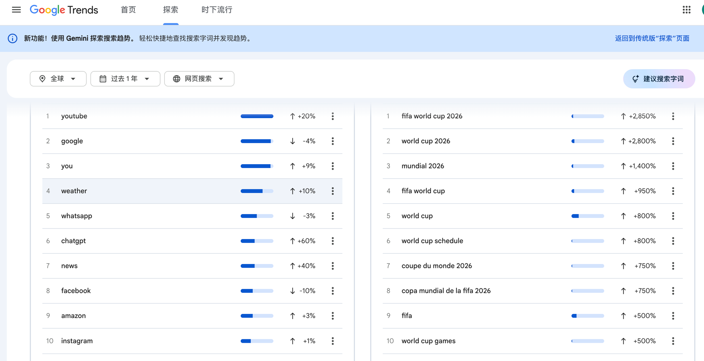

# 第 2 章 找到值得做的事——产品定位

---

## 2.1 三个必答题

### 开场

上一个模块我们建立了认知——一个人能做、不会编程也能做、出海是更好的选择。

从这个模块开始，我们进入实操的第一步。不是打开编辑器写代码，而是一件更重要的事：**想清楚你要做什么。**


AI 能帮你写代码，但不能帮你想清楚做什么。产品方向错了，技术再好也白搭。

所以，在你打开任何工具之前，先回答三个问题。

### 第一个问题：你要解决谁的什么问题？

这是最核心的问题。你要用一句话说清楚。

好的回答：
- 「帮英语母语者把长文章变成要点摘要」
- 「帮设计师批量去除图片背景」
- 「帮远程团队做异步站会记录」
- 「帮自媒体博主把长视频自动剪成短视频」
- 「帮独立开发者监控他们产品在 Twitter 上的提及」

坏的回答：
- 「做一个 AI 平台」——太模糊，什么 AI？给谁用？
- 「做一个效率工具」——什么效率？谁的效率？   
- 「做一个社交 App」——跟微信竞争？跟 Twitter 竞争？你凭什么？

一句话定位有一个公式：**「帮 [谁] [做什么事]」**。

如果你用这个公式说不清楚你的产品，说明你还没想明白。继续想，不要着急写代码。

注意一个关键词：**「谁」**。你的用户必须是一个具体的群体                                                                                                                                                        ，不能是「所有人」。「所有人」意味着你不知道该去哪里找用户，不知道该用什么语言跟他们沟通，不知道他们愿意为什么付钱。

越聚焦越好。「帮自由职业设计师批量导出 Figma 设计稿为 PDF」比「帮设计师提高效率」好一百倍。因为前者你知道该去哪找用户（Figma 社区、设计师 subreddit），后者你只能到处撒网。

### 第二个问题：用户凭什么用你的而不是别人的？

任何值得做的领域，都已经有人在做了。这不是坏事——有竞品说明有需求。但你需要想清楚，你的产品跟竞品比，差异在哪。

常见的差异化角度：

**更便宜。** 竞品收 $49/月，你收 $9/月。这是最简单粗暴的差异化，但也是最不持久的——别人也可以降价。

**更聚焦。** 竞品做了 50 个功能，你只做其中一个，但做到极致。比如 Remove.bg，它只做一件事——去除图片背景。市面上有一堆全功能的图片编辑器都能去背景，但 Remove.bg 就是更快、更好、更简单。它后来被 Canva 收购了。

**更好的体验。** 同样的功能，你的界面更好看、操作更顺滑、速度更快。这对独立开发者来说是一个好角度，因为大公司的产品往往因为功能太多而变得臃肿。

**更适合某个细分场景。** 竞品面向所有人，你只面向律师、只面向地产经纪人、只面向 YouTube 博主。你对这个群体的理解更深，功能更贴合他们的工作流。

**千万不要的回答是：「没什么差异，就是我也想做一个。」** 如果你找不到差异点，要么换一个方向，要么去更深入地了解用户——你了解得越深，越容易发现竞品没覆盖到的痛点。

### 第三个问题：你打算怎么收钱？

很多人觉得「先做产品，收钱的事以后再说」。这是一个严重的错误。

收费模式决定了你的产品设计、技术架构和用户获取策略。你必须在第一天就想清楚。

四种常见的收费模式：

**订阅制（Subscription）。** 用户按月或按年付费。比如 $9/月或 $79/年。

- 优点：收入可预测，用户生命周期价值高
- 缺点：用户对「又一个订阅」越来越抗拒，需要持续提供价值
- 适合：工具类产品、有持续使用场景的产品
- 案例：Notion（$8/月）、Grammarly（$12/月）

**一次性买断（One-time Purchase）。** 用户付一次钱，永久使用。

- 优点：用户决策门槛低，「付一次就完事了」
- 缺点：没有复购，收入不可预测，需要不断获取新用户
- 适合：模板、工具包、特定场景的一次性需求
- 案例：ShipFast（$199 一次性）、Tailwind UI（$299 一次性）

**按量付费（Usage-based）。** 用户用多少付多少。比如每处理一张图片收 $0.1。

- 优点：用户入门门槛低，「不用不花钱」
- 缺点：收入波动大，用户可能用完就走
- 适合：API 类产品、处理类产品（图片处理、文件转换）
- 案例：HeadshotPro（$29 一次生成 40 张）、Remove.bg（按张计费）

**免费增值（Freemium）。** 基础功能免费，高级功能收费。

- 优点：用户获取成本低，免费版是天然的漏斗
- 缺点：需要精心设计免费和付费的边界，太多免费功能则没人付费
- 适合：有明确「基础需求」和「进阶需求」分层的产品
- 案例：Notion（免费版够个人用，团队版收费）、Canva（基础功能免费，Pro 功能收费）

**我对新手的建议：从一次性买断或简单的订阅制开始。** 按量付费和免费增值的定价策略更复杂，等你有了第一个产品的经验再考虑。

### 本节小结

- 在写代码之前，先回答三个问题：解决谁的问题、凭什么是你、怎么收钱
- 用「帮 [谁] [做什么事]」的公式写出一句话定位
- 差异化不需要全面碾压竞品，在一个维度上做到更好就够了
- 收费模式第一天就要想清楚，新手建议从一次性买断或简单订阅制开始

---

## 2.2 需求验证实战

### 开场

上节课我们讲了三个必答题的理论。这节课是实操——我手把手带你做需求验证。

需求验证的目的只有一个：**确认真的有人需要你想做的东西，而且他们愿意为此付钱。**

不要跳过这一步。在你花一周做产品之前，花两小时做验证，能帮你避免「做了一个没人用的东西」的悲剧。

### 从自身需求找灵感

在开始验证之前，还有一个更靠前的问题：如果你压根还没想好做什么，去哪里找方向？

离你最近的答案，是你自己。英文独立开发者社区有一句老话：**scratch your own itch——挠自己的痒。** 你每天工作生活里遇到的麻烦，就是离你最近的产品灵感。

这条路有一个天然优势：你就是第一个用户。需求是真是假、功能该怎么取舍、文案该怎么写，你不用猜——问自己就行。冷启动阶段最贵的东西是「对用户的理解」，而这份理解你天生就有。

很多知名产品都是这么来的。Drew Houston 在波士顿到纽约的巴士上又一次忘带 U 盘，一怒之下写了 Dropbox 的第一版。Pieter Levels 自己一边环球旅行一边远程工作，想知道哪个城市网速快、消费低、适合数字游民，先做了一个众包的 Google 表格，后来它变成了 Nomad List——多年来一直是他公开收入仪表盘上的主力产品。

怎么系统地捕捉自己的需求？**记一周「摩擦日记」。** 接下来七天，每当你冒出「要是有个工具能……就好了」的念头，或者发现自己在用复制粘贴、Excel、五六个工具拼凑着完成同一件事，立刻记一条。不评判、不筛选，先记下来。一周之后，你手里会有一张十几条的清单——这就是你的灵感库。

但自身需求有一个著名的陷阱：**你的痛点，可能全世界只有你一个人有。** 样本量为一。所以从摩擦日记里挑出来的想法，必须先过两道关：

- 你自己愿意为解决它付钱吗？如果连你都不愿意付，别指望别人付
- 跟你处境相似的人有多少？他们聚集在哪里？

怎么过这两道关？往下看——去排行榜确认有没有人在做类似的东西，去 Reddit 搜有没有人在抱怨同样的问题。**自身需求给你灵感，外部验证给你答案，两条腿走路。**

### 用排行榜网站找灵感和定位

如果往内看没找到强烈的痛点，那就往外看：排行榜网站。

**排行榜的本质是别人替你做好的市场验证——能上榜的产品，说明需求是真的、有人在用、有人在付钱。** 你要做的只是站在榜单上看：什么在涨、什么在赚钱、什么品类挤满了人、什么缝隙还没人填。

几个我常看的榜单：

| 排行榜                         | 看什么                   | 适合找什么                     |
| --------------------------- | --------------------- | ------------------------- |
| Product Hunt Leaderboard    | 每日/每月/每年票数排名          | 当下什么品类最热，用户在为什么投票         |
| Toolify.ai                  | AI 工具按流量排名            | AI 赛道里哪些细分品类流量在涨          |
| There's An AI For That      | 按任务场景分类的 AI 工具库，附热度排名 | 哪些任务已经有 AI 在做、哪些场景还是空白    |
| Indie Hackers Products      | 独立产品按收入（MRR）排序        | 一个人能做到什么规模，什么模式真的赚钱       |
| acquire.com                 | 待出售项目及其收入             | 什么样的小产品值钱，买家愿意为什么付钱       |
| App Store / Google Play 分类榜 | 各分类免费榜和畅销榜            | 移动端哪些工具类需求长期稳定            |
| Chrome Web Store 热门插件       | 安装量和评分                | 浏览器场景下的高频小需求              |
| Google Trends               | 关键词搜索热度随时间的变化         | 一个需求是在涨还是在退潮，哪些地区需求最强     |
| GitHub Trending             | 开源项目按 star 增速排名       | 开发者世界什么方向在爆发，哪些开源项目能包装成产品 |

**第一步，看趋势，不看榜首。**

榜首的产品——Notion、Canva 这个级别——跟你没关系，那是几百人团队的战场。你要看的是排在第 20 到第 100 名之间的产品：它们小到一个人能做出来，又大到证明了有真实市场。在 Toolify 上按「流量增长」排序，在 Indie Hackers 上筛选 MRR 在 $1k-$10k 之间的产品，这个区间就是独立开发者的机会带。

看中一个方向之后，去 Google Trends（trends.google.com）搜一下核心关键词。一条持续爬升的曲线，比任何人的判断都可靠；一条明显下滑的曲线，是在提醒你别接最后一棒。顺手切到「按地区」视图看看——如果某个需求在日本或巴西的搜索热度远高于英语市场，而那里还没有本地化的产品，这就是一个现成的切入点。



上图是 Google Trends 的「探索」页面。左边是搜索量最大的词——你看 chatgpt 一年涨了 60%，而 facebook 跌了 10%，热钱往哪流一目了然。右边是增速榜，动辄百分之几百上千的爆发词。**看左边找长期稳定的需求，看右边抓正在爆发的窗口**——但要小心右边的词很多是事件驱动的（比如 world cup 2026），热度来得快去得也快，别把一波热点错当成一个市场。

GitHub Trending（github.com/trending）是另一条路，尤其适合有技术背景的人。一个开源项目短时间内涨了几千 star，说明开发者们用注意力投了票，这个方向的需求是真的。但开源项目有一个普遍的短板——**会用命令行的人不需要付费，愿意付费的人不会用命令行。** 把一个爆火的开源工具做成网页版、托管版或者带界面的服务，向不想折腾部署的用户收钱，这是被反复验证过的模式。

**第二步，找「品类第一的弱点」。**

选一个你感兴趣的细分品类，点进榜单第一名，然后去它的差评区。一个月流量几十万的产品，差评里反复出现的抱怨——「不支持中文」「太贵了」「移动端体验差」——每一条都是一个现成的定位。你的产品不需要全面超越它，只需要在这一条上做得比它好。

**第三步，做「平台搬运」和「人群搬运」。**

榜单上还藏着一种更省力的机会——一个已被验证的需求，换个平台或换个人群重做一遍：

- Web 上很火的工具，还没有 Chrome 插件版 → 做插件版
- 英文市场验证过的产品，没有日语/西语版本 → 做本地化版本
- 面向所有人的通用工具 → 做一个只面向律师、教师或跨境电商卖家的垂直版本

这三种搬运都有一个共同点：**需求已经被榜单验证过了，你省掉的是最贵的那一步——猜。**

看完榜单，你手里应该有两三个候选方向。接下来，用 Product Hunt 和 Reddit 把它们逐个验证一遍。

### 用 Product Hunt 做竞品调研

Product Hunt（producthunt.com）是全球最大的新产品发现平台。每天都有几十个新产品在上面发布，用户会投票、评论、提问。

**第一步，搜索你的关键词。**

假设你想做一个「AI 摘要工具」，就在 Product Hunt 的搜索框里搜 `AI summary` 或 `AI summarizer`。

你会看到一堆已经存在的产品。不要慌——有竞品是好事，说明这个需求是真实的。如果你搜一个关键词，一个竞品都搜不到，反而要警惕——可能根本没人需要这个东西。

**第二步，看评论区。**

点进每个竞品的页面，重点看评论区。用户在评论里会说三种话：

1. 夸的内容——「I love that it can handle PDFs」→ 说明 PDF 支持是刚需
2. 骂的内容——「The summary quality is terrible for technical articles」→ 说明技术文章的摘要是一个痛点，可能是你的差异化方向
3. 问的问题——「Does it support team collaboration?」→ 说明团队协作是一个未被满足的需求

**第三步，记录到表格里。**

我建议你用一个简单的表格来记录你的发现：

| 竞品名称 | 核心功能 | 定价 | 用户夸什么 | 用户骂什么 | 缺失的功能 |
|---------|---------|------|-----------|-----------|-----------|
| SummarizeBot | 网页/PDF 摘要 | $9/月 | 速度快 | 中文支持差 | 团队协作 |
| TLDR This | Chrome 插件 | 免费+$4.99/月 | 简单好用 | 只支持网页 | API 接口 |
| ... | ... | ... | ... | ... | ... |

填完这个表格，你就对这个领域有了一个全景认知——谁在做、做得怎么样、用户满意什么不满意什么、还有什么空白。

### 用 Reddit 挖掘真实用户痛点

Product Hunt 上的用户偏向科技早期采用者。如果你想了解更广泛的用户需求，Reddit 是更好的渠道。

**第一步，找到相关的 subreddit。**

还是以「AI 摘要工具」为例，你可以去这些 subreddit：
- r/productivity（效率工具爱好者）
- r/ChatGPT（AI 工具用户）
- r/SaaS（SaaS 产品讨论）
- r/Entrepreneur（创业者社区）

**第二步，搜索关键词。**

在 subreddit 的搜索框里搜 `summarize`、`summary tool`、`too long to read` 这类关键词。

你会找到大量真实用户的帖子：
- 「Is there a tool that can summarize my meeting recordings?」→ 会议录音摘要是一个需求
- 「I've tried X and Y but they both suck at long articles」→ 长文章是竞品的弱项
- 「Would pay $20/month for something that can summarize academic papers well」→ 有人明确表示愿意为学术论文摘要付 $20/月

**第三步，记录「付费信号」。**

在你的调研过程中，特别留意以下信号：
- 用户说「I would pay for...」「I'd gladly pay...」「Take my money」→ 强付费意愿
- 用户说「I've been looking for...」「Does anyone know...」→ 有需求但还没找到好的解决方案
- 帖子有大量赞和评论 → 说明这个需求有共鸣

这些信号比任何市场调研报告都有价值，因为它们来自真实用户的真实表达。

### 竞品分析深入

找到 3-5 个最接近的竞品之后，你需要做一次更深入的分析。

**试用它们的产品。** 注册账号，真的去用一用。注意哪些地方让你觉得好用，哪些地方让你觉得别扭。你的真实使用感受就是最好的用户研究。

**看它们的定价页面。** 定价策略透露了很多信息——他们把什么功能放在免费版，什么功能放在付费版，说明他们认为什么功能是「钩子」（吸引用户来），什么功能是「价值」（让用户付钱）。

**看它们的差评。** 去 G2、Trustpilot、Product Hunt 评论区找差评。差评里藏着机会——如果很多人在抱怨同一个问题，而你能解决这个问题，那就是你的差异化。

**看它们的流量来源。** 用 SimilarWeb（免费版就够）看竞品的流量构成——搜索流量占多少、社交流量占多少、直接访问占多少。这会帮你理解它们的获客策略，也就是你将来可能需要用的策略。

### 本节小结

- 需求验证的核心：确认有人需要、有人愿意付钱
- 自身需求：记一周「摩擦日记」捕捉痛点，但样本量为一，必须做外部验证
- 排行榜网站：看第 20-100 名找机会带 → 挖品类第一的差评找定位 → 用平台/人群搬运省掉「猜」的成本
- 趋势工具：Google Trends 确认需求在涨还是在退潮，GitHub Trending 找能产品化的开源项目
- Product Hunt：搜关键词 → 看评论区（夸什么、骂什么、缺什么）→ 填竞品表格
- Reddit：找相关 subreddit → 搜痛点关键词 → 记录付费信号
- 竞品深入分析：试用产品 → 看定价 → 看差评 → 看流量

---

## 2.3 最小概念速通

### 开场

在出海独立开发者的世界里，有一些高频词汇你会反复碰到。这节课我们用最短的时间，把最核心的几个概念过一遍。

不需要背，理解就行。遇到的时候知道是什么意思就够了。

### 四个必知概念

**SaaS（Software as a Service）——软件即服务。**

传统的软件是你买一个安装包，装到电脑上用。SaaS 是你打开浏览器就能用，数据存在云端，按月或按年付费。

Google Docs 是 SaaS，Notion 是 SaaS，Canva 是 SaaS。你要做的出海产品，大概率也是一个 SaaS。

为什么 SaaS 模式对独立开发者特别友好？因为你只需要维护一个版本——用户打开网页看到的就是最新版。不用像 App 一样等审核、处理兼容性、管理版本更新。

**MRR（Monthly Recurring Revenue）——月经常性收入。**

就是你每个月稳定进账的订阅收入。如果你有 100 个用户，每人每月付 $10，你的 MRR 就是 $1000。

MRR 是衡量一个 SaaS 产品健康度的最核心指标。独立开发者社区里，大家互相交流的时候最常问的就是「你 MRR 多少了」。

一些里程碑：
- $100 MRR → 你的产品有人愿意付费了，方向基本对
- $1000 MRR → 你有了一个真实的小生意
- $5000 MRR → 在很多城市，这够你全职做这个产品了
- $10000 MRR → 你的产品比大多数创业公司都赚钱

**PMF（Product-Market Fit）——产品市场匹配。**

这个概念是 Marc Andreessen 提出的，意思是你做的东西刚好是市场需要的。

怎么判断你达到了 PMF？有一个简单的测试——如果你的产品突然消失了，你的用户会不会觉得很痛苦？如果会，说明你达到了 PMF。如果用户无所谓，说明你还没到。

在达到 PMF 之前，你的核心任务是不断调整产品方向、功能和定位，直到找到那个「刚好对的位置」。在达到 PMF 之后，你的核心任务变成增长——获取更多用户。

**MVP（Minimum Viable Product）——最小可行产品。**

核心功能能用、能解决用户的核心问题，其他都可以先不做——这就是 MVP。

MVP 的意义在于：**用最小的代价验证你的想法对不对。** 你花一周做一个 MVP 上线，如果没人用，你最多浪费了一周。你花三个月做一个「完美」的产品上线，如果没人用，你浪费了三个月。

MVP 该有什么：核心功能、能注册登录、能付费。

MVP 不该有什么：完善的设置页面、多语言支持、暗黑模式、复杂的权限系统、完美的错误处理。这些都可以等产品验证之后再做。

Danny Postma 的 HeadshotPro 第一版长什么样？一个上传照片的框、一个「生成」按钮、一个付款页面。就这样。界面很丑，但功能是好的。用户不在乎界面丑不丑，他们在乎的是「能不能帮我生成一张好看的职业照」。

### 四种商业模式对比

上节课我们讲了四种收费模式的理论，这里用一个表格做个对比，帮你选择：

| 模式 | 适合什么产品 | 优点 | 缺点 | 典型定价 |
|------|------------|------|------|---------|
| 订阅制 | 持续使用的工具 | 收入可预测 | 需要持续交付价值 | $9-49/月 |
| 一次性买断 | 模板、工具包 | 决策门槛低 | 没有复购 | $29-299 |
| 按量付费 | 处理类、API 类 | 入门门槛低 | 收入波动大 | $0.01-1/次 |
| 免费增值 | 用户量大的工具 | 获客成本低 | 定价策略复杂 | 免费 + $9-29/月 |

如果你是第一次做产品，我的建议是：

- 如果你做的是一个持续使用的工具（比如 AI 写作助手）→ **订阅制**，$9-19/月
- 如果你做的是一个一次性需求的产品（比如 AI 简历生成器）→ **一次性买断**，$19-49
- 如果你拿不定主意 → **先做一次性买断**，因为它最简单、最容易实现

### 本节小结

- SaaS：浏览器里用的软件，按月/年付费，对独立开发者最友好
- MRR：月经常性收入，$1000 MRR 就是一个真实的小生意
- PMF：产品市场匹配，「产品消失了用户会不会痛苦」
- MVP：最小可行产品，核心功能 + 注册登录 + 付费，其他先不做
- 新手建议：从一次性买断或简单订阅制开始

---

## 2.4 选题练习

### 开场

前三节课我们学了理论、做了调研、过了概念。这节课是练习环节——把前面学的东西用起来，完成你自己的产品定位。

这不是可选作业，这是整个课程最重要的环节之一。因为从模块三开始，你的每一步操作都会基于你在这节课想清楚的东西。

### 练习一：一句话产品定位

用这个公式写出你的产品定位：

> **帮 [具体的人群] [解决一个具体的问题]**

要求：
- 「人群」必须足够具体。不是「所有人」，不是「企业」，而是「自由职业设计师」「YouTube 教育博主」「远程团队的项目经理」
- 「问题」必须足够具体。不是「提高效率」，而是「把 30 分钟的会议录音变成 5 条要点摘要」
- 一句话，不超过 20 个字

写三个版本，然后选一个你最想做的。

举几个例子帮你找感觉：

- 帮 YouTube 博主把长视频自动剪成短视频片段
- 帮独立开发者监控他们产品在社交媒体上的提及
- 帮留学生把英文论文改写成学术语言
- 帮电商卖家批量生成多语言产品描述
- 帮自由职业者自动生成发票和收款提醒

### 练习二：产品画布

选定了一句话定位之后，填写这个画布：

```
┌─────────────────────────────────────────────────────┐
│                    产品画布                           │
├──────────────────────┬──────────────────────────────┤
│  目标用户             │                              │
│  (谁？在哪找到他们？)  │                              │
├──────────────────────┼──────────────────────────────┤
│  核心问题             │                              │
│  (他们现在怎么解决？   │                              │
│   痛点在哪？)         │                              │
├──────────────────────┼──────────────────────────────┤
│  你的解决方案          │                              │
│  (MVP 只做哪个功能？)  │                              │
├──────────────────────┼──────────────────────────────┤
│  差异化               │                              │
│  (跟竞品比你赢在哪？)  │                              │
├──────────────────────┼──────────────────────────────┤
│  收费模式             │                              │
│  (订阅/买断/按量？     │                              │
│   定价多少？)          │                              │
├──────────────────────┼──────────────────────────────┤
│  竞品                 │                              │
│  (列出 3 个最接近的)   │                              │
├──────────────────────┼──────────────────────────────┤
│  验证方式             │                              │
│  (怎么在做之前确认     │                              │
│   有人需要？)          │                              │
└──────────────────────┴──────────────────────────────┘
```

填写指南：

- **目标用户**：写清楚是谁，以及你能在哪里找到他们（哪个 subreddit、哪个 Slack 社区、哪个 Facebook 群组）
- **核心问题**：他们现在没有你的产品时怎么解决这个问题？是手动做？用竞品但体验差？还是干脆就忍着不解决？
- **你的解决方案**：只写 MVP 要做的核心功能，一到两个就够。不要写「全面的解决方案」
- **差异化**：从更便宜、更聚焦、更好体验、更适合细分场景中选一个
- **收费模式**：写清楚具体的价格。不是「收费」，而是「$19/月」或「$49 一次性」
- **竞品**：列出名字和网址，附一句话说明
- **验证方式**：你打算怎么在做之前确认需求？去 Reddit 发帖问？做一个 landing page 收集邮箱？直接找潜在用户聊？

### 练习三：电梯测试

最后一个练习。想象你在电梯里遇到一个潜在用户，你只有 30 秒时间告诉他你在做什么。

写一段 30 秒能说完的话，包含以下信息：
1. 你注意到什么问题（pain point）
2. 你做了什么来解决它（solution）
3. 跟其他方案比有什么不同（differentiation）

示例：

> 「你知道吗，大多数 YouTube 博主花在剪辑短视频上的时间比录长视频还多。我做了一个工具，你把长视频丢进去，AI 自动帮你找到最精彩的片段，剪成竖屏短视频，一键导出到 TikTok 和 Instagram。跟市面上那些需要你手动标记时间点的工具不同，我们是全自动的——上传，等两分钟，下载。」

如果你能流畅地说出这段话，说明你对自己的产品想得足够清楚了。如果说的时候觉得别扭、牵强，说明还需要继续打磨。

### 本节小结

- 完成三个练习：一句话定位、产品画布、电梯测试
- 这不是可选作业——模块三开始的所有操作都基于你这节课想清楚的东西
- 如果你对自己的定位还不确定，去 Reddit 搜一搜相关关键词，看看有没有真实需求
- 不需要完美，需要清晰。80 分的定位比 0 分的完美主义强一万倍

---

## 总结

四节课下来，你应该完成了以下事情：

1. **回答了三个必答题**：解决谁的问题、凭什么是你、怎么收钱
2. **做了需求验证**：从自身需求和排行榜网站找过方向，在 Product Hunt 和 Reddit 上搜索过、看过竞品、填了竞品分析表格
3. **理解了四个核心概念**：SaaS、MRR、PMF、MVP
4. **完成了产品画布和电梯测试**：你的产品方向已经清晰了

从下一个模块开始，我们终于要打开工具了——先用 AI 设计界面，再用 AI 写代码。

### 课后作业

1. 完成产品画布，拍照或截图保存。这是你整个项目的「北极星」——迷路了就回来看
2. 在 Reddit 的相关 subreddit 里发一个帖子，描述你想做的产品，问问大家觉得有没有用。不需要推销，只是问「If this existed, would you use it?」
3. 把你的一句话定位和电梯测试发到课程社群里，让其他同学给你反馈
4. 如果你还在犹豫做什么，不要卡在这里——从你最感兴趣的那个方向开始，做错了可以改，不做永远不知道对不对
