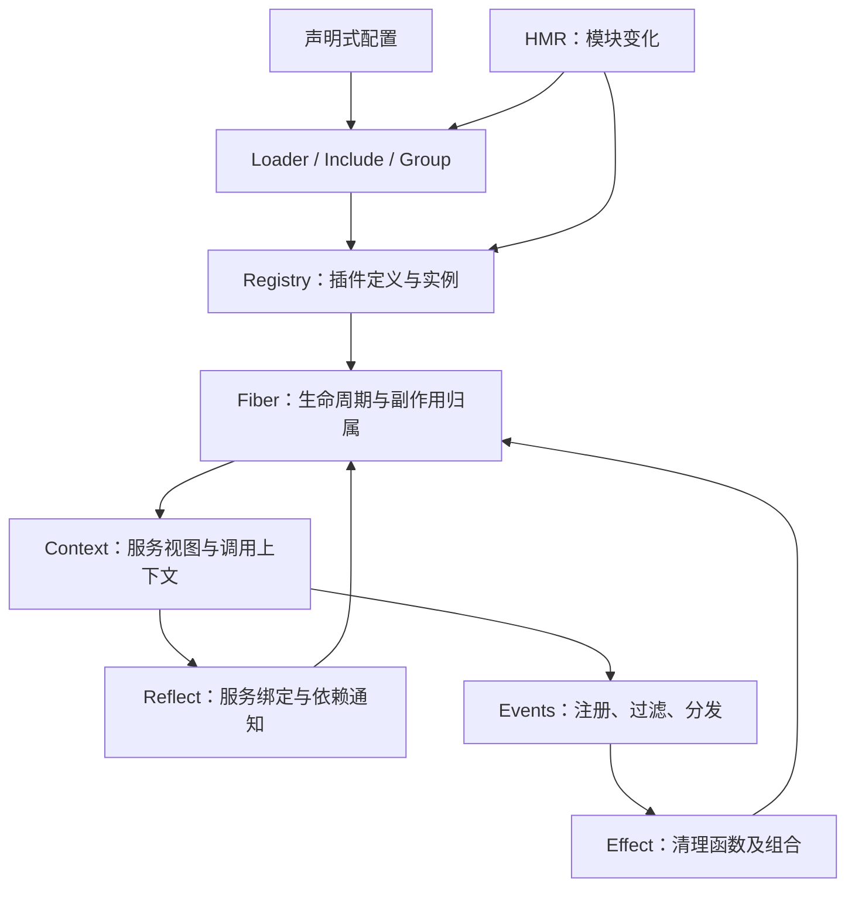
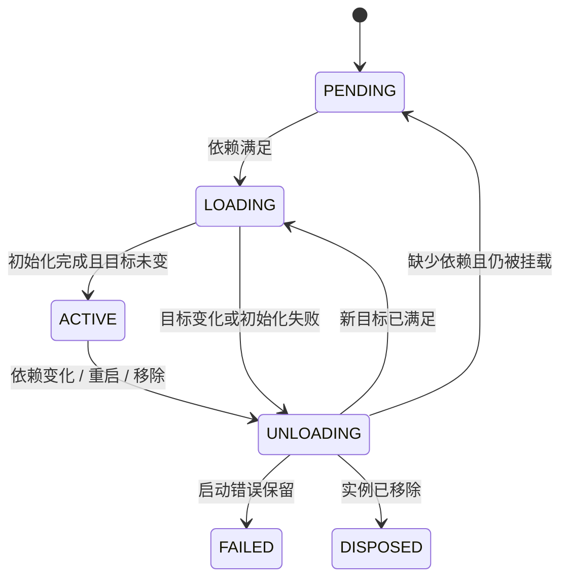

# Cordis：基础、架构、设计与实现研究

研究日期：2026-10-01。

**核心判断：Cordis 将服务依赖、插件生命周期和可撤销注册放进同一个运行时，使应用能够在运行中重新组合。它最值得学习的设计，是让每次能力注册都有明确的归属，让每次依赖变化都能驱动受影响组件的生命周期。其保证有边界，尤其不能把服务撤销、资源排空和外部业务回滚混为一谈。**

本文针对 DeepSeek Harness 所采用的 Cordis 元框架。方法是对照论文、固定提交的上游源码、Harness vendored 源码及测试，并运行行为实验。文中的“推论”“建议”表示工程分析，不表示项目官方承诺。

## 1. 研究基线：必须区分的三个对象

| 对象 | 本次固定版本 | 本文用途 |
| --- | --- | --- |
| 理论 | *A Programming Paradigm for Spatiotemporal Composability*，arXiv:2608.25512v1 | 理解问题定义、模型和保证的前提；重点核对 §3、§4.3、§5.1 |
| 上游实现 | `cordiverse/cordis`，`f8ea3cd50f1a5724e8e715995bcde131c9c12b2c` | 分析具体数据结构、调用链和运行语义；core 包声明 `4.0.0-rc.10` |
| Harness 实现 | `deepseek-ai/deepseek-harness`，`639ed015397290b3745d163aafe02ffee4aa3f84` | 分析实际产品如何采用并修改框架 |

Harness 的 vendor manifest 记录 core 基于上游 `4.0.0-rc.7`、提交 `56b3d4f…`，另外列出本地修改。它使用 `@deepseek-ai/cordis` 包名，不应视为当前 npm `cordis` 的无差别副本。上游 README 也明确标记 API 尚不稳定。[上游清单][U-package]、[Harness vendor 清单][H-vendor]、[上游 README][U-readme]。

**验证结果：上游 core 的 12 个测试文件、87 个测试通过；另外设计的 10 组行为实验分别在两版实现上运行。** 没有跑完整 Harness、Loader/HMR 集成测试，也没有做性能基准。实验运行器、脚本、输出和复现说明保存在 [cordis-experiments](./cordis-experiments/README.md)。

## 2. 基础：为什么单靠模块和依赖注入不够

设一个长期运行的应用有数据库、搜索、工具注册、会话和界面模块。启动时把它们按顺序装起来并不困难，难的是运行中发生变化：搜索实现被替换，数据库暂时消失，一个 Agent 结束，某个工具插件被禁用。

此时要回答的是一组互相关联的问题：谁停止接收新调用？谁还持有旧对象？谁负责移除监听器？异步初始化尚未完成怎么办？重新出现的服务该唤醒谁？哪些状态应该保留？

### 2.1 理论中的两条轴

论文把组合性拆成时间与空间两个维度：时间上，移除组件需要撤销它对上下文的影响；空间上，组件对环境的要求需要显式声明，并随环境变化重新判断。对应机制分别是可撤销 effect 与响应式 coeffect。统一的 Context 承载两者；独立组件的交错执行以观察等价为尺度讨论，而非要求机器全部状态逐位复原。[论文 §3][P]。

在工程上，可以用以下两个问题来记忆这一区分：

- **Effect：这段代码往系统中放进了什么，退出时由谁取走？**
- **Coeffect：这段代码需要哪些环境条件，这些条件改变时怎么办？**

这里的术语并不意味着 TypeScript 获得了一个静态 effect 类型系统。下面分析的是 Cordis 通过运行时注册、代理、依赖声明与状态机实现的具体机制。

### 2.2 与相邻机制的关系

下表是工程对照，描述机制关注点，不宣称其他生态只能做到表中这些事。

| 机制 | 主要管理的东西 | Cordis 补充的视角 |
| --- | --- | --- |
| `import` / 模块系统 | 代码如何链接、求值 | 同一个插件定义可有多个运行实例；实例能等待、失活和重建 |
| 常见启动期 DI | 依赖如何装配成对象图 | 依赖声明在运行期间持续参与生命周期判断 |
| EventEmitter | 谁订阅了哪些消息 | 监听注册附带所属 Fiber 的清理；分发有明确模式与过滤 |
| RAII / disposer | 资源由谁释放 | 资源归属扩展到跨服务的注册，以及动态创建的子插件 |
| 热更新器 | 如何加载新代码 | 更新前后还必须管理旧实例、依赖消费者和注册副作用 |

因此，把 Cordis 称为“插件库”是正确但不完整的。它提供的是构建插件化应用的组合机制；数据库、Agent Loop、UI 等业务能力仍由上层决定。

## 3. 总体架构：小内核和多种运行时关系

本次上游 `packages/core/src` 共 1,874 行，包含日志、工具函数和注释，不能直接解读为“生命周期算法有 1,874 行”。核心文件分工如下。

| 文件 | 核心职责 | 阅读时抓住什么 |
| --- | --- | --- |
| `context.ts` | 创建根上下文、派生上下文、隔离和拦截配置 | 根是 Proxy；派生主要借助原型链 |
| `registry.ts` | 插件定义到运行实例的映射、`plugin` / `inject` | `Map<Function, Runtime>` 与一个定义的多个 Fiber |
| `fiber.ts` | 生命周期、effect 收集、配置更新、错误 | `epoch`、`inertia`、`store`、`_disposables` |
| `reflect.ts` | 服务提供、查找、访问约束、依赖变化通知 | 名字到隔离 Symbol，再到 `Impl` |
| `service.ts` | 服务对象的约定、初始化钩子、调用上下文跟踪 | 服务自己也是可挂载的插件 |
| `events.ts` | 事件注册、过滤与五种分发方式 | receiver、`Context.filter`、`next()` |
| `utils.ts` | 清理列表、trace/shadow 代理、错误栈 | definition site 与 use site 的分离 |

来源：[Context][U-context]、[Registry][U-registry]、[Fiber][U-fiber]、[Reflect][U-reflect]、[Service][U-service]、[Events][U-events]、[Utils][U-utils]。



这张图描述模块职责；运行时还要区分三类关系：

1. **归属树**：父插件通过自己的 Context 创建子插件，子 Fiber 的 disposer 作为父 Fiber 的 effect 保存。父退出会级联处理孩子。
2. **依赖关系**：插件声明 `inject`，通过可见的服务绑定依赖提供者。消费者与提供者可以是归属树上的兄弟。
3. **服务可见性关系**：Context 为服务名映射隔离 Symbol，决定某个消费者连接到哪个实现。

例如，根下并列挂载 `Database` 和 `Search`，Search 依赖 database。Database 退出会让 Search 因依赖缺失失活，但不会因为父子归属关系把 Search 永久移除。新的 Database 出现后，正常等待状态的 Search 可以重新激活。相反，Search 自己创建的子插件会随它的本轮运行被回收。两种级联机制不可互换。[Registry][U-registry]、[Fiber][U-fiber]。

## 4. 基本对象：Plugin、Runtime、Fiber、Context、Service

### 4.1 Plugin 是定义，Fiber 是运行实例

源码接受三种插件：函数、构造器、带 `apply` 方法的对象。`Service` 子类是常用形式，但插件不必继承 Service，也不必提供服务。

Registry 将函数本身或对象的 `apply` 函数作为 identity。同一 identity 对应一个 `Runtime`，其中的 `fibers` 保存多个挂载实例。这使得相同实现可以带不同配置在不同位置实例化；同一服务名是否冲突，则由它们的隔离域决定。[Registry][U-registry]。

`ctx.plugin()` 返回带 PromiseLike 接口的 Fiber 包装对象。`await ctx.plugin(...)` 得到稳定后的实际 Fiber，但“稳定”可以是 `PENDING`，不是“所有依赖都必定已就绪”。`Fiber.await()` 只等待当前 `inertia` 收敛，并在有启动错误时抛出；它没有等待未来服务出现的条件变量。[Fiber][U-fiber]。

这个区别很实用：启动程序不能把“await 已结束”直接当成“应用所有功能可用”。需要审计 Fiber 状态或定义产品级 readiness。

### 4.2 Context 是服务访问与归属的载体

根 Context 创建根 Fiber、Reflect、Registry、Events 和 Logger。其 Proxy 会拦截普通服务属性访问。

`ctx.extend(meta)` 通过原型链派生上下文并保留属性描述符。它不会自动创建新的 Fiber，也不会复制整份服务实例。`ctx.isolate(...)`、`ctx.intercept(...)` 在此基础上修改相应映射。[Context][U-context]。

因此，“一个 Context 就是一套独立容器”并不准确。多个 Context 可以共享服务存储、共享同一个 Fiber，只携带不同的元数据或服务视图。

### 4.3 Service 将能力对象接入相同生命周期

`new Service(ctx, name)` 的核心动作是通过 `ctx.reflect.provide()` 注册服务，同时附加 tracker，使后续经 Context 访问的方法能够跟踪调用上下文。

构造器适合建立对象结构；异步初始化可放入 `[Service.init]()`。服务提供者完成启动、进入 `ACTIVE` 后，严格查找才将其提供的实现视为可用。`[Service.check]()` 可以进一步影响依赖是否满足，但不是内置的定时健康检查器。[Service][U-service]、[Reflect][U-reflect]、[服务测试][U-tests-service]。

## 5. 生命周期实现：依赖如何驱动运行状态

### 5.1 一次挂载发生了什么

沿 `ctx.plugin(plugin, config)` 跟踪，主要路径是：

1. Registry 解析插件，找到或创建 Runtime。
2. 创建 Fiber，解析 `inject`，派生携带该 Fiber 的 Context。
3. 为声明的依赖解析可见的 `Impl`，写入候选 `_store`。
4. `_refresh()` 计算依赖的目标 `epoch`。
5. 依赖满足则 `_reload()`，快照依赖视图后执行插件。
6. 初始化产出的清理函数被收集，稳定后进入 `ACTIVE`。
7. 状态变化通知使用其服务的其他 Fiber。

上游与 Harness 在初始化时注册父 disposer、发布 `internal/plugin` 通知的先后顺序上存在差异，后文单列。以上描述共同主线，不表示两版逐语句相同。[Registry][U-registry]、[Fiber][U-fiber]、[Harness Fiber][H-fiber]。

### 5.2 `epoch` 表达“依赖的是谁”

上游 `_refresh()` 的逻辑可概括为：

```text
若任一声明的依赖无法解析：epoch = INACTIVE
否则：epoch = 按声明顺序拼接每个服务提供者的 Fiber uid
```

所以它跟踪的是提供者身份，既不是服务值的深比较，也不只是“依赖齐了没有”的布尔值。

假设两个不同 Fiber 提供的配置对象完全相等，提供者切换仍会改变 epoch。反过来，某个提供者内部把服务对象字段改了，并不自动构成依赖替换。`Reflect.set()` 更新现有 `Impl.value`，本身也没有调用 `notify()`。不要把 Cordis 的服务依赖机制误用成任意对象属性的响应式系统。[Fiber][U-fiber]、[Reflect][U-reflect]。

### 5.3 `inertia` 串联异步状态转换

核心状态包括 `PENDING`、`LOADING`、`ACTIVE`、`UNLOADING`、`FAILED`、`DISPOSED`。



图省略了无 effect 时的快速路径及版本特定恢复路径。

`inertia` 保存正在执行的异步转换。转换未完成时，新变化更新目标 epoch，不同时启动另一条加载/卸载链。当前转换收尾再判断是否继续卸载或重新加载。这可以避免“旧初始化尚未完，新实例已经占用同一资源”的一类重叠。

但它不等于抢占式取消。已经等待的 Promise 不会被框架强行终止；异步迭代器是在迭代边界检查 epoch。长期 I/O 仍需要 AbortController、超时、任务排空等上层协议。停止继续迭代也不应当被假设为必然调用了任意生成器的 `return()`；需要可靠执行的清理应进入 effect disposer。[Fiber][U-fiber]。

### 5.4 候选依赖与已提交依赖

Fiber 有两个容易混淆的表：

- `_store`：根据当前服务变化计算的候选绑定。
- `store`：本轮加载开始时提交的绑定视图，直到清理结束才释放。

普通的 `ctx.service` 访问会沿允许的 Fiber 链寻找已提交绑定。依赖消失时，消费者清理代码仍可以通过本轮绑定访问旧服务对象；它不会突然拿到新提供者。

**这保存的是对象绑定，不是对象内部状态的不可变快照，也不保证对象背后的连接尚未关闭。** 后一个问题取决于资源清理顺序，第 6 节给出可复现反例。[Reflect][U-reflect]、[Fiber][U-fiber]。

### 5.5 故障与等待是不同状态

上游当前版本在 `_setEpoch()` 中检查 `_error`，失败 Fiber 不会仅因依赖恢复自动重试；`update()` 清除错误并重启。Harness 所固定版本没有同样的 guard，实验中服务撤销后重现触发第二次启动尝试。

缺依赖的 `PENDING` 与执行出错的 `FAILED` 必须在诊断和产品 UI 中区分：前者需要补足环境，后者需要排查初始化或配置错误。不能依赖跨版本一致的自动重试行为。[上游 Fiber][U-fiber]、[Harness Fiber][H-fiber]、[两版实验](./cordis-experiments/README.md)。

## 6. Effect：归属与清理比“注册回调”更深一层

### 6.1 它记录逆操作，不自动发明逆操作

`ctx.effect(setup)` 立即运行 setup，收集它返回或 yield 的清理函数，返回可手动调用的 disposer。支持同步函数、Promise、同步迭代器和异步迭代器。

框架提供的 `ctx.on()`、`ctx.provide()`、子插件挂载等操作本身也建立 effect，因此多数插件作者不必手工维护一份清理列表。[Fiber][U-fiber]、[Events][U-events]、[Reflect][U-reflect]。

清理注册表条目和撤销外部业务事实有本质差异。已经发送的请求、已提交的数据库写入、已发布的消息都没有自动逆操作。需要业务补偿、事务或幂等设计；Cordis 能调用作者提供的清理函数，无法判断它是否完整且正确。这是由 API 能力边界得到的工程结论。

### 6.2 三种顺序必须分开

| 层次 | 本次源码和实验观察 |
| --- | --- |
| 同一个 effect 内收集的 disposer | 逆序执行；遇到异步结果会串联等待 |
| 同一个 Fiber 的多个顶层 effect | 清理列表逆序取出，但 `_unload()` 用 `Promise.all` 启动，完成顺序不串行 |
| 提供者与消费者 | 服务撤销 effect 通知并等待相关 Fiber；提供者的其他顶层 effect 可以同时运行 |

`DisposableList.clear()` 返回逆序数组，所以“先启动较晚注册的清理”是真的；从中推导“较晚清理完全结束后才执行较早清理”则是错的。[Utils][U-utils]、[Fiber][U-fiber]。

### 6.3 实测边界：消费者没结束，资源已经关闭

以下写法将服务撤销和资源关闭放在两个顶层 effect 中：

```ts
ctx.provide('db', connection)
ctx.effect(() => () => connection.close())
```

在两版代码上，使用 Promise 闸门阻塞消费者清理，观测到的顺序都是：

```text
provider resource closed
consumer cleanup starts
consumer cleanup ends
```

这并不表示服务依赖清理完全没有等待；`Reflect.provide()` 的 disposer 确实会通知并等待消费者。问题是该等待位于一个 effect 内，拦不住与它并行的其他顶层资源清理。[Reflect][U-reflect]、[实验脚本](./cordis-experiments/probe.mjs)。

需要顺序时，应显式组合成一个 effect。以下是简化写法，假定 `openConnection()`、`close()` 满足业务协议：

```ts
ctx.effect(function* () {
  const connection = openConnection()
  yield () => connection.close()
  yield ctx.provide('db', connection)
})
```

逆序清理先撤销服务并等消费者，再关闭连接。实验确认顺序变为：

```text
consumer cleanup starts
consumer cleanup ends
provider resource closed
```

这里必须 `yield` 内层 disposer，使它被纳入外层的顺序控制；仅在 setup 内调用两个注册函数，不能想当然地认为已建立同样的顺序关系。这一模式仍不替代对独立在途请求的追踪，也不保证抛错的清理链一定执行完所有后续逆操作。

### 6.4 重入为什么会改变正确性

更隐蔽的情况是：setup 尚未返回清理函数，却同步触发了拥有者卸载。

```ts
fiber.ctx.effect(() => {
  unload = fiber.dispose()
  return cleanup
})
```

上游被测版本在 setup 执行后才将 effect wrapper 放入拥有者列表。卸载在中间截取列表时，可能漏掉它；实验输出 `reentrant_setup_cleanup_collected: false`。

Harness 修改版先登记 wrapper，再运行 setup，并用 setup barrier 处理重入等待；同一实验输出 `true`。它还让异步清理在完成前保持对拥有者可见，内部组合可以加入已经进行的清理，并拒绝 `UNLOADING` 阶段新增 effect。[Harness 修改记录第 6 项][H-vendor]、[Harness Fiber][H-fiber]。

这个例子说明，生命周期库的困难主要集中在“正在建立资源时就被要求撤销”的交错，而不只是正常启动与正常退出。

## 7. Context 代理：让服务方法里的副作用归调用者所有

这是 Cordis 最值得仔细阅读的一层设计。

假设一个长寿命的 ToolRegistry 服务提供 `register()`，短寿命插件通过 `ctx.tools.register(...)` 添加工具。注册表方法在服务对象内部执行，但该工具应该随调用插件退出而移除。如果副作用归注册表服务所有，短寿命插件卸载后工具就会泄漏。

Cordis 的 `getTraceable()` / `createTraceable()` 通过 tracker 与 Proxy 解决这一问题：访问经过跟踪的服务时，方法看到的 `this.ctx` 带上消费方的使用上下文，同时保留服务代码定义处的依赖约束。[Utils][U-utils]。

| 维度 | 负责什么 |
| --- | --- |
| Definition site | 服务实现代码允许读取哪些依赖 |
| Use site | 该调用携带的隔离、intercept 和 effect 归属 |

例如 A 注入 B，B 注入 C。调用 A 的插件不必再声明 B 的内部依赖 C；B 的实现也不应因为被一个权限更宽的上下文调用就任意读取未声明服务。shadow Context 将这两个要求组合起来。[Reflect][U-reflect]、[shadow 测试][U-tests-shadow]。

行为实验中，服务的 `register()` 内调用 `this.ctx.effect()`；只卸载消费者，注册就被撤销，而服务提供者仍在。这个性质让“一个共享注册表，很多独立生命周期的贡献者”成为可落地的设计。

它同时带来作者约束：

- 需要调用方归属的注册动作，应通过跟踪后的 `this.ctx` 完成。
- 若方法绕开代理、捕获提供者的原始 Context，或依赖箭头函数捕获的词法 `this`，需要单独确认归属语义。
- `ctx.get(name)` 是显式查找接口，和受 `inject` 约束的普通 `ctx.name` 访问不同；根上下文也有访问例外。它们是框架提供的工具，不构成权限沙箱。

第三条直接来自 Reflect 实现；前两条是依据 JS 绑定与代理机制提出的使用建议，不能仅靠类型声明证明代码满足它们。

## 8. 空间组合：isolate 和 intercept 各管什么

### 8.1 `isolate` 改变服务绑定位置

服务查找的基本路径是：

```text
服务名（例如 db）
  → 当前 Context 的 isolate 映射
  → Symbol 标识的服务槽位
  → Impl { name, fiber, value, check }
```

`root.isolate('db')` 默认生成新 Symbol。两个不同 Symbol 下可以各有一个 db；若两个 Context 显式使用同一个 Symbol，就会连接到相同槽位。同一槽位重复 provide 会报错，而不是悄悄覆盖。[Context][U-context]、[Reflect][U-reflect]、[隔离测试][U-tests-isolate]。

关键点是**按服务名隔离**：隔离 db 不意味着 logger、events、tools 也全部复制或隔离。原型链用于继承映射，真正的服务位置由 Symbol 决定，不能简单画成“每层 DI 容器查不到就向父层找”。

### 8.2 `intercept` 改变服务的调用配置

`ctx.intercept(name, config)` 派生配置视图。服务调用 `[Service.resolveConfig]()` 时沿链收集配置，结合 base/head；如果提供 `Config.merge` 则采用它，否则浅合并。

它不会天然创建新的服务实例，也不是所有方法都会自动读取的通用 AOP。服务实现必须主动使用这一配置协议。[Service][U-service]。

因此，这两个机制回答不同问题：isolate 决定“连接哪个实现”；intercept 决定“以什么局部配置使用该能力”。两者都不是进程隔离、文件权限或不可信代码隔离。

## 9. Events：通信、策略和作用域过滤

五种分发方式的实际语义如下，依据当前上游源码而非仅依据方法名：

| 方法 | 执行方式 | 返回与失败语义 |
| --- | --- | --- |
| `emit` | 按注册顺序同步调用 | 不等待 Promise；同步异常会中断后续调用 |
| `parallel` | 并行执行，`allSettled` 等全部结束 | 有失败则抛 `AggregateError` |
| `serial` | 顺序 await | 遇到 bail 值停止 |
| `bail` | 同步逐个调用 | 遇到 bail 值停止 |
| `waterfall` | around middleware；显式 `next()` | 可包裹、修改结果或短路；同一层重复 next 报错 |

**Bail 值是除 `undefined`、`null`、`false` 以外的返回值，`0` 和空字符串也会停止分发。** 不可写成普通 truthy 判断。[Events][U-events]。

本版 waterfall 不等于常见的“每个监听器返回值作为下个监听器参数”的管线：监听器接收原参数和 next，可在 next 返回前后工作；不调用 next 就截断后续监听器与末端操作。方法本身没有统一 await，但返回值可以是 Promise；调用方要按事件契约等待。

事件过滤由可选 receiver 上的 `[Context.filter]` 决定，过滤对象是监听器注册时的 Context。`global` 监听器可绕过该过滤。服务默认 filter 使用该服务名的隔离 Symbol 做比较；普通没有 filter 的事件也不会自动变成“只发给子树”。[Events][U-events]、[Service][U-service]。

TypeScript declaration merging 可以统一服务名与事件签名。Harness 还把事件 mode 写进文档契约。这改善可发现性，但没有把所有运行时依赖与资源协议变成静态可验证性质。[Harness Primer][H-primer]。

## 10. Loader、Include、HMR：从代码机制到可重配应用

### 10.1 Loader 将配置条目映射为 Fiber

core 不负责决定应用配置从哪个文件来。Loader 在 core 上引入：

- **Entry**：稳定 id、插件名、配置、禁用状态，以及对应 Fiber。
- **EntryGroup**：对子条目列表按 id 做增删和更新。
- **EntryTree**：树级存储、导入解析与变更提交。
- **Realm 管理**：将配置中的 isolate 标注转换成局部或共享 Symbol 映射。

`EntryGroup.update()` 对照旧、新 id 集合；存在的创建/更新，消失的移除。它用 `Promise.all` 处理条目，并记录错误，不是一次失败便把整棵旧树还原的事务。[Entry][U-entry]、[Group][U-group]、[Loader isolate][U-loader-isolate]。

上游本次版本在 Entry 中求值/插值配置；Harness 修改版将依赖相关表达式延后到所属插件依赖激活后，通过 `internal/config` 解析。两者不能以同一份“配置加载流程图”不加区分地解释。[Entry][U-entry]、[Harness 修改记录第 15 项][H-vendor]。

### 10.2 Include 管文件和覆盖层

Include 提供文件载入、嵌套组合、patch 和回写等能力。上游 `patch.ts` 按条目 id 寻址，支持插入和属性覆盖；本次实现会复制基础条目，并把新插入条目加入索引，供后续 patch 访问。[Patch][U-patch]。

配置中的 id 因而应被当成应用装配接口，而不是无关紧要的 UI 标签。更改 id 可能被解释为删除旧实例并创建新实例。表达式求值也属于受信任的应用配置执行，应与普通用户数据分开处理。

### 10.3 HMR 至少有两个不同的失败边界

本次上游 HMR 的主要流程：

1. 观察文件变化，分析模块依赖和需要替换的插件。
2. 备份并清理受影响的 ESM/CJS 缓存，尝试重新 import 并校验插件导出。
3. 若 import/导出校验失败，恢复备份缓存，此时旧插件尚未卸载。
4. 触发旧实例卸载，排除将被祖先重建的子实例。
5. 等待各旧 Fiber 的生命周期收敛，再用旧位置与配置建立新实例。

第 2—3 步具有模块缓存层面的回退，第 5 步不承诺恢复整个旧应用；新插件启动失败可留在失败状态。新的模块顶层代码若已产生外部副作用，也不会被“恢复模块缓存”自动撤销。[HMR][U-hmr]。

HMR 还使用 Node 模块加载器内部接口；没有相应内部能力时，源码热替换会被禁用，框架自身依赖变化可能要求完整重启。因此，支持插件运行时重配与支持任意代码无损热替换是两个不同能力。

## 11. 实测：哪些结论可以直接复现

实验通过 esbuild 将固定源码打包后运行。上游使用 Cosmokit 1.8.1，Harness 使用自己同提交的 vendored Cosmokit。下面报告观察结果，不把有限实验泛化成形式证明。

| 场景 | 上游结果 | Harness 结果 | 含义 |
| --- | --- | --- | --- |
| 消费者先挂载，服务后出现、撤销、重现 | 启动 1 → 清理 1 → 启动 2 → 清理 2 | 相同 | 依赖驱动失活与重激活 |
| await 缺依赖 Fiber | 返回稳定的等待实例 | 相同 | await 不是全功能就绪屏障 |
| 两个顶层 effect，其中一个清理被阻塞 | 清理重叠 | 相同 | 无全局串行 LIFO 保证 |
| 同一个 effect 内两个清理 | 后注册者完成后才清理先注册者 | 相同 | 组合建立顺序 |
| 服务撤销与底层资源关闭分属两个顶层 effect | 资源先于消费者清理结束关闭 | 相同 | 绑定等待不足以覆盖全部资源 |
| provide disposer 与资源关闭组合进一个 effect | 先等消费者，再关资源 | 相同 | 显式表达资源依赖 |
| 两个 db isolate 域 | 各得各的 db | 相同 | 隔离以槽位身份为依据 |
| bail 返回 0；waterfall 短路 | 0 会 bail；末端被截断 | 相同 | API 精确定义很重要 |
| 启动失败后撤销并恢复依赖 | 总尝试次数 1 | 总尝试次数 2 | 故障恢复策略存在版本差异 |
| effect setup 内重入卸载 | 本实验清理遗漏 | 本实验正确清理 | Harness 的加固有实际作用 |
| 服务方法内部注册 effect，卸载调用插件 | 注册撤销，提供者仍在 | 相同 | 副作用可归属于调用者 |

表格拆分了其中一组实验的两个观察点，因此有 11 行、10 组脚本场景。[上游结果](./cordis-experiments/upstream-results.json)、[Harness 结果](./cordis-experiments/harness-results.json)、[测试日志](./cordis-experiments/core-tests.txt)。

论文 §5.1 的算法在提供者整体恢复前设置 dependent drain，而被测源码将等待放在服务撤销 effect 中。二者对独立资源清理的排序不能直接等同。本文没有逐条重证论文；报告的是固定源码与上述实验能支持的边界。[论文 §5.1][P]、[Fiber][U-fiber]、[Reflect][U-reflect]。

## 12. DeepSeek Harness 如何利用这些机制

Cordis 为 Harness 提供应用组成机制；模型调用、Session 事件、工具策略、Agent 生命周期语义由 Harness 的服务实现。

实际采用中最重要的组合是：**服务实例可以共享，注册贡献可以按 Agent/执行作用域组织，清理由调用上下文的 Fiber 承担。**

Harness 的 `ScopedLayers` 是一个具体例子：

1. 从传入 Cordis Context 读取当前 scope。
2. 找到全局层或确切 scope 层。
3. 执行注册动作，取得该次插入的 undo。
4. 先 yield undo，再发出 change 通知。
5. 清理时撤销插入；聚合层为空才回收该层。

“先记录 undo，后发通知”很关键，因为通知回调可以同步触发其他生命周期动作。`NamedEntries` 和 `AnonymousEntries` 又区分按名称唯一的注册与按独立 identity 追加的注册，避免旧 disposer 误删后续新条目。[Scope store][H-scope-store]。

这也是为什么不应将 `ctx.extend()` 误读为“复制出一个 Agent 专属工具系统”。真正的隔离、继承、可见性策略，是 Context 元数据与领域注册表共同实现的。

Harness 的 vendor 修改还包含惰性配置求值、配置写入排空、Fiber identity 处理与 volatile 配置更新等。它们揭示了从一个组合内核到完整产品需要补足的东西；不能把所有这些能力都归到上游 Cordis core 名下。[vendor 修改记录][H-vendor]。

## 13. 设计评价：收益、代价与适用边界

### 13.1 最有价值的三个决策

**第一，使用同一 Context 同时决定访问路径与副作用归属。** 这样服务的注册 API 可以自然支持短生命周期调用者，不必在每个 API 外再添加一套 owner 参数协议。

**第二，将依赖变化转成实例状态机。** 代码不需要到处写“数据库是否存在”“重连后是否重新注册”等分散判断；正常依赖失活与恢复集中由 Fiber 协调。

**第三，把装配从实现中分离出来。** 插件定义、运行实例、服务槽位和配置条目各有 identity，组合方式可以变化而不要求业务代码直接导入全部具体实现。

这些是根据前述实现得到的设计评价，价值主要体现在长期运行、扩展多、生命周期复杂的应用。

### 13.2 为此支付的代价

- **调试复杂度**：同一服务方法的定义处与使用处上下文不同，普通对象调试直觉不总是适用。
- **运行时成本**：Proxy、原型链和动态事件分发引入间接访问。`Reflect.notify()` 扫描 Runtime/Fiber，再检查受影响依赖；本次版本没有直接使用服务键到消费者的反向索引。一次通知的相关扫描大体随 Fiber 数和变化名字数增长，整次级联还会产生更多通知。这里是代码结构分析，不是性能测量。
- **可用性波动**：提供者切换可能触发整个消费者子图清理、重建；这会产生初始化成本和业务暂停。
- **作者纪律**：绕开 Context 的全局写入、漏登记的外部资源、永不完成的 Promise，会超出内核能恢复的范围。
- **版本维护成本**：上游仍是候选版本，产品 vendoring 又带来补丁重放和行为差异。

论文的进展与收敛结论有依赖无环、参与组件和步骤受限等前提，不应推广成“任何插件图都无死锁且必然结束”。源码层面，A 等待 B、B 等待 A 的启动结构就可能一直等待；未完成的业务清理也能阻塞收敛。[论文 §4.3][P]。上述运行时成本依据 [Reflect][U-reflect] 和 [Utils][U-utils]。

### 13.3 适合什么，不适合直接承担什么

适合编辑器/机器人插件平台、可动态装配的服务应用，以及需要按 Agent 生命周期管理工具和策略的 Harness。若应用只是一个启动后不变的短程序，显式函数组合可能更易理解。

Cordis 的这些机制本身不提供：不可信代码沙箱、跨进程一致性、持久化工作流恢复、数据库事务、外部消息补偿、通用请求取消和完整安全授权。不是说上层不能提供，而是不能从 `plugin/inject/effect` 三个接口推导出这些保证。

## 14. 如果借鉴或重写，应该先实现什么

建议先做最小语义闭环，再复制表面 API：

1. **资源 identity 和拥有者**：每次注册有独立 undo，手动移除不误删新注册，父作用域能够收回孩子。
2. **依赖目标与已提交视图**：声明依赖、等待可用、身份变化触发重建，清理期间保留本轮绑定。
3. **异步状态机**：初始化/清理串联，重入可控，等待操作能明确表示“已稳定”还是“已可用”。
4. **可组合清理**：区分顶层并发与内部顺序；先登记拥有关系再执行可重入用户代码。
5. **调用方归属协议**：可以选择 Context 代理，也可以先采用显式 scope/owner 参数。先把资源语义做正确，再决定是否值得引入透明代理。
6. **可观察性**：暴露失败、缺失服务、提供者身份、当前转换和未完成清理。没有这些信息，动态组件图很难运维。
7. **最后加配置协调与 HMR**：先定义哪些变更能原地应用、哪些要重建、何时允许回退，再做文件监听和模块替换。

优先测试“父作用域在子初始化中退出”“清理过程中服务再次出现”“两轮启动的新旧注册重名”“setup 一半失败”“提供者退出但消费者仍有在途任务”。这些测试比只验证成功装载一个插件更能说明组合内核是否可靠。

## 15. 源码阅读路线

建议按问题读代码：

1. **组件从哪里开始活起来？** `context.ts` → `registry.ts` → `fiber.ts` constructor / `_refresh()`。
2. **依赖改变后谁被影响？** `reflect.ts` `provide()` / `notify()` → Fiber `_checkImpl()` / `_setEpoch()`。
3. **异步工作如何收尾？** Fiber `_execute()` / `effect()` / `_unload()`，同时读 dispose/fiber 测试。
4. **为什么共享服务的注册能随调用者清理？** `utils.ts` `createTraceable()` / `createShadow()` → `reflect.ts` handler → shadow 测试。
5. **如何装配整套应用？** Loader Entry/Group/Tree → Include patch → HMR `partialReload()`。
6. **产品补上了什么？** Harness `vendor/README.md` → vendored Fiber → Scope store。

这条路线从对象 identity 和状态转换入手，再看代理和配置层。阅读过程中反复用实验回答同一个问题：**这次改变归谁所有、谁依赖它、退出时到底等待了什么？**

[P]: https://arxiv.org/pdf/2608.25512v1
[U-readme]: https://github.com/cordiverse/cordis/blob/f8ea3cd50f1a5724e8e715995bcde131c9c12b2c/README.md
[U-package]: https://github.com/cordiverse/cordis/blob/f8ea3cd50f1a5724e8e715995bcde131c9c12b2c/packages/core/package.json
[U-context]: https://github.com/cordiverse/cordis/blob/f8ea3cd50f1a5724e8e715995bcde131c9c12b2c/packages/core/src/context.ts
[U-registry]: https://github.com/cordiverse/cordis/blob/f8ea3cd50f1a5724e8e715995bcde131c9c12b2c/packages/core/src/registry.ts
[U-fiber]: https://github.com/cordiverse/cordis/blob/f8ea3cd50f1a5724e8e715995bcde131c9c12b2c/packages/core/src/fiber.ts
[U-reflect]: https://github.com/cordiverse/cordis/blob/f8ea3cd50f1a5724e8e715995bcde131c9c12b2c/packages/core/src/reflect.ts
[U-service]: https://github.com/cordiverse/cordis/blob/f8ea3cd50f1a5724e8e715995bcde131c9c12b2c/packages/core/src/service.ts
[U-events]: https://github.com/cordiverse/cordis/blob/f8ea3cd50f1a5724e8e715995bcde131c9c12b2c/packages/core/src/events.ts
[U-utils]: https://github.com/cordiverse/cordis/blob/f8ea3cd50f1a5724e8e715995bcde131c9c12b2c/packages/core/src/utils.ts
[U-tests-service]: https://github.com/cordiverse/cordis/blob/f8ea3cd50f1a5724e8e715995bcde131c9c12b2c/packages/core/tests/service.spec.ts
[U-tests-shadow]: https://github.com/cordiverse/cordis/blob/f8ea3cd50f1a5724e8e715995bcde131c9c12b2c/packages/core/tests/shadow.spec.ts
[U-tests-isolate]: https://github.com/cordiverse/cordis/blob/f8ea3cd50f1a5724e8e715995bcde131c9c12b2c/packages/core/tests/isolate.spec.ts
[U-entry]: https://github.com/cordiverse/cordis/blob/f8ea3cd50f1a5724e8e715995bcde131c9c12b2c/packages/loader/src/config/entry.ts
[U-group]: https://github.com/cordiverse/cordis/blob/f8ea3cd50f1a5724e8e715995bcde131c9c12b2c/packages/loader/src/config/group.ts
[U-loader-isolate]: https://github.com/cordiverse/cordis/blob/f8ea3cd50f1a5724e8e715995bcde131c9c12b2c/packages/loader/src/config/isolate.ts
[U-patch]: https://github.com/cordiverse/cordis/blob/f8ea3cd50f1a5724e8e715995bcde131c9c12b2c/packages/include/src/patch.ts
[U-hmr]: https://github.com/cordiverse/cordis/blob/f8ea3cd50f1a5724e8e715995bcde131c9c12b2c/packages/hmr/src/index.ts
[H-vendor]: https://github.com/deepseek-ai/deepseek-harness/blob/639ed015397290b3745d163aafe02ffee4aa3f84/vendor/README.md
[H-fiber]: https://github.com/deepseek-ai/deepseek-harness/blob/639ed015397290b3745d163aafe02ffee4aa3f84/vendor/cordis/src/fiber.ts
[H-primer]: https://github.com/deepseek-ai/deepseek-harness/blob/639ed015397290b3745d163aafe02ffee4aa3f84/docs/cordis-primer.md
[H-scope-store]: https://github.com/deepseek-ai/deepseek-harness/blob/639ed015397290b3745d163aafe02ffee4aa3f84/packages/core/scope/src/store.ts
