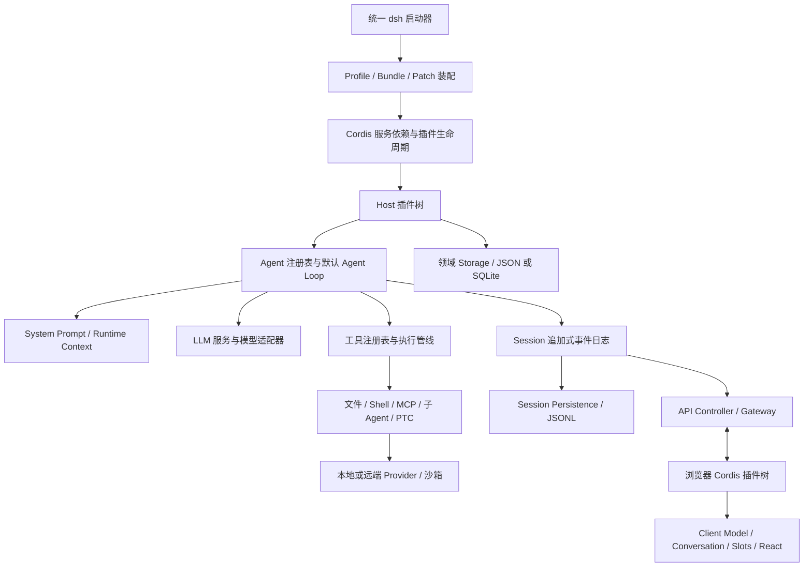

# DeepSeek Harness 架构调研

调研日期：2026-10-01。对象：DeepSeek 官方 `deepseek-ai/deepseek-harness`，命令名 `dsh`。

源码基线：`639ed015397290b3745d163aafe02ffee4aa3f84`，提交日期 2026-09-29；抽查的 `dsh-base` 包版本为 `0.2.0-rc.2`。本文基于官方文档、配置与源码静态阅读，未安装依赖、启动产品或执行模型调用；性能和生产稳定性不在本次验证范围内。链接固定到该提交，避免后续主分支变化混淆结论。

**核心判断：DSH 把 Agent 产品做成了由配置装配的插件系统。Cordis 管理依赖与生命周期，Session 日志承载可重建的会话事实，默认 Agent Loop 驱动模型与工具循环，能力服务和前后端都沿同一插件机制扩展。**

以下“实现事实”来自固定源码与官方文档；“分析判断”明确标注为本文推论。

## 1. 整体结构



这是逻辑职责图；模块之间仍有类型和服务契约依赖，并非所有节点都位于独立进程。

仓库以 TypeScript、ESM、pnpm workspace 为主，`packages/<group>/<package>` 按领域拆包。`vendor/` 保存 Cordis 等基础设施，`apps/` 承载应用入口，`python/` 提供 Python SDK 与运行时包装。大量小包的目的，是让能力、实现和产品组合能独立变化。

依据：[仓库地图](https://github.com/deepseek-ai/deepseek-harness/blob/639ed015397290b3745d163aafe02ffee4aa3f84/AGENTS.md)、[总体架构](https://github.com/deepseek-ai/deepseek-harness/blob/639ed015397290b3745d163aafe02ffee4aa3f84/docs/architecture.md)。

## 2. Cordis：共享机制，能力由插件提供

Cordis 在 DSH 中承担三个基础职责：

- **服务依赖注入**：消费者通过 `ctx.tools`、`ctx.llm` 等服务键访问能力；`inject` 声明依赖，依赖满足后插件才激活。
- **类型化事件**：TypeScript declaration merging 扩展事件地图；不同事件采用观察、串行、并行或 waterfall 等分发语义。
- **生命周期管理**：注册工具、提示词、监听器和适配器都是带 disposer 的 effect，插件卸载时可撤销注册。

`waterfall` 是可包裹下游的中间件链。监听器调用 `next()` 才继续委托，不调用便会短路；其顺序属于行为契约。

“Everything is a plugin”的具体含义是：连 Agent Loop、Session 和工具注册表也以插件形式挂载。插件系统本身仍由 Cordis 提供，公共接口和运行时不变量也依然约束替换实现。

**分析判断：** 这种设计将产品变化更多地转移到配置、服务实现和事件扩展点，但正确性也更依赖生命周期、依赖关系和中间件顺序的治理。

依据：[Cordis 入门](https://github.com/deepseek-ai/deepseek-harness/blob/639ed015397290b3745d163aafe02ffee4aa3f84/docs/cordis-primer.md)、[Scope 实现](https://github.com/deepseek-ai/deepseek-harness/blob/639ed015397290b3745d163aafe02ffee4aa3f84/packages/core/scope/src/store.ts)。

## 3. 配置装配：Profile、Bundle、Preset 是三个层次

| 概念 | 控制范围 | 示例与作用 |
|---|---|---|
| Profile | 一个应用运行时 | `web`、`headless`、`sdk`、`sdk-minimal`、`acp` |
| Bundle | 可分发的插件组合 | `dsh-base` 提供共享能力；应用 Bundle 增加 UI 或协议入口 |
| Patch | 对组合结果的覆盖 | 按插件行 id 替换配置，或插入新行 |
| Agent Preset | 一个 Agent 的子插件组合 | 会话选择不同工具、提示词与行为组合 |

主要配置层按以下顺序应用：

```text
空插件列表
 → Profile 声明的各 Bundle（有序）
 → Profile 自己的 cordis.patch.yml
 → Harness home 的 cordis.patch.yml
 → --patch 覆盖层
```

关键细节：patch 替换目标行的整个 `config`，不是对其字段做深度合并。配置行的排列也不等于插件启动顺序；激活取决于服务依赖。

`web/headless/sdk/acp` 共享 `dsh-base`；`sdk-minimal` 自带完整且显式的最小树，不加载 base。SDK 继续走统一 `dsh` Profile 启动机制。Desktop 携带自己的运行时并通过 Host 复用 Web 应用，不另写一套 Agent 引擎。

Preset 定义更新作用于随后创建的 Agent；活跃 Agent 保留其组合修订。因此配置热更新不能理解为所有活跃会话都会即时切换能力。

依据：[配置装配源码](https://github.com/deepseek-ai/deepseek-harness/blob/639ed015397290b3745d163aafe02ffee4aa3f84/packages/boot/app-boot/src/profile.ts)、[base 配置](https://github.com/deepseek-ai/deepseek-harness/blob/639ed015397290b3745d163aafe02ffee4aa3f84/packages/bundle/base/cordis.patch.yml)、[Preset 契约](https://github.com/deepseek-ai/deepseek-harness/blob/639ed015397290b3745d163aafe02ffee4aa3f84/packages/preset/agent-preset/README.md)、[应用启动](https://github.com/deepseek-ai/deepseek-harness/blob/639ed015397290b3745d163aafe02ffee4aa3f84/docs/architecture.md#application-launch)。

## 4. 核心接口与默认执行器分开

| 模块 | 核心职责 | 服务入口 |
|---|---|---|
| `core/agent` | Agent 接口、注册表、运行期事件 | `ctx.agents` |
| `core/agent-loop` | 默认创建、恢复和循环执行实现 | `ctx.agentLoop` |
| `core/session` | 内存中的追加式会话日志与消息投影 | `ctx.sessions` |
| `core/system-prompt` | 组装提示词片段、变量和工具 schema | `ctx.systemPrompt` |
| `core/tools` | 工具注册、可见性、策略与执行管线 | `ctx.tools` |
| `core/scope` | 按 Agent 隔离注册和生命周期 | 库级原语 |
| `llm/llm` | 模型消息、流协议和适配器边界 | `ctx.llm` |

`Agent` 是接口，默认 `ReactLoopAgent` 是实现。这让上层通过稳定的 Agent 能力操作会话，同时允许替换驱动方式。这里的类名不代表 UI React 组件。

作用域也不只是“请求里带一个 sessionId”：注册通过 Agent 自己的 `ctx` 归属到作用域，影响工具与事件的可见性，并随生命周期释放。它是逻辑隔离，不等于进程或权限隔离。

依据：[默认执行器工厂](https://github.com/deepseek-ai/deepseek-harness/blob/639ed015397290b3745d163aafe02ffee4aa3f84/packages/core/agent-loop/src/index.ts)、[循环实现](https://github.com/deepseek-ai/deepseek-harness/blob/639ed015397290b3745d163aafe02ffee4aa3f84/packages/core/agent-loop/src/agent.ts)、[作用域设计](https://github.com/deepseek-ai/deepseek-harness/blob/639ed015397290b3745d163aafe02ffee4aa3f84/docs/subsystems/scope.md)。

## 5. 一次用户输入如何运行

一个 **Turn** 可以包含零个或多个 **Step**；一个 Step 包含一次模型请求及其工具调用，内部还可能有重试 attempt。

```text
输入进入 inbox
  → turn/start
  → 领取输入、组装提示词与工具 schema
  → agent/pre-step：可改写或拒绝输入，也可触发压缩
  → step/start
  → agent/request + prepareCall：确定实际模型路由与能力
  → 记录 system/user 消息及请求信息
  → deriveMessages：从日志生成并冻结模型请求
  → llm/stream：流式模型响应
  → 结算 assistant/message 或 assistant/attempt
  → tool/call → 工具管线 → tool/result
  → step/end
  → 工具结果或新输入需要处理时继续下一 Step
  → agent/turn-stopping
  → turn/end
```

三个重要边界：

1. `pre-step` 拒绝输入，或首次输入被改写为空，可以结束一个没有 Step 的 Turn。
2. 路由准备阶段取消，不应提前把 system/user 消息提交成已接受的请求输入。
3. 失败或取消时要补齐缺失工具结果等结构，保证后续投影和恢复能解释这段历史。

**分析判断：** 默认循环的复杂度主要来自状态结算、取消与恢复，而非“循环调用模型”本身。

依据：[preStep 与 turn](https://github.com/deepseek-ai/deepseek-harness/blob/639ed015397290b3745d163aafe02ffee4aa3f84/packages/core/agent-loop/src/agent.ts#L264)、[模型路由与请求构造](https://github.com/deepseek-ai/deepseek-harness/blob/639ed015397290b3745d163aafe02ffee4aa3f84/packages/core/agent-loop/src/agent.ts#L570)、[工具调度](https://github.com/deepseek-ai/deepseek-harness/blob/639ed015397290b3745d163aafe02ffee4aa3f84/packages/core/agent-loop/src/tool-calls.ts)。

## 6. Session 日志：上下文、恢复和 UI 的共同事实来源

这里有三类不同事件，不能都当作持久化消息：

| 类别 | 用途 | 示例 |
|---|---|---|
| Session 事件 | 可重建的会话事实 | turn、step、message、tool 等日志事件 |
| Agent 事件 | 拦截或观察活跃执行 | `agent/pre-step`、`agent/request` |
| Capability 事件 | 各能力内部的策略与适配 | `tools/*`、`fs/*` |

模型历史由 `deriveMessages()` 从日志投影得出。设计约束是模型可见的上下文变化必须能从日志重建；并非每个日志事件都发送给模型。更准确地说，是保留足以按协议重建请求的事实，不代表记录所有底层 HTTP 字节。

实时 token 增量经 `agent/assistant-stream` 发布；完成后把紧凑流作为 `assistant/message` 的一部分结算。失败、取消和重试 attempt 也可结算到日志，但 `assistant/attempt` 不进入模型历史。进程在结算前硬崩溃，不能保证保住尚未结算的流。

压缩同样不直接删除旧日志：追加压缩记录，并用带 `surfaceOp: replace` 的消息替换模型所见范围。这样审计历史和当前模型上下文可以不同，同时保留演变依据。

持久化由独立的 `SessionPersistence` 实现。当前仓库提供 JSONL 后端，读写经 SessionHandle，写入受单写者所有权约束。内存事件先进入有界 write-behind 批次，`flush` 是明确的持久化检查点；不能把一次内存 `append` 理解成已经落盘。

恢复路径保留已完成记录，对未结束 Turn 补充缺失结果和结束标记。只读查询可在内存中平衡中断结构，真正恢复写入须获得写所有权。

非会话数据另走 `storage` 的领域接口，后端包括 JSON 和 SQLite。因此不能笼统说“DSH 的所有状态都存在 JSONL”或“Session 默认存在 SQLite”。

依据：[Session 类型](https://github.com/deepseek-ai/deepseek-harness/blob/639ed015397290b3745d163aafe02ffee4aa3f84/packages/core/session/src/types.ts)、[surface 投影](https://github.com/deepseek-ai/deepseek-harness/blob/639ed015397290b3745d163aafe02ffee4aa3f84/packages/core/session/src/surface.ts)、[持久化](https://github.com/deepseek-ai/deepseek-harness/blob/639ed015397290b3745d163aafe02ffee4aa3f84/docs/subsystems/persistence.md)、[压缩](https://github.com/deepseek-ai/deepseek-harness/blob/639ed015397290b3745d163aafe02ffee4aa3f84/docs/subsystems/compaction.md)、[领域存储](https://github.com/deepseek-ai/deepseek-harness/blob/639ed015397290b3745d163aafe02ffee4aa3f84/docs/subsystems/storage.md)。

## 7. 工具管线：执行、策略和呈现分开

逻辑上可以概括为：

```text
参数快照与校验
 → pre-execute 策略
 → 只允许收紧权限的 Guard
 → execute 中间件 / 工具函数
 → 规范化结构化输出
 → post-execute 策略及内容终处理
 → tool/result 结算
```

工具定义不仅包含名字和参数，还包含输出 schema、执行函数、并发安全声明及 UI 呈现接口。模型只接收其允许暴露的 schema 字段，不接收宿主执行和调度元数据。

Guard 只能拒绝或保持现状，不能返回“允许”覆盖已有否决。这是在可组合中间件之外，额外建立不可被后续顺序放宽的约束。

并行执行需要工具显式声明 `isConcurrencySafe`。默认不满足条件的调用形成独占屏障；并行组使用有界调度。执行可以重叠，但策略处理、结果提交和结果携带的上下文保持模型调用顺序。

工具的规范化 JSON 值与模型/界面看到的内容分开：程序化调用可消费结构值，模型可消费文本或内容块，UI 可获得合适的展示。

依据：[工具注册与管线实现](https://github.com/deepseek-ai/deepseek-harness/blob/639ed015397290b3745d163aafe02ffee4aa3f84/packages/core/tools/src/index.ts)、[输出契约](https://github.com/deepseek-ai/deepseek-harness/blob/639ed015397290b3745d163aafe02ffee4aa3f84/docs/subsystems/tools.md)、[并发调度实现](https://github.com/deepseek-ai/deepseek-harness/blob/639ed015397290b3745d163aafe02ffee4aa3f84/packages/core/agent-loop/src/tool-calls.ts)。

## 8. 能力服务：接口、实现和消费者三方解耦

典型能力分为 Service Definition、Service Provider、Consumer：

```text
模型工具 / 功能插件
       ↓ 消费
能力服务接口
       ↑ 实现
本地 / SSH / 其他 Provider
```

文件系统与子进程需要指向一致的执行环境。切换远端实现时，读取文件、Shell、PTY 和 LSP 应看到同一组路径与进程世界，否则“编辑了 A 环境、测试却跑在 B 环境”会破坏 Agent 闭环。

子 Agent 也是可选能力，由具名 Provider 注册表承载：既有进程内 spawn/fork，也有 ACP、Codex、Claude Code、DSH SDK 等实现。服务先检查 Provider 能力，不支持的参数应显式拒绝。子 Agent 的存在不意味着每次任务都会自动启用多 Agent；实验性 Agent Teams 也是另行选择的组合。

Code Mode / PTC 把工具暴露为程序可调用的 binding，让模型写 TypeScript 编排多次工具调用。**当前 base 装配 `ptc-runtime-node`：每次执行启动新的 Node 子进程，应用会话沙箱策略。** 直接 Node API 仍可用，但受已选限制约束；宿主 binding 仍经过工具注册、策略和日志路径。它不是跨调用持久化的 JS REPL，也不能概括成仅靠 Worker 实现的安全沙箱。

依据：[子 Agent](https://github.com/deepseek-ai/deepseek-harness/blob/639ed015397290b3745d163aafe02ffee4aa3f84/docs/subsystems/subagent.md)、[PTC Node 实现说明](https://github.com/deepseek-ai/deepseek-harness/blob/639ed015397290b3745d163aafe02ffee4aa3f84/packages/ptc-runtime/ptc-runtime-node/README.md)、[base 实际选型](https://github.com/deepseek-ai/deepseek-harness/blob/639ed015397290b3745d163aafe02ffee4aa3f84/packages/bundle/base/cordis.patch.yml)。

## 9. 前端同样插件化

Web Client 运行独立的浏览器 Cordis 插件树，业务数据与 React 呈现分层：

```text
Host 权威状态
 → API Controller / 生成的 Remote 接口
 → Client Model（不依赖 React）
 → UI Adapter / Conversation 投影
 → Slots
 → React 组件
```

Host 负责持久化、权限、变更排序和流生产；Client Model 负责对象身份、订阅、重连后的基线替换及请求/推送竞争；组件消费数据和动作，而非直接持有 Host 服务。

Conversation 将会话历史与实时增量组装成 Chat、Trajectory 等视图，Slots 提供 UI 扩展位置。断线恢复按数据域处理：会话历史靠带基线与序号的流和分页修复，工作区状态靠新基线替换；普通通知不能假定可重放。

**分析判断：** 前端独立开发成本高于一个集中式聊天组件，但有利于同一会话支持多种界面和插件式功能扩展。

依据：[Web Client 分层与恢复](https://github.com/deepseek-ai/deepseek-harness/blob/639ed015397290b3745d163aafe02ffee4aa3f84/docs/subsystems/web-client.md)、[API Gateway](https://github.com/deepseek-ai/deepseek-harness/blob/639ed015397290b3745d163aafe02ffee4aa3f84/docs/api-gateway.md)。

## 10. 安全与可靠性的实际边界

- Scope 管注册可见性，沙箱管进程文件效果，两者不是同一层隔离。
- 沙箱模式定义文件效果范围；其文档明确不把网络与进程可见性包括在此词汇中。
- 后端报告 `full` 或 `partial` enforcement，跨平台能力并不完全一致。
- Approval 管决策与审计，沙箱实现具体约束；缺少可用受限后端时不能静默按全权限执行。
- 同进程工具依赖协作式取消，注册表不能硬杀任意同进程代码；PTC 子进程可以通过进程生命周期管理停止。
- 插件的可撤销 effect 撤销注册和运行时资源，不意味着自动回滚已发生的文件修改、外部请求等业务副作用。
- 日志支持请求和上下文重建，不保证重新运行模型或外部工具得到相同结果。

依据：[沙箱语义](https://github.com/deepseek-ai/deepseek-harness/blob/639ed015397290b3745d163aafe02ffee4aa3f84/docs/subsystems/sandbox.md)、[审批语义](https://github.com/deepseek-ai/deepseek-harness/blob/639ed015397290b3745d163aafe02ffee4aa3f84/docs/subsystems/approval.md)、[工具契约](https://github.com/deepseek-ai/deepseek-harness/blob/639ed015397290b3745d163aafe02ffee4aa3f84/docs/subsystems/tools.md)。最后两条是对机制适用范围的分析。

## 11. 架构评价与可借鉴之处

以下为分析判断，不是运行基准结论。

| 设计 | 收益 | 代价或边界 |
|---|---|---|
| 全插件与声明式组合 | 可替换模型、工具、执行器和界面 | 装配复杂，依赖契约与生命周期要求高 |
| 追加日志 + 多种投影 | 同一事实支持上下文、恢复、审计和 UI | 格式迁移、投影一致性和缓存需专门治理 |
| 能力接口与 Provider 分离 | 执行环境和后端可替换 | 必须清楚声明能力差异，不能静默降级 |
| 保守工具并发 | 加速可并行工作，同时保留结果顺序 | 并发安全取决于工具正确声明和共享状态设计 |
| 宿主与客户端共同插件化 | 可扩展成完整 Agent 产品平台 | 学习与维护成本高于任务专用执行器 |

如果为自己的 Harness 选取可落地的设计，建议优先复用以下原则：

1. 定义清楚 Turn、Step、消息、工具结果和取消的结算契约。
2. 以一份会话事实源生成模型上下文与 UI，避免两份历史漂移。
3. 将“是否能执行”的策略与“如何执行”的 Provider 分开。
4. 每项注册绑定明确的所有者与释放时机。
5. 先把单 Agent 的恢复与工具闭环做好，再增加程序化编排和子 Agent。

不必立即复制全部小包和前端插件机制；是否采用同等粒度，取决于产品是否确实需要多种运行组合及第三方扩展。

## 12. 建议源码阅读顺序

1. [架构总览](https://github.com/deepseek-ai/deepseek-harness/blob/639ed015397290b3745d163aafe02ffee4aa3f84/docs/architecture.md) → [Cordis 入门](https://github.com/deepseek-ai/deepseek-harness/blob/639ed015397290b3745d163aafe02ffee4aa3f84/docs/cordis-primer.md)：先建立服务和事件模型。
2. [base YAML](https://github.com/deepseek-ai/deepseek-harness/blob/639ed015397290b3745d163aafe02ffee4aa3f84/packages/bundle/base/cordis.patch.yml) → [profile.ts](https://github.com/deepseek-ai/deepseek-harness/blob/639ed015397290b3745d163aafe02ffee4aa3f84/packages/boot/app-boot/src/profile.ts)：看产品实际装配。
3. [agent.ts](https://github.com/deepseek-ai/deepseek-harness/blob/639ed015397290b3745d163aafe02ffee4aa3f84/packages/core/agent-loop/src/agent.ts) → [tool-calls.ts](https://github.com/deepseek-ai/deepseek-harness/blob/639ed015397290b3745d163aafe02ffee4aa3f84/packages/core/agent-loop/src/tool-calls.ts)：跟一次输入走完执行链。
4. [Session](https://github.com/deepseek-ai/deepseek-harness/blob/639ed015397290b3745d163aafe02ffee4aa3f84/packages/core/session/src/index.ts) → [surface.ts](https://github.com/deepseek-ai/deepseek-harness/blob/639ed015397290b3745d163aafe02ffee4aa3f84/packages/core/session/src/surface.ts)：看原始事实如何成为模型历史。
5. [Tools](https://github.com/deepseek-ai/deepseek-harness/blob/639ed015397290b3745d163aafe02ffee4aa3f84/packages/core/tools/src/index.ts)：看策略、结构化结果和程序化工具接口。
6. [Persistence](https://github.com/deepseek-ai/deepseek-harness/blob/639ed015397290b3745d163aafe02ffee4aa3f84/docs/subsystems/persistence.md) → [Compaction](https://github.com/deepseek-ai/deepseek-harness/blob/639ed015397290b3745d163aafe02ffee4aa3f84/docs/subsystems/compaction.md)：看长会话与重启边界。
7. [Web Client](https://github.com/deepseek-ai/deepseek-harness/blob/639ed015397290b3745d163aafe02ffee4aa3f84/docs/subsystems/web-client.md)：最后理解产品界面如何消费这些事实。

外部入口：[官方仓库](https://github.com/deepseek-ai/deepseek-harness)、[官方文档站](https://deepseek-harness.github.io/deepseek-harness/)、[官方产品介绍](https://www.deepseek.com/harness/)。
