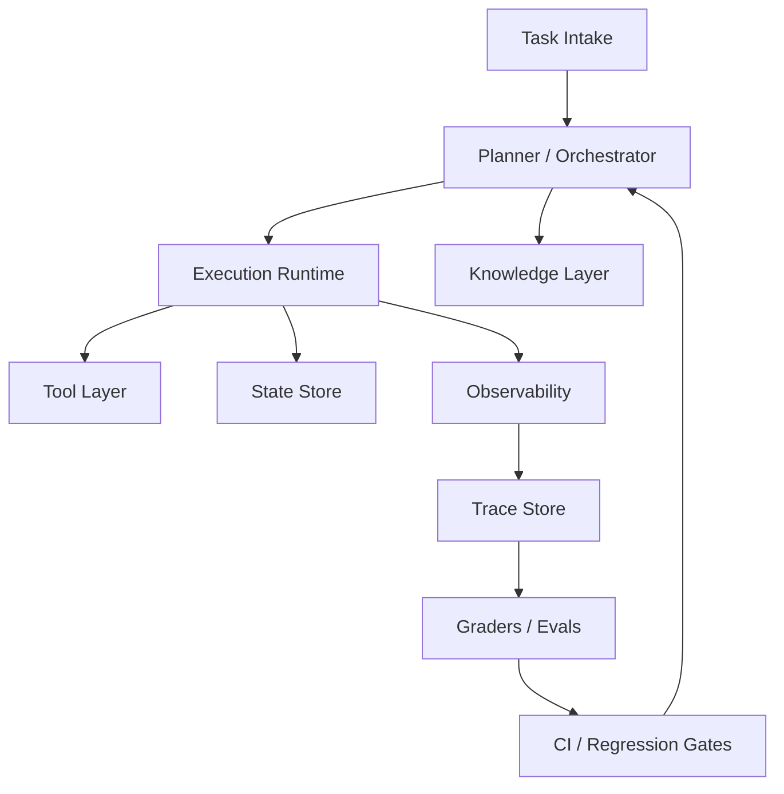

# Harness Engineering for AI Agents

Last updated: 2026-04-05

## Executive summary

Harness engineering is the discipline of making an agent reliably operable by shaping the environment around it, not just the prompt inside it. In practice, the harness is the combination of:

- execution sandboxes
- tool interfaces and schemas
- repository-local knowledge
- observability and traces
- evaluation datasets and graders
- guardrails, policies, and permissions
- replay, regression, and CI loops

The current frontier evidence points in the same direction:

- OpenAI's February 11, 2026 harness engineering writeup argues that agent effectiveness comes from legible repos, structured docs, worktree-local app instances, and agent-visible logs, metrics, and traces, with invariants enforced mechanically rather than via prose alone.
- OpenAI's current agent platform docs emphasize full traces, workflow-level trace grading, datasets, and reproducible evals.
- Anthropic's tool-use docs emphasize that tool quality is mostly a harness problem: detailed tool descriptions, strong schemas, examples, and compact high-signal responses materially affect agent behavior.
- OpenHands recommends Docker-style sandboxing because isolation and reproducibility matter more than convenience when agents execute arbitrary commands.
- Benchmark work such as SWE-bench, WebArena, and tau-bench shows that real-world agent performance drops sharply once tasks become long-horizon, stateful, tool-mediated, and policy-constrained.

The main implication is simple: if you want reliable agents, treat the harness as the product. The model is only one component.

## What "harness engineering" should mean

For AI agents, the harness is the operational interface between model cognition and external reality. A good harness does five things:

1. Gives the agent a controlled world to act in.
2. Makes that world legible enough for the agent to reason about.
3. Records enough structure to debug and grade behavior.
4. Constrains dangerous or low-signal actions.
5. Makes improvements measurable through replayable evals.

That definition is more useful than "agent framework" because it includes the full feedback loop: not just orchestration, but also runtime, scoring, observability, and safety.

## Core findings from current primary sources

### 1. Repo legibility is a first-class harness primitive

OpenAI's harness engineering post is the strongest recent primary-source statement on this point. Their team reports that a short `AGENTS.md` should act as a map, while structured `docs/` becomes the actual system of record. They also describe:

- worktree-local app instances for agent validation
- agent-visible logs, metrics, and traces
- execution plans checked into the repo
- custom linters and structural tests to enforce invariants

This is a strong signal that repo shape is part of the runtime, not just documentation. If the agent cannot find the truth in-repo, that truth effectively does not exist for the agent.

### 2. Traceability is mandatory, not optional

OpenAI's current docs define trace grading as structured scoring over the end-to-end trace of decisions, tool calls, and reasoning steps. The important shift is from output-only evaluation to workflow evaluation.

For harness design, this means you should store at least:

- task input
- model configuration
- tool definitions at run time
- full tool-call sequence
- tool inputs and normalized outputs
- state diffs
- final artifact
- grader outputs

Without traces, you can tell that an agent failed. With traces, you can often tell why.

### 3. Tool interfaces are a major source of agent quality variance

Anthropic's tool docs are unusually explicit here: detailed descriptions, tight schemas, examples, and smaller clearer tool surfaces improve tool behavior. This matches field experience. Agents often fail not because they cannot reason, but because tools are underspecified, ambiguous, bloated, or too numerous.

The harness implication:

- design tools for machine use, not human aesthetics
- prefer semantically stable identifiers
- keep outputs compact and decision-relevant
- consolidate overlapping tools
- version tool contracts

### 4. Isolation and reproducibility should dominate local convenience

OpenHands currently recommends Docker sandboxes, and describes process sandboxes as unsafe because they lack isolation. This is the right default mental model for any serious agent system.

If agents can execute commands, modify files, browse, or call external APIs, then your harness needs:

- isolated execution
- bounded credentials
- deterministic environment setup
- clean reset semantics
- auditable permissions

### 5. Realistic benchmarks are harsh and should shape your design

The benchmark literature shows why shallow demos do not transfer:

- SWE-bench: real repository issue resolution requires long context, execution environments, and coordinated edits across files.
- WebArena: long-horizon realistic web tasks dramatically reduce success rates versus humans.
- tau-bench: user interaction and policy compliance are reliability problems, not just reasoning problems.

This means your harness should be built against realistic failure modes:

- partial observability
- hidden state
- flaky tools
- policy constraints
- retries with side effects
- multi-step plans that can drift

## A practical reference architecture

Use six layers.



### 1. Task intake

Normalize incoming work into a typed task spec.

Minimum shape:

- `task_id`
- `goal`
- `success_criteria`
- `environment`
- `allowed_tools`
- `risk_level`
- `budget`
- `timeout`
- `artifacts_expected`

Do not hand raw user text directly to the runtime as the only source of truth.

### 2. Planner / orchestrator

Responsibilities:

- select model and reasoning budget
- expand or decompose task
- choose tools
- manage retries and backoff
- decide when to stop, escalate, or hand off

This layer should be thin. Complex hidden orchestration logic is hard to evaluate. Prefer explicit plans and explicit state transitions.

### 3. Execution runtime

This is the actual "world" the agent acts in:

- container or VM
- browser session
- mounted repo or staged files
- seeded databases or fixtures
- temporary credentials

Requirements:

- deterministic environment image
- per-run isolation
- reset to known state
- resource limits
- wall-clock timeout
- event capture

### 4. Tool layer

Tools should be organized by domain, with versioned contracts and strict schemas.

Recommended categories:

- `repo.*`
- `shell.*`
- `browser.*`
- `search.*`
- `kb.*`
- `issue_tracker.*`
- `ci.*`
- `payments.*`
- `crm.*`

Each tool should define:

- purpose
- allowed callers
- input schema
- output schema
- side effects
- retry safety
- idempotency notes
- redaction rules

### 5. Knowledge layer

Use progressive disclosure:

- `AGENTS.md` as routing map
- `ARCHITECTURE.md` as top-level system map
- structured docs under `docs/`
- generated references under `docs/generated/`
- active execution plans under `docs/exec-plans/active/`

Keep repo knowledge versioned and mechanically checked. If a rule matters, prefer a linter or test over a paragraph.

### 6. Observability and eval layer

Capture structured traces for every run. Then build three evaluator classes:

- outcome graders: did the task succeed
- process graders: was the sequence acceptable
- policy graders: were constraints violated

This should support:

- single-run debugging
- replay
- batch benchmark runs
- regression detection in CI
- side-by-side agent comparisons

## Design principles that hold up in practice

### Make state transitions explicit

Most agent failures are state-management failures disguised as reasoning failures. Every meaningful step should produce one of:

- no-op
- observation
- proposal
- external side effect
- terminal result

Store step type explicitly.

### Separate planning from acting

Even if both are done by the same model, separate the interfaces. The planning representation should be inspectable and gradable without reinterpreting free-form text.

### Build for replay before you build for scale

A scalable harness without replay is expensive confusion. Replayable traces let you:

- reproduce regressions
- compare prompts and models fairly
- debug tool and policy failures
- measure drift over time

### Normalize tool outputs

Agents perform better when tool outputs are:

- stable
- compact
- typed
- deduplicated
- ordered

Avoid raw HTML, giant logs, or opaque SDK payloads unless absolutely necessary.

### Treat permissions as data

Permissions should be machine-readable policy, not hidden code paths. At a minimum, encode:

- tool allowlists
- network access rules
- write scopes
- approval requirements
- destructive-action policies

### Use benchmark-inspired task corpora

Do not rely on hand-picked demos. Your eval set should include:

- success cases
- adversarial cases
- near-miss ambiguity cases
- tool-failure cases
- policy-edge cases
- multi-turn recovery cases

## Benchmark-guided harness requirements

### Software engineering agents

Use SWE-bench as the mental model, not simple codegen benchmarks.

Harness requirements:

- full repo checkout
- test execution
- patch application
- dependency setup
- multi-file diff capture
- issue-to-fix grading
- flaky-test handling

### Web agents

Use WebArena and BrowserGym as the mental model.

Harness requirements:

- browser automation with screenshots and DOM snapshots
- environment reset
- network trace capture
- deterministic scoring where possible
- support for long-horizon tasks

The recent WebArena-Verified project is especially important because it replaces softer evaluation patterns with audited tasks, deterministic scoring, and offline evaluation via network trace replay.

### Tool-and-policy conversational agents

Use tau-bench as the mental model.

Harness requirements:

- simulated users
- mutable backend state
- policy docs available to the agent
- goal-state comparison
- repeated-trial reliability metrics

If your agent touches support, operations, or transactions, single-run success is not enough. You need repeated-run consistency.

## A concrete repo layout for this project

Recommended starting structure:

```text
AGENTS.md
ARCHITECTURE.md
docs/
  design/
  exec-plans/
    active/
    completed/
  policies/
  generated/
  benchmarks/
evals/
  datasets/
  graders/
  reports/
harness/
  orchestrator/
  runtime/
  tools/
  policies/
  replay/
  telemetry/
sandboxes/
  docker/
  fixtures/
benchmarks/
  swe/
  web/
  tool_user/
traces/
  schemas/
scripts/
```

What goes where:

- `AGENTS.md`: short routing layer for agents
- `ARCHITECTURE.md`: architectural invariants
- `docs/policies/`: permission and escalation rules
- `harness/runtime/`: sandbox lifecycle, environment reset, credentials
- `harness/tools/`: versioned tool definitions and adapters
- `harness/replay/`: trace replay and deterministic reruns
- `harness/telemetry/`: trace, metrics, event schemas
- `evals/datasets/`: task corpora
- `evals/graders/`: outcome, process, and policy graders
- `benchmarks/`: adapters for SWE-bench, BrowserGym/WebArena, tau-bench-like tasks

## Minimum viable harness

If you are starting from zero, build this order:

1. Docker-based isolated runtime with reset.
2. Small typed tool surface: shell, patch, repo read, test run.
3. Structured trace logging for every step.
4. Local dataset of 20 to 50 representative tasks.
5. Outcome graders plus one policy grader.
6. CI job that replays the dataset on each orchestrator or prompt change.

Do not start with:

- multi-agent routing
- vector memory
- complex self-reflection loops
- broad tool catalogs
- LLM-as-judge everywhere

Those add cost and ambiguity before you have a stable measurement baseline.

## Metrics that actually matter

Track these by task type, tool profile, and model version.

Primary metrics:

- task success rate
- pass^k or repeated-run consistency
- cost per successful task
- wall-clock latency
- human intervention rate
- policy violation rate
- destructive action rate

Debugging metrics:

- tool selection error rate
- schema validation failure rate
- retry count
- recovery-from-failure rate
- steps per successful task
- context bytes consumed per run

For coding agents specifically:

- tests passed delta
- diff size
- files touched
- revert rate
- follow-up fix rate after merge

## Common failure patterns

### Overloading the prompt instead of improving the harness

This is the classic mistake. If the same failure recurs, encode the fix into one of:

- a tool contract
- a linter
- a fixture
- a policy
- a grader
- a doc map

Not another giant instruction block.

### Using black-box success scoring only

Output-only grading hides process failures, unsafe retries, and brittle tool use. Add process and policy graders early.

### Letting environments drift

If resets are weak, evals become noise. Pin images, seed data, and make teardown part of the harness contract.

### Exposing too many similar tools

Tool ambiguity creates selection errors. Consolidate aggressively.

### Storing important knowledge outside the repo

If key architecture, policies, or task recipes live in chat or human memory, agent performance will look inconsistent because the environment is inconsistent.

## Recommended near-term build plan

### Phase 1: foundation

- create the repo maps: `AGENTS.md`, `ARCHITECTURE.md`, `docs/`
- define trace schema
- implement isolated sandbox lifecycle
- define first 5 to 10 core tools

### Phase 2: measurement

- create initial dataset of realistic tasks
- add deterministic task fixtures
- implement outcome and policy graders
- wire benchmark runs into CI

### Phase 3: realism

- add browser tasks or repo tasks depending on target use case
- add replay
- add repeated-run reliability measurement
- add tool-failure simulation

### Phase 4: throughput

- add parallel eval execution
- add benchmark slices by risk and cost
- add promotion gates based on regression thresholds

## Opinionated recommendations

- Prefer containerized sandboxes over local-process execution.
- Prefer repo-local knowledge over external knowledge bases for operational truths.
- Prefer explicit state machines over hidden orchestration magic.
- Prefer deterministic graders over LLM judges when ground truth exists.
- Prefer fewer, better tools over many overlapping tools.
- Prefer replayable traces over anecdotal demos.
- Prefer benchmark-shaped tasks over founder-demo tasks.

## Bottom line

The frontier has shifted. The limiting factor for agent reliability is increasingly the harness, not raw model capability. The best recent evidence supports a straightforward thesis:

- make the environment legible
- make actions constrained
- make runs traceable
- make evaluation replayable
- make knowledge versioned
- make correctness mechanical where possible

If you build those pieces first, model upgrades compound. If you do not, model upgrades mostly produce faster confusion.

## Sources

- OpenAI, "Harness engineering: leveraging Codex in an agent-first world" (February 11, 2026): https://openai.com/index/harness-engineering/
- OpenAI API docs, "Agents SDK": https://developers.openai.com/api/docs/guides/agents-sdk
- OpenAI API docs, "Using tools": https://developers.openai.com/api/docs/guides/tools
- OpenAI API docs, "Agent evals": https://developers.openai.com/api/docs/guides/agent-evals
- OpenAI API docs, "Trace grading": https://developers.openai.com/api/docs/guides/trace-grading
- Anthropic docs, "Define tools": https://platform.claude.com/docs/en/agents-and-tools/tool-use/define-tools
- OpenHands docs, "Sandbox overview": https://docs.openhands.dev/openhands/usage/sandboxes/overview
- OpenHands docs, "Docker sandbox": https://docs.openhands.dev/openhands/usage/sandboxes/docker
- SWE-bench paper: https://arxiv.org/abs/2310.06770
- WebArena paper: https://arxiv.org/abs/2307.13854
- BrowserGym repository: https://github.com/ServiceNow/BrowserGym
- WebArena-Verified repository: https://github.com/ServiceNow/webarena-verified
- tau-bench paper: https://arxiv.org/abs/2406.12045
- tau-bench repository: https://github.com/sierra-research/tau-bench
