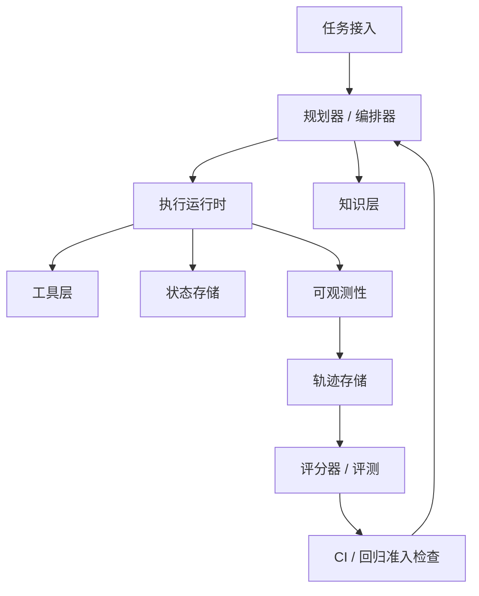

# AI 智能体的 Harness Engineering（运行支撑体系工程）

原文最后更新：2026-04-05

## 执行摘要

Harness Engineering 是一门通过构建智能体周围的运行环境，使其可靠执行任务的工程学科，其关注范围超出了智能体内部的提示词。在实践中，Harness（运行支撑体系）由以下部分共同组成：

- 执行沙箱
- 工具接口与数据模式（Schema）
- 代码仓库内的知识
- 可观测性与执行轨迹
- 评测数据集与评分器
- 防护机制、策略与权限
- 回放、回归测试与持续集成（CI）闭环

当前前沿资料指向了相同的方向：

- OpenAI 于 2026 年 2 月 11 日发布的 Harness Engineering 文章认为，智能体的有效性来自易于理解的代码仓库、结构化文档、每个工作树独立运行的应用实例，以及智能体能够访问的日志、指标和执行轨迹。关键不变量应通过自动化机制强制执行，而不能仅依赖文字说明。
- OpenAI 当前的智能体平台文档强调完整执行轨迹、工作流级别的轨迹评分、数据集与可复现评测。
- Anthropic 的工具使用文档强调，工具质量在很大程度上取决于运行支撑体系：详细的工具描述、严格的数据模式、示例，以及精简且信息密度高的响应，都会显著影响智能体行为。
- OpenHands 推荐使用 Docker 一类的沙箱，因为当智能体执行任意命令时，隔离性和可复现性比使用上的便利更重要。
- SWE-bench、WebArena 和 tau-bench 等基准研究表明，一旦任务变为长程、有状态、依赖工具且受策略约束的任务，智能体在真实场景中的表现就会明显下降。

核心启示很简单：要构建可靠的智能体，就应把运行支撑体系当作产品来建设。模型只是其中一个组件。

## 如何理解 Harness Engineering

对 AI 智能体而言，Harness 是连接模型认知与外部现实的运行接口。一个好的运行支撑体系需要做到五件事：

1. 为智能体提供一个受控的行动环境。
2. 让这个环境足够清晰，使智能体能够理解并推理。
3. 记录足够的结构化信息，以便调试和评估行为。
4. 限制危险或信息价值低的动作。
5. 通过可回放的评测，让改进效果可以衡量。

这个定义比“智能体框架”更实用，因为它包含完整的反馈闭环：除了编排，还涵盖运行时、评分、可观测性和安全性。

## 当前一手资料中的核心发现

### 1. 仓库的可理解性是运行支撑体系的一等基础能力

OpenAI 的 Harness Engineering 文章，是近期一手资料中对这一点最有力的阐述。其团队指出，简短的 `AGENTS.md` 应充当导航图，而结构化的 `docs/` 才是真正的权威记录。他们还描述了以下做法：

- 为每个工作树提供独立的应用实例，供智能体验证
- 让智能体能够访问日志、指标和执行轨迹
- 将执行计划纳入仓库版本管理
- 使用自定义静态检查器和结构测试，强制维持不变量

这明确表明，仓库组织方式是运行环境的一部分，而不仅是文档问题。如果智能体无法在仓库中找到某项事实，那么对它而言，这项事实实际上就不存在。

### 2. 可追溯性是必需能力

OpenAI 当前的文档将轨迹评分定义为：对涵盖决策、工具调用和推理步骤的端到端轨迹进行结构化评分。关键变化是从仅评估输出，转向评估整个工作流。

对于运行支撑体系的设计，这意味着至少应该保存：

- 任务输入
- 模型配置
- 运行时的工具定义
- 完整的工具调用序列
- 工具输入与标准化后的输出
- 状态差异
- 最终产物
- 评分器输出

没有执行轨迹，你只能知道智能体失败了。有了轨迹，通常还能知道失败原因。

### 3. 工具接口是智能体表现差异的重要来源

Anthropic 的工具文档对此给出了非常明确的说明：详细的描述、严格的数据模式、示例，以及规模更小、含义更清晰的工具接口集合，都能改善工具使用表现。这也符合实践经验。智能体失败的原因往往不是缺乏推理能力，而是工具定义不完整、含义模糊、过于臃肿或数量太多。

对运行支撑体系的启示是：

- 面向机器使用来设计工具，而非追求人类眼中的形式美感
- 优先使用语义稳定的标识符
- 保持输出精简，并与决策直接相关
- 合并功能重叠的工具
- 对工具契约进行版本管理

### 4. 隔离性与可复现性应优先于本地使用的便利

OpenHands 当前推荐 Docker 沙箱，并将进程沙箱描述为不安全，因为它缺乏隔离。这应成为严肃构建智能体系统时的默认认知。

如果智能体可以执行命令、修改文件、浏览网页或调用外部 API，那么运行支撑体系就需要具备：

- 隔离执行
- 权限范围受限的凭据
- 确定性的环境初始化
- 明确、干净的重置语义
- 可审计的权限

### 5. 贴近现实的基准很严苛，应据此设计系统

基准研究解释了为什么简单演示中的表现难以迁移到真实场景：

- SWE-bench：解决真实仓库中的问题，需要长上下文、执行环境，以及跨文件的协同修改。
- WebArena：在贴近现实的长程网页任务中，智能体的成功率明显低于人类。
- tau-bench：用户交互和策略遵循不仅是推理问题，也是可靠性问题。

因此，运行支撑体系应针对真实的失败模式进行构建：

- 只能观察到部分信息
- 存在隐藏状态
- 工具表现不稳定
- 受到策略约束
- 重试可能带来副作用
- 多步骤计划可能逐渐偏离目标

## 实用的参考架构

采用六层结构。



### 1. 任务接入

将输入的工作规范化为带有类型定义的任务规格。

最少应包含以下字段：

- `task_id`：任务标识
- `goal`：目标
- `success_criteria`：成功标准
- `environment`：运行环境
- `allowed_tools`：允许使用的工具
- `risk_level`：风险等级
- `budget`：预算
- `timeout`：超时时间
- `artifacts_expected`：预期产物

不要直接把用户的原始文本作为唯一依据交给运行时。

### 2. 规划器 / 编排器

职责包括：

- 选择模型和推理预算
- 展开或拆解任务
- 选择工具
- 管理重试和退避
- 决定何时停止、升级处理或移交

这一层应保持精简。复杂且隐藏的编排逻辑很难评估，应优先采用显式计划与显式状态转换。

### 3. 执行运行时

这是智能体实际行动的“世界”：

- 容器或虚拟机
- 浏览器会话
- 挂载的仓库或预先准备的文件
- 已填充初始数据的数据库或测试夹具
- 临时凭据

要求包括：

- 确定性的环境镜像
- 每次运行独立隔离
- 能够重置到已知状态
- 资源限制
- 按实际经过时间计算的超时限制
- 事件采集

### 4. 工具层

工具应按领域组织，采用版本化契约和严格的数据模式。

推荐分类：

- `repo.*`
- `shell.*`
- `browser.*`
- `search.*`
- `kb.*`
- `issue_tracker.*`
- `ci.*`
- `payments.*`
- `crm.*`

每个工具都应定义：

- 用途
- 允许的调用方
- 输入数据模式
- 输出数据模式
- 副作用
- 重试安全性
- 幂等性说明
- 敏感信息脱敏规则

### 5. 知识层

采用渐进式信息披露：

- 用 `AGENTS.md` 作为导航图
- 用 `ARCHITECTURE.md` 作为系统顶层地图
- 将结构化文档放在 `docs/` 下
- 将自动生成的参考资料放在 `docs/generated/` 下
- 将进行中的执行计划放在 `docs/exec-plans/active/` 下

对仓库知识进行版本管理，并通过自动化机制检查。如果一条规则很重要，就应优先用静态检查器或测试来落实，而非仅写一段说明。

### 6. 可观测性与评测层

为每次运行采集结构化轨迹，然后构建三类评估器：

- 结果评分器：任务是否成功
- 过程评分器：执行序列是否可接受
- 策略评分器：是否违反约束

这一层应支持：

- 单次运行调试
- 回放
- 批量基准测试
- CI 中的回归检测
- 智能体之间的并列比较

## 经得起实践检验的设计原则

### 让状态转换显式化

多数智能体失败，本质上是看起来像推理失败的状态管理问题。每个有意义的步骤都应归为以下类型之一：

- 无操作
- 观察
- 提案
- 外部副作用
- 终止结果

应显式存储步骤类型。

### 将规划与行动分开

即使二者由同一个模型完成，也应分离接口。规划的表示形式应能够直接检查和评分，无须重新解读自由形式的文本。

### 先具备回放能力，再追求规模化

缺乏回放能力的系统即使能够扩展，也只会让混乱变得更加昂贵。可回放的轨迹能帮助你：

- 复现回归问题
- 公平比较提示词和模型
- 调试工具使用和策略执行中的失败
- 衡量表现随时间发生的漂移

### 标准化工具输出

当工具输出具备以下特点时，智能体通常表现更好：

- 稳定
- 精简
- 有类型定义
- 已去重
- 有序

除非确有必要，否则应避免原始 HTML、巨量日志或难以理解的 SDK 数据载荷。

### 将权限视为数据

权限应以机器可读的策略表达，而不是隐藏在代码分支中。至少应明确编码以下内容：

- 工具允许列表
- 网络访问规则
- 写入范围
- 审批要求
- 破坏性操作策略

### 构建借鉴基准设计的任务集

不要依赖精心挑选的演示案例。评测集应包括：

- 成功案例
- 对抗案例
- 容易因细微歧义而误判的案例
- 工具失败案例
- 策略边界案例
- 多轮交互中的故障恢复案例

## 由基准测试引导的运行支撑要求

### 软件工程智能体

应以 SWE-bench 为参考，而不是简单的代码生成基准。

运行支撑体系需要具备：

- 完整仓库检出
- 测试执行
- 补丁应用
- 依赖配置
- 多文件差异采集
- 从问题到修复结果的评分
- 对不稳定测试的处理

### 网页智能体

以 WebArena 和 BrowserGym 为参考。

运行支撑体系需要具备：

- 支持截图和 DOM 快照的浏览器自动化
- 环境重置
- 网络轨迹采集
- 尽可能采用确定性评分
- 支持长程任务

近期的 WebArena-Verified 项目尤其值得关注，因为它用经过审核的任务、确定性评分，以及通过网络轨迹回放进行的离线评测，替代了较为宽松的评估方式。

### 使用工具且受策略约束的对话智能体

以 tau-bench 为参考。

运行支撑体系需要具备：

- 模拟用户
- 可变的后端状态
- 智能体能够访问的策略文档
- 与目标状态进行比较
- 重复试验下的可靠性指标

如果智能体涉及客服、运营或交易，单次运行成功还不够，必须衡量多次运行的一致性。

## 本项目的具体仓库布局

建议从以下结构开始：

```text
AGENTS.md
ARCHITECTURE.md
docs/
  design/
  exec-plans/
    active/
    completed/
  policies/
  generated/
  benchmarks/
evals/
  datasets/
  graders/
  reports/
harness/
  orchestrator/
  runtime/
  tools/
  policies/
  replay/
  telemetry/
sandboxes/
  docker/
  fixtures/
benchmarks/
  swe/
  web/
  tool_user/
traces/
  schemas/
scripts/
```

各部分的用途：

- `AGENTS.md`：面向智能体的简短导航层
- `ARCHITECTURE.md`：架构不变量
- `docs/policies/`：权限与升级处理规则
- `harness/runtime/`：沙箱生命周期、环境重置、凭据管理
- `harness/tools/`：版本化的工具定义与适配器
- `harness/replay/`：轨迹回放与确定性重跑
- `harness/telemetry/`：轨迹、指标和事件的数据模式
- `evals/datasets/`：任务集
- `evals/graders/`：结果、过程和策略评分器
- `benchmarks/`：面向 SWE-bench、BrowserGym/WebArena 及 tau-bench 类任务的适配器

## 最小可用运行支撑体系

如果从零开始，建议按以下顺序构建：

1. 基于 Docker、支持重置的隔离运行时。
2. 精简且有类型定义的工具接口集合：Shell、补丁、仓库读取、测试运行。
3. 覆盖每一步的结构化轨迹日志。
4. 包含 20 至 50 个代表性任务的本地数据集。
5. 结果评分器，以及一个策略评分器。
6. 在每次编排器或提示词变更后，回放数据集的 CI 任务。

不要一开始就引入：

- 多智能体路由
- 向量记忆
- 复杂的自我反思循环
- 庞大的工具目录
- 到处使用大语言模型充当裁判

在建立稳定的衡量基线之前，这些能力只会增加成本和不确定性。

## 真正重要的指标

按任务类型、工具配置和模型版本分别跟踪以下指标。

核心指标：

- 任务成功率
- `pass^k` 或重复运行一致性
- 每个成功任务的成本
- 实际耗时
- 人工介入率
- 策略违规率
- 破坏性操作发生率

调试指标：

- 工具选择错误率
- 数据模式校验失败率
- 重试次数
- 故障恢复率
- 每个成功任务的执行步数
- 每次运行消耗的上下文字节数

针对编程智能体，还应跟踪：

- 通过测试数量的变化
- 代码差异规模
- 涉及的文件数量
- 回退率
- 合并后的后续修复率

## 常见失败模式

### 不断堆叠提示词，却不改进运行支撑体系

这是典型错误。如果同一种失败反复出现，应将修复措施落实到以下某一处：

- 工具契约
- 静态检查器
- 测试夹具
- 策略
- 评分器
- 文档导航图

而不是再增加一大段指令。

### 只使用黑盒式成功评分

只对输出评分，会掩盖过程失败、不安全的重试和脆弱的工具使用方式。应尽早加入过程评分器和策略评分器。

### 放任环境漂移

如果重置机制不可靠，评测结果就会充满噪声。应固定镜像版本、填充初始数据，并将运行结束后的环境清理纳入运行支撑体系的契约。

### 暴露过多相似工具

工具之间含义不清、边界重叠，会导致选择错误。应积极合并。

### 将重要知识放在仓库之外

如果关键架构、策略或任务操作方法只存在于聊天记录或人的记忆中，智能体就会表现得不一致，因为它面对的环境本身就不一致。

## 建议的近期建设计划

### 第一阶段：基础能力

- 建立仓库导航：`AGENTS.md`、`ARCHITECTURE.md`、`docs/`
- 定义轨迹数据模式
- 实现隔离沙箱的生命周期管理
- 定义首批 5 至 10 个核心工具

### 第二阶段：衡量能力

- 创建包含真实任务的初始数据集
- 加入确定性的任务测试夹具
- 实现结果评分器与策略评分器
- 将基准测试接入 CI

### 第三阶段：贴近真实场景

- 根据目标用途加入浏览器任务或仓库任务
- 加入回放能力
- 加入重复运行可靠性衡量
- 加入工具故障模拟

### 第四阶段：提升吞吐量

- 支持并行执行评测
- 按风险和成本划分基准测试子集
- 根据回归阈值设置版本晋级检查

## 明确的取舍建议

- 优先使用容器化沙箱，而不是直接在本地进程中执行。
- 对运行所依赖的权威信息，优先采用仓库内知识，而不是外部知识库。
- 优先采用显式状态机，而不是隐藏的复杂编排逻辑。
- 存在标准答案时，优先采用确定性评分器，而不是大语言模型裁判。
- 优先提供少量高质量工具，而不是大量功能重叠的工具。
- 优先建立可回放轨迹，而不是依赖个别演示案例。
- 优先采用按基准要求设计的任务，而不是只适合创始人展示的任务。

## 结论

前沿实践的重点已经发生变化。限制智能体可靠性的因素越来越多地来自运行支撑体系，而不只是模型的原始能力。近期最有力的证据支持以下主张：

- 让环境易于理解
- 让行动受到约束
- 让运行过程可追溯
- 让评测能够回放
- 让知识纳入版本管理
- 尽可能通过自动化机制保障正确性

先构建好这些基础，模型升级的收益才会不断累积。否则，模型升级大多只会让混乱发生得更快。

## 参考来源

- OpenAI，《Harness Engineering：在智能体优先的世界中运用 Codex》（2026 年 2 月 11 日）：[原文](https://openai.com/index/harness-engineering/)
- OpenAI API 文档：[Agents SDK](https://developers.openai.com/api/docs/guides/agents-sdk)
- OpenAI API 文档：[工具使用](https://developers.openai.com/api/docs/guides/tools)
- OpenAI API 文档：[智能体评测](https://developers.openai.com/api/docs/guides/agent-evals)
- OpenAI API 文档：[轨迹评分](https://developers.openai.com/api/docs/guides/trace-grading)
- Anthropic 文档：[定义工具](https://platform.claude.com/docs/en/agents-and-tools/tool-use/define-tools)
- OpenHands 文档：[沙箱概述](https://docs.openhands.dev/openhands/usage/sandboxes/overview)
- OpenHands 文档：[Docker 沙箱](https://docs.openhands.dev/openhands/usage/sandboxes/docker)
- [SWE-bench 论文](https://arxiv.org/abs/2310.06770)
- [WebArena 论文](https://arxiv.org/abs/2307.13854)
- [BrowserGym 仓库](https://github.com/ServiceNow/BrowserGym)
- [WebArena-Verified 仓库](https://github.com/ServiceNow/webarena-verified)
- [tau-bench 论文](https://arxiv.org/abs/2406.12045)
- [tau-bench 仓库](https://github.com/sierra-research/tau-bench)
