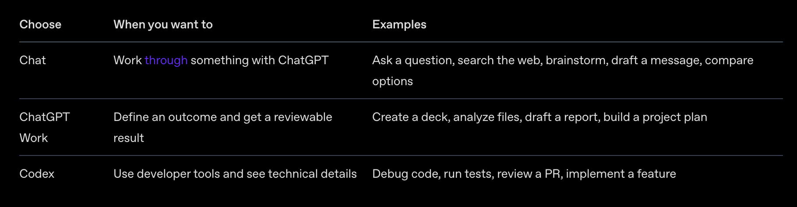
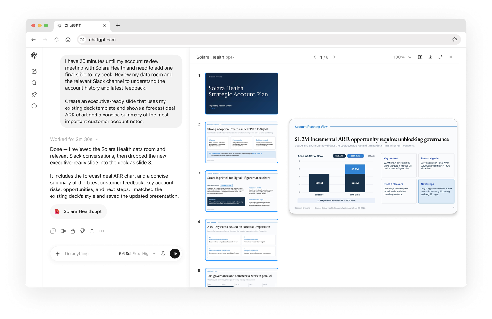
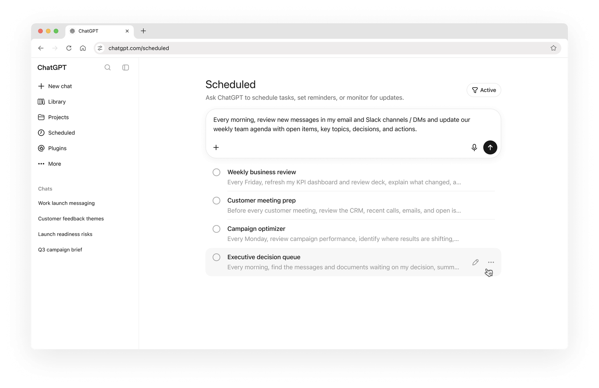

# 起步

## 准备阶段

- 推荐macOS 电脑，强烈建议 
- 能够访问外网（要tz） 
  - 推荐自己搭，比较稳定，也比较安全 
  - 机场服务慎用，无法推荐

- 注册chatgpt 帐号
  - 推荐使用google gmail 邮箱

- 支付处理
  - 一条充值路径
    - 先注册美国地区的 Apple ID 
    - 支付宝小程序 pockyt shop 购买美国地区的 Apple 礼品卡 ， 充值到 chatgpt for iOS 


## 熟悉界面

- 初步认始 

  - 下载安装

  - 认识界面部局

  - 界面功能介绍

- 三种工作模式

  - Chat 

    - 聊天模式， 搜索网页， 头脑风爆， 日常快速问答 

  - Chat Work

    - 适合常见的文字工作，分析文件，起草报告，创建项目的规划 

  - Codex 

    - 代码编写、使用开发者工具、调试代码、运行测试、审查 PR 等。

    


# ChatGPT Work 入门指南

## ChatGPT Work 简介

ChatGPT Work 是一种将实际工作委派给 ChatGPT 的方式。

如果你需要获得答案、解释、头脑风暴结果或简短草稿，请使用 Chat（对话）。如果你希望 ChatGPT 完成一项结果明确的任务，例如制作简报、演示文稿、分析报告、定期更新、工作流，或生成一份可供审阅和使用的文件，请使用 ChatGPT Work。进一步了解如何[结合使用 Chat 与 ChatGPT Work](https://learn.chatgpt.com/docs/use-chatgpt)。

ChatGPT Work 可以使用你的文件、插件和已获授权的工具来检索信息、创建成品文件、运行工作流，并完成可直接交由你审阅的工作。在执行过程中，你可以查看进度、回答问题、调整方向，以及批准重要操作。

在[桌面应用](https://learn.chatgpt.com/docs/app)中，如果相关工具可用，ChatGPT Work 还可以使用本地文件、应用程序和浏览器。

如果你以前曾使用 Codex 处理非编程工作，可以继续使用 Codex，也可以改用 ChatGPT Work。ChatGPT Work 具备相同的核心能力，同时提供了一套专为日常工作设计的使用体验。

## 首先可以尝试什么

首先，切换到 **Work（工作）**。然后选择你的第一项任务。

合适的任务通常具有明确的预期成果、少量参考资料，以及一份可以审阅的输出结果。

### 选择本地工作或云端工作

在桌面应用中，打开编辑框中标有 **Work locally（在本地工作）** 的选项。如果其中显示 **Cloud（云端）**，并且你希望在关闭应用或电脑关机后让 ChatGPT Work 继续运行，或者希望通过网页端或移动应用继续对话，请选择该选项。

如果任务需要使用电脑上的文件或应用程序，请继续选择 **Work locally（在本地工作）**。

云端模式也适用于需要长期研究或检查网站的计划任务，因为这些任务的运行不依赖于你的电脑是否处于开机状态。

以下是三个可以立即开始尝试的常见用例：

### 创建演示文稿

使用 ChatGPT Work，将笔记、文档、研究资料或会议材料整理成结构清晰的演示文稿。



**提示词示例：**

```
审阅随附的参考资料，并为[受众]制作一份八页的演示文稿。重点介绍主要主题，加入支持性证据，并标出所有需要人工审阅的内容。请先返回草稿供我审阅。
```

### 创建对比电子表格

使用 ChatGPT Work，将笔记、文件或研究资料整理成用于比较不同选项的电子表格，帮助你作出决策。


**提示词示例：**

```
创建一份电子表格，对与[待决事项]有关的选项进行比较。使用随附的笔记和参考资料，加入最重要的评估标准，为每个选项评分，标出风险或缺失的信息，并添加一个汇总工作表，给出建议和后续步骤。
```

### 设置定期更新

如果你希望 ChatGPT Work 定期重复执行、监控或刷新某项内容，请使用计划任务。



**提示词示例：**

```
每周一上午，查看 @Slack 和 @Google Drive 中与[项目]有关的新动态。根据其中的决策、阻碍因素、负责人和待解决问题，更新会议议程。请在分享之前先将草稿发送给我。
```

进一步了解[计划任务](https://learn.chatgpt.com/docs/automations?surface=app)。


## 使用 ChatGPT Work 的最佳实践

如果你希望 ChatGPT 完成一项任务、创建文件，或者持续管理某项工作，可以使用 ChatGPT Work。它特别适合以下类型的任务：

- 需要使用多个信息来源、插件、工具或执行步骤。
- 如果手动完成，需要投入较多时间。
- 需要生成一份可供审阅、编辑或重复使用的成果。
- 需要定期重复、监控或更新。

为了获得更好的结果，请告诉 ChatGPT：你需要什么成果、需要使用哪些信息来源或插件、需要遵守哪些限制、什么样的结果才算符合要求，以及何时应停下来等待审阅或批准。

**不要只说：** 为我制作一份有关客户研究的演示文稿。

**可以使用这样的提示词：**

```
审阅随附的访谈记录和调查结果。为产品管理层会议制作一份八页的演示文稿。重点说明最常见的三个客户问题，加入支持性证据，将研究发现与建议分开呈现，并标出所有缺乏充分证据支持的观点。使用 @Google Drive 中的源文档。在将内容视为最终版本之前，请先返回草稿供我审阅。
```

进一步了解[如何为 ChatGPT Work 编写提示词](https://learn.chatgpt.com/docs/prompting#prompting-for-work)。

## 添加插件，以获得更多上下文并改善输出结果


插件可以将 ChatGPT Work 连接到团队使用的工具，例如 Slack、Google Drive、SharePoint、电子邮件、日历、客户关系管理系统和项目跟踪工具。

- 在左侧边栏中选择 **Plugins（插件）**，查看插件库。
- 安装与你的工作最相关的插件。
- 如果需要让 ChatGPT 使用某个特定工具，请在提示词中输入 `@` 和插件名称。

进一步了解[插件](https://learn.chatgpt.com/docs/plugins)。


## 高效使用 ChatGPT Work

ChatGPT Work 最适合需要多个步骤、多个信息来源或多种工具的实质性任务，以及必须生成完整交付成果的任务。由于 ChatGPT 会代表你完成更多工作，耗时更长或更加复杂的任务可能会消耗更多额度。建议关注最终成果所带来的价值，而不是提示词的数量。

通过设置合理的边界，让任务保持聚焦。例如：

- “仅使用这些信息来源。”
- “比较排名前五的选项。”
- “在发送任何内容之前停止并等待批准。”

如果只是需要快速提问、简短改写，或者只需要建议来辅助决策，请改用 Chat（对话）。

进一步了解[如何高效使用 ChatGPT Work](https://learn.chatgpt.com/docs/prompting#prompting-for-work)。

## 更多使用场景

探索适用于常见团队和任务的 ChatGPT Work 实用工作流。


# 提示词

https://learn.chatgpt.com/docs/prompting


## 提示词概述

提示词是你告诉 ChatGPT 自己想了解、创建或更改什么的方式。提示词可以是问题、指令或目标。你不需要使用技术语法，也不必遵循严格的公式。先用自己的语言描述需求，查看回复，然后通过后续消息逐步调整结果。

简短的提示词通常就已足够。对于规模较大或更重要的任务，请包含其中真正重要的部分：

- **目标：** ChatGPT 应该做什么？
- **上下文：** 哪些信息或来源会有所帮助？
- **输出：** 你需要什么格式、长度或详细程度？
- **边界：** 哪些内容必须保持不变？ChatGPT 应避免什么？执行哪些操作前需要先征求你的确认？

只使用有帮助的部分即可。你不必填写所有项目，也不需要遵循固定格式。

## 描述你需要的结果

先描述结果，而不是列出详细步骤。如果受众或格式会影响 ChatGPT 应该生成的内容，请一并说明。

```
将这些会议记录整理成一份面向项目团队的简短进展说明。
把已做出的决定和后续步骤放在最前面。
```

这段提示词说明了需要创建什么，以及内容将由谁阅读。当流程本身很重要时，请描述流程；否则，可以给 ChatGPT 留出空间，让它自行搜索、比较信息并调整方法。


## 添加有用的上下文

提供那些可能改变结果的信息。只添加真正相关的来源，并说明 ChatGPT 应从每项来源中获取什么。

- 如果需要 ChatGPT 总结、比较或转换内容，或者[创建供你审核的文件](https://learn.chatgpt.com/docs/artifacts-viewer)，请附上文档、电子表格、演示文稿或 PDF 文件。
- 如果任务依赖视觉上下文，请添加屏幕截图、图表或其他[图像输入](https://learn.chatgpt.com/docs/image-inputs)。请指出图像中真正重要的区域，不要只依赖图像本身传达需求。
- 如果答案依赖当前信息，请要求 ChatGPT 使用[网页搜索](https://learn.chatgpt.com/docs/web-search)；如果需要核查结果，也请要求它提供来源。
- 如果相关对话需要共享文件、来源或本地文件夹，请使用[项目](https://learn.chatgpt.com/docs/projects)。

### 使用已连接的来源

当 ChatGPT 可以访问已连接的来源时，请说明它应该到哪里查找，以及需要找到什么。你不必逐一描述它应该执行的每项搜索。

```
使用 Drive 中最新的项目计划，以及该项目 Slack 频道中的相关决定和进展，
准备一份项目状态更新。
```

使用已连接的来源需要安装相应插件。具体是否可用，可能取决于你的套餐和工作区设置。

### 使用插件

插件可以为 ChatGPT 和 Codex 提供可复用指令，并将它们连接到 Google Drive、Gmail、Slack 和 GitHub 等工具。两个产品从同一个统一目录中获取公开插件。描述你需要的结果，然后让当前使用端从可用工具中进行选择。在 ChatGPT 中，可以在输入框中输入 `@` 来选择特定插件。

[了解插件 Plugin 在 ChatGPT 和 Codex 中查找、安装并使用插件。](https://learn.chatgpt.com/docs/plugins)


### 个性化 ChatGPT

对于需要跨对话生效的偏好，请前往 **设置 > 个性化**，将其添加为自定义指令。只与当前对话有关的细节则应写入提示词。

[查看个性化设置设置默认个性、自定义指令和其他应用偏好。](https://learn.chatgpt.com/docs/reference/settings#personalization)


## 设置能够防止实际问题的边界

边界是少量必要指令，可以帮助 ChatGPT 避免制造额外工作或执行你无意让它执行的操作。如果错误地更改某个细节会导致结果无法使用，或者你希望某项内容在影响其他人之前先由你审核，请添加相应边界。

- 保持已经批准的日期和预算数字不变。
- 只使用提供的来源。如果信息缺失，请明确指出，不要猜测。
- 所有建议都必须控制在规定预算内。
- 将消息准备为草稿，不要发送。

重点说明最重要的一两个边界即可。你不需要控制 ChatGPT 执行的每一个步骤。

## 让结果可以直接使用

告诉 ChatGPT 你准备如何使用结果。这有助于它选择合适的篇幅、详细程度和组织方式。

- 将内容整理为一页摘要，方便主管在会议前快速浏览。把需要做出的决定和后续步骤放在最前面。
- 将这些笔记整理成一封跟进邮件，其中包含已做出的决定、负责人和截止日期。
- 创建一张清晰的表格，对比计划支出与实际支出，并突出显示超过 10% 的差异。

对于重要工作，可以要求 ChatGPT 在结束前进行最终检查，例如确认每项行动都有负责人和截止日期，或者标出无法核实的信息。使用或分享结果前，你仍应亲自进行检查。

## 通过后续消息改进结果

第一条提示词不必完美。查看结果后，再明确说明你想要怎样修改。

```
让开头更加直接，保留证据，并将建议移到背景部分之前。
```

你可以补充缺失的来源、纠正方向、要求提供另一种方案，或者调整详细程度，而不必从头开始。

### 引导与排队

Codex 已经在工作时，你无需等待当前运行结束，也可以继续发送消息：

- **引导（Steer）**会将消息加入当前运行。可以用它改变方向、补充遗漏的细节或提供新信息。
- **排队（Queue）**会保存消息，供下一次运行处理。适用于应当等当前工作结束后再执行的后续要求。

在 ChatGPT 桌面应用中，可以前往**[设置 > 通用 > 后续行为](https://learn.chatgpt.com/docs/reference/settings#general)**选择默认方式。排队的消息会显示在输入框上方，你可以编辑、重新排序、发送或删除它们。该设置还会显示快捷键，让你能够针对单条消息临时使用另一种行为，而不更改默认设置。

在 Codex CLI 中，当 Codex 正在工作时，按 <kbd>Enter</kbd> 可引导当前轮次，按 <kbd>Tab</kbd> 可将消息加入下一轮的队列。详情请参阅[交互式快捷键](https://learn.chatgpt.com/docs/developer-commands?surface=cli#cli-interactive-shortcuts)。

## 将各个部分组合起来

如果要使用已连接的来源准备项目更新，一段完整的提示词可以是：

```
为周一的管理层会议准备一份一页的项目状态更新。使用 Drive 中最新的项目
计划，以及该项目 Slack 频道中的相关决定和进展。

先列出管理层需要做出的决定和后续步骤。总结项目进展、风险、负责人和截止
日期。保持已经批准的日期和预算数字不变。标出相互冲突或缺失的信息，不要
发送或发布任何内容。

结束前，请检查每项后续步骤是否都有负责人和截止日期。
```

这段提示词涵盖了**目标**、**上下文**、**输出**和**边界**，并要求进行最终检查，但没有逐一规定所有执行步骤。

## 使用语音听写

在 ChatGPT 桌面应用中，当输入框可见时，按住 <kbd>Ctrl</kbd>+<kbd>M</kbd>，然后开始说话。ChatGPT 会将你的语音转写到输入框中，供你在发送提示词之前检查和编辑。

<CodexScreenshot alt="输入框中的语音听写指示器，其中显示了一段转写后的提示词" lightSrc="/images/codex/app/voice-dictation-light.webp" darkSrc="/images/codex/app/voice-dictation-dark.webp" maxHeight="400px" class="my-8" />

<a id="threads"></a> <a id="chats"></a>

## Chat 的提示词示例

使用 Chat 提问、构思创意、起草内容和处理日常决策。先说明你想要的结果，只有在细节会影响答案时再进行补充。

### 理解一个主题

```
向一位从未投资过的人解释复利的工作原理。
使用一个具体示例，并解释你引入的所有金融术语。
```

### 起草和修改文字

```
起草一封语气友好的邮件，以我要外出旅行为由婉拒这次邀请。
将邮件控制在 120 字以内，并为以后参加类似活动保留可能性。
```

### 比较不同选择

```
为一位每年出国旅行两次的用户比较这两种手机套餐。使用表格列出重要差异，
然后推荐其中一种并说明取舍。
```

### 制订实用计划

```
规划五顿工作日晚餐，每顿的准备时间不超过 30 分钟。避免使用花生，
在不同餐食中重复利用食材，并在最后提供一份合并后的购物清单。
```

<a id="prompting-for-work"></a> <a id="prompting-in-work-mode"></a>

## 为 ChatGPT Work 编写提示词

Chat 适合快速提问、简短改写、头脑风暴和轻量级草稿。对于需要使用不同来源或工具、包含一系列步骤、需要执行更改或生成较大交付成果的任务，请使用 ChatGPT Work。

在 ChatGPT Work 中，请描述所需结果、提供源材料、说明目标受众，并解释你将如何审核这项工作。你可以要求 ChatGPT 制订计划、收集所需信息、创建文件，并在结束前进行检查。

<a id="use-work-efficiently"></a> <a id="use-work-mode-efficiently"></a>

### 高效使用 ChatGPT Work

ChatGPT Work 适合耗时或重复性的任务，也适合生成可以重复使用的成品文件。如果一项任务能够节省时间、提高质量或帮助你做出重要决定，那么即使它消耗更多额度，也可能是值得的。

先从一项可以审核的结果开始：

- 只包含相关来源，并在适当时限制日期范围。
- 明确受众、输出格式和期望长度。
- 区分必须完成的工作与可选的改进或润色。
- 当执行方法很重要时，要求 ChatGPT 先制订计划。在 ChatGPT 发送、发布或更改他人所依赖的信息之前，要求它先获得你的批准。
- 如果任务开始执行你不再需要的工作，请缩小任务范围或将其停止。

检查第一版结果，完善指令，并在工作流运行良好后重复使用它。

### 将源材料制作成成品文件

```
使用附带的季度报告创建一份管理层简报和一份六页演示文稿。

受众是高管团队。先列出他们需要做出的三项决定，将报告中的事实与你的分析
明确区分，为每个数字标注其来源文件，并在结束前检查简报和幻灯片中的内容
是否一致。
```

### 研究一项决策

```
为一家拥有 50 名员工的公司研究三种客户支持平台。使用当前来源比较价格、
安全性、集成能力和迁移工作量。

交付一份建议备忘录，其中包含相关链接、假设，以及签订合同前需要回答的问题。
```

### 协调产品发布

```
根据附带的产品简报创建一份发布计划。包含时间线、负责人、依赖项、风险、
公告草稿、客户常见问题解答和发布日检查清单。在生成最终文件之前，标出所有
尚未做出的决定。
```

对于重复性工作，可以先在普通对话中完善提示词。输出变得可靠后，可以[在该对话中安排定时任务](https://learn.chatgpt.com/docs/automations#schedule-a-task-inside-a-chat)。如果希望每次定时运行都从一个新对话开始，则应创建独立的定时任务。

<a id="use-editor-context"></a>

## 为 Codex 编写提示词

当你希望 ChatGPT 处理代码、代码库或开发工具时，请使用 Codex。一段实用的 Codex 提示词应说明你期望的行为，指向相关代码或复现步骤，保留重要约束，并说明如何验证更改。

<a id="goal-mode"></a>

对于多步骤任务，如果希望 Codex 在编辑之前先调查并提出方案，可以在应用输入框中输入 `/plan`。如果可以使用[目标模式](https://learn.chatgpt.com/docs/long-running-work)，请在计划完成后使用 `/goal` 设置一个持久目标。当前可用的命令列表请参阅[应用斜杠命令](https://learn.chatgpt.com/docs/reference/slash-commands)。

### 如何阅读以下示例

每个工作流都包括：

- **适用场景**，以及最合适的 Codex 使用端（IDE、CLI 或云端）。
- 带有用户提示词示例的**步骤**。
- **上下文说明**：Codex 会自动看到哪些内容，以及你应该附加哪些内容。
- **验证方式**：如何检查输出。

> **注意：** IDE 扩展会自动将你打开的文件作为上下文。在 CLI 中，请明确提及路径，或者使用 `/mention` 和 `@` 路径自动补全功能附加文件。

Codex 会在限制文件和网络访问的[沙箱](https://learn.chatgpt.com/docs/sandboxing)中运行本地命令。如果任务需要越过这一边界，Codex 会先按照你的批准策略处理，然后再继续执行。

### 解释代码库

适用于刚开始接触项目、接手某项服务，或者尝试理解协议、数据模型或请求流程的情况。

#### IDE 扩展工作流（本地探索最快）

<WorkflowSteps>

1. 打开最相关的文件。
2. 选择你关注的代码（可选，但建议这样做）。
3. 向 Codex 输入提示词：

```
   解释请求如何流经所选代码。

   请包含：
   - 对每个相关模块职责的简短总结
   - 哪些数据会在哪里接受验证
   - 修改这些代码时需要留意的一两个易踩坑之处
```

</WorkflowSteps>

验证：

- 要求它提供一份可以核查的流程图或检查清单：

```
以编号列表的形式总结请求流程，然后列出涉及的文件。
```

#### CLI 工作流（适合保留过程记录并运行命令）

<WorkflowSteps>

1. 启动交互式会话：

```
   codex
```

1. 附加文件（可选），然后输入提示词：

```
   我需要理解这项服务使用的协议。读取 @foo.ts 和 @schema.ts，解释数据结构
   以及请求和响应流程。重点说明必填字段与可选字段，以及向后兼容规则。
```

</WorkflowSteps>

上下文说明：

- 可以在输入框中使用 `@` 插入工作区中的文件路径，也可以使用 `/mention` 附加特定文件。

### 修复缺陷

适用于能够在本地复现的错误行为。

#### CLI 工作流（紧密循环完成复现与验证）

<WorkflowSteps>

1. 在代码仓库根目录启动 Codex：

```
   codex
```

1. 向 Codex 提供复现步骤，以及你怀疑有问题的文件：

```
   缺陷：点击设置页面上的“保存”后，有时会显示“已保存”，但更改并未持久化。

   复现步骤：
   1) 启动应用：npm run dev
   2) 前往 /settings
   3) 切换“启用提醒”
   4) 点击“保存”
   5) 刷新页面：开关会恢复原状

   约束：
   - 不要更改 API 结构。
   - 尽量保持修复范围最小；如果可行，请添加回归测试。

   先在本地复现缺陷，然后提出补丁并运行检查。
```

</WorkflowSteps>

上下文说明：

- 由你提供：复现步骤和约束条件。这些内容比概括性描述更加重要。
- 由 Codex 提供：命令输出、发现的调用位置，以及执行过程中触发的所有堆栈跟踪信息。

验证：

- 修复完成后，Codex 应重新执行复现步骤。
- 如果项目有标准检查流程，请要求它运行：

```
修复后，运行 lint 和最小范围的相关测试套件。报告执行的命令及其结果。
```

#### IDE 扩展工作流

<WorkflowSteps>

1. 打开你认为存在缺陷的文件，以及离它最近的调用方。
2. 向 Codex 输入提示词：

```
   找出导致界面显示“已保存”但更改没有持久化的缺陷。提出修复方案后，
   告诉我如何在界面中验证修复结果。
```

</WorkflowSteps>

### 编写测试

适用于需要明确规定测试范围的情况。

#### IDE 扩展工作流（基于选区）

<WorkflowSteps>

1. 打开包含目标函数的文件。
2. 选择定义该函数的代码行。在命令面板中选择 “Add to Codex Thread”，将这些代码行加入上下文。
3. 向 Codex 输入提示词：

```
   为这个函数编写单元测试，并遵循其他测试采用的约定。
```

</WorkflowSteps>

上下文说明：

- 由 “Add to Codex Thread” 命令提供：选中的代码行（即“行号”范围），以及当前打开的文件。

#### CLI 工作流（在提示词中说明路径和行范围）

<WorkflowSteps>

1. 启动 Codex：

```
   codex
```

1. 使用函数名编写提示词：

```
   为 @transform.ts 中的 invert_list 函数添加测试。覆盖正常路径和边界情况。
```

</WorkflowSteps>

### 根据屏幕截图创建原型

适用于将设计稿、屏幕截图或界面参考转换成可运行原型的情况。

#### CLI 工作流（图像与提示词）

<WorkflowSteps>

1. 将屏幕截图保存到本地，例如 `./specs/ui.png`。
2. 运行 Codex：

```
   codex
```

1. 将图像文件拖入终端，把它附加到提示词中。
2. 继续补充约束和结构要求：

```
   根据这张图片创建一个新的仪表板。

   约束：
   - 使用 React、Vite 和 Tailwind，并使用 TypeScript 编写代码。
   - 尽可能准确地匹配间距、字体和布局。

   输出：
   - 一个能够呈现该界面的新路由或页面
   - 所需的小型组件
   - 包含本地运行说明的 README.md
```

</WorkflowSteps>

上下文说明：

- 图像提供了视觉要求，但你仍需说明实现约束，例如框架、路由方式和组件风格。
- 对于图像无法展示的行为，例如悬停状态、验证规则或键盘交互，请使用文字说明。

验证：

- 要求 Codex 启动开发服务器（如果权限允许），并明确告诉你应该访问哪里：

```
启动开发服务器，并告诉我查看该原型所需访问的本地 URL 或路由。
```

#### IDE 扩展工作流（图像与现有文件）

<WorkflowSteps>

1. 在 Codex 对话中附加图像，可以拖放或粘贴。
2. 向 Codex 输入提示词：

```
   创建一个新的设置页面，以附带的屏幕截图为目标界面。
   遵循本项目其他文件中的设计和视觉模式。
```

</WorkflowSteps>

### 通过实时更新迭代界面

适用于希望在 Codex 编辑代码时采用紧密的“设计 → 调整 → 刷新 → 再调整”循环。

#### CLI 工作流（运行 Vite，然后使用简短提示词迭代）

<WorkflowSteps>

1. 启动 Codex：

```
   codex
```

1. 在另一个终端窗口中启动开发服务器：

```
   npm run dev
```

1. 要求 Codex 进行更改：

```
   为这个着陆页提出两到三项样式改进方案。
```

1. 选择一个方向，然后使用简短而具体的提示词继续迭代：

```
   采用方案 2。

   只修改页头：
   - 让字体排版更具编辑设计感
   - 增加留白
   - 确保在移动设备上仍然具有良好效果
```

1. 继续提出范围明确的要求：

```
   下一轮：减少视觉干扰。
   保持布局不变，但简化颜色并移除多余的边框。
```

</WorkflowSteps>

验证：

- 在 Codex 更新代码时，通过浏览器检查更改。
- 提交你满意的更改，并撤销不满意的更改。
- 如果你撤销或修改了某项编辑，请告诉 Codex，以免它在处理下一条提示词时覆盖你的更改。

### 将重构任务委派到云端

适用于先利用本地上下文设计方案，再将耗时的实现工作委派给可以并行运行的云端对话。

#### 本地规划（IDE）

<WorkflowSteps>

1. 确保当前工作已经提交，或者至少已使用 stash 暂存，以便清晰地比较更改。
2. 要求 Codex 制订重构计划。如果可以使用 `$plan` 技能，请明确调用它：

```
   $plan

   我们需要重构身份验证子系统，以便：
   - 拆分职责（令牌解析、会话加载和权限处理）
   - 减少循环导入
   - 提高可测试性

   约束：
   - 不改变任何用户可见行为
   - 保持公共 API 稳定
   - 包含逐步迁移计划
```

1. 检查计划并协商修改：

```
   修改计划：
   - 明确说明每个里程碑需要移动哪些文件
   - 包含回滚策略
```

</WorkflowSteps>

上下文说明：

- 如果 Codex 能够在本地扫描当前代码，例如入口点、模块边界和依赖关系图线索，规划效果会更好。

#### 云端委派（IDE → 云端）

<WorkflowSteps>

1. 如果尚未设置，请先配置 [Codex 云端环境](https://learn.chatgpt.com/docs/environments/cloud-environment)。
2. 点击提示词输入框下方的云朵图标，然后选择你的云端环境。
3. 输入下一条提示词时，Codex 会在云端创建一个新对话，并继承现有对话的上下文，包括计划和所有本地源代码更改。

```
   实施计划中的里程碑 1。
```

1. 检查云端差异，并根据需要继续迭代。
2. 直接在云端创建 PR，或将更改拉取到本地进行测试和收尾。
3. 继续处理计划中的其他里程碑。

</WorkflowSteps>

委派到云端的任务会在隔离环境中运行。除非你为该环境启用互联网访问，否则智能体执行阶段默认无法访问互联网。详情请参阅[云端互联网访问](https://learn.chatgpt.com/docs/cloud/internet-access)。

### 执行本地代码审查

适用于在提交更改或创建 PR 前，希望获得额外一轮检查的情况。

#### CLI 工作流（审查工作树）

<WorkflowSteps>

1. 启动 Codex：

```
   codex
```

1. 运行审查命令：

```
   /review
```

1. 可选：提供自定义检查重点：

```
   /review 重点检查边界情况和安全问题
```

</WorkflowSteps>

验证：

- 根据审查反馈应用修复，然后再次运行 `/review`，确认问题已经解决。

### 审查 GitHub 拉取请求

适用于不将分支拉取到本地，也希望获得审查反馈的情况。

使用此功能前，需要在代码仓库中启用 Codex **代码审查**。请参阅[代码审查](https://learn.chatgpt.com/docs/third-party/github)。

#### GitHub 工作流（通过评论触发）

<WorkflowSteps>

1. 在 GitHub 上打开拉取请求。
2. 发表评论，通过标签提及 Codex，并明确说明检查重点：

```
   @codex review
```

1. 可选：提供更明确的指令。

```
   @codex review for security vulnerabilities and security concerns
```

</WorkflowSteps>

### 更新文档

适用于需要准确、清晰地修改文档的情况。

#### IDE 或 CLI 工作流（本地编辑与本地验证）

<WorkflowSteps>

1. 确定需要修改的文档文件，然后在 IDE 中打开它们，或在 IDE/CLI 中使用 `@` 提及这些文件。
2. 使用提示词说明范围和验证要求：

```
   更新“高级功能”文档，补充身份验证故障排除指南。验证所有链接均有效。
```

1. Codex 起草更改后，检查文档并根据需要继续迭代。

</WorkflowSteps>

验证：

- 阅读渲染后的页面。


# 个性化 ChatGPT


https://learn.chatgpt.com/docs/personalize


> 如需查看完整的文档索引，请参阅 [llms.txt](https://learn.chatgpt.com/llms.txt)。在文档页面 URL 末尾添加 `.md`，即可获取相应页面的 Markdown 版本。

对 ChatGPT 进行个性化设置，使其回答方式和工作风格更符合你的偏好。你可以自行决定启用哪些个性化功能，并随时在 ChatGPT 桌面应用的设置中进行更改。

## 选择个性

前往 **设置 > 个性化**，选择 **友好**、**务实**或**无**作为默认个性。个性设置只会改变 ChatGPT 的沟通方式，不会影响模型的能力。

## 添加自定义指令

你可以使用自定义指令，让 ChatGPT 在不同对话中始终遵循你的偏好，例如你喜欢的回答风格。在 Codex 中，这些个人指令存储在全局 `AGENTS.md` 文件中。项目和代码仓库也可以提供各自的指令。

[了解 ](https://learn.chatgpt.com/docs/agent-configuration/agents-md)`AGENTS.md`[ 指令的工作方式](https://learn.chatgpt.com/docs/agent-configuration/agents-md)。

## 使用记忆延续上下文

[记忆](./memory.md)功能可以让 ChatGPT 将此前对话中的有用信息带入今后的工作中。这些信息可以包括长期稳定的偏好、经常使用的工作流程、项目规范，以及其他你不想反复说明的背景信息。

记忆与项目的强制性指导规则是相互独立的。必须始终遵守的指令，应保存在 `AGENTS.md` 或纳入版本管理的项目文档中。

## 使用 Chronicle 添加近期屏幕上下文

[Chronicle](https://learn.chatgpt.com/docs/customization/chronicle) 是一项需要主动选择启用的研究预览功能，可以利用近期的屏幕上下文来补充记忆。该功能面向符合条件的 ChatGPT Pro 订阅用户开放，仅适用于 macOS 桌面应用，并需要授予“屏幕录制”和“辅助功能”权限。

启用前，请先了解 Chronicle 在隐私、安全、存储和速率限制方面的相关事项。你可以随时暂停或关闭 Chronicle。

## 管理个性化设置

打开 **[设置](codex://settings)**，即可调整个性、‍自定义指令、记忆以及其他可用的个性化选项。关于常用偏好设置的完整介绍，请参阅 [ChatGPT 桌面应用设置](https://learn.chatgpt.com/docs/reference/settings)。


术语已依据 OpenAI Docs 和 `skill-creator` 统一为“技能、插件、连接器”。

# 技能与插件

技能和插件可以为 ChatGPT 与 Codex 提供合适的指令、资源和工具，帮助它们完成可重复执行的工作。这样，你就不必在每次对话中反复粘贴相同的提示词、模板、要求或流程。

- **技能（skill）**将特定任务或工作流所需的指令和支持资源打包在一起。
- **插件（plugin）**是一种可安装的软件包，其中可以包含技能、连接器，或同时包含两者。连接器由模型上下文协议（MCP）服务器提供支持，还可以选择包含自定义 ChatGPT 用户界面。

## 使用技能处理重复性工作

技能是一种可复用的工作流，能够为 ChatGPT 或 Codex 提供针对特定任务的指导。它可以记录你处理重复性工作的既有方式，让任一产品在以后遇到同类任务时，都能遵循相同的流程。

一个技能可以包含：

- 名称和描述，帮助 ChatGPT 与 Codex 判断该技能适用于哪些情况。
- 工作流指令，用于定义执行流程和预期结果。
- 模板、示例、品牌规范、数据结构或已连接工具等支持资源。

当高质量结果依赖一套可重复执行的方法时，技能尤其有用。例如，技能可以用于准备每日简报、审查文档、制作演示文稿、应用团队写作规范，或者每周从同一组已连接工具中收集信息。

使用技能可以提高结果的一致性，将团队最佳实践直接融入工作流，并通过共享标准流程来减少对未记录经验的依赖。

当你的请求与某项技能的用途匹配时，ChatGPT 和 Codex 可以自行选择该技能。你也可以明确指定要使用的技能：ChatGPT 支持通过 `@` 提及技能，Codex 则支持通过 `$` 提及技能。

## 创建技能

你可以先将一项经常重复执行的任务，整理成供 ChatGPT 和 Codex 使用的专门操作手册。适合作为首批技能的任务包括撰写每周进展、制作营销活动简报、整理会议跟进事项，以及其他需要保持步骤和格式一致的工作。

创建实用技能的步骤如下：

1. **选择一项明确、聚焦的任务。** 记录你通常从哪些材料开始，例如文件、链接或笔记，以及最终结果应当是什么样子。
2. **描述工作流。** 在 ChatGPT 中使用 `@skill-creator` 开始；在 Codex 中则使用 `$skill-creator`。说明任务目标、需要遵循的步骤、预期输出格式，以及技能必须包含或避免的内容。如果已有模板或优秀示例，也可以一并提供。
3. **检查并试用草稿。** 检查指令，使用真实场景测试技能。如果结果遗漏步骤或偏离预期格式，请继续调整。
4. **安装并重复使用。** 技能启用后，ChatGPT 或 Codex 可以在相关请求中自动使用它，你也可以明确指定该技能。如果工作区设置允许，还可以将技能分享给团队成员。

有关技能创建的更多信息，请参阅下面的专门指南。

https://learn.chatgpt.com/docs/build-skills


使用插件扩展工具和共享工作流

插件让可复用能力更容易安装和共享。一个插件可以将技能与 GitHub、Google Drive 或 Slack 等服务的连接器组合在一起，也可以包含 MCP 服务器，以提供更多工具和上下文。

ChatGPT 和 Codex 共用一个统一的插件目录。当你希望添加现有工作流，而不想从头自行创建时，可以浏览该目录。安装插件后，你可以直接描述任务，也可以根据当前使用端所支持的调用语法，明确选择某个插件或其中包含的技能。

[了解如何安装和使用插件](https://learn.chatgpt.com/docs/plugins)。

## 在技能和插件之间进行选择

如果你需要的是一套针对特定任务的可复用指令，请使用技能。如果你需要的是一个可安装的软件包，并希望将指令与已连接服务或其他工具组合在一起，请使用插件。

你还可以使用 [Record & Replay](https://learn.chatgpt.com/docs/extend/record-and-replay) 演示一次工作流，系统会将录制内容转换为可复用技能。如果需要打包并分发自己的插件，请参阅[创建插件](https://developers.openai.com/plugins/build/plugins)。

如果你的插件需要连接某项服务或提供 MCP 工具，请参阅[创建 MCP 服务器](https://developers.openai.com/plugins/build/mcp-server)。插件准备好接受公开审核后，请参阅[提交插件](https://developers.openai.com/plugins/deploy/submission)。

如需查看更多可复用工作流的示例，请参阅 [OpenAI Academy：使用技能](https://openai.com/academy/skills/)。


# 权限

## 权限模式

权限用于控制 ChatGPT（桌面应用）和 Codex（CLI 或 IDE）如何执行本地操作，例如编辑文件、运行命令和访问互联网。你选择的模式决定了 ChatGPT 可以自行执行哪些操作，以及哪些操作需要经过审核。

对于大多数工作，建议从**请求批准**模式开始。该模式允许 ChatGPT 在当前工作区内执行操作，并在需要超出这一边界时暂停，等待批准。

选择下面的不同模式，了解每种模式的工作方式。

<PermissionModeSelectorDemo client:load />

## 启用权限模式

首次使用 ChatGPT 桌面应用时，需要先在应用设置中启用相应的权限模式。

**请求批准**模式始终可用。如果要将**为我批准**（在设置中称为**自动审核**，即 **Auto-review**）或**完全访问权限**添加到权限菜单，请在 ChatGPT 桌面应用中打开 **设置 > 通用**，然后在**权限**下开启相应模式。启用某个模式只是让它出现在菜单中，并不会自动选中该模式，也不会更改现有对话的权限模式。

<Illustration description="展示“默认权限”“自动审核”和“完全访问权限”的权限可见性控件。">  <PermissionModeSettingsIllustration ariaLabel="展示“默认权限”“自动审核”和“完全访问权限”的权限可见性控件。" /> </Illustration>

可用的权限模式可能取决于你的本地配置和组织要求。不被允许使用的模式会显示为禁用状态。

## 权限的工作方式

以下两项控制机制会共同发挥作用：

- **沙箱**决定 ChatGPT 可以访问哪些文件和网络资源。
- **批准机制**决定 ChatGPT 何时需要在执行操作前暂停，或者何时将请求发送给自动审核。

更改请求的审核者并不会扩大沙箱范围。例如，**为我批准**与**请求批准**使用相同的工作区边界；区别在于，前者会将超出该边界的请求发送给自动审核。

在 ChatGPT 桌面应用或 IDE 扩展中，可以使用输入框下方的权限控件更改设置。

在 CLI 中，请输入 `/permissions`。有关技术细节，请参阅[沙箱](https://learn.chatgpt.com/docs/sandboxing)、[自动审核](https://learn.chatgpt.com/docs/sandboxing/auto-review)或[权限配置文件](https://learn.chatgpt.com/docs/permissions)。


# 工作流


# 实用能力


# 案例 


## 知识库

个性化设置一个知识库

在知识库通过 youtube 学习、记录笔记、扩展知识、问答 


