# **一种用于时空可组合性的编程范式**

Yifan Shi$^{1,2}$ , Wei Zhang$^{1}$ , Tianyi Cui$^{2}$ **${}^1$北京大学 ${}^2$DeepSeek-AI**

## **摘要**

现代软件——从插件系统到自进化的智能体支撑框架——越来越需要_动态组合_，但其形式化基础仍然不成熟。我们确定了问题的两个正交维度：_时间可组合性_，即组件移除时能够完全撤销其副作用的能力；以及_空间可组合性_，即声明和响应式管理组件间依赖关系的能力。我们通过将经典的效应（effect）和协效应（coeffect）概念提升到运行时机制来解决这两个维度。特别是，我们形式化了_可撤销效应_，其中每次上下文转换都携带一个由运行时跟踪的逆操作。我们形式化了_响应式协效应_，其中上下文的每一次变化都会通知组件其协效应规范。我们将效应上下文和协效应上下文统一为一个单一的_上下文类型_，这构成了一种编程范式。之后，我们将这些机制结合到_组件_的概念中，并给出了动态组合的演算，其元理论将时空可组合性从单个组件推广到一个由交错组件组成的整个系统。我们在 _Cordis_ 中实现了这些思想，这是一个时空可组合性的元框架，它提供了一个带有效应跟踪和协效应解析的核心库，以及一个具有配置协调和热模块替换的声明式组件加载器。

### **目录**

- 1. 引言 (p. 4)
  - 1.1. 可组合性的维度 (p. 4)
  - 1.2. 动机示例 (p. 4)
    - 1.2.1. 插件系统 (p. 4)
    - 1.2.2. 自进化智能体支撑框架 (p. 5)
    - 1.2.3. 粗粒度变通方法 (p. 5)
  - 1.3. 贡献 (p. 6)
- 2. 前置知识 (p. 7)
  - 2.1. 效应 (p. 7)
  - 2.2. 协效应 (p. 7)
  - 2.3. 与动态组合的关系 (p. 8)
- 3. 可撤销效应和响应式协效应 (p. 9)
  - 3.1. 可撤销效应 (p. 9)
    - 3.1.1. 效应上下文 (p. 9)
    - 3.1.2. 可撤销效应函数 (p. 12)
    - 3.1.3. 效应的独立性 (p. 15)
  - 3.2. 响应式协效应 (p. 17)
    - 3.2.1. 协效应上下文 (p. 18)
    - 3.2.2. 规范与通知 (p. 19)
    - 3.2.3. 隔离与拦截 (p. 20)
  - 3.3. 上下文范式 (p. 22)
    - 3.3.1. 统一上下文 (p. 22)
    - 3.3.2. 观察等价性 (p. 23)
    - 3.3.3. 情境化上下文范式 (p. 27)
- 4. 动态组合的演算 (p. 28)
  - 4.1. 组件与纤程 (p. 28)
  - 4.2. 基本演算 (p. 30)
  - 4.3. 进展中的转换 (p. 33)
    - 4.3.1. 撤回 (p. 34)
    - 4.3.2. 迭代 (p. 35)
    - 4.3.3. 异步性 (p. 37)
    - 4.3.4. 失败 (p. 37)
  - 4.4. 元理论 (p. 38)
    - 4.4.1. 保持性 (p. 42)
    - 4.4.2. 时间可组合性 (p. 43)
    - 4.4.3. 空间可组合性 (p. 45)
    - 4.4.4. 进展性 (p. 47)
    - 4.4.5. 合流性 (p. 49)
- 5. 实现与案例研究 (p. 54)
  - 5.1. 核心库 (p. 54)
    - 5.1.1. 效应跟踪 (p. 56)
    - 5.1.2. 协效应操作 (p. 57)
    - 5.1.3. 组件生命周期 (p. 58)
    - 5.1.4. 上下文访问 (p. 61)
  - 5.2. 组件加载器 (p. 61)
    - 5.2.1. 声明式配置 (p. 62)
    - 5.2.2. 热模块替换 (p. 64)
  - 5.3. 案例研究：Koishi (p. 66)
- 6. 讨论 (p. 67)
  - 6.1. 系统边界 (p. 67)
  - 6.2. 服务复用 (p. 68)
  - 6.3. 访问控制与沙箱化 (p. 69)
  - 6.4. 语言无关性与选择 (p. 70)
  - 6.5. 相互依赖与组件粒度 (p. 71)
  - 6.6. 依赖类型和版本控制 (p. 72)
  - 6.7. 与语言和操作系统的协同设计 (p. 73)
- 7. 相关工作 (p. 74)
  - 7.1. 效应与协效应系统 (p. 74)
  - 7.2. 编程范式 (p. 75)
  - 7.3. 时间可组合性 (p. 76)
  - 7.4. 空间可组合性 (p. 78)
- 8. 结论 (p. 79)
- 参考文献 (p. 80)

### **1. 引言**

组合——从更简单的部分组装出复杂系统——是软件工程的一项基础原则 [1]。传统上，组合是_静态的_：函数调用、模块导入和类继承在编译时解析，并在整个执行过程中保持固定。然而，现代软件越来越需要_动态组合_，即组件在运行时被加载、卸载和重新配置。插件架构 [2] 和自进化智能体支撑框架都要求系统能够即时、安全地添加和移除功能，但目前的实践依赖于粗粒度机制 [3]，这些机制只能通过重启来重新配置，从而丢弃运行时状态。尽管动态组合的实际重要性日益增加，但与静态组合已有的丰富形式化框架相比，其理论基础仍不成熟。

#### **1.1. 可组合性的维度**

为了刻画动态组合的需求，我们在已充分研究的组合代数方面之外，确定了两个正交维度：

- **时间可组合性** 关注_时间_维度：当一个组件被移除时，该组件对共享环境所做的修改必须被完全且安全地撤销。这要求跟踪组件执行的每一个资源分配、事件注册和状态变更，并保证在移除时对其进行有序回收。

- **空间可组合性** 关注_空间_维度：组件必须能够以结构化和可验证的方式声明、发现和解析它们彼此之间的依赖关系。这要求管理依赖拓扑结构，并在响应依赖变化时协调组件生命周期。

在静态设置中，时间可组合性简化为词法作用域（例如 RAII [4]、bracket 模式 [5]），空间可组合性简化为模块导入解析 [6]。在动态设置中，当组件在运行时到达和离开时，这两个维度都变得显著更难：时间可组合性必须处理生命周期较长、具有状态的效应，其作用域不是词法有界的；而空间可组合性必须处理在执行过程中出现、消失或改变身份的依赖关系。

#### **1.2. 动机示例**

##### **_1.2.1. 插件系统_**

插件系统是动态组合的一个典型实例。我们以 Visual Studio Code (VSCode)——一个使用最广泛的可扩展 IDE——作为代表性示例。

**时间限制。** VSCode 在一个名为 extension host 的共享进程中运行所有扩展。尽管可以动态安装扩展，但该宿主没有机制可以在运行时卸载单个扩展的代码。一旦执行了某个扩展的 `activate` 函数，禁用或卸载它就需要重启整个宿主，从而影响所有已加载的扩展。纯声明式的扩展，如主题、键盘绑定和代码片段，不包含任何代码，可以自由移除。然而，在安装数量排名前 100 的扩展中，有 87 个包含可执行代码1，因此在移除时需要进行此类重启。尽管 VSCode 提供了一个 `deactivate` 钩子，但它仅作为宿主进程终止时的优雅关闭回调，因此不能实现实时移除。此外，该钩子将效应的处置与效应的创建（在 `activate` 中）分离开来，违反了关注点局部性，使得完全清理难以验证。

**空间限制。** VSCode 确实提供了 `extensionDependencies` 来声明扩展之间的依赖关系，但其用处甚微：在安装数量排名前 100 的扩展中，只有 7 个声明了对非内置扩展的 `extensionDependencies`。1 这种稀缺性反映了扩展 API 的结构，该 API 暴露了固定的、表面级别的扩展点，例如命令、视图和语言特性。扩展是通过这些点为宿主做出贡献的，而不是相互依赖的，因此扩展间的依赖关系很少出现。此外，VSCode 用于扩展间交互的机制没有提供结构契约：它通过 `vscode.extensions.getExtension(...).exports` 将一个扩展的功能暴露给其他扩展，但返回的值是未类型的（默认是 `any`），因此依赖方不能依赖于经过检查的接口。简而言之，VSCode 将扩展引导到一个固定的一组由宿主提供的扩展点，并且没有提供一种安全、结构化的方式让它们相互依赖。

这两个限制并非 VSCode 特有的；它们在一般插件系统中普遍存在[2, 7]，仅在程度上有所不同。

#### **_1.2.2. 自进化智能体支撑框架_**

现代 AI 智能体依赖于运行时智能体支撑框架 [8–10]。这些系统可以组合不同的工具集 [11] 和执行环境，管理权限和沙箱，维护会话状态和持久性，提供上下文管理和内存系统 [12]，编排子智能体和多智能体工作流 [13]，并向用户和自动化暴露接口。未来的支撑框架可以在持续响应请求的同时生成和部署对其自身组件的修改。模型合成的可重用工具为组件级别的自我修改提供了更窄的前身 [14]。每一次这样的修改本身就是动态组合的一个实例。

由于这些修改是持续发生的，并且缺乏或没有人工监督，因此动态可组合性变得不可或缺。如果没有时间可组合性，每一次自我修改都会强制进行一次完全重启，从而丢弃所有进程本地累积的状态；以这种频率，累计的不可用性将非常显著，正在进行的任务会反复中断；更糟的是，一个有缺陷的自我修改可能会禁用用于恢复本身的进程。如果没有空间可组合性，每个模块必须自行检测并适应其所依赖的模块在出现、消失或改变身份时发生的变化，并且只能通过临时性的手段做到；更糟糕的是，一种天真的代码替换策略可能会静默地破坏依赖方，或者引入仅在重新加载时才会显现的循环依赖。

#### **_1.2.3. 粗粒度变通方法_**

动态可组合性获得有限形式关注的一个原因是操作系统和容器编排器已经提供了粗粒度的替代方案。操作系统以进程为粒度提供时间可组合性；容器编排器[3]则以服务为粒度提供空间可组合性。在实践中，大多数软件通过依赖这些粗粒度的机制来容忍缺乏细粒度的可组合性：一个行为不良的模块是通过重启进程来处理的，而服务依赖关系则由容器编排器管理。

然而，这种变通方法带来了巨大的成本。在时间上，每次重启都会丢弃所有进程本地累积的状态（例如缓存、连接、部分计算），重建这些状态需要几秒到几分钟 [15]；在中间维持可用性需要冗余副本，从而产生了资源开销来弥补无法恢复单个组件的能力。在空间上，容器级别的编排无法表达共享地址空间组件之间的依赖关系，并为本可以作为本地函数调用的交互引入了网络开销。这两种机制都在进程和容器的边界上操作，然而现代系统正越来越多地在更精细的级别进行组合。这种粒度不匹配要求一种管理效应和依赖关系与组件本身处于同一级别的组合抽象。

#### **1.3. 贡献**

动态可组合性的两个维度分别关注计算如何“修改”其环境以及它们如何“依赖于”其环境。这两个方向正是效应系统 [16, 17] 和协效应系统 [18, 19] 所形式化的：效应为推理环境修改提供了形式词汇，而协效应为推理环境需求提供了形式词汇。然而，现有公式限制了推理范围到字面固定的作用域的编译时分析，并且不能扩展到组件在运行时到达和离开的动态场景。通过将效应提升到一个可撤销的运行时模型，并将协效应提升到一个响应式依赖解析机制，我们获得了动态可组合性的一个统一形式基础，该基础与语言无关，并可应用于任何需要动态组合的软件架构。我们的贡献如下：

1. 我们形式化了**可撤销效应**（第 3.1 节）：每个上下文转换都携带一个显式的逆操作，该操作由运行时跟踪，并且跟踪和恢复都保持了组合性，因此在组件移除时可以恢复上下文。这建立了局部的时间可组合性。

2. 我们形式化了**响应式协效应**（第 3.2 节）：一个组件声明其所需的协效应作为规范，每次上下文变化都会根据该规范通知组件是激活、失活还是中立。这建立了局部的空间可组合性。

3. 我们将效应上下文和协效应上下文统一为一个单一的**上下文类型**（第 3.3 节），其中对协效应的观察等价为效应提供了独立性，构成了时空可组合性的编程范式。

4. 我们给出了一个**动态组合演算**（第 4 节），它将这两种机制结合到组件的概念中，并为其生命周期配备了操作语义。其元理论将时空可组合性从单个组件推广到一个由交错组件组成的整个系统。

5. 我们在 **Cordis**（第 5 节）中实现了这些思想，这是一个时空可组合性的元框架，提供了一个核心库，该库实现了带有效应跟踪和协效应解析的形式模型，以及一个具有配置协调和热模块替换的可声明组件加载器。

### **2. 预备知识**

本节简要概述了效应系统和协效应系统——它们是我们工作所依赖的两个理论支柱。我们假设读者熟悉基本的类型论和范畴论；这里的目标是固定符号并介绍第 3 节将作为运行时机制操作化的关键抽象概念。

#### **2.1. 效应 (Effects)**

在简单类型 $\lambda$ 演算（STLC）[20, 21] 中，一个类型判断 $\Gamma \vdash t: T$ 表示项 $t$ 在上下文 $\Gamma$ 下具有类型 $T$。一个**效应系统**完善了类型以描述计算可能产生的副作用，从而产生如下形式的判断：

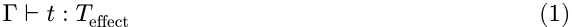

这里，结果类型被注解了一个描述该计算可能产生哪些副作用的效应代数（effect algebra）的元素，从而能够对有状态计算进行组合性推理。这种方法源于 Lucassen 和 Gifford [22]，他们引入了一种区分类型、效应和区域的带类型的类型系统，用于发现并行程序中的调度约束。

**单子效应 (Monadic effects)。** Moggi [16] 首先通过单子（monads）从范畴论角度对计算效应进行了建模；Wadler [23] 在 Haskell 中推广了这种方法。一个作用于范畴 $\mathcal{C}$ 上的单子 $(T, \eta, \mu)$ 将一个带有效应的计算封装为一个类型为 $T(A)$ 的值，其中 $\eta: A \to T(A)$ 用于提升纯值，$\mu: T(T(A)) \to T(A)$ 用于序列化嵌套计算。经典的实例包括 Maybe 单子（用于部分性）、State 单子（用于可变状态）和 IO 单子（用于外部交互）。

**代数效应 (Algebraic effects)。** Plotkin 和 Power [17, 24] 展示了代数运算决定了单子，建立了一个效应接口与其实现解耦的框架。一个效应签名 $\Sigma$ 声明了一组操作（例如，状态的 `get : () \to S`，`put : S \to ()`）；程序可以在不承诺于特定解释的情况下自由调用这些操作。Plotkin 和 Pretnar [25] 随后引入了**效应处理器 (effect handlers)**，它们通过提供延续语义来解释操作：

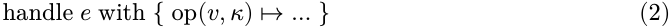

该处理器接收操作参数 $v$ 和限定的延续 $\kappa$，它可以零次、一次或多次调用它，从而在一个统一的框架内支持异常、协程和非确定性 [26]。像 Koka [27, 28]、Eff [29] 和 OCaml 5 [30] 这样的语言采用了代数效应，但设计权衡各不相同。

#### **2.2. 协效应 (Coeffects)**

与效应对立的是，**协效应系统** [18, 31] 不是丰富类型而是丰富上下文，产生如下形式的判断：

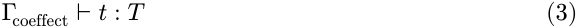

这里，上下文被注解了一个描述计算从其环境所需内容的协效应代数（coeffect algebra）的元素，例如需要访问的资源、持有的权限或依赖的服务。如果说效应模型了程序对世界的影响，那么协效应则模型了世界对程序的约束。

**共单子协效应 (Comonadic coeffects)。** 使用共单子来构建上下文依赖计算的想法最早由 Uustalu 和 Vene [32] 提出，他们提出了对称（半）幺半群作为 Moggi 用于效应的单子框架的对偶，捕获了数据流和属性评估等概念。Petricek 等人 [18] 在此基础上提出了协效应，将其视为上下文依赖性的统一静态分析。一个共单子 $(D, \varepsilon, \delta)$ 捕获了上下文依赖计算：$\varepsilon: D(A) \to A$ 从上下文中提取当前值，而 $\delta: D(A) \to D(D(A))$ 为嵌套访问复制了上下文。环境共单子 $D(X) = E \times X$ 模拟了对固定环境 $E$ 的依赖；流（Stream）共单子 $D(X) = \mathbb{N} \to X$ 模拟了对时间数据的依赖。

**分级协效应 (Graded coeffects)。** 为了更精细的跟踪，**分级**协效应系统使用一个预序半环 $\mathcal{S} = (S, \le, +, \times, 0, 1)$ 作为协效应代数 [33]，该学科后来被 Gaboardi 等人 [19] 与分级效应统一起来。$S$ 的元素注解了每个变量绑定以量化其使用情况：0 表示未使用，1 表示线性使用，$n$ 表示有界使用，$\infty$ 表示无限制使用。半环运算顺序地组合协效应（$\times$）和并行地组合协效应（$+$），在一个统一的代数框架内实现了精确的资源跟踪、敏感性分析 [34] 和信息流控制 [35, 36] [37]。

#### **2.3. 与动态可组合性的关系**

效应系统和协效应系统沿着两个互补的方向组织了对计算推理：效应描述了一个计算如何**修改**其环境，而协效应描述了它如何**依赖于**其环境。这两个方向对应于第 1 节中确定的动态可组合性的两个维度：

- **时间可组合性**要求组件对共享环境的修改在卸载时是可撤销的。相关的效应是具有状态的效应，它们持久地转换该环境；撤销这种转换要求它具备一个逆操作。

**空间可组合性**要求组件间的依赖关系必须以响应式的方式声明和管理。此类依赖正是协效应捕获的对象，而管理它们相当于将每个依赖项与环境提供的进行协调。

然而，经典的效应和协效应系统是静态工具：效应在词法固定的作用域内被跟踪，并通过编译时处理器释放；协效应注解则根据执行前确定的上下文进行验证。相比之下，动态组合要求这些保证对于运行时到达和离开的组件以及持续演化的上下文都成立。任何固定词法作用域都无法限定部署后加载的插件；任何编译时上下文都无法预知源于运行时配置的依赖关系。

这促使我们改变视角：与其用更多的注解来扩展静态类型系统，不如将效应和协效应的概念结构实体化（reify），从而允许在运行时直接操作它们，动态地建立这些系统静态提供的保证。

### **3. 可撤销效应与响应式协效应**

本节将第 2 节介绍的效应和协效应概念提升到运行时机制层面，构建了动态组合理论。核心思想是将携带效应和协效应的“类型上下文”（typing contexts）转化为“上下文类型”（context types），即实体化（reify）上下文为一等公民的、可在运行时操作的类型。对于效应类型，我们将其建模为一个与逆运算配对的上下文变换，从而实现局部的时空可组合性。对于协效应上下文，我们将其建模为一个携带依赖信息类型的结构，从而实现局部的空间可组合性。在协效应上建立的观察等价性（observational equivalence）则赋予了效应独立性。同时携带效应和协效应的统一上下文本身构成了一种编程范式。

#### **3.1. 可撤销效应**

时间可组合性（Temporal composability）是指能够在运行时加载和卸载组件，并且在卸载时，共享环境恢复到其预复合状态的能力。这要求组件对环境所做的每一次修改都必须是可跟踪和可恢复的。因此，我们将一个效应建模为一个类型为 $\Gamma \to \Gamma \times (\Gamma \to \Gamma)$ 的函数：将其应用于当前上下文，它会产生修改后的上下文以及一个显式的逆运算。提供这个逆运算使得效应可以被撤销，而将其返回给运行时则使得效应可被跟踪。我们将此类效应称为“可撤销的”（revertible）：通过在执行过程中跟踪和组合这些逆运算，环境的完全恢复成为一个结构性保证。

#### **_3.1.1. 效应上下文_**

给定任何不纯函数 $f_{\text{impure}} : X \to Y$，我们将其转换为一个纯形式 $f: \Gamma \times X \to \Gamma \times Y$，其中 $\Gamma$ 是上下文，所有可能的副作用都可以表示为对 $\Gamma$ 的变换。对于任何固定的输入 $x: X$，诱导映射 $\gamma \mapsto \text{pr}_1(f(\gamma, x))$ 捕获了与返回值无关的 $f$ 的副作用。因此，作用于 $\Gamma$ 上的效应存在于变换 $\Gamma \to \Gamma$ 的幺半群中，该幺半群通过复合 $\circ$ 定义，其中每个幺半群公理都可直接解读为效应的一个性质：

- **封闭性（Closure）**：两个效应的顺序复合仍然是一个效应；
- **结合律（Associativity）**：一个复合效应与如何分组无关；
- **单位元（Identity）**：$\text{id}_\Gamma$， $\Gamma$ 上的恒等函数，充当了复合的单位元。

为了对可撤销的效应进行建模，我们将每个变换 $f$ 与另一个逆转 $f$ 的变换 $g$ 配对，并将 $g$ 称为 $f$ 的“左逆”（left inverse），在本文中简写为 $\text{inverse}$。撤销是单向的：一个逆运算所依赖的是 $g \circ f$，而非 $f \circ g$。这些变换对携带了自己的乘法：

**定义 1.** 通过以下方式定义上下文变换对的“扭曲复合”（twisted composition）：
$$ (f_1, g_1) \circ (f_2, g_2) := (f_1 \circ f_2, g_2 \circ g_1) \quad (4) $$

至于 $\circ$ 本身，左操作数在右操作数之后作用，而逆运算则按相反的顺序累积。这使得 $(\Gamma \to \Gamma) \times (\Gamma \to \Gamma)$ 成为一个幺半群，其单位元为 $(\text{id}_\Gamma, \text{id}_\Gamma)$，即变换幺半群与其对偶的乘积，我们称之为 $\Gamma$ 上的扭曲复合幺半群 $\mathfrak{T}_\Gamma$。

为了在上下文内部跟踪效应，我们引入了以下定义：

**定义 2.** 给定一个上下文 $\Gamma$，定义其“效应上下文”（effect context）为：

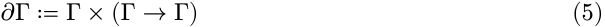

它可以被理解为一个对 $(\gamma, \varphi)$ 的对，其中：

- $\gamma$: 是当前的上下文状态；
- $\varphi$: 是“累加器”（accumulator），即迄今为止执行的效应逆运算的复合，也是恢复上下文到初始状态的函数。

特别地，初始效应上下文可以表示为 $(\gamma_0, \text{id}_\Gamma)$。

我们还写 $\partial^2 \Gamma = \partial\Gamma \times (\partial\Gamma \to \partial\Gamma)$，依此类推向上层塔。

由于存在累加器 $\varphi$，所有作用于 $\partial\Gamma$ 上的效应都可以被跟踪和恢复。现在给出跟踪和恢复的具体构造。

**定义 3.** 在上下文函数对上定义变换 $\text{track}_\Gamma$:

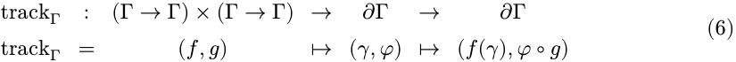

该变换将一个前向函数 $f$ 与一个候选逆运算 $g$ 转换为作用于效应上下文 $\partial\Gamma$ 的变换。将 $\text{track}_\Gamma(f, g)$ 应用于状态 $(\gamma, \varphi)$ 会通过 $f$ 变换 $\gamma$，并将逆运算 $g$ 复合到 $\varphi$ 上，从而在上下文中跟踪 $f$ 的效应。

**定理 4.** 对于每个 $(f, g) \in (\Gamma \to \Gamma) \times (\Gamma \to \Gamma)$，以下图是共轭的，即：

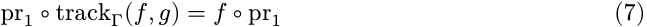

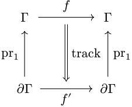

_证明。_ 对于所有 $(\gamma, \varphi) \in \partial\Gamma$：

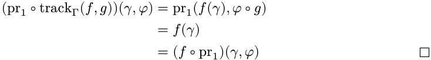

**定理 5.** $\text{track}_\Gamma$ 是从 $\mathfrak{T}_\Gamma$ 到 $\partial\Gamma \to \partial\Gamma$ 的幺半群同态。即：

1. $\text{track}_\Gamma(\text{id}_\Gamma, \text{id}_\Gamma) = \text{id}_{\partial\Gamma}$；2. 对于所有 $(f_1, g_1), (f_2, g_2) \in \mathfrak{T}_\Gamma$，

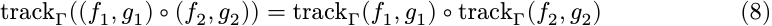

_证明。_

1. 单位元被映射到单位元，因为 $\text{track}_\Gamma(\text{id}_\Gamma, \text{id}_\Gamma)(\gamma, \varphi) = (\gamma, \varphi \circ \text{id}_\Gamma) = (\gamma, \varphi)$。2. 对于乘法，取任意 $(\gamma, \varphi) \in \partial\Gamma$：

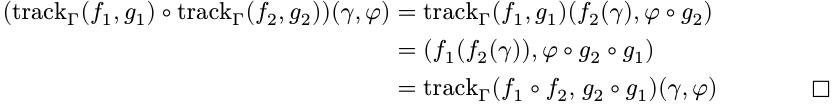

**定义 6.** 在 $\partial\Gamma$ 上定义变换 $\text{recover}_\Gamma$:

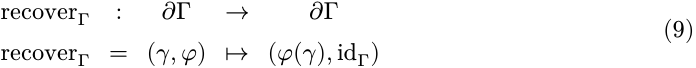

该变换将恢复函数 $\varphi$ 应用于当前状态 $\gamma$，并将 $\varphi$ 重置为恒等函数。下图说明了在对 $\partial\Gamma$ 应用了一系列效应跟踪 $\text{track}(f_1, g_1), \cdots, \text{track}(f_n, g_n)$ 之后，$\text{recover}$ 如何将上下文恢复到其初始状态：

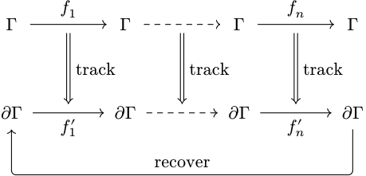

该图显示了经过 $\text{recover}$ 的跟踪效应将初始效应上下文带回自身。每个跟踪步骤保持的是恢复本身的结果，无论它从何种状态开始：

**定理 7.** 对于每一个 $(\gamma, \varphi) \in \partial\Gamma$ 和每一对 $(f, g)$ 使得 $g(f(\gamma)) = \gamma$，

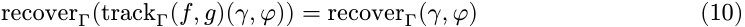

_证明._

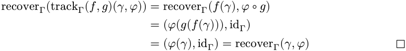

一系列对不需要单独的论证。设 $(f_1, g_1), \cdots, (f_n, g_n)$ 依次从 $(\gamma, \varphi)$ 应用，并写 $\delta_0 = \gamma$ 和 $\delta_i = f_i(\delta_{i-1})$。根据定理 5，复合跟踪 $\text{track}\Gamma(f_n, g_n) \circ \cdots \circ \text{track}\Gamma(f_1, g_1)$ 等于 $\text{track}\Gamma$ 的扭曲复合 $(f_n \circ \cdots \circ f_1, g_1 \circ \cdots \circ g_n)$，如果对于所有 $i$，有 $g_i(\delta_i) = \delta_{i-1}$，则 $(g_1 \circ \cdots \circ g_n)(\delta_n) = \delta_0 = \gamma$。因此，该对满足定理 7 在 $\gamma$ 处的假设，应用一次该定理得到

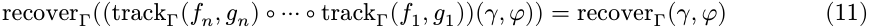

取 $(\gamma, \varphi) = (\gamma_0, \text{id}_\Gamma)$，恢复将所有以这种方式到达的状态带回 $(\gamma_0, \text{id}_\Gamma)$。具有 $g \circ f = \text{id}_\Gamma$ 的对在每个状态都满足假设。

$\text{recover}$ 通过量 $\varphi(\gamma)$ 读取一个状态，我们将 $\varphi(\gamma) = \gamma_0$ 称为 $\partial\Gamma$ 中一个状态的**良性不变量**（soundness invariant）。

#### **_3.1.2. 可撤销效应函数_**

前节的 $\text{track}/\text{recover}$ 模型预先给定逆元：$\text{track}\Gamma(f, g)$ 在看到任何上下文状态之前就固定了 $g$，因此一个 $g$ 必须服务于该效应应用的所有状态。然而，在实践中，每个效应的逆元并非预先可知：它必须由调用者在效应应用的点提供。此外，$\text{recover}$ 是全有或全无的：它不能选择性地撤销一个效应而保留其他效应。为了解决这两个问题，我们在输入和输出两端增强了模型：

1. 在输入端，我们不仅转换 $\Gamma$，还返回一个逆函数，以便在应用效应的地方提供该逆函数：$\Gamma \to \Gamma \times (\Gamma \to \Gamma)$，即 $\Gamma \to \partial\Gamma$；

2. 在输出端，我们不仅转换 $\partial\Gamma$，还返回一个逆函数，以便可以在撤销一个效应的同时保留其他效应：$\partial\Gamma \to \partial\Gamma \times (\partial\Gamma \to \partial\Gamma)$，即 $\partial\Gamma \to \partial^2\Gamma$。

这种增强保持了输入和输出之间的结构一致性，因此我们仍然可以定义一个相应的理论来保持 $\text{track}$ 的数学性质。得到的类型是效应函数 $\mathfrak{E}\Gamma$ 及其见证精化 $\mathfrak{E}\Gamma^{\ast:}$：

**定义 8.** 定义效应函数 $\mathfrak{E}\Gamma$ 和**见证**效应函数 $\mathfrak{E}\Gamma^{\ast}$ 为：

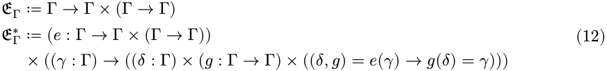

其中 $e(\gamma)$ 返回一个对 $(\delta, g)$，表示：

- $\delta$: $\Gamma$ 是新的上下文；

- $g$: $\Gamma \to \Gamma$ 是当前效应的逆函数。

$\mathfrak{E}\Gamma^{\ast}$ 的一个元素为每个状态选择其逆元，并且约束 $g(\delta) = \gamma$ 保持了该选择以撤销效应应用时的效果，而在其他地方 $g$ 没有约束。单个具有 $g \circ f = \text{id}_\Gamma$ 的 $g$ 在所有状态下同时满足约束，并诱导了一个 $\mathfrak{E}\Gamma^{\ast}$ 的元素通过 $(f, g) \mapsto \gamma \mapsto (f(\gamma), g)$，定理 11 表明这是一个同态。该约束可以可视化为以下交换图，确保逆元 $e$ 确实在 $e$ 应用的状态处反转了变换：

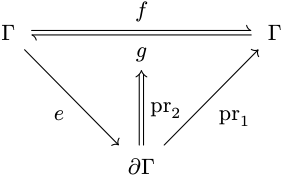

由于效应函数 $\mathfrak{E}\Gamma$ 不再是上下文上的内同态，它们不能直接复合。因此，我们定义了一个新的效应复合操作：

**定义 9.** 给定函数 $f, g \in \mathfrak{E}\Gamma$，定义它们的**效应复合** $f \diamond g$ 为：

$$f \diamond g : \Gamma \to \partial\Gamma$$

$$f \diamond g = \gamma \mapsto \operatorname{let}(\delta, s) = g(\gamma)\operatorname{\ in\ }\operatorname{let}(\epsilon, t) = f(\delta)\operatorname{\ in\ }(\epsilon, s \circ t) \qquad (13)$$

- **定理 10.** 效应复合将 $\mathfrak{T}\Gamma$ 的幺半群结构传递到 $\mathfrak{E}\Gamma$。也就是说，

   1. $(\mathfrak{E}\Gamma, \diamond)$ 是一个具有单位元 $\eta_\Gamma := \gamma \mapsto (\gamma, \text{id}_\Gamma)$ 的幺半群；

   2. 赋值 $(f, g) \mapsto \gamma \mapsto (f(\gamma), g)$ 是从 $\mathfrak{T}\Gamma$ 到 $\mathfrak{E}\Gamma$ 的一个幺半群同态。

_证明._

1. 结合律和单位律分别来自 $\circ$ 的分量式。

2. 写 $e_i = \gamma \mapsto (f_i(\gamma), g_i)$；则 $(e_1 \diamond e_2)(\gamma) = (f_1(f_2(\gamma)), g_2 \circ g_1)$，这是 $(f_1, g_1) \circ (f_2, g_2)$ 的像，且 $(\text{id}_\Gamma, \text{id}_\Gamma)$ 映射到 $\eta_\Gamma$。$\square$

**定理 11.** 见证在效应复合下保持，并且存在一个统一的逆元来见证每个状态。也就是说，

1. $\mathfrak{E}\Gamma^{\ast}$ 是 $\mathfrak{E}\Gamma^{\ast}$ 的子幺半群；

2. 定理 10 的同态将所有具有 $g \circ f = \text{id}_\Gamma$ 的对映射到 $\mathfrak{E}\Gamma^{\ast}$。

_证明._

1. 单位元位于 $\mathfrak{E}\Gamma^{\ast}$ 中，因为 $\text{id}_\Gamma(\gamma) = \gamma$。对于封闭性，取 $f, g \in \mathfrak{E}\Gamma^{\ast}$ 和任意 $\gamma \in \Gamma$，令 $(\delta, s) = g(\gamma)$，$(\epsilon, t) = f(\delta)$，使得 $(f \diamond g)(\gamma) = (\epsilon, s \circ t)$。则 $s(\delta) = \gamma$ 且 $t(\epsilon) = \delta$，因此 $(s \circ t)(\epsilon) = s(\delta) = \gamma$。

2. $g \circ f = \text{id}_\Gamma$ 意味着对于所有 $\gamma$，有 $g(f(\gamma)) = \gamma$，因此此类对的像在每个状态都被见证了。$\square$

正如 $\text{track}$ 将 $\Gamma$ 上的一对变换提升到 $\partial\Gamma$ 一样，我们定义效应将 $\mathfrak{E}\Gamma$ 提升到 $\mathfrak{E}\partial\Gamma$：

**定义 12.** 定义效应函数变换 $\text{effect}\Gamma$ 为：

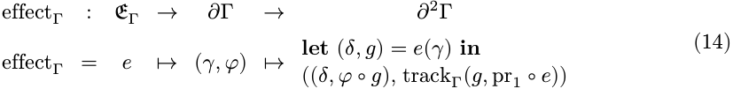

由于 $\text{effect}\Gamma(e)$ 本身是 $\mathfrak{E}\partial\Gamma$，它返回的是根据定义 8 的意义上的逆元，只是提升了一个级别。该逆元本身是跟踪对通过交换效应的两个方向得到的对的结果。普通的跟踪规则再次适用：撤销效应本身就是一个效应，它通过 $g$ 变换状态，而撤销*这个*操作的方法就是再次执行该效应，这就是 $\text{pr}_1 \circ e$ 所做的。因此，逆元复合到它所接收的累加器上，与 $\text{track}$ 所规定的完全一致。

现在我们可以证明与 $\text{track}$ 类似的效应性质。

**定理 13.** $\text{effect}$ 保持 $\diamond$ 操作。也就是说，$\forall f, g \in \mathfrak{E}\Gamma$:

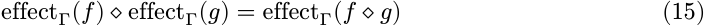

_证明._ 取任意 $(\gamma, \varphi) \in \partial\Gamma$，令 $(\delta, s) = g(\gamma)$ 和 $(\epsilon, t) = f(\delta)$，使得 $(f \diamond g)(\gamma) = (\epsilon, s \circ t)$ 且 $\text{pr}_1 \circ (f \diamond g) = (\text{pr}_1 \circ f) \circ (\text{pr}_1 \circ g)$。则

$$(\text{effect}\Gamma(f) \diamond \text{effect}\Gamma(g))(\gamma, \varphi)$$

$$= ((\epsilon, \varphi \circ s \circ t), \text{track}\Gamma(s, \text{pr}_1 \circ g) \circ \text{track}\Gamma(t, \text{pr}_1 \circ f))$$

$$= ((\epsilon, \varphi \circ s \circ t), \text{track}\Gamma(s \circ t, (\text{pr}_1 \circ f) \circ (\text{pr}_1 \circ g)))$$

$$= \text{effect}\Gamma(f \diamond g)(\gamma, \varphi)$$

其中第一个步骤在 $(\gamma, \varphi)$ 和 $(\delta, \varphi \circ s)$ 处展开 定义 12，第二个是 定理 5，第三个折叠 定义 12。$\square$

两个级别之间的关系由下图所示。其上三角部分是根据 定义 8 对 $e$ 的见证条件，下三角部分则是关于 $e^{\prime\prime}$ 是否以与 $e$ 相同的方式被见证的问题。

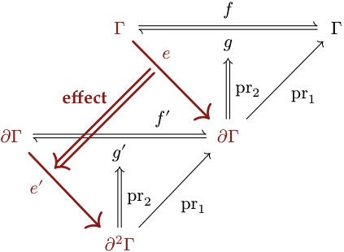

在这些级别之间，投影 $pr_1$ 将每个提升的映射与其所提升的映射联系起来，这与 定理 4 中对 $\text{track}\Gamma$ 的情况相同。

**定理 14.** 设 $e \in \mathfrak{E}\Gamma$，写 $f := pr_1 \circ e$，令 $e^{\prime\prime} := \text{effect}\Gamma(e)$，其前向映射为 $f^{\prime\prime} := pr_1 \circ e^{\prime\prime}$。则

1. $pr_1 \circ f^{\prime\prime} = f \circ pr_1$;

2. 对于每个 $(\gamma, \varphi) \in \text{dom}\Gamma$，提升的逆 $g^{\prime\prime} := pr_2(e^{\prime\prime}(\gamma, \varphi))$ 和在 $\text{dom}\Gamma$ 处见证的逆 $g := pr_2(e(\gamma))$ 满足 $pr_1 \circ g^{\prime\prime} = g \circ pr_1$.

_证明._

1. 根据 定义 12，$f^{\prime\prime}(\gamma, \varphi) = (f(\gamma), \varphi \circ g)$，其状态为 $f(\gamma) = (f \circ pr_1)(\gamma, \varphi)$。2. 这是将 定理 4 应用于 $g^{\prime\prime} = \text{track}\Gamma(g, f)$。$\square$

下三角是否闭合取决于计算提升的逆返回什么：

**定理 15.** 设 $e \in \mathfrak{E}\Gamma^{\ast}$，写 $f := pr_1^{\ast} \circ e$。固定 $(\gamma, \varphi) \in \text{dom}\Gamma$，令 $(\delta, g) = e(\gamma)$，并为 $\text{effect}\Gamma(e)$ 在 $(\gamma, \varphi)$ 处的值写 $(\Delta, g^{\prime\prime})$。则

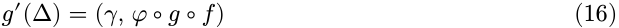

状态被精确恢复。累加器也被恢复，等价地，$\text{effect}\Gamma(e) \in \mathfrak{E}\text{dom}\Gamma^{\ast}$ 当且仅当 $g \circ f = \text{id}_{\Gamma^{\ast}}$；并且在每种情况下 $(\varphi \circ g \circ f)(\gamma) = \varphi(\gamma)$，因此健全不变量 $\text{soundness invariant}^{\ast}$ 被保持。

_证明._ 根据 定义 12，$\Delta = (\delta, \varphi \circ g)$ 且 $g^{\prime\prime} = \text{track}\Gamma(g, f)$，所以

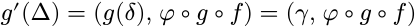

利用 $g(\delta) = \gamma$。$\mathfrak{E}\text{dom}\Gamma^{\ast}$ 的成员资格要求这在每个输入处都等于 $(\gamma, \varphi)$；取 $\varphi = \text{id}_{\Gamma}$ 将累加器的等价性转化为 $g \circ f = \text{id}_{\Gamma}$，而该条件反过来保证了对于每个 $\varphi$ 累加器的等价性。最后 $(\varphi \circ g \circ f)(\gamma) = \varphi(g(\delta)) = \varphi(\gamma)$。$\square$

因此，下三角只有在在 $\gamma$ 处见证的逆在每个状态都撤销了 $f$ 时才会闭合，所以 $\text{effect}\Gamma$ 不会将 $\mathfrak{E}\Gamma^{\ast}$ 映射到 $\mathfrak{E}^{\ast}\text{dom}\Gamma^{\ast}$。在每种情况下成立的是在 $\gamma$ 处的一致性：$\text{recover}\Gamma(g^{\prime\prime}(\Delta)) = \text{recover}\Gamma(\gamma, \varphi)$，这正是 定理 7 对累加器的所有假设，因此撤销不会触动恢复目标。

按相反的顺序撤销效应不需要任何额外的条件，因为每个逆都会遇到其自身应用产生的状态：

**定理 16.** 设 $e_1, \cdots, e_n \in \mathfrak{E}\Gamma^{\ast}$ 按顺序从 $(\gamma^{\ast}_0, \text{id}_{\Gamma^{\ast}})$ 应用并按相反的顺序撤销。则

1. 每个撤销恢复了其应用所处的上下文状态；

2. 每个中间状态都满足健全不变量。

_证明._ 每一步是一个应用或一个撤销。一个应用将 $(\gamma, \varphi)$ 转移到 $(\delta, \varphi \circ g)$，其中 $g(\delta) = \gamma$，因此根据 定理 7 保留了 $\varphi(\gamma)$，其假设恰好是 $\mathfrak{E}\Gamma^{\ast}$ 的见证。按相反的顺序撤销将每个逆交到了其自身应用产生的状态，因此根据 定理 15，该撤销精确地恢复了前一个状态并保持了 $\varphi(\gamma)$；这两个结论都不依赖于接收到的累加器。$\square$

#### **_3.1.3. 效应的独立性_**

在其自身应用产生的状态处撤销一个效应由 定理 16 涵盖；而在任何其他状态处撤销一个效应由本节讨论。有两种情况需要后者。一个逆可能在后续效应仍然存在的情况下运行，这相当于从正在运行的系统中移除一个组件；或者一个序列可能交错地包含多个组件的效应，每个组件都保留了其自身的逆，使得一个组件的逆被另一个组件的应用所分隔。在这两种情况下，一个逆遇到的是被外部效应移动过的状态，它是否仍然能撤销其设计要撤销的内容是一个交换性的问题：必须交换的是每种变换可以执行的与另一种变换可以执行的每一次变换（包括前向映射和产生的逆）之间的所有组合。单个累加器无法解决这两种情况，$\varphi$ 是一个复合函数，它按一个顺序一次性运行其持有的所有逆。

**定义 17.** 对于一个效应函数 $e \in \mathfrak{E}\Gamma$，_变换幺半群_ $\mathfrak{M}(e)$ 是由 $e$ 的前向映射以及每个逆 $e$ 产生的元素的子幺半群，而 $\mathfrak{M}(e)$ 的_生成元_是该生成集中的元素：

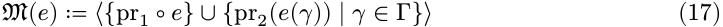

由一对 $(f, g) \in \mathfrak{T}\Gamma$ 诱导的效应具有 $f$ 和 $g$ 作为其生成元，它产生的逆在每个状态都是 $g$。

**引理 18.** 交换性是在生成元上确定的，而 $\diamondsuit$ 不扩大任何变换幺半群。也就是说，

1. 如果 $\mathfrak{M}(e_1)$ 的每个生成元都与 $\mathfrak{M}(e_2)$ 的每个生成元交换，那么 $\mathfrak{M}(e_1)$ 的每个元素都与 $\mathfrak{M}(e_2)$ 的每个元素交换；

2. $\mathfrak{M}(e_1 \diamondsuit e_2) \subseteq \langle \mathfrak{M}(e_1) \cup \mathfrak{M}(e_2) \rangle$。

_证明._

1. 与 $\mathfrak{M}(e_2)$ 的每个生成元交换的映射构成了一个 $\Gamma \to \Gamma$ 的子幺半群，因为 $\text{id}_{\Gamma}$ 在其中，并且 $f \circ f^{\prime\prime}$ 也是如此，当 $f$ 和 $f^{\prime\prime}$ 都是如此时。该子幺半群根据假设包含 $\mathfrak{M}(e_1)$ 的生成元，因此包含 $\mathfrak{M}(e_1)$。固定 $f \in \mathfrak{M}(e_1)$，与 $f$ 交换的映射同样构成了一个包含 $\mathfrak{M}(e_2)$ 的生成元的子幺半群，因此包含 $\mathfrak{M}(e_2)$。

2. 根据 定义 9，$e_1 \diamondsuit e_2$ 的前向映射是 $(pr_1 \circ e_1) \circ (pr_1 \circ e_2)$，它在任何状态产生的逆是 $s \circ t$，其中 $s$ 由 $e_2$ 产生，$t$ 由 $e_1$ 产生。因此，$\mathfrak{M}(e_1 \diamondsuit e_2)$ 的每个生成元都是两个生成元的复合。$\square$

**定义 19.** 效应函数 $e_1, e_2 \in \mathfrak{E}\Gamma$ 在以下情况下是 _独立的_：

1. 一个的每一个变换都与另一个的每一个变换交换，

      - $\forall f \in \mathfrak{M}(e_1), g \in \mathfrak{M}(e_2)$. $f \circ g = g \circ f$ (18)

2. 任何一个的变换都不会干扰另一个产生的逆，

   - $\forall g \in \mathfrak{M}(e_2), \gamma \in \Gamma$. $pr_2(e_1(g(\gamma))) = pr_2(e_1(\gamma))$ (19)

并且交换 $e_1$ 和 $e_2$ 也是如此。

一个族 $(e_l)_{l \in L}$ 是 _成对独立的_ 当且仅当对于所有 $l \neq l^{\prime\prime}$，$e_l$ 和 $e_l^{\prime\prime}$ 是独立的。一个族可以重复一个效应函数，而保持其独立于自身则意味着 $\mathfrak{M}(e)$ 是可交换的。

对于由对 $(f_1, g_1)$ 和 $(f_2, g_2)$ 诱导的效应，根据引理 18(1)，子句 (1) 等价于四个对 $(f_1, f_2)$；$(g_1, g_2)$；$(f_1, g_2)$；和 $(g_1, f_2)$ 的交换性，而子句 (2) 是直接成立的，诱导出的效应在每个状态都产生一个逆效应。在 $\diamond$ 下的交换性是一种不同的性质。等式 $e_1 \diamond e_2 = e_2 \diamond e_1$ 描述的是两个顺序的复合前向映射以及两个顺序的复合逆映射，其中每个逆映射在其自身应用产生的状态处进入复合过程；而独立性则将一个效应的每一次变换与另一个效应的每一次变换相关联，包含了一个成对的前向映射和一个外来逆映射。

在独立性下，逆效应可以在后续效应已经移动的状态处运行，它撤回的是其自身的贡献而没有其他任何东西：

**定理 20。** 设 $e_1, \cdots, e_n \in\mathfrak{E}\Gamma^\ast$ 是两两独立的，并按顺序从 $\gamma^0$ 应用。记 $f_i := \text{pr}_1 \circ e_i$，令 $\delta_i := f_i(\delta_{i-1})$，其中 $\delta_0 := \gamma^0$，并将 $g_i := \text{pr}_2(e_i(\delta_{i-1}))$ 定义为 $e_i$ 在其应用处产生的逆效应。固定 $j$，并写 $\delta'_i := (f_{i} \circ \cdots \circ f_{j+1})(\delta_{j-1})$，用于省略了 $e_j$ 的序列的状态，使得 $\delta'_j = \delta_{j-1}$。那么对于每个满足 $j \le u \le n$ 的 $u$，

1. $\delta_u = f_j(\delta'_u)$ 且 $g_j(\delta_u) = \delta'_u$;

2. 每个 $e_i$（其中 $i> j$）在 $\delta'_{i-1}$ 处产生的逆效应与它在 $\delta_{i-1}$ 处产生的逆效应相同。

_证明._

1. 第一个等式是对 $u$ 的归纳法。当 $u=j$ 时，它读作 $\delta_j = f_j(\delta_{j-1})$，这是 $\delta_j$ 的定义。对于归纳步骤，$\delta_{u+1} = f_{u+1}(\delta_u) = f_{u+1}(f_j(\delta'_u)) = (f_u \circ \cdots \circ f_{j+1})(f_j(\delta_{j-1})) = \delta'_{u+1}$，中间的等式是定义 19 中关于 $e_{u+1}$ 和 $e_j$ 的子句 (1)，因为它们是该族的不同效应，因为 $u+1 > j$。对于第二个等式，子句 (1) 将 $g_j$ 通过应用于 $e_j$ 之后的正向映射带出，使得 $e_j$ 的见证可以在它持有的唯一状态处使用：

   - $g_j(\delta_u) = (g_j \circ f_u \circ \cdots \circ f_{j+1})(\delta_j) = (f_u \circ \cdots \circ f_{j+1})(g_j(f_j(\delta_{j-1}))) = \delta'_u$

最后一个等式依赖于 $g_j(f_j(\delta_{j-1})) = \delta_{j-1}$，这是定义 8 要求 $e_j$ 在 $\delta_{j-1}$ 处的见证。

2. 根据 (1)，状态 $\delta_{i-1} = f_j(\delta'_{i-1})$，且 $f_j \in \mathfrak{M}(e_j)$，因此定义 19 关于 $e_i$ 和 $e_j$ 的子句 (2) 给出了 $\text{pr}_2(e_i(f_j(\delta'_{i-1}))) = \text{pr}'_2(e_i(\delta'_{i-1}))$. □

子句 (1) 定位了逆效应到达的状态：它是如果该效应从未应用，而无论之后应用了什么效应，序列本应到达的状态。子句 (2) 定位了其他效应持有的逆效应，两者结合使得定理可以再次应用于更短的序列：

**推论 21。** 设 $e_1, \cdots, e_n \in\mathfrak{E}\Gamma^\ast$ 是两两独立的，并按顺序从 $\gamma^0$ 应用，令 $g_1, \cdots, g_n$ 如上所述。在 $\delta_n$ 处按照 $\{1, \cdots, n\}$ 的任意排列顺序应用这 $n$ 个逆效应，会到达 $\gamma^0$。

_证明._ 通过对 $n$ 的向下归纳法。令该排列以 $j$ 开始。根据定理 20(1)，在 $\delta_n$ 处应用 $g_j$ 到达 $\delta'_n$，即省略了 $e_j$ 的序列到达的状态，并且根据定理 20(2)，剩余效应产生的逆效应就是手头的 $g_i$。该序列是两两独立的，因为它是一个子族，所以归纳假设适用于它和排列的其余部分；空序列到达 $\gamma^0$。□

LIFO 顺序是这样一个排列，并且定理 16 在其中没有任何假设地进行了回滚。独立性带来的好处是所有其他顺序，以及与之相关的交错多个组件的序列，这在第 4.4.2 节中被推广到整个系统的跟踪轨迹。

总而言之，这些构造构成了**可撤销效应**：$\mathfrak{E}\Gamma^\ast$ 中的每个效应函数都明确地提供了其自身的逆效应，效应在效应上下文 $\Delta\Gamma$ 上跟踪这些逆效应，而 $\diamond$ 操作在保持可撤销性的同时组合它们。它们提供的是**局部时间可组合性**，这里的“局部”是指保证是从单个组件的效应自身获取的。我们将此理解为以下准则：对于一个组件应用的任何效应函数序列，累加器恢复到它开始时的上下文（定理 7），并且回滚该序列会给每个逆效应提供其自身应用所依据的状态（定理 16）。加载一个组件就是应用这样一个序列并将其逆效应积累到 $\varphi$ 中；卸载它就是应用 $\varphi$。

该准则遗漏了两件事，而这两件事在多个组件参与时都会出现：从累加器施加的顺序中回滚，以及交错其他效应的序列。独立性提供了它们（推论 21），并且它是一个关于效应的条件，而不是构造的性质，第 3.3.2 节识别了满足该条件的学科，而第 4.4.2 节则说明了整个系统的跟踪轨迹上的保证。当独立性失败时，顺序必须在别处处理：由累加器在单个组件内部进行回滚（无论效应如何）（第 4.3.2 节），或由声明的协效应跨组件进行排序，该协效应将一个激活与另一个激活进行排序（第 4.3.1 节）。

#### **3.2. 响应式协效应**

_空间可组合性_ 是组件能够声明它们之间的依赖关系，并且系统能够在运行时解析、提供和撤销这些依赖关系的能力。这要求每当共享上下文改变时，都必须重新评估依赖关系的满足情况，以便组件在其依赖可用时激活，并在它们被撤销时失活。因此，我们将组件的依赖建模为一种规范（specification），并将每次对上下文的改变相对于该规范分类为激活、失活或中性。根据规范进行分类是检测满足变化的过程；响应这种分类驱动了激活和失活。我们将此类协效应称为**响应式**：通过从这些变化分类并驱动激活和失活，正确的协效应排序成为一个结构性保证。

#### **_3.2.1. 协效应上下文_**

传统的控制反转（IoC）容器 [38] 通常将依赖关系建模为简单的键值映射。本节将 IoC 正式化为一个与可撤销效应协同工作的协效应上下文，从而为动态组合提供数学基础。

**定义 22。** 给定一个类型族 $\mathcal{V}: K \to \text{Type}$，将 _协效应上下文_ 定义为依赖部分函数类型：

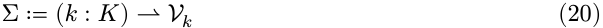

其中 $\sigma: \Sigma$ 是一个有限的部分函数，它为每个 $k\in\text{dom}(\sigma) \subseteq K$ 分配一个类型为 $\mathcal{V}k$ 的值。我们写：

- $\sigma(k)$ 表示应用（当 $k\in\text{dom}(\sigma)$ 时定义）；
- $\sigma[k\mapsto v]$ 表示在 $k$ 处绑定 $v$，而在其他地方与 $\sigma$ 一致的表；
- $\sigma \setminus k$ 表示限制（当 $k\in\text{dom}(\sigma)$ 时定义）；
- $k\in\text{dom}(\sigma)$ 表示成员资格。

使用类型族 $\mathcal{V}$ 确保了每个依赖键 $k$ 都与特定的值类型 $\mathcal{V}k$ 相关联，为依赖访问提供了静态类型安全。扩展和限制带有前置条件，这些前置条件由下面的操作施加：一个依赖不能被提供两次（扩展时要求 $k\notin\text{dom}(\sigma)$），也不能在缺失时撤销（限制时要求 $k\in\text{dom}(\sigma)$）。违反的前置条件会发出错误信号且不产生任何转移，因此描述实际发生的转移的效应代数对这些操作保持不变。一个倾向于内部化失败的读者可以将下面所有的 $\Sigma \rightharpoonup \Sigma$ 视为 $\Sigma \to \text{Maybe}(\Sigma)$，并在 $\text{Maybe}$ 范畴（第 2.1 节）中复合，代价是将其中的每个恒等式替换为操作域上的部分恒等式。基于此上下文结构，我们定义了两个核心操作：

**定义 23。** 在 $\Sigma$ 上的 get 和 set 操作定义为：

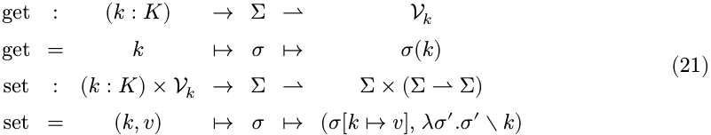

其中 get$(k)$ 要求 $k\in\text{dom}(\sigma)$，而 set$(k, v)$ 要求 $k\notin\text{dom}(\sigma)$ 作为前置条件。

值得注意的是，set$(k, v)$ 的类型是 $\mathfrak{E}\Sigma^{<*>}$，精确地说是一个作用于协效应上下文的效应函数。因此，我们可以直接应用第 3.1 节的效应机制：effect$\Sigma$ 提供对依赖注册的自动跟踪和恢复。这是响应式协效应和可撤销效应之间的协同作用：协效应操作是效应，而效应是可撤销的。

get 返回给组件的是一个值，而该组件能用该值做什么，则由该键处的协效应提供决定。因此，一个键携带的不仅仅是一个值类型：

**定义 24。** 在键 $k$ 处的 _协效应_ 是一个三元组 $(\mathcal{V}k, \simeq k^{<*>}, \mathcal{A}k)$，其中 $\mathcal{V}k$ 是定义 22 的值类型，$\simeq k^{<*>}$ 是一个在 $\mathcal{V}k$ 上的等价关系，用于比较 $k$ 处的取值（第 3.3.2 节），而 $\mathcal{A}k$ 是一组 _协效应操作_，即该值绑定到 $k$ 时提供给持有它的组件的操作。一个操作 $a\in\mathcal{A}k$ 携带一个参数类型 $X_a$ 和一个结果类型 $B_a$，并且只作用于该值：

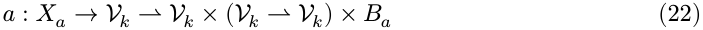

其前两个组成部分构成了一个在 $\mathcal{V}k$ 上的效应函数，如定义 8 所要求的，而第三个是 _结果_。每个操作都要求 _尊重_ $\simeq k^{<*>}$：对于 $\simeq{}k^{<*}$-相关的取值，它要么在两者处定义，要么在两者处都不定义；当定义时，它产生 $\simeq k^{<*}$-相关的后继，其逆操作再次携带 $\simeq k^{<*}$-相关的取值到 $\simeq{}k^{<*}$-相关的取值，并具有相等的结果。一个操作通过其 _提升_ 作用于协效应上下文

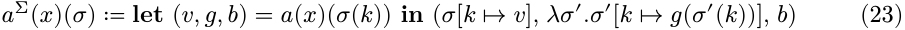

（当 $k\in\text{dom}(\sigma)$ 时定义），其前两个组成部分是一个在 $\Sigma$ 上的效应函数。

为 $k$ 类型的操作进行类型化将其限制于 $k$ 的绑定：提升读取并写入该绑定，而使所有其他键保持不变，因此不需要额外的侧条件来说明这一点。当隔离生效时，它到达的绑定是域解析到的那个（定义 28），两个共享域的键共享一个绑定。其行为取决于另一个键的操作，则将该键的值读入其参数 $X_a$，而下一小节的响应式纪律保证了只要读取它的组件运行，该值就保持固定（定理 63）。

#### **_3.2.2. 规范和通知_**

前面的定义描述了单个依赖项如何注册和访问。然而，访问一个不存在的依赖项是一个运行时失败。因此，一个组件应该只在它声明的所有依赖项都存在时才激活，而不是乐观地访问它们并在缺少其中一项时失败。这就引出了两个问题：组件声明的依赖项是否共同满足，以及当该状态改变时系统应如何响应。协效应上下文 $\Sigma$ 携带了一个自然的观察结构，使得这两个问题都可以被处理：对于任意协效应规范 $d\subseteq K$，定义 _满足性谓词_ ：

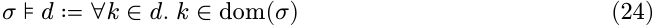

该谓词是可判定的（因为 $\text{dom}(\sigma)$ 是有限的）。由于所有对 $\sigma$ 的修改都经过效应函数（其逆操作恢复了之前的域），因此满足性的变化可以在每个效应边界处被检测到。这就是响应性的代数基础：效应系统保证了每一次协效应的变化都被观察到。

**定义 25。** 一个 _协效应规范_ 是：

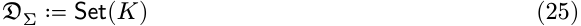

代表一个组件从环境中声明的依赖项集合。

使该规范具有响应性的在于它如何对状态转移进行分类。任何将 $\sigma$ 转换为 $\sigma'$ 的效应都可以根据规范 $d\in\mathfrak{D}\Sigma$ 来分类，具体取决于 $d$ 的满足性状态是否改变：

**定义 26。** 给定一个协效应规范 $d\subseteq K$ 和状态 $\sigma, \sigma' \in \Sigma$，定义：

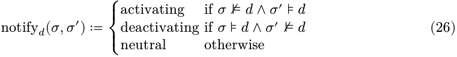

这是良定义的，因为 $\sigma\models d$ 是可判定的，并且所有状态转移都由效应函数中介。响应性不变量是：激活的转移触发组件的效应执行（带有完整的效应跟踪），而失活的转移则通过应用累加器触发恢复。这些转移精确的操作语义取决于它们与控制流的交互，并在第 4 节中发展。

我们一起交付的集合和通知是 $\text{_local spatial composability_}$，这里的 local 与之前相同，其保证是读取组件自身携带的协效应。我们将此定义为以下准则：一个组件仅在满足其规范的状态下激活，因此它永远不会读取不存在的绑定，并且对上下文的任何更改都根据该规范进行分类，从而在发生损失满足性时检测到并驱动去激活。这两个半部分从上述定义中立即得出，其中满足性是组件将要激活时检查的前置条件，而 $\text{notify}_d$ 在每次转换处都有定义。

该准则覆盖了协效应排序的一个方向，而非另一个方向。如果组件 $A$ 提供了一个键 $k$，并且组件 $B$ 声明 $k \in d_B$，那么 $B$ 要激活只能在 $A$ 已经激活并提供了 $k$ 之后，因为 $\sigma \models d_B$ 要求 $k \in \text{dom}(\sigma)$。反之则不成立：卸载 $A$ 会从 $\text{dom}(\sigma)$ 中移除 $k$，从而破坏了 $B$ 的满足性，但一个通知本身不能保证 $k$ 在 $B$ 自身的清理需要它时一直可读，也不能阻止 $A$ 直到 $B$ 完成。将撤销的顺序定为其引起的去激活之后，这是对其他组件的条件，而非对执行动作的组件的条件，因此属于保证的全局形式，第 4.3.1 节提供了所需的机制。

#### **_3.2.3. 隔离与拦截_**

基本的协效应上下文 $\Sigma$ 模拟了一个扁平的依赖表。然而，在实践中，系统可能需要为不同组件将不同的值绑定到相同的逻辑依赖上。本节通过两个机制扩展了协效应上下文：$\text{_coeffect isolation_}$（同一键在不同上下文中解析为不同结果）和 $\text{_coeffect interception_}$（关于依赖访问的横切行为）。

**实现。** 这两种机制与 $\text{get}$ 和 $\text{set}$ 的区别在于它们作用的对象。$\text{provision}$ 写入所有组件读取的共享表，因此它对该表产生了一个效应，并携带一个逆操作来撤销它。而隔离和拦截则调整了在一个上下文中如何 $\text{resolve}$ 一个键，使表本身保持不变。将一个操作类型化为效应固定了其 $\text{_denotation_}$（一个与逆操作配对的后继状态），但没有固定其 $\text{_realization_}$，后者决定了该逆操作是如何执行的。

**定义 27。** 一个作用于上下文的效应函数具有两个 $\text{_realizations_}$：

- $\text{_In-place_ realization}$ 会修改上下文并返回一个非平凡的逆操作；后继状态别名输入，恢复则运行该逆操作来撤销修改。

- $\text{_Derived_ realization}$ 会保持输入不变并返回一个源自它的新上下文，其逆操作为恒等函数；恢复则丢弃派生的上下文。从另一个上下文派生的上下文是定义 32 的递归结构所携带的。

在纯函数式设置中两者是重合的，而命令式宿主可以根据操作选择其一；第 5.1.2 节实现了两者。隔离和拦截直接给出派生实现：每种都产生一个与继承的上下文表不同的新上下文，因此它们分别在下方类型化为从上下文到上下文的映射，而非效应函数。共享表中的任何内容都不改变，因此没有需要跟踪的逆操作，也没有需要定义 12 提升的内容，恢复则丢弃了派生的上下文以及它携带的调整。对派生表的赋值会覆盖继承表中该键持有的任何值，这就是为什么这两种操作都没有携带前置条件。

**协效应隔离。** 通过引入 $\text{_isolation realms_}$，协效应隔离允许相同的依赖在不同的上下文中绑定到不同的值。这在多租户系统、测试环境和组件沙箱中有广泛的应用。

**定义 28。** 将带有隔离的协效应上下文定义为：

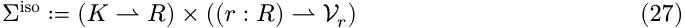

它可以表示为一个对 $(\rho, \sigma)$，其中：

- $\rho: K \rightharpoonup R$ 是隔离域表，为每个隔离键分配一个域标识符；不在 $\text{dom}(\rho)$ 中的键解析到其自身的域，因此我们写 $\rho(k) = k$（$R seteq K$）；

- $\sigma: (r: R) \rightharpoonup \mathcal{V}_r$ 是依赖表，一个从域标识符到类型化值的偏依赖函数。

这种两层映射结构将逻辑层与存储层解耦，使得依赖访问具有上下文感知能力。当访问键 $k$ 时，系统首先解析 $\rho(k)$ 以获得一个域标识符 $r$，然后访问 $\sigma(r)$ 获取实际值。

**定义 29。** 在 $\Sigma^{\text{iso}}$ 上的 $\text{get}$、$\text{set}$ 和 $\text{isolate}$ 操作为：

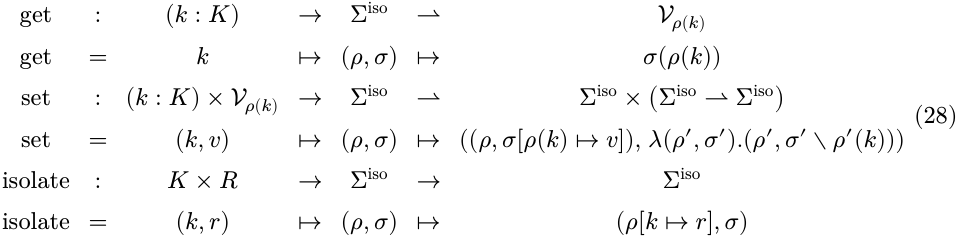

其中 $\text{get}$ 和 $\text{set}$ 携带了定义 23 通过 $\rho$ 传输的前置条件，即 $\rho(k) \in \text{dom}(\sigma)$ 和 $\rho(k) \notin \text{dom}(\sigma)$。$\text{isolate}(k, r)$ 所派生的上下文为 $k$ 分配域 $r$，并继承了未变的依赖表，因此一个已经被隔离的键是重新分配而不是被拒绝。

协效应隔离机制本质上实现了一个运行时即席多态系统。通过隔离域标识符，相同的依赖键可以在不同的上下文中解析到完全不同的值，并且这种多态可以在运行时动态调整。与传统的依赖注入相比，协效应隔离提供了更精细的控制，使得可以为特定组件定制隔离；$\text{set}$ 仍然是一个效应函数 $(\mathfrak{E}\Sigma^{\text{*iso}})$ 并因此继承了可撤销性，而 $\text{isolate}$ 则不需要，而是派生了一个上下文而不是写入共享表。

**协效应拦截。** 第二个机制 $\text{_coeffect interception_}$ 在依赖访问上附加横切元数据，在不修改依赖值的情况下添加行为。这些元数据可以是上下文携带的或组件声明的，因此我们扩展了协效应上下文和协效应规范：

**定义 30。** 将带有拦截的协效应上下文和规范定义为：

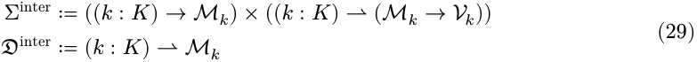

上下文 $\Sigma^{\text{inter}}$ 是一个对 $(\mathcal{E}, \sigma)$：$\mathcal{E}$ 是安装在上下文本身上的“上下文携带的”元数据，默认为空 ($\epsilon_k$)；而 $\sigma$ 将每个键 $k$ 映射到从元数据 $\mathfrak{M}_k$ 到值 $\mathcal{V}_k$ 的一个“提供者函数”。一个规范 $d \in \mathfrak{D}^{\text{inter}}$ 携带“组件声明的”元数据，为每个键分配其元数据 $d(k)$，其中 $\text{dom}(d)$ 作为依赖集。每个键都为其元数据配备了一个幺半群 $(\mathfrak{M}_k, \oplus_k, \epsilon_k)$：合并操作 $\oplus_k$ 与单位元 $\epsilon_k$ 结合律，即 $\epsilon_k$ 是空元数据。

**定义 31.** 在 $\Sigma^{\text{inter}}$ 上的 get、set 和 intercept 操作如下：

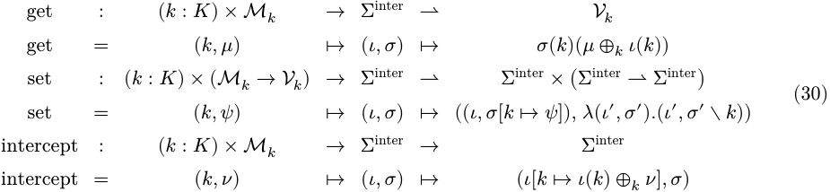

其中 get 和 set 携带了定义 23 关于提供者表的先决条件，即 $k \in \text{dom}(\sigma)$ 和 $k \notin \text{dom}(\sigma)$。上下文 $\text{intercept}(k, \nu)$ 派生的合并 $\nu$ 应用到在 $k$ 处继承的元数据上，并保持提供者表不变。

当一个具有规范 $d$ 的组件访问键 $k$ 时，系统评估 $\sigma(k)(d(k) \oplus_k \mathcal{E}(k))$：组件声明的元数据与上下文携带的元数据 $\mathcal{E}$ 进行合并，然后将提供者函数应用于结果。此合并遵循每个键自身的语义（例如，标量字段被覆盖，集合值字段进行并集运算）并且是右偏置的，因此 $\mathcal{E}(k)$ 具有优先权，可以覆盖组件的声明，从而允许一个包围的上下文在不修改该组件的情况下约束组件如何使用协效应（例如第 6.3 节）。

#### **3.3. 上下文范式**

第 3.1 节和第 3.2 节分别作用于一个上下文，前者作为效应的载体，后者作为协效应的载体，留下了同时携带两者单个上下文是什么样的开放问题。本节为这种统一性提供了一个具体的构造，从协效应中组装出一个提供了第 3.1.3 节留下的效应独立性的观察等价性，并论证了由此产生的上下文类型本身构成了一种编程范式。

#### **_3.3.1. 统一上下文_**

对于一个上下文 $\Gamma$，效应上下文 $\mathcal{E}\Gamma$（第 3.1 节）提供了一个更高层次的抽象，携带前一级的上下文和该级别的累加器（定义 2）。使此结构递归化并将其与协效应上下文 $\Sigma$ 相结合，得到以下类型：

**定义 32.** 上下文类型 $\Gamma^\infty$ 定义为：

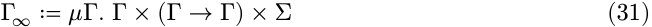

其中三个投影分别是：

- $\Gamma$: 当前的上下文状态（递归）；
- $\Gamma \to \Gamma$: 累加器，用于恢复该级别的效应；
- $\Sigma$: 携带依赖信息的协效应上下文。

根据此定义，效应映射 $\mathfrak{E}\Gamma^\infty$ 到自身，将 $\mathcal{E}$-塔统一为一个单一的自相似类型。协效应上下文 $\Sigma$ 是结构性集成的：依赖操作（set, get）作用于 $\Sigma$，而累加器跟踪它们的逆转。由于底层 $\Sigma$ 的类型族 $\mathcal{V}$ 没有约束，系统需要在组件间共享的任何状态都可以被编码为一个带有适当值类型的依赖——$\Sigma$ 涵盖了所有共享的可变状态，而不仅仅是组件间的依赖。组件与其环境之间的每一次交互都必须通过这个单一实体。

**层次化组合。** $\Gamma^\infty$ 的递归结构支持层次化的控制：一个父上下文聚合多个子级别的效应，形成了一个树状的控制结构，在保持模块性的同时实现了统一的跨级别管理。效应变换实现了一种字面意义上的“即插即用”的比喻：

- 加载一个组件对应于执行其效应（插入）；
- 卸载一个组件对应于恢复其效应（拔出，而不影响其他正在运行的组件）；
- 不同层次的组件是可独立加载和卸载的；父上下文聚合并管理所有子组件的效应，从而支持任意嵌套的组合。

#### **_3.3.2. 观察等价性_**

第 3.1 节的恢复保证断言了状态的相等性（定理 7），这是一种理想化，因为物理状态无法被恢复到其原来的样子。例如，`free` 会将一个块释放给分配器，而不会恢复堆在 `malloc` 之前的布局；并且生成名称不会被逆操作恢复，因为它会丢弃它，因为下一次创建的是一个新的 [39]。因此，第 3 节的等式需要理解为 $\simeq$ 的等价关系，我们将 $\simeq$ 定义为**观察等价性**：当没有观察者能区分两个状态时，它们就相关。比较行为而非表示是程序等价性的既定途径 [40]，而这种比较所产生的关系取决于观察者被赋予的工作对象 [41]。观察者被赋予的上下文的是它携带的协效应，每个协效应都带有自身的等价性（定义 24），因此上下文上的关系是从这些关系组合而成的。组装它们是本小节的任务，而除以这个关系则获得了第 3.1.3 节所要求的独立性。

**定义 33.** 当两个协效应上下文将相同的键绑定到相关的值时相关；当它们的协效应投影为：

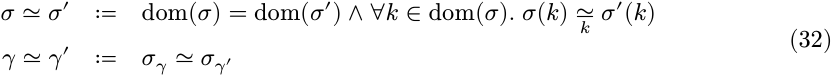

写 $\sigma_\gamma$ 表示 $\gamma$ 的协效应投影（定义 32）。

因此，一个状态中没有键绑定的部分被遗忘，而这种遗忘使得定理 7 可以理解为 $\simeq$ 的等价关系：上述示例中的堆布局和生成名称除非有某个键将它们绑定起来，否则都位于该关系之外。第 3.2.2 节需要 $\simeq$ 的条件是后续的，而不是假设的。相关的状态具有相同的域，因此它们在满足谓词 $\sigma \models d$ 和定义 26 的分类通知 $\text{notify}_d$ 上是一致的，而响应性是 $\Sigma/\simeq$ 的一个性质。

将关系称为观察等价（observational）是一个关于每个 $\simeq_k$ 的断言，即它不能区分 $k$ 的操作所不能区分的任何东西。一个值观察者会运行这些操作并读取其结果。**定义 34.** 设 $V$ 携带了一个由定义 24 意义下的操作集 $\mathcal{A}_{\text{op}}$，并将 $\mathfrak{M}(a)$ 写为作用于每个参数 $x: X_a$ 的效应函数 $a(x)$ 的变换幺半群（定义 17）。$\mathcal{A}_{\text{op}}$ 上的一个 $\text{test}$ 是一个由幺半群 $\mathfrak{M}(a)$, $a\in\mathcal{A}_{\text{op}}$ 的生成元构成的有限词，每个字母作用于前一个字母离开的值；其 $\text{outcomes}$ 是沿途这些字母作为操作的向前映射所产生的那些结果，当前提条件失败时则未定义。值 $v, v^{\prime} : V$ 是**不可区分的**（indistinguishable），记作 $v \approx_{\mathcal{A}_{\text{op}}} v^{\prime}$，当且仅当对于 $\mathcal{A}_{\text{op}}$ 上的每个测试，该测试在两者处都已定义或在两者处均未定义，并且在两者处产生相同的结果。

**引理 35.** 不可区分性是操作所保持的最粗糙的关系。也就是说，

1. $\mathcal{A}_{\text{op}}$ 的每个操作都以定义 24 的意义上保持 $\approx_{\mathcal{A}_{\text{op}}}$;

2. $\mathcal{A}_{\text{op}}$ 的任何被操作保持的等价关系都包含在 $\approx_{\mathcal{A}_{\text{op}}}$ 中。因此，任何可接受的 $\simeq_k$ 都包含在 $\mathcal{A}_{\text{op}}^{\approx} k$ 中，反之亦然，$\mathcal{A}_{\text{op}}^{\approx} k$ 本身也是可接受的。

_证明._

1. 设 $v \approx_{\mathcal{A}_{\text{op}}} v^{\prime}$，且令 $a\in\mathcal{A}_{\text{op}}$ 应用于一个参数。将一个字母前缀到测试中仍然是一个测试，因此向前映射到达的值是不可区分的，任何一个值从不可区分的参数反向到达的值也是如此；单字母测试在两者处都具有定义性或均不具有定义性，并且结果相等。

2. 设 $R$ 是这样一个等价关系，且 $v_R v^{\prime}$。测试的每个字母都是一个操作的向前映射或产生的逆映射，而保持（respect）沿着其中任何一个都携带了 $R$，使得到达的值保持相关，并且在每个字母处结果相等。因此，每个测试在 $v$ 和 $v^{\prime}$ 处都一致。$\square$

将 $\simeq$ 代替所有地方的 $=$ 不足以保证成立，因为效应函数返回一个逆映射和一个状态，而 $\simeq$ 所识别的两个状态也必须产生 $\simeq$ 所识别的逆映射。

**定义 36.** 一个映射 $f: \Gamma \to \Gamma_{\text{op}}$ 当且仅当：

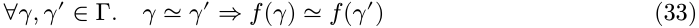

两个映射在它们的所有状态处一致时相关，而 $\mathfrak{D}\Gamma$ 中的两个对 $((\delta, g))$ 在其两个分量都满足以下条件时相关：

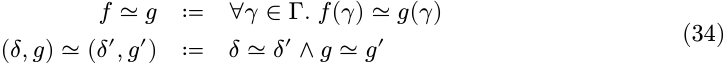

一个保持 $\simeq$ 的映射是下降到 $\Gamma/\simeq$ 的，而由 $\simeq$ 相关的两个映射是指下降到该处相同映射的两个映射。效应函数需要两者：第一个是为了它计算的状态在商空间上确定，第二个是为了它返回的逆映射。

**定义 37.** 参考定义 8 直到 $\simeq$：一个 $e\in\mathfrak{E}\Gamma$ 位于 $\mathfrak{E}\Gamma$ 当且仅当 $e$ 作为从 $\Gamma \to \mathfrak{D}\Gamma$ 的映射保持 $\simeq$，并且写 $({\delta}, g) = e(\gamma)$，对于每个 $\gamma\in\Gamma$:

1. $g(\delta) \simeq_{\gamma}$;

2. $g$ 保持 $\simeq$。

将 $\simeq$ 取为 $\Gamma$ 上的相等性恢复了定义 8。

**引理 38.** 将 $\mathfrak{E}\Gamma$ 理解为定义 37 中的含义，则第 3.1 节中断言的每个状态等式都成立（用 $\simeq$ 代替 $=$），并且从 $(\gamma_0, \text{id}_\Gamma)$ 可达的每个状态的累加器都保持 $\simeq$。

_证明._ 一个累加器是逆映射的复合，每个逆映射根据定义 37(2) 都保持 $\simeq$，而保持 $\simeq$ 的映射的复合也保持 $\simeq$，基本情况是 $\text{id}_\Gamma$。第 3.1 节的证明因此无需更改，其中 $\text{respect}$ 是携带关系通过一个逆映射：从 $g_2(\delta_2) \simeq_{\delta_1}$ 和 $g_1(\delta_1) \simeq_{\gamma}$ 保持给出 $(g_1 \circ g_2)(\delta_2) \simeq_{\gamma}$，这是每个逆复合所采取的步骤，并且定理 7 的健全性不变量读作 $\varphi(\gamma) \simeq_{\gamma_0}$ 通过该步骤得到。$\square$

定义 19 所要求的交换律（commutation）也通过相同的引理理解，以这种方式理解使得它根本可达到：两个操作可能留下 $\simeq_k$ 所识别的值，但仍然被认为是交换的。对于两个操作的要求比它们提升的效应函数更进一步，即一个操作还需要产生一个结果。

**定义 39.** 操作 $a$ 和 $a^{\prime}$ 是**独立的**（independent），当且仅当它们的提升在每对参数上作为效应函数是独立的（定义 19），并且其中任何一个的变换都不会干扰另一个产生的结果：

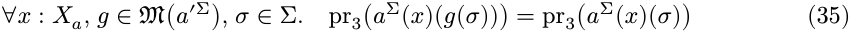

以及交换 $a$ 和 $a^{\prime}$ 的情况也是如此，将 $\mathfrak{M}(a \Sigma)$ 写为作用于每个参数的提升 $a \Sigma(x)$ 的变换幺半群（如定义 34 写 $\mathfrak{M}(a)$ 为操作本身的那个）。一个键 $k$ 是**可交换的**（commutative），当且仅当 $\mathcal{A}_{\text{op}}^k$ 中的任何两个操作都是独立的，并且一个操作自身也被视为独立。

在不同的键上，该条件是直接成立的。

**定理 40.** 不同键上的操作是独立的。

_证明._ 设 $a \in \mathcal{A}_{\text{op}}^k$ 和 $a^{\prime} \in \mathcal{A}_{\text{op}}^{k'}$，其中 $k \neq k^{\prime}$。根据定义 24，$\mathfrak{M}(a \Sigma)$ 的每个生成元的形式为 $\sigma \mapsto \sigma[k \mapsto u(\sigma(k))]$，其中 $u$ 是在 $\mathcal{V}^k$ 上的一个映射，要么是向前映射的提升，要么是产生逆映射的提升，对于 $a^{\prime}$ 在 $k^{\prime}$ 上也是如此。这两个映射是可交换的，每个只读取和写入一个键，并且两个键不同，引理 18(1) 将这种可交换性从生成元推广到两个幺半群。对于第二个条件，$\sigma$ 处 $a \Sigma$ 产生的逆映射和结果，由 $\sigma(k)$ 决定，而每个 $\mathfrak{M}(a^{\prime} \Sigma)$ 的生成元都保持了这一点。$\square$

其值是一个独立添加和移除条目的表的键是可交换的，注册一条路由或一个事件监听器是代表性的例子：无论何种顺序进行两次注册，都会留下一个对每个测试都给出相同答案的表，并且任何一次注册都可以被撤销而另一方保持不变。其值是一个有序链的键则不是，因为在另一个之前插入的中间件会看到不同的请求，而且任何一种顺序都不能在不干扰另一个的情况下被撤销。开头的例子中的分配器除以其接口发布的内容。其中它提供的句柄由该键的任何操作进行比较时，$\simeq_k$ 可能将两个堆相关联（up to a renaming of handles），这就是 CompCert 将程序及其翻译的内存状态关联起来的方式 [42]，并且分配是可交换的；而当地址是通过相等性比较的结果时，没有可接受的 $\simeq_k$ 能使两种分配顺序一致，因此该键不可交换。

组件执行的操作序列，其中每个操作可能依赖于它之前操作产生的结果，而下面定理讨论的正是这种形状的效应函数。

**定义 41.** _协效应介导_ 的效应函数构成最小集合 $\mathfrak{E}\Sigma^{\mathcal{A}} \subseteq \mathfrak{E}\Sigma$，该集合包含单位元 $\eta\Sigma$ 并且对以下情况封闭：对于一个键 $k$，一个操作 $a \in \mathcal{A}_k$，一个参数 $x: X_a$，以及一组成员 $(e_b)_{b \in B_a}$，

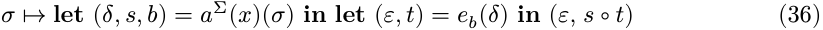

仍然是该集合的成员。每个阶段执行一个操作，并通过结果选择后续的操作，因此参数可能依赖于已经获得的结果。一个成员中出现的那些操作，是在所有结果选择的情况下其阶段所执行的操作。

**定理 42.** 设 $e_1, e_2 \in \mathfrak{E}\Sigma^{\mathcal{A}}$，并且它们都出现的每个键都是交换的（定义 39）。那么 $e_1$ 和 $e_2$ 是独立的（定义 19）。

_证明。_ 通过对定义 41 的构造进行归纳，$\mathfrak{M}(e_i)$ 位于由 $e_i$ 中出现的操作的生成元生成的子幺半群内：单位元生成平凡幺半群，而一个阶段是 $a\Sigma(x)$ 与一个成员的 $\diamond$-复合，引理 18(2) 可用。

因此，对于定义 19 的条款 (1)，根据引理 18(1)，只需保证 $e_1$ 中出现的操作的生成元与 $e_2$ 中出现的操作的生成元交换即可。当这两个操作位于不同的键上时，这是定理 40；当它们位于同一个键上时，该键携带了两个操作并且根据假设是交换的。

对于条款 (2)，取 $g \in \mathfrak{M}(e_2)$，它是 $e_2$ 中出现的操作生成元的复合，并对 $e_1$ 的构造进行归纳。单位元在每个状态都产生 $\text{id}\Sigma$。在一个阶段，设 $(\delta, s, b) = a\Sigma(x)(\sigma)$ 且 $(\epsilon, t) = e_b(\delta)$，使得该阶段在 $\sigma$ 处产生 $s \circ t$。操作的独立性应用于 $g$ 的一个生成元时，再次得到 $s$ 和 $b$ 在 $g(\sigma)$ 处，因此选择相同的延续 $e_b$，而条款 (1) 将其运行的初始状态置于 $g(\delta)$，其中归纳假设得到 $t$。因此，该阶段在 $g(\sigma)$ 处产生 $s \circ t$。$\square$

组件与其环境之间的每一次交互都通过上下文传递，而类型族 $\mathcal{V}$ 是无约束的，因此一个系统可以将其跨组件共享的每个位置绑定到其自身的键上（第 3.3.1 节）。组件的效应函数然后是沿着协效应投影提升的协效应介导的函数的提升，独立性传递到该提升上，其变换只移动了投影。第 3.1.3 节提出的假设也通过这种方式得到了满足，从而获得了整个组件系统的时空可组合性。

分解所分割的是一个计算的交换部分和其顺序敏感部分。交换部分由效应携带：组件按照其任务要求的任何顺序执行它们，而余项定理 21 则以系统方便的任何顺序撤销它们，两个组件之间没有相互约束。顺序敏感部分由协效应携带，因为操作不交换的键是必须从效应外部施加顺序的键，并且有两个地方可以施加它。在一个组件内部，累加器施加它，并按 LIFO 顺序撤销任何效应（定理 16）。跨组件，声明的协效应施加它，一个组件提供另一个组件所声明的，并且提供发生在声明满足之前（第 3.2.2 节）。因此，可组合性是在组件的粒度上实现的，而不是在单个效应的粒度上，而这是第 4 节工作的尺度。

定理有两个限制值得指出。将所有共享位置绑定到一个键是范式的纪律而非构造的属性，因此系统无法将其重新化为协效应的位置超出了第 6.1 节和该定理的边界。而一个键的交换性是该键所发布的接口的属性，因此满足它是一个对提供该键的组件的义务，而不是对消费它的组件的义务。

#### **_3.3.3. 上下文范式的定位_**

编程范式在处理副作用方面存在根本差异。两个既定的极点定义了整个谱系：

**显式状态传递（函数式）。** 为了保持引用透明性，纯函数式语言将副作用建模为对状态的显式变换。`State` 模态 $S \to (A, S)$ [23] 在每次计算中传递一个环境。这种方法提供了强大的组合保证：效应在类型中可见，并且易于等式推理。然而，它带来了显著的人体工程学成本：调用链中的每个函数都必须接受和返回状态参数，即使它只是将状态原样传递。随着效应维度的增加（日志记录、配置、I/O），模态堆叠或 effecthandler 的样板代码会泛滥。

**隐式变异（命令式/OOP）。** 主流的命令式语言允许组件在调用点没有显式声明的情况下修改共享状态和访问依赖关系。在效应方面，一个代表性的例子是 React 的 `useEffect` 钩子：它在一个持久的副作用注册到组件内部的纤程上，但既没有效应目标作为显式参数，也没有注册机制——识别依赖于隐藏运行时状态中的调用顺序位置。在协效应方面，Java 的服务定位器模式（例如 Spring 的 `ApplicationContext.getBean(...)`）在运行时从整个进程范围的注册表中检索依赖项，需要在每个调用点进行空值检查和类型转换；依赖关系是隐式的，并且分散在代码库中。更一般地说，理解 $f()$ 如何修改或依赖于系统需要对其实现进行传递性读取。重构变得脆弱，因为移动或删除一个调用可能会静默地破坏遥远的不变量。

上下文范式将函数式方法的可追溯性与命令式方法的工程学特性结合起来。效应和协效应都通过显式的上下文参数来中介。因此，每个操作都可以归因于它被调用的特定上下文，进而归因于该上下文所属的组件。

超越结合两个极点的优势，上下文范式允许开发者单独处理每个效应和依赖关系，并自动将它们组合成系统的行为。对于可撤销效应，开发者提供每个原子操作的逆运算，任何复合操作的逆运算则通过组合得到（第 3.1 节），因此组件的销毁过程源于其加载过程而非与之并列编写。对于响应式协效应，组件只需声明其所需的依赖关系，运行时会自动解析和重新连接它们（第 3.2 节），从而在添加、移除或替换提供者时保持一致的连接状态。在这两个方向上，原本依赖于开发者纪律性的正确性成为了范式的结构属性。

### **4. 动态组合的演算**

第 3 节仅建立了空间和时间可组合性的局部形式。将其推广到整个系统需要将系统分解为 $\text{组件}$，每个组件都将一个协效应规范与一个有证效应函数配对，从而使得与共享环境的每一次交互都可以归因于其中之一。下文的章节为这种分解提供了操作语义，并在全局形式上建立了空间和时间可组合性。

第 4.1 节和第 4.2 节给出了最小的演算，该演算可以为生命周期给出规则，其规则将每次转换视为原子、即时且无误；第 4.3 节则放宽了这三个假设，允许每种方向的转换都具有原子性，接受运行时在转换开始和结束之间插入的控制流形式，并得出了一个实际运行时的演算；而第 4.4 节建立了该演算的元理论，即保持性、全局时间可组合性和空间可组合性、进展性和合流性。

#### **4.1. 组件与纤程**

本节固定了规则作用的对象：$\text{组件}$；$\text{纤程}$，它是携带自身生命周期状态的组件的一个实例化；以及 $\text{注册表}$，它保存着状态所携带的纤程，并且从该注册表中读取协效应上下文。

**组件。** 一个组件被定义为一个三元组，其协效应侧被拆分为它从环境中读取的部分和它提供给环境的部分。

**定义 43。** 在一个携带了效应和协效应（定义 32）的上下文 $\Gamma$ 上的 $\text{组件}$ 定义为：

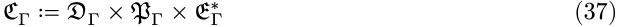

表示一个三元组 $(d, p, e)$，其中：

- $d$: $\mathfrak{D}\Gamma$ 是定义 25 的协效应规范，声明了从环境中所需的依赖关系；
- $p$: $\mathfrak{P}\Gamma \coloneqq \Sigma_{\text{et}}(K)$ 是 $\text{提供}$（provision），声明了组件可能提供的协效应键，并且其效应函数不会写入任何不在 $p$ 中的键；
- $e$: $\mathfrak{E}\Gamma^{*}$ 是定义 8 的有证效应函数，定义了当组件与撤销这些效应的逆运算一起激活时所贡献的效应。

这两个声明代表了一个接口的两个方向：$d$ 是组件从环境中读取的部分，而 $p$ 是组件写入环境的部分；第 4.2 节不允许一个注册表中的两个纤程提供相同的键。下标在整个过程中都取自 $\Gamma$，协效应上下文是其投影之一（定义 32），因此定义 25 的 $\mathfrak{D}\Sigma$ 在此处写作 $\mathfrak{D}\Gamma$。

提供者的不相交性是本章与第 3.2.3 节不同的地方。定义 28 的隔离性允许一个键通过一个域表（realm table）解析，使得两个纤程可以在不同的域中提供相同的键；携带域的演算会将不相交性放宽为域内的不相交性，并将声明的键与声明该键的纤程所在的域进行解析。我们这里不引入域，而是读取所有键在一个共享的域上，这使得上述的不相交性成为正确的条件，并且每个键的提供者是唯一的（定义 45）。它限制的是组件可以被实例化多少次：具有非空提供的组件一次只能有一个纤程，因此下面的多次实例化都是提供无内容的组件，这是仅消费或注册其他组件的组件的常见情况。

在一个运行系统中实例化的组件会随时间激活和失活，因此它携带一个 $\text{生命周期状态}$，而 $\text{转换}$（transition）就是将其从一个生命周期状态移动到另一个状态的过程：$\text{激活}$ 执行 $e$，在上下文中累积副作用；$\text{失活}$ 将累加器应用于上下文以恢复上下文。在其最简单形式中，生命周期是图 1 的双状态模型，第 4.2 节为它给出了规则；第 4.3 节将其细化，允许每种控制流特性。

图 1 | 基本组件生命周期

**纤程。** 一个组件可以被多次实例化，每次实例化都携带其自身的生命周期状态。我们将这种实例化称为 $\text{纤程}$（fiber）。一个纤程记录了产生它的组件、它被实例化的纤程、它提供的协效应，以及它在生命周期中的位置。

**定义 44。** 固定一组纤程名称 $\mathfrak{N}$。实例化组件 $(d, p, e) \in \mathcal{C}\Gamma$ 的 $\text{纤程}$ 是一个元组 $\langle d, p, e, \pi, \sigma, \tau, \theta \rangle$，其中：

- $d$: $\mathfrak{D}\Gamma$, $p$: $\mathfrak{P}\Gamma$, 和 $e$: $\mathfrak{E}\Gamma^{*}$ 分别是定义 43 的协效应规范、提供和效应函数；
- $\pi$: $\mathfrak{N} \cup \{\text{root}\}$ 是 $\text{父级}$（parent），即该纤程被实例化的纤程，或根标记 $\text{root}$；
- $\sigma$: $\Sigma$ 是该纤程自身的协效应表（定义 22），在激活之前为空，并在其效应运行过程中由其效应写入；
- $\tau$: $\{\perp, \top\}$ 是 $\text{退役}$（retirement）标志，$\perp$ 表示新创建的纤程，$\top$ 表示编排器已退役该纤程；
- $\theta$: $\Theta\Gamma$ 是 $\text{生命周期状态}$，在第 4.2 节的双状态模型中是

   $$\Theta\Gamma \coloneqq \text{Inactive} | \text{Active}(g, \omega) \quad (38)$$

其中 $g: \Gamma \to \Gamma$ 是累加器，$\omega: d \to \mathfrak{N}$ 是 $\text{已提交视图}$（committed view）。

已提交视图 $\omega$ 将该纤程声明的每个键发送给在转换提交时提供它的纤程的名称。第 4.3 节用需要进行中的转换的扩展来替换 $\Theta\Gamma$；定义 44 的其余部分对两者都是相同的，只是 $e$ 在第 4.3 节引入的每一层更丰富的效应类型上被读取。

**注册表。** 一个状态在其名称下持有其纤程，并且纤维的身份和第 3.2 节的协效应上下文都从该结构中读取。

**定义 45。** 写 $\mathfrak{F}\Gamma$ 表示 $\Gamma$ 上的纤程集合。一个状态 $\gamma \in \Gamma$ 携带一个 _registry_

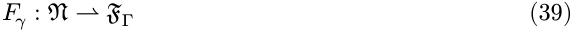

有限的偏函数，其父指针构成一棵以 $\text{root}$ 为根的树，以及 $\Gamma$ 中除纤程的 $\sigma$ 命名的其他内容。我们写 $\gamma(n)$ 表示 $\mathfrak{F}\gamma(n)$，并用下标 $n$ 来缩写 $\gamma(n)$ 的一个域，前提是状态是明确的，使得 $d_n, p_n, e_n, \pi_n, \sigma_n, \tau_n, \theta_n$ 分别是定义 44 的域，而 $g_n, \omega_n$ 是 $\theta_n$ 携带的累加器和已提交视图；$\gamma[\theta_n \mapsto\theta^{\prime\prime\prime\prime}]$, $\gamma[n\mapsto \langle\cdots\rangle]$ 和 $\gamma\setminus n$ 分别是与 $\gamma$ 在一个域、一个纤程和存在一个纤程方面不同的状态。

一个纤程的名称赋予了它一种在自身突变后依然存在的身份：下面每个规则重写一个纤程的生命周期状态，而保持其他纤程不变，因此该规则必须指明是哪一个，并且两个域分别引用纤程而非描述它们，即父 $\pi$ 和已提交视图 $\omega$。名称是原子：没有规则会计算出它、检查其结构，或通过任何非相等关系关联两者，引入一个纤程仅仅是绘制一个尚未使用的名称。这是动态创建的局部名称 [39] 的学科，此处用于纤程身份。

每个拥有表的纤程意味着协效应上下文是推导出来的而非存储的：它是活动纤程共同提供的。

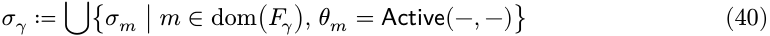

并集是良定义的，因为一个纤程只写入其声明的键，$\text{dom}(\sigma_n) \subseteq p_n$，并且不同纤程的提供是不相交的（定义 43），因此每个 $k\in\text{dom}(\sigma_\gamma)$ 都位于恰好一个 $\text{Active}$ 纤程的表中，其名称我们写为 $\text{provider}_k(\gamma) \in\mathfrak{N}$ 并称之为 $k$ 的 _provider_。因此，每个键只有一个可能的提供者，由提供决定而非由状态决定。没有规则直接写入 $\sigma_n$：一个纤程的提供是其自身效应函数执行的集合操作，这些操作落入 $\sigma_n$，因此已经是 $e_n$ 返回的状态的一部分，并且它们随着累加器再次离开。只有效应的协效应部分以这种方式记录下来，因为只有协效应部分是其他纤程声明的对象；那些修改 $\gamma$ 中其他地方状态的效应由 $g$ 像任何其他一样跟踪，但没有纤程可以在规范中命名它们，因此它们不贡献任何排序约束。

第 3.2.2 节的满足关系保持不变，其中 $\gamma\models d$ 表示 $\sigma_\gamma \models d$。一个键存在于 $\text{dom}(\sigma_\gamma)$ 当且仅当某个 $\text{Active}$ 纤程已安装了它，其提供是它可能安装的键集合而非它已经安装的键集合，因此 $\gamma\models d$ 已经要求每个声明的键都有一个 $\text{Active}$ 的提供者。只对 $\text{Active}$ 纤程取并集使得一个纤程可以在没有撤回任何东西之前停止提供，这在第 4.3.1 节中转化为排序纪律。

#### **4.2. 基本演算**

本节给出图 1 中双状态生命周期的演算及其余内容：每个纤程与之比较的目标，以及移动它的五个规则。

**目标视图。** 这些规则将每个纤程与一个 _target_ 进行比较，即它是否应该运行以及相对于其依赖关系的哪个解析。目标不是纤程自身的属性，因为一个纤程声明的键是相对于整个状态进行解析的，所以它是一个关于该状态的谓词。

**定义 46。** $\gamma$ 在 $n$ 的 _target view_ 将每个声明的键映射到其提供者，因此它是一个从 $d_n \to\mathfrak{N}$ 的全映射，当 $n$ 完全不应该运行时为 $\perp$：

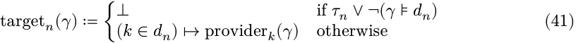

一个状态是 _quiescent_ 的，当每个纤程都达到了其目标视图：

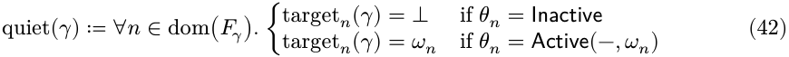

目标回答两件事，不多于此：退役（通过 $\tau_n$）和协效应解析（通过 $\gamma\models d_n$ 和 $\text{provider}_k$），每个声明的键都在定义 43 的一个共享领域中从 $\sigma_\gamma$ 读取。

定义 44 的已提交视图具有与目标视图相同的类型，生命周期是通过比较它们来驱动的：$\omega_n$ 是 $n$ 被激活时的解析，$target_n(\gamma)$ 是它应该运行时的解析，下面每个规则都是在它们一致或不一致时触发的。记录提供者而不是值使得比较可用，因为另一个提供相同值的纤程否则会比较相等。组件读取的值是通过视图到达的，因为提供者的表持有了该值，而实现将该映射保存在 `fiber.committed` 中，并将哈希值保存在 `fiber.target` 中（第 5.1.3 节）。

**规则。** 基本演算将每次转换视为原子、即时且无误的：一次激活在一个步骤中应用其效应函数，一次停用在一个步骤中应用累加器，两者都成功完成。第 4.3 节消除了所有这三者。五个规则生成两个关系。一个以 O- 开头并写为 $\gamma\Rightarrow\delta$ 的 _orchestration_ 规则是编排器可能执行的操作；其前提说明了何时该操作合法，而不是它何时发生。一个以 L- 开头并写为 $\gamma\longrightarrow\delta$ 的 _lifecycle_ 规则是系统在前提成立时无提示采取的步骤。一系列步骤交错这两个过程，而下面的 $\longrightarrow^*$ 指的是生命周期步骤本身。

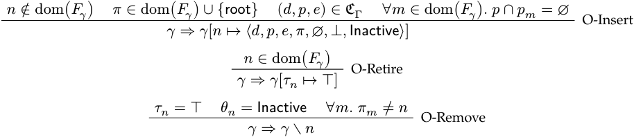

插入和退役是唯一的外部输入：编排器请求一个纤程存在或停止存在，并且绝不直接设置其生命周期状态。O-Retire 对纤程的状态无条件，因为退役是一个请求，而生命周期规则负责执行它。退役与移除分离的原因相同：一个仍然 $\text{Active}$ 的已退役的纤程必须先被停用，过早地移除它会丢弃累加器并造成泄漏。前提 $\forall m. \pi_m \neq n$ 通过在父节点之前移除子节点来保持树的良好结构。O-Insert 的最后一个前提是施加单源纪律的地方：一个键只有一个可能的提供者，因为编排器不能允许第二个组件声明它。

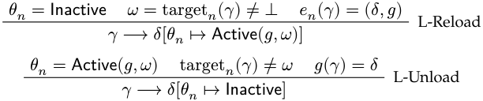

L-Reload 会在逆操作（inverse）的同时安装已提交的视图；L-Unload 应用逆操作并丢弃已提交的视图。两者都由相同的比较驱动：当一个纤程不持有任何已提交的视图且其目标视图不是 $\perp$ 时，触发 L-Reload；当它持有的已提交视图不是其目标视图时，触发 L-Unload。这是第 3.2 节的响应式纪律，它从一个不仅对退役（retirement）也对协效应（coeffects）做出反应的目标读取：每当目标视图改变时，无论哪个操作使其改变，都会启动一个转换。

**实例化 (Instantiation)。** 一个组件在安装其效应的同时可以实例化另一个组件，这就是插件宿主在加载自身插件时所做的事情。到目前为止的规则将注册表留给编排规则处理，因此这种实例化无处发生。一个原始规则为其提供了发生的位置。

**定义 47。** 对 $e_n$ 的一次应用，或其迭代（当第 4.3.2 节适用时），可以 $\text{register}$ 一个组件 $(d, p, e) \in \mathcal{C}\Gamma$。它不使用状态映射，而是使用该组件的 $O\text{-Insert}$ 并在 $\pi=n$ 时执行，并以所注册纤程的 $O\text{-Retire}$ 作为其逆操作。此规则抽取名称，受限于 $O\text{-Insert}$ 的新鲜度前提（freshness premise），并将其传递给效应函数。

逆操作执行的是退役（retires）而不是移除（removes），原因是逆操作必须在到达它的任何地方应用。$O\text{-Remove}$ 携带前提，因此由其构建的逆操作可能会失败：一个其子组件仍处于 $\text{Active}$ 状态的父组件无法运行其累加器，并且由于定义 46 不读取纤程树，没有任何规则会移动该子组件。$O\text{-Retire}$ 的唯一前提是 $n \in \text{dom}(F\gamma)$。它在注册发生时的状态留下的条目被退役为 $\text{Inactive}(\perp)$，并持有一个空表，这是引理 57 的残余条目：它仅在控制域（control fields）上与纤程的缺失不同，没有任何规则能区分两者。

退役一个子组件会设置 $\tau$，从而将其目标视图设为 $\perp$，之后普通规则将其带回 $\text{Inactive}$。父组件不会被阻止等待，$O\text{-Retire}$ 是无条件的，因此无论子组件是否离开，L-Unload 都会应用于父组件。孙组件一次到达一个级别，子组件自身的累加器退役了子组件注册的内容。定理 66 涵盖了这种级联效应，以及第 4.3.1 节关于协效应施加的效应。

**限制 (Confinement)。** 在唯一的例外情况下，可以为效应函数设定一个纪律。它限制了一个应用写入什么，使得应用于它的规则考虑到所有其他变化；并限制了一个应用读取什么，使得一个纤程只能看到其声明的协效应以及注册表中的内容，不能再多。限制写入的内容使得第 4.4 节可以将表 1 读取为一个完整的清单。

**定义 48。** 一个从 $\Gamma \to \Gamma$ 的映射 $f$ 在 $n$ 上是 $\text{confined to}$ $n$，当对于每个 $\gamma \in \Gamma$ 且 $n \in \text{dom}(F\gamma)$，写入 $\delta = f(\gamma)$ 时：

1. **(写入。)** $\text{dom}(F\delta) = \text{dom}(F\gamma)$，并且对于所有 $m \in \text{dom}(F\gamma)$ 且 $m \neq n$，$\delta(m) = \gamma(m)$；而 $\delta(n)$ 和 $\gamma(n)$ 只在 $\sigma$ 上不同；

2. **(读取。)** 两个状态在 $\sigma_n$、对于所有 $m \in \text{dom}(F\gamma)$ 的限制 $\sigma_m|d_n$，以及不在任何纤程的表名中携带的、关于状态的部分上达成一致。

一个效应函数 $e$ 在 $n$ 上是 $\text{confined to}$ $n$，当其每次应用，及其迭代（当第 4.3.2 节适用时）要么注册一个组件（定义 47），要么其状态映射 $\text{pr}_1 \circ e$ 和它产生的逆操作都在 $n$ 上是 $\text{confined to}$ $n$。每个纤程的效应函数都要求在该纤程上是 $\text{confined to}$ 该纤程本身。

一次注册写入了 $O\text{-Insert}$ 写入的内容，即它抽取的那个名称上的条目，仅此而已；它产生的逆操作 $O\text{-Retire}$ 写入了该名称的 $\tau$ 以及仅此而已。因此，无论哪种类型的应用都不会写入任何已存在的纤程的控制域（control field），除了那一个 $\tau$，并且根本不读取任何内容。

子句 (2) 是组件可以读取其声明的值的原因：这些值位于其提供者（providers）的表中，因此一个不读取任何表的效应函数，而只读取 $\sigma_n$，将无法使用自身的协效应。它不能读取 $d_n$ 之外的表，或任何控制域，这也是防止组件根据其未声明的纤程的生命周期状态进行分支的原因。

这些规则是非确定的：多个纤程可能持有与目标视图不同的已提交视图，而关系不规定它们之间的顺序。它们也是**响应式 (reactive)** 的，因为没有任何规则提及调度器（scheduler）；步骤是任何规则应用的序列，因此在一个所有此类序列上证明的定理对运行时采用的任何调度策略都成立。

#### **4.3. 进行中的转换**

本节在四个设置中扩展了基础演算。第一个提供了第 3.2 节需要而第 4.2 节无法表达的内容，即跨越一个时间间隔的停用（deactivation）范围，其依赖项可能占据；其他三个则放弃了转换是原子、即时和无误的理想化假设，而这些都不是真实运行时中的转换所具备的。被放弃的是整个转换是一个步骤，而不是一个步骤是一次规则应用，而这四个设置共享了一个结构性后果，此处一次性考虑：一个不是步骤的转换需要在其进行过程中占据一个状态，为它可能运行的每个方向各需要一个状态。

**定义 49。** 本节的生命周期状态用以下公式替代了 $\Theta\Gamma$：

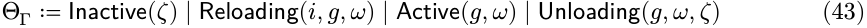

其中 $i: \mathcal{E}\Gamma^{\text{iter*}}$ 是剩余效应迭代器（见下文定义 51），$\gamma: \Gamma \to \Gamma$ 是到目前为止构建的累加器，$\omega: d \to \mathbb{N}$ 是已提交视图，而 $\zeta: \{\perp\} \cup \Xi$ 是**结果 (outcome)**，由 $\text{Unloading}$ 携带其退役的目标，以及由 $\text{Inactive}$ 携带其到达的结果，要么是 $\perp$，要么是从第 4.3.4 节提供的错误集合 $\Xi$ 中取出的一个错误。

一个纤程处于 $\text{installed}$ 状态时，它处于携带累加器和已提交视图的三个状态之一；当它携带一个错误结果时，则处于 $\text{failed}$ 状态：

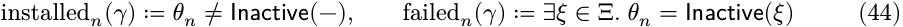

一个已安装的纤程 $n$ 当 $\omega_n(k) = m$ 时，$\text{resolves}$ $k$ 到 $m$。定义 46 的静止性在更广的状态空间上读取为：

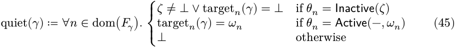

第 4.1 节的定义延续到此状态空间，需要进行两种解读。首先，第 4.2 节中的 $\text{Inactive}$ 在 O-Insert 的结论部分被读作 $\text{Inactive}(\perp)$，在 O-Remove 的前提部分被读作 $\text{Inactive}(-) $。其次，$\sigma_\gamma$ 仍然只并集了 $\text{Active}$ 纤程的表，因此对于其转换正在进行中的纤程，它通过其持有的 $\omega$ 读取其协效应，而自身不提供任何协效应；因此，该纤程已经写入的键尚未成为依赖项可以激活的对象。在双状态演算中，这种区别是空洞的，因为所有已安装的纤程都是 $\text{Active}$ 的。

图 2 描绘了这些状态形成的生命周期，下面四个小节提供了其边的规则。

图 2 | 转换进行中的生命周期；两个转换状态被描出

#### **_4.3.1. 撤回_**

第 3.2 节要求依赖项在其依赖项之后激活，并且依赖项只有在它们的依赖项停用后才会撤销其提供的服务。前半部分已经在基础演算中成立：一个激活需要 $\gamma \vdash dn$，因此声明了 $k$ 的纤程不能在某个纤程主动提供 $k$ 之前激活。后半部分是实质性的，它必须提供比状态变化顺序更丰富的内容。当一个组件因为其提供者即将离开而被拆除时，它正在运行自己的拆除代码，而该代码可能需要正在被撤回的协效应；关闭连接池通常意味着将连接交还给提供它们的任何实体。后半部分必须提供的则是：消费者可以在整个自身停用过程中持续读取 $k$，并且提供者撤销 $k$ 的效果要等到之后才会生效。基础演算根本无法提供这一点：其 L-Unload 会移除服务并一起运行逆操作，两者之间没有间隔供消费者的拆除过程占据。

此层将该步骤分成两部分，并通过以下条件来保护后半部分。

**定义 50.** 当某个其他已安装的纤程解析到一个键到 $n$ 时，说纤程 $n$ 在 $\gamma$ 处是 _被依赖的_：

L-Leave 记录了不采取行动而决定停用的行为，这会停止提供其协效应的纤程，同时保持其自身已提交的视图和所有其他人的状态完好。L-Unload 应用累加器，丢弃已提交的视图，并使该纤程处于它携带的结果状态；如果不是第 4.3.4 节提供了其他情况，则结果为 $\perp$。它是唯一一个应用累加器的演算规则。

这两个顺序部分分别由形式的不同部分承载：可见性部分由已提交的视图承载，L-Unload 作为其最后一步丢弃它；而顺序部分由前提 $\neg \text{relied}_n(\gamma)$ 承载，我们称之为 _保护子 (guard)_，它将 $k$ 的撤回一直保留到所有解析了该键到 $n$ 的消费者都离开为止。定理 63 同时确立了这两点。

保护子是针对每个绑定而不是针对每个纤程施加的：$\text{relied}_n(\gamma)$ 测试是否某个已提交的视图命名了 $n$，因此声明了不包含 $n$ 任何键的纤程没有障碍，另一个在另一个领域解析了 $n$ 的键（第 3.2.3 节）的纤程也没有障碍。在第 4.2 节的单源纪律下，按绑定读取与更粗粒度的测试 $\exists m \neq n, k \in d_m.\text{installed}_m(\gamma) \land k \in p_n$，即一个键只有一个可能的提供者相符。

这类保护子通常会导致死锁。阻止其发生的是 $\text{Unloading}$ 与 $\sigma_\gamma$ 仅是 $\text{Active}$ 纤程的并集：一旦 L-Leave 标记了 $n$，其表就会离开 $\sigma_\gamma$，因此任何目标视图都不能再命名 $n$，并且所有提交给 $n$ 的消费者本身也正在退出。定理 66 将此转化为保护子总是释放的断言。

保护子沿着协效应而不是沿着纤程树对停用进行排序：一个父组件可能在它的子组件仍在 $\text{Unloading}$ 的同时运行其逆操作，因为 $\text{relied}$ 只谈论已提交的视图。因此，父组件和子组件的顺序比定理 63 对提供者及其消费者的排序更弱，而效应相遇在环境状态处的父组件和子组件则受定义 60 的独立性假设控制。

#### **_4.3.2. 迭代_**

一个激活可能会按顺序执行多个效应，并且停用必须恢复它们。我们使用一个 _效应迭代器 (effect iterator)_ 来对这样的激活进行建模，每个迭代都产生修改后的上下文、一个逆操作和一个延续：

**定义 51.** 将效应迭代器 $\mathfrak{E}\Gamma^{\text{iter}}$ 和有证效应迭代器 $\mathfrak{E}/\Gamma^{\text{iter}* }$ 定义为以下递归类型：

其中 $e(\gamma)$ 产生一个三元组 $(\delta, g, o)$，分别代表：

- $\delta$ 是新的上下文；
- $g$ 是当前效应的逆函数；
- $o$ 表示延续：
    - $\text{Nothing}$ 表示迭代终止；
    - $\text{Just}(i)$ 提供下一个迭代。

证（witness）在定义 33 的 $\simeq$ 处读取，因为定义 37 读取了 $\mathfrak{E}\Gamma^{\text{iter}* }$ 的情况：当 $i \in \mathfrak{E}/\Gamma^{\text{iter}*}$ 时，如果 $i$ 尊重 $\simeq$，并且它产生的每个 $g$ 都尊重 $\simeq$ 并满足上述子句时，则成立。三元组是按分量比较的，$\text{Nothing}$ 与 $\text{Nothing}$ 仅比较，而 $\text{Just}(i)$ 与 $\text{Just}(i')$ 在 $i \simeq i'$ 时比较，并且迭代器上的 $\simeq$ 是满足这些子句的最大关系。将 $\simeq$ 取为 $\Gamma$ 上的相等性可以恢复字面意义上的读取。

效应迭代器转换 $\text{effect}^{\text{iter}}\Gamma$ 通过递归调用定义了：

**定义 52.** 将效应迭代器转换 $\text{effect}^{\text{iter}}\Gamma$ 定义为：

在每次迭代中，逆函数 $g$ 会按照应用顺序复合到 $\varphi$ 上，因此累加器 $\varphi \circ g_1 \circ \cdots \circ g_k$ 在应用时自然地恢复了 LIFO（后进先出）顺序的效应。由于效应 $\Gamma^{\text{iter}}$ 落在与效应 $\Gamma$ 相同的 $\partial\Gamma \to \partial^2\Gamma$ 中，迭代器本身就是一个效应，可以在任何需要效应的地方使用。组件的整个激活就是这样一种用法，这也是本节其余部分所形式化的，并且该实现允许在每个变异点处存在一个迭代器（第 5.1.1 节）。$\text{M}\text{a}\text{y}\text{b}\text{e}(\mathcal{E}^{\text{iter}})$ 的延续使得在任何两个连续的迭代之间提供了一个边界，在该边界上，上下文是到目前为止所有迭代所设定的，而累加器恢复了这些内容，仅此而已。从这个意义上说，效应迭代器是一个再化的限定延续（reified delimited continuation），这是主流语言通过 `yield` 操作符暴露的结构 [43]，因此该模型直接映射到它们已经提供的生成器上。

在演算中，从现在开始，定义 44 中的 $\text{en}$ 在 $\mathcal{E}\Gamma^{\text{iter}*}$ 处读取，用迭代器替换原子效应函数后，基础的 L-Reload 分裂成一个痕迹会经过的已开始状态（begun state），并为纤程提供了一个离开该状态的第二种方式。

每次迭代都按照定义 52 将新产生的逆函数复合到累加器上，形成 $g \circ h$，使得累加器以后进先出（last-in-first-out）的顺序应用这些逆函数。在任何两个连续的迭代之间，如果其目标视图已改变，系统可能会 $\text{divert}$ 过渡，将到目前为止积累的逆函数应用于恢复上下文。L-Divert 像其他所有停用操作一样通过 $\text{Unloading}$，而不是在当前位置应用累加器，它遇到的保护（guard）是空洞的，一个从未处于 $\text{Active}$ 状态、不提供任何内容且未出现在任何已提交视图中的纤程。其两个替代方案中的第一个会 $\text{abort}$ 当前迭代所持有的迭代，这只有迭代边界才能实现粒度，因此 $\text{divert}$ 可能发生的粒度就是迭代器；第二个则让该迭代落地，而第 4.3.3 节就是需要它的地方。

一个普通的效应函数 ($\mathcal{E}\Gamma$) 是退化情况，即第一次迭代已经产生了 $\text{Nothing}$。这样的过渡仍然会经过 $\text{Reloading}$，L-Divert 仍然适用，但累加器是 $\text{id}_\Gamma$ 且没有运行任何迭代，因此什么都没有恢复，该过渡要么安装所有效应，要么不安装任何效应。

#### **_4.3.3. 异步性_**

到目前为止的层允许环境在一次迭代和下一次迭代之间移动，并假设每次迭代本身是瞬时的，其启动和落地是一个步骤。我们抽象地对非即时性进行建模：一个迭代产生一个类型为 $\text{Future}(A)$ 的值，其中 $\text{Future}$ 是一个不透明的类型构造器，其定义属性是提交到解析之间外部状态可能会改变。

在该模型下，一次迭代在一个状态启动并在另一个状态落地，并且纤程在飞行过程中处于 $\text{Reloading}$ 状态。该层增加的是“惯性”（inertia）：一旦启动，一个迭代就会落地，而且其落地不能被拒绝。因此，在飞行过程中发生变化的任何目标视图都不能通过中止迭代来响应，只有剩余的 L-Divert 的替代方案是可用的：即迭代落地，然后纤程停用。因此，该层没有增加任何规则和任何规则匹配的类型；在 $\Gamma$ 的粒度上，惯性就是其全部内容，它表现为对宿主可以采取的 L-Divert 替代方案的一种限制。

正是这个替代方案是基础演算无法表达的。在那里，一个目标视图发生变化的过渡是在发现它的同一步中被撤销的；而在这里，正在飞行的迭代必须先落地，因此纤程需要在其逆函数运行期间有某个地方停留，唯一合理的地点就是 $\text{Unloading}$ 处持有该迭代产生的逆函数。如果改为通过 $\text{Active}$ 路由，则允许纤程在一个步骤的长度内提供其协效应，并迫使其依赖项针对一个已经离开的组件进行激活。这是 `reload` 和 `unload` 在实现中的相互链式调用。

停用也可能通过复合而非规则直接链接回激活。L-Unload 不对目标视图做任何前提假设，因此无论在纤程停用的期间目标视图变成了什么，累加器都会运行，并且纤程变为 $\text{Inactive}$，此时 L-Begin 可以立即开始一个新的过渡。

#### **_4.3.4. 失败_**

到目前为止的每条规则都假设其执行的效应是成功的，而运行时不能保证这一点。组件安装的效应会超出跟踪它们的上下文范围，它们所触及的内容可能会拒绝：一个已绑定的端口、一个不存在的文件、一个未响应的对等点（peer）。一个失败的过渡仍然必须恢复纤程的效应而不是使其悬空。

令 $\Xi$ 为错误集合，并完善定义 51 的效应迭代器，使得一次迭代可以在抛出（raise）而不是产生三元组的情况下发生：

见证（witness）仅约束了 $\text{Right}$ 情况，在模式不匹配时是空洞的，因为抛出什么都没有可以撤销；而 $\text{Reloading}$ 携带的 $i$ 从现在开始在 $\mathcal{E}\Gamma^{\text{fail}*}$ 处读取。定义 52 的提升（lift）带着一个抛出的值替代三元组进行传播，因此可用的抛出迭代器可以在任何需要效应的地方使用，就像普通效应一样。该层增加了一条规则，并利用了定义 49 的第二个结果 $\text{O-Remove}$，它不需要扩展就能接受。L-Iter、L-Finish 和 L-Divert 的前提条件都用 $\text{Right}$ 包围了它们匹配的三元组。抛出是迭代所做的事情，因此该规则是从 $\text{Reloading}$ 的退出。

$$\theta_n = \text{Reloading}(i, \langle g, \omega \rangle) \quad i(\gamma) = \text{Left}(\xi) \mid \text{L-Raise} \quad \gamma \longrightarrow \gamma[\theta_n \mapsto \text{Unloading}(g, \omega, \xi)]$$

L-Raise 在记录之前恢复。纤程（fiber）路由到 $\text{Unloading}$，将错误作为其结果携带；累加器（accumulator）构建到失败的迭代中并在那里应用；然后纤程到达 $\text{Inactive}(\xi)$，此时什么都没有安装，其状态与中止的 L-Divert 所产生的状态不同，这种差异仅体现在纤程所携带的结果上。路由一个失败就像其他任何停用一样，使得所有结果只能通过 L-Unload 到达，这是定理 59 的唯一事实基础。L-Begin 以 $\text{Inactive}(\perp)$ 作为前提，因此生命周期不会从错误结果重新进入；这就是结果的实质，它保留了一个其效应函数在运行时的状态下被证明是不良的纤程，而不是尝试在未改变的环境中重试它。一个失败的纤程也不会阻碍任何事情：它是 $\text{Inactive}$ 的，所以不携带已提交的视图（committed view）并且不能做出依赖的保持（relied hold）。

失败记录在纤程上而不是传播到其父级，因此一个转换失败的组件会使它的兄弟组件继续运行，这正是插件宿主（plugin host）所期望的行为，也是结果是每个纤程的属性而不是整个状态的属性的原因。

#### **4.4. 元理论**

第 4.3 节提供了十条规则：第 4.2 节的三个编排规则；用于激活的 L-Begin、L-Iter 和 L-Finish；用于激活可能提前结束的两种方式（L-Divert 和 L-Raise）；以及用于停用的 L-Leave 和 L-Unload。本节从这些规则的全局形式中读取了可组合性的两个维度：即无论其他纤程做什么，一个纤程的保证都成立，并增加了只有整个系统才能要求的特性：它总是达到其目标调用的配置，并且该配置是静态组装（static assembly）会产生的那个。下面每个性质都是一系列步骤的性质，因此我们对这些步骤进行索引，并根据该索引读取状态的字段。

两个约定将第 3.3.2 节带入本节。下面所有状态之间的等价性都指到定义 33 的观察等价 $\simeq$，因为引理 38 读取了第 3.1 节的内容，而效应函数所持有的见证条件（witness condition）是定义 37 给出的，当从迭代器读取时如定义 51 所给，当从下面的注册迭代时也一样。

**定义 53.** 用 $t$ 来索引步骤，使得 $\gamma^{t}$ 是前 $t$ 个步骤到达的状态，并写下

表示在 $\gamma^{t}$ 处采取的步骤：它应用的规则 $r$（十条规则之一），以及它应用该规则的名称 $n \in \mathfrak{N}$。序列从 $\gamma^{0}$ 开始，其中 $\text{dom}(F^{0}) = \emptyset$，因此每个纤程都是通过 O-Insert 产生的，无论是编排器（orchestrator）还是迭代器（iteration）产生的（定义 47）。$\gamma^{t}$ 的一个字段携带上标索引，使得 $\theta_n^{t, \omega}, \omega_n^{t, \sigma}, g_n^{t,}$ 和 $it_n$ 分别是 $n$ 在 $\gamma^{t}$ 时的生命周期状态（lifecycle state）、已提交视图（committed view）、表（table）、累加器（accumulator）和剩余迭代器（remaining iterator），而 $F^{t}$ 和 $\sigma^{t}$ 是 $\gamma^{t}$ 本身的注册表（registry）和协效应上下文（coeffect context），其定义与定义 45 中所述的 $F_\gamma$ 和 $\sigma_\gamma$ 一致。谓词将状态作为其参数，其余所有内容作为下标，因此 $\text{installed}_n^{t, \text{target}_t}$、$ \text{relied}_t n$ 和 $\text{quiet}_t$ 分别是 $\gamma^{t}$ 处的定义 46、定义 49 和定义 50 的谓词。$n$ 的一个 _episode_ 是一个最大的区间 $[b, u]$，在这个区间内 $\text{installed}_n^{t}$ 成立。它在 $b$ 处 _opens_，其中 $b>0$ 且 $\neg \text{installed}^{b-1} n$，空 $F^{0}$ 在开始时没有安装任何纤程；当 $\text{installed}^{u} n$ 成立但 $\text{installed}^{u+1} n$ 不成立时，它在 $u$ 处 _closes_，而最后一个 episode 不需要这样做。

第 4.3 节的每条规则都以 $\gamma \longrightarrow \delta[\cdots]$ 的形式结束，其中前提从 $\gamma$ 计算出 $\delta$，并在它们计算无内容时保持为 $\gamma$，方括号编辑了注册表（registry）中命名的字段。这两个半部分分别命名，并且都是作用于所有 $\Gamma$ 上的映射。在 $\gamma^{t}$ 处由作用于 $n$ 的规则执行的步骤的 _状态映射_ 是

其中 $i$ 和 $g$ 是 $\theta_n^{t}$ 携带的迭代器和累加器，而 $\text{edit}_t: \Gamma \rightarrow\Gamma$ 是方括号作为函数读取的，它将命名的字段赋值为前提在 $\gamma^{t}$ 处计算出的值。因此，两者都由步骤 $t$ 以及 $\gamma^{t}$ 固定，并在每个状态下定义，这使得定理 61 和引理 71 可以从 $\gamma^{t}$ 中评估它们。每个步骤可以分解为

例如，在 L-Unload 时，$\text{edit}_t$ 是 $[\theta_n \mapsto \text{Inactive}(\zeta)]$；而在 O-Remove 时，它是移除 $\setminus n$，这就是为什么第二个半部分是一个编辑（edit）而不是赋值（assignment）。字段沿着相同的接缝划分：是 _表_ $\sigma_m$，它在创建 $m$ 的 O-Insert 已经将其设置为 $\emptyset$ 后不会被任何 $\text{edit}_t$ 写入；以及 _控制字段_ $\theta_m, \tau_m, \pi_m, d_m, p_m, e_m$ 以及 $\text{dom}(F_\gamma)$，这些在 $\Psi^{t}$ 不会写入，除非通过定义 47 的原始操作。当两个状态在所有控制字段上都一致时，写 $\gamma \approx \delta$。

关系 $\approx$ 不是定义 33 的 $\simeq$，它也不精化另一个，因为每个都会忘记对方需要保留的内容。恢复精确性（Recovery exactness）是一个关于效应的断言，所以 $\approx$ 精确地比较表和环境状态，只忘记了注册表中记录的哪个纤程安装了它们。一条规则读取控制字段来决定是否适用，所以 $\simeq$ 必须保留它们，而本节将其理解为定义 33 与在注册表的域以及每个纤程的每个控制字段上一致性的合取：

≔ $\gamma \simeq \delta \sigma_\gamma \simeq\sigma_\delta \land \text{dom}(F_\gamma) = \text{dom}(F_\delta) \land \forall n, c \in \{\theta, \tau, \pi, d, p, e\}. c(\gamma(n)) \simeq c(\delta(n))$ (53)

函数类型的字段，如 $\text{en}$ 和 $\theta_n$ 中的 $g$，是像定义 36 比较映射那样比较的；迭代器是像定义 51 那样比较两个；其他任何类型的字段则通过相等性比较。下面得到的结果在两种关系下都成立，分别对应状态的两半部分，引理 55 为所有十条规则建立了 $\simeq$ 的一半。

表 1 是第 4.3 节的十条规则，以其书写形式呈现。累加器（accumulator）、已提交视图（committed view）和剩余迭代器（remaining iterator）是 $\theta_n$ 的组成部分，因此第三列记录了对它们的写入，而 $h$ 指的是第四列所产生的迭代的逆，即 $\text{id}\Gamma$，其中 L-Divert 会中止该迭代。当一个由迭代器构建的 $\Psi^t$ 注册一个纤程（fiber）（定义 47）时，该注册携带了 O-Insert 行在其引用的名称处的写入，以及一个累加器退出的 L-Unload 的写入。下面每个案例分析都是对表格的查找，其中五个查找足够频繁以至于值得命名。

|**规则**|**$\theta^n$****t** **n**|**$\theta^{t+1}$****n** **n**|**$\Psi^t$**|**编辑的控制字段**|
|---|---|---|---|---|
|O-Insert|undefined|Inactive($\perp$)|id$\Gamma$|dom($F\gamma$)|
|O-Retire|unconstrained|unchanged|id$\Gamma$|$\tau_n$|
|O-Remove|Inactive($-$)|undefined|id$\Gamma$|dom($F\gamma$)|
|L-Begin|Inactive($\perp$)|Reloading$(en, \text{id}\Gamma, \omega)$|id$\Gamma$|$\theta_n$|
|L-Iter|Reloading$(i, g, \omega)$|Reloading$(i', g \circ h, \omega)$|pr$_1\circ i$|$\theta_n$|
|L-Finish|Reloading$(i, g, \omega)$|Active$(g \circ h, \omega)$|pr$_1\circ i$|$\theta_n$|
|L-Divert|Reloading$(i, g, \omega)$|Unloading$(g \circ h, \omega, \perp)$|id$\Gamma$orpr$_1\circ i$|$\theta_n$|
|L-Raise|Reloading$(i, g, \omega)$|Unloading$(g, \omega, \xi)$|id$\Gamma$|$\theta_n$|
|L-Leave|Active$(g, \omega)$|Unloading$(g, \omega, \perp)$|id$\Gamma$|$\theta_n$|
|L-Unload|Unloading$(g, \omega, \zeta)$|Inactive($\zeta$)|$g$|$\theta_n$|

表 1 | 规则在它们作用的纤程 $n$ 上的写入，其中 $\text{step}^t$ 是在 $n$ 处应用的该规则。

**引理 54。** 将表 1 与定义 48 一起阅读，对于每个步长 $t$ 和所有存在于 $\gamma^t$ 的纤程 $m, n$：

1. $\sigma_m^{t+1} \neq \sigma_m^t$ 当且仅当 $\text{step}^t$ 作用于 $m$，并且写入位于 $\Psi^t$ 内；

2. $\omega_n$ 只在 $\text{step}^t = \text{L-Begin}(n)$ 时出现，只在 $\text{step}^t = \text{L-Unload}(n)$ 时消失，因此 $\omega_n^t$ 在 $n$ 的一个周期内对 $t$ 是常数；

3. $\Psi^t = g_n^t$ 当且仅当 $\text{step}^t = \text{L-Unload}(n)$，并且没有其他步骤将 $g$ 应用于 $n$ 的状态；4. $\neg \text{installed}^t n \land \text{installed}^{t+1} n \Rightarrow \text{step}^t = \text{L-Begin}(n)$，且 $\text{installed}^t n \land \neg \text{installed}^{t+1} n \Rightarrow \text{step}^t = \text{L-Unload}(n)$;

5. $\pi_n, d_n, p_n, e_n$ 与 $n$ 的进入一起出现，并且再也不会被写入，而 $\tau_n$ 是单调的，只在 $\top$ 处写入，且仅由 O-Retire 写入。

_证明._ 令 $\text{step}^t$ 在 $n$ 处应用规则 $r$。根据定义 53，它分解为 $\text{edit}^t \circ \Psi^t$，其中 $\text{edit}^t$ 写入表 1 第五列命名的字段及其以外的任何内容，而 $\Psi^t$ 是 $\text{id}\Gamma$、 $n$ 的迭代之一的应用，或累加器 $g_n^t$，后者是这些迭代产生的逆的复合。根据定义 48，每个部分都被限制在 $n$ 内，因此 $\Psi^t$ 不写入存在于 $\gamma^t$ 的任何纤程的字段，而是 $\sigma_n$，以及注册添加的条目和 $\tau$ 其逆写入的内容。因此，这两个半部分划分了写入，每条子句都是在某个字段上读取的这种划分。对第二列和第三列的阅读被使用了两次：Inactive 是不携带已提交视图的生命周期状态，L-Begin 是离开它的规则，而 L-Unload 是进入它的规则，而其他每一行都将其前提中的 $\omega$ 不变地带到结论中。

(1) 一个 $\text{edit}^t$ 不写入任何表，第五列不命名任何内容，$\Psi^t$ 不写入存在于 $m \neq n$ 的任何 $\sigma_m$。因此 $\sigma_m$ 只能在 $m=n$ 时移动，并且只能在 $\Psi^t$ 内。

(2) $\omega_n$ 是 $\theta_n$ 的组成部分，只有 $\text{edit}^t$ 写入，并且只在步骤作用的纤程处写入，因此根据上述阅读，$\omega_n$ 在 $n$ 的 L-Begin 时出现，并在 $n$ 的 L-Unload 时消失。$n$ 的一个周期是一个 $\text{installed}_n$ 成立的区间，因此整个区间内 $\omega_n$ 是定义的，所以没有规则落入其内部。

(3) 第四列中，累加器仅在 L-Unload 中出现：其他规则取前向映射 $\text{pr}_1 \circ i$ 或 $\text{id}\Gamma$，而任何 $\text{edit}^t$ 都没有对状态应用映射。

(4) $\text{installed}_n$ 是 $\theta_n \neq \text{Inactive}(-) $，根据上述阅读，L-Begin 和 L-Unload 是前提和结论在 $\theta_n$ 是否为 $\text{Inactive}$ 上不同的唯一规则。作用于某个 $m \neq n$ 的步骤不写入 $\theta_n$，而注册添加的条目位于不在 $\gamma^t$ 中的名称处。

(5) 第五列没有行命名 $\pi, d, p,$ 或 $e$；它们与 O-Insert 添加时出现，其结论也写入了这些内容，O-Insert 注册也如此。只有 O-Retire 在 $\top$ 处写入 $\tau$，无论是由编排器获取还是作为注册的逆（定义 47）；O-Insert 在一个尚未存在的名称处设置 $\tau = \perp$，因此没有步骤将 $\tau$ 返回到 $\perp$。$\square$

另外两个查找说明了规则无法看到的内容。第一个是它们只通过上述观察来读取状态，因此整个演算下降到 $\Gamma/\simeq$。

**引理 55。（$\simeq$-不变性。）** 令 $\gamma \simeq \gamma'$ 如上阅读。那么第 4.3 节的规则在作用于 $n$ 的 $\gamma$ 上应用当且仅当它在作用于 $n$ 的 $\gamma'$ 上应用，并且两个应用的最终状态再次由 $\simeq$ 联系起来。

_证明._ 第 4.3 节的每个前提属于四种类型之一，每种都读取了关系保持的组成部分。匹配 $\theta_n$ 或 $\tau_n$ 与模式的前提，以及 O-Remove 的前提 $\forall m. \pi_m \neq n$，读取控制字段。前提 $(d, p, e) \in \mathcal{C}\Gamma$ 和 O-Insert 的 $\forall m. p \cap p_m = \emptyset$ 读取 $d, p,$ 和 $e$。提及目标 $n$ 或依赖 $n$ 的前提读取 $\tau_n$，$\theta_m$ 内的已提交视图，以及 $\text{dom}(\sigma_\gamma)$，后者由定义 45 从 $\theta_m$ 和 $\text{dom}(\sigma_m)$ 计算得出，并且定义 33 只在两个协效应上下文的域一致时关联它们。其余的前提读取 $\text{dom}(F\gamma)$。没有前提除了至多到 $\simeq k$ 的值 $\sigma_\gamma(k)$ 外，不读取任何值，因此没有前提可以将两个 $\simeq$-相关的状态区分开来。

对于结论，根据定义 53，$\gamma^{t+1} = \text{edit}^t (\Psi^t (\gamma^t))$。 $\text{edit}^t$ 分配的值是其匹配的前提的组成部分，这些组成部分通过上述段落和定义 51（该定义关联了迭代器在 $\simeq$-相关状态上产生的三元组）联系起来。并且 $\Psi^t$ 保持 $\simeq$：它是 $\text{id}\Gamma$，或 $e_n$ 的一个迭代，根据定义 51 要求它保持 $\simeq$，或 $\theta_n$ 内的累加器，后者是每个都按相同定义保持 $\simeq$ 的逆的复合。$\square$

状态携带的名称由两个观察结果 $\text{dom}(\mathcal{F}\gamma)$ 和控制域的索引读取，并且规则规定绘制一个名称会绘制任何未使用的名称（定义 47）。阅读下面的结果直到 $\simeq$ 也要求阅读到重命名为止，这是第 4.1 节中已解决的学科。

**引理 56。（等变性。）** 设 $\chi: \mathfrak{N} \to \mathfrak{N}$ 是一个双射，令 $\chi \cdot \gamma$ 为携带注册表 $\mathcal{F}\gamma \circ \chi^{-1}$ 的状态，其中每个名称都用其像替换了出现在 $\pi_m$ 或 $\omega_m$ 中的。那么 $\chi \cdot \gamma$ 是一个状态，在 $\gamma$ 良好形成的地方也是如此，并且 $\text{step}^t = r(n)$ 将 $\gamma^t$ 转移到 $\gamma^{t+1}$ 当且仅当 $r(\chi(n))$ 将 $\chi \cdot \gamma^t$ 转移到 $\chi \cdot \gamma^{t+1}$。

_证明._ 一个前提只通过将其与另一个进行比较来读取名称，无论是直接的，如 O-Insert 的新鲜度 $n \notin \text{dom}(\mathcal{F}\gamma)$ 和 $\forall m.\pi_m \neq n$，还是通过名称表，如 target$n$ 和 relied$n$ 读取 $\pi_m$ 和 $\omega_m$。一个双射保持了每种此类比较。规则写入的唯一名称是 O-Insert 设置的 $\pi$ 和 L-Begin 设置的 $\omega$，两者都来自其前提读取的内容，因此写入与 $\chi$ 可交换；效应函数根本不写入任何名称，只通过定义 47 的原始操作绘制一个名称，而定义 48 将其限制在该原始操作添加的条目上。良好形成性（定义 58）是四个比较名称与名称的条件。$\square$

因此，一个序列及其重命名以相同的规则按相同的顺序进行，并达到仅由 $\chi$ 不同的状态。相应地，两个在其注册表绘制的名称上相同的序列被识别，下面的结果是在识别它们的重命名意义下阅读的。

第二个查找是剥离了除名称以外的一切内容的条目对规则不可见，这就是允许定义 47 退役一个其恢复的状态没有（任何）的纤程，以及引理 72 移除已删除的剧集的注册表的原因。

**引理 57。（残余条目。）** 当 $\tau_n = \top$, $\theta_n = \text{Inactive}(\perp)$, $\sigma_n = \emptyset$，并且没有 $m$ 使得 $\pi_m = n$ 时，称 $n$ 在 $\gamma$ 处为 _残余的_；一个残余条目满足 $\gamma \approx \gamma \setminus \{n\}$。如果 $n$ 在 $\gamma$ 处是残余的，那么对于每个规则和每个 $m \neq n$：

1. 一个在 $\gamma$ 处作用于 $m$ 的规则，在 $\gamma \setminus \{n\}$ 处作用于 $m$ 时适用，并且两个状态仅在 $n$ 的条目上不同，该条目保持残余；

2. 反之，一个在 $\gamma \setminus \{n\}$ 处作用于 $m$ 的规则，在 $\gamma$ 处适用，除非它是绘制名称 $n$ 或声称键为 $p_n$ 的 O-Insert。

_证明._ 一个残余的 $n$ 不对任何前提做出贡献，一个作用于 $m \neq n$ 的规则的前提读取它。它不是 $\text{Active}$，所以 $\sigma_n$ 不进入 $\sigma_\gamma$，并且 $n$ 不是任何键的提供者，使得 $\gamma \models d_m$ 和 $\text{target}_m$ 不变；$\text{installed}_n$ 失败，所以 $n$ 不对 $\text{relied}_m$ 做贡献；没有 $\pi'_m$ 名称为 $n$，所以 O-Remove 的前提 $\forall m' . \pi'_{m'} \neq m$ 没有变化；并且 $\theta_n$, $\tau_n$, 和 $\pi_n$ 只被作用于 $n$ 的规则读取。两个前提子句 (2) 是移除放宽的两个，一个缺失的名称是新鲜的，一个缺失的提供物满足所有其他条件。根据引理 54，没有作用于 $m \neq n$ 的规则写入 $n$ 的域，所以该条目得以保留，并且步骤的状态映射由定义 48 限制在 $m$ 上，因此它使 $\sigma_n$ 为空。$\square$

简化生命周期状态以及匹配它们的规则产生了一个子演算，但并非所有结果都能通过简化。删除第 4.3.1 节是重要的情形，这是第 4.3 节以...开始的划分，从元理论的角度来看：其卫语句建立了定义 58 的子句 (3) 和 (4)，而定理 63 依赖于该卫语句创建的区间，因此没有它这三个都失败了。其他三个小节增加的内容可以在不干扰下面结果的情况下被简化掉，它们每个都只是向定义 49 固定的一个状态空间添加规则。

#### **_4.4.1. 保持性_**

定义 45 固定了注册表的形状，并且在下面的结果可以对其进行补充之前，必须根据它来检查规则。本小节确定了规则所保持的不变式，其中第一个子句是该形状，其余的则是这些结果假设的。

- **定义 58.** 当对于所有 $m, n \in \text{dom}(\mathcal{F}\gamma)$ 和所有 $k \in K$，以下条件都成立时，注册表 $\mathcal{F}\gamma$ 是 _良好形成的_：

   1. $\pi_n \in \text{dom}(\mathcal{F}\gamma) \cup \{\text{root}\}$；

   2. $m \neq n \Rightarrow p_m \cap p_n = \emptyset$；

   3. $\text{installed}_n(\gamma) \Rightarrow \omega_n$ 在 $d_n$ 上是全域的，并且值域在 $\text{dom}(\mathcal{F}\gamma)$ 中；

   4. $\text{installed}_n(\gamma) \land k \in d_n \land \omega_n(k) = m \Rightarrow \text{installed}_m(\gamma)$.

子句 (1) 是定义 45 的树，逐边读取，并保持一个指向注册表的父指针。定义也要求的无环性不需要子句，因为命名纤程的指针是在该纤程被命名的之前注册的。

**定理 59。（保持性。）** 如果 $\mathcal{F}^t$ 是良好形成的，那么无论哪个规则步骤 $t$ 应用，$\mathcal{F}^{t+1}$ 也都是良好的形成。每个子句都在 $\gamma^{t+1}$ 从 $\gamma^t$ 的所有四个子句中建立起来。

_证明._ 设步骤 $t$ 在 $n$ 上作用。

(1) 根据表 1，只有 O-Insert 和 O-Remove 会写入 $\pi$ 或 $\text{dom}(\mathcal{F}\gamma)$。O-Insert 的前提是 $\pi_n \in \text{dom}(\mathcal{F}^t) \cup \{\text{root}\}$，这是它添加的纤程的子句，并且它在扩大 $\text{dom}(\mathcal{F}\gamma)$ 的同时不改变任何其他 $\pi$。O-Remove 有 $\forall m.\pi_m \neq n$，所以没有存活的 $\pi_m$ 名称了它移除的纤程。

(2) O-Insert 的最后一个前提是 $\forall m. p_n \cap p_m = \emptyset$，这是它添加的纤程的子句，根据表 1，没有其他规则写入 $p$ 或扩大 $\text{dom}(\mathcal{F}\gamma)$。下面使用了两个推论：根据定义 43，$\text{dom}(\sigma_m) \subseteq p_m$，因此不同的表是不相交的，并且 $\sigma_\gamma$ 是一个函数；以及 $k \in p_m \cap p_{m'}$ 强制 $m = m'$，所以 $k$ 最多有一个可能的提供者。

(3) 根据引理 54(2)，唯一写入 $\omega_n$ 的规则是 L-Begin，其前提 $\omega = \text{target}_n^t \neq \perp$ 使其在 $d_n$ 上全域化并值域在 $\text{dom}(\mathcal{F}^t)$ 中，即目标命名提供者。根据表 1，唯一缩小 $\text{dom}(\mathcal{F}\gamma)$ 的规则是 O-Remove，其前提 $\theta_n^t = \text{Inactive}(-)$ 给出 $\neg \text{installed}_n^t$，因此根据 $\gamma^t$ 的子句 (4)，没有 $m$ 使得 $\omega_m^t(k) = n$ 对于某个 $k \in d_m^t$ 且 $\text{installed}_m^t$；并且 $n$ 本身不携带任何 $\omega$。

(4) 根据引理 54(2) 和 (4)，该子句在 $\gamma^{t+1}$ 处只能失败于某些 $\text{installed}$ 消失、某些 $\omega$ 被写入，或者某个 $\omega$ 名称的纤程离开了 $\text{dom}(\mathcal{F}\gamma)$ 的地方。最后一个是 O-Remove，其移除的纤程不是 $\text{installed}$ 的，因此根据 $\gamma^t$ 的子句 (4)，没有 $\omega_m^t$ 从一个 $\text{installed}$ 的 $m$ 命名它。第一个是 L-Unload of $n$，其前提 $\neg \text{relied}_n^t$

并且不写入任何 $\omega_m$ 对于 $m\neq n$，并保留了 $\neg \text{installed}^{t+1}_n$，因此该子句对 $n$ 也成立。第二个是 $n$ 的一个 L-Begin，写入 $\text{target}^t_n$，其值是 $d_n$ 键的提供者，因此在 $\gamma^t$ 时刻是 $\text{Active}$；该步骤不改变任何其他纤程的 $\theta$，因此它们也在 $\gamma^{t+1}$ 时刻被安装。$\square$

L-Unload 上的守卫携带了子句 (3) 和 (4)。O-Remove 的前提 $\forall m. \pi_m \neq n$ 只涉及父指针；使已提交的视图不命名一个已被移除的纤程的是守卫，该守卫是在更早的步骤和出于不同的原因施加的。由于故障也会通过 $\text{Unloading}$ 路由，因此无需为错误结果重复论证。由此可以得出两个基础演算所不具备的特性。O-Remove 释放的一个名称可能被 O-Insert 重用，因为没有过时的已提交视图可以命名它；并且一个纤程可以在其变为 $\text{Inactive}$ 时立即被移除，而不需要单独检查是否有人依赖它。

#### **_4.4.2. 时间可组合性_**

局部时间可组合性使用一个累加器恢复了一系列效应（第 3.1.3 节）。注册表为每个纤程维护一个累加器，并且这些纤程是交错执行的：在 $n$ 将一个逆操作复合到 $g_n$ 的时刻和 $g_n$ 执行的时刻之间，其他纤程已经改变了状态。全局形式的保证断言的是 $g_n$ 是否仍然能撤销其设计要撤销的内容，而它触发的条件是中间步骤与 $g_n$ 可交换。

**定义 60.** 对于 $i\in\mathfrak{E}\Gamma^{\text{iter}*}$，令 $\text{reach}(i)$ 为包含 $i$ 且对延续（continuation）封闭的最小迭代器集，并读取定义 17的变换幺半群 $\mathfrak{M}$ 在一个迭代器处，其生成元为 $\text{reach}(i)$ 中每个迭代器的前向映射和产生的逆映射：

读取第 4.3.4 节所应用的三元组周围的 $\text{Right}$，并写入 $\text{len}(i)$ 作为对链 $C\subseteq\text{reach}(i)$ 的 $|C|$ 的上确界，其中延续对这些链进行排序。两个迭代器 $i, j$ 在它们具有定义 19意义上的独立时是**独立的**，即使用这些变换幺半群，并将一次迭代的产生视为其逆映射连同其延续：

并在 $j$ 中对称地进行，按定义 36 读取映射，按定义 51 读取延续，并按注册迭代器的约定（定义 47）读取其所命名组件的一致性。一个迭代器族 $(i_l)_{l\in L}$ 在 $i_l$ 和 $i_{l'}$ 对于所有 $l\neq l'$ 都独立时是**成对独立的**，而一系列步骤在 $(\epsilon_n)_{n\in N}$ 是成对独立的，其中 $N$ 是该序列所持有的名称集合，对于编排器插入的每个纤程和注册迭代器的每个纤程各有一个。

这种意义上的独立性是迹理论（trace theory）视为原初的：可交换的操作在序列上生成一个等价关系，使得重新排序两个相邻的独立操作保持了终点 [44]，引理 71 就是这些规则的重排。一个族而不是一个集合保留了一个组件的两个名称的作用域：该条件要求该组件的效应函数与其自身独立，即要求 $\mathfrak{M}(i)$ 是可交换的。第一个条件是定理 61 使用的，第二个条件是定理 73 所需的附加条件：重排两个纤程的步骤会在一个由另一个纤程移动的状态上评估一个迭代器，而映射的可交换性本身并不能保证该迭代器产生相同的逆映射和相同的延续。检查第一个条件只需要迭代器本身，因为引理 18(1) 将可交换性从生成元传递到它们生成的幺半群。

在这些条件下，定理 7 的单累加器不变量能够抵抗交错执行，从而形成了时间可组合性的内容：运行一个逆操作会撤销该纤程的贡献，仅此而已。

**定理 61。（恢复精确性。）** 设步骤序列是成对独立的，设 $n$ 在 $b$ 处开启一个片段（episode），设 $u\geq b$ 位于其中，且令 $t_1 < \cdots < t_l$ 是在 $[b, u)$ 内作用的纤程不是 $n$ 的索引。则

也就是说，在 $\gamma^u$ 处应用 $n$ 的累加器，除了控制域外，会产生与从 $\gamma^b$ 开始执行相同的步骤所产生的状态。将右侧读取为假设 $n$ 从未开始的到达的状态，还隐含地假设没有纤程 $n$ 注册在 $[b, u)$ 内执行了任何步骤，因为一个纤程 $n$ 的注册是不会在那里执行步骤的。

_证明._ 通过对 $u$，在索引 $u+1$ 在片段中的情况下进行归纳。当 $u=b$ 时，在 $b-1$ 处的步骤是一个 L-Begin，该片段根据定义 53开启，因此 $g_n^b = \text{id}_{\Gamma}$，$\langle b \rangle$ 根据表 1，索引集为空，且结论是 $\gamma^b \approx \gamma^b$。在每一步都使用了两个事实。由于 $\text{edit}^t$ 只写入控制域，

并且由于 $\mathfrak{M}(e_n)$ 中的每个映射都不写入控制域，除非是注册添加的，根据定义 48和定义 47，每个这样的映射都携带了 $\approx$-等价的状态到 $\approx$-等价的状态。

设步骤 $u$ 对 $n$ 执行操作。由于片段在 $u$ 和 $u+1$ 处开启，引理 54(4) 排除了 $n$ 的 L-Begin 和 L-Unload，以及 O-Insert 和 O-Remove 读取的 $\theta_n$ 声明了，留下了两种情况。当规则是 L-Iter、L-Finish 或一个着陆的 L-Divert 时，表 1 给出了 $\Psi^u = \text{pr}_1 \circ \text{in}^u$ 和 $g_n^{u+1} = g_n^u \circ h$（其中 $h$ 是迭代器产生的逆映射）。定义 51的见证条件读取为 $h(\Psi^u (\gamma^u)) = \gamma^u$，在 $\approx$ 的意义下，其中迭代器注册了一个纤程（引理 57），并且 $g_n^u$ 通过上述方程携带了 $\approx$，因此

当规则是 L-Leave、L-Raise、一个中止的 L-Divert 或 $n$ 的 O-Retire 时，表 1 给出了 $\Psi^u = \text{id}_{\Gamma}$ 和 $g_n^{u+1} = g_n^u$，因此相同的方程在 $h=\text{id}_{\Gamma}$ 的情况下成立。无论哪种情况，归纳假设都保持不变的索引集传递下来，这正是定理 7 一步一步的计算过程。

设步骤 $u$ 对 $m\neq n$ 执行操作。则 $g_n^{u+1} = g_n^u$（根据表 1），且 $\Psi_u \in \mathfrak{M}(e_m)$，或 $\Psi_u=\text{id}_{\Gamma}$，其中规则是一个编排规则，因此独立性给出

即带有附加 $\Psi^{\text{u}}$ 的归纳假设。$\square$

**推论 62。（终端恢复。）** 设步骤序列是成对独立的，并且一个在 $b$ 打开的篇章无论最终达到何种结果都会在 $u$ 关闭。那么，令 $t_1 < \cdots < t_l$ 如定理 61 中所述，

由 O-Remove 移除的纤程什么都不会留下，其前提只允许 $\theta_n = \text{Inactive}(-)$。

_证明._ 根据引理 54(4)，步骤 $u$ 是 $n$ 的 L-Unload，其 $\Psi^{\text{u}}$ 根据引理 54(3) 为 $g_n^{\text{u}}$，因此 $\gamma_{u+1} \approx g_n^{\text{u}}(\gamma_u)$ 且定理 61 适用。陈述和 $\approx$ 均未提及 $\zeta$，而根据表 1，$\zeta$ 是状态 L-Divert 和 L-Raise 导致不同的唯一字段。$\square$

上述结果和第 3.3.2 节假设了组件的成对独立性：其中每个效应都是一个键的操作，并且每个键都是可交换的，则由这些操作构建的任意两个效应函数是独立的（定理 42）。将该结果从效应函数推广到迭代器无需任何新东西，一个通过协效应介导的效应函数（定义 41）已经根据该阶段产生的结果选择了后续内容，这正是迭代器在其延续中携带的内容。第 3.2 节的协效应操作是完全不需要假设的情况：组件贡献的映射是集合操作和相应限制的复合，只要它们接触不相交的键，这两个操作就是可交换的，并且定义 58 的条款 (2) 保证了不同纤程的互不干扰。

#### **_4.4.3. 空间可组合性_**

局部空间可组合性将一个组件与其自身的规范绑定，仅在其依赖项提供时激活它，并将其每个上下文变化都与这些依赖项进行分类（第 3.2.2 节）。全局形式增加了对其他纤程的量化：一个提供者只有在所有依赖项已停用之后才会撤销一个绑定，并且安装其效应的解析不会在其之下发生偏移。协效应侧的两个性质提供了这两个特性，它们被一起证明了，因为它们是一个不变量的两个半部分，即引理 54(2) 建立的 $\omega_n$ 在一个篇章上的固定性。序定理说明了这种固定性在 $n$ 为 $\text{Active}$ 然后 $\text{Unloading}$ 的篇章部分所带来的好处，而一致性定理说明了它在 $n$ 安装其效应的部分所带来的好处。

**定理 63。（排序。）** 一个纤程仅在其依赖项提供时才开始一个转换：

令 $[b'^{\prime}, u'^{\prime}]$ 是具有 $\omega_m^{b'}(k) = n$ 的 $m$ 的篇章，其中 $m \neq n$ 且 $k \in d^m$，令 $[b, u]$ 是包含 $b'^{\prime}$ 的 $n$ 的篇章，并且令 $t$ 遍历 $[b'^{\prime}, u'^{\prime}]$。则

1. $\omega_m^t(k) = n$;

2. $b \le b'^{\prime}$, 且 $u'^{\prime} < u$ 如果 $[b, u]$ 关闭；
3. $k \in \text{dom}(\sigma_n^t)$ 且 $\sigma_n^t(k) = \sigma_n^{b'}(k)$.

_证明._ 第一个断言是 L-Begin 的前提目标 $\text{target}_t^m \neq \perp$，根据定义 46，这给出 $\gamma_t \models d_m$。

第 (1) 条是引理 54(2)。

对于 (2)，在 $b'^{\prime}-1$ 处的 L-Begin 写下 $\omega_m^{b'= \text{target}_b} m'^{-1}$，其值是提供者，因此 $\theta_n^{b'=} \text{Active}(-, -)$；在 $b-1$ 处的 L-Begin 留下 $\theta_n^{b= \text{Reloading}(-, -, -)}$，所以 $b \neq b'$ 从而 $b < b'^{\prime}$，两个篇章都根据定义 53 打开。令 $[b, u]$ 关闭并假设 $u \le u'^{\prime}$。那么 $u \in [b'^{\prime}, u'^{\prime}]$，因此 $\text{installed}^u_m$ 且根据 (1)，$\omega_m^u(k) = n$，这被 $\text{relied}_n^u$ 所依赖，而 L-Unload 在 $u$ 处否认了这一点。因此 $u'^{\prime} < u$。对于 (3)，$n$ 是在 $\gamma^{b'}$ 处的 $k$ 的提供者，所以 $k \in \text{dom}(\sigma_n^{b'})$。没有 L-Unload 在 $[b', u']$ 内发生：如果 $[b, u]$ 关闭，则根据 (2) 它发生在 $u > u'^{\prime}$；如果未关闭，引理 54(4) 使 $n$ 完全没有 L-Unload。由于 $\theta_n^{b'=} \text{Active}(-, -)$，表 1 因此使 L-Leave 是 $n$ 在 $[b'^{\prime}, u'^{\prime}]$ 内唯一可以被作用的规则，其 $\Psi^t$ 为 $\text{id}_\Gamma$；根据引理 54(1)，$\sigma_n$ 在那里是常数。$\square$

否则，跨越多个步骤的转换可能会安装计算基于在其之下已改变的解析的效应，而两个前提阻止了这种情况发生。L-Iter 和 L-Finish 携带 $\text{target}_n(\gamma) = \omega$，因此一个转换仅在它承诺的视图仍然是其目标视图时才会进行，而 L-Divert 携带否定，因此对目标视图的任何变化都会使纤程离开该转换。L-Raise 完全不依赖于目标视图，因为提升（raise）是迭代器做的事情而不是环境要求的，并且无论哪种情况下它都会退出转换。变化的两个方向没有区别：一个依赖项消失的组件和一个依赖项被替换的组件会通过相同的路径离开，因为变成 $\perp$ 的目标视图和变成其他纤程的目标视图对 $\omega$ 来说是同等不等的。

惯性（Inertia）阻止了这成为关于每个步骤的保证。当目标视图变为 $\text{lands}$ 时已经正在运行的迭代器，根据 L-Divert 会无论如何落地，而该落地安装了一个基于不再成立的解析计算出的效应。因此规则提供的是一个析取式，第二个分支使得第一个安全。

**定理 64。（解析一致性。）** 令 $n$ 的篇章 $[b, u]$ 在 $b$ 打开，且 $\omega_n^b = \omega$。则 $\theta_n$ 在篇章的初始区间 $[b, r]$ 上是 $\text{Reloading}(-, -, -)$，并且每次迭代的转换都基于同一个解析 $\omega$：

其中纤程离开该区间，使得 $r < u$，以下两者之一成立：

1. $\text{step}^r = \text{L-Finish}(n)$ 且 $\theta_n^{r+1} = \text{Active}(-, \omega)$;

2. $\text{step}^r \in \{\text{L-Divert}(n), \text{L-Raise}(n)\}$，并且篇章在某个 $u > r$ 关闭，使得 $\gamma^{u+1} \approx (\Psi^{t_l} \circ \cdots \circ \Psi^{t_1})(\gamma^b)$ 如推论 62 中所述。

_证明._ 在 $b-1$ 处的 L-Begin 写下 $\text{Reloading}$，根据表 1，它是进入该生命周期状态的唯一规则；其前提 $\theta_n = \text{Inactive}(\perp)$ 和引理 54(4) 将任何第二次应用都置于篇章之外。因此 $\text{Reloading}$ 占据了 $[b, u]$ 的初始区间 $[b, r]$ 并且不会再次进入。

第一个断言是表 1 为 L-Iter 和 L-Finish 给出的前提目标 $n(\gamma) = \omega'^{\prime}$，结合引理 54(2) 得 $\omega'^{\prime} = \omega$。

对于二分法，步 $\text{step}_r$ 是一个前提为 $\theta_n = \text{Reloading}(-, -, -)$ 而结论不为该形式的规则，表 1 提供了 L-Finish、L-Divert 和 L-Raise；第一个落入 $\text{Active}(-, \omega)$，另外两个落入 $\text{Unloading}(-, \omega, -)$，根据引理 54(4)，L-Unload 是唯一的退出方式，推论 62 给出了方程。迭代一个落地到 L-Divert 的贡献是 $n$ 本身的一个映射，因此属于累加器撤回的映射之一。当 $\text{step}_r = u$ 时，序列以仍在飞行的转换结束，并且第一个断言就是所断言的一切。$\square$

#### **_4.4.4. 进展性_**

一个延迟提供者撤回直到其依赖项消失的守卫（guard）只有在其最终释放时才能导出定理 63。关于注册表纤程的一个关系携带了该论证。

**定义 65.** 一个注册表名称上的 _前序关系_ 是

使得 $n$ 可以提供一个声明的键 $m$。它只读取 $d$ 和 $p$，根据引理 54(5)，它们在纤程进入时产生，并且再也不会被写入。

定理 66 和定理 73 在 $\prec$ 是无环的前提下建立，这是一个假设而非定义提供的结果，$n \prec n$ 表示一个声明了键的组件提供该键本身。$\prec$ 排序的是两个纤程的激活状态而不是其生命周期：$n \prec m$ 表示 $n$ 必须在 $m$ 之前变为 $\text{Active}$，而提供者比其消费者存活更久是定理 63(2)，这是一个关于守卫演算的定理。

一个纤程的目标视图不仅对创建它的纤程负责，也对其提供者负责。创建者写入的是 $\tau_n$，通过定义 47 的原始操作，并且 $\tau$ 根据引理 54(5) 是单调的。因此，创建者在其子组件整个存在期间最多只能改变一次其目标视图。

进展性是一个断言，即某个规则适用，因此它是在主机必须提供的规则上表述的：L-Begin、L-Leave、L-Unload、落地规则 L-Iter、L-Finish 和 L-Raise，以及 L-Divert。它诉诸于 L-Divert 的中止替代路径，因此也涵盖了受第 4.3.3 节惯性约束的主机。

**定理 66. (进展性。) ** 假设 $\prec$ 是无环的，$\text{len}(e_n) \le K$ 对所有 $n$ 成立，并且定义 60 的名称集合 $N$ 是有限的；并且设每个步都应用一个生命周期规则。令 $S(n)$ 表示作用于 $n$ 的步数，

表示其目标视图改变的次数。则

1. _(无死锁。) _ $\neg \text{quiet}^t$ 蕴含在 $\gamma^t$ 时有某个生命周期规则适用；

2. _(终止性。) _ $S(n) \le (K+4)(V(n) + 1)$，并且 $V(n)$ 和 $\sum_n S(n)$ 都是有限的。因此，每最大序列的生命周期步最终会以静止状态结束。

_证明. 无死锁._ 设 $\neg \text{quiet}^t$，则存在某个纤程 $n$ 不满足定义 49 的任一子句。根据表 1 读取，它可能是：

* $\theta_n^t = \text{Inactive}(\perp)$ 且目标 $\text{target}^t_n \neq \perp$: 应用 L-Begin；
- $\theta_n^t = \text{Reloading}(-, -, \omega^t_n)$ 且 $\text{target}^t_n = \omega^t_n$: 应用 L-Iter、L-Finish 和 L-Raise 中由 $i^t_n(\gamma^t)$ 选择的任意一个；
- $\theta_n^t = \text{Reloading}(-, -, \omega^t_n)$ 且 $\text{target}^t_n \neq \omega^t_n$: 如果 $i^t_n(\gamma^t)$ 执行 L-Raise，则应用 L-Raise，否则应用 L-Divert，落地该迭代而不是中止它；
* $\theta_n^t = \text{Active}(-, \omega^t_n)$ 且 $\text{target}^t_n \neq \omega^t_n$: 应用 L-Leave。

假设没有纤程属于上述任何一种类型，则存在某个 $m_0$ 满足 $\theta_{m_0}^t = \text{Unloading}(-, -, -)$。按如下构造 $m_0, m_1, \dots$：给定处于 $\text{Unloading}$ 状态的 $m_j$，要么 $\neg \text{relied}^t_{m_j}$，此时对 $m_j$ 应用 L-Unload 且构造停止；否则存在 $m_{j+1} \neq m_j$ 和 $k_j$ 使得 $\text{installed}^t_{m_{j+1}}$ 且 $\omega^t_{j+1}(k_j) = m_j$。在后一种情况下

第二个成员资格是定理 63(3) 在 $t$ 位于 $m_{j+1}$ 的回合，使得 $m_j \prec m_{j+1}$。此外 $\text{target}^t_{m_{j+1}} \neq \omega^t_{j+1}$：一个处于 $\text{Unloading}$ 状态的纤程不在定义 $\sigma_{\gamma}$ 所定义的并集内，因此在 $\gamma^t$ 时 $k_j$ 是未提供的或由除 $m_j$ 以外的纤程提供的。如果 $m_{j+1}$ 处于 $\text{Active}$ 或 $\text{Reloading}$ 状态，则它属于上述四种排除类型之一，因此它处于 $\text{Unloading}$ 状态且构造继续。$m_j$ 是 $\prec$-递增的，因此根据无环性是不同的，并且 $\text{dom}(F^t)$ 是有限的，所以构造停止。

_终止性._ 两个断言限制了 $S(n)$。

(A) 在目标 $\text{target}^t_n$ 恒为 $\omega^*$ 的最大区间内，作用于 $n$ 的步数至多为 $K+4$ 步。读取表 1 的 $\theta_n$ 列，从 $\text{Active}(-, \omega)$ 且 $\omega \neq \omega^*$ 开始，该纤程执行 L-Leave 和一个 L-Unload，然后，如果 $\omega^* \neq \perp$，执行一个 L-Begin 和至多 $\text{len}(e_n) \le K$ 次落地，加上第二次 L-Unload，其中最后一次落地是 L-Raise；从 $\text{Reloading}$ 针对 $\omega \neq \omega^*$ 开始，它执行 L-Divert 代替 L-Leave；从任何其他状态开始，则是一个该序列的后缀。区间内没有进一步的 L-Divert 或 L-Leave，因为 L-Begin 写入的 $\omega$ 本身就是 $\text{target}^t_n = \omega^*$，并且在 $\text{Active}(-, \omega^*)$、$\text{Inactive}(\perp)$ 且 $\omega^* = \perp$，以及 $\text{Inactive}(\xi)$ 时没有任何规则适用。

(B) 如果 $\text{target}^t_n \neq \text{target}^{t+1}_n$ 并且步 $t$ 作用于 $m$，则要么 $m \prec n$ 要么步 $t$ 写入了 $\tau_n$。根据定义 46，$\text{target}_n$ 的值是 $\tau_n$ 和键 $d_n$ 提供者的表函数的函数；一个提供者满足 $k \in \text{dom}(\sigma_m) \cap d_n$，因此 $m \prec n$，并且根据引理 54(1)，一个表只在作用于其自身纤程的步时改变。无环性保证了第一种情况中 $m \neq n$，而引理 54(5) 的单调性允许第二种情况在每个纤程上恰好发生一次。

根据 (A)，区间计数限制了 $S(n)$ 为 $S(n) \le (K+4)(V(n) + 1)$，根据 (B)，$\text{target}_n$ 的每次改变要么消耗了一个严格 $\prec$-低于 $n$ 的纤程的步，要么是 $\tau_n$ 提供的唯一一次改变，因此 $V(n) \le 1 + \sum_{m \prec n} S(m)$。由于 $\prec$ 是无环的且 $N$ 是有限的，递归

是良基的并定义了 $B$ 使得 $S(n) \le B(n)$；因此 $V(n)$ 是有限的且 $\sum_n S(n) \le \sum_n B(n)$。根据 (1)，一个不能被扩展的序列就是静止的。$\square$

假设 $N$ 的有限性而非推导得出，而组件上的一个条件保证了这一点。主机持有的组件是运行前给定的有限个程序，因此，如果没有任何组件能间接注册到自身组件的纤程，那么这些注册构成的树具有有界深度，且 $\text{len}(e_n) \le K$ 限制了其分支度。该假设排除的是一个无界地注册自身实例的组件。

目标记录提供该纤程而非布尔值，并且在第 4.2 节的单源原则下，两者驱动相同的转换，其中一个键只有一个可能的提供者。视图所获得的优势是上述结果的词汇表，定理 63 和定理 64 都讨论了激活的纤程所解析的范围，这也是使这些结果能够在第 3.2.3 节的范围解析下幸存的原因，在该范围内，一个键在不同的领域会解析到不同的提供者，并且提供的不再强制视图。实现携带了这种范围限制，并将视图保存在 `fiber.committed`（第 5.1.3 节）。

#### **_4.4.5. 合流性_**

到目前为止的结果是关于单个纤程的。表征整个系统的性质是其动态历史不留下任何痕迹：无论运行系统经历了何种激活和停用序列，它最终静止的状态都是如果每个最终激活的组件都按依赖顺序加载一次，且没有一个组件被卸载过，那么相同的插入和退役操作所产生的状态。生命周期关系是合流的，其收敛的范式形式是静态组装的。这是动态组合方面的一个类比，类似于变化传播为增量计算建立的一致性 [45]。

该论断仅关于 $\longrightarrow$ 本身。编排步骤是输入，给定不同输入的两个序列会落入不同的位置而没有有趣的理由；问题在于生命周期规则是否可以被设计成不一致的，即在哪个纤程下一步以及在哪个退出点重新加载（Reloading）一个纤程时，这些规则能否产生分歧。

首先需要三个引理。第一个固定了最终处于 $\text{Active}$ 状态的纤程集合，而与任何步骤序列无关，这使得它成为输入而非调度的函数。

**定义 67.** 一个纤程在 $\gamma$ 处是 _受支持的_（supported），当且仅当它没有被退役，注册它的纤程是受支持的，并且它声明的每个键都由一个受支持的纤程提供。$\text{dom}(F_\gamma)$ 上的 _支持关系_ 是该条款所读取的两个关系的并集，

并且在它良好基础（引理 68）时，我们用 $A$ 表示 _支持集_（support set），即 $\gamma$ 处受支持的纤程：

其中 $\pi_n = \text{root}$ 标记了编排器插入的纤程，否则 $\pi_n$ 是其激活注册 $n$ 的纤程。该条款不读取任何字段，只读取 $\tau, \pi, d, p$。两个半部分都将一个纤程与其紧邻的下方（而非祖先）以及直接提供者（而非传递性提供者）关联起来，因为这就是条款所读取的；如果下面的结果需要一个顺序，它们则取其传递闭包，其最小元素、最大元素和线性化是 $\prec$ 的。

该条款引用了 $A$ 本身，因此定义沿着 $\prec$ 进行递归，而以下内容使其具有唯一解。

**引理 68。（支持良好基础。）** 设 $\prec$ 是无环的，且 $\gamma$ 由一系列步骤达到。那么 $\models$ 是良好基础的，并且 $A$ 是定义 67 的唯一解，仅是 $\tau, \pi, d,$ 和 $p$ 的函数。

_证明._ 按注册每个键的步骤索引对 $\text{dom}(F_\gamma)$ 的名称进行排序，该索引由定义 53 通过从空注册表开始序列提供。$\models$ 的父部分沿着该索引下降：一个 O-Insert 以 $\pi \in \text{dom}(F_\gamma)$ 为前提，因此父指针命名了一个更早注册的纤程，迭代它可以在有限步内达到名称的整个祖先链。因此，循环必须使用 $\prec$，由于 $\prec$ 是无环的，它必须混合两者，这需要某个 $m$ 来声明一个其子树中的纤程可能提供的键。这样的纤程是由 $m$ 或 $m$ 的后代激活注册的，因此在 $m$ 的 L-Begin 之后的一个步骤；该 L-Begin 以 $\gamma \models d_m$ 为前提，因此提供该键的纤程在此之前就已经处于 $\text{Active}$ 状态，并且定义 58 的条款 (2) 不允许第二个可能的提供者。因此，会闭合循环的纤程从未被注册，该边不存在于 $\text{dom}(F_\gamma)$ 中。良好基础的递归有一个解，而条款只读取了四个字段。$\square$

最后一个条款读取 $p$，组件可能提供的键，而目标读取 $\text{dom}(\sigma_\gamma)$，其纤程已安装的键，并且定义 43 通过仅 $\text{dom}(\sigma_n) \subseteq p_n$ 将两者关联起来。因此，支持集在一般情况下过度近似了 $\text{Active}$ 的纤程，而封闭这一差距的条件是以下内容。

**定义 69.** 一个组件 $(d, p, e)$ 在其提供上是 _完全的_（total on its provision），当且仅当一次完成的激活安装了 $p$ 中的每个键，使得在实例化它的每个 $\text{Active}$ 纤程处有 $\text{dom}(\sigma_n) = p_n$。

像独立性（定义 60）一样，这是一个仅关于组件的条件，不提及任何生命周期状态和任何步骤，而独立性已经限制了它可能失败的程度：如果一个组件只在另一个组件效应到达的上下文状态安装一个键，那么它的前向映射将与该组件的映射不交换，因此纤程安装的键是由其组件决定的，而不是由调度决定的。全备性增加的是固定的集合是全部 $p$ 而不是 $p$ 的真子集。

**引理 70。（静止时的支持。）** 设 $\prec$ 是无环的，设 $\text{quiet}(\gamma)$，假设 $\gamma$ 中没有纤程失败，并且 $\gamma$ 中的每个组件在其提供上都是完全的（定义 69）。那么支持集是 $\text{Active}$ 纤程的集合：

_证明._ 将右侧写为 $A^{\prime\prime}$。由于没有纤程失败，定义 49 的静止状态只留下 $\text{Inactive}(\perp)$ 和 $\text{Active}$ 作为唯一状态，并读取

根据定义 46，右侧仅在 $\neg\tau_n$ 且所有 $k \in d_n$ 位于 $\text{dom}(\sigma_\gamma)$ 时成立，而根据定义 69，$\text{dom}(\sigma_\gamma) = \bigcup_{m \in A'} p_m$。中间子句是目标不再携带的部分，注册机制提供了它：只有当 $\pi_n \neq \text{root}$ 的纤程才会被激活的 $\pi_n$ 注册，如果 $\pi_n \notin A^{\prime\prime}$，则 $\pi_n$ 不是 $\text{Active}$ 的，因此其累加器根据定义 47 已经运行并退役了 $n$，从而产生了 $\tau_n$。因此，$A^{\prime\prime}$ 满足定义 67 的子句，引理 68 为其提供了一个解，所以 $A = A^{\prime\prime}$ 。$\square$

**引理 71。（转置。）** 设步骤是成对独立的，且 $\mathcal{F}$ 是良构的，设步骤 $t$ 和 $t+1$ 分别作用于不同的纤程 $m$ 和 $n$。

> 1. 如果两者都应用了激活规则，即 L-Begin、L-Iter 或 L-Finish，并且步骤 $t+1$ 在 $\gamma_t$ 处适用，则步骤 $t$ 在步骤 $t+1$ 从 $\gamma_t$ 产生的状态下适用，且两个顺序达到相同的 $\gamma_{t+2}$。

2. 如果步骤 $t$ 在 $m$ 上应用了激活规则，步骤 $t+1$ 在 $n$ 上应用了编排规则，并且步骤 $t$ 没有注册 $n$，则两者相同。

_证明._ 对于 (1)，根据表 1，步骤 $m$ 写下 $\theta_m$，并在 $\Psi_t \in \mathfrak{M}(e_m)$ 中写下表 $\sigma_m$ 和效应部分。因此它忽略了 $\theta_n$ 和 $i_n$，并且根据定义 60 的第二个条件，也只留下 $i_n$ 产生的逆和延续，所以只需要检查提及 $\text{target}_n$ 的步骤 $t+1$ 的前提。其退役半部分不可能失败，没有写入 $\tau$ 的激活规则。它的解析半部分也不能移动：步骤 $t+1$ 在 $\gamma_t$ 处适用意味着所有 $k \in d_n$ 都位于 $\text{dom}(\sigma_t)$ 中，而定义 58 的子句 (2) 使提供此类 $k$ 的纤程是唯一可能的，所以 $k \notin p_m$，且 $\sigma_m$ 的任何写入都不会到达 $d_n$ 的键。反向的论证也成立，使得步骤 $t$ 可用。最后，$\Psi_t \in \mathfrak{M}(e_m)$ 和 $\Psi_{t+1} \in \mathfrak{M}(e_n)$ 根据定义 60 的第一个条件可交换，并且两个编辑写入了不同纤程的控制域，所以复合在任一顺序下都是相同的。

对于 (2)，编排步骤根据表 1 有 $\Psi_{t+1} = \text{id}_\Gamma$，因此两个状态映射直接可交换，并且其 $\text{edit}^{t+1}$ 只在 $n$ 上写入了 $\tau_n$ 或 $\text{dom}(\mathcal{F}\gamma)$，而激活步骤既不读取也不写入：后者的前提读取 $\theta_m, i_m, \tau_m$, 和 $\text{target}_m$，一个对新鲜的 $n$ 的 O-Insert 不移动任何目标，提供空值的新鲜纤程；而对 $n$ 的 O-Retire 或 O-Remove 则使 $\sigma_\gamma$ 保持原位，其中 $n$ 在前者是 $\text{Inactive}$ 的，在后者其表中未受影响。因此步骤 $t$ 仍然适用。反之，编排步骤的每个前提要么是在 $n$ 上读取的，而步骤 $t$ 不写入，要么是 O-Insert 的两个前提之一，该前提仅由一个较小的注册机制放松，从而其在 $\gamma_{t+1}$ 处的适用性保证了它在 $\gamma_t$ 处的适用性；此处步骤 $t$ 没有注册 $n$ 是保持 $n$ 在 $\gamma_t$ 处存在于 O-Retire 和 O-Remove 所要求的关键。$\square$

**引理 72。（删除。）** 设步骤序列成对独立，设每个组件在其提供上都是全域的（定义 69），设它到达一个静止的 $\gamma_T$，此时没有纤程失败，设 $[b, u]$ 是 $n$ 的一个闭合片段，设在序列中没有任何 $m$ 的片段与 $n \prec m$ 关闭，并且设在 $[b, u]$ 期间没有纤程 $n$ 进行注册。令 $R$ 为这些注册命名的集合。那么删除作用于 $[b, u]$ 中 $n$ 的步骤，以及作用于 $R$ 中任何名称的每个步骤，得到一个到达状态 $\approx$-等于 $\gamma_T$，且在 $R$ 之外 $\simeq$-等于它的步骤序列。

_证明._ 被删除的步骤使其处于发现时的状态。设 $t_1 < \cdots < t_l$ 是作用于非 $n$ 纤程的 $[b, u]$ 的步骤。推论 62 写道：

$$\gamma_{u+1} \approx (\Psi_{t_l} \circ \cdots \circ \Psi_{t_1}) (\gamma_b)$$

其右侧是剩余的 $[b, u]$ 的步骤自身产生的，$\gamma_{b-1} \approx \gamma_b$，并且它们的编辑写入了不被删除触及的非 $n$ 纤程的控制域。根据表 1，被删除的 $n$ 的步骤不写入任何域，只写入 $\theta_n$，而引理 54(4) 在 $u$ 时将其恢复为 $\text{Inactive}(\perp)$，没有纤程失败，并且它在 $\gamma_{b-1}$ 时也是如此。

_一个不变式携带后缀._ 令 $\gamma^{\prime}_t$ 表示剩余步骤在对应于 $t$ 的点到达的状态。我们断言，对于所有 $t>u$，$\gamma_t \approx \gamma^{\prime}_t$，其中 $R$ 中每个名称在 $\gamma_t$ 处是残余的，而在 $\gamma^{\prime}_t$ 处不存在；并且这两个状态在 $R$ 之外的每个域上一致。当 $t=u+1$ 时，这是上述段落结合定义 47，它使 $R$ 中每个名称都由在 $u$ 运行的累加器退役为 $\text{Inactive}(\perp)$ 并携带空表，根据假设，$R$ 的纤程没有片段。归纳步骤是依次应用于 $R$ 中每个名称的引理 57(1)：作用于 $R$ 之外的步骤在两个状态下具有相同的前提，再次达到 $\approx$-等价的状态，并使 $R$ 的条目残余化。作用于 $R$ 中名称的步骤是被删除的步骤之一，而引理 57(2) 说明它必须被删除而不是保留，对不存在的名称执行 O-Retire 或 O-Remove 没有纤程可操作；根据 (1)，此类步骤不移动 $R$ 之外的任何域，因此删除它保持了不变式。因此最终状态 $\approx$-等价，并且在 $R$ 之外相等。

_没有剩余步骤丢失前提._ 作用于 $m \notin R \cup \{n\}$ 的步骤仅通过 $\text{target}_m(\gamma)$ 或 $\text{relied}_m(\gamma)$ 读取 $n$。前者依赖于 $n$，当 $m$ 声明一个由 $n$ 提供键时，因此 $n \prec m$，并且当 $n$ 注册了 $m$，这使得 $m \in R$。在第一种情况下，$m$ 的片段不会关闭，根据假设，它在 $\gamma_T$ 时是开放的，其中静止给出 $\omega_m = \text{target}_T m$，并且引理 70 将其值置于 $\text{Active}$ 纤程中，而 $n$ 不属于此类；由于一个键最多只有一个可能的提供者，$n$ 在 $m$ 的 L-Begin 时也没有提供 $d_m$ 的任何键。后者仅通过 $\omega_n$ 的值读取 $n$，删除片段只能使 $\text{relied}$ 为假，这放松了 L-Unload 的保护条件而不是阻止它。此类步骤从 $R$ 中名称读取的内容由不变式覆盖。成对独立是效应函数的一个性质，因此删除步骤保持了该性质。$\square$

**定理 73。（合流性。）** 设一个步骤序列到达一个静止的 $\gamma_T$，此时没有纤程失败，设步骤成对独立，且每个组件在其提供上都是全域的（定义 69），并且令 $A$ 如定义 67 中所述。那么

1. $\gamma^{\text{T}}$ 可达到，在忽略了归约撤销条目的名称的情况下，从 $\gamma^0$ 出发，通过一个序列，该序列以其原始顺序执行相同的编排步骤：这些步骤包括在每个生命周期步骤前由编排器插入的纤程（fiber）以及其余跟在作用于该纤程的步骤之后；并且对于 $A$ 的线性化 $\models$ 的枚举 $n_1, \dots, n_k$，它包含按顺序执行的每个 $n_i$ 的一个片段（episode）。

2. 任何两个从 $\gamma^0$ 出发并执行相同编排步骤的序列，在进行如引理 56 所述的重命名后，都通过 $\simeq$ 和 $\approx$ 相关联到状态。

$\text{证明}$。对于 (1)，该序列的片段有两种类型：那些在 $\gamma^{\text{T}}$ 时关闭的，以及那些仍处于开放状态的；根据 quiet$^{\text{T}}$ 和引理 70，它们分别是 $A$ 中每个纤程的一个片段。

$\text{先处理关闭的片段，通过其数量进行归纳。}$ 在每一步，选择一个属于纤程 $n$ 的、在所有仍可关闭片段中 $\models$-最大的关闭片段；根据引理 68 和 $N$ 的有限性，这样的片段存在。此时满足了引理 72 的三个假设。由于最大性，不存在任何 $m$ 使得 $n \prec m$ 且具有关闭片段。并且在 $[b, u]$ 期间注册的任何纤程都没有片段：这样的纤程被在 $u$ 时运行的累加器（accumulator）退役（定义 47），并根据引理 54(5) 保持退役，因此其目标视图为 $\perp$，而引理 70 将其置于 $A$ 之外，从而它在 $\gamma^{\text{T}}$ 时没有开放的片段；此外，$\models$ 通过其父指针将其与 $n$ 相关联，因此根据最大性，它也没有关闭的片段。该引理移除该片段及其注册名称的步骤，留下 $\gamma^{\text{T}}$ 在这些名称上保持不变。度量减一，因此不再有任何关闭片段。

$\text{位于 } A \text{ 之外的纤程不执行生命周期步骤。}$ 根据引理 70 和 quiet$^{\text{T}}$，它在 $\gamma^{\text{T}}$ 时没有开放的片段，现在也没有关闭的片段，因此它根本没有任何片段，并且始终为 $\text{Inactive}(\perp)$；L-Begin 是唯一适用的规则，而应用它会打开一个片段。

$\text{编排步骤接下来处理。}$ 在编排器插入的纤程上的编排步骤根据引理 71(2) 向前移动到另一个纤程的生命周期步骤之前，因为该步骤属于 $A$ 的纤程不会注册此类名称：注册会产生新的名称，而此处提到的名称是原始序列的一个 O-Insert 引入的。对于同一纤程的生命周期步骤，没有可交换的内容，一个对 $n$ 的 O-Insert 已经位于 $n$ 的所有步骤之前，而对 $n$ 的 O-Retire 或 O-Remove 只在 $A$ 之外适用，不执行任何生命周期步骤。依次将它们移动到最前面保持了它们的相对顺序。作用于某个激活已注册的纤程上的编排步骤不能移到最前面，因为其前提要求该纤程存在，所以它停留在注册时所在的位置；根据上述段落，它在 $A$ 之外起作用，因此与引理 71 的同一条款规定的注册之间的所有内容可交换。

$\text{片段按顺序排列并连续化，通过对 } |A| \text{ 的归纳。}$ 令 $n_1$ 是 $A$ 中 $\models$-最小的。则 $d_{n_1} = \emptyset$ 且 $\pi_{n_1} = \text{root}$，因为定义 67 在 $A$ 中将提供键 $d_{n_1}$ 的组件和注册 $n_1$ 的纤程放在 $\models$ 的下方。因此 $\text{target}_{n_1}$ 不读取其他纤程的任何字段，并且没有剩余的编排步骤写入 $\tau_{n_1}$，也没有位于 $n_1$ 下方的纤程需要退役它，所以它是常数。作用于 $n_1$ 的每个步骤都是一个激活步骤，不是片段关闭，其剩余前提读取 $\theta_{n_1}$ 和 $in_{n_1}$，而根据表 1，只有 $n_1$ 会写入它们；因此，每种情况在任何更早的状态都是适用的，并且引理 71 将其向前移动了一步而没有移动终点。其他纤程的步骤数量在每次应用时相对于 $n_1$ 的步骤减少一个，因此 $n_1$ 的片段变成了一个初始连续块。该论证重复应用于 $A \setminus \{n_1\}$ 在跟随该块的后缀上，其中 $n_1$ 始终处于 $\text{Active}$ 状态并且不执行任何进一步的步骤，因此它也贡献了一个常数目标。由此产生的枚举通过构造线性化了 $\models$。

对于 (2)，两个序列都通过 (1) 归约到一个规范形式，并且两次归约在 $A$ 上运行到相同（忽略重命名）为止。定义 67 读取 $\tau, \pi, d$，其中后两者与一个纤程的条目一起写入一次（引理 54(5)），因此需要看到的是相同的名称产生了携带相同的 $d, p$, 和 $\pi$，并且相同的名称被退役。插入操作是两个序列根据假设共享的。注册也是它们共享的：$A$ 的纤程的激活在每次迭代中都会注册其迭代器命名的组件，而定义 60 的第二个条件在交错过程中保持不变，因此 $A$-纤程下方的注册树是该纤程组件的函数；这些注册所引用的名称不是共享的，正是在这里应用了引理 56，通过一个双射匹配了两个树。退役要么是一个编排步骤（共享的），要么是累加器执行的 O-Retire，它恰好退役了与该激活相同的名称注册的名称。两个线性化 $\models$ 的枚举之间相差的是不可比片段的转置，而引理 71 再次保证终点不变，因此两个规范序列一致。随着定理 66 的终止，生命周期关系因此具有唯一的范式形式。$\square$

失败（Failure）从该陈述中排除，因为它是一个真正的发散源，并且演算不应被理解为否认它：一个步骤是否会提升取决于其运行的上下文，因此一种调度可能在一个纤程上失败而另一种完成了它，并且这两个静止状态在該纤程的生命周期状态上存在差异。根据推论 62，它们在其他任何地方都没有差异，该推论将失败纤程对状态的贡献置为零。

在第 4.2 节的基础演算中，相同的定理成立，证明只需要删除一个条款即可。L-Unload 在那里不携带守卫（guard），因此引理 72 的最后一段是空洞的；该引理的其余部分仅依赖于 quiet$^{\text{T}}$，而基础演算提供了未改变的此项。

该定理使得我们可以像对静态组装的组件一样推理一个 Cordis 应用。一个添加组件、移除组件、替换提供者并撤销替换的编排器，保证其最终状态与在开始时将最终组合写下来所获得的状态一致；而推理哪些协效应处于作用域内的组件作者，可以仅基于静止状态进行推理。它还限定了这种保证的范围：它讨论的是状态，而不是系统沿途产生的发射（emission），这是第 6.1 节在“获取”（acquisition，在边界内跟踪）和“发射”（emission，跨越边界）之间所做的区分。

### **5. 实现与案例研究**

本节介绍了 _Cordis_，它将第 3 节的形式模型实现为一个实际的编程抽象。Cordis 是一个时空可组合性的 _元框架_：与针对特定领域的应用框架（例如 Web 路由、ORM、UI 渲染）不同，它不规定任何具体的场景；其唯一职责是提供通用的动态组合语义。该实现分层为三个层次：（1）_核心库_（第 5.1 节）直接实现了效应和协效应系统；（2）_组件加载器_（第 5.2 节）在核心之上扩展了配置协调和热模块替换功能；以及（3）像 _Koishi_ 这样的应用框架（第 5.3 节）在上述两个层次之上构建了特定领域的业务功能。

#### **5.1. 核心库**

表 2 总结了理论构造与其运行时对应关系。特别是，我们在本节中使用了下面介绍的运行时名称，将理论符号保留用于形式对应。我们还使用 `@@name` 来表示框架内部的符号键，因此 `ctx[@@store]` 中的方括号表示对上下文上一个由符号键访问的不透明槽位的访问，而不是对字符串键映射的索引。

|**理论（第 3 节，第 4 节）**|**实现**|
|---|---|
|$\Gamma_\infty$|`ctx`，一等公民上下文|
|$\gamma \in \Gamma$|包含运行系统所触及的一切的上下文树|
|$\mathcal{E}\Gamma, \mathcal{E}^{\text{iter}}   \Gamma$|返回/产生逆元的效应回调|
|effect$\Gamma(e)$|`ctx.effect(callback)`|
|$\Sigma, \Sigma^{\text{iso}}, \Sigma^{\text{inter}}$|`ctx[@@store]`,`ctx[@@isolate]`,`ctx[@@intercept]`|
|get$(k)$, set$(k, v)$|`ctx.get(key)`,`ctx.set(key, value)`|
|isolate$(k, r)$|`ctx.isolate(key, realm)`|
|intercept$(k, \nu)$|`ctx.intercept(key, metadata)`|
|$\langle d, p, e, \pi, \sigma, \tau, \theta \rangle$|`fiber`，在 $\mathcal{C}\Gamma$ 中的组件实例化|
|dom($\mathcal{F}\gamma$)|通过 `ctx.registry` 枚举|
| $n: \mathfrak{N}$|`fiber.uid`|
| $d: \mathfrak{D}\Gamma$|`fiber.inject`|
| $p: \mathfrak{P}\Gamma$|组件的 `provide`|
| $e: \mathcal{E}^{\ast}   \Gamma$|`fiber.apply`|
| $\pi: \mathfrak{N}$|`fiber.parent.fiber.uid`，即实例化该上下文的纤程的 ID|
|派生实现（定义 27）|`fiber.ctx`，纤程运行的子上下文|
|$\theta$（定义 44）|`fiber.state`，生命周期状态，其 `LOADING` 为 $\text{Reloading}$ 且 其 `FAILED` 为 $\text{Inactive}(\xi)$|
|recover, accumulator$\gamma$|`fiber.dispose`，累加器|
|$\omega$（定义 44）|`fiber.committed`，已提交的视图|
|provider$k(\gamma)$|一个其提供者纤程为 `ACTIVE` 的 `Impl`|
|target$(\gamma, n)$|`fiber.target`，通过 `refresh`（算法 5）重新计算，其中 $\perp$ 为 `INACTIVE`|
|Future, inertia（第 4.3.3 节）|`fiber.inertia`，正在进行的转换的句柄|
|O-Insert, O-Retire（定义 47）|`ctx.use` 及其回调的逆操作（算法 4）|
|O-Remove|从其运行时中移除的纤程，并清除 `uid`|
|L-Begin, L-Iter, L-Finish|`execute` 的迭代循环（算法 1）|
|L-Divert|在迭代边界失败的 `guard`（算法 1），或 `reload` 链式调用到 `unload`|
|L-Leave|`refresh` 将纤程标记为 `UNLOADING`（第 10 行）|
|L-Unload|`unload` 及其惯性链式调用（算法 5）|
|guard on L-Unload|等待通知的依赖项的 `unload`（第 25 行）|
|L-Raise|记录在纤程上的错误，其 `target` 设置为 $\perp$|

表 2 | 从理论到实现的对应关系

本节剩余部分将从底层向上构建核心库。第 5.1.1 节实现了可撤销效应（第 3.1 节），这是上下文被修改的唯一原始机制；第 5.1.2 节在其上实现了响应式协效应；第 5.1.3 节将两者组合到组件生命周期中；而第 5.1.4 节则暴露了基于这些机制的上下文级操作。

#### **_5.1.1. 效应跟踪_**

本节实现了可撤销效应（第 3.1 节）。Cordis 中的每次上下文修改都流经一个单一的原始机制：`ctx.effect`：协效应提供、组件实例化以及所有其他上下文修改操作都归结为一次 `ctx.effect` 调用，因此任何通过上下文执行的操作都会被自动跟踪并在组件卸载时恢复。在操作层面，`ctx.effect` 是 $\text{effect}^{\text{iter}} \Gamma$（定义 52）的实现：它接收一个类型为 $\mathcal{E}^{\text{iter}} \Gamma$ 的回调，并将其提升为 $\mathcal{E}\Delta\Gamma^{\text{iter}}$，从而产生一个在调用时恢复效应的 `dispose` 闭包。Cordis 通过此单个操作接受 $\mathcal{E}\Gamma$ 和 $\mathcal{E}^{\text{iter}} \Gamma$（即临时的多态性）；我们选择迭代器形式作为代表，因为一个纯粹的效应函数是产生单个逆元的退化迭代器。该操作不检查的是 $\mathcal{E}\Gamma^{\ast}$ 所携带的证明：回调提供了一个逆元，并且该逆元恢复了其伴随的效应，这是一个对组件作者的义务，而不是运行时验证的属性。定理 61 是演算诉诸它的地方，而第 6.1 节是限定这种义务的地方。

算法 1 展示了 `ctx.effect` 的构造过程。我们写 $f \circ g$ 表示在 $g$ 之后运行 $f$ 的清理器（disposer），写 $\text{id}$ 表示无操作；因此，预置每个新的逆元会产生 LIFO 恢复。

**算法 1** 效应跟踪

- 1 **async function** execute(callback, guard)
2 iter $\leftarrow$ callback()
3 inverse $\leftarrow$ id
4 **while** guard()
5 (value, done) $\leftarrow$ **await** iter.next()
6 **if** value **then** inverse $\leftarrow$ value $\circ$ inverse
7 **if** done **then break**
8 **return** inverse
9 **function** effect(ctx, callback)

- 10 armed $\leftarrow$ true
11 task $\leftarrow$ execute(callback, () $\mapsto$ armed)
12 **async function** dispose()
13 **if not** armed **then return**
14 armed $\leftarrow$ false
15 recover $\leftarrow$ **await** task
16 recover()
17 ctx.dispose $\leftarrow$ dispose $\circ$ ctx.dispose
18 **return** dispose

引擎 `execute` 将回调作为效应迭代器（$\mathfrak{E}\Gamma^{\text{iter}}$，定义 51）驱动，并将每一步产生的逆元折叠成一个单一的复合结构。在每一步之前，它会查询调用者提供的 `guard`；一旦 `guard` 触发，迭代就会停止，只保留到目前为止累积的逆元。这是第 4.3.2 节中的步边界中断：$\text{M}\text{a}\text{y}\text{b}\text{e}(\mathfrak{E}^{\text{iter}})$ 的延续是通过迭代器的 `done` 标志和 `guard` 实现的。

`ctx.effect` 是对 `execute` 的一个薄封装，增加了两点。首先是自处置（self-disposal）：`guard` 会报告 `armed` 标志，返回的 `dispose` 函数将 `armed` 置为 false，这同时会中止任何正在进行的迭代，并确保恢复操作最多只触发一次。如果触发两次，将在效应未产生任何应用状态时应用一个逆元，此时没有任何东西能将其约束以进行撤销。其次是父级复合（parent composition）：`dispose` 被前置到包含上下文的累积逆元 `ctx.dispose` 上，因此子效应的逆元本身成为了作用于父级的效应，这构成了 $\mathfrak{E}^{\partial 2}\Gamma$ 的递归结构。组件级别（第 5.1.3 节）重用了相同的 `execute`，但其 `guard` 测试的是 `fiber.target` 的稳定性而不是 `armed`。

#### **_5.1.2. 协效应操作_**

本节实现了响应式协效应（第 3.2 节）。所有协效应操作作用于每个上下文携带的三个符号键槽位：

- `@@store`：从领域符号到类型化值的存储 $\sigma: (r: \mathcal{R}) \rightharpoonup \mathcal{V}r$；

- `@@isolate`：从协效应键到领域符号的域表 $\rho: \text{Map}(K, \mathcal{R})$；

- `@@intercept`：从键到元数据的拦截表 $\lambda: (k: K) \to \mathfrak{M}k$，为每个键分配其元数据。

前两个组合成了两层解析 $k \to \rho(k) \to \sigma(\rho(k))$：`ctx.get(key)`（算法 2）从 `@@isolate` 读取领域符号 $\rho(k)$，然后从 `@@store` 读取绑定的值 $\sigma(\rho(k))$。$\rho$ 的间接性允许隔离将一个键重定向到一个独立的绑定，而 `@@intercept` 仅在访问绑定时被查询，用于调整其使用方式而非它解析到的结果。我们将这些操作分为两部分实现：（1）_提供和通知_（provision and notification），用于安装或撤销绑定并向依赖项传播更改；以及（2）_隔离和拦截_（isolation and interception），用于重塑键的解析方式。

**提供和通知。** 由于 $\text{set}(k, v)$ 的类型是 $\mathfrak{E}\Sigma$（第 3.1 节），协效应提供是一个 `ctx.effect` 调用，并继承了其自动跟踪和恢复机制。算法 2 实现了 `ctx.set(key, value)`，即具体的 $\text{set}(k, v)$：回调函数将一个值绑定到存储中，使用领域符号 $\rho(k)$，返回的 `dispose` 函数将其移除。安装和移除都会调用 `notify` 将更改传播给依赖组件。

##### **算法 2** 协效应操作

- 1 function get(ctx, key) 
2 realm ← ctx[ `@@isolate` ][key] ▷ ρ(k) 
3 return ctx[ `@@store` ][realm] ▷ σ(ρ(k)) 
4 function set(ctx, key, value) 
5 function callback() 
6 realm ← ctx[ `@@isolate` ][key] ▷ ρ(k) 
7 ctx[ `@@store` ][realm] ← value ▷ σ[ρ(k) ↦𝑣] 
8 notify(ctx, [key]) 
9 return function () 

- 10 delete ctx[ `@@store` ][realm] ▷ σ∖ρ(k) 
11 notify(ctx, [key]) 
12 return ctx.effect(callback) 

算法 3 通过测试对于每个存活的纤程，更改的键是否出现在其 `fiber.inject` 中并解析到相同的领域，来将每个绑定更改传播给依赖项；如果是，则调用 `refresh`（第 5.1.3 节）根据新状态重新评估该纤程，并返回它重新评估的纤程，以便调用者可以等待它们。这是定义 26 的响应式分类：一个改变翻转了满足性激活或停用了纤程，而 `refresh` 的幂等性使得中性更改无害。本节将开发这种重新评估与不同控制流的交互作用。

##### **算法 3** 响应式通知

|1 **fu**|**nction**notify(ctx, keys)|
|---|---|
|2|affected← ⌀|
|3|**for**fiber**in**all_fibers**do**|
|4|**for**key**in**keys**do**|
|5 6|**if**key∈fiber.inject**and**fiber.ctx[`@@isolate`][key]=ctx[`@@isolate`][key]**then** refresh(fiber)|
|7|affected←affected∪{fiber}|
|8|**break**|
|9|**return**affected|

一个绑定只有在安装它的纤程是 `ACTIVE` 时才对依赖项可用，因此 `refresh` 是根据活动提供者而不是仅根据存储来解析每个声明的键。这是定义 46 的 _provided by_ 关系，它使得撤销操作在其发生前一步对依赖项可见：一个进入了 `UNLOADING` 状态的提供者已经停止提供，因此其依赖项重新计算了一个不满足的目标视图并开始自己的清理过程，而其绑定仍然全部存在。

**隔离和拦截。** 这两个操作在结构上做的是相同的事情：每个都推导出子上下文，该子上下文调整了用于 `key` 的一个继承表，而不会影响父上下文，因此恢复是隐式的：丢弃子上下文就足够了，无需运行显式的逆元。`ctx.isolate(key, realm)` 用 `realm` 覆盖领域映射 $\rho$，或默认生成一个新的符号（实现隔离，定义 29），因此将不同符号分配给同一键的两个上下文解析为独立的绑定。`ctx.intercept(key, metadata)` 将 `metadata` 合并到拦截表 $\lambda$ 中（实现拦截，定义 31）：根据该定义，新的元数据与上下文已为 `key` 携带的任何内容合并，并且具有优先权。

#### **_5.1.3. 组件生命周期_**

组件通过 `ctx.use` 被实例化为一个 _fiber_。本节将纤程（在第 5.1 节介绍）赋予了操作意义，使其成为第 4.3.3 节的惯性状态机。以下算法由两个字段驱动：`fiber.parent`，它是形成组件层次结构的父上下文 `fiber.ctx`（$\Gamma^{\infty}$ 的递归结构，第 3.3.1 节），和 `fiber.inertia`，一个指向正在进行的异步转换的处理程序（如果空闲则为 null）。

算法 4 展示了组件实例化。一个 $\text{_component_}$ 将协效应规范 `component.inject` ($\text{d}$) 与一个效应函数 `component.apply` 配对；实例化将组件的 `config` 绑定到 `fiber.apply`（第 9 行），即生命周期随后运行的配置应用后的效应函数 ($\text{e}$)。`callback` 函数（第 2 行）是跟踪在 $\text{_parent_}$ 纤程中的效应：当执行时，它通过调用 `refresh`（算法 5）启动子组件的生命周期；当恢复时，它将强制子组件的目标设置为 $\perp$ 并触发 `unload`。这是定义 47 的注册原语，其中 `callback` 是其 O-Insert，而闭包 `callback` 返回的是其 O-Retire：一次实例化是父纤程的一个普通跟踪效应，因此卸载父组件会级联到其子组件。

**算法 4** 组件实例化

- 1 **function** use(ctx, component, config)

|2|**function**callback()|
|---|---|
|3|refresh(fiber)|
|4|**return** **function**()|
|5|fiber.target $\leftarrow \perp$|
|6|unload(fiber)|
|7|fiber $\leftarrow$ Fiber(parent: ctx, inject: component.inject)|
|8|fiber.ctx $\leftarrow$ ctx[fiber $\mapsto$ fiber]|
|9|fiber.apply $\leftarrow () \mapsto$ component.apply(fiber.ctx, config)|
|10|ctx.effect(callback)|
|11|**return**fiber|

算法 5 实现第 4.3.3 节的惯性状态机，其中 `reload` 和 `unload` 是惯性的：一旦进入，一个转换会运行到完成，然后系统才会响应目标状态的变化。它使用两个辅助查找操作在协效应存储上进行：`resolve(inject)` 返回声明的键当前解析到的绑定，而 `provided(fiber)` 返回该纤程安装了哪些键的绑定。`refresh` 函数从协效应存储重新计算 `fiber.target`，如果纤程尚未处于转换中，则启动 `reload` 或 `unload` 任务$\text{^2}$。`reload` 函数记录当前目标并执行组件的效应函数 `apply`。完成后，它检查目标是否仍然匹配：如果是，纤程进入 `ACTIVE`；如果不是（无论新目标是 $\perp$ 还是另一组提供者），则链式调用到 `unload`。对称地，`unload` 恢复所有跟踪的效应（LIFO 顺序），然后要么进入 `INACTIVE` 要么链式调用到 `reload`。这种相互递归实现了惯性属性：一旦开始一个转换，它会完成，之后才能开始任何新的转换。

**算法 5** 组件生命周期 1 **function** refresh(fiber) 2 target $\leftarrow$ target($\gamma$, $n$) 3 **if** target = fiber.target **then return** 4 fiber.target $\leftarrow$ target 5 **if** fiber.inertia **then return** 6 **if** target $\neq \perp$ **then** 7 fiber.state $\leftarrow$ `LOADING` 8 fiber.inertia $\leftarrow$ create\_task(reload(fiber)) 9 **else** 10 fiber.state $\leftarrow$ `UNLOADING` _▷ out of service before any inverse is scheduled_ 11 fiber.inertia $\leftarrow$ create\_task(unload(fiber)) 12 **async function** reload(fiber) 13 target0 $\leftarrow$ fiber.target 14 fiber.committed $\leftarrow$ resolve(fiber.inject) _▷ commit the view_ 15 recover $\leftarrow$ **await** execute(fiber.apply, () \mapsto$ fiber.target = target0) 16 fiber.dispose $\leftarrow$ recover $\circ$ fiber.dispose 17 **if** fiber.target = target0 **then** 18 fiber.state $\leftarrow$ `ACTIVE`

> $\text{^2}$ `create_task` 调度一个异步函数并发运行并返回其句柄（存储在 `fiber.inertia` 中）。我们明确写出它以保证语言独立性：对于急切调度（例如 TypeScript promises），调用是隐式的，返回的是承诺句柄；而对于惰性调度（例如 Python coroutines, Rust futures），宿主必须为使其进展而启动该任务。

|19|notify(fiber.ctx, provided(fiber))|
|---|---|
|20|fiber.inertia $\leftarrow$ null|
|21|**else**|
|22|fiber.state $\leftarrow$ `UNLOADING`|
|23|fiber.inertia $\leftarrow$ create\_task(unload(fiber))|
|24 **a**|**sync function**unload(fiber)|
|25|**await**all(notify(fiber.ctx, provided(fiber)).map(f $\mapsto$ f.await()))_▷ drain dependents_|
|26|**await**fiber.dispose()|
|27|fiber.dispose $\leftarrow$ id|
|28|fiber.committed $\leftarrow \perp$|
|29|**if** fiber.target = $\perp$ **then**|
|30|fiber.state $\leftarrow$ `INACTIVE`|
|31|fiber.inertia $\leftarrow$ null|
|32|**else**|
|33|fiber.state $\leftarrow$ `LOADING`|
|34|fiber.inertia $\leftarrow$ create\_task(reload(fiber))|

`fiber.target` 是通过将每个声明的键与当前的协效应存储解析，并将其提供该键的纤程的 `uid` 组合而计算得出的，因此它是 target($\gamma$, $n$) 的一个摘要（定义 46）。通过其提供者而非其值来识别绑定是使得只需一次比较即可判断是否足够的：`uid` 是新生成的且永不重复使用，因此即使两个提供者提供了相等的值，被替换的提供者也不能与它所取代的提供者混淆。由于 `notify`（第 5.1.2 节）在每次协效应变化时重新计算目标，一个纤程仅当其声明的某个键被另一个不同的纤程提供时才会重新加载。因此，原地覆盖自身绑定的提供者不会被观察到；希望其替换能够传播的组件会撤销绑定并重新安装它。

该算法在两个互补的层面上操作。在 $\text{_transition_}$ 级别，`reload` 和 `unload` 在完成时检查目标，从而实现了跨转换的惯性链式调用。在每个转换内部的 $\text{_iteration_}$ 级别，效应执行（算法 1）在每个迭代边界检查目标，从而实现在单个转换内的部分回滚。这两种机制分别对应于第 4.3.3 节的跨转换链式调用和定理 64 所依赖的单次转换陈旧性检查。

三行承载了定理 63 的协效应顺序，而它们各自的位置决定了这个顺序的成立。`reload` 在第 14 行提交解析后的视图，只有在每个逆操作都运行之后才会丢弃它，因此一个纤程会读取到相同的绑定，只要它处于加载状态，包括其自身的销毁过程。`refresh` 在创建转换任务之前，于第 10 行将该纤程标记为 `UNLOADING`，这是 L-Leave 步骤：纤程停止提供，而依赖项在任何逆操作被调度之前，会根据此进行重新计算。然后 `unload` 会在第 25 行等待每个通知的依赖项达到 `INACTIVE` 状态，这是 L-Unload 的保护机制；`notify` 只有当其声明的 key 解析到与提供者相同的领域符号时才会接受一个依赖项，这体现了运行时对依赖项必须看到来自 *此纤程* 而非仅仅声明该 key 的保护要求。等待操作位于整个恢复过程之前，而不是在等待的逆操作内部，因为 `fiber.dispose` 会并发地启动一个纤程的效应，如果将等待放在其中任何一个效应内部，其余部分就会失去顺序性。终止遵循定理 66：一个纤程只会在等待那些已经不再可满足的依赖项，而一个本身就是提供者的依赖项会以相同的方式等待其自身的依赖项，因此提供者图是按需遍历的，而不是预先分析的。

#### **_5.1.4. 上下文访问_**

第 5.1.2 节的协效应操作构成了一个 _反射性_ API：通过 `ctx.set(key, value)` 写入一个协效应，并通过 `ctx.get(key)` 读取，两者都以名称作为键。Cordis 在此反射性 API 之上增加了一种第二种、更原生的方式来扩展和消费上下文：_属性访问_。组件可以通过属性 `ctx[key]` 来访问一个协效应，就好像它是上下文的本地结构一样，而不是通过方法调用。在 TypeScript 中，Cordis 使用了一个 `Proxy` 来实现这一点，其 `get` 陷阱（trap）中介了每一次属性访问。算法 6 展示了上下文如何在基础的第 5.1.2 节的 `get` 操作之上解析此类对协效应的访问。

**算法 6** 通过 Proxy 中介的上下文访问

- 1 **function** resolve(ctx, key) 2 fiber ← ctx.fiber 3 **repeat** 4 **if** key ∈ fiber.committed **then return** fiber.committed[key] 5 **if** key ∈ fiber.inject **then throw** `INACTIVE_ACCESS` 6 **if** fiber = root **then throw** `UNDECLARED_ACCESS` 7 fiber ← fiber.parent.fiber

算法 6 从访问的上下文向上遍历纤程链：在第一个绑定了 `key` 的已提交视图的纤程处，访问被授权并返回该绑定；如果遍历到达了一个声明了 `key` 但尚未提交它的纤程，则该纤程未加载且访问失败；如果它到达根节点但没有任何声明，则访问因未声明而被拒绝。这正是代理与裸露的 `ctx.get` 的区别所在：`ctx.get(key)` 是对存储（store）的查找，返回绑定的值或无值，并且绝不失败，而代理是在使用点解析针对访问纤程自身视图的，并强制执行协效应规范 $\mathsf{d}$。读取视图而不是存储也是定理 63 的基础，因为正是这一点使得一个组件在因该依赖项消失而触发销毁时，仍然可以读取到该依赖项。

这种拒绝是一种在访问点执行的 _运行时_ 检查。由于组件的协效应规范 $\mathsf{d}$ 是静态声明的，原则上相同的违规可以在编译时通过在执行前将每个 `ctx[key]` 解析到声明的 $\mathsf{d}$ 来检测；第 6.4 节讨论了宿主语言的类型级依赖声明和编译时元编程如何精确地执行这种中介。

#### **5.2. 组件加载器**

核心库为 _组件开发者_ 配备了用于动态组合的命令式原语，例如 `ctx.effect`、`ctx.use` 和 `ctx.set`。对于 _应用编排器_ 而言，则出现了一个不同的关注点，它们负责将预先存在的组件组装成一个运行系统并在其生命周期内调整组合。_组件加载器_ 通过引入一个声明式配置层来解决这一问题：编排器将期望的组合指定为一个持久化数据结构，而加载器将对该规范的更改转换为相应的命令式纤程操作。

#### **_5.2.1. 声明式配置_**

第 4 节将一个运行系统分解为多个纤程，每个纤程都是一个组件的实例化。任何实例化所需的一切都可以被声明，因此编排器可以将整个系统描述为一个 _声明式配置_：一个持久化的记录，加载器将其实现为纤程并与之保持同步。

**条目（Entries）。** 一个配置由 _条目_ 组成。每个条目指定一个纤程并管理它，绑定是双向的：加载器响应条目字段的变化来调整纤程，而修改自身配置或禁用自身的组件则会将更改写回其条目。

**定义 74。** 一个 _条目_ 声明了一个单一的纤程，记录了以下内容：

- `id` — 一个稳定的标识符，当其组的子列表发生变化时用作协调键；

- `url` — 要实例化的组件模块的 URL；

- `isolate` — 应用于条目上下文的隔离注解；

- `intercept` — 应用于条目上下文的拦截注解；

- `config` — 绑定到组件中以形成其效应函数 `apply` 的配置；

- `disabled` — 条目是否被管理上禁用。

一个条目可以作为忠实的规范，因为支持一个纤程的东西恰恰就是条目记录的内容。定义 67 的支持集读取 $\tau$、$\pi$、$\mathsf{d}$ 和 $\mathsf{p}$ 且不读取其他任何内容，而一个条目提供了全部四个：`disabled` 提供 $\tau$，树中的父条目提供 $\pi$，而 `url` 选择声明了 $\mathsf{d}$ 和 $\mathsf{p}$ 的组件。支持集未读取的字段是纤程的运行时状态，实例化也不需要，并且引理 70 将支持集与静止状态（定义 49）下的活动纤程等价，前提是每个组件都安装了其声明的每一个键（定义 69）。

这些条目构成一个_配置树_，它是系统加载内容的权威记录。一个条目可以是一个映射到单个纤程的叶子，或者其组件本身可以进一步加载其他组件，使该条目成为一个分支节点。Cordis 为此类分组和嵌套加载提供了组件：`@cordisjs/group` 接收一个子条目列表作为其配置并将其作为一个子组加载，而 `@cordisjs/include` 加载一个外部配置文件（YAML 或 JSON）并将其中条目作为嵌套子树挂载。两者都是基于定义 47（算法 4）的注册原语的普通组件，因此嵌套的树结构仍然在演算内部，下面给出的结果对其也成立。

**协调。** 当一个条目的记录发生变化时，加载器会进行增量协调，而不是销毁纤程并整体重建。以这种方式进行协调对于元理论提供了充分的理由是合理的。

- 定理 73 将静止状态函数化为仅依赖于最终配置：无论加载器在过程中执行了哪些实例化和退役操作，以及按照何种顺序，系统都会达到一个与从零开始加载最终配置时所达到的状态相同的静止状态。最终加载的组件仅根据每个组件声明的键来读取（定义 69）；一个声明了某个键并在某些配置下才安装该键的组件，是加载器仍然可以协调的，但此时已加载的组件集合也必须满足这些配置的要求。

- 定理 66 证明了系统确实会达到静止状态，因此一旦其实例化和退役操作发出，协调就完成了。

- 推论 62 将一个离开纤程对状态的贡献置为零，因此重建一个条目会撤销其纤程所安装的内容，并使周围的纤程保持原样。

- 定理 63 允许条目一起实例化，编排器无需确定加载顺序：如果声明的键尚未提供的纤程会在其 L-Begin 等待，而提供者离开的纤程则会提前停用。因此，依赖关系约束的是纤程激活的时间，而不是其模块被获取和评估的时间，所以加载器并发地加载模块，其中启动一个大型配置会花费时间。

除了条目声明的纤程之外，加载器还会根据条目的哪个字段发生了变化来分派操作，并对每个字段应用最不具破坏性的操作。

- `id` , `url` — 重建该条目，因为其身份或其组件已更改；

- `isolate` — 重新分配该条目的域（算法 7）；

- `intercept` — 原地更新，因为拦截元数据在读取时被查询，不需要重新加载；

- `config` — 传递给组件，由组件决定如何应用新的载荷，通常是通过将其与前一个载荷进行差异比较并仅在发生实质性变化时重新加载。特别是，一个 `@cordisjs/group` 条目的 `config` 是其子条目列表，因此它通过对子 `id` 的键式差异来应用更新，创建、移除或更新每个子组件；由于更新一个存活的子组件会再次进入此相同的按字段分派过程，组协调和条目更新在树中一起递归进行；

- `disabled` — 设置时卸载纤程，清除时重新加载。

**受管域。** 核心中的隔离性通过覆盖键为一的域表 $\rho$ 来推导出子上下文（第 5.1.2 节），这在上下文树保持静止时是足够的。一个条目可以在运行时在组之间移动，因此加载器管理着它自身的域，而 `isolate` 字段则为每个键选择两种作用域规则。值为 `true` 时请求一个_局部_域，该域私有于该条目并由其 `id` 标记，无论该条目移动到哪里都会携带此标记；字符串值请求一个所有命名该字符串的条目共享的_全局_域，因此移动这样一个条目改变的是它与哪些条目共享绑定，而不是它所属的域。当没有条目命名某个域时，该域将被丢弃。

重新分配条目的域会开启哪个键改变了域、该条目本身是否是某个变化键的提供者，以及需要通知哪些依赖项。第二个问题是最难的，因为一个域符号可能被多个纤程共享，而其中只有一个是提供者。加载器用_分隔符_来解决这个问题：每个键对应一个符号 $\delta_k$，每个上下文都存储其自身的标签。分隔符写入一个上下文并继承给其后代，因此条目的标签和提供者的标签在它们都在同一个隔离作用域内推导出来时会精确匹配，这种情况发生在 $k$ 处的绑定是该条目自身的并且必须随之移动时。

**算法 7** 隔离域重新分配

> 1 **function** patch_isolation(entry, $\rho'$ )
> 2 $\rho \leftarrow$ `entry.ctx[@@isolate]`
> 3 `store` $\leftarrow$ `entry.ctx[@@store]`
> 4 $\Delta \leftarrow \{k|\ \rho(k) \neq\rho'(k)\}$ _▷ 域发生变化的键_
> 5 **for** $k$ **in** $\Delta$ **do**
> 6 entry.ctx$[\delta_k] \leftarrow$ fresh tag
> 7 diff$[k] \leftarrow (\rho(k), \rho'(k), entry.ctx$[\delta_k], store[\rho(k)].fiber.ctx$[\delta_k])$
> 8 entry.ctx[ `@@isolate` ] $\leftarrow \rho'$
> 9 reload(entry.fiber)

- 10 **for** $k$ **in** $\Delta$ **do**
> 11 $(s_1, s_2, d_1, d_2) \leftarrow diff[k]$
> 12 **if** $d_1 = d_2$ **and** store$[s_1]$ **and not** store$[s_2]$ **then** _▷ 该绑定属于该条目自身_
> 13 store$[s_2] \leftarrow$ store$[s_1]$
> 14 **delete** store$[s_1]$

> 15 **function** affected(fiber, $k$)
> 16 $(s_1, s_2, d_1, d_2) \leftarrow diff[k]$
> 17 **return** fiber.ctx[ `@@isolate` ][k] $\in \{s_1, s_2\}$ **and** (fiber.ctx$[\delta_k] = d_1$) $\neq$ $(d_2 = d_1)$

> 18 notify(entry.ctx, $\Delta$, affected$) \quad$ _替代算法 3 的域测试_

该测试依赖于分隔符的一个性质。$\delta_k$ 下的标签写入条目的上下文并继承给所有从其派生的上下文，并且在每次重新分配时都会重新生成，因此对于一个上下文 $\gamma'$：

编写 own($\gamma'$ ) 来满足该条件，其中 $d2 = d1$ 是提供者（provider）实例。重新赋值将满足 own 的上下文从 $s1$ 移动到 $s2$，而保持其他上下文不变；通过上述循环，它在提供者满足 own 时才将绑定移动到 $s2$。一个依赖项（dependent）在其自己的领域 $\text{own}$ 在 $k$ 处看到的是该绑定所在的领域。当 own 在依赖项和提供者上达成一致时，两者都移动或都不移动，因此依赖项在之后看到的绑定与之前看到的一致。当 own 使它们分离时，一方移动而另一方保持不变，因此依赖项获得了或失去了该绑定。不等式就是这种分离，而成员测试会丢弃那些在任何领域都没有解析出 $k$ 的依赖项，这部分内容没有被移动所触及。

#### **_5.2.2. 热模块替换（Hot Module Replacement）_**

热模块替换（HMR）在 $\text{module}$ 级别应用了可撤销效应模式：当源文件改变时，通常是在开发过程中，系统会在原地替换受影响的模块而无需重启进程。由于一个纤程（fiber）已经绑定了其所有组件的效应和协效应，因此本身就是一个组件的模块可以通过仅使用纤程操作来替换：处置旧的纤程可以恢复组件安装的一切，而从重新加载的模块实例化的新纤程则会重新安装它。因此，HMR 不需要像 Webpack [46] 或 Vite [47] HMR 那样需要开发者注解的接受边界（acceptance boundaries）。

`@cordisjs/hmr` 组件提供了 HMR $\text{engine}$，它在三个阶段运行。

**阶段 1：模块分类。** 该引擎接收两个输入：$\text{stashed}$ 集（自上次重新加载以来内容发生变化的文件的 URL）和 $\text{externals}$ 集（无法热替换而触发完全重启的模块）。通过编写 `get_imports(url)` 来获取 `url` 直接导入的模块，它对变更的依赖子图进行分类，标记每个模块为 $\text{accepted}$ 或 $\text{declined}$：

**算法 8** 模块分类

> 1 **function** classify(stashed, externals)
>
> 2 accepted ← stashed
>
> 3 declined ← externals
>
> 4 pending ← $\emptyset$
>
> 5 **for** url **in** stashed **do**
>
> 

它以 stashed 文件导入的模块为种子，一旦其导入中的一个被接受，该固定点就接受一个模块；一旦其所有导入都被拒绝，则拒绝一个模块；任何未决定的、陷入导入循环的模块，默认被拒绝。

**阶段 2：陈旧条目检测。** 使用 $\text{accepted}$ 和 $\text{declined}$ ，引擎然后将组件条目过滤到 $\text{stale}$ 的条目，这些条目的依赖树到达了一个已更改的模块。它使用 `get_dependencies` 遍历每个条目的树，该函数在尊重 $\text{declined}$ 作为边界的同时收集模块的传递性导入：

**算法 9** 陈旧条目检测

一个条目当且仅当其树与 $\text{accepted}$ 相交时是陈旧的；然后该树被折叠到 $\text{accepted}$ 中，因此沿途的每个陈旧模块在下一阶段都会失效。

**阶段 3：事务性重新加载。** 最后，引擎重新加载陈旧条目。它使已接受模块的缓存失效$^{3}$，将每个移除的模块备份以实现回滚，然后通过其 `url` 重新导入每个陈旧条目的组件模块并交换一个新鲜的纤程：

|**算法 **|**算法 10**事务性模块重新加载|
|---|---|
|1 **fu**|**nction**reload(ctx, accepted, stale_entries)|
|2|backup $\leftarrow$ invalidate\_caches(accepted)|
|3|**try**|
|4|**for**entry **in** stale\_entries **do**|
|5|entry.fiber.dispose()|
|6|entry.fiber $\leftarrow$ ctx.use(import(entry.url), entry.config)|
|7|**catch**error|
|8|restore\_caches(backup)|
|9|**for**entry **in** stale\_entries **do**|
|10|entry.fiber.dispose()|
|11|entry.fiber $\leftarrow$ ctx.use(backup[entry.url], entry.config)|
|12|**throw**error|

事务性保证确保系统永远不会进入半重新加载状态：如果任何模块导入失败（例如，由于语法错误），缓存将被恢复，并且每个陈旧条目都将从 `backup[entry.url]` 重建，即刚刚被恢复缓存的先前组件，从而撤销已经进行的交换。

#### **5.3. 案例研究：Koishi**

Koishi 是一个基于 Cordis$^{4}$ 的开源聊天机器人应用框架。在四年的开发过程中，它积累了超过 4000 个社区贡献的插件$^{5}$，范围从即时消息（IM）适配器和数据库驱动到管理控制台和终端用户功能。其规模和多样性使其成为 Cordis 在生产环境中动态组合性的代表性验证。

**元框架的表达力和通用性。** Koishi 作为服务器端机器人运行，其每一个功能都是在第 5.1 节的上下文原语之上实现的插件；Koishi 本身只贡献了聊天机器人领域的词汇表。相同的模型出现在一个完全不同的运行时环境中：Koishi 的 Web 控制台是第二个、独立的 Cordis 应用，其插件组合的是浏览器及其用户界面的原语，而不是服务器的原语。上述不同的设置确立了第 3 节模型的两个性质。（1）它是表达性的：其原语足以承载一个完整的生产系统，宿主框架仅提供领域词汇表。（2）它是通用的：它规定了效应和协效应如何组合，而将它们的含义留给每个应用来决定，因此既不预设特定的领域也不预设特定的运行时。

**无认知开销的时间可组合性。** 第 1.2.1 节综述的插件系统在不重启扩展的情况下无法卸载单个扩展的效应。

> 3在 Node.js 中，这意味着清除 ES 模块和 CommonJS 模块系统的缓存，因为通过 ES 加载器导入的模块可能同时存在于两者中。

> 4Koishi 目前使用 Cordis v3。本文介绍了 Cordis v4，它完善了效应和协效应语义并重新设计了加载器；核心组合模型在两个版本之间是共享的。

> 5Koishi 使用 _plugin_ 一词来指代本文形式化为 _component_ 的概念。

host。Koishi 定期执行此操作：编排器从控制台禁用一个插件，其效应会原地撤销；在开发过程中，HMR 引擎在保存时重新应用编辑过的插件，同时保留缓存状态和系统中其他地方的实时连接。Cordis 使这种移除不仅是可能的，而且对插件作者来说是毫不费力的。由于通过上下文执行的效应是可追踪的，并且其逆操作会自动组合（第 3.1 节），即使是经验不足的作者，在不编写卸载路径的情况下也能为插件的上下文介导的效应获得有序清理。这实现了第 1.2.1 节指出的缺乏的关注点局部性：原本依赖于每位作者勤勉度的正确性，现在而是由抽象一次性地释放了。

**跨开放生态系统的空间可组合性。** 与第 1.2.1 节中很大程度上缺乏插件间依赖关系的插件系统相反，Koishi 的生态系统表现出真实的依赖拓扑结构：IM 适配器提供对每个消息平台的访问，数据库驱动程序提供持久化存储，而功能性插件则将这些声明为协效应并访问它们。在运行时重新配置一个提供者，例如切换存储后端或重新连接适配器，只会重新激活那些已解析的依赖发生变化的依赖项（第 3.2 节）；如果某个插件的依赖不可用，它会保持非活动状态，直到其出现，而不会报错。案例研究证实的是，这种组合性在独立编写的代码中依然成立：一个插件及其依赖通常由不同的作者编写，他们仅就连接它们的协效应这一点达成协调，因此响应式协效应使得整个开放生态系统中独立贡献者的组件保持一致性。

**有效性的威胁。** 这里的证据来源于单个生态系统和单一宿主语言，因此它不能将范式的优点与其 TypeScript 的实现或 Koishi 特定的领域区分开来，而且这是一种观察性的结果，而不是与替代架构的受控比较。因此，案例研究建立的是一个存在性和采纳性结果，而非量化结果；衡量抽象的开销及其对开发人员生产力的影响与基线进行比较仍然是未来的工作。

### **6. 讨论**

前几节提出的形式模型和实现引入了一种用于动态组合的编程范式。本节探讨了该范式如何扩展到更广泛的工程关注点，并讨论了设计上的张力和开放问题。

#### **6.1. 系统边界**

第 3.1 节中的每个效应都携带一个逆操作，而这个逆操作具体是什么则由 _系统边界_ 来决定。该边界将系统运行的环境划分为两个部分。（1）如果系统能够独占地修改某个位置并恢复到修改之前的状态，那么该位置就处于 _内部_；因此，对它的操作会在 $\Gamma$ 中被追踪，并在之后可以恢复。（2）如果上述能力之一都无法实现，那么该位置就处于 _外部_；因此，对它的操作充当 $\text{id}_{\Gamma}$，既不被追踪也不可恢复。本节阐述了该边界的性质及其对恢复的后果。

**来自协效应的边界。** 一个协效应通过物化一个外部位置来移动边界：它将对该位置的每一次访问限制在一组它提供的操作上，而每一种操作都能提供一个逆操作，因此原本充当 $\text{id}_{\Gamma}$ 的操作被纳入 $\Gamma$ 并可恢复。

因此，边界是针对每个位置而不是针对每个媒介绘制的，因为上述两种能力都是位置的属性，而物化改变了访问该位置的方式，但保持了其媒介不变。例如，一个内存区域在系统单独写入时处于内部，而在其他进程也写入时则处于外部；一个文件只有系统可以到达时处于内部（如私有路径下的临时文件），当其他程序读取或写入时则处于外部。移动边界本身就是一个权衡，即环境是为某个位置提供可撤销语义，还是在每次访问时提供这些语义的成本。我们在第 6.7 节讨论了由此暗示的共同设计问题。

**获取和发射。** 一个超出边界的操作通常分两个阶段进行。（1）在 _获取_ 阶段，该操作获得访问权限并在边界内安装一个记录：`open` 安装一个由 `close` 移除的描述符，`malloc` 分配一个被 `free` 释放的块，`fork` 启动一个子进程并由 `kill` 终止。该记录本身是重现位置的协效应的一部分，例如它维护的一个映射中的一项条目，而安装该条目是一个可撤销效应。该记录同时也是数据可以离开的 _通道_。(2)在 _发射_ 阶段，该操作通过该通道推送数据，就像 `write` 传递给文件的字节或 `send` 放入线路的数据报一样，这种推送充当了 id$\Gamma$，将数据留在其他方可以读取和写入的地方。因此，这两个阶段位于边界的两侧：获取保持在内部，而发射则跨越到外部。

**暂留和补偿。** 一个必须从发射中恢复的系统有两种方法可用。一种是暂留发射，直到产生该效应的状态确定会持续存在，这是回滚恢复 [48] 的 _输出提交问题_。另一种是 _补偿_ [49]：一个将状态恢复到应用程序提供的等价性（比定义 33 中的 $\simeq$ 更粗糙）的操作，例如删除创建的文件或退还的费用。此类操作以与逆运算相同的 LIFO 顺序组合，因此第 3.1 节的复合性也转移到它们身上。元理论则不具备这种性质：定义 60 的交换律是针对 $\simeq$ 证明的，必须针对更粗糙的等价性重新建立。

#### **6.2. 服务多路复用**

像 OSGi [50] 这样的动态组件平台围绕 _服务_ 进行组合：提供者在一个接口下发布功能单元，而消费者则绑定到该接口。Cordis 协效应模型呼应了这一概念，其中一个服务对应于一个键背后的接口。`provide` 一个服务的组件是其 _提供者_，而 `inject` 一个服务的组件是其 _消费者_。单个服务可以由多个提供者实现，这种多重性可以通过两种形式实现。(1) _独占绑定_：多个实现共享一个接口，但同一时间最多只能绑定一个；编排器选择哪个实现被绑定，并在它们之间切换需要卸载一个提供者并加载另一个，暂时扰动了每个消费者的依赖。 (2) _服务代理_：一个充当该接口入口点的中央服务，同时被后端提供者和消费者注入，因此多个提供者共存，而代理负责将每个请求分派给它们。与独占绑定相比，代理吸收了这种扰动：更新一个后端提供者不会使代理失效，因此消费者看不到其依赖的变化，也不会触发重新加载。

服务代理支撑着三种能力：负载均衡、滚动更新和跨进程调用。

**负载均衡。** 当多个提供者共存时，代理根据可配置的策略（例如，轮询、最少负载、延迟加权）或消费者指定的明确目标来在它们之间分配请求。由于提供者是普通组件，可以添加或移除以扩展容量；每个提供者通过一个可撤销效应向代理注册，因此卸载它会自动撤销注册并将其从代理的路由集中移除。

**滚动更新。** 在运行时升级服务实现归结为一个受控的提供者转换 [51, 52]。为了执行此转换，新的提供者作为额外的纤程被加载并向代理注册；一旦它变为 `ACTIVE`，流量就会逐渐从旧提供者转移到新提供者（例如，通过调整选择权重），并且当旧提供者不再携带正在进行中的请求时，它们就会被卸载。这种提供者转换将传统上属于基础设施级别的操作（例如，容器编排、蓝绿部署）转变为应用级别的组合模式。

**跨进程调用。** 服务代理也可以应用于进程边界 [53]。每个进程都拥有自己的 Cordis 上下文和本地提供者；一个协调组件将它们链接起来，将其视为远程提供者。跨进程服务访问由一个保留接口的 RPC 机制中介，使分布对消费者透明。一个需要注意的问题是，跨进程调用会产生延迟并可能在途中失败，因此同步暴露它会阻塞调用方。因此，打算跨进程暴露的接口必须根据异步契约进行设计。

#### **6.3. 访问控制和沙箱**

给定一个由独立组件组装的应用程序，保护该应用程序需要两种互补机制：（1）限制组件可以访问哪些依赖项，以及（2）将不受信任的代码隔离于宿主环境。Cordis 通过依赖声明和拦截支持前者；后者则需要外部沙箱。

**基于能力的访问控制。** 依赖访问机制（第 5.1.4 节）本身就构成了一种对代理中介属性的访问控制形式：组件只能访问其已声明的依赖项；未声明的访问会引发错误。这在结构上类似于基于能力的安全性 [54–56]，其中权威性是通过持有引用而非环境权限来授予的。`inject` 声明充当了能力请求，而上下文代理充当了能力中介。由于这些请求是静态声明的，组件所需的所有代理中介能力集在其运行时之前就是已知的，这使得编排器可以在加载时而不是在发生访问时进行审查和批准。

该中介机制推广到细粒度策略，通过拦截机制实现。访问控制元数据可以由上下文携带或由组件声明（定义 30），提供者在调用依赖时查阅这些元数据，以决定请求是否被允许。例如，一个文件系统依赖可能会携带元数据，声明某个组件可读取或写入哪些路径，而提供者会根据该元数据检查每一次调用。由于这种拦截发生在上下文而非任一方的代码中，编排器可以在不修改提供者的前提下调整它，从而限制任何组件对某个依赖的访问，例如，授予社区组件只读数据库访问权限，而核心组件保留完全访问权限。此外，由于拦截只影响依赖的调用方式，而不影响其是否得到满足，因此它可以在运行时安装、重新配置或移除，而不会触发任何重新加载或扰动依赖图。

**对不可信组件进行沙箱化。** 当一个组件的代码不能被信任时，语言级别的访问控制是不够的，因为具有访问宿主运行时的恶意组件可以直接触及底层对象，使得此类检查变得无关紧要。沙箱化需要一个超出语言级别手段可及的执行边界，例如软件故障隔离 [57]、一个独立的语言运行时、一个沙箱进程或一个虚拟化容器 [58]。无论采用何种机制，不可信组件都在其自身的沙箱上下文中运行，并通过一个桥接（bridge）访问宿主提供的依赖，这推广了第 6.2 节中的跨进程调用：相同的透明性论证使得这种桥接访问与本地注入无法区分。在宿主侧，该桥接是一个普通的纤程（fiber），其能力可以通过上述的访问控制进行衰减。

#### **6.4. 语言无关性和选择**

尽管 Cordis 使用 TypeScript 实现，但上下文范式是语言无关的：时空可组合性仅由其两个可组合维度定义，因此可以在任何满足这两个维度的特定要求的语言中实现。我们依次分析了每个维度上的这些要求。

**时间可组合性。** 在最基本的层面上，时间可组合性要求存在 _闭包_（closures）：一个可撤销效应将一个动作与其逆操作配对，并且该逆操作必须作为一个值捕获，连同它恢复的状态一起，以便在清理时重放。除此之外，组件的代码及其加载带来的副作用必须能够在运行时引入和撤回。

语言如何满足这一第二个要求取决于其执行模型。在托管运行时中，这表现为一个程序化的模块注册表（module registry），其中一个已加载的模块可以在不再引用时从注册表中被驱逐并进行垃圾回收；例如，Node.js 暴露了这样一个注册表。6 原生代码不暴露模块注册表，因此引入和撤回的形式是显式的动态链接和解除链接（例如，Unix 上的 `dlopen` / `dlclose`，Windows 上的 `LoadLibrary` / `FreeLibrary`）[59]，即将目标代码加载到正在运行的进程中，之后再将其分离。WebAssembly 根据其嵌入器采取了其中一种路径：在托管嵌入器（例如 JavaScript 主机）下，模块实例由宿主的收集器回收；而在原生嵌入器（例如 Wasmtime）下，则在释放时被释放。跨越这些机制，可撤销效应模型将加载视为对上下文的效应，其逆操作会撤销该模块引入的符号、类型或处理器的注册。

**空间可组合性。** 空间可组合性要求一种机制，使得组件能够声明它们的依赖关系，并且运行时能够提供和注入这些依赖。这归结为一个依赖注入（DI）问题 [38]，它在两个层面体现，且这两个层面的差异取决于语言：依赖如何被 _类型化_ 和其访问如何被 _中介_。

在类型级别，语言应该为开发者提供一种表达良好类型依赖访问的方式。消费者通过从上下文中读取键来获取一个协效应（coeffect），因此上下文类型（第 3.2.1 节）必须记录每个键的协效应。类型类（Haskell）[60] 和特质（Rust）[61] 通过允许提供者通过 `instance` 或 `impl` [62] 从其自身的模块扩展上下文类型来实现这一点。TypeScript 的模块增强 [63] 也允许提供者模块将声明合并到上下文类型中。

在运行时级别，依赖访问必须被动态中介：随着提供者的加载和卸载，某个键背后的协效应可能会改变，并且可能在不同的上下文中以不同的方式解析。因此，语言需要一种透明地拦截访问的方式，而不会改变消费者的代码，例如通过 JavaScript 的 `Proxy` 对象 [64] 或 Python 的描述符协议（`__get__`）[65]。如果没有这样的基本原语，运行时反射 [66, 67] 可以以牺牲类型安全性和开发体验为代价来动态中介访问。

在两个层面，元编程设施同时提供了类型化和中介机制。注解 [68] 和装饰器将元数据附加到声明上，处理器会将这些元数据扩展成一个中介访问器；编译时元编程（例如 Rust 的过程宏、Scala 宏 [69]、Zig comptime）为每种依赖项生成一个带有类型化声明和此类访问器的结构，从而无需通用的拦截原语。

#### **6.5. 相互依赖和组件粒度**

在响应式协效应模型中，依赖循环只会使涉及的组件永久处于非活动状态：给定两个组件 $A$ 和 $B$，如果 $A$ 需要由 $B$ 提供的键，而 $B$ 需要由 $A$ 提供的键，那么两者都无法使其满足性谓词（satisfaction predicate）变为真。与依赖于调度并必须在发生时检测的并发系统中的死锁不同，此条件仅从依赖声明本身即可预测，因此运行时可以在组件加载时报告它。

在实践中，大多数表面上的相互依赖都可以分解为更细粒度的组件，从而消除循环。考虑两个组件：一个服务器（提供网络接口）和一个访问控制器（强制执行授权策略）。这两个组件是双向交互的：访问控制器中介到达服务器的请求，而服务器则暴露了一个用于修改访问控制策略的端点。一个单体设计会使每个组件都依赖于另一个组件。然而，这两个交互方向在逻辑上是相互独立的关注点。将它们分解后产生了四个组件：server-core、accesscontrol-core、request-mediation（依赖两个核心来对传入请求应用访问控制）和 policy-management（依赖两个核心通过服务器暴露策略修改）。通过这种方法，循环被消除了，因为任何一个核心都不依赖于另一个核心；只有集成组件才依赖于两者。

原则上，这种分解总是可能的，因为任何双向交互都可以分解为独立的单向绑定，但这增加了组件的数量：在一般情况下，给定 $n$ 个相互交互的组件，集成组件的数量可能随 $n$ 的平方增长，因为每对相互交互的组件可能需要一个用于每个交互方向的独立组件。这不影响正确性或运行时性能（组件是轻量级的），更精细的粒度可能是有益的：用户可以只加载他们需要的特定集成绑定，从而有效地提高了系统的可组合性。然而，它可能会影响开发人员体验：更多的组件需要更多的配置、更多的命名和理解依赖图的认知开销。

减轻这种粒度成本是一个工程问题而非理论问题。实际策略包括包捆绑（即将相关的细粒度组件分组到一个可安装单元中）、基于约定的接线（即自动连接名称或类型匹配特定模式的组件）以及脚手架工具（即从声明性规范生成样板集成组件）。这些策略在减少编写负担使其更接近单体情况的同时，保持了无环模型的形式化保证。

#### **6.6. 依赖类型和版本控制**

在形式模型中，依赖链接纯粹是通过键身份建立的：提供键 $k$ 的组件满足任何在其依赖集中声明 $k$ 的组件的要求。类型族 $\mathcal{V}_k$ 确保了单个编译单元内的类型级一致性，但当组件独立开发和构建时，这种保证就会瓦解，这是组件生态系统中常见的情况。这种瓦解导致了两个不同的问题。

**接口漂移（Interface drift）。** 一个提供者可能会在不同版本之间修改与 $k$ 相关的接口（添加字段、更改方法签名、改变行为契约），而一个针对早期接口编译的消费者仍然声明相同的键 $k$。依赖在协效应级别得到满足（$k \in \text{dom}(\sigma)$），但运行时值不再符合消费者的预期，从而导致类型错误、找不到方法失败或静默的行为分歧 [70]。

**键冲突（Key collision）。** 两个独立开发的提供者可能使用相同的键名 $k$ 来表示完全不相关的接口。由于仅凭键身份建立链接，期望一个提供者接口的消费者会接受另一个提供者的值而没有任何兼容性检查。与至少共享共同血统的提供者和消费者之间的接口漂移不同，键冲突涉及预期类型和实际类型之间没有任何关系，使得由此产生的失败不可预测且难以诊断。

这两个问题都指向了同一个空白：协效应模型只提供了**名义链接**（按键名），而没有**版本化或结构化链接**（按接口兼容性）[71]。我们讨论了从耦合度最高的到最语言无关的三个方法来弥补这一空白。

**键命名空间化（Key namespacing）。** 将键空间从 $K$ 扩展到 $K \times P$，其中 $P$ 用于标识定义接口的包，通过构造性地消除了键冲突：具有相同局部名称的独立开发接口占据了不同的键。这是最直接的解决方案，但也是耦合度最高的：它将包命名空间嵌入到形式模型本身，使得系统依赖于外部的包注册表来确定键身份。

**对等依赖（Peer dependencies）。** 更轻度的耦合是通过宿主语言的包管理器声明版本约束 [72]。这是 Cordis 当前采用的方法。组件依赖是语义上的**对等依赖**：一个组件不会在内部捆绑其依赖项，而是期望运行时上下文提供它们。支持对等依赖的包管理器（例如 npm）可以强制执行版本兼容性：如果提供键的包的版本超出了消费者声明的对等范围，则不兼容性会在安装时被捕获，而不是表现为运行时失败。然而，这种方法有两个局限性：（1）它依赖于提供者严格遵守语义化版本控制，而这是一种不可强制执行的约定；（2）包管理器通常将每个依赖项解析为一个单一的版本，这阻止了在一个应用程序中加载来自同一包的多个版本的组件。

**结构兼容性（Structural compatibility）。** 一种完全语言无关的方法是将成员检查 $k \in \text{dom}(\sigma)$ 替换为兼容性谓词，该谓词验证提供者的实际接口在结构上是否包含消费者的期望。这类似于结构子类型 [73]：如果提供的接口是所需接口的子类型，则一个提供者满足了一个消费者。挑战在于如何以语言无关的方式定义这个谓词：对于记录类型（宽度子类型）来说，结构兼容性很简单，但对于行为契约（例如前/后条件 [74]、效应规范 [22]）来说，它变得复杂，一旦引入了带界限的量化参数多态性，就变得不可判定的了 [75]。

这三种方法解决了问题的不同方面。设计一个统一的依赖模型，该模型结合了这些方法同时保持协效应模型的动态组合性保证，仍然是一个开放问题。

#### **6.7. 与语言和操作系统的协同设计**

第 6.4 节确定了一个宿主语言必须为上下文范式提供的最小支持。本节探讨了相反的问题：一个与该范式协同设计的语言或操作系统可以提供超出这一最小支持范围的能力。

**与语言的协同设计。** 一个围绕上下文范式设计的语言可以在两个方面改进现有库：它赋予上下文的语义，以及它为效应和协效应提供的原语。

这样的语言可以在保持第 3.3 节的上下文语义的同时，使上下文再次隐式化。一个命令式语言已经针对隐式上下文运行了每条语句，而这个单一的上下文既不跟踪效应也不解析协效应。相反，上下文范式区分多个上下文，其中一个操作要么修改其运行的上下文，要么从中推导出另一个上下文（定义 27）。原地实现修改环境上下文，这与命令式语言的行为相同。而派生实现则引入了一个独立的上下文，为此语言必须提供一个结构。使上下文隐式化带来了人体工程学和安全性的双重益处。（1）在库实现中，涉及效应或协效应的每个函数都将上下文作为普通参数或接收者来处理，如第 5.1 节所述。当语言隐式地提供上下文时，函数就不再需要显式地接受它了。（2）每个上下文都携带其自身的生命周期状态和已提交的视图（第 4.1 节）。库实现将上下文作为普通变量传递，因此一个组件可能会通过闭包或全局变量错误地访问另一个组件的上下文。它在那里安装的一个效应就会泄漏出其自身的生命周期范围，而它读取的一个协效应则会逃逸其依赖规范。使上下文隐式化同时解决了这两个问题。

这样的语言还可以使其编译器知晓效应和协效应。（1）对于效应，一个效应迭代器（定义 51）在每一步都会分配一个闭包来持有逆操作以及恢复的状态。有了执行效应的语法，编译器可以为整个迭代发出单个状态机，并将这些逆操作保存在其帧中。（2）对于协效应，可以将协效应规范纳入类型系统，从而带来两个好处。首先，依赖循环会在编译时报告，而不是留给运行时处理（第 6.5 节）。其次，依赖可以通过类型的结构而非仅通过键的身份进行比较，就像行类型所做的那样 [28]，这为第 6.6 节的结构兼容性提供了类型级支持。

**与操作系统的协同设计。** 第 1.2.3 节观察到了一种粗粒度的动态组合性的替代方案，其中操作系统在进程级别提供时间可组合性，而上层的容器编排器则在服务级别提供空间可组合性。一个与该范式协同设计的操作系统将支持细粒度组合，方法是让协效应规范成为组件声明其可达范围的全部内容，并通过自身资源作为协效应提供。

这样的操作系统可以提供第 6.3 节推迟到语言外部机制的沙箱。它是通过将一个组件限制在其声明的依赖项上来实现的，在组件加载时提供这些依赖项，并且不让其他任何东西可达，就像 WebAssembly 模块在实例化时从其嵌入器接收导入一样 [76]。它

还可以将其第 3.2.3 节中的协效应隔离和拦截作为自身的能力提供，为每个组件绑定不同的键并中介其提供的访问。

这样的操作系统还可以将自身的资源作为协效应提供。一个位于边界之外的资源会被设置为可撤销的，运行时会记录每次获取操作与发起该操作的组件相关联（第 6.1 节），并且每个运行时都会保留自己的记录。提供资源的操作系统只需记录一次该记录，因为它就是分发资源的方，可以将其归因于请求该资源的组件。内存和文件描述符是直接的候选对象，为了恢复目的跟踪它们已经在内核接口层面实现过 [77, 78]。此外，操作系统还可以使第 6.1 节中只能阻止或补偿的部分操作变得可撤销。一个以事务方式对持久存储执行写入的系统可以回滚它 [79]，而基于写时复制或不可变存储构建的系统则通过移动指针达到更早的状态 [80, 81]。

### **7. 相关工作**

动态组合性与多个既有的研究领域相交。我们综述了最相关的研究线索，并阐明了我们的贡献与每一条线索的区别。

#### **7.1. 效应和协效应系统**

第 2 节回顾了效应和协效应作为支撑我们工作的理论支柱。我们首先介绍了目前工业实践中常见的单子效应系统，然后综述了三条研究线索，这些线索将效应和协效应扩展到与 Cordis 相关的方向：将代数效应重构为能力（capabilities），赋予效应可逆的语义，以及在单一的 graded discipline 下统一效应和协效应。

**单子效应系统。** 一类库将效应编码到现有通用语言的类型系统中，将其表示为运行时执行的单子值。Scala 中的 ZIO [82] 将计算建模为 `ZIO[R,E,A]`，TypeScript 中的 Effect-TS [83] 建模为 `Effect<A,E,R>`，这是一个泛型类型，其参数描述了结果、其类型的错误以及其上下文必须提供的服务；fp-ts 库 [84] 通过基于 Reader 的单子转换器编码了相同的错误和需求通道。两个特性将这些系统与 Cordis 分离开来。首先，跟踪是通过一个单子嵌入获得的：程序只有在效应类型内部编写时才能获得它，而 Cordis 将效应作为普通宿主代码的覆盖层进行跟踪。其次，需求是通过解释（一种提供其操作的已安装服务）来释放的，当该服务被撤回时，其执行的操作仍然存在；Cordis 相反地将每个效应与一个逆运算配对，并在提供者进出时重新解析需求（第 3.1 节，第 3.2 节）。

**作为能力的代数效应。** 代数效应（第 2.1 节）使效应操作对类型系统可见。最接近我们工作的扩展是 Brachthäuser 等人提出的 Effekt 语言，它将效应类型重新解释为“能力”（capabilities）[85, 86]：一个效应类型表达的是计算从其上下文需要什么，而不是它可能产生什么副作用。这种视角与我们的观点一样，将上下文视为能力的中介者。Cordis 和 Effekt 在两个方面不同。（1）在目的上，代数效应使效应可见以实现“模块化解释”，赋予一个操作多种处理程序语义；而 Cordis 使它们可见以实现“跟踪和撤销”，将每个上下文转换与一个逆运算配对。（2）在设置上，Effekt 在类型级别静态地约束效应，默认采用基于作用域的推理，其中能力是二级且局限于其词法作用域，并通过装箱（boxing）恢复一级使用，后者通过在类型中跟踪捕获的能力来提升这一限制；Cordis 相反地在运行时约束效应，旨在组件移除时实现完整的资源恢复；第 6.7 节讨论了如果一种语言能以这种方式使上下文成为二级公民所提供的功能。

**可逆效应语义。** 一个平行的研究线为效应提供了可逆的语义而非解释性的语义。Heunen 等人 [87] 通过将 Hughes 的箭头适配为“匕首箭头”（dagger arrows）和“逆箭头”（inverse arrows），在一个可逆的环境中对副作用进行了建模，捕获了诸如序列化和可变存储等具有逆运算的操作的效应。这是最接近我们可撤销效应的形式化描述：两者都将每个效应与撤销它的手段配对，而不是通过处理程序来释放它。两者在可逆性存在于何处以及要求多少方面不同。Heunen 等人在一个定义域论、范畴论的环境中工作，其中可逆性是一个全局属性，由于每个计算都是可逆的，因此由构造保证，且逆运算是双边的，并从范畴结构中恢复。Cordis 在运行时跟踪逆运算，并且要求更少：不是整个计算必须可逆，而是每个原子效应都必须具有单边逆运算，该逆运算由调用者在应用点提供，而不是推导出来的，任何复合效应的逆运算都可以通过组合得到（第 3.1 节）。

**作为统一效应和协效应的梯度类型。** Orchard 等人 [88] 提出了“梯度模态类型”（graded modal types），作为一个包罗万象的概念，涵盖了效应推理（通过梯度单子）和协效应推理（通过梯度共单子），并在 Granule 语言中实现，证明了一个单一的类型系统可以跟踪一个计算所执行的操作及其所需的内容；更近期的工作将协效应扩展到命令式的 Java 类语言 [89, 90] 和按值推送调用（call-by-push-value）[91]。所有这些都在类型级别操作：效应和协效应是在词法固定作用域上在编译时检查的静态注解。我们的贡献与此分析正交：我们将相同的两个概念提升到运行时机制，这使得 Cordis 能够处理动态组合。时间回溯和空间依赖关系不是在一个固定的程序文本上一次性确定的，而是随着加载组件的演变而重新解析。

#### **7.2. 编程范式**

第 3.3.3 节将上下文范式建立为一个通过显式上下文来中介效应和协效应的学科。有两个已建立的范式值得明确比较：一个使用了我们的术语，另一个处理横切关注点的方式与我们不同。

**面向上下文的编程。** COP [92, 93] 为一种语言配备了“层”（layers）——在运行时根据执行上下文激活和停用的部分方法和类定义，使得行为适应而无需基础代码命名其上下文依赖关系 [94]。COP 和 Cordis 在将上下文视为一级、可运行时变的实体以及动态地激活和停用行为方面一致，但相似性只是名义上的。在 COP 中，“上下文”表示环境执行情况（例如，位置、用户、模式），激活改变了动态作用域范围内的方法分派；一个层既不跟踪它引起的副作用，也不撤销它们，其激活不受依赖满足的控制。在 Cordis 中，上下文是中介效应和协效应的 $\Gamma_\infty$ 实体：激活运行组件的可撤销效应，并由响应式协效应的满足驱动（第 3.2 节），而停用则完全撤销它们。COP 改变的是运行什么行为；Cordis 组合并撤销组件安装的哪些效应和依赖关系。它们的区别在于权衡取舍。COP 将激活折叠到宿主语言的方法分派中，以牺牲语言特异性的代价获得了动态作用域范围的层级，而 Cordis 作为一种与语言无关的覆盖层，在共享的上下文中进行响应式解析。因此，Cordis 可以仅作为协效应表达：

COP 的全局、值驱动片段：实现之间的上下文依赖选择，但不是动态作用域激活。

**面向方面编程。** AOP [95, 96] 将横切关注点模块化为一个 _aspect_：一个在基础程序中选择的、量化于 _join points_ 的 _pointcut_，并在每个点上编织 _advice_。Cordis 解决了与此相同的问题，即原本会分散到各个组件中的上下文行为，但其方面（aspect）的类似物是协效应（coeffect）：一个多个组件声明依赖的共享中介点，因此可以在不修改任何组件的情况下重塑横切行为。这两个范式在两个轴上存在差异。（1）_声明与无知性_：AOP 的 pointcut 是无知的和量化的，它匹配任意的 join points，而这些代码本身并不知道自己被建议了；相反，Cordis 将横切行为限制在每个组件声明的协效应中，因此其范围恰好是声明的表面。这带来了确定性和可追溯性：一个应用编排器可以在配置层检查和管理某个组件的横切点，而无需读取或分析其源代码；然而，AOP 的关注点只能通过量化它的方面来阅读。 (2) _生命周期集成_：Cordis 中的横切更改由组件的效应（effects）承载，在组件卸载时撤销，并响应式地传播到其依赖项，因此它是动态组合模型中的一个操作；而动态 AOP 系统 [97, 98] 也可以在运行时编织和解织，但作为独立操作，它们既不绑定于组件的生命周期，也不触发被建议代码之间的重新解析。

#### **7.3. 时间可组合性**

时间可组合性关注的是在运行程序中替换或移除一个组件，同时恢复其安装的效应。先前的方法根据它们如何处理离开组件的状态和效应进行了划分：将状态传递给后续版本、通过开发者编写的清理代码恢复效应、在预设范围内自动反转效应，或者从运行时通过拦截接口累积的记录中回收资源。

**有状态前向迁移。** 一大类系统通过在运行程序中携带组件的状态跨版本进行替换，从而实现无停机时间。所有这些都观察到相同的时序纪律：一个组件只有在其达到安全、不交互的点后才能被交换。Kramer 和 Magee 将此标准确立为 _quiescence_ [51]，后来 Vandewoude 等人将其放宽为干扰较小的 _tranquility_ [52]；我们的滚动更新模式（第 6.2 节）通过在卸载提供者之前耗尽正在进行的请求来强制执行这一点。动态软件更新 (DSU) 然后通过手工编写的转换函数将状态向前迁移：Hicks 等人提出的用于 C 的通用 DSU [99]、Stoyle 等人通过无依赖性分析实现的类型安全更新点 [100]，以及 Hayden 等人的 Kitsune [101] 都将旧版本数据映射到新版本表示，在原地继承堆对象、打开的文件和连接，同时重新初始化任何未迁移的部分。相同的纪律延伸到了持久化状态：Overeem 等人 [102] 通过手工编写的升级操作来转换正在运行的事件存储的数据以适应不同的模式版本，同时保持系统可用。Erlang/OTP [15] 在进程级别采取了相同立场，通过 `code_change/3` 迁移状态，并通过重启受监控的进程而不是撤销其效应来从故障中恢复；JavaScript 的热模块替换（例如 webpack [46]、Vite [47]）在模块级别执行了同样的操作，通过 `module.hot` 或 `import.meta.hot` API 在重新加载时传递状态。与 Cordis 的模块替换（第 5.2 节）相比，这些方法更优雅地迁移了内存中的状态：Cordis 会撤销旧组件跟踪的效应，并从一个干净的状态重新应用新组件的效应，因此除非组件被置于生命周期更长的依赖项中，否则其自身的内存状态不会在重新加载时保留，并且将 DSU 式的前向迁移分层到可撤销效应上是未来的工作。然而，Cordis 的方法在两个方面更通用：它不需要像 DSU 和 HMR 所需的那种手工编写的迁移函数，并且它支持完全卸载一个组件并恢复其资源，而不仅仅是在原地更新。

**开发者编写的恢复机制。** 第二类系统通过开发者手动编写的清理或补偿逻辑来恢复组件的效应。插件生命周期约定（例如 OSGi [50]、Eclipse 的扩展点、IntelliJ 和 VSCode）将清理工作委托给开发者编写的卸载回调；命令模式 [103] 将一个操作与其用于撤销/重做堆栈的 `undo` 方法封装在一起；Saga 模型 [49] 将长期事务结构化为一系列步骤，每一步都配有一个补偿动作；代数效应处理器可以附加在关闭时运行的最终化器 [104]；事件溯源 [105] 不是执行逆操作，而是通过追加补偿事件来撤销状态。在所有这些机制中，逆操作是一个未强制执行的义务，与操作解耦，因此如果忘记了它，会静默地泄漏资源（如第 1.2.1 节经验记录所示）。React 的 `useEffect` hook [106] 在结构上最接近将效应与其逆操作配对，它返回一个清理函数，该函数在每次重新执行和卸载时由运行时调用。它的不足之处在于可组合性：一个 hook 可能只能在组件或另一个 hook 的顶层被调用，而不能在条件语句、循环或嵌套函数内部，并且其效应体既不接受异步函数也不接受迭代器。因此，效应无法从其他效应中组装或与控制流交错，从而没有可以推导出复合逆操作的来源。Cordis 效应没有任何此类限制：它们是普通的运算，可以自由组合，并且可以异步运行，并且只需要为每个原子效应手工编写一个逆操作，而任何复合效应的逆操作都是通过组合得到的，因此组装现有效应根本不需要编写任何逆操作。这种将每个效应与其逆操作进行结构化配对，使得完全恢复成为系统的不变性，而不是开发者纪律的问题。

**静态作用域的撤销。** 第三类效应通过构造自动撤销，但将撤销限制在一个预先固定的作用域内。软件事务内存 [107, 108]，源自硬件事务内存 [109]，记录一个读/写日志，使得一组内存操作要么提交要么中止，并将内存回滚到交易前的状态。可逆计算，从 Landauer 和 Bennett 的热力学分析 [110, 111] 到 Janus 等可逆语言 [112]，更进一步，使整个计算的每一步都具有全局可逆性。可逆过程演算将回溯内置于语义本身：RCCS [113] 在每个进程旁边携带一个内存，并允许在到达的状态与过去在因果上等价时执行一次回退步骤，而 Phillips 和 Ulidowski [114] 则在保持其前向操作语义的同时，为 CCS、ACP 和 CSP 推导出可逆算子。它们的过程一致性准则是并发版本的顺序恢复（Cordis 的恢复遵循的顺序），即一个累加器以后进先出（lastin-first-out）的顺序应用组件自身的逆元，而第 4.3.1 节中的守卫则延迟了提供者撤回，直到其消费者已停用（定理 63）。然而，可达性由语义固定，执行的每个动作都无法撤销，而 Cordis 组件为每个原子效应提供一个逆元，并且其累加器将上下文恢复到组合开始时的状态。线性类型 [115]、RAII [4] 和 Rust 的所有权系统 [61] 将资源的释放与词法区域绑定。每种机制都静态地固定了撤销的作用域和可达性；相比之下，Cordis 没有预先固定任何此类作用域：它在组件的整个生命周期上撤销任意上下文操作，并将词法资源管理视为互补的，适用于单个组件内的局部资源。

**插入式回收。** 第四类效应通过记录其在运行时控制的接口处获取的资源来回收组件所获取的资源，而无需组件本身提供逆元。Nooks [77] 包装了所有跨越 Linux 内核与其可加载扩展边界的调用，使得内核对象接触的扩展会经过一个对象跟踪器，该跟踪器的记录告诉恢复管理器在扩展失败时释放什么；影子驱动程序 [78] 从另一侧拦截相同的调用，记录确定驱动程序状态的请求和配置，以便重启的实例可以恢复到该状态。Akeso [116] 通过编译器插桩来获取记录，将内核执行划分为可嵌套的恢复域，记录其状态变化和跨线程依赖关系，并将故障请求连同所有依赖于它的域一起回滚。因此，回收源于运行时维护的记录，而不是开发者需要编写清理代码，这使得该类成为最接近可撤销效应的系统级先例。它与 Cordis 在词汇和可达性上有所不同。平台固定了可以记录的内容，无论是每个内核对象类型的释放代码、每个驱动程序类的一个影子，还是每个插桩分配器的一个逆元，因此组件只能持有平台已知如何释放的资源；而 Cordis 组件则引入了自己的效应，并为每个原子效应提供了一个逆元（第 3.1 节）。回收同样受限于提交请求或相同扩展的重启，而 Cordis 在整个组件生命周期上进行撤销，并将移除传播到其依赖项，这些依赖项也依次释放它们自己的效应（第 3.2 节）。

#### **7.4. 空间可组合性**

空间可组合性关注如何声明和绑定一个组件对其他组件的依赖关系。先前的机制根据绑定对变化的响应方式进行划分：在初始化时一次性连接依赖、响应整个组件的可用性，或以单个值的粒度传播变化。

**初始化时依赖连接。** 两种成熟的机制在初始化时将组件连接起来。依赖注入框架 [38]（例如 Spring [117]、Guice、Angular、Inversify）在初始化时将依赖注入到组件中，而 UI 框架上下文（例如 Vue.js 的 `provide` / `inject` 和 React 的 Context API）则通过组件树传递它们。一些支持动态作用域（例如 Spring 的 prototype/request scopes，Angular 的层次化注入器），但两者都没有进行反应式重新解析：当运行时替换或移除提供者时，现有的依赖项既不会被停用也不会被重新初始化，并且没有一个提供了我们组件状态机所提供的生命周期管理。Cordis 的响应式协效应（第 3.2 节）提供了这一点：通知机制在满足谓词改变时触发生命周期转换。

**可用性反应式组件模型。** 最接近我们响应式协效应的先例是响应服务可用性。OSGi 的声明式服务和 iPOJO [118, 119] 允许组件声明提供的和所需的服务，运行时会随着服务的出现和消失自动激活和停用它们；iPOJO 的 Gravity 项目 [119] 明确针对自主的运行时适应不断变化的可用性，其提供/要求模型直接预示了 Cordis 的 `ctx.provide` / `ctx.get` 模式。R-OSGi [53] 通过 RPC 将相同的抽象透明地扩展到分布式设置，将网络故障映射为服务撤回事件，该模式在第 6.2 节讨论为对 Cordis 模型的扩展。所有这些系统都通过一个停用回调进行恢复，而这个回调在两个方面是有限制的。首先，回调是手工编写的，因此资源安全依赖于开发者的纪律性，遗忘会导致静默泄漏。其次，回调是同步的：如果清理需要与离开的依赖项进行异步交换，这些框架没有提供等待它的协议，从而迫使对一个可能已过时的引用执行阻塞等待。Cordis 的响应式协效应弥补了这两个差距：停用会撤销依赖项累积的效应，并且其惯性 `Unloading` 状态（第 4.3.3 节）在对进一步变化采取行动之前运行异步清理直到完成。

**值级响应性。** 函数式响应式编程 (FRP) [120] 及其现代变体（例如 SolidJS 中的 signals [121, 122]、Vue 的响应式系统、Angular Signals）在 _值级别_ 的粒度上传播变化：当一个信号改变时，派生计算会同步地或在调度器下重新评估 [123]。Cordis 的响应式协效应在 _组件级别_ 的粒度上起作用，增加了值级传播不建模的异步生命周期语义。相同的粒度差异反过来也成立以保持一致性：在一个回合中（即在依赖图固定的顺序中）进行传播，要求 FRP 不能让任何派生计算读取更新和陈旧输入的混合体，这被称为 _故障自由_ [124]；而 Cordis 没有“回合”这一对应概念，其编排动作一次到达一个，并且只保证没有单个转换跨越其协效应的两次解析（定理 64）。两者是互补而非竞争的：Cordis 的协效应本身可以携带响应式值，而组件仅在其实际消耗的部分进行更新，将组件级别的响应性细化为跨越这两个层级的更精细粒度的响应式协效应。

### **8. 结论**

我们通过将效应和协效应的经典概念提升到运行时机制，提出了动态组合的形式基础。_可撤销效应_ 解决了局部的时空可组合性：每个上下文转换都携带一个反转操作，该操作由运行时跟踪，并且跟踪和恢复都保持了组合性，因此在组件移除时可以恢复上下文。_响应式协效应_ 解决了局部的空间可组合性：每当上下文改变时，组件会根据其协效应规范收到通知，每次变化被分类为激活、失活或中性，其中协效应隔离决定了声明的 key 解析到什么值，而协效应拦截则决定了绑定如何使用。我们将效应上下文和协效应上下文统一为一个单一的 _上下文类型_，在该类型中，对协效应的观察等价性为效应提供了独立性，构成了时空可组合性的编程范式。将这些机制结合到 _组件_ 的概念中，就得到了动态组合的演算，其元理论将时空可组合性从单个组件推广到一个由交错组件组成的整个系统。我们将该范式实现为 _Cordis_ 元框架，其中核心库提供效应跟踪和协效应解析，以及一个具有配置协调和热模块替换功能的声明式组件加载器。Koishi 的案例研究验证了 Cordis 在拥有超过 4000 个社区插件的生产系统中的设计。

除了人工策划的插件生态系统之外，未来验证的一个引人注目的方向是自进化的智能体支撑框架（第 1.2.2 节），其中 AI 智能体持续地、在极少人工监督下生成和替换其自身的支撑组件。将 Cordis 应用于这种场景，将验证在快速组件替换下的完全恢复的时间保证，以及在频繁拓扑变化下的依赖协调的空间保证。此类验证将证明该范式作为支持可恢复、协调和连续自进化的智能体支撑框架和其他自主系统的基础的可行性。

### **参考文献**

- [1] D. L. Parnas, “On the criteria to be used in decomposing systems into modules,” _Communications of the ACM_ , vol. 15, no. 12, pp. 1053–1058, 1972, doi: 10.1145/361598.361623. 

- [2] D. Birsan, “On Plug-ins and Extensible Architectures,” _ACM Queue_ , vol. 3, no. 2, pp. 40– 46, 2005, doi: 10.1145/1053331.1053345. 

- [3] B. Burns, B. Grant, D. Oppenheimer, E. Brewer, and J. Wilkes, “Borg, Omega, and Kubernetes,” _Communications of the ACM_ , vol. 59, no. 5, pp. 50–57, 2016, doi: 10.1145/2890784. 

- [4] B. Stroustrup, _The Design and Evolution of C++_ . Addison-Wesley, 1994. 

- [5] S. Marlow, S. Peyton Jones, A. Moran, and J. Reppy, “Asynchronous Exceptions in Haskell,” in _Proceedings of the ACM SIGPLAN 2001 Conference on Programming Language Design and Implementation_ , in PLDI '01. New York, NY, USA: Association for Computing Machinery,  2001, pp. 274–285. doi: 10.1145/378795.378858. 

- [6] L. Cardelli, “Program Fragments, Linking, and Modularization,” in _Proceedings of the 24th ACM SIGPLAN-SIGACT Symposium on Principles of Programming Languages (POPL 1997)_ , ACM Press,  1997, pp. 266–277. doi: 10.1145/263699.263735. 

- [7] C. Szyperski, _Component Software: Beyond Object-Oriented Programming_ , 2nd ed. AddisonWesley, 2002. 

- [8] R. Lopopolo, “Harness Engineering: Leveraging Codex in an Agent-First World.” [Online]. Available: https://openai.com/index/harness-engineering/ 

- [9] Anthropic, “Harness Design for Long-Running Application Development.” [Online]. Available: https://www.anthropic.com/engineering/harness-design-longrunning-apps 

- [10] L. Wang _et al._ , “A Survey on Large Language Model Based Autonomous Agents,” _Frontiers of Computer Science_ , vol. 18, no. 6, p. 186345, 2024, doi: 10.1007/s11704-024-40231-1. 

- [11] Y. Qin _et al._ , “Tool Learning with Foundation Models,” _ACM Computing Surveys_ , 2025, doi: 10.1145/3704435. 

- [12] C. Packer, V. Fang, S. G. Patil, K. Lin, S. Wooders, and J. E. Gonzalez, “MemGPT: Towards LLMs as Operating Systems,” _CoRR_ , vol. abs/2310.08560, 2023. 

- [13] T. Guo _et al._ , “Large Language Model Based Multi-Agents: A Survey of Progress and Challenges,” in _Proceedings of the Thirty-Third International Joint Conference on Artificial Intelligence_ , in IJCAI 2024.  2024, pp. 8048–8057. doi: 10.24963/ijcai.2024/890. 

- [14] T. Cai, X. Wang, T. Ma, X. Chen, and D. Zhou, “Large Language Models as Tool Makers,” in _Proceedings of the Twelfth International Conference on Learning Representations_ , in ICLR 2024.  2024. [Online].  Available: https://openreview.net/forum?id=qV83K9d5WB 

- [15] J. Armstrong, “Making Reliable Distributed Systems in the Presence of Software Errors,” Doctoral dissertation, 2003. [Online].  Available: https://erlang.org/download/ armstrong_thesis_2003.pdf 

- [16] E. Moggi, “Notions of computation and monads,” _Information and Computation_ , vol. 93, no. 1, pp. 55–92, 1991, doi: 10.1016/0890-5401(91)90052-4. 

- [17] G. Plotkin and J. Power, “Adequacy for Algebraic Effects,” in _Foundations of Software Science and Computation Structures_ , F. Honsell and M. Miculan, Eds., Berlin, Heidelberg: Springer Berlin Heidelberg,  2001, pp. 1–24. 

- [18] T. Petricek, D. Orchard, and A. Mycroft, “Coeffects: unified static analysis of contextdependence,” in _Proceedings of the 40th International Conference on Automata, Languages, and Programming - Volume Part II_ , in ICALP'13. Riga, Latvia: Springer-Verlag,  2013, pp. 385–397. doi: 10.1007/978-3-642-39212-2_35. 

- [19] M. Gaboardi, S.-ya Katsumata, D. Orchard, F. Breuvart, and T. Uustalu, “Combining effects and coeffects via grading,” in _Proceedings of the 21st ACM SIGPLAN International Conference on Functional Programming_ , in ICFP 2016. Nara, Japan: Association for Computing Machinery,  2016, pp. 476–489. doi: 10.1145/2951913.2951939. 

- [20] A. Church, “A Formulation of the Simple Theory of Types,” _The Journal of Symbolic Logic_ , vol. 5, no. 2, pp. 56–68, 1940, doi: 10.2307/2266170. 

- [21] B. C. Pierce, _Types and Programming Languages_ . MIT Press, 2002. 

- [22] J. M. Lucassen and D. K. Gifford, “Polymorphic Effect Systems,” in _Proceedings of the 15th ACM SIGPLAN-SIGACT Symposium on Principles of Programming Languages_ , in POPL '88. San Diego, California, USA: Association for Computing Machinery,  1988, pp. 47–57. doi: 10.1145/73560.73564. 

- [23] P. Wadler, “Monads for functional programming,” in _Program Design Calculi_ , M. Broy, Ed., Berlin, Heidelberg: Springer Berlin Heidelberg,  1993, pp. 233–264. 

- [24] G. Plotkin and J. Power, “Notions of Computation Determine Monads,” in _Foundations of Software Science and Computation Structures_ , Berlin, Heidelberg: Springer Berlin Heidelberg,  2002, pp. 342–356. doi: 10.1007/3-540-45931-6_24. 

- [25] G. Plotkin and M. Pretnar, “Handlers of Algebraic Effects,” in _Programming Languages and Systems (ESOP)_ , Berlin, Heidelberg: Springer Berlin Heidelberg,  2009, pp. 80–94. doi: 10.1007/978-3-642-00590-9_7. 

- [26] M. Pretnar, “An Introduction to Algebraic Effects and Handlers. Invited tutorial paper,” _Electron. Notes Theor. Comput. Sci._ , vol. 319, no. C, pp. 19–35, Dec. 2015, doi: 10.1016/ j.entcs.2015.12.003. 

- [27] D. Leijen, “Koka: Programming with Row Polymorphic Effect Types,” _Electronic Proceedings in Theoretical Computer Science_ , vol. 153, pp. 100–126, Jun. 2014, doi: 10.4204/ eptcs.153.8. 

- [28] D. Leijen, “Type directed compilation of row-typed algebraic effects,” in _Proceedings of the 44th ACM SIGPLAN Symposium on Principles of Programming Languages_ , in POPL '17. Paris, France: Association for Computing Machinery,  2017, pp. 486–499. doi: 10.1145/3009837.3009872. 

- [29] A. Bauer and M. Pretnar, “Programming with algebraic effects and handlers,” _Journal of Logical and Algebraic Methods in Programming_ , vol. 84, no. 1, pp. 108–123, Jan. 2015, doi: 10.1016/j.jlamp.2014.02.001. 

- [30] K. Sivaramakrishnan _et al._ , “Retrofitting parallelism onto OCaml,” _Proc. ACM Program. Lang._ , vol. 4, no. ICFP, Aug. 2020, doi: 10.1145/3408995. 

- [31] T. Petricek, D. Orchard, and A. Mycroft, “Coeffects: a calculus of context-dependent computation,” in _Proceedings of the 19th ACM SIGPLAN International Conference on Functional Programming_ , in ICFP '14. Gothenburg, Sweden: Association for Computing Machinery,  2014, pp. 123–135. doi: 10.1145/2628136.2628160. 

- [32] T. Uustalu and V. Vene, “Comonadic Notions of Computation,” _Electronic Notes in Theoretical Computer Science_ , vol. 203, no. 5, pp. 263–284, 2008, doi: 10.1016/j.entcs.2008.05.029. 

- [33] A. Brunel, M. Gaboardi, D. Mazza, and S. Zdancewic, “A Core Quantitative Coeffect Calculus,” in _Proceedings of the 23rd European Symposium on Programming Languages and Systems - Volume 8410_ , Berlin, Heidelberg: Springer-Verlag,  2014, pp. 351–370. doi: 10.1007/978-3-642-54833-8_19. 

- [34] J. Reed and B. C. Pierce, “Distance makes the types grow stronger: a calculus for differential privacy,” _SIGPLAN Not._ , vol. 45, no. 9, pp. 157–168, Sep. 2010, doi: 10.1145/1932681.1863568. 

- [35] M. Abadi, A. Banerjee, N. Heintze, and J. G. Riecke, “A core calculus of dependency,” in _Proceedings of the 26th ACM SIGPLAN-SIGACT Symposium on Principles of Programming Languages_ , in POPL '99. San Antonio, Texas, USA: Association for Computing Machinery, 1999, pp. 147–160. doi: 10.1145/292540.292555. 

- [36] D. E. Denning, “A lattice model of secure information flow,” _Commun. ACM_ , vol. 19, no. 5, pp. 236–243, May 1976, doi: 10.1145/360051.360056. 

- [37] U. Dal Lago and F. Gavazzo, “A relational theory of effects and coeffects,” _Proc. ACM Program. Lang._ , vol. 6, no. POPL, Jan. 2022, doi: 10.1145/3498692. 

- [38] M. Fowler, “Inversion of Control Containers and the Dependency Injection pattern.” [Online]. Available: https://martinfowler.com/articles/injection.html 

- [39] A. M. Pitts and I. D. B. Stark, “Observable Properties of Higher Order Functions that Dynamically Create Local Names, or What's New?,” in _Mathematical Foundations of Computer Science 1993 (MFCS 1993)_ , in Lecture Notes in Computer Science, vol. 711. Springer,  1993, pp. 122–141. doi: 10.1007/3-540-57182-5\_8. 

- [40] G. D. Plotkin, “LCF Considered as a Programming Language,” _Theoretical Computer Science_ , vol. 5, no. 3, pp. 223–255, 1977, doi: 10.1016/0304-3975(77)90044-5. 

- [41] D. R. Ghica, K. Muroya, and T. Waugh Ambridge, “A Robust Graph-Based Approach to Observational Equivalence,” _Logical Methods in Computer Science_ , vol. 21, no. 2, p. 8:1– 8:95, 2025, doi: 10.46298/LMCS-21(2:8)2025. 

- [42] X. Leroy and S. Blazy, “Formal Verification of a C-like Memory Model and Its Uses for Verifying Program Transformations,” _Journal of Automated Reasoning_ , vol. 41, no. 1, pp. 1–31, 2008, doi: 10.1007/s10817-008-9099-0. 

- [43] R. P. James and A. Sabry, “Yield: Mainstream Delimited Continuations,” in _First International Workshop on the Theory and Practice of Delimited Continuations (TPDC 2011)_ ,  2011, pp. 20–32. [Online].  Available: https://homes.luddy.indiana.edu/sabry/files/yield.pdf 

- [44] A. W. Mazurkiewicz, “Trace Theory,” in _Petri Nets: Central Models and Their Properties, Advances in Petri Nets 1986, Part II_ , in Lecture Notes in Computer Science, vol. 255. Springer,  1986, pp. 279–324. doi: 10.1007/3-540-17906-2_30. 

- [45] U. A. Acar, G. E. Blelloch, and R. Harper, “Adaptive functional programming,” _ACM Transactions on Programming Languages and Systems_ , vol. 28, no. 6, pp. 990–1034, 2006, doi: 10.1145/1186632.1186634. 

- [46] webpack, “Hot Module Replacement.” [Online]. Available: https://webpack.js.org/api/ hot-module-replacement/ 

- [47] Vite, “HMR API.” [Online]. Available: https://vite.dev/guide/api-hmr 

- [48] E. N. (M. Elnozahy, L. Alvisi, Y.-M. Wang, and D. B. Johnson, “A Survey of RollbackRecovery Protocols in Message-Passing Systems,” _ACM Computing Surveys_ , vol. 34, no. 3, pp. 375–408, 2002, doi: 10.1145/568522.568525. 

- [49] H. Garcia-Molina and K. Salem, “Sagas,” in _Proceedings of the 1987 ACM SIGMOD International Conference on Management of Data_ , in SIGMOD '87.  1987, pp. 249–259. doi: 10.1145/38713.38742. 

- [50] OSGi Alliance, _OSGi Core Release 8_ . OSGi Alliance, 2020. [Online].  Available: https:// docs.osgi.org/specification/osgi.core/8.0.0/ 

- [51] J. Kramer and J. Magee, “The Evolving Philosophers Problem: Dynamic Change Management,” _IEEE Transactions on Software Engineering_ , vol. 16, no. 11, pp. 1293–1306, 1990, doi: 10.1109/32.60317. 

- [52] Y. Vandewoude, P. Ebraert, Y. Berbers, and T. D'Hondt, “Tranquility: A Low Disruptive Alternative to Quiescence for Ensuring Safe Dynamic Updates,” _IEEE Transactions on Software Engineering_ , vol. 33, no. 12, pp. 856–868, 2007, doi: 10.1109/tse.2007.70733. 

- [53] J. S. Rellermeyer, G. Alonso, and T. Roscoe, “R-OSGi: Distributed Applications Through Software Modularization,” in _Proceedings of the ACM/IFIP/USENIX 8th International Middleware Conference_ , in Middleware '07.  2007, pp. 1–20. doi: 10.1007/978-3-540-76778-7_1. 

- [54] J. B. Dennis and E. C. Van Horn, “Programming Semantics for Multiprogrammed Computations,” _Communications of the ACM_ , vol. 9, no. 3, pp. 143–155, 1966, doi: 10.1145/365230.365252. 

- [55] M. S. Miller, K.-P. Yee, and J. Shapiro, “Capability Myths Demolished,” technical report SRL2003–2, 2003. [Online].  Available: http://zesty.ca/capmyths/usenix.pdf 

- [56] R. N. M. Watson, J. Anderson, B. Laurie, and K. Kennaway, “Capsicum: Practical Capabilities for UNIX,” in _Proceedings of the 19th USENIX Security Symposium_ ,  2010, pp. 29–46. [Online].  Available: https://www.usenix.org/legacy/events/sec10/tech/full_papers/ Watson.pdf 

- [57] R. Wahbe, S. Lucco, T. E. Anderson, and S. L. Graham, “Efficient Software-Based Fault Isolation,” in _Proceedings of the 14th ACM Symposium on Operating Systems Principles_ , in SOSP '93.  1993, pp. 203–216. doi: 10.1145/168619.168635. 

- [58] A. Barth, A. P. Felt, P. Saxena, and A. Boodman, “Protecting Browsers from Extension Vulnerabilities,” in _Proceedings of the 17th Annual Network and Distributed System Security Symposium_ , in NDSS '10.  2010. [Online].  Available: https://www.ndss-symposium.org/ ndss2010/protecting-browsers-extension-vulnerabilities/ 

- [59] W. W. Ho and R. A. Olsson, “An Approach to Genuine Dynamic Linking,” _Software: Practice and Experience_ , vol. 21, no. 4, pp. 375–390, 1991, doi: 10.1002/SPE.4380210404. 

- [60] P. Wadler and S. Blott, “How to Make Ad-hoc Polymorphism Less Ad Hoc,” in _Proceedings of the 16th ACM SIGPLAN-SIGACT Symposium on Principles of Programming Languages_ , in POPL '89.  1989, pp. 60–76. doi: 10.1145/75277.75283. 

- [61] N. D. Matsakis and F. S. K. II, “The Rust Language and Type System,” in _ACM SIGPLAN ML Family Workshop_ , Gothenburg, Sweden, Sep. 2014. 

- [62] D. Dreyer, R. Harper, M. M. T. Chakravarty, and G. Keller, “Modular Type Classes,” in _Proceedings of the 34th ACM SIGPLAN-SIGACT Symposium on Principles of Programming Languages_ , in POPL '07.  2007, pp. 63–70. doi: 10.1145/1190216.1190229. 

- [63] Microsoft, “Declaration Merging.” [Online]. Available: https://www.typescriptlang. org/docs/handbook/declaration-merging.html 

- [64] T. Van Cutsem and M. S. Miller, “Proxies: Design Principles for Robust Object-oriented Intercession APIs,” in _Proceedings of the 6th Symposium on Dynamic Languages_ , in DLS '10. 2010, pp. 59–72. doi: 10.1145/1869631.1869638. 

- [65] R. Hettinger, “Descriptor HowTo Guide.” [Online]. Available: https://docs.python.org/ 3/howto/descriptor.html 

- [66] P. Maes, “Concepts and Experiments in Computational Reflection,” in _Conference on Object-Oriented Programming Systems, Languages, and Applications (OOPSLA)_ ,  1987, pp. 147–155. doi: 10.1145/38765.38821. 

- [67] G. Bracha and D. M. Ungar, “Mirrors: design principles for meta-level facilities of objectoriented programming languages,” in _Proceedings of the 19th Annual ACM SIGPLAN Conference on Object-Oriented Programming, Systems, Languages, and Applications (OOPSLA)_ ,  2004, pp. 331–344. doi: 10.1145/1028976.1029004. 

- [68] R. Rouvoy and P. Merle, “Leveraging component-based software engineering with Fraclet,” _Annals of Telecommunications_ , vol. 64, no. 1–2, pp. 65–79, 2009, doi: 10.1007/ s12243-008-0072-z. 

- [69] E. Burmako, “Scala Macros: Let Our Powers Combine!,” in _Proceedings of the 4th Workshop on Scala_ , in SCALA@ECOOP '13.  2013, p. 3:1–3:10. doi: 10.1145/2489837.2489840. 

- [70] S. Raemaekers, A. van Deursen, and J. Visser, “Semantic Versioning and Impact of Breaking Changes in the Maven Repository,” _Journal of Systems and Software_ , vol. 129, pp. 140–158, 2017, doi: 10.1016/j.jss.2016.04.008. 

- [71] P. Lam, J. Dietrich, and D. J. Pearce, “Putting the Semantics into Semantic Versioning,” in _Proceedings of the 2020 ACM SIGPLAN International Symposium on New Ideas, New Paradigms, and Reflections on Programming and Software_ , in Onward! '20.  2020, pp. 157– 179. doi: 10.1145/3426428.3426922. 

- [72] P. Abate, R. Di Cosmo, R. Treinen, and S. Zacchiroli, “Dependency Solving: A Separate Concern in Component Evolution Management,” _Journal of Systems and Software_ , vol. 85, no. 10, pp. 2228–2240, 2012, doi: 10.1016/j.jss.2012.02.018. 

- [73] L. Cardelli, “Structural Subtyping and the Notion of Power Type,” in _Proceedings of the 15th ACM SIGPLAN-SIGACT Symposium on Principles of Programming Languages_ , in POPL '88.  1988, pp. 70–79. doi: 10.1145/73560.73566. 

- [74] B. Meyer, “Applying "Design by Contract",” _Computer_ , vol. 25, no. 10, pp. 40–51, 1992, doi: 10.1109/2.161279. 

- [75] B. C. Pierce, “Bounded Quantification is Undecidable,” _Information and Computation_ , vol. 112, no. 1, pp. 131–165, 1994, doi: 10.1006/inco.1994.1055. 

- [76] A. Haas _et al._ , “Bringing the web up to speed with WebAssembly,” in _Proceedings of the 38th ACM SIGPLAN Conference on Programming Language Design and Implementation (PLDI)_ , ACM,  2017, pp. 185–200. doi: 10.1145/3062341.3062363. 

- [77] M. M. Swift, B. N. Bershad, and H. M. Levy, “Improving the reliability of commodity operating systems,” in _Proceedings of the 19th ACM Symposium on Operating Systems Principles (SOSP)_ , ACM,  2003, pp. 207–222. doi: 10.1145/945445.945466. 

- [78] M. M. Swift, M. Annamalai, B. N. Bershad, and H. M. Levy, “Recovering device drivers,” _ACM Transactions on Computer Systems_ , vol. 24, no. 4, pp. 333–360, 2006, doi: 10.1145/1189256.1189257. 

- [79] D. E. Porter, O. S. Hofmann, C. J. Rossbach, A. Benn, and E. Witchel, “Operating System Transactions,” in _Proceedings of the 22nd ACM Symposium on Operating Systems Principles (SOSP)_ , ACM,  2009, pp. 161–176. doi: 10.1145/1629575.1629591. 

- [80] O. Kiselyov and C.-chieh Shan, “Delimited Continuations in Operating Systems,” in _Modeling and Using Context (CONTEXT 2007)_ , in Lecture Notes in Computer Science, vol. 4635. Springer,  2007, pp. 291–302. doi: 10.1007/978-3-540-74255-5_22. 

- [81] E. Dolstra and A. Löh, “NixOS: a purely functional Linux distribution,” in _Proceedings of the 13th ACM SIGPLAN International Conference on Functional Programming (ICFP)_ , ACM, 2008, pp. 367–378. doi: 10.1145/1411204.1411255. 

- [82] ZIO, “ZIO: Type-safe, composable asynchronous and concurrent programming for Scala.” [Online]. Available: https://zio.dev/ 

- [83] Effect, “Effect: A TypeScript library for building robust applications.” [Online]. Available: https://effect.website/ 

- [84] G. Canti, “fp-ts: Functional programming in TypeScript.” [Online]. Available: https:// github.com/gcanti/fp-ts 

- [85] J. I. Brachthäuser, P. Schuster, and K. Ostermann, “Effects as capabilities: effect handlers and lightweight effect polymorphism,” _Proc. ACM Program. Lang._ , vol. 4, no. OOPSLA, 2020, doi: 10.1145/3428194. 

- [86] J. I. Brachthäuser, P. Schuster, E. Lee, and A. Boruch-Gruszecki, “Effects, capabilities, and boxes: from scope-based reasoning to type-based reasoning and back,” _Proc. ACM Program. Lang._ , vol. 6, no. OOPSLA1, 2022, doi: 10.1145/3527320. 

- [87] C. Heunen, R. Kaarsgaard, and M. Karvonen, “Reversible Effects as Inverse Arrows,” in _Proceedings of the Thirty-Fourth Conference on the Mathematical Foundations of Programming Semantics (MFPS XXXIV)_ , in Electronic Notes in Theoretical Computer Science, vol. 341. 2018, pp. 179–199. doi: 10.1016/j.entcs.2018.11.009. 

- [88] D. Orchard, V.-B. Liepelt, and H. Eades III, “Quantitative program reasoning with graded modal types,” _Proc. ACM Program. Lang._ , vol. 3, no. ICFP, 2019, doi: 10.1145/3341714. 

- [89] R. Bianchini, F. Dagnino, P. Giannini, E. Zucca, and M. Servetto, “Coeffects for sharing and mutation,” _Proc. ACM Program. Lang._ , vol. 6, no. OOPSLA2, Oct. 2022, doi: 10.1145/3563319. 

- [90] R. Bianchini, F. Dagnino, P. Giannini, and E. Zucca, “A Java-like calculus with heterogeneous coeffects,” _Theoretical Computer Science_ , vol. 971, p. 114063, 2023, doi: https://doi. org/10.1016/j.tcs.2023.114063. 

- [91] C. Torczon, E. Suárez Acevedo, S. Agrawal, J. Velez-Ginorio, and S. Weirich, “Effects and Coeffects in Call-by-Push-Value,” _Proc. ACM Program. Lang._ , vol. 8, no. OOPSLA2, Oct. 2024, doi: 10.1145/3689750. 

- [92] R. Hirschfeld, P. Costanza, and O. Nierstrasz, “Context-oriented Programming,” _Journal of Object Technology_ , vol. 7, no. 3, pp. 125–151, 2008, doi: 10.5381/jot.2008.7.3.a4. 

- [93] P. Costanza and R. Hirschfeld, “Language constructs for context-oriented programming: an overview of ContextL,” in _Proceedings of the 2005 Symposium on Dynamic Languages (DLS '05)_ , ACM,  2005, pp. 1–10. doi: 10.1145/1146841.1146842. 

- [94] G. Salvaneschi, C. Ghezzi, and M. Pradella, “Context-oriented programming: A software engineering perspective,” _Journal of Systems and Software_ , vol. 85, no. 8, pp. 1801–1817, 2012, doi: 10.1016/j.jss.2012.03.024. 

- [95] G. Kiczales _et al._ , “Aspect-Oriented Programming,” in _ECOOP'97 — Object-Oriented Programming, 11th European Conference_ , in Lecture Notes in Computer Science, vol. 1241. Springer,  1997, pp. 220–242. doi: 10.1007/BFb0053381. 

- [96] G. Kiczales, E. Hilsdale, J. Hugunin, M. Kersten, J. Palm, and W. G. Griswold, “An Overview of AspectJ,” in _ECOOP 2001 — Object-Oriented Programming, 15th European Conference_ , in Lecture Notes in Computer Science, vol. 2072. Springer,  2001, pp. 327–353. doi: 10.1007/3-540-45337-7_18. 

- [97] A. Popovici, T. Gross, and G. Alonso, “Dynamic Weaving for Aspect-Oriented Programming,” in _Proceedings of the 1st International Conference on Aspect-Oriented Software Development (AOSD 2002)_ , ACM,  2002, pp. 141–147. doi: 10.1145/508386.508404. 

- [98] J. Bonér, “What Are the Key Issues for Commercial AOP Use: How Does AspectWerkz Address Them?,” in _Proceedings of the 3rd International Conference on Aspect-Oriented Software Development (AOSD 2004)_ , ACM,  2004, pp. 5–6. doi: 10.1145/976270.976273. 

- [99] M. Hicks, J. T. Moore, and S. Nettles, “Dynamic Software Updating,” in _Proceedings of the ACM SIGPLAN 2001 Conference on Programming Language Design and Implementation_ , in PLDI '01.  2001, pp. 13–23. doi: 10.1145/378795.378798. 

- [100] G. Stoyle, M. Hicks, G. Bierman, P. Sewell, and I. Neamtiu, “Mutatis Mutandis: Safe and Predictable Dynamic Software Updating,” in _Proceedings of the 32nd ACM SIGPLANSIGACT Symposium on Principles of Programming Languages_ , in POPL '05.  2005, pp. 183– 194. doi: 10.1145/1040305.1040321. 

- [101] C. M. Hayden, K. Saur, E. K. Smith, and M. Hicks, “Kitsune: Efficient, General-Purpose Dynamic Software Updating for C,” _ACM Trans. Program. Lang. Syst._ , vol. 36, no. 4, 2014, doi: 10.1145/2629460. 

- [102] M. Overeem, M. Spoor, and S. Jansen, “The Dark Side of Event Sourcing: Managing Data Conversion,” in _IEEE 24th International Conference on Software Analysis, Evolution and Reengineering_ , in SANER '17.  2017, pp. 193–204. doi: 10.1109/SANER.2017.7884621. 

- [103] E. Gamma, R. Helm, R. Johnson, and J. Vlissides, _Design Patterns: Elements of Reusable Object-Oriented Software_ . Boston, MA: Addison-Wesley, 1994. 

- [104] D. Leijen, “Algebraic Effect Handlers with Resources and Deep Finalization,” technical report MSR-TR-2018-10, Apr. 2018. [Online].  Available: https://www.microsoft.com/ en-us/research/publication/algebraic-effect-handlers-resources-deep-finalization/ 

- [105] M. Fowler, “Event Sourcing.” 2005. 

- [106] J. Lee, J. Ahn, and K. Yi, “React-tRace: A Semantics for Understanding React Hooks,” _Proc. ACM Program. Lang._ , vol. 9, no. OOPSLA2, pp. 471–498, 2025, doi: 10.1145/3763067. 

- [107] N. Shavit and D. Touitou, “Software Transactional Memory,” in _Proceedings of the Fourteenth Annual ACM Symposium on Principles of Distributed Computing_ , in PODC '95.  1995, pp. 204–213. doi: 10.1145/224964.224987. 

- [108] T. Harris, S. Marlow, S. Peyton Jones, and M. Herlihy, “Composable Memory Transactions,” in _Proceedings of the Tenth ACM SIGPLAN Symposium on Principles and Practice of Parallel Programming_ , in PPoPP '05.  2005, pp. 48–60. doi: 10.1145/1065944.1065952. 

- [109] M. Herlihy and J. E. B. Moss, “Transactional Memory: Architectural Support for LockFree Data Structures,” in _Proceedings of the 20th Annual International Symposium on Computer Architecture_ , in ISCA '93.  1993, pp. 289–300. doi: 10.1145/165123.165164. 

- [110] R. Landauer, “Irreversibility and Heat Generation in the Computing Process,” _IBM Journal of Research and Development_ , vol. 5, no. 3, pp. 183–191, 1961, doi: 10.1147/rd.53.0183. 

- [111] C. H. Bennett, “Logical Reversibility of Computation,” _IBM Journal of Research and Development_ , vol. 17, no. 6, pp. 525–532, 1973, doi: 10.1147/rd.176.0525. 

- [112] T. Yokoyama and R. Glück, “A Reversible Programming Language and its Invertible Self-Interpreter,” in _Proceedings of the 2007 ACM SIGPLAN Workshop on Partial Evaluation and Semantics-Based Program Manipulation_ , in PEPM '07.  2007, pp. 144–153. doi: 10.1145/1244381.1244404. 

- [113] V. Danos and J. Krivine, “Reversible Communicating Systems,” in _CONCUR 2004 — Concurrency Theory, 15th International Conference_ , in Lecture Notes in Computer Science, vol. 3170. Springer,  2004, pp. 292–307. doi: 10.1007/978-3-540-28644-8_19. 

- [114] I. Phillips and I. Ulidowski, “Reversing Algebraic Process Calculi,” in _Foundations of Software Science and Computation Structures, 9th International Conference (FOSSACS 2006)_ , in Lecture Notes in Computer Science, vol. 3921. Springer,  2006, pp. 246–260. doi: 10.1007/11690634_17. 

- [115] P. Wadler, “Linear Types Can Change the World!,” in _Programming Concepts and Methods: Proceedings of the IFIP Working Group 2.2/2.3 Working Conference_ , North-Holland,  1990, pp. 561–581. [Online].  Available: https://homepages.inf.ed.ac.uk/wadler/papers/ linear/linear.ps 

- [116] A. Lenharth, V. S. Adve, and S. T. King, “Recovery domains: an organizing principle for recoverable operating systems,” in _Proceedings of the 14th International Conference on Architectural Support for Programming Languages and Operating Systems (ASPLOS)_ , ACM, 2009, pp. 49–60. doi: 10.1145/1508244.1508251. 

- [117] C. Walls, _Spring in Action_ , 6th ed. Manning Publications, 2022. [Online].  Available: https://www.manning.com/books/spring-in-action-sixth-edition 

- [118] C. Escoffier, R. S. Hall, and P. Lalanda, “iPOJO: an Extensible Service-Oriented Component Framework,” in _IEEE International Conference on Services Computing_ ,  2007, pp. 474– 481. doi: 10.1109/SCC.2007.74. 

- [119] H. Cervantes and R. S. Hall, “Autonomous Adaptation to Dynamic Availability Using a Service-Oriented Component Model,” in _Proceedings of the 26th International Conference on Software Engineering_ , in ICSE '04.  2004, pp. 614–623. doi: 10.1109/ICSE.2004.1317483. 

- [120] C. Elliott and P. Hudak, “Functional Reactive Animation,” in _Proceedings of the Second ACM SIGPLAN International Conference on Functional Programming_ , in ICFP '97.  1997, pp. 263–273. doi: 10.1145/258948.258973. 

- [121] G. H. Cooper and S. Krishnamurthi, “Embedding Dynamic Dataflow in a Call-by-Value Language,” in _Programming Languages and Systems (ESOP 2006)_ , in Lecture Notes in Computer Science, vol. 3924. Springer,  2006, pp. 294–308. doi: 10.1007/11693024_20. 

- [122] I. Maier and M. Odersky, “Deprecating the Observer Pattern with Scala.React,” technical report EPFL-REPORT-176887, 2012. [Online].  Available: https://infoscience.epfl.ch/ record/176887 

- [123] E. Bainomugisha, A. L. Carreton, T. Van Cutsem, W. De Meuter, and others, “A Survey on Reactive Programming,” _ACM Comput. Surv._ , vol. 45, no. 4, 2013, doi: 10.1145/2501654.2501666. 

- [124] A. Margara and G. Salvaneschi, “On the Semantics of Distributed Reactive Programming: The Cost of Consistency,” _IEEE Trans. Software Eng._ , vol. 44, no. 7, pp. 689–711, 2018, doi: 10.1109/TSE.2018.2833109.
