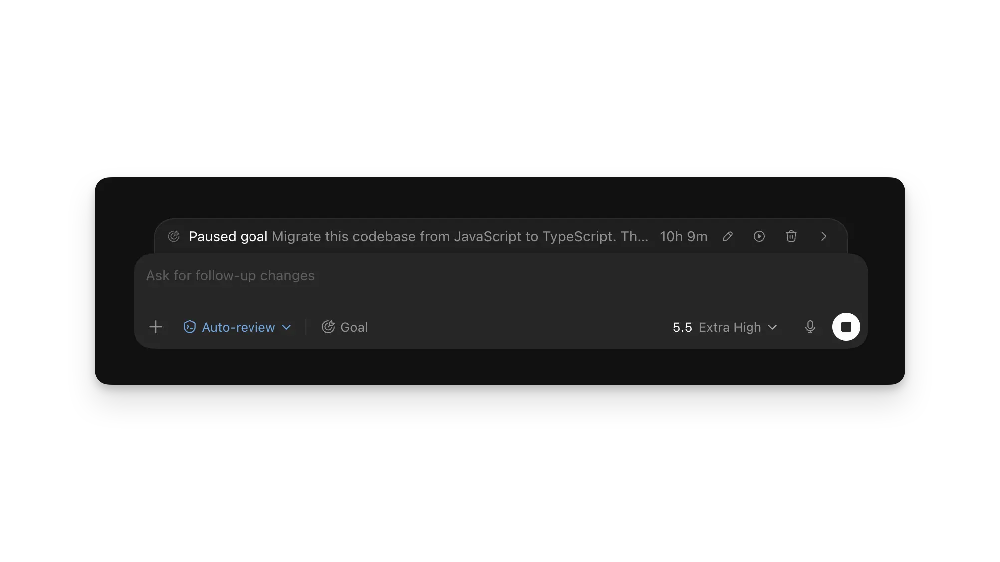

# 项目与对话

> 如需查看完整的文档索引，请参阅 [llms.txt](https://learn.chatgpt.com/llms.txt)。在文档页面 URL 后添加 `.md`，即可获取 Markdown 版本。

使用项目可以整理相互关联的对话，并为 ChatGPT 提供所需的上下文。

ChatGPT 桌面应用中的 **Projects（项目）** 视图同时包含 ChatGPT 项目，以及与电脑本地文件夹连接的本地项目。

## 选择一个项目或直接开始

如果一项工作将持续一段时间、需要生成多个成果，或者依赖相同的文件和信息来源，请创建一个项目。

如果工作本身相对独立，不需要共享项目上下文，则可以直接开始对话，无须创建项目。

<a id="work-in-a-project"></a>

## 在项目中工作

**Projects（项目）** 视图将 ChatGPT 项目和本地项目集中显示在同一个位置。

ChatGPT 项目可以在相关对话之间共享项目文件和上下文。本地项目则可以让对话访问电脑上的一个或多个文件夹，例如一组源文件或一个代码库。

建议为每个不同的预期成果分别创建一个对话。这样可以让其中的消息和结果保持聚焦，同时通过项目统一整理相关工作。

<CodexScreenshot alt="ChatGPT 桌面应用，侧边栏显示多个项目，主区域显示多个对话" lightSrc="/images/codex/app/multitask-light.webp" darkSrc="/images/codex/app/multitask-dark.webp" maxHeight="400px" class="my-8" />

<a id="manage-project-threads"></a> <a id="organize-projects-and-chats"></a> <a id="organize-projects-and-tasks"></a>

## 整理项目和对话

让正在进行的工作保持可见，并将已经完成的工作移到一旁：

- **置顶项目**，使其保持在侧边栏顶部附近。你也可以在 Projects（项目）视图中置顶项目。
- 如果你经常返回某个对话，可以**置顶该对话**。即使项目中出现了更新的对话，它也会继续保留在醒目位置。
- 使用能够描述成果的简短标题**重命名对话**，例如“第三季度发布简报”或“结账流程无障碍评审”。
- 在 Projects（项目）视图中**搜索项目**。如果你还记得某个短语或分支名称，却不记得对话标题，可以按 <kbd>Cmd</kbd>/<kbd>Ctrl</kbd>+<kbd>G</kbd> 搜索过去的对话。
- 工作完成后，可以**归档对话**。在项目菜单中选择 **Archive chats（归档对话）**，即可一起归档该项目中的所有对话。

置顶操作不会添加上下文，也不会改变 ChatGPT 可以访问的内容。它只会改变项目或对话在侧边栏中的显示位置。

你可以前往 **Settings > Archived chats（设置 > 已归档的对话）** 恢复已归档的对话。

<a id="use-local-projects-for-folders-and-codebases"></a>

## 使用本地项目处理文件夹和代码库

当 ChatGPT 需要读取或修改电脑上的文件时，可以添加一个本地项目。

项目并非必须关联文件夹，但你可以根据需要将文件夹添加到项目中。

如需添加或更改文件夹，请打开项目菜单并选择 **Edit project（编辑项目）**。选择 **Add folder（添加文件夹）** 可以关联多个文件夹。ChatGPT 可以读取和修改每个已关联文件夹中的文件。

如需更改默认工作目录，请指向某个文件夹并选择 **Make primary（设为主要文件夹）**。

新对话会从主要文件夹开始。Codex 也会将该文件夹用作执行 Git 操作以及自动查找 `AGENTS.md`、技能和 `config.toml` 的默认位置。

辅助文件夹仍然可以用于搜索、读取和编辑文件，但 Codex 不会自动从辅助文件夹中查找这些项目文件。

如果相关工作分别存放在不同位置，可以使用多个文件夹，例如应用程序与其文档分别存放，或者网站与其后端分别存放。

如果不同工作之间没有关联，或者每个对话只应访问代码库中的某一部分，请分别创建项目。这样可以让工作上下文保持聚焦。目前，远程项目仅支持一个文件夹。

使用[本地环境](https://learn.chatgpt.com/docs/environments/local-environment)可以为项目定义初始化操作和常用命令。

[评审面板](https://learn.chatgpt.com/docs/code-review?surface=app)可以显示同一个项目所关联的多个代码库中的更改。拉取请求和[工作树](https://learn.chatgpt.com/docs/environments/git-worktrees)操作以主要代码库为目标。

当你在工作树中开始对话时，其他文件夹仍会保持关联状态。

项目和工作树用于整理工作，而[沙盒](https://learn.chatgpt.com/docs/sandboxing)则负责限制本地命令可以读取、修改或通过网络访问的内容。

<a id="start-without-a-project"></a> <a id="start-a-task-without-a-project"></a>

## 不使用项目，直接开始对话

如果工作本身相对独立，不需要共享项目文件、项目说明或文件夹访问权限，请选择 **New chat（新建对话）**。

如果多个对话需要依赖相同的上下文，请先创建一个项目。

<a id="start-a-chat"></a> <a id="start-a-standalone-chat"></a> <a id="use-quick-chat-for-a-quick-conversation"></a>

## 使用 Quick chat 快速提问

Quick chat（快速对话）会打开一个普通的 ChatGPT 对话。

ChatGPT 对话不会出现在 Codex 侧边栏中。Codex 侧边栏只显示你的 Codex 对话和项目。

将指针移到 **New chat（新建对话）** 上，然后选择右侧的 **Quick chat（快速对话）** 图标。

你也可以使用以下快捷键：

- macOS：<kbd>Cmd+Option+N</kbd>
- Windows：<kbd>Ctrl+Alt+N</kbd>

通过 **New chat（新建对话）**，你还可以打开一个已有的 ChatGPT 对话，并将其添加到 Codex 对话中。

## 引入其他工具和上下文

- 如果文件或[图片输入](https://learn.chatgpt.com/docs/image-inputs)只与当前请求有关，可以直接将其添加到对话中。
- 安装[插件](https://learn.chatgpt.com/docs/plugins)，从其他服务引入上下文和可执行操作。
- 如果你的组织或开发环境通过模型上下文协议提供工具，可以配置 [MCP](https://learn.chatgpt.com/docs/extend/mcp) 服务器。
- 在相关功能可用的情况下，使用[记忆](https://learn.chatgpt.com/docs/customization/memories)，将过去工作中的有用上下文带入未来的对话。

## 后续步骤

- [了解如何编写和完善提示词](https://learn.chatgpt.com/docs/prompting)
- [了解如何使用 ChatGPT](https://learn.chatgpt.com/docs/use-chatgpt)
- [继续处理长时间运行的工作](https://learn.chatgpt.com/docs/long-running-work)


# Sites

> 如需查看完整的文档索引，请参阅 [llms.txt](https://learn.chatgpt.com/llms.txt)。在文档页面 URL 后添加 `.md`，即可获取 Markdown 版本。

Sites 目前处于公开测试阶段。其可用性可能取决于你的套餐、所在地区和工作区设置。测试期间，特定套餐的使用限额适用于该账户下的所有 Sites。ChatGPT 会显示当前限额，并在你接近限额时发出通知。

达到限额后，你可能无法创建新 Site、添加存储空间，或者继续公开访问量较高的 Site，但仍然可以编辑和管理现有 Sites。

Sites 可以让 ChatGPT 创建、托管、完善和分享网站、Web 应用及游戏。如果你希望将提示词或兼容的现有项目转换为托管式体验，而不想单独配置部署工作流，可以使用 Sites。

在 ChatGPT 桌面应用中打开 **Sites**。你可以通过提示词或兼容的本地项目创建 Site，然后返回 Sites 视图进行管理。

每个 Sites 部署 URL 都是生产环境部署。如果你希望在内容正式上线前进行审阅，请让 ChatGPT 保存一个版本，但不要部署。

## Sites 入门

在 ChatGPT 中，在提示词里加入“website（网站）”一词，或者提及 `@Sites`，即可明确启动 Sites 工作流。

<WorkflowSteps variant="headings">

1. 描述 Site

   说明 Site 的目标受众、用途、必需功能，以及应当使用的信息。

2. 审阅 Site

   审阅生成的内容和功能。确认 Site 使用了预期的信息，并按预期方式处理数据。

3. 完善 Site

   描述你希望进行的更改。如果相关文件或视觉参考能够帮助 ChatGPT 完成修改，请将其一并添加。

4. 管理和分享 Site

   返回 **Sites**，重新打开或继续完善 Site。准备就绪后，选择可以访问 Site 的用户，并分享生成的链接。

</WorkflowSteps>

## 使用提示词完成 Sites 常见任务

对于新网站、仪表盘或内部工具，请在提示词中说明目标受众、核心体验和必需信息：

```
为我的运营团队创建一个项目需求仪表盘。让团队成员可以提交需求、查看每项需求的负责人、更新状态并筛选列表。要求用户使用工作区账户登录，并在多次访问之间持续保存需求数据。
```

对于现有项目，可以让 Sites 准备并发布当前应用：

```
使用 Sites 部署这个项目。检查项目是否兼容，完成所有必要的修改，然后将部署 URL 提供给我。
```

如果 Site 需要持久保存应用数据或用户上传的文件，请在请求中明确说明：

```
为这个游戏添加玩家分数和头像上传功能。在用户多次访问之间持续保存分数和已上传的头像。
```

浏览 [Sites 展示库](https://developers.openai.com/showcase)，查看已经部署的内部应用及用于创建这些应用的完整提示词。

## 查看 Site 分析数据

Sites 会自动记录访问流量，因此无须添加分析 SDK，你也可以了解用户如何使用已经部署的 Site。

分析视图会显示独立访客总数和页面浏览量，以及这两项指标随时间的变化。你可以更改日期范围或数据粒度，查看不同时间段的数据。

打开 **Sites**，找到相应 Site，然后选择 **More actions（更多操作）** > **Analytics（分析）**。

<Illustration description="交互式 Sites 分析仪表盘，显示七天内的独立访客数和页面浏览量。">  <SitesAnalyticsIllustration /> </Illustration>

目前，分析功能仅适用于不归 Enterprise 工作区所有的 Sites。

## 添加“使用 ChatGPT 登录”

公开 Site 可以继续向所有人开放，同时提供可选的“使用 ChatGPT 登录”功能，以支持需要识别用户身份的功能，例如保存进度、显示个性化视图，或者管理归属于特定用户的记录。

仅限工作区访问的 Sites 已经使用 ChatGPT 身份来执行其分享设置。

可以让 Sites 添加以下登录体验：

```
为这个公开 Site 添加“使用 ChatGPT 登录”功能。未登录的访客仍然可以访问 Site。用户未登录时，显示“使用 ChatGPT 登录”操作。登录后，如果可以获得用户的全名，就使用全名问候；否则使用其电子邮件地址。添加“退出登录”操作，并将授权判断保留在服务器端代码中。
```

<ToggleSection title="工作原理">

Sites 通过平台提供的路径处理登录和退出登录流程，然后将访客送回你的 Site：

```
<a href="/signin-with-chatgpt">使用 ChatGPT 登录</a>
<a href="/signout-with-chatgpt">退出登录</a>
```

访客登录后，Sites 会通过以下请求标头将其身份信息转发给服务器：

- `oai-authenticated-user-email` 包含经过身份验证的电子邮件地址。
- `oai-authenticated-user-full-name` 可能包含非空的个人资料姓名。请将其视为可选信息；如果不存在，请改用电子邮件地址。

请将授权判断保留在服务器端代码中，不要依赖拆分姓名的请求标头。

</ToggleSection>

## 了解项目、版本和部署

Site 是一种持续存在的托管成果。你可以在 ChatGPT 的 **Sites** 中重新打开、完善、配置和分享 Site。

Sites 项目会将本地源项目与通过 Sites 管理的托管服务关联起来。Sites 会将这种关联关系以及可选的存储绑定名称保存在 `.openai/hosting.json` 中。

新创建的本地初始项目可以暂时不包含 `project_id`；Sites 会在配置好托管项目后添加该字段。

例如，一个已经配置完成、使用关系数据库绑定但不使用文件存储的 Site，可以包含以下配置：

```
{
  "project_id": "<project-id>",
  "d1": "DB",
  "r2": null
}
```

Sites 发布过程分为两个独立阶段：

1. **保存版本。** ChatGPT 构建一个可以部署的版本。对于本地源项目，ChatGPT 会将该版本与构建时使用的 Git 提交关联。需要获得可供审阅的候选部署版本时，请使用这一阶段。
2. **部署版本。** ChatGPT 发布一个已保存的版本，并在部署成功后报告生产环境 URL。只有当你确实希望所选受众访问 Site 时，才应执行此操作。

如果需要确定以前保存的某个候选部署版本，可以让 ChatGPT 列出或检查已保存的版本。

## 选择受支持的 Site 形态

对于新项目，Sites 工作流可以使用其推荐的 Site 初始模板。对于现有项目，请在要求部署前，让 ChatGPT 确认该项目能够生成兼容的部署产物。

请告诉 ChatGPT 你需要的产品行为，以便它选择合适的 Site 形态：

| Site 需求                             | 应该向 Sites 提出的要求                                      |
| ------------------------------------- | ------------------------------------------------------------ |
| 以内容为主的网站或落地页              | 创建一个不包含持久化应用状态的 Site，除非实际体验需要保存状态 |
| 保存记录、用户进度或游戏分数          | 使用 D1——一种用于持久保存结构化数据的关系数据库              |
| 图片、文档、音频、视频或其他上传内容  | 使用 R2 对象存储来保存文件                                   |
| 包含可搜索元数据的上传文件            | 使用 D1 保存元数据，并使用 R2 保存文件内容                   |
| 需要获取当前工作区用户身份的内部 Site | 使用经过工作区身份验证的用户身份                             |
| 公开登录或外部身份提供商              | 创建启用身份验证的 Site                                      |

不要为临时展示状态申请持久存储，例如主题选择或已经关闭的横幅。但如果属于用户期望托管 Site 能够记住的产品数据，则应使用持久存储。

## 控制访问权限和密钥

在你更改访问权限之前，新 Site 仅限其所有者和工作区管理员访问。审阅 Site 的内容、数据处理方式和预期受众期间，请保持严格的访问限制。

根据账户和工作区设置，分享选项可能包括：

- **所有者和工作区管理员**
- **选定的活跃用户或群组**（如果支持）
- **工作区中的所有人**（如果支持）
- **互联网上的任何人**（仅在启用公开发布时可用）

分享权限允许其他人访问 Site，但不会授予编辑权限。

在 Enterprise 工作区中，公开发布功能默认处于关闭状态，必须由管理员启用。

对于受限分享，受邀访客必须使用获得访问权限的账户登录。公开 Site 不要求访客拥有 ChatGPT 工作区访问权限。

Site 的受众设置与 Site 内部构建的登录功能属于两套相互独立的控制机制。

例如：

```
先向我显示当前 Site 并确认其 URL，然后将该 Site 的访问权限更改为我的工作区中的所有人。
```

### 配置运行时环境值

打开 **Sites**，然后进入 Site 设置，添加、更新或删除托管环境变量和密钥。

不要在提示词、附件或 Site 内容中包含密钥值。

不要将这些值存储在 `.openai/hosting.json` 中。确保本地 `.env` 和 `.env.example` 文件与本地开发所需的键保持一致，并且不要将密钥值提交到版本库。

添加、更新或删除托管环境值后，请让 ChatGPT 重新部署已经批准的已保存版本，以确保下一次部署使用更新后的配置。

## 连接自定义域名

如果自定义域名功能可用，你可以连接自己已经拥有的根域名或子域名。

Sites 不会代你注册域名，因此你必须能够修改该域名的 DNS 记录。Sites 发布初期，Enterprise 工作区无法使用自定义域名。

连接域名的步骤如下：

1. 打开 Site 设置并选择 **Add domain（添加域名）**。
2. 输入要使用的根域名或子域名。
3. 复制 Sites 提供的 DNS 记录和值，然后通过你的域名服务商添加这些记录。
4. 等待几分钟，然后返回 Site 设置并刷新域名状态。

你也可以让 ChatGPT 帮助你将域名指向 Site。如果已经启用浏览器或电脑操作功能，登录域名服务商网站后，ChatGPT 可以协助你完成相关操作。

## 分享前进行检查

分享 Site 之前，请完成以下检查：

- 检查 Site 的内容、生成的文字和图片、链接、上传的文件、表单以及交互行为。
- 确认其中没有暴露机密信息、敏感信息、密钥值，或你无权分享的第三方内容。
- 以目标访客的实际使用方式测试 Site，包括访问权限和登录行为。
- 检查所有会收集个人信息或其他访客内容的功能。判断 Site 是否应该收集、分享或发布这些信息。
- 如果 Site 使用“通过 ChatGPT 登录”，请说明 Site 会接收哪些访客信息，以及如何使用这些信息。
- 如果 Site 收集或处理个人数据，请遵守[适用的隐私和数据保护法律](https://help.openai.com/en/articles/20001340)。
- 选择能够满足目标受众需求的最严格分享选项。
- 打开已分享的 Site，确认目标受众能够正常访问。

对于由本地项目构建的 Site，还应在 Codex 的[评审面板](https://learn.chatgpt.com/docs/code-review?surface=app)中检查源代码更改和所有数据库迁移。

## 下线或删除 Site

如果希望取消访问权限但不删除 Site，请打开分享设置，将访问范围限制为你自己或指定用户。随后确认此前的受众已经无法打开该 Site。

如需永久删除 Site：

1. 打开 **Sites** 并找到相应 Site。
2. 选择 **Delete site（删除 Site）**，然后按照提示中的说明操作。
3. 输入 Site 的短标识符（slug），然后选择 **Permanently delete（永久删除）**。

删除操作会永久移除 Site。已经删除的 Site 无法恢复。

## 了解限制和不支持的用途

Sites 用于托管在其受支持运行环境中运行的 Web 体验。某些框架、专用网络、数据库、后台服务和托管模式不受支持。

Sites 发布初期不支持数据驻留或推理驻留。这项限制涵盖已部署的 Sites、Site 代码、D1 和 R2 中的数据及文件存储、生成的产物和日志。

请勿使用 Sites 执行以下操作：

- 处理受保护的健康信息或支付卡数据。
- 将产品面向 13 岁以下儿童，或未达到当地适用数字同意年龄的用户。
- 支持金融交易。
- 传播恶意软件。
- 实施网络钓鱼。
- 冒充个人或组织。
- 以其他方式违反 OpenAI 政策。

如需查看当前限制和政策链接，请参阅[创建和管理 ChatGPT Sites](https://help.openai.com/en/articles/20001339)。

## 相关文档

- [ChatGPT 桌面应用](https://learn.chatgpt.com/docs/app)：介绍应用导航、项目和对话。
- [检查并发布更改](https://learn.chatgpt.com/docs/code-review?surface=app)：介绍如何在发布前检查源代码更改。


# 可视化

> 如需查看完整的文档索引，请参阅 [llms.txt](https://learn.chatgpt.com/llms.txt)。在文档页面 URL 后添加 `.md`，即可获取 Markdown 版本。

可视化功能可以将问题、想法和信息转换为图表、地图、示意图、计算器、模拟器，以及能够直接在 ChatGPT 对话中探索的交互式说明。

当调整输入或观察某种关系能够让答案更容易理解、比较、练习或转化为行动时，可以使用可视化。

可视化功能目前正以预览版形式逐步推出。其可用性可能取决于你的套餐、平台、账户和工作区设置。

<ContentModeSwitch group="codex-surface" id="app">

可视化预览版正在 ChatGPT 桌面应用中逐步推出。

如果 **Visualize（可视化）** 已经可用，请在编辑框中输入 `@`，然后开始输入 `Visualize`，并在 **Plugins（插件）** 下选择 **Visualize**。编辑框会在你的请求前添加 **Visualize** 标签。

如果没有显示 **Visualize**，请通过网页端使用 ChatGPT，或者等待预览功能覆盖你的账户后再试。

</ContentModeSwitch>

<ContentModeSwitch group="codex-surface" id="web">

在受支持的 Chat 或 ChatGPT Work 对话中，在编辑框里输入 `@`，然后开始输入 `Visualize`，并在 **Plugins（插件）** 下选择 **Visualize**。它的描述是 **Create visualizations and interactive tools（创建可视化和交互式工具）**。编辑框会在你的请求前添加 **Visualize** 标签。

你也可以直接输入 `@Visualize`，然后选择对应的建议。

</ContentModeSwitch>

## 检查可用性

| 使用平台              | 当前可用性                                                   |
| --------------------- | ------------------------------------------------------------ |
| ChatGPT 网页端        | 支持的账户可以在 Chat 和 ChatGPT Work 中使用                 |
| ChatGPT 桌面应用      | 正在以预览版形式逐步推出                                     |
| ChatGPT 移动应用      | 正在向符合条件的账户逐步推出；不同应用版本中的编辑框控件可能有所不同 |
| Codex CLI 和 IDE 扩展 | 不支持渲染可视化内容                                         |

出现 **Visualize** 建议，是判断你的账户是否已经启用预览功能的可靠标志。

在逐步推出期间，即使使用相同套餐，不同账户、工作区和应用版本的可用性也可能有所不同。

## 判断何时适合使用可视化

当某种视觉形式能够显著改善答案时，ChatGPT 可以自行选择合适的可视化格式。如果你明确希望获得交互式结果，也可以添加 `@Visualize` 标签。

请选择能够满足任务需求的最简形式：

- 对于带标签的关系或流程，使用示意图。
- 对于具有明确名称的数值数据和比较，使用图表或绘图。
- 对于地理信息，使用地图。
- 如果输入、时间、运动或空间关系需要发生变化，使用交互式可视化。
- 如果需要具有可分享 URL、访问权限或持久数据的长期托管应用，请使用 [Site](https://learn.chatgpt.com/docs/sites)。

## 在提示词中说明目标和控制方式

优秀的请求应明确说明预期成果、参考资料、需要回答的问题，以及有用的交互方式。可以尝试以下示例：

**提示词：**

```
@Visualize 展示供给和需求如何决定市场价格。让我能够移动两条曲线、标出均衡点，并解释价格和数量会如何变化。
```

请告诉 ChatGPT 应该使用哪些信息，例如对话中已有的内容、粘贴的数据、附件，或者当前可用的已连接信息来源。

对于复杂请求，如果可以选择更高级别的推理设置，请考虑使用该设置。

## 探索交互式示例

以下示例重现了 GPT-5.6 发布页面中的三个可视化。

你可以使用其中的控件，了解一条目标明确的提示词如何转化成交互式说明、实验环境或教学工具。

<Illustration description="三个交互式 ChatGPT 可视化示例：可以调整几何参数的旋轮线图、带有可移动探针的波干涉实验，以及支持编辑文本并展示分词步骤的分词器说明工具。">  <VisualizationExampleGallery client:visible /> </Illustration>

## 完善结果并继续处理

在同一个对话中继续说明你希望进行的更改。以下是一些实用的后续请求：

- 添加或移除控件、筛选条件、比较项目或注释。
- 修正源数据、单位、标签或假设。
- 通过聚合、分箱或抽样简化运行缓慢的结果。
- 添加简短的文字摘要和数据表格。
- 确保所有控件都可以使用键盘操作，并添加清晰可见的焦点状态。
- 除颜色外，同时使用标签或图案，并移除循环动画。
- 如果结果需要托管并供以后反复访问，将其转换为 Site。

后续请求可能会创建一个新的替代可视化，而不是直接修改原来的结果。依赖新版本之前，请先进行检查。

## 分享或重复使用结果

如果对话中提供了标准的 **Share（分享）** 操作，可以使用该功能。

分享前，请先检查整个对话，包括其中的源数据和之前的消息。

可视化通常只是 ChatGPT 创建它时已有信息的快照，而不是会与已连接信息来源持续同步的实时仪表盘。

生成结果中提供的下载控件和导出格式可能各不相同。如果导出功能无法正常工作，可以要求 ChatGPT 以更简单的格式提供底层数据，或者将可视化转换为 Site。

## 改善无障碍体验

生成的可视化会尽量使用语义化控件、清晰可见的焦点状态、易于阅读的对比度和减少动态效果的设计，但实际结果可能有所不同。

分享前，请检查可视化。你可以要求 ChatGPT：

- 添加文字摘要和数据表格。
- 标注坐标轴和单位。
- 避免仅依靠颜色传达信息。
- 确保控件可以通过键盘操作。

## 从失败的结果中恢复

可视化的生成可能需要一分钟或更长时间。

如果结果为空或缺失，请先等待响应全部完成，重新加载一次对话，然后重试。如果仍然失败，可以：

- 要求生成规模更小或更简单的可视化。
- 对数据进行聚合或分箱、减少采样点数量，或者降低大型数据集的精度。
- 移除无法正常工作的生成控件或库。
- 核对重要数值、地理边界和数据来源假设。
- 改为要求生成图表、示意图、表格或 Site。

请使用与其他 ChatGPT 对话相同的数据处理判断标准。只有在组织允许的情况下才应加入敏感信息，并在分享前检查完整对话。

## 相关文档

- [Sites](https://learn.chatgpt.com/docs/sites)
- [项目与对话](https://learn.chatgpt.com/docs/projects)
- [使用文件](https://learn.chatgpt.com/docs/artifacts-viewer)
- [图像生成](https://learn.chatgpt.com/docs/image-generation)


# 计划任务

> 如需查看完整的文档索引，请参阅 [llms.txt](https://learn.chatgpt.com/llms.txt)。在文档页面 URL 后添加 `.md`，即可获取 Markdown 版本。

你可以安排周期性任务，让它们在后台运行。在 **Scheduled（计划任务）** 中，可以查看正在运行、已暂停和已完成的任务，以及最近的运行记录。你还可以结合计划任务与[技能](https://learn.chatgpt.com/docs/build-skills)，处理更复杂的工作。


在 ChatGPT 桌面应用中，计划任务可以与本地项目配合使用，并在项目目录或隔离的工作树中运行。如果计划任务需要使用本地文件，请保持电脑开机并让应用持续运行。


例如，可以安排一项任务来评估遥测错误并提交修复，或者生成有关代码库近期变更的报告。

对于需要持续使用相同上下文的长期工作，可以[在现有对话中安排任务](app://-/index.html#schedule-a-task-inside-a-chat)。

对于限定在某个项目范围内的计划任务，请保持电脑开机并让 ChatGPT 桌面应用持续运行。任务到达预定运行时间时，所选项目必须仍然存在于本地磁盘上。

在 Git 代码库中，你可以选择让计划任务在本地项目中运行，或者在新的[工作树](https://learn.chatgpt.com/docs/environments/git-worktrees)中运行。这两种方式都会在后台执行。

工作树可以将计划任务产生的更改与尚未完成的本地工作隔离开来；在本地项目中运行则可能修改你仍在处理的文件。对于未使用版本控制的项目，计划任务会直接在项目目录中运行。

你可以继续使用默认的模型和推理强度设置；如果希望更精确地控制计划任务的执行方式，也可以明确选择相应设置。

如果计划任务通过 ChatGPT 登录使用 `gpt-5.4` 或 `gpt-5.4-mini`，请在这些模型于 2026 年 8 月 31 日停用前更新任务：

- 将 `gpt-5.4` 替换为 `gpt-5.6-terra`。
- 将 `gpt-5.4-mini` 替换为 `gpt-5.6-luna`。

<Illustration description="ChatGPT 编辑框已准备好创建计划任务，并选择了 5.6 Sol Extended。">  <CodexScheduledTasksIllustration    variant="manage"    ariaLabel="ChatGPT 编辑框已准备好创建计划任务，并选择了 5.6 Sol Extended。"  /> </Illustration>

计划任务会在无人值守的情况下运行，并使用你的默认沙盒设置。应先选择能够让任务成功运行的最小访问权限；只有确实需要时，才授予网络访问权限或更广泛的文件访问权限。进一步[了解沙盒机制](https://learn.chatgpt.com/docs/sandboxing)。

## 管理计划任务

在 ChatGPT 桌面应用侧边栏的 **Scheduled（计划任务）** 中，可以找到所有计划任务及其运行记录。

**Scheduled（计划任务）** 视图相当于你的收件箱。包含调查结果的计划任务运行记录会显示在这里；如果某次运行需要你处理，还会显示未读标记。

<Illustration description="计划任务页面，其中包含“全部”“正在运行”和“已暂停”筛选条件，以及三个计划任务。">  <CodexScheduledTasksIllustration    variant="inbox"    ariaLabel="计划任务页面，其中包含“全部”“正在运行”和“已暂停”筛选条件，以及三个计划任务。"  /> </Illustration>

独立计划任务会为每次计划运行创建一个新对话，并在 **Scheduled（计划任务）** 中报告结果。如果每次运行都应彼此独立，或者同一个计划任务需要在一个或多个项目中运行，请使用这种方式。

如果需要自定义运行频率，请使用自定义计划控件。对于高级计划，可以编辑其 RFC 5545 重复规则（RRULE），例如：

```
RRULE:FREQ=MONTHLY;BYMONTHDAY=1;BYHOUR=9;BYMINUTE=0
```

对于 Git 代码库，每个计划任务既可以在本地项目中运行，也可以在专用的后台[工作树](https://learn.chatgpt.com/docs/environments/git-worktrees)中运行。

如果希望将计划任务产生的更改与尚未完成的本地工作隔离开来，请使用工作树。如果希望计划任务直接在主要签出目录中工作，可以使用本地模式，但需要注意：它可能修改你当前正在编辑的文件。

对于未使用版本控制的项目，计划任务会直接在项目目录中运行。同一个计划任务可以在多个项目中运行。

通过 ChatGPT 网页端的 ChatGPT Work，或者桌面应用中的 ChatGPT Work 或 Codex 创建的计划任务，可以使用插件。计划任务也可以使用技能。

为了让计划任务易于维护，并且便于团队共享，可以使用[技能](https://learn.chatgpt.com/docs/build-skills)定义操作，同时提供相应工具和上下文。如果工作流不应依赖自动工具选择，请在任务提示词中选择或明确调用特定技能。

## 让 ChatGPT 创建或更新计划任务

你可以从 ChatGPT 或 Codex 对话中创建和更新计划任务。

请描述需要完成的工作、运行时间安排，以及每次计划运行应返回当前对话还是创建新对话。ChatGPT 可以起草提示词、选择合适的结果位置，并在任务范围或执行频率发生变化时更新计划任务。

例如，你可以让 ChatGPT 在当前对话中安排后续任务，在部署完成前持续检查；也可以让它创建一个独立计划任务，按照周期性计划检查某个项目。

技能也可以创建或更新计划任务。例如，一个用于看管拉取请求的技能，可以创建计划任务，通过 GitHub 插件检查拉取请求状态并修复新的评审反馈。

## 在对话中安排任务

如果希望 ChatGPT 按计划返回某个现有对话，请在该对话中安排任务。

这种计划任务会使用对话已有的上下文，而不是在每次运行时都从一条新提示词开始。

对话内的计划任务可以采用以分钟为单位的运行间隔，用于活跃的后续检查循环；如果需要在特定时间检查，也可以使用每日或每周计划。

以下场景适合在对话中安排任务：

- 持续检查一项长时间运行的操作，直到操作完成。
- 轮询 Slack、GitHub 或其他已连接的信息来源，并将结果保留在同一个对话中。
- 提醒 ChatGPT 按固定频率继续执行评审循环。
- 运行使用插件的技能驱动型工作流，例如检查拉取请求状态并处理新的反馈。
- 在不丢失上下文的情况下，继续正在进行的研究或问题分类对话。

如果每次运行都应相互独立，或者调查结果应作为单独的运行记录出现在 **Scheduled（计划任务）** 中，请使用独立计划任务。

在对话中安排任务时，应确保提示词能够长期使用。提示词应说明：

- ChatGPT 在每次计划运行中应该做什么。
- 如何判断是否存在值得报告的重要内容。
- 何时停止运行或向你询问信息。

## 测试计划任务

安排任务之前，请先在普通对话中手动测试提示词。这有助于确认：

- 提示词表达清晰，任务范围正确。
- 所选或默认的模型、推理强度和工具能够按预期工作。
- 生成的结果便于审阅。

开始运行计划任务后，请检查最初几次的输出，并根据需要调整提示词或运行频率。

在 ChatGPT 桌面应用中，可以在计划任务提示词里使用 `$skill-name`，明确调用某个技能。

## 清理计划任务的工作树

如果为 Git 代码库选择了工作树，频繁运行的计划任务可能会随着时间推移创建大量工作树。

请归档不再需要的计划运行记录。如果不打算保留相应的工作树，请不要置顶这些运行记录。

## 权限和安全模型

计划任务在无人值守的情况下运行，并使用你的默认沙盒设置。

如需阅读这些权限边界的通俗说明，请参阅[沙盒机制概览](https://learn.chatgpt.com/docs/sandboxing)。有关文件系统和网络规则的说明，请参阅[权限](https://learn.chatgpt.com/docs/permissions)。

- 如果沙盒模式为 **read-only（只读）**，需要修改文件、访问网络或操作电脑应用的工具调用都会失败。可以考虑将沙盒设置更新为“工作区可写”。
- 如果沙盒模式为 **workspace-write（工作区可写）**，需要修改工作区以外文件、访问网络或操作电脑应用的工具调用都会失败。你可以使用[规则](https://learn.chatgpt.com/docs/agent-configuration/rules)，有选择地将某些需要在沙盒外运行的命令加入允许列表。
- 如果沙盒模式为 **full access（完全访问）**，后台计划任务会带来更高的风险，因为 ChatGPT 可能在不询问你的情况下修改文件、运行命令和访问网络。可以考虑将沙盒设置更新为“工作区可写”，并使用[规则](https://learn.chatgpt.com/docs/agent-configuration/rules)，有选择地定义智能体可以用完全访问权限运行哪些命令。

如果你使用的是受管理环境，管理员可以通过强制执行的要求限制这些行为。例如，管理员可以禁止使用 `approval_policy = "never"`，或者限制允许使用的沙盒模式。

请参阅[管理员强制要求（](https://learn.chatgpt.com/docs/enterprise/managed-configuration#admin-enforced-requirements-requirementstoml)`requirements.toml`[）](https://learn.chatgpt.com/docs/enterprise/managed-configuration#admin-enforced-requirements-requirementstoml)。

如果组织政策允许，计划任务会使用 `approval_policy = "never"`。如果管理员要求禁止使用 `approval_policy = "never"`，计划任务会改用所选权限模式对应的审批行为。

## 示例

### 自动创建新技能

```
扫描过去一天内的所有 `~/.codex/sessions` 文件。如果使用某些技能时出现了问题，请更新这些技能，使其更加实用。只处理个人技能，不要处理代码库技能。

如果我们经常执行某项工作却总是遇到困难，而且把它保存为技能可以加快以后的工作，那么就创建相应技能。

完全没有必要为了更新而更新——只有在确实有充分理由时才进行修改！

如果你进行了任何修改，请告诉我。
```

### 及时了解项目动态

```
查看远程仓库中最新的 origin/master 或 origin/main，然后针对过去 24 小时内涉及 <DIRECTORY> 的提交生成一份管理层简报。

格式和结构：

- 使用丰富的 Markdown 格式（以一级标题划分工作流，副标题使用斜体，并根据需要使用水平分隔线）。
- 开场可以写成：“以下是 <directory> 过去 24 小时的简报：”
- 副标题应为：“按工作流分组，并注明负责人，以叙事方式进行说明。”
- 按工作流归类，不要逐条列出提交。工作流标题应使用一级标题。
- 为每个工作流撰写一段简短说明，以通俗语言解释相关更改。
- 如果项目符号和粗体有助于提高可读性，可以使用它们。
- 可以按人员列出项目符号，但请将人员姓名加粗。

内容要求：

- 在正文中直接加入 PR 链接，例如 [#123](...)，不要添加“PR：”标签。
- 不要包含提交哈希，也不要添加“关键提交”部分。
- 同一个工作流下可以包含多个 PR，但请避免为每次提交分别创建项目符号。

范围规则：

- 只包含当前工作目录（或对应的主要签出目录）内的更改。
- 只包含过去 24 小时内的提交。
- 如果有帮助，可以使用 `gh` 获取 PR 标题和说明，也可以读取 PR 评审和评论。
```

### 将计划任务与技能结合起来，修复自己引入的错误

创建一个新技能，通过创建 `$recent-code-bugfix` 来尝试修复由你自己的提交引入的错误，并将其[保存在个人技能中](https://learn.chatgpt.com/docs/build-skills#where-to-save-skills)。

```
---
name: recent-code-bugfix
description: 查找并修复当前作者在过去一周内、当前工作目录中引入的错误。适用于用户希望主动修复近期更改中的错误、提示词为空，或者要求分类和修复近期提交造成的问题时。根本原因必须能够直接追溯到作者自己的更改。
---

# 近期代码错误修复

## 概述

查找当前作者在过去一周内引入的错误，实施修复，并尽可能完成验证。所有操作均在当前工作目录中进行；假定代码存储在本地，并确保根本原因与作者自己的修改直接相关。

## 工作流

### 1）确定近期更改范围

使用 Git 确定作者身份以及过去一周内发生更改的文件。

- 通过 `git config user.name`/`user.email` 确定作者。如果无法获得这些信息，则使用环境中的当前用户名，或者询问一次。
- 使用 `git log --since=1.week --author=<author>` 列出近期提交和文件。重点检查这些提交涉及的文件。
- 如果用户的提示词为空，直接按照这一默认范围继续执行。

### 2）查找与近期更改直接相关的具体故障

优先处理可以直接归因于作者修改的缺陷。

- 如果本地存在日志或 CI 输出，检查近期故障，例如测试失败、代码检查失败或运行时错误。
- 如果没有提供故障信息，则运行与已编辑文件有关的最小验证，例如单项测试、文件级代码检查或针对性复现。
- 确认根本原因与作者的更改直接相关，而不是无关的遗留问题。如果只发现无关故障，请停止并报告没有检测到符合条件的错误。

### 3）实施修复

按照项目惯例完成最小范围的修复。

- 只更新解决问题所需的文件。
- 避免添加额外的防御性检查或进行无关重构。
- 确保更改与本地代码风格和测试保持一致。

### 4）验证

在条件允许时尝试验证修复。

- 优先使用范围最小的验证步骤，例如针对性测试、聚焦的代码检查或直接复现命令。
- 如果无法运行验证，请说明原本应该运行什么，以及未能执行的原因。

### 5）报告

总结根本原因、实施的修复以及完成的验证。明确说明根本原因如何与作者近期的更改相关联。
```

随后，创建一个新的计划任务：

```
检查我过去 24 小时内的提交，并执行一次 $recent-code-bugfix。
```


# 长时间运行的工作

> 如需查看完整的文档索引，请参阅 [llms.txt](https://learn.chatgpt.com/llms.txt)。在文档页面 URL 后添加 `.md`，即可获取 Markdown 版本。

对于可能需要多个步骤才能完成的工作，请向 ChatGPT 提供明确的预期成果、限制条件和完成标准。

请将相互关联的工作保留在同一个对话中，以便 ChatGPT 使用相同的上下文选择下一步操作，并判断工作何时完成。

在 ChatGPT 桌面应用中输入 `/goal`，即可启动 Goal（目标）模式。ChatGPT 工作期间，你可以通过目标进度栏暂停、恢复、编辑或清除目标。



## 启动目标

在 ChatGPT 桌面应用、Codex CLI 或 IDE 扩展中输入 `/goal`。

目标文本既会成为任务的第一条提示词，也会成为判断任务是否完成的标准。

如果预期成果还不明确，可以先使用 `/plan`。让 ChatGPT 向你提问、确定限制条件，并将最终结果转化为一个具有可衡量成功标准的目标。然后使用 `/goal` 启动完善后的目标。

## 明确定义完成标准

目标的写法应使 ChatGPT 能够自行验证工作进度。在适用的情况下，请包含以下三项内容：

| 目标要素     | 应包含的内容                                                 |
| ------------ | ------------------------------------------------------------ |
| **成果**     | 描述你希望得到的结果，而不仅仅是 ChatGPT 应执行的活动。      |
| **限制条件** | 指明必须使用的工具、工作边界、兼容性要求，或者需要避免的方法。 |
| **验证方式** | 添加能够证明工作已经完成的测试、衡量指标或评审标准。         |

例如：

```
将这个代码库从 JavaScript 迁移到 TypeScript。保留现有行为，在严格模式下完成编译，不使用显式的 `any` 类型，并确保完整测试套件全部通过。
```

## 调整正在运行的目标

在 ChatGPT 桌面应用中，目标进度栏会显示在编辑框上方。你可以使用它暂停或恢复工作、编辑目标，或者清除目标。

目标运行期间，你也可以发送后续消息，以补充上下文或调整限制条件。

如果只是希望获得进度摘要或相关说明，并且不想中断主对话，可以使用侧边对话。

如果预计即将断开网络连接，请先暂停目标。准备好让 ChatGPT 继续工作后，再恢复目标。

启动目标不会授予 ChatGPT 更广泛的访问权限。它仍然使用相同的[沙盒和审批策略](https://learn.chatgpt.com/docs/sandboxing)，并在需要你作出决定时暂停。

如果启用了[自动审批评审](https://learn.chatgpt.com/docs/sandboxing/auto-review)，一个单独的评审模型可以评估符合条件的请求，但不会扩大现有的权限边界。

## 并行运行多个目标

每个对话都拥有各自独立的上下文、消息、结果和目标。

你可以同时运行多个对话，但应避免让两个对话修改相同的文件。对于并行进行的编程任务，可以使用[工作树](https://learn.chatgpt.com/docs/environments/git-worktrees)，为不同对话提供相互独立的代码签出目录。

对于本地工作，请在设置中开启 **Prevent sleep while running（运行时防止电脑进入睡眠）**，让 Mac 在任务运行期间保持唤醒状态。

你可以使用 [Pets](https://learn.chatgpt.com/docs/pets?surface=app) 或[系统通知](https://learn.chatgpt.com/docs/notifications?surface=app)，了解某个对话何时需要你提供信息，或者何时已经可以开始审阅。

## 相关文档

- [项目与对话](https://learn.chatgpt.com/docs/projects)
- [目标模式和提示词](https://learn.chatgpt.com/docs/prompting#goal-mode)
- [Git 工作树](https://learn.chatgpt.com/docs/environments/git-worktrees)