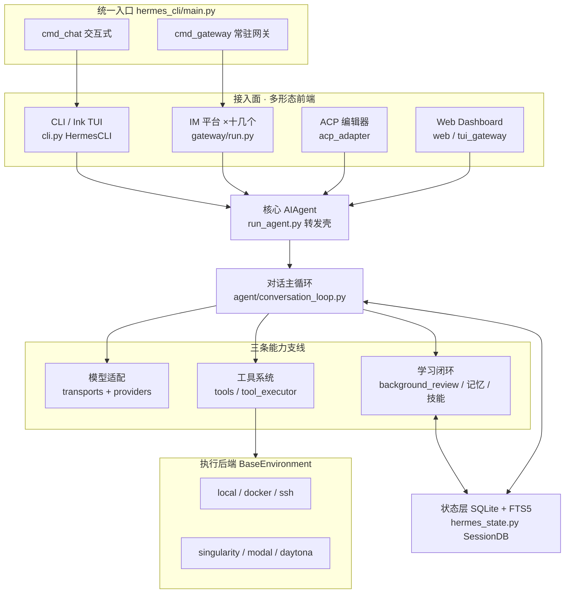
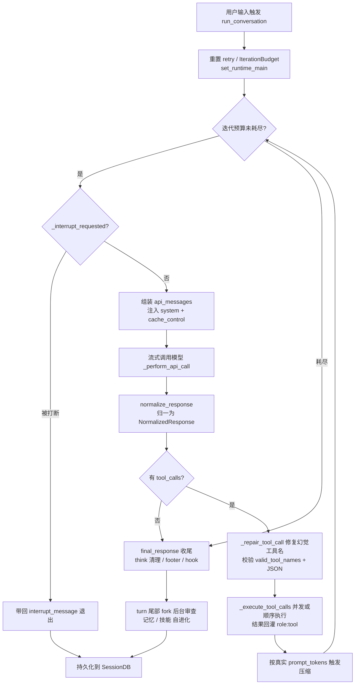
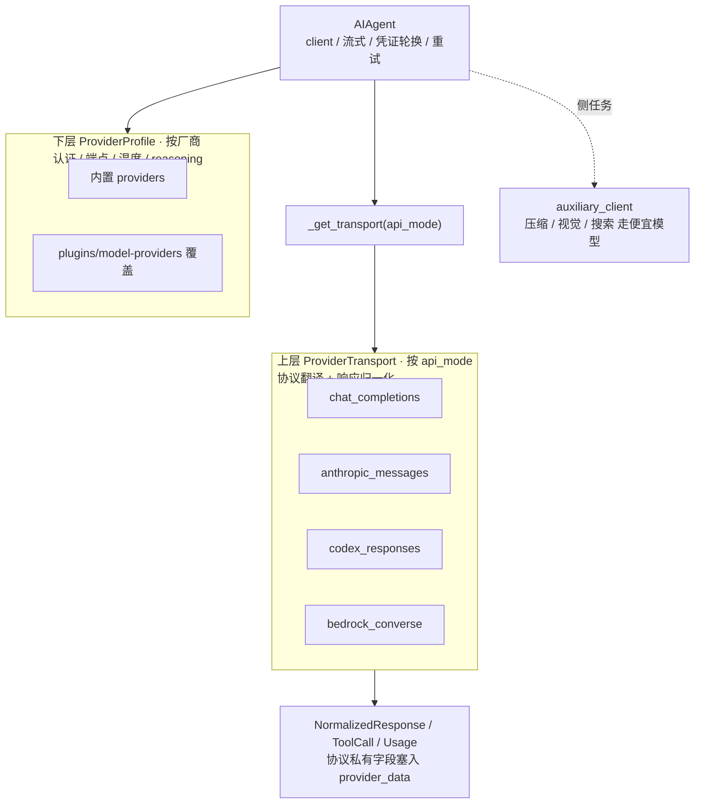
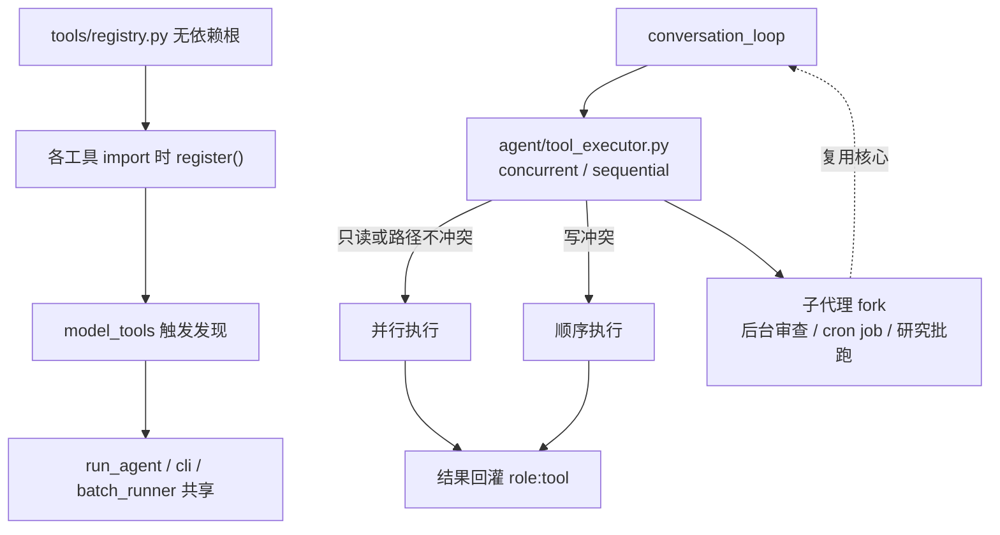
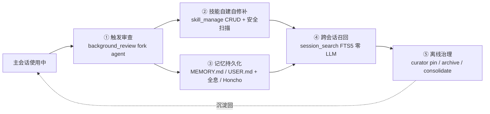
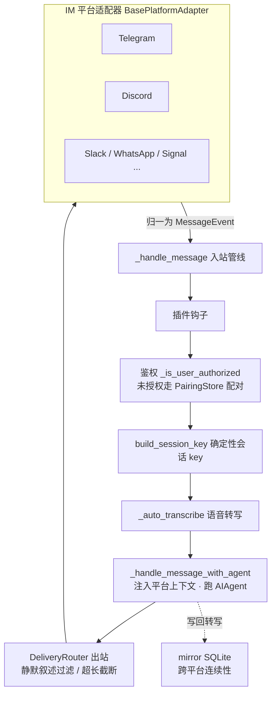
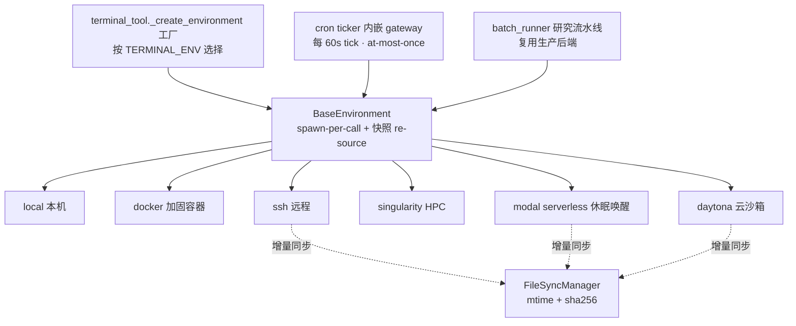

# Hermes Agent 源码精读：一个自进化终端 AI Agent 框架的实现全景

## 这是什么

Hermes Agent 是 Nous Research 出品的开源终端 AI agent 框架。用一句话概括，它是一个“可在任意环境、对接任意模型、接入任意聊天平台”并且能“在使用中自己创建和修补技能”的常驻 agent 内核。

它的形态相当丰富：既可以作为交互式命令行工具在终端里使用，也可以作为常驻消息网关同时桥接 Telegram、Discord、Slack、飞书等十几个平台，还能通过 ACP 协议接入 Zed 编辑器、通过 Web dashboard 在浏览器里操作。但无论从哪个入口进来，最终都汇聚到同一个核心 `AIAgent`。它的执行后端可以是本机、Docker、SSH、HPC 集群或云端 serverless 沙箱；它的模型可以是 OpenAI、Anthropic、AWS Bedrock 等任意 provider。整套设计围绕一个目标展开：让一个 agent 内核以最小的行为漂移，运行在尽可能多的接入面与执行面之上，并在运行中持续积累技能与记忆。

## 整体架构

Hermes 采用“瘦入口 + 单巨核 AIAgent + 多运行形态”的架构。下图是它的整体结构：多形态前端接入同一个核心 `AIAgent`，对话循环向上屏蔽接入差异、向下屏蔽模型与执行差异，状态统一沉淀到 SQLite。

所有命令统一从 `hermes` 这个可执行脚本进入，它仅做一件事：`from hermes_cli.main import main; main()`。真正的进程主入口是 `hermes_cli/main.py` 的 `main()`，它构建顶层 argparse，注册 `chat/model/gateway/cron/doctor/setup` 等子命令并 `set_defaults(func=...)`，解析后调用 `args.func(args)`。从这里开始分叉出两条主路径：

一条是交互式 CLI/TUI。`cmd_chat` 经由 `cli.py` 的 `HermesCLI` 进入持久化输入循环，每条用户输入触发一次对话。`cli.py` 既支持基于 prompt_toolkit 的经典终端体验（多行编辑、slash 命令补全、流式工具输出），也支持 `hermes --tui` 启动的 Ink/React TypeScript 前端。

另一条是常驻消息网关。`cmd_gateway` 经 `hermes_cli/gateway.py` 管理 systemd/launchd 守护进程，最终拉起 `gateway/run.py` 的 `start_gateway`，对接各个 IM 平台。

两条路径在底层完全收敛：CLI 的单查询模式直接调 `cli.agent.run_conversation(...)`，网关的入站消息经 `_handle_message_with_agent` 同样喂给 `AIAgent.run_conversation`。换句话说，两种运行形态只是不同的 I/O 外壳，共享同一个对话循环，这从根本上降低了行为漂移。

核心 `AIAgent` 类定义在 `run_agent.py`（约 5000 行），但它已经演变为“转发壳”：`__init__` 含约 60 个参数（凭证、路由、回调），转发到 `agent/agent_init.py` 的 `init_agent`；`run_conversation` 转发到 `agent/conversation_loop.py`。`cli.py` 与 `run_agent.py` 这两个巨文件大量方法只是 “Forwarder — see agent.xxx”，真实实现下沉到模块化的 `agent/` 目录。这种设计让两个体积庞大的文件保持稳定的 API 表面，同时内部得以持续拆分演进。

状态层职责单一且明确。会话状态、消息历史、全文检索统一落在 `hermes_state.py` 的 SQLite `SessionDB`，路径由 `hermes_constants.py` 的 `get_hermes_home()` 按 profile 解析。`SessionDB` 定义 `sessions/messages/state_meta/compression_locks` 等表，`SCHEMA_VERSION=14`，采用 WAL 模式专为网关多平台“单写多读”并发设计，并对 FTS5 不可用的情况做了降级回退。该模块头部注释明确声明只存会话/消息/配置，batch runner 与 RL 轨迹刻意不入此库。

还有两个工程细节值得一提。其一是 `hermes_bootstrap.py`，它在 import 时即把 Windows 的 stdout/stderr/stdin reconfigure 为 utf-8 并设 `PYTHONUTF8`（POSIX 下无操作），必须在任何 I/O 前最先导入，体现了对跨平台（含原生 Windows、Termux）启动鲁棒性的投入。其二是 `pyproject.toml` 声明的三个 console_scripts 入口：`hermes`、`hermes-agent`、`hermes-acp`，分别对应主 CLI、裸 agent 入口与编辑器适配器。项目根目录的 `AGENTS.md` 给出了完整的结构图、文件依赖链与 `AIAgent` 参数说明，是架构权威概览。

## 主要逻辑流程

从一次 `hermes` 启动到进入对话循环，链路大致如下：shell 执行 `hermes` 脚本，`main()` 先做进程标题设置、Windows stdio 配置、Termux 快速路径探测，再构建 argparse 并按子命令分发。默认无子命令时走 `cmd_chat`，它会检查是否已配置 provider（未配置则引导 `hermes setup`）、同步内置 skills，然后实例化 `HermesCLI`、注入 skills 与 worktree 上下文，进入 prompt_toolkit 持久输入循环。每条用户输入触发 `self.agent.run_conversation`。

真正的 agentic 主循环在 `agent/conversation_loop.py` 的 `run_conversation()` 里。一个 turn 的完整闭环可以拆成以下步骤：

下面是这条主循环的流程图：

入口先做 `set_runtime_main` 通知辅助客户端当前主模型，重置各类 retry 计数与 `IterationBudget`，然后进入 `while api_call_count < max_iterations and iteration_budget.remaining > 0` 循环。

循环每一轮，先检查 `_interrupt_requested`（用户中途发了新消息则在循环边界优雅 break，把 `interrupt_message` 带回结果，不丢已完成的工具结果）；接着组装 `api_messages`，注入 system 提示与 Anthropic 的 `cache_control`，调 `agent._build_api_kwargs` 构建请求；再走 `_perform_api_call`，默认采用流式调用（即便没有 UI 消费者也用流式，目的是获得 90s stale-stream / 60s read-timeout 的连接健康检测，避免 provider 假死时无限挂起）。

拿到原生响应后，关键一步是 `agent._get_transport().normalize_response(response)`，它把各家协议的原生响应统一成 `NormalizedResponse`（content / tool_calls / finish_reason / reasoning + provider_data）。归一化之后，下游逻辑就不再需要按 api_mode 分支。

随后把归一化结果当作 assistant message：若 `finish_reason == length` 走续写重试；若存在 tool_calls，先 `_repair_tool_call` 修复模型幻觉的工具名，再校验 `valid_tool_names` 与 JSON 参数（参数截断则判定 partial 并退出），通过后把 assistant message append 进 `messages`，调 `agent._execute_tool_calls` 经 `tool_executor` 并发或顺序执行，每个结果作为 `role: tool` 消息回灌。执行后检查 tool guardrail 是否要 halt，并按真实 `prompt_tokens` 判断是否触发 post-turn 压缩，然后 continue 回到循环顶。

当某次响应不再发起工具调用时，`final_response = assistant_message.content`，跳出循环，做 think_blocks 清理、footer 注入、post_turn hook，返回结果。整个过程中会话状态持续经 `SessionDB` 持久化到 `get_hermes_home()/state.db`。

网关形态的流程与之并行而又收敛：`cmd_gateway` 拉起 `start_gateway`，后者取 PID 锁、为各平台 adapter 注册 `_handle_message`。入站消息经统一管线（钩子→鉴权→配对→命令→会话路由），最终汇入同一个 `AIAgent.run_conversation`。

学习闭环则在每个 turn 的尾部悄然运转。响应交付且未被打断后，`conversation_loop.py` 按两套独立节奏判定是否触发后台审查：记忆审查按轮次累加（`_turns_since_memory`），技能审查按本轮工具迭代数（`_iters_since_skill`）。满足条件就调 `_spawn_background_review`，在 daemon 线程里 fork 一个继承父 runtime、工具白名单仅限 `memory` 与 `skill_manage` 的审查 agent，回放对话快照判断该不该写记忆、该不该新建或修补技能。这条审查链路全程走辅助模型与 forked agent，从不污染主会话的 prompt cache。

## 核心实现拆解

下面按五个领域逐一拆解关键实现。

## 核心循环与模型适配

推理内核的模型无关性靠两层抽象实现。

两层抽象的关系如下：

上层是 `ProviderTransport`（`agent/transports/base.py` 的 ABC），定义四个模型无关的抽象方法 `convert_messages / convert_tools / build_kwargs / normalize_response`，外加 `map_finish_reason / extract_cache_stats`。按 api_mode 注册了四种协议传输：`chat_completions`、`anthropic_messages`、`codex_responses`、`bedrock_converse`。`get_transport(api_mode)` 按字符串路由到具体传输类。以 `agent/transports/anthropic.py` 的 `AnthropicTransport` 为例，它委托 `agent/anthropic_adapter.py` 做格式转换，`normalize_response` 解析 text/thinking/tool_use 块，并用 `_STOP_REASON_MAP` 把 `end_turn/tool_use/max_tokens` 映射成 OpenAI 风格的 `stop/tool_calls/length`。

下层是 `ProviderProfile`（`providers/base.py` 的声明式画像基类），描述同一协议下不同厂商的认证、端点、温度、reasoning 字段等请求级差异，提供 `prepare_messages / build_extra_body / build_api_kwargs_extras / fetch_models` 等钩子。`providers/__init__.py` 从 `plugins/model-providers/` 与 `$HERMES_HOME` 懒发现并注册，用户插件按 name 覆盖内置（last-writer-wins）。

api_mode 的解析发生在初始化阶段（`agent/agent_init.py`）：按 provider 名与 base_url 的 hostname 判定，例如 `openai-codex/xai` 走 `codex_responses`、`anthropic` 走 `anthropic_messages`、`bedrock` 走 `bedrock_converse`，默认 `chat_completions`，并预热 transport 缓存。

归一化类型定义在 `agent/transports/types.py`。`NormalizedResponse / ToolCall / Usage` 把所有协议的响应收敛到统一形态，协议私有字段（codex 的 `call_id`、gemini 的 `thought_signature`、anthropic 的 `reasoning_details`）塞进 `provider_data`，并用 property 兼容 `tc.function.name` 这类 OpenAI 风格读取，避免在 `run_agent.py` 几十处读取点写适配 shim。

值得强调的是两层抽象的关注点切分：`ProviderTransport` 负责“协议格式翻译 + 响应归一化”（api_mode 维度），明确不拥有客户端构造、流式、凭证轮换、重试，这些留在 `AIAgent`；`ProviderProfile` 负责“同协议下各厂商的请求级差异”（provider 维度）。两者各司其职，避免把二十多个布尔 flag 散落到传输层。此外，压缩、视觉、会话搜索等侧任务走 `agent/auxiliary_client.py` 的独立 provider 解析链，与主推理解耦，可单独配置便宜模型。

## 工具、并发执行与子代理

工具的发现遵循一条严格的单向依赖链（见 `AGENTS.md`）：`tools/registry.py` 无依赖，被所有工具 import，工具在 import 时 `register()`，`model_tools` 触发发现，再被 `run_agent / cli / batch_runner` 共享。

工具的发现链与执行路径如下：

工具的实际分发执行在 `agent/tool_executor.py`：`execute_tool_calls_concurrent / sequential` 把校验通过的 tool_calls 分发执行，对只读及路径不冲突的写操作并行执行以降延迟，结果以 `role: tool` 消息 append 回 `messages`。

子代理能力体现在多处：后台审查 fork 出工具受限的审查 agent，cron 任务可拉起独立的 job agent，研究流水线则批量并行跑 agent。这些都复用同一个 `AIAgent` 核心，只是注入不同的工具白名单与上下文。

## 学习闭环与记忆

这是 Hermes 最大的卖点，一条“用中学、学中改”的自我进化闭环，可分五段。

五段闭环如下：

第一段是创建技能与写记忆。`agent/background_review.py` 是核心，定义了 `_MEMORY_REVIEW_PROMPT / _SKILL_REVIEW_PROMPT / _COMBINED_REVIEW_PROMPT` 三套审查提示词，`spawn_background_review_thread()` 选提示词，`_run_review_in_thread()` 在 daemon 线程里 fork agent 跑审查，`summarize_background_review_actions()` 把“💾 Memory updated”之类的动作回显给用户。

第二段是使用中改进。技能 CRUD 由 `tools/skill_manager_tool.py` 的 `skill_manage` 工具完成，`_create_skill / _edit_skill / _patch_skill / _delete_skill` 实现自建与自修补，`_validate_frontmatter()` 强制 `SKILL.md` 规范（兼容 agentskills.io 标准），`_security_scan_skill()` 对自建技能做可选安全扫描并失败回滚。审查提示词把约束写得很重：优先 PATCH 已加载技能，其次更新已有“伞”技能，再次加 references，最后才新建，强调 CLASS-LEVEL 造伞而非“一会话一窄技能”。

第三段是记忆持久化。本地走 `tools/memory_tool.py` 管理 `MEMORY.md`（环境/项目事实）与 `USER.md`（用户偏好），带字符上限、文件锁与手改漂移检测。外部走可插拔 plugin：`plugins/memory/holographic/` 是带 `trust_score` 信任评分的本地全息记忆库，用 HRR（全息归约表示）做 bind/unbind/bundle 向量代数与 FTS5 + Jaccard + HRR 三路融合打分；`plugins/memory/honcho/` 是辩证式用户建模，双层上下文注入（base 与 dialectic 两套节奏），刻意把上下文注入到 user message 而非 system prompt 以保住 prompt cache。

第四段是跨会话召回。所有消息进 `hermes_state.py` 的 SQLite，建有 `messages_fts`（unicode61）与 `messages_fts_trigram`（CJK/子串）两张 FTS5 虚表。`tools/session_search_tool.py` 的 `session_search` 是零 LLM 调用的纯检索工具，三形态 `_discover() / _scroll() / _read_session()`，靠 FTS5 rank + 锚定窗口 + bookends 把长会话里任意位置的命中还原成可读上下文，支持跨 profile。

第五段是离线治理。`agent/curator.py` 的 `maybe_run_curator()` 在空闲时 fork 审查 agent 做 pin/archive/consolidate/patch，`apply_automatic_transitions()` 按活跃时间戳做 active→stale→archived 生命周期流转，只动自建技能、永不删除只归档、pinned 豁免。`tools/skills_tool.py` 实现渐进式披露：`skills_list()` 只暴露 name + description 元数据，`skill_view()` 才按需加载完整 `SKILL.md` 及附件。

## 多平台网关

`gateway/run.py` 是网关主进程，核心是 `GatewayRunner`。它把十几个 IM 平台统一桥接到同一个 agent。每个平台用一个继承自 `gateway/platforms/base.py` 中 `BasePlatformAdapter` 的适配器，把平台原生消息归一化成 `MessageEvent`（含 `SessionSource`：platform / chat_id / chat_type / user_id / thread_id）。新增平台只需实现 `connect / disconnect / send` 三个抽象方法。

网关的消息进出链路如下：

入站消息进入统一管线 `_handle_message()`：触发插件钩子→`_is_user_authorized` 鉴权（未授权 DM 走 `gateway/pairing.py` 的 `PairingStore` 发配对码）→拦截斜杠命令→用 `gateway/session.py` 的 `build_session_key(source)` 算出确定性会话 key（DM 按 chat_id 隔离、群组按 user_id、线程默认共享）→`_auto_transcribe` 把语音转写文本拼进消息→忙碌会话排队→`_handle_message_with_agent` 取/建会话，`build_session_context_prompt` 把“你在哪个平台、有哪些可投递目标”注入系统提示，跑 agent。

出站与主动投递走 `gateway/delivery.py` 的 `DeliveryRouter`：`DeliveryTarget.parse()` 解析 `origin / local / telegram:chatid:threadid` 等目标，`_deliver_to_platform()` 取对应 adapter 调 `send()`，处理超长截断、静默叙述过滤（在所有适配器之前的单一收口处丢弃 `*(silent)*`、🔇 等幻觉 token，防止 bot-to-bot 死循环）。跨平台连续性靠 `gateway/mirror.py` 把外发内容写回目标会话的 SQLite 转写，靠 `gateway/channel_directory.py` 缓存可达频道供 `resolve_channel_name` 把“#engineering”解析成 ID。

平台扩展采用“注册表 + 内置双路径”：核心平台仍用 `_create_adapter` 里的 if/elif 硬编码，插件平台（`plugins/platforms/` 下的 irc/line/teams 等）通过 `gateway/platform_registry.py` 的 `PlatformRegistry` 自注册，可覆盖内置而无需改核心代码。除 IM 外，同一 agent 还经 `acp_adapter/`（Agent Client Protocol，对接 Zed 等编辑器）、`tui_gateway/` + `ui-tui`（终端 WS 流式渲染）、`web/`（浏览器 dashboard）三种非 IM 前端接入，共享同一会话与状态层。

## 执行后端与自动化

“在哪里执行 shell 命令”被抽象成一组可插拔的执行后端，全部继承 `tools/environments/base.py` 的 `BaseEnvironment`，由 `tools/terminal_tool.py` 的 `_create_environment` 工厂按 `TERMINAL_ENV` 配置选择。六种后端是：`local`（本机）、`docker`（安全加固容器，`--cap-drop ALL`、`no-new-privileges`、PID 与 CPU/内存限制）、`ssh`（远程，ControlMaster 连接复用）、`singularity`（HPC 集群，writable overlay 持久化）、`modal`（云 serverless 沙箱）、`daytona`（云沙箱）。

可插拔执行后端与自动化的结构如下：

所有后端共享一套“spawn-per-call”会话语义：基类 `init_session()` 用 `bash -l` 把 env/函数/别名 dump 到快照文件，之后每条命令在 `_wrap_command` 里 re-source 快照 + cd + 执行 + 回写 CWD marker，子类只实现 `_run_bash()` 与 `cleanup()`。云端后端支持 serverless 休眠/唤醒：`ModalEnvironment.cleanup()` 调 `snapshot_filesystem` 存快照到 `modal_snapshots.json` 再 terminate，下次按 task_id 恢复文件系统；`DaytonaEnvironment` 则 persistent 时 `stop()`、构造时 `start()`。远程后端（SSH/Modal/Daytona）用 `tools/environments/file_sync.py` 的 `FileSyncManager` 做 mtime + sha256 增量同步，而 bind-mount 的 Docker/Singularity 不需要。

定时自动化由 `cron/` 模块提供。`cron/jobs.py` 的 `parse_schedule` 解析 once/interval/cron 三种调度，`croniter` 算 cron 下次时间。`cron/scheduler.py` 的 `tick()` 在 `fcntl/msvcrt` 文件锁内取 due jobs、先 `advance_next_run` 保证 at-most-once、按是否触碰进程全局状态分区并行/串行执行，`_run_job_script` 在 `HERMES_HOME/scripts/` 沙箱执行 pre-run 脚本并 `_parse_wake_gate` 解析末行 `{wakeAgent:false}` 决定是否唤醒 LLM，结果经 `_deliver_result` 投递到聊天平台。这个 ticker 不是独立守护进程，而是内嵌进 gateway 进程（`gateway/run.py._start_cron_ticker`，每 60 秒一次），让一个常驻服务同时处理消息与定时任务。agent 还能经 `tools/cronjob_tools.py` 给自己自调度，该工具对 prompt 做隐藏 Unicode 注入扫描以防无人值守自动执行被劫持。

面向 RL 训练的研究流水线由 `batch_runner.py` 与 `mini_swe_runner.py` 构成。`BatchRunner` 用 `multiprocessing.Pool` 多进程并行跑 agent，把对话转成 Hermes 轨迹格式（from/value），支持 checkpoint 断点续跑、按 `toolset_distributions.py` 的分布采样工具集，最终合并为 `trajectories.jsonl`。`MiniSWERunner` 复用同一套生产执行后端跑 SWE 任务，保证轨迹分布与部署一致。`trajectory_compressor.py` 再把长轨迹压到目标 token 预算内（保护首尾 turn、只摘要中段），供训练使用。部署侧覆盖多阶段 `Dockerfile`（s6-overlay 监督）、`docker-compose.yml`、`flake.nix`、Homebrew formula、`setup-hermes.sh` 本地脚本，以及 `hermes_cli/service_manager.py` 对 systemd/launchd/Windows 服务的跨平台抽象。

## 产品功能全景

面向用户的能力可以分成五类。

接入与交互层面，单一 `hermes` 命令统一入口，子命令覆盖 chat/model/tools/gateway/setup/cron/doctor/update 等；终端体验有经典 CLI 与 Ink/React TUI 两套前端；一个网关进程可同时接入 Telegram、Discord、Slack、WhatsApp、Signal、Email、SMS、Matrix、飞书、企业微信、微信、钉钉、QQ、BlueBubbles、HomeAssistant，以及 IRC/LINE/Teams 等插件平台；还可经 ACP 接入 Zed 编辑器、经 Web dashboard 在浏览器操作。无论从哪进来都路由到同一个 agent。

模型与执行层面，同一 agent 循环可对接 OpenAI 兼容、Anthropic 原生、AWS Bedrock、OpenAI Codex(Responses) 等多种协议，并对几十家 provider 做请求级适配，`hermes model` 一键切换，用户还能在 `$HERMES_HOME/plugins/model-providers` 放画像覆盖内置 provider；执行后端六选一，云端支持 serverless 休眠/唤醒与跨会话状态保留，容器后端有完整安全加固。

会话与记忆层面，SQLite + FTS5 支持跨会话全文检索（含中文 trigram），`--resume/--continue` 恢复历史，压缩触发的父子会话链与按来源标记过滤；记忆分本地 `MEMORY.md`/`USER.md` 双层笔记加可插拔外部后端（全息 HRR 库、Honcho 用户建模等）。

自进化层面，agent 能在使用中自己 create/patch/edit/delete 技能，每轮结束自动 fork 审查 agent 判断该不该存记忆、新建或更新技能，动作以“💾 Memory updated”回显且不打断用户；技能库由 curator 周期性整合归档；官方可选技能经 Skills Hub 浏览/搜索/安装。

运维与研究层面，内置 cron 调度（一次性/间隔/cron 表达式三种，由 gateway 守护进程自动执行）、agent 自调度、pre-run 脚本 wake-gate、纯脚本 no_agent 任务、批量轨迹生成与轨迹压缩反哺训练、git worktree 并行隔离、`-q` 单查询脚本化模式、语音消息自动转写与 `/voice` 自动 TTS、DM 配对授权、会话交接（handoff）、用户自定义事件钩子，以及对 HTTP/SOCKS 代理与 macOS 系统代理的内置识别。

## 设计亮点与取舍

回顾整套实现，有几处设计取舍值得记录。

“瘦入口 + 转发壳”是贯穿全局的组织手法。`cli.py`（约 730KB）与 `run_agent.py` 的巨型类靠转发把真实逻辑切到 `agent/` 子模块，既保持单一 `self` 状态与稳定 API 表面，又让巨文件内部可拆分演进。CLI 与 gateway 共用同一个 `AIAgent` 核心，两种运行形态只是 I/O 外壳，对话循环完全复用。

模型适配的双层抽象把“协议翻译/归一化”与“厂商请求级差异”彻底分离，并用 `NormalizedResponse` 的 property 做向后兼容，避免在几十处读取点写 shim。归一化把各家 `finish_reason` 收敛到四个值，让循环的续写、工具、终止判断完全协议无关。一个细节是压缩用真实 `prompt_tokens` 而非 `completion_tokens` 触发，专门规避 thinking 模型 reasoning 撑大 completion 导致的过早压缩。

自进化闭环上有几处针对“最容易翻车点”的工程防御。审查提示词把“什么不该学”写得和“什么该学”一样重，明确禁止把缺二进制、凭证未配、“工具坏了”等环境性失败固化成技能，因为这些会硬化成 agent 反复自我引用的拒答。curator 永不删除只归档、pinned 受保护，多层防护防止自改进破坏已有能力。所有审查与策展都走 forked agent 与辅助模型，“never touch the main session's prompt cache”是反复强调的硬不变量，上下文注入也刻意放进 user message 而非 system prompt。

网关侧把静默叙述过滤做成所有适配器之前的单一收口，一处覆盖所有平台，胜过在每个 persona prompt 里写规则；确定性会话 key 作为隔离粒度的单一真相源，并对 WhatsApp 的 JID/LID 别名做规整以防同一人分裂成两个会话。这些都是为适配真实平台怪癖付出的工程代价。

执行后端则用“spawn-per-call + 快照 re-source”让六种异构后端共享同一套会话与中断/超时语义，用 bind-mount 与 file-sync 二分避免无谓拷贝，并让研究流水线直接复用生产执行后端，保证训练数据分布与线上一致。cron 把 at-most-once 语义放在文件锁内、执行前就前移 next_run，对无人值守的高风险面做 prompt 注入扫描与脚本逃逸校验。

## 小结

Hermes Agent 的整体形态可以概括为“一个核心，多面接入，多处执行，持续进化”。它以 `AIAgent` 与 `conversation_loop` 为不变的内核，向上用 transport/provider 双层抽象屏蔽模型差异，用网关适配器与 ACP/Web 屏蔽接入差异，向下用 `BaseEnvironment` 屏蔽执行环境差异，再叠加一条以 forked 审查 agent 为驱动的技能与记忆自进化闭环。对想深入研究的开发者，建议从 `AGENTS.md` 的依赖链入手，沿 `hermes_cli/main.py` → `cli.py` → `run_agent.py` → `agent/conversation_loop.py` 读通主循环，再分别展开 `agent/transports/`、`gateway/`、`tools/environments/` 与 `agent/background_review.py` 四条支线，即可建立完整的架构认知。