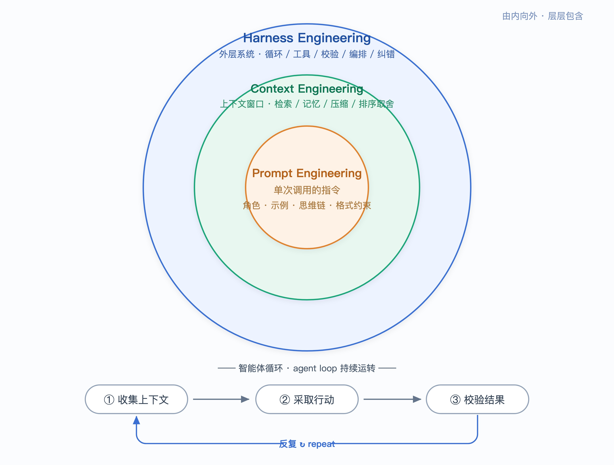

# Prompt · Context · Harness：AI 应用的三层工程

AI 应用开发有三个不同层次的工程问题：Prompt Engineering 管单次调用的指令设计，Context Engineering 管上下文窗口的信息组装，Harness Engineering 管模型外部的系统编排与循环控制。三者是嵌套关系，解决不同层的问题，混淆会导致在错误的层面上投入精力。

---

## 一、三层定义与边界



| 维度 | Prompt Engineering | Context Engineering | Harness Engineering |
|---|---|---|---|
| 操作单位 | 一次调用的指令 | 一次调用的整个上下文窗口 | 模型外部的系统与循环 |
| 核心问题 | 指令怎么写，模型才准确执行 | 窗口里放什么信息，模型才有足够依据 | 怎么让模型反复行动并可靠收敛 |
| 典型手段 | few-shot、CoT、角色设定、格式约束 | RAG、记忆、摘要压缩、相关性排序 | agent loop、工具调用、重试、验证、多智能体编排 |
| 代表产物 | 一段 system prompt | 一套 RAG／记忆管线 | Claude Code、Cursor、Devin |

**外层放大内层的价值，但替不了内层的错。**

---

## 二、Prompt：单次调用的指令优化

角色设定、few-shot 示例、Chain-of-Thought、输出格式约束——这些技术降低模型输出的歧义性和随机性。

**边界：Prompt 只能调度模型权重中已有的能力。**模型训练数据中没有的私有知识、实时数据，靠指令优化无法补偿。当调整指令无效时，通常说明问题出在 Context 层——所需信息不在上下文窗口中。

---

## 三、Context：上下文窗口的信息工程

**模型单次推理的能力上限 = 上下文窗口中的信息质量。**Context Engineering 的四个操作：检索（按需注入外部文档）、记忆（跨会话状态持久化）、压缩（长对话摘要）、排序取舍（信息优先级管理）。

关键约束：上下文窗口存在注意力衰减。《Lost in the Middle》（Liu et al., 2023）实验表明，模型对窗口中间位置信息的召回率显著下降。无关信息占用 token 预算并稀释注意力分配。**上下文工程的核心难度在过滤，不在堆砌。**

Context Engineering 管理的是信息状态，不涉及执行能力——谁调用工具、谁处理错误，属于 Harness 层。

---

## 四、Harness：多步执行的系统编排

单次 LLM 调用是无状态的输入→输出映射。实际任务（如自动修复 bug）需要多轮调用、工具执行、结果校验、错误恢复。Harness 是组织这一切的外部程序，核心组件：

- **Agent loop** — 循环调用模型直到满足终止条件
- **工具层** — 文件读写、命令执行、API 调用
- **校验与纠错** — 执行结果验证、失败重试策略
- **权限隔离** — 操作权限控制、沙箱执行环境

智能体内核的代码结构：

```python
while not done:
    context = gather(task, history, tool_results)  # Context Engineering
    action  = model(context)                        # Prompt Engineering
    result  = run_tool(action)                       # 工具执行
    history.append(result)
    done    = verify(result)                          # 结果校验
```

**三层在同一个循环中协作：`gather` 是 Context，`model(context)` 中的指令是 Prompt，整个 `while` 结构是 Harness。**

---

## 五、演进趋势

| 阶段 | 重心 | 时间 | 标志 |
|---|---|---|---|
| 第一阶段 | Prompt | ~2023 | 提示词模板、prompt 库 |
| 第二阶段 | Context | ~2023–2025 | RAG 系统、长上下文窗口、向量数据库 |
| 第三阶段 | Harness | ~2025 起 | AI Agent、工具编排、自动纠错系统 |

**外层无法修复内层缺陷，但内层做对后外层能成倍放大效果。**诊断 AI 应用问题的第一步：判断瓶颈在哪一层——指令歧义（Prompt）、信息缺失（Context）、还是缺乏多步执行能力（Harness），三者的修复路径完全不同。
