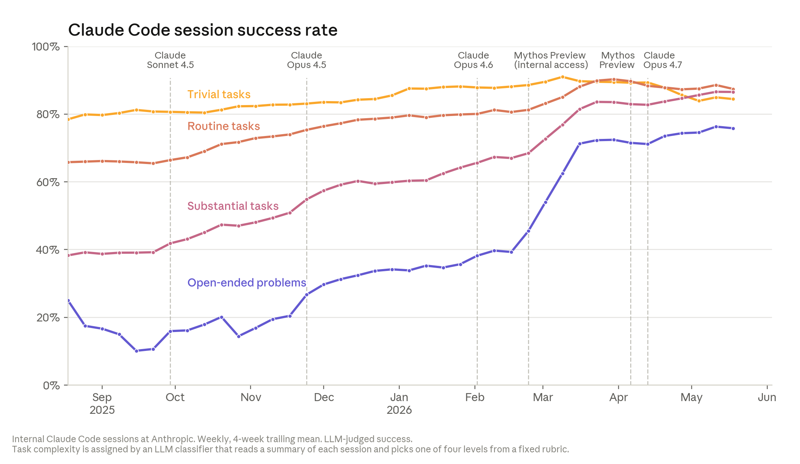
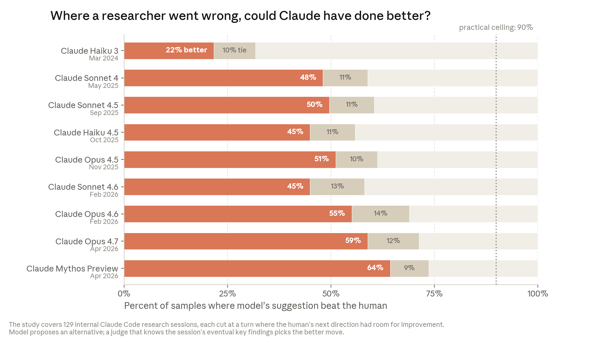

# 当AI构建自身

*我们在递归自我改进方面的进展及其影响。*

*原文：[Anthropic Institute](https://www.anthropic.com/institute/recursive-self-improvement)*

---

在AI的大部分历史中，人类驱动着其开发周期的每一个步骤。但在Anthropic，我们正在将越来越多的AI开发工作委托给AI系统本身，这加速了我们的工作。

如果这一趋势走得足够远，并且拥有足够的算力，它将指向一个能够完全自主设计和开发其继任者的AI系统。这被称为递归自我改进。我们尚未达到那一步，递归自我改进也并非不可避免。但它可能比大多数机构所准备的来得更快。

Anthropic研究院利用公开的基准测试和此前未公开的Anthropic内部数据，表明AI已经在加速AI系统的开发。仅举一个例子：如今，Anthropic的工程师平均每季度交付的代码量是2021-2025年期间的8倍。

本文讨论的技术趋势表明，AI系统在未来几年将变得更加强大。这些趋势具有重大影响。能够构建自身的AI将是技术史上的一个重大发展——它可能在科学、医疗保健及其他领域为世界带来巨大的福祉。但完全的递归自我改进也可能增加人类失去对AI系统控制权的风险。如果系统能够完全自主地构建其继任者，那么我们保护它们、监控它们以及塑造其行为的方式就变得更加重要。

---

**2021–2023 — 构建第一个Claude**

在早期阶段，Anthropic的工作与其他任何科技公司无异：人们在笔记本电脑上编写代码和文档。

**2023–2025 — 聊天机器人**

人们使用早期的聊天机器人来辅助部分流程，例如生成简短的代码片段并将输出复制到文本编辑器中。

**2025–2026 — 编程代理**

随着代理能力的增强，它们能够自主编写和编辑代码，有时甚至是整个文件。

**自主代理**

代理现在可以自行运行代码，并将数小时的工作委派给其他代理。

**闭合循环**

在未来，代理可能变得足够强大，能够自行构建和训练模型。如果这一天到来，未来版本的Claude可能会由Claude自身持续改进。

---

## 来自外部世界的证据

AI模型改进的速度正在加速。它们能够独立可靠完成的任务时长大约每四个月翻一倍，而此前的趋势是每七个月翻一倍。2024年3月，Claude Opus 3能够完成人类大约需要四分钟才能完成的软件任务。一年后，Claude Sonnet 3.7能处理大约需要一个半小时的任务。又过了一年，Claude Opus 4.6能处理12小时的任务。[^1] 如果这一趋势持续下去，需要一个熟练人员花费数天的任务可能在今年内进入AI的能力范围。到2027年，AI系统可能有能力处理需要一个人花费数周的任务。

同样的模式也出现在编程和研究基准测试上。基准测试衡量模型在特定领域的表现，当模型达到接近100%的表现时，即为"饱和"。[^2] SWE-bench是一个标准的真实世界软件工程测试：它向模型提供一个真实的开源代码库和一份真实的错误报告，要求它编写能修复问题并通过项目自身测试的代码变更。模型的得分已经从个位数的低水平发展到在两年内使基准测试趋于饱和。

CORE-Bench测试模型能否复现已有的研究成果，这是它们进行原创研究的前提。它向AI模型提供已发表论文背后的代码和数据，要求它重新运行一切并确认能够复现论文的结果。AI系统从2024年大约20%的成功率发展到十五个月后使基准测试趋于饱和。运行长时任务完成度基准测试的METR发现，Claude Mythos Preview能够工作"至少"16小时，处于"METR在没有新任务的情况下所能衡量的上限"。

公开的基准测试能告诉我们很多关于这些系统能力的信息。但它们无法揭示AI系统对加速AI开发本身所产生的影响。为此，我们需要来自Anthropic等AI公司内部的直接证据。

## 来自Anthropic内部的证据

构建前沿模型需要两大类工作。一类是工程：编写代码、搭建基础设施和监督模型训练。另一类是研究：决定运行哪些实验、解读实验结果，以及确定下一步尝试哪些想法。

在工程和研究两个方面，情况是一致的。在工程方面，Claude可以接手一个定义不明确的问题并找出解决方法；人类提供目标，但不再需要提供方法。在研究方面，Claude已经能够在执行定义明确的实验时达到甚至超越熟练人类的水平。然而，在Claude运用判断力来选择工程和研究目标方面，仍然存在巨大的能力差距。这就是当今的AI与未来能够自主设计其继任者的系统之间的鸿沟。

在Anthropic，员工随着经验的积累，通常会接到更开放、更重要的任务。在早期，他们执行的是别人指定的任务，比如"导出按钮不工作了，请修复它。"有了经验之后，他们会被给定一个目标并自行设计方法，比如"调查一下为什么网络在高负载下变慢。"在最资深的层级，他们在决定哪些问题值得投入精力："团队下个季度应该做什么？"我们可以利用Anthropic的内部数据来观察Claude在处理这些不同类型任务方面已经走了多远。

Claude编写了Anthropic代码库中相当大比例的代码。截至2026年5月，我们合并到Anthropic代码库中超过80%的代码是由Claude编写的。[^3] 在2025年2月Claude Code以研究预览版发布之前，这个数字仅为个位数的低水平。这一转变也体现在每位工程师的产出量上。在Anthropic的前四年（2021-2024年），每位工程师每天合并的代码行数保持稳定，然后在2025年Claude开始运行代码而非仅仅建议工程师复制粘贴时开始攀升。2026年，当模型开始在更长的时间范围内自主工作时，斜率再次变陡。这两个拐点显示在下方的图表中。在2026年第二季度，典型工程师每天合并的代码量是2024年的8倍。[^4] 这是因为大部分代码是由Claude编写的，工程师负责指导和审查，而非亲自编码。

需要注意的是：代码行数是一个不完美的衡量标准，因为它衡量的是数量而非质量。因此，2026年第二季度每工程师每天8倍的代码行数几乎可以肯定是对真实生产力提升的高估。尽管如此，它表明了一种加速。在Anthropic，我们不以编写的代码行数来奖励员工；相反，团队成员产出更多代码只是因为他们在使用AI系统来编写更多代码。

代码行数的增长与对生产力大幅提升的主观感受相吻合。在2026年3月对Anthropic各研究团队130名员工的调查中，受访者的中位数估计，在他们本来就会进行的项目类型上，使用Mythos Preview的产出大约是没有任何AI模型辅助时的4倍。[^5] 我们预计3月份的真实提升幅度可能略低一些。[^6] 尽管如此，我们认为这一整体判断是可信的，并且与我们的其他观察一致：Anthropic相当大一部分技术人员完成核心工作的速度是没有AI辅助时的数倍。

我们还看到证据表明，Anthropic的员工正在使用Claude来完成那些原本根本不会去做的工作，比如构建探索性工具和处理长期搁置的清理任务。例如，2026年4月，Claude提交了超过800个修复，将一类API错误减少了1000倍。负责监督Claude的工程师估计，一个人类需要四年才能完成这项工作；修复他人的bug既缓慢又费力，人类很难同时在脑中保持如此多不熟悉的上下文。

> 大约一年前，我开始大力投入"Claude化"。这是一段疯狂的冒险，到现在已经大约五个月没有亲自写过任何代码了。

Claude编写的代码是"好的"，而且在持续改进。"好代码"意味着两件事：它能运行，而且它的编写方式允许其他工程师理解并在其基础上继续开发。在第一个标准上，证据是明确的。在过去一年中，Anthropic员工对Claude进行纠正、重新引导或中途接手的比率一直在稳步下降，包括在最复杂和最开放的任务上。这里指的是那些没有明确规格说明、工程师自己也不确定答案应该是什么样的问题。这在Claude在不同难度任务上的成功率随时间变化的图表中清晰可见。Claude编写的代码确实能用。

在最开放的任务上，Claude的成功率在2026年5月达到了76%，六个月内提升了50个百分点。举一个这一难度层级的任务为例：一次常规升级开始导致数万个训练任务崩溃。一位工程师仅凭一些文本内容和集群访问权限就将Claude指向了这个实时事故。通过逐一检查运行中的作业和测试每个环境设置，Claude定位到了触发崩溃的那个隐晦的调试标志，可靠地复现了问题，并确认了修复方案。在大约两小时内，Claude完成了通常需要两到三天的工作。

第二个标准是编写其他工程师能够理解并在其基础上继续开发的代码。在这一点上，人类和AI之间的差距仍然存在，但正在迅速缩小。Anthropic内部尚未达成完全共识，但许多人认为，2025年底时Claude编写的代码质量仍略逊于Anthropic人类编写的代码，而如今大致持平。我们预计在今年内它将超越人类。

> Claude编写的代码在2025年底时质量略逊于Anthropic的人类编写代码，如今大致持平，我们预计在今年内将严格优于人类。

这改变了Anthropic审查自身代码的方式。对代码库的变更提交现在会先由一个自动化的Claude审查器读取，检查bug、安全漏洞和其他缺陷，然后才能合并。使用这个工具，我们进行了一次回顾性分析，发现如果对代码库的每一次变更都进行自动化的Claude审查，大约能在bug进入生产环境之前就捕获claude.ai过去事故背后约三分之一的bug。编写那些代码的工程师是世界上构建这类系统的顶尖人才。Claude现在正在捕获他们遗漏的错误。

Claude擅长按照别人设定的目标来运行实验。每次Anthropic发布一个模型时，我们都会运行同一个测试：给Claude一段训练小型AI模型的代码，要求它在通过相同正确性检查的前提下让代码尽可能快地运行。目标和成功指标是预先固定的，因此Claude的任务是通过重写代码、运行代码、计时并重复来寻找加速方案。这是实验研究循环的一个微缩版本。2025年5月，Claude Opus 4对起始代码平均实现了约3倍的加速。到2026年4月，Claude Mythos Preview达到了约52倍。作为参照，一位熟练的人类研究员需要四到八小时才能在同一任务上达到4倍加速。[^7] 在研究工作流程的这一部分——在定义明确的实验中优化步骤——Claude在不到一年的时间里从非常有用进化到了超越人类。

> 如今的大致状态是"人类提出想法，模型能够以快一个数量级的速度去实现、测试和评估它们"。

Claude在自主提出实验方面越来越出色。2026年4月，Anthropic发表了Claude端到端运行开放式研究项目的首个演示。Claude驱动的代理被给予了一个AI安全领域的开放问题——大致是：一个较弱的模型能否可靠地监督一个更强的模型？——然后被放手去解决。这涉及提出假设、测试假设、与并行代理共享发现以及迭代。该任务有一个明确的性能"下限"和"上限"：下限是弱监督者独立工作时的表现；上限是强模型在正确答案上训练后的表现。两位人类研究员用大约一周时间缩小了大约23%的差距；代理在800个累计工时内缩小了97%的差距，使用了大约18,000美元的算力。这项工作有一些需要注意的地方：结果未能顺利迁移到生产规模的模型上，而且人类仍然选择了问题和创建了评分标准。但在这些限定范围内，代理自行设计了每一个实验。方向设定是人类扮演的唯一有实质意义的角色。

> Claude在一到两天的时间里完成了所有这些工作，几乎不需要我的帮助。我觉得如果一个初级同事在同样的时间内给我带回这样的结果，我会稍感惊喜。未来已来。

Claude在引导研究会话走向研究发现方面越来越出色。我们检查了2026年1月至3月期间Anthropic研究员使用Claude Code进行开放式研究问题的真实会话，例如弄清楚为什么一个训练运行持续崩溃，或者为什么一个模型在某个基准测试上得分很低。在每个案例中，我们都找到了研究员走弯路的时刻：他们在会话最终回到正轨之前，追求了一个使会话偏离方向的路径。然后，我们向不同版本的Claude模型展示会话偏离之前的工作，并询问它会怎么做。一个能够看到会话最终结果的独立Claude随后判断AI还是人类给出了更好的下一步建议。[^8]

因为我们刻意挑选了那些人类的选择有改进空间的时刻（n=129），所以这不是模型和人类判断之间的同等条件对比。这些时刻为我们提供了一组现实的、具有挑战性的情境，其中正确的下一步并不显而易见，而人类的选择可以作为一个有用的参照来比较模型随时间的表现。在这一衡量标准上，2025年11月我们最好的模型（Opus 4.5）有51%的时间优于人类的选择；到2026年4月（Mythos Preview），这一比例增长到64%。研究的日常工作在很大程度上是一系列这样的下一步决策，因此这是衡量模型最终能否独立运行调查的一个相关指标。我们将这一结果视为AI系统在做出AI研究所依赖的判断方面正在变得更好的早期信号。

> 目前人类的比较优势仍然在于看到更大的图景，以及思考超出当前任务局限之外的事情。

## Anthropic的工作未来可能是什么样的？

证据表明，在AI开发过程的每一个步骤中，人类的角色都在收窄。一旦人类和AI编写的代码质量达到持平，人类将完全停止编写代码，转而仅做审查。但如果他们审查代码的速度跟不上Claude生成代码的速度，人类审查将成为AI开发的瓶颈。类似地，一旦Claude能够运行实验，问题就转变为"这些实验中哪些值得运行？"简单来说：执行（即编写代码、运行实验、产出结果）在人类时间上的成本现在几乎为零，即使它在算力上仍有成本。

目前人类的一个比较优势领域是研究品味和判断力，包括选择哪些问题重要、哪些结果值得信赖，以及何时一个方向是死胡同。

> 工作（和生活）运行在人与人之间小恩小惠的礼物经济上。"你能帮我把这个脚本跑起来吗？"……每一次都创造了一点债务、一点彼此的关注。Claude更快，它不产生任何债务，但每一次这样的互动都是一次人类协作机会的丧失。

> 在一切运行顺利的日子里，我不禁会想，我做的一切都无关紧要，一切都被自动化了，比我做得更好更快。但也有些日子，一切都崩溃了，我不知道为什么，然后我意识到我已经不知道自己一直在做什么了。

## 如果我们错了呢？

对上述证据的一个自然反驳是，仍然掌握在人类手中的那部分工作——选择研究哪些问题——才是最重要的。没有这种判断力，Claude只是一个能干的助手，而非一个能够独立推动AI进步的系统。

目前的训练方法和架构是否能够解锁这种能力，确实不清楚。但AI很少是通过"灵光乍现"的时刻来取得进步的。在AI的近代历史中，确实有过几次这样的时刻，比如Transformer架构或混合专家模型，但范式性的突破性想法每隔数年才出现一次。在此期间，大多数进展是渐进式的：我们扩大某个东西的规模，看看什么会出问题，修复它，然后再试一次。这恰恰是Claude现在擅长的工作流程。爱迪生说，**天才是1%的灵感加99%的汗水。但我们看到汗水正在被日益自动化**。**越来越清楚的是，推动前沿进步的大部分工作是可自动化的；大规模的研究进展主要取决于工具和资源，它们决定了你能多快地运行实验、同时运行多少个实验，以及多快能获得结果。**

即使我们假设Claude永远不会获得好的研究品味，对我们证据的保守解读仍然意味着复合加速。如果人类将大部分时间花在仅占个位数百分比的方向设定工作上，而Claude处理其余的一切，那就意味着每位工程师或研究员正在引导远比以前更多的工作。我们看到的证据表明，Anthropic的员工既在更快地推进，又在覆盖更广泛的领域。在实践中，这意味着AI已经使Anthropic的运转速度远超有效AI工具出现之前。

更激进的解读是，Claude在研究判断力方面改善的早期证据——尽管目前还很有限——预示着这一能力也在提升。"研究品味"可能只是又一个AI系统暂时做不好、然后逐渐精通的AI能力。我们在其他定性技能上看到过类似的模式，比如AI系统能够解释一个笑话为什么好笑、展示心智理论，以及解决语言谜题。

## 可能的未来

接下来会发生什么取决于两件事：趋势是否会持续，以及如果持续的话我们选择怎么做。我们可以想象至少三种未来场景：

### 场景一：趋势停滞，但当今的AI能力被广泛扩散

这篇文章呈现了许多指数级增长的轨迹。但这些轨迹实际上可能会变成S曲线。我们可能正在接近曲线的拐点，在那里规模回报递减，曲线变直，然后趋平。区分一个称职研究员和一个优秀研究员的判断力，可能是一种无法仅通过扩大算力和数据等训练输入来获得的能力。如果是这样，突破这一瓶颈将需要一个新想法，比如一种取代当前所有前沿模型所使用的Transformer架构的新架构方法。

另一种可能是，AI进步的约束瓶颈可能在供应链而非模型本身：**推进和扩散前沿可能需要比目前更多的能源和算力。芯片制造、电网扩展或互联带宽的速度可能才是约束，而非智能本身**。我们也不能排除对AI生态系统产生剧烈冲击的外部事件从而显著减缓发展的可能性，比如算力或电力供应的突然减少，这两者都会减缓进展并使实验室的前瞻性投资变得更加昂贵。或者我们可能没有预料到某些其他的进步障碍。

即使模型能力被冻结在今天的水平，我们仍然预期世界将发生重大变化。Project Glasswing就是一个早期迹象：**在最初几周内，Mythos Preview在全球最重要的系统中发现了超过一万个高危和关键级别的软件漏洞——多到网络防御的瓶颈已经从发现漏洞转移到了足够快地修补它们**。而且我们仍处于当今模型向更广泛经济扩散的早期阶段，一家100人的公司正越来越能完成1000人公司的工作量，因为每位员工将坐在一个代理金字塔的顶端。

我们将这一场景纳入是为了完整性，但我们不认为它是可能的。我们能测量的每一项能力，包括那些感觉更"柔性"的能力，如代码质量和开放式任务的成功率，迄今都遵循着相同的曲线。**我们尚未看到那条曲线出现拐点**。**在我们考虑的三种未来中，这一种将给政府和社会最多的适应时间。我们更担心接下来的两种，它们将推进得更快，留给准备的空间也更少。**

### 场景二：AI实验室持续看到复合效率提升

在这一场景中，AI开发变得大幅自动化，但人类继续设定研究方向和判断结果。使用AI系统的组织将随着时间的推移变得更加高效，因此我们可以预期这些组织中的每个人都将获得显著的生产力倍增。**100人的公司可能完成10,000甚至100,000人组织的工作量**。这将彻底改变知识工作和政府服务，但也可能被用于有害目的，从对整个人口的威权监控，到针对每个个体量身定制的操纵行动，其规模远超任何人类团队所能匹敌。像Anthropic这样的公司中人类的角色将发生转变。人们将与AI系统合作以扩大研究规模和产生新洞见，并共同构建验证AI输出可信度所需的系统。

我们在此列出的证据表明，我们很可能正朝着这一场景前进。但加速一个流程的某一部分通常只是将瓶颈转移到其他地方：整体速度受限于那些尚未加速的部分。在计算领域，这被称为阿姆达尔定律，同样的逻辑也适用于组织。Anthropic已经遇到了阿姆达尔定律的一个典型表现：随着我们开始在组织中推送更多代码，人类代码审查已成为新的瓶颈。

我们在工程之外也遇到了这种摩擦。**由于Anthropic员工与高度能干的模型合作，产生了大量新想法、新计划、新工具和新模拟——远超我们有能力追求的数量。组织发现和修复这些瓶颈的速度可能是一项随时间改善的技能，它可能成为任何组织最重要的技能。**

### 场景三：AI系统本身具备完全递归自我改进的能力

如果推进能力的技术趋势继续下去，而且AI系统能够发展出变革性人类创造力所固有的能力，那么AI系统设计和改进自身就是合理的。

在这个世界中，AI开发的进步速度完全取决于AI系统可用算力的多少（或在算法训练或推理中发现各种效率提升的速度）。人类在其开发中的角色将大幅缩减，**我们的大部分精力可能转向对一个由AI系统运行的不断扩展的"虚拟实验室"进行监督、验证和核实**。**我们预计，具备自动化AI研究和开发能力的系统将拥有可迁移到其他科学领域的技能，从而开始革新其他学科。**

在这个未来中，对齐问题如何解决——或者是否能解决——是我们最不确定的部分。模型可能被证明具有足够好的对齐性和研究品味，从而发现和实施我们尚未达到的新颖解决方案。它们也可能足够智慧，在做不到的时候停止开发。另一种可能是，当今模型中罕见的错误对齐现象可能随着模型构建其继任者而不断累积，变得更加频繁但更难理解，直到我们失去对它们的控制。我们有可能无法构建、整合和验证我们所需的工具来理解我们实际处于哪条趋势线上。

**我们对这个世界会是什么样子没有很好的直觉，因为我们的经济目前是由人类和人类构建的工具驱动的。从本质上讲，一个由快速递归自我改进驱动的世界，可能会随着自我改进模型的能力完全超越人类并渗透到更广泛的经济中而被该模型所主导。如果人类劳动不再具有竞争力，经济会是什么样子，这很难预测。**

即使模型开发变得完全自动化和递归，我们也无法预测这对大多数人的日常生活意味着什么。阿姆达尔定律在这里同样适用。递归智能可能会在某些领域迅速实现《**充满爱的机器**》中概述的许多益处。我们预计，具身智能（即机器人技术）可能会在递归智能之后迅速跟进，并遵循类似的收益递增、成本递减的路径。更强大的智能可能帮助我们在物理世界中更快地建造事物，进行更高效的救命药物临床试验，并发展新型协调形式。

但仅仅实现递归改进并不意味着工业生产方式、社会组织形式或市场运作方式会立即改变。更多的智能无法知道一种药物在数十年使用后的效果，无法比宪法规定的更早举行选举，也无法在一个周末内把一个陌生人变成一个老朋友。对大多数人来说，这个未来的感知速度仍然由瓶颈决定，即使上游的实验室以算力的速度运转。递归智能以越来越快的速度构建自身与人类、人际关系和治理的现实世界之间的碰撞，是这个未来中我们无法预测的另一部分。

## 我们应该怎么做？

如果有可能有效地减缓这项技术的发展速度，给我们更多时间来应对其巨大影响，我们认为这很可能是一件好事。但如果减速只是让最不审慎的参与者在技术上赶上来，那可能会让所有人都更不安全。在没有全球协调机制的情况下，企业和政府将不得不在竞争和地缘政治压力下做出关于安全的艰难决定。

**我们认为，让世界拥有减缓或暂时暂停前沿AI开发的选项将是有益的，以使社会结构和对齐研究能够跟上技术进步的步伐。**Anthropic研究院将与许多其他方合作开展研究，并采取行动帮助建立一个可信的减速或暂停所需要的系统。这些系统将使前沿AI开发者能够验证全球其他开发者确实已经停止或减速，并且恶意行为者不能利用协调减速的名义暗中抢先。如果这样的系统存在，我们预计我们会减速或暂时暂停——前提是其他处于或接近前沿的开发者也以可验证的方式这样做。

**有意义的减速或暂停需要多个资源充足的、处于或接近前沿的实验室在多个国家达成一致，在相同条件下停止。还需要每一方都能验证其他方确实已经停止。由于AI系统的独特特性，这一军控问题中的可检测性（一个低于可验证性的标准）要素比其他技术要困难得多。训练运行比导弹发射井更容易隐藏，其输入是通用的，而且暗中违约的动机是巨大的，因为在其他人暂停时继续推进的一方可能继承领先地位。一个可信的暂停还必须规定什么触发它、什么解除它，以及谁来裁决。**

这一切在原则上并非不可能——世界已经为其他复杂技术建立了验证制度（例如《中导条约》）——但那些制度花了数十年来建设基础设施和信任。我们没有那么长的时间。相比之下，单个实验室的单方面暂停可以立即实现，但成效要小得多：它会改变谁是领跑者，但不会创造目前所缺失的更广泛的审议过程。

在未来几个月内，我们将组织对话，让政策制定者、研究人员、公民社会和其他AI公司共同帮助回答本文提出的一些问题，特别是围绕完全递归自我改进以及如何创造更好的协调和审议选项。我们将公开发表讨论的成果。共同探讨这些问题的窗口就在眼前，AI公司之外的人们应当参与到这一审议中来。

---

*Marina Favaro和Jack Clark共同撰写了本文，Santi Ruiz提供编辑支持。Shan Carter、Romello Goodman和Nikki Makagiansar基于Brian Calvert和Jun Shern Chan收集的数据创建了可视化内容。Daniel Freeman、Jim Baker、Max Young、Sarah Pollack、Francesco Mosconi、Holden Karnofsky、Andy Jones、Kevin Troy、Anton Korinek、Meg Tong、Andrew Ho、Dan Altman、Drake Thomas、Jack Shen、Sasha de Marigny和Avital Balwit提供了反馈意见。*

*本文中Anthropic员工的引言摘自内部讨论，经许可使用。它们反映的是截至2026年5月的个人观点，不代表公司官方立场。*

---

## 脚注

[^1]: METR的关键指标告诉你AI系统在一组任务上能够达到50%可靠性的时间跨度，尽管在80%可靠性上趋势线看起来是一样的。

[^2]: 特别是随着基准测试转向更开放的格式和更困难的任务（如奥林匹克级别的数学），由于题目和答案集中的错误（如模糊的问题陈述和无解的问题），基准测试通常在100%以下就趋于饱和。

[^3]: Anthropic管理层已公开估计90%或更多的代码是由Claude编写的，包括脚本和实验性代码。我们超过80%的数字衡量的是可归因于Claude的合并到生产环境的代码行占比。这在两方面是更保守的衡量：我们的归因管道存在缺口，而且未归因于Claude的代码行包括自动生成的代码和其他并非由人类手工编写的产物。

[^4]: 代码产出的激增正在对每个人共享的基础设施造成压力。GitHub——全球大部分软件在其上构建的平台——在2025年全年大约有10亿次代码提交；到2026年年中，每周达到2.75亿次，按此速度全年将达到约140亿次。该公司的首席运营官表示，他们正在"极力推动"产能以跟上节奏。

[^5]: 关于这项调查的方法论的更多细节在Claude Opus 4.7系统卡的第2.3.5节中讨论。

[^6]: 许多受访者可能没有仔细考虑如何处理问题定义中的各种偏差或微妙之处，而且METR的最新研究表明，开发者对AI生产力提升的估计可能被高估。

[^7]: 加速倍数有多大在很大程度上取决于起始代码留有多少改进空间，不应将其理解为真实世界的训练加速。因此，绝对倍数不是这里应该锚定的数字。更有参考价值的是这一实验设置所能进行的同等条件比较，包括跨模型的比较（过去一年从约3倍到约52倍）和与熟练人类的比较（在同一任务上花四到八小时达到约4倍）。

[^8]: 作为对评审偏差的检验，我们在另一组127个人类下一步行动已经很强的时刻（与原始集合中人类决策有改进空间的情况相反）上运行了相同的测试。在那里，模型的建议被判断为更好的比例仅为约20%。
