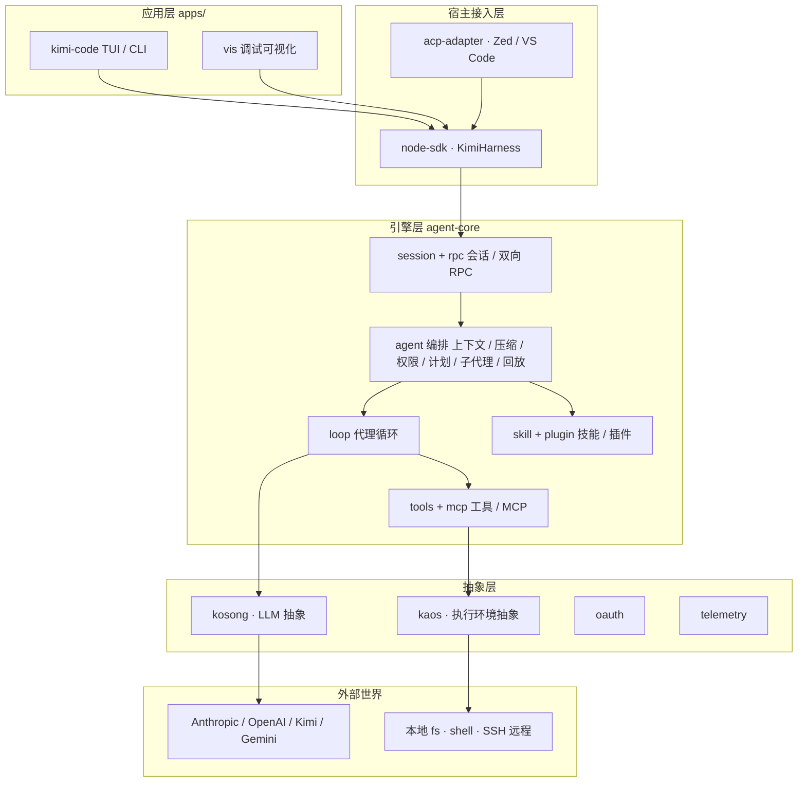
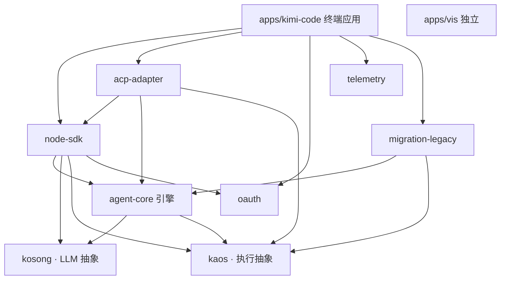
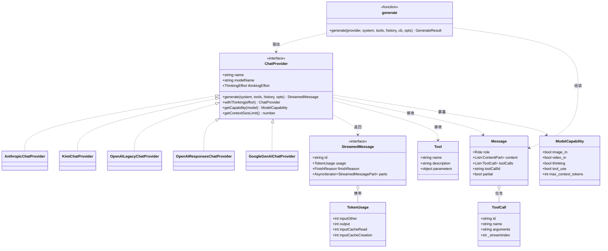
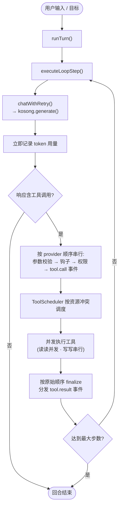
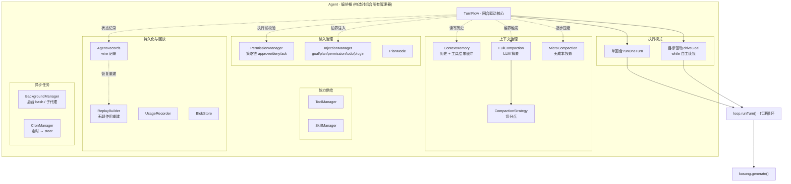
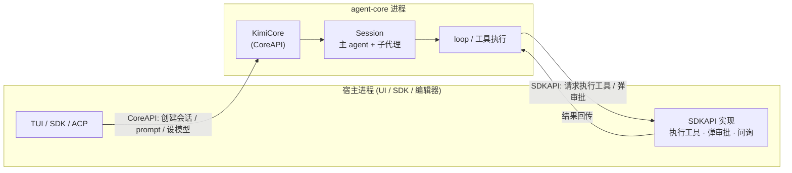
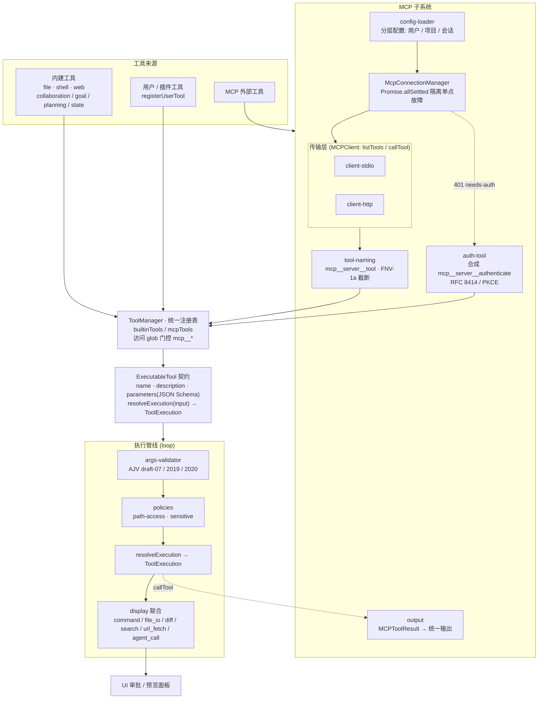

# 拆解 Kimi Code：一个终端 AI 编程代理的完整架构

Kimi Code 是 MoonshotAI 开源的终端 AI 编程代理，定位上对标 Claude Code 这类工具：在命令行里运行，能读写代码、执行 shell、检索文件、抓取网页，并根据反馈自主规划下一步动作。它以 TypeScript pnpm monorepo 的形式组织，最终交付为一个不依赖 Node.js 运行时的单二进制文件。

如果只把它当成一个套了壳的 LLM 调用循环，会错过它真正值得研究的部分。一个成熟的编程代理需要解决的工程问题远比“调模型、跑工具”复杂：要在多个 LLM 供应商之间抹平差异，要在长达数小时的会话中管理不断膨胀的上下文，要在工具执行时做权限管控，要支持工具/技能/插件/子代理多个维度的扩展，还要把客户端 UI 与代理运行时解耦，以便同一套引擎既能驱动终端 TUI 又能被 SDK 调用。Kimi Code 用一套清晰的分层架构把这些问题逐一拆解。本文按照从底层抽象到顶层应用的顺序，完整走一遍它的设计。

## 分层心智模型：为什么这样切

整个系统是一个五层栈，自下而上分别是：

**kosong(LLM 抽象层)**：统一Anthropic、OpenAI、Kimi、Google Gemini 等供应商的接口，把消息格式、流式响应、工具调用、能力探测、token 计费全部归一化。

**kaos(执行环境抽象层)**：抽象文件系统、shell、进程管理，让上层不关心代码跑在本地还是远程 SSH 上。

**agent-core(统一代理引擎)**：系统的心脏，编排代理循环、会话管理、工具解析与执行、权限、上下文压缩、后台任务、技能加载、MCP 配置、生命周期钩子和全量记录。

**node-sdk(公开SDK)**：把 agent-core、kosong、kaos、oauth 打包成单一入口，`KimiHarness` 作为工厂统管会话、配置、凭证、日志、遥测。

**apps/kimi-code(终端应用)**：基于 pi-tui 的交互式 TUI、一次性 prompt 模式，以及单二进制分发。

把这五层连同主要模块画在一起，整体架构如下图。所有箭头都指向下方，依赖方向严格单向：

这种分层的核心收益是依赖方向的单向性。kosong 和 kaos 是叶子层，只依赖外部供应商 SDK;agent-core 同时依赖这两层，但它从不直接 import 任何供应商的代码——kosong 是它唯一的模型抽象边界，kaos 是它唯一的执行抽象边界。这意味着agent-core 的代码里搜不到 `@anthropic-ai/sdk` 或 `child_process`，所有 provider 特有的怪癖、所有本地与远程执行的差异，都被隔离在更下层。当你要新增一个模型供应商，只需在 kosong 里加一个 adapter；当你要支持远程执行，只需提供一个新的 Kaos 实现。上层逻辑完全无感。

这种单向性并非抽象口号，它直接体现在每个包的 package.json 声明里。把所有内部依赖(`@moonshot-ai/*`)抽出来，模块之间的依赖关系是一张清晰的有向无环图(箭头表示“依赖于”)：

这张图里有几条值得点出的关系。`kosong` 和 `kaos` 是两个真正的叶子节点，不依赖任何内部包，所有上层模块最终都汇聚到它们身上——这正是两条抽象边界的体现。`agent-core` 作为引擎，依赖且只依赖 `kosong` 与 `kaos`，它不碰 `oauth`、`telemetry`，也不反向依赖 `node-sdk`，保持引擎本身的纯粹。`node-sdk` 扮演聚合者，把 `agent-core`、`kosong`、`kaos`、`oauth` 打包成单一对外入口。终端应用 `apps/kimi-code` 站在最上层，它依赖的是 `node-sdk` 而非直接依赖 `agent-core`——也就是说应用与引擎之间始终隔着 SDK 这层契约。`acp-adapter` 同时依赖 `agent-core`、`kaos` 和 `node-sdk`，因为它要把编辑器的文件系统能力装饰进执行层。`telemetry` 和 `apps/vis` 则是旁路：前者被应用层单向引用做埋点，后者是完全独立的会话调试可视化工具。

## kosong：把模型供应商的差异关在边界之外

kosong 自身是个三层结构。最底是一组不可变的、provider 无关的统一类型：`Message` (role 加 content 加 toolCalls)、`StreamedMessagePart` (文本、思考、图片、工具调用等流式片段的联合类型)、`Tool` (简单的 name/description/parameters 的 JSON Schema)、`ModelCapability` (image_in、video_in、thinking、tool_use 等布尔标志加上下文窗口大小)、`TokenUsage` (把缓存读取、缓存写入、普通输入、输出分开计费)。这些类型是 adapter 与消费者之间的契约边界。

用一张 UML 类图把 kosong 的契约关系表达出来会更直观：中间是统一数据类型(`Message`、`ToolCall`、`Tool`、`ModelCapability`、`TokenUsage`)，左侧是两个核心接口(`ChatProvider` 与流式响应 `StreamedMessage`)，五个 provider 实现都落在 `ChatProvider` 之下，而 `generate()` 编排函数驱动接口、组装出最终的 `Message`：

类图里有两条主线。一条是继承线：五个 provider 类都实现同一个 `ChatProvider` 接口，把各自后端的差异封装在实现内部；另一条是数据流线：`generate()` 不属于任何 provider，它接收一个 `ChatProvider` 引用，消费其 `StreamedMessage` 流，最终组装出一个干净的 `Message`(并在此过程中剥离 `ToolCall` 的内部 `_streamIndex` 字段)。所有统一类型都是只读的、provider 无关的，这是 adapter 与上层之间得以解耦的根本原因。

中间是六个 provider adapter( `anthropic.ts`、`kimi.ts`、`openai-legacy.ts`、`openai-responses.ts`、`google-genai.ts`，以及作为 Google GenAI 别名的 VertexAI)。每个 adapter 把统一类型翻译成供应商原生的线格式，把供应商的 finish_reason 归一化成统一枚举，把 token 字段映射到统一的 `TokenUsage`。

最上层是 `generate()` 编排函数，它管理跨所有 provider 的流生命周期。这里藏着kosong 几个值得细看的设计决策。

**原地合并流式片段**。`generate()` 不缓冲整个响应，而是片段到达时就地修改待处理片段——两个文本片段拼接、工具调用的参数增量追加。这降低了大响应的内存占用，也让“每片段回调”成为可能，UI 可以在流进行中就渲染。

**基于索引的并行工具调用路由**。OpenAI 兼容的 API 在流式返回多个并行工具调用时，参数块会按 `choice.index` 交错到达。`generate()` 维护一个 `toolCallIndexMap` (streamIndex 映射到 `message.toolCalls` 的数组位置)，把迟到的参数增量路由到正确的调用，而不依赖顺序。这避免了工具调用片段乱序时的交叉污染。值得注意的是 `ToolCall` 携带一个内部 `_streamIndex` 字段专门用于这个路由，但在存入 `message.toolCalls` 之前会被剥离，保持存储的工具调用干净。

**延迟推断工具调用完成**。各家 adapter 不发独立的“工具调用结束”事件。完成是从合并边界推断出来的：当新的工具调用或内容片段到达、而待处理的工具调用无法合并时，就把待处理的那个 flush 掉。这套机制统一了有显式结束信号的 Anthropic 和必须靠推断的 OpenAI Chat Completions。

**拒绝“只有思考”的响应**。`generate()` 会校验响应里除了 thinking 之外还有文本或工具调用。如果只有思考内容(可能是输出预算在推理过程中耗尽)，它抛出 `APIEmptyResponseError`，防止代理基于不完整的推理去行动。

错误处理同样做了归一化。`normalizeAPIStatusError()` 用消息字符串去匹配上下文溢出的模式，识别出各家拼写不同的“上下文超限”错误并统一为 `APIContextOverflowError` ; `isRetryableGenerateError()` 按异常类型和状态码(429、5xx)判断是否可重试。auth 是请求级解析的—— `ProviderRequestAuth` 在每次 `generate()` 之前即时解析，从不缓存在 provider 实例上，这样支持凭证刷新和按请求轮换密钥。

## agent-core 的执行循环：无状态、保持顺序、双路事件

下面这张流程图描述了一个回合内的主控制流——从模型调用到工具调度，再到下一步的循环：

往上一层是 agent-core 的 loop 模块，它实现了无状态的代理循环。顶层`runTurn()` ( `packages/agent-core/src/loop/run-turn.ts` )反复调用 `executeLoopStep()`，聚合 token 用量，执行最大步数限制，处理中止和错误收敛。每一步通过 `chatWithRetry()` 调用 LLM(带指数退避重试)，拿到响应后交给 `runToolCallBatch()` 处理整个工具调用生命周期。

这个 loop 最核心的不变量是**保持provider 顺序**。模型返回的工具调用有一个固定顺序，loop 在两个阶段都保持它：验证、钩子执行、tool.call 事件分发，这三步在执行开始前按 provider 顺序串行完成；执行可以并发重叠，但 `finalizePendingToolResult` 和 tool.result 分发在执行完成后，通过对原始顺序的 `pendingResults` 数组做 `Promise.allSettled`，仍然按 provider 顺序发出。即便执行是乱序的，记录到 transcript 的结果顺序也是稳定的，这保证了会话回放的确定性。

并发由 `ToolScheduler` 配合 `ToolAccesses` 完成。每个工具声明它访问的资源(读某文件、写某文件、搜索某目录树，或访问全部资源)，调度器用 `conflict()` 判断序列化边界：读 /path1 和读 /path2 不冲突，可以并发；写同一路径必须串行。这是一个简单的队列模型，`isBlocked()` 检查任务是否与活跃或排队的任务冲突，不冲突就立即启动，否则入队，每次有任务完成就重新检查队列。

事件走双路分发器( `events.ts` )。持久事件(step.begin/end、tool.call/result、content.part)记入 transcript 并可选地实时发出；临时事件(deltas、tool.progress、retrying、interrupted)只走实时通道。这个区分很关键：transcript 是用来持久化和回放的，必须干净；而流式增量和进度更新只服务于实时 UI，不该污染持久记录。

几个工程细节值得留意。loop 在 `llm.chat()` 返回后立即记录用量(早于工具执行)，所以即便工具执行期间发生中止，已花费的模型成本也已记账——被中止的回合仍可能累积模型费用。对于不响应中止信号的工具，`raceExecuteWithGraceTimeout()` 在 abort 信号触发后设置一个 2 秒宽限超时，无视 AbortSignal 的工具会以一个合成的错误结果终止。`coerceToolResult()` 校验工具返回值是否符合契约(输出必须是字符串或 ContentPart 数组)，不合规的返回被强制转为 isError 以维持loop 的不变量。整个 loop 把 kosong 当作唯一的模型抽象边界，从不窥探 provider 特有的细节。

## agent 编排层：长会话的真正难点都在这里

loop 解决的是“一个回合怎么跑”，而 agent 编排层( `packages/agent-core/src/agent/` )解决的是“一段可能持续数小时的对话怎么管”。它围绕 `TurnFlow` 这个核心循环展开，外面套了六个同心环。

`Agent` 类本身是这一层的组合根：它在构造函数里一次性实例化全部管理器(`turn`、`context`、`fullCompaction`、`microCompaction`、`permission`、`injection`、`tools`、`skills`、`records`、`background`、`cron`、`replayBuilder` 等)，再把它们交给 `TurnFlow` 协调。下图把这套核心逻辑画出来——中心是 `TurnFlow`，它向下驱动 loop 完成一个回合，向四周咨询各个管理器完成注入、校验、压缩与记录：

**回合与目标驱动**。`TurnFlow` 管理回合生命周期。它有两种执行模式：普通模式跑完一个逻辑回合；目标驱动模式( `driveGoal` )在一个 while 循环里跑自主续接回合，每个回合调用模型后检查目标状态——若仍 active 则继续循环，若 complete、blocked 或 paused 则退出。这里有个针对 prompt 缓存的精巧处理：目标上下文在回合边界注入(每回合一次)，而非每步注入，这样消息前缀保持稳定，prompt 缓存的价值能跨续接回合累积。在活跃回合中到达的 steer 输入会被缓冲，在步边界处 flush，不打断正在进行的流式输出。

**上下文与压缩**。`ContextMemory` 维护消息历史，并做工具结果缓冲——它把用户消息延迟到所有待处理工具结果到齐后再追加，以保证消息序列良构(不出现孤立的工具结果)。压缩分两层：`FullCompaction` 检测到上下文使用率超过阈值(如 85%)时，调用 LLM 把较老的前缀总结成摘要； `MicroCompaction` 则做逐步的消息投影，就地压缩近期工具交换而不调用 LLM。`DefaultCompactionStrategy` 决定在哪里切分——保留最近 N 条消息、至多 M 条用户消息、至多占最大 token 的 P%，同时确保切分点安全(不在工具交换中间、不在用户消息中间)。上下文溢出错误触发内联重试：捕获 `APIContextOverflowError` 后，`runStepLoop` 用压缩后的新上下文递归重试，不重启整个回合。

**权限**。每次工具执行前，`PermissionManager` 按顺序评估一组无状态策略(如禁止危险 bash 模式、默认策略)，返回 approve、deny 或 ask。ask 触发一次 RPC 去请求审批，弹出 UI 交互。审批可以是 session 范围的——用户“本会话批准”后，审批模式被缓存进 `localSessionApprovalRulePatterns`，后续匹配的调用自动放行。模式(manual/yolo/auto)调节这套规则：manual 要求显式规则匹配，yolo 放行除显式 deny 之外的一切，auto 完全跳过检查。

**注入与配置**。`InjectionManager` 串联四个逐步注入器(插件会话启动、待办提醒、计划模式、权限模式)加一个边界注入器(目标注入)。每个注入器记录自己的 `injectedAt` 索引，这样上下文清空、压缩或消息删除能让陈旧的注入状态失效，避免重复注入。

**持久化与回放**。`AgentRecords` 把每个改变状态的操作记成 wire 协议记录写到磁盘(当前 v1.3)。恢复时 `replay()` 顺序走一遍记录流，可选地迁移旧版本协议，然后逐条还原以确定性地重建内存状态——回放过程没有任何副作用，不调 LLM、不执行工具、不改文件系统。这套设计让旧会话能无缝恢复，也让会话可以被离线分析。

**后台与定时**。`BackgroundManager` 管理后台 bash 和子代理任务，每个任务有唯一id，输出存进一个 1 MiB 环形缓冲区(超出则丢弃最旧的块，完整日志另写磁盘)，终止副作用(通知、事件、钩子)通过 `terminalFired` 标志保证幂等，即便多个等待者竞争也只触发一次。`CronManager` 管理定时任务，在 fire 时把任务翻译成一次 steer 调用，长时间离线后恢复时还能把多次错过的触发合并成一次，避免一次性灌爆模型。

## session 与 RPC：客户端与运行时的进程分离

agent 是单段对话上下文，而 session 是承载多个 agent(一个主 agent、零或多个子代理)的长生命周期容器。更重要的是，session 层定义了整个系统的进程架构：一套对称的双向 RPC 协议。

下图刻画了这套对称 RPC 的进程架构：宿主一侧(TUI / SDK / ACP)实现 SDKAPI，引擎一侧的 `KimiCore` 实现 CoreAPI，两个方向的调用在同一条连接上往返：

`CoreAPI` 和 `SDKAPI` 是同一场双向对话的两端。`KimiCore` 是服务端的 CoreAPI 实现，跑在 agent-core 进程里，用一个 `Map<string, Session>` 管理会话。CoreAPI 方向是 SDK 调 core(创建会话、prompt、设置模型);SDKAPI 方向反过来——agent 需要执行工具或弹审批时，调用 SDK 侧的处理器，由它弹出 UI、执行工具。两侧没有固定的服务端/客户端之分，任一侧都能调用对方。

这套对称 RPC 的意义在于把 UI 与代理运行时彻底解耦。同一个 agent-core 引擎，既能被终端 TUI 驱动，也能被编程式的 SDK 驱动，还能被 ACP 编辑器集成驱动，因为它们都只是 RPC 的另一端。Session 内部用 `proxyWithExtraPayload` 包装 RPC 引用，把 agentId 自动注入每次调用，Session 本身不必关心 agent 范围的 RPC 管线。

几个有意思的设计：agent 恢复是惰性的，`agents` Map 里存的可能是已实例化的 Agent，也可能是正在恢复的 `Promise<ResumedAgent>`，当某个 RPC 调用打到尚未加载的 agent 时，`ensureAgentResumed()` 才从磁盘重建它，避免重复恢复和并发恢复。子代理由 `SessionSubagentHost.spawn()` 创建，继承父 agent 的模型和工具，链接到父的中止信号以便取消传播。用于“顺便问一句”的临时子代理( `startBtw()` )更激进：内存持久化、不写元数据、从父投影上下文，并配一个 `DenyAllPermissionPolicy` 屏蔽所有工具调用。会话持久化用快照(state.json 加 records 文件), `SessionStore` 按 workdir-key 编码目录，允许同一机器上多套会话集(dev、prod)互不冲突。

## 工具系统与 MCP：统一契约下的内建与外部能力

所有工具——无论内建的 Read/Edit/Bash/Glob/Grep/WebSearch，还是 MCP 桥接的外部工具——都实现同一个 `ExecutableTool` 契约：定义 name、description、parameters(JSON Schema)，以及返回 `ToolExecution` 的 `resolveExecution()`。参数用 AJV 编译 JSON Schema 校验，并且针对 draft-07/2019/2020 三种方言分别建实例，避免在单个校验器里混淆方言语义。

整个工具系统的设计可以用一张图概括：`ToolManager` 是统一注册表，内建工具、用户与插件工具、MCP 外部工具三条来源最终都收敛到 `ExecutableTool` 这一个契约，再统一进入 loop 的执行管线(参数校验 → 安全策略 → 执行 → 渲染)：

文件操作的安全策略是个值得学习的点：它用**词法规范化**(normalizeUserPath、expandUserPath)而非 realpath 加符号链接跟随。这样守卫逻辑与后端无关，也避免了 stat 竞态被利用；共享前缀的逃逸通过“前缀后必须有路径分隔符”的检查挡掉。敏感文件采用小型允许式黑名单(.env、id_rsa、.aws/credentials 等明确的凭证模式)，而不是宽泛的封禁，.env.example 这类例外被显式豁免。Read 工具的细节也很扎实：检测 CRLF/LF/混合换行，在混合模式下把 CR 渲染成可见的 `\r` 以便 Edit 能用精确转义；同时处理“最多 1000 行”和“最多 100 KB”双重边界并报告命中了哪个。

MCP 集成由 `McpConnectionManager` 管理。它读取分层配置(用户 `~/.kimi-code/mcp.json`、项目根 `.mcp.json`、会话 `.kimi-code/mcp.json`，后者覆盖前者)，并行拉起 stdio/http 客户端，通过 `Promise.allSettled` 隔离单服务器故障。两种传输都实现极简的 `MCPClient` 接口(listTools、callTool)，与 SDK 类型图解耦，便于测试时注入 mock。工具名通过 `mcp__<server>__<tool>` 前缀限定，超过 64 字符用 FNV-1a 哈希截断，保留前缀结构。

OAuth 流程的设计很有代表性：HTTP 服务器返回 401 时，连接管理器把该条目标记为 needs-auth，并用一个合成的 `mcp__<server>__authenticate` 工具替换掉真实工具。用户调用它时触发 RFC 8414 元数据发现、PKCE、本地回调监听，返回授权 URL，用户在浏览器批准后回调带回 code，服务交换 token 持久化到磁盘(0600 权限)，然后重连恢复真实工具。把 OAuth 做成一个可见、可阻塞的工具，而非藏在内部的隐式循环，让授权流程对模型和用户都透明。

每个 `ToolExecution` 还带一个 `display` 联合类型(command、file_io、diff、search、url_fetch、agent_call 等),UI 据此渲染审批面板的预览，而不必从原始参数反推工具意图。

## 技能与插件：四个维度的扩展模型

Kimi Code 的扩展性有四个维度：工具、MCP、技能、插件，层层嵌套。

**技能**是基于 markdown 的 prompt 注入机制。技能文件带 YAML frontmatter 元数据加正文，parser 提取元数据并在运行时展开参数占位符($0、$name、$ARGUMENTS)，仿照 shell/CLI 约定，并做 XML 转义防注入。scanner 按固定优先级从多个根递归发现技能：项目、用户主目录、插件提供的根、额外目录、内建。索引按规范化名称(大小写无关)建立，采用“先发现者胜”的冲突解决——因为 readdir 在处理前已排序，这个语义是确定的，既避免了复杂的合并逻辑，又保持了可预测的覆盖关系。技能支持`.md` 扁平文件(仅顶层)和 `SKILL.md` 目录捆绑(可嵌套但其子项不被单独扫描)，后者允许把脚本、数据等技能资产放在一起而不污染技能命名空间。

**插件**把技能、MCP 服务器、会话初始化逻辑捆绑在一起，通过 `kimi.plugin.json` 清单声明。manager 在安装/加载时解析清单、校验技能路径(必须以 `./` 开头且停留在插件根内)、规范化 MCP 命令、拷贝到 `~/.kimi-code/plugins/managed/`。安装源支持三种：本地路径、zip URL、GitHub。GitHub 解析特意绕开api.github.com 以避免配额耗尽，改用对 releases/latest 的手动重定向探测，无 release 时回落到 codeload 的 HEAD 让 GitHub 后端解析默认分支。

**profile** 是 YAML 定义的 agent 行为(工具列表、系统提示、子代理)，默认 profile(agent、coder、explore、plan)互相继承并特化工具集：explore 只读(只有 Bash/Read/Grep/Glob),plan 去掉编辑工具，coder 拥有全集。子代理的 promptVars 里有 roleAdditional，指示它们把父 agent 当作调用者并总结结果回传。系统提示在 `Agent.useProfile()` 时才渲染，以便注入实时上下文(cwd、OS、技能列表)。

## 终端应用：控制器化的 TUI 与反向 RPC

`apps/kimi-code` 是用户直接面对的层。CLI 入口( `main.ts` )用 Commander.js 解析参数，`validateOptions` 提前捕获互斥标志冲突，然后路由到三个 runner 之一：交互式 TUI( `runShell` )、一次性 prompt( `runPrompt` )、插件节点入口。

TUI 核心( `kimi-tui.ts` ,1400 多行)编排整个交互体验。它拥有 pi-tui 的 UI 树，协调六个专职控制器(流式 UI、审批、问询、会话事件处理、认证流、编辑器键盘)，维护一个响应式 `AppState`。控制器采用控制器/宿主模式：每个控制器接收一个注入了状态、会话和变更方法的 Host 对象，把控制器逻辑与 TUI 内部解耦。

这一层最具代表性的是反向 RPC 桥。agent SDK 的审批/问询回调被 `ApprovalController` / `QuestionController` 拦截，转发到 UI 模态框，而不是阻塞主循环。这样即便 SDK 是事件驱动的，UI 依然保持响应。流式则做了去抖：`StreamingUIController` 在一个 50ms 窗口内累积 assistant.delta、thinking.delta、tool.call.delta，然后一次性 flush 成 transcript 组件，避免低延迟流式造成终端重绘风暴。状态变更走“不可变状态加请求者”模式——通过 `setAppState(patch)` 触发 `requestRender()`，组件在所含状态变化时重渲染，无需命令式重绘。

## 单二进制分发与支撑包

Kimi Code 交付为一个不需要Node.js 的单二进制，通过 Node.js SEA(Single Executable Application)实现。构建管线分五个阶段：tsdown 打包成单体 `main.cjs`，收集各目标平台的原生包(koffi 用于 SSH/剪贴板)，用 SEA 配置生成不可变 blob,postject 把 blob 注入复制出来的 Node 可执行文件，Darwin 上签名，最后验证注入完整性。

原生资产在运行时惰性加载。启动时 `installNativeModuleHook()` 拦截 `require('koffi')`，通过 `node:sea` 取出资产 blob，按平台解码manifest，把文件解压到平台特定缓存(macOS 的 `~/Library/Caches/kimi-code` 等)，校验每个文件的 SHA256，失败即快速报错防止损坏的 blob。首次解压后续运行命中 Node 缓存，避免 500ms 以上的启动开销。陈旧的 manifest 目录在 `queueMicrotask` 里后台清理，从不阻塞启动也从不抛错。原生资产按(version、target、manifest_hash)索引，支持不同版本并行安装。

底层的 kaos 给出统一的执行环境 API, `LocalKaos` 包装 Node 的 fs 和 child_process, `SSHKaos` 经 ssh2 隧道远程操作。acp-adapter 让 Kimi 作为 ACP 协议的 agent 端接入 Zed、VS Code 等编辑器，其中 `AcpKaos` 是个装饰器，把文件读写路由到 ACP 的 `fs/readTextFile` / `fs/writeTextFile` (从而能读到编辑器里未保存的缓冲区)，其余操作委托给内层Kaos。这是依赖反转的干净示范：工具只看到一个 `Kaos` 引用，SDK 永远不需要知道 ACP 的存在。oauth 包做 provider 无关的 token 生命周期管理(设备码流、惰性刷新、proper-lockfile 跨进程文件锁、50% 过期阈值避免临近过期反复刷新)。

## 综合：这套架构教给我们什么

把这八个子系统放在一起看，几条贯穿全局的设计主线浮现出来。

**抽象边界的纪律性**。kosong 之于模型、kaos 之于执行，都是单一、收窄的抽象边界，上层代码不许越过它去碰底层细节。这种纪律不是免费的——它要求把每家供应商的怪癖、每种执行后端的差异都吸收进 adapter——但回报是上层逻辑的纯净和可测试。agent-core 几万行代码里没有一处 provider 特有的分支，这本身就是边界设计成功的证据。

**确定性优先**。从 loop 的 provider 顺序不变量，到双路事件分发(持久 vs 临时)，再到 AgentRecords 的无副作用回放，系统在多处刻意保证可重放性。对一个会持续数小时、随时可能崩溃和恢复的代理来说，能确定性地从磁盘重建状态，是可靠性的基石。

**长上下文管理是一等公民**。双层压缩(LLM 摘要的 Full 加无成本投影的 Micro)、工具结果缓冲保证消息良构、目标注入的边界节奏保护 prompt 缓存、上下文溢出的内联重试——这些细节合在一起，回答了“代理如何在有限的上下文窗口里跑很久”这个真正困难的问题。

**扩展性的层次化**。工具、MCP、技能、插件、子代理构成一个嵌套的扩展体系，而它们最终都收敛到少数几个统一契约( `ExecutableTool`、`MCPClient`、profile)。把 OAuth 做成合成工具、把权限做成有序策略链、把子代理做成带受限权限的隔离 agent，这些选择都体现了同一个倾向：用现有的统一机制去表达新需求，而非每次引入新的特殊路径。

**进程解耦换来部署灵活性**。对称 RPC 让同一个引擎服务终端、SDK、编辑器三种宿主；单二进制 SEA 分发让最终用户零依赖即可运行。前者是架构层面的解耦，后者是交付层面的封装，两者叠加，使得这个代理既容易嵌入又容易分发。

对于正在构建代理系统的工程师，Kimi Code 最值得借鉴的并非某个具体技巧，而是它对待复杂度的整体态度：把每一类难题(供应商差异、上下文膨胀、权限、扩展、持久化、分发)隔离到专门的层和专门的抽象里，让每一层都能独立演进和独立测试。这种克制而清晰的分层，正是一个能长期维护的代理引擎该有的样子。