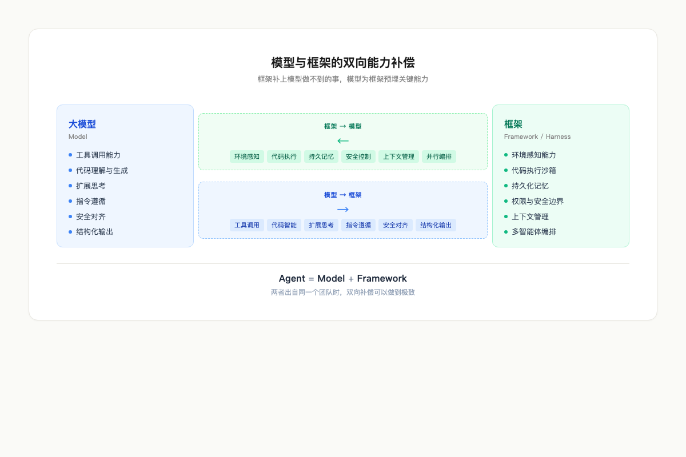
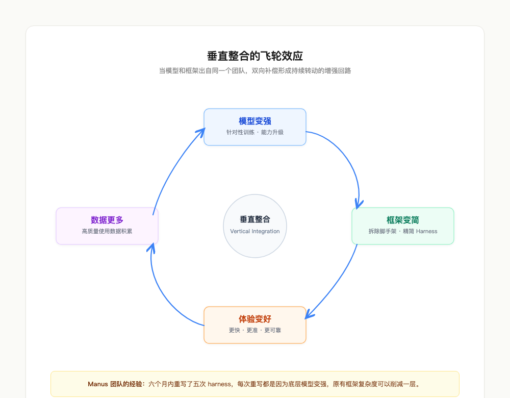
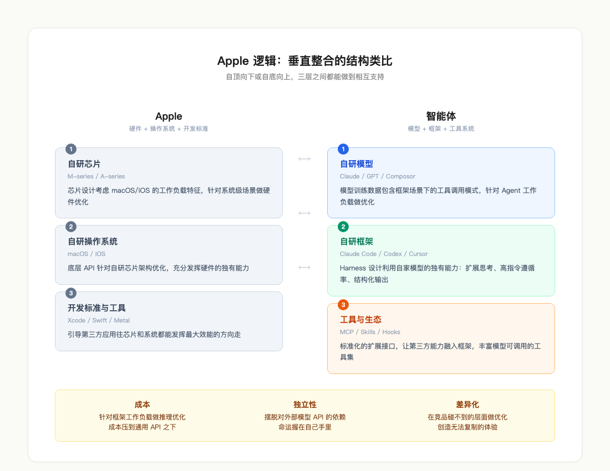

# 智能体时代的垂直整合：模型和框架如何相互成就

研究了一圈智能体框架之后，我发现一个规律：做得最好的那几个，都有自家的模型。

Anthropic 做了 Claude 模型，然后做了 Claude Code。OpenAI 做了 GPT 系列，然后做了 Codex。这两个产品既是智能体框架，也是完整的 coding agent 应用——它们定义了结构和标准，提供了完整的骨架抽象。Cursor 一开始用别人的模型，但很快就开始自研模型。

这里面有一个值得深挖的问题：为什么自家模型加自家框架的组合，总是能做出更好的产品？

答案是模型和框架之间存在双向的能力补偿关系。框架补充了模型做不到的事，模型在训练阶段也为框架预埋了关键能力。当两者出自同一个团队，这种补偿可以做到极致。

## 框架替模型做了什么

大模型能力很强，但有明确的能力边界。这些边界不是模型"不够聪明"，而是模型在架构层面不具备某些能力。框架的核心工作，就是补上这些结构性缺口。

**让模型"看见"真实世界。** 模型在训练时读过海量代码，但它无法 `ls` 一下你的项目目录。它知道什么是好的代码结构，却不知道你的代码长什么样。Claude Code 通过 Read、Bash、Agent 等工具，让模型第一次拥有了感知真实项目状态的能力——`grep` 搜索符号定义，`git log` 查看提交历史，读文件、读截图、读 PDF。模型从一个"只能靠想象回答问题"的角色，变成了一个"先看再说"的角色。这个能力完全由框架提供。

**让模型能"动手"。** 模型可以写出一段看起来完美的函数，但它不知道这段代码在你的环境里能不能跑通。Codex 的沙箱执行环境解决了这个问题——模型写完代码后，框架在隔离环境中运行测试，把结果（通过、报错、超时）喂回给模型，模型根据反馈修改代码。这个"写—跑—看—改"的闭环，没有框架就不存在。Claude Code 的 Bash 工具做了类似的事，模型可以执行命令、运行脚本、检查输出，形成完整的行动-反馈循环。

**给模型装上长期记忆。** 模型的记忆随上下文窗口清零。今天对话中告诉它的项目规范，明天新对话里全部忘掉。Claude Code 通过 CLAUDE.md 和 memory 系统实现了持久化记忆——项目规范、用户偏好、编码风格、历史决策被写入磁盘文件，每次新对话启动时自动注入模型的上下文。模型"以为"自己记住了这些事，实际上是框架在背后完成了加载。Hermes Agent 的三层记忆系统（即时记忆、会话记忆、长期记忆）做了更进一步的设计，让模型在跨平台、跨会话的场景下也能维持连贯的认知。

**替模型画安全边界。** 模型发出"执行 `rm -rf /`"和"读一个文件"这两条工具调用时，从模型的视角看，两者没有本质区别。是框架判断了前者是高危操作需要人类确认，后者是安全操作可以自动放行。Codex 提供了 suggest、auto-edit、full-auto 三种权限模式；Claude Code 有一套精细的权限系统，针对每个工具、每种操作定义了是否需要审批。安全边界是框架画的，模型只是在边界内工作。

**管理有限的注意力。** 一个复杂编程任务可能需要几十轮对话，累积的上下文远超模型的窗口容量。框架在窗口接近上限时自动压缩历史消息，保留关键信息，丢弃冗余细节。模型甚至不知道自己的记忆被压缩过——它只是在每一轮拿到"刚好合适"的上下文。

**让单线程的模型做并行工作。** 模型的推理是串行的，一次只能想一件事。Claude Code 的 Agent 工具可以同时派出多个子智能体：一个搜索代码，一个读文档，一个跑测试。OpenClaw 的多 agent 编排可以在不同的聊天平台上同时处理多个用户的请求。这种并行能力完全是框架层面的编排，模型层面不存在这个能力。

总结一下，框架为模型提供了六种它原生不具备的能力：环境感知、代码执行、持久记忆、安全控制、上下文管理、并行编排。把这六种能力加在一起，一个只会"说话"的模型就变成了一个能"做事"的智能体。

## 模型替框架做了什么

反过来看，框架能工作的前提是模型具备一系列在预训练和后训练阶段专门培养的能力。这些能力不是模型"顺便会的"，而是模型团队为了让框架能运转而刻意训练出来的。

**工具调用能力。** 这是最关键的一项。模型在训练中学会了一件事：当它不知道答案或需要执行操作时，不要编造，而是发出一个结构化的工具调用请求，等框架返回真实结果。

这个能力看似简单——不就是输出一段 JSON 吗？但实际上它要求模型建立"我不知道，但我可以去查"的认知模式。一个没有经过工具调用训练的模型，面对"这个文件现在的内容是什么"这种问题，会直接编造一个答案。经过训练的模型会发出 Read 工具调用，等待框架返回文件的真实内容。没有这个训练，框架的整个工具系统就是摆设。

**代码理解与生成。** 模型的代码能力远不只是"会写代码"。它包括理解项目结构、定位 bug、安全重构、编写测试的能力。Anthropic 和 OpenAI 在训练各自的模型时，都会刻意增加高质量代码数据的权重——因为他们清楚，这些模型最终要跑在 Claude Code 和 Codex 上。代码能力的天花板直接决定了产品的天花板。

**扩展思考。** Claude 的 extended thinking 是专门训练出来的能力，让模型在面对复杂任务时可以在思考区逐步推理、规划、自我纠错，然后再给出最终答案。框架利用这个能力做了精细的调度——需要深度规划时（比如大型重构）开启 thinking 模式，简单任务时关闭。这个开关是模型暴露给框架的一个接口，可以理解为模型主动为框架提供的一种可编程能力。

**指令遵循。** 框架的所有控制——角色设定、输出格式、安全约束、行为规范——都通过 system prompt 传递给模型。模型必须被训练到能严格遵循 system prompt 中的每一条指令，框架才能可靠地工作。Claude Code 的 system prompt 里写着"不要用 cat 命令读文件，用 Read 工具"，模型就真的会遵守。这种高度的指令遵循能力来自 RLHF 和 Constitutional AI 训练，也是框架正常运转的基础。

**安全对齐。** 模型层面的安全训练是框架安全系统的第一道防线。即使框架的权限控制出现漏洞，模型自身仍然会拒绝生成恶意代码、拒绝执行明显危险的操作。两道防线的叠加——模型层的对齐训练加框架层的权限系统——让整个 agent 的安全性远超任何单一层面。

**结构化输出。** 框架需要解析模型的输出并分发给对应的处理器：是工具调用还是最终回答，是思考过程还是直接行动？模型在训练时学会了在需要时输出精确的 JSON 结构，在不需要时用自然语言回答。如果模型的输出格式不稳定——有时 JSON 合法，有时残缺——框架的解析器就会反复报错，整个循环就卡住。输出格式的稳定性是模型训练时被反复优化的指标。

总结一下，模型为框架提供了六项基础能力：工具调用、代码智能、扩展思考、指令遵循、安全对齐、结构化输出。这六项能力是框架能运转的地基——地基不牢，上面的工程设计再精巧也没用。

## 垂直整合的飞轮

当模型和框架出自同一个团队，上面说的双向补偿就可以形成一个持续转动的飞轮。

Anthropic 可以分析 Claude Code 用户的真实使用数据，发现模型在某些场景下容易出错——比如长上下文的代码重构中丢失关键信息——然后在下一版 Claude 模型的训练中针对性地补强这个场景。反过来，Claude Code 团队发现新版模型改善了工具调用的可靠性，就可以简化框架里那些处理调用失败的重试逻辑，让 harness 更精简。

这个循环一旦转起来，方向是确定的：**模型变强 → 框架变简 → 用户体验变好 → 产生更多高质量使用数据 → 模型更有针对性地变强。**

Manus 团队的经验是一个佐证——他们在六个月内重写了五次 harness，每次重写都是因为底层模型变强了，原有的框架复杂度可以削减一层。这正是飞轮在转动的表现。

这也解释了为什么 Cursor 要自研模型。Cursor 最初完全依赖外部模型 API，但遇到了通用模型解决不了的问题：tab completion 场景需要极低延迟（200ms 以内），通用大模型做不到这个速度；代码补全需要高度定制的输出格式，通用模型的输出并非为此优化；API 成本随用户规模线性增长，长期难以持续。

自研模型不需要像 GPT 那样懂天文地理，只需要在代码补全这一个场景做到极致。专用模型配专用框架，在垂直场景里的效果超过了通用方案。

## Apple 逻辑

这个模式和 Apple 做的事情在结构上完全一致。

Apple 自研芯片、自研操作系统、自定义应用开发标准。M 系列芯片的设计会考虑 macOS 的工作负载特征；macOS 的底层 API 会针对 M 系列芯片的架构做优化；开发者工具引导第三方应用往芯片和操作系统都能发挥最大效能的方向走。三层之间无论自顶向下还是自底向上，都能做到相互支持。

结果是整个系统的体验优于任何单点最强的组合——你把最快的 CPU 装进一台软件优化最差的电脑里，用户体验照样不如 MacBook。

智能体领域正在走同样的路。

Anthropic 的 Claude 模型加 Claude Code 框架就是这种垂直整合。Claude 模型的 tool use 训练数据里包含了大量 Claude Code 场景下的工具调用模式。Claude Code 的 harness 设计也大量利用了 Claude 模型独有的能力——extended thinking、高指令遵循率、稳定的结构化输出。模型团队和框架团队在同一家公司里，可以做到外部团队做不到的事：**同步迭代**。模型的下一个版本和框架的下一个版本可以同步设计、同步测试、同步发布。外部团队只能等 API 更新后被动适配，永远慢一拍。

从商业上看，这种垂直整合同时解决了三个问题。

**成本。** 自家模型可以针对框架的典型工作负载做推理优化——KV cache 策略、批处理策略、量化方案——把每次调用的成本压到通用 API 之下。

**独立性。** 核心产品完全依赖另一家公司的模型 API，意味着你的命运握在别人手里。对方涨价、降质、或者推出一个跟你直接竞争的产品，你毫无还手之力。自研模型是一张保底牌。

**差异化。** 当所有人都用同一个模型 API 时，竞争只能发生在框架层面，而框架的差异化空间有限。拥有自己的模型，意味着你可以在别人碰不到的层面做优化，创造出竞品无法复制的体验。

三张牌加在一起，构成了一道清晰的竞争壁垒。

技术选择从来不只是技术选择。每一个工程决策的背后，都嵌入着商业上的权衡。搞懂技术和商业之间的这层关系，就能看到很多藏在表面之下的东西。
