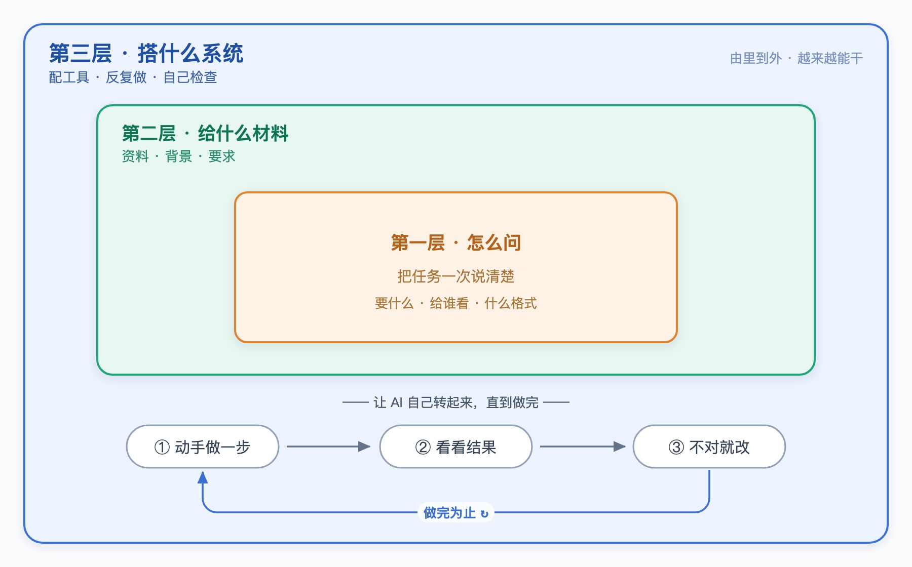

# 用好 AI 的三层功夫：大多数人只会第一层

同样用 ChatGPT，有人只能让它陪聊、写两段文案，有人能让它查完资料、做完一份报告。差距不在用的哪个 AI，而在用的人掌握了几层功夫。

用好 AI 一共三层，由浅入深：

**第一层，怎么问；第二层，给它什么材料；第三层，给它搭一套能干活的系统。**

大多数人停在第一层，所以觉得 AI 也就那样。真正的差距，在后两层。

下面一层层说。为了好懂，你可以把 AI 想象成一个刚入职的助手——聪明、肯干，但对你的事一无所知。

---

## 一、怎么问：把话一次说清楚

同一件事，说得含糊和说得明白，AI 给的结果差很远。

你说“写个通知”，它只能猜着写。你说“写一条放假通知，放 3 天，发给全体员工，语气正式，200 字以内”，它一次就能给你能用的。

这一层的功夫就是：把你要什么、给谁看、什么格式、什么风格，一次交代清楚。

但它有个天花板：**AI 不知道的事，你问得再清楚，它也只能编。** 它不清楚你公司的报销标准，你让它写报销说明，它只会胡诌一通。

这时候，光改问法没用了。该进第二层。

---

## 二、给它什么材料：把该看的递到它面前

AI 的本事，上限就是它当下能看到的东西。它没看到的，对它就等于不存在。

所以第二层的功夫，是在它动手前，把相关的东西递给它：公司的规定、上次的会议记录、你要它参照的范本。材料对了，它才有谱。

这里的难点不在“多给”，而在“给对”。一股脑塞一堆无关的东西，反而会把它带偏、看花眼。**会挑、会删，比会堆更重要。**

这一层也有天花板：材料备得再齐，AI 也只是“看”。看完之后谁去执行、做错了谁来兜底，它管不了。

该进第三层。

---

## 三、搭一套能干活的系统：让它能动手、能反复、能自查

聊天是一问一答，问完就结束了。可真正的活儿要好几步：查资料、动手做、看结果、不对再改。

第三层的功夫，是在 AI 外面搭一套东西，让它能：

- **用上工具**——能上网查、能打开文件、能操作软件，不再只是嘴上说；
- **一步步来**——做完一步看结果，再决定下一步；
- **自己检查**——错了重来，直到做完；
- **危险先停**——要删东西、要花钱这种事，先停下来问你一句。

你听过的那些“AI 帮你写代码”“AI 自动整理表格”的工具，底子就是这一层。它决定的是：**AI 到底能不能自己把一件事做完，而不只是给你出主意。**

---

## 这三层，是一层套一层

它们不是三选一，而是像三个同心圆，由里到外套在一起：

- “怎么问”在最里面——每次开口都用得上；
- “给什么材料”把它包在外面——决定 AI 手上有没有料；
- “搭什么系统”在最外层——让它能反复地问、反复地做，直到把事做完。

越往外，越难，也越值钱。会问的人很多，能搭出一套靠谱系统的人很少。

---

## 怎么用：AI 没干好，先看卡在哪一层

下次 AI 让你失望，先别急着说它笨。问自己三个问题：

1. 是我没说清楚？（第一层）
2. 还是它手上根本没有该有的材料？（第二层）
3. 还是它压根没法动手、也没人帮它检查？（第三层）

三个问题，对应三种完全不同的解法。卡在哪一层，就在哪一层使劲。找错了层，再用力也是白费。

---

## 写在最后

会问，是入门；会给材料，是进阶；会搭系统，才是把 AI 真正变成帮手的那一步。

大多数人卡在第一层，以为 AI 就这点本事。其实只是后两层，还没用上。
