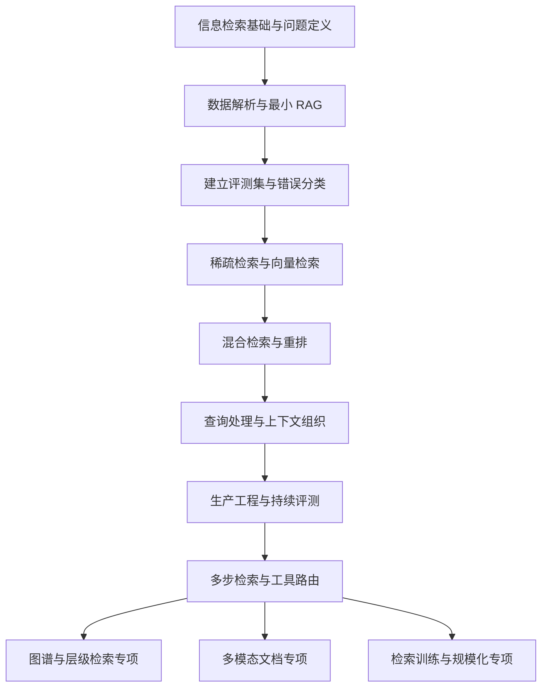

# RAG 技术系统学习路线图：从检索基础到生产系统

> 资料核查日期：2026-10-01。技术机制参考原始论文与官方文档；学习顺序、时间安排和验收方式是面向个人实践的建议，不是行业采用率排名。本文由 AI 辅助整理，尚未人工复核；没有实际运行本文规划的实验。

## 1. 学习目标与前提

建议用 **16 周建立工程主线，再用 4–8 周深入一个专项**。按每周 10–12 小时计算，主线约 160–192 小时。前提是能用 Python 编写脚本、调用 HTTP API、处理 JSON，并掌握基础 SQL、Git 和向量运算；如果这些还不熟悉，先增加 2–4 周准备。

真正掌握 RAG，意味着能够做到：

1. 从数据、索引、检索、上下文和生成五个层次解释系统行为。
2. 建立有来源证据、无答案样本和隐藏测试集的评测流程。
3. 针对错误类型选择改进手段，并通过对照实验说明收益与代价。
4. 处理权限、版本更新、删除、缓存失效、并发和线上回归。
5. 判断何时采用单次检索、多步检索、结构化查询、图谱、视觉检索或直接长上下文。

16 周的目标是建立这些能力并完成一个完整项目；图谱、多模态、模型训练不要求在这 16 周中全部达到专家水平。

上一篇：[RAG 常见面试题与回答要点](../notes/2026-10-01-RAG常见面试题.md)。它适合检查概念是否能讲清楚；本路线用来把概念落实为可验证的工程能力。

## 2. 总体路线

评测从第一阶段开始贯穿全程。工程上的推荐学习基线是：**可追溯的数据处理 + 稀疏／稠密检索对照 + 按需融合重排 + 证据约束生成 + 分层评测**。这是一套便于诊断和扩展的起点，具体模块是否保留由实验决定。

## 3. 技术地图：必修、进阶与专项

| 层次 | 需要学习的技术 | 学习深度 | 解决的问题 |
|---|---|---|---|
| 数据层 | 文档解析、OCR、版面与表格、去重、版本、来源与权限元数据 | 必修：能处理、抽检、定位解析损失 | 原始证据没有被正确保存 |
| 分块层 | 结构分块、token 分块、overlap、父子分块、相邻块扩展 | 必修：能做对照实验 | 粒度与语境之间的取舍 |
| 稀疏检索 | 倒排索引、BM25、分词、术语与同义词；SPLADE 等学习型稀疏表示 | BM25 必修，学习型稀疏进阶 | 精确词项匹配与词汇扩展 |
| 稠密检索 | 双编码器、相似度、对比学习、领域与跨语言评测 | 必修：能选型并解释失败 | 同义表达和语义匹配 |
| 索引层 | 精确检索、HNSW、IVF、量化、过滤与索引迁移 | 精确检索和 HNSW 必修，其余按规模深入 | 延迟、内存和近似误差 |
| 融合与精排 | RRF、分数融合、Cross-Encoder、MMR、late interaction | 融合和重排必修，其余进阶 | 候选排序与上下文多样性 |
| 查询层 | 多轮改写、实体规范化、过滤条件、Multi-query、分解、HyDE | 前四项优先，其余按错误类型引入 | 用户表达与检索表达不一致 |
| 上下文层 | 去重、压缩、证据排序、引用映射、长上下文、上下文预算 | 必修 | 已检索到但未正确使用的证据 |
| 评测层 | 检索指标、证据覆盖、忠实度、正确性、拒答、成本与延迟 | 必修且贯穿全程 | 无法判断改进是否有效 |
| 生产层 | ACL、多租户、增量更新、删除、缓存、追踪、回归与降级 | 必修 | 正确性以外的可用性与边界 |
| Agentic RAG | 检索决策、工具路由、多跳检索、证据状态、停止条件 | 进阶：先做有界工作流 | 一次查询不足以收集答案证据 |
| 图谱／层级 | 实体与关系、GraphRAG、社区报告、RAPTOR、文档树导航 | 场景专项 | 跨实体关系、全局主题、跨段综合 |
| 多模态 | 页面视觉向量、ColPali 类方法、图表和页面引用 | 场景专项 | 纯文本提取丢失视觉信息 |
| 训练优化 | Hard negatives、embedding／reranker 微调、蒸馏、检索与生成协同 | 深入专项 | 通用模型在目标领域长期不足 |

特别区分几个概念：RRF 是排名融合；Reranker 根据相关性重新打分；MMR 在相关性与多样性之间取舍。它们可以组合，但不能互相替代。ColBERT 类 late interaction 保留 token 级多向量，可以用于检索或精排，并非 Cross-Encoder 的别名。[Sentence Transformers](https://www.sbert.net/examples/sentence_transformer/applications/retrieve_rerank/README.html)、[ColBERTv2](https://arxiv.org/abs/2112.01488)

## 4. 16 周主线

### 第 1–2 周：信息检索基础、最小系统与评测种子集

**学习内容**

- 相关性、倒排索引、TF-IDF、BM25、分词和文档长度归一化。
- 向量、点积、余弦相似度、向量归一化；明确模型训练时使用的相似度假设。
- LLM 的 token、输入预算、生成不确定性、引用和证据不足时的行为。
- RAG、模型微调、直接长上下文的能力边界。RAG 不以“必须使用向量数据库”为定义。

**动手实验**

选择一个明确主题，准备 100–300 份文档。先用简单 Python 函数串起解析、分块、检索和生成；保留原始输入、候选片段与最终上下文。框架可以稍后用于组织流程。

在同一批问题上建立三个基线：BM25 检索、精确向量检索、无检索生成。无检索基线用于识别模型已有知识带来的干扰；使用私有或新近变更的事实，避免“答对了”被误判为检索有效。

手工建立 50 个问题的种子集：包含简单事实、术语精确匹配、近义表达、多个版本和无答案问题。每题保存标准证据位置及答案要点。

**验收**

- 能逐步复盘任一答案的来源。
- 能手算一条查询的相似度排序，并解释 BM25 与向量结果为什么不同。
- 能给出至少 10 个失败案例及其所属层次。

**资料**：[Introduction to Information Retrieval](https://nlp.stanford.edu/IR-book/) 的索引、评分、评测和查询扩展章节；[RAG 原始论文](https://arxiv.org/abs/2005.11401)。原始论文用于理解参数知识与外部知识的结合，不要求原样复现其训练结构。

### 第 3–4 周：文档工程、分块与证据可追溯

**学习内容**

- Markdown／HTML 的结构保留；PDF 阅读顺序、双栏、页眉页脚、扫描件 OCR。
- 表格的行列、单位、跨页表头；代码块、列表、图片说明与正文的关系。
- 固定长度、结构分块、父子分块、相邻块扩展；语义分块作为对照项。
- 文档 ID、版本、内容哈希、chunk ID、来源位置、有效时间、权限范围。

**动手实验**

从同一语料抽取 20–30 份有代表性的文档，逐页抽查解析结果。保持模型和检索方法固定，对比三种分块：固定 token、标题／段落结构、父子分块。

小范围尝试 256／512／1024 token 及少量 overlap 配置，数字只是实验起点；应按 tokenizer、文档结构及模型输入限制调整，不能当成通用最佳实践。

为每个片段保留原始页码或标题路径。若检索索引中添加了生成的摘要或上下文前缀，同时保留原文，并区分“检索辅助文本”和“最终事实证据”。

**验收**

- 能从答案引用打开正确文档版本和位置。
- 能展示一个“检索算法正常，但解析丢失表头导致答错”的案例。
- 换分块方式后，用原文证据区间重新映射标签，而不是沿用旧 chunk ID。

**资料**：[Docling 文档](https://docling-project.github.io/docling/)、[Docling 分块设计](https://github.com/docling-project/docling/blob/main/docs/concepts/chunking.md)。

### 第 5–6 周：稀疏／稠密检索、ANN 与模型选型

**学习内容**

- 双编码器为什么能预计算文档表示；检索相关性与一般文本相似性的区别。
- BM25 与 SPLADE 类学习型稀疏检索的区别；稀疏并不等于没有语义扩展。
- HNSW 的图搜索、构建和查询参数；精确搜索与近似搜索的差异。
- 过滤条件、索引选择和过滤后候选不足；维度、精度、内存和吞吐量。
- 中文、术语、代码、长文档、跨语言问题分别评测，避免被总分掩盖。

**动手实验**

固定数据、分块和查询，对比两个适合目标语言与硬件的 embedding 模型。BGE／Qwen Embedding 等模型族可作为候选；选择时重新核对模型卡、许可证、查询指令、长度和维度，不把发布时榜单等同于当前业务排名。[Qwen3 Embedding 论文](https://arxiv.org/abs/2506.05176)

先跑精确向量检索，再建立 ANN 索引。改变查询搜索范围，测量 ANN Recall@K、延迟、内存；加入产品版本或租户过滤后重复测量。pgvector 的官方说明包含 HNSW、IVFFlat 和过滤相关行为，可用作一种实现参考。[pgvector](https://github.com/pgvector/pgvector)

**验收**

- 能区分“向量本身没有把证据排前面”和“近似索引漏掉精确搜索结果”。
- 给出一个质量／延迟／资源消耗的对照表，解释选择的工作点。
- 能解释为什么通用 embedding 相似度不能直接作为答案正确概率。

**资料**：[SPLADE v2](https://arxiv.org/abs/2109.10086)，结合上述模型论文和索引文档。

### 第 7–8 周：混合检索、融合与精排

**学习内容**

- 候选集并集、去重、RRF 与经过校准的分数融合。
- Cross-Encoder 与双编码器的质量／计算量差异。
- ColBERT 类多向量表示与 late interaction 的基本原理。
- 召回数量、精排数量、最终上下文数量分别控制。

**动手实验**

固定分块、生成模型、提示词和上下文预算，比较：BM25、dense、hybrid、hybrid + reranker。先在小规模开发集上尝试每路 20／50／100 个候选，再根据结果收缩参数范围；不必穷举所有组合。

逐题检查：候选集中是否有证据、精排后是否保留、是否进入最终上下文。特别分析型号、缩写、近义词、版本相似段落四类问题。

**验收**

- 能手算 RRF，并说明排名融合不需要直接比较两路原始分数。
- 能用实验判断混合检索增加了哪些有效证据、带来了哪些噪声。
- 能展示 reranker 造成错误排序的反例，并说明如何回退或调节。

**资料**：[Qdrant 混合检索与重排教程](https://qdrant.tech/documentation/tutorials-basics/reranking-hybrid-search/)、[Sentence Transformers Retrieve & Re-Rank](https://www.sbert.net/examples/sentence_transformer/applications/retrieve_rerank/README.html)。这些资料提供可复现实例，不意味着必须采用同一数据库或模型。

### 第 9–10 周：查询处理、上下文工程与可靠回答

**学习内容**

- 多轮问题独立化、实体消歧、别名、时间和权限过滤条件。
- Multi-query、问题分解、HyDE：各自针对不同的查询缺口。
- Contextual Retrieval：为片段补充文档语境后建立索引，与查询时改写分开理解。
- 去重、MMR、父文档扩展、抽取式／生成式压缩、证据排序与 token 预算。
- 主张级引用、证据冲突、拒答和长上下文路线对照。

**动手实验**

分别选择 20 个短问句、20 个多轮追问、20 个实体歧义问题，先保留原查询，再比较针对性的改写。检查改写是否保留数字、否定条件、时间及产品版本。

对“片段脱离原文后指代不清”的问题，比较标题前缀、父子分块与 Contextual Retrieval。新增上下文可能包含生成错误，因此事实引用仍需回到原文。[Contextual Retrieval](https://www.anthropic.com/engineering/contextual-retrieval)

对一组可放入上下文的文档，比较直接长上下文、常规 RAG、先检索文档再读取较长章节三种方式，记录成本与准确性；不要据旧论文的具体模型结果推断所有当前模型。[长上下文与 RAG 对照研究](https://arxiv.org/abs/2407.16833)

**验收**

- 能展示一种查询增强带来提升，以及另一种产生意图漂移的案例。
- 在证据不足时给出正确拒答或澄清，同时统计有答案却被拒绝的比例。
- 能解释答案是否正确、是否忠实于给定证据、引用是否支持主张三者的差异。

**资料**：[HyDE 原始论文](https://aclanthology.org/2023.acl-long.99/)、[Context Engineering](https://www.anthropic.com/engineering/effective-context-engineering-for-ai-agents)。HyDE 的假设文档是检索辅助，不是事实来源。

### 第 11–12 周：生产工程、评测自动化与回归

**学习内容**

- 数据接入、幂等写入、增量索引、变更检测、删除传播和索引版本切换。
- 用户认证、ACL／租户范围与检索过滤；索引隔离和缓存隔离。
- 分阶段日志、请求追踪、模型／提示词／索引版本记录。
- 超时、重试、并发、限流、降级、首 token 延迟和总响应时间。
- 检索文档中的提示注入、敏感信息输出和工具执行边界。

**动手实验**

设计两个租户、两个产品版本，加入更新、删除和撤销权限事件。检查搜索、重排、生成上下文、答案缓存和引用访问是否一致。

执行一次 embedding 模型迁移：建立新索引，对照评测，切换流量，并验证回滚。不要把不同模型生成的向量混在同一个不可区分的向量空间中。

把评测接入每次配置变更，保存运行元数据。针对检索超时、重排失败、模型不可用分别设计有限的降级路径；记录降级后质量变化。

**验收**

- 当前测试集中的跨租户访问和已撤权访问全部被阻止；这只是已测覆盖范围，不构成“系统绝对安全”的证明。
- 更新／删除的可见延迟能被测量，旧答案缓存按规则失效。
- 能用一次请求追踪定位耗时与错误，不依赖最终回答猜测原因。
- 对质量、p95 延迟、成本与数据新鲜度定义自己的业务门槛。

**资料**：[Ragas 指标目录](https://docs.ragas.io/en/stable/concepts/metrics/available_metrics/) 用于理解可自动化的评估维度；实际接口和指标输入以使用版本为准。

### 第 13–14 周：Agentic RAG、多跳检索与结构化工具

**学习内容**

- 问题分类与路由：文档检索、SQL／结构化查询、计算、网页或文件读取。
- 一轮检索的能力边界；基于新证据形成下一步查询。
- 证据状态、已回答子问题、缺失信息、最大轮数、时间／token 预算及停止条件。
- 区分固定多步工作流、模型动态选择工具、检索模型本身。

**动手实验**

构造需要两到三个证据步骤的问题。先实现有明确状态和最多几轮检索的工作流，再尝试由模型选择下一步。把限制写入程序，不只写在提示词中。

增加一个结构化数据工具：例如“统计某版本支持哪些功能、共有多少项”，先从受控数据表查询再生成解释；检索 top-k 文本不能证明全集计数正确。只读权限、参数验证、超时和结果行数限制由工具层执行。

与单轮 RAG 比较任务成功率、检索次数、证据覆盖、成本和长尾延迟。多轮增加的步骤必须带来可验证的新证据。

**验收**

- 能解释 Agent 为什么继续搜索或停止。
- 无新增证据或预算耗尽时能够退出，不能无界循环。
- 简单事实问题可以走短路径；复杂问题才触发额外步骤。

**资料**：[Context Engineering](https://www.anthropic.com/engineering/effective-context-engineering-for-ai-agents)、[Self-RAG](https://arxiv.org/abs/2310.11511)、[Corrective RAG](https://arxiv.org/abs/2401.15884)。Self-RAG 原论文包含训练与 reflection tokens；用提示词让模型自评只能称为借鉴其思想，不能声称复现了该方法。

### 第 15–16 周：专项试验与完整项目验收

从以下方向选一个做小规模验证，不要求同时实现：

- **图谱／层级检索**：同一语料上的跨实体问题与全局主题问题。
- **多模态文档**：包含图表、扫描页和复杂版面的报告。
- **训练与规模优化**：已有足够标注数据，且通用检索模型有明确领域缺陷。

同时整理整个项目：架构、语料与标注规范、基线、实验记录、失败分析、性能、成本、权限与更新回归，以及下一阶段计划。

**验收**：在冻结测试集上提交结果，说明专项能力是否值得纳入系统；即使没有提升，只要实验可靠、原因可解释，也完成了有效学习。

## 5. 再用 4–8 周深入一个专项

### A. 图谱、层级检索与全局综合

依次学习实体抽取、实体消歧、关系与原文证据绑定、图遍历、社区划分、社区摘要，以及更新成本。区分广义“图增强 RAG”和 Microsoft GraphRAG 的具体实现。

Microsoft GraphRAG 的 Local Search 结合实体关系与原文片段；Global Search 面向社区报告做全局综合；DRIFT 将社区信息引入局部探索。它们针对不同问题，不是一个统一的“更高级向量搜索”。[GraphRAG 查询说明](https://microsoft.github.io/graphrag/query/overview/)

RAPTOR 则通过递归聚类与摘要构建多层表示，重点是不同抽象层次的信息检索。[RAPTOR](https://arxiv.org/abs/2401.18059)

文档目录树导航也是可实验的路线：先选择章节再定位原文，可能使用模型判断、关键词或向量辅助。它与知识图谱不同，“无需向量”也不自动代表更准确或更便宜。

**专项项目**：对一个研究主题做跨文档综合问答。对比普通混合检索、多步检索、图谱或层级方案，分别统计建索引成本、更新成本、查询成本与原文证据支持程度。模型抽取出的图谱关系和摘要不能免除事实核验。

### B. 多模态与视觉文档检索

依次学习 OCR／版面解析、图表与表格理解、页面级检索、多向量视觉表示、视觉语言模型阅读和页面／区域引用。

ColPali 类方法将文档页面图像编码成多向量，通过 late interaction 检索，适合研究文字之外的版面与视觉信息。它改变检索表示，不意味着解析、精确数值抽取和引用定位的问题都已消失。[ColPali](https://arxiv.org/abs/2407.01449)

**专项项目**：用一批包含图表的报告，对比 OCR 文本 RAG、页面视觉检索、文本与视觉混合路线。分别测文字问答、图表定位、数值提取和跨页综合；为数据计算接入确定性的计算工具。

验证检索是否命中页面和模型是否读对数值，要分成两个指标。资源受限时先做少量页面，实测显存、存储与吞吐，再决定扩容。

### C. 检索训练、精排训练与规模化

依次学习对比学习、in-batch negatives、hard-negative mining、false negatives、蒸馏，以及训练／验证／测试划分。

先训练小规模 reranker 或 embedding 对照实验，选择由失败分析决定；不是默认微调生成模型。对领域内词义混淆、术语映射、长文档匹配分别构建标注。

规模方向进一步学习 IVF／PQ、标量或二值量化、磁盘索引、分片、复制、热冷数据、批处理与批量推理。做训练和索引压缩时分别测量损失来源。

**专项项目**：从真实失败案例构造训练数据，比较通用模型、微调模型和轻量蒸馏模型。按文档／实体／时间分组避免泄漏，额外保留域外测试集，报告领域提升和泛化退化。

## 6. 深入掌握需要理解的数学与指标

不要求手写所有底层算法，但应能解释下面的式子及其适用条件。

### 6.1 相似度与表示

余弦相似度：

$$
\operatorname{cos}(q,d)=\frac{q\cdot d}{\|q\|\|d\|}
$$

单位归一化后，余弦与点积相同；是否归一化应遵循模型设计。距离越近仅表示该表示空间中的接近，不等于文档包含完整答案。

### 6.2 排名融合

$$
\operatorname{RRF}(d)=\sum_{r:d\in r}\frac{1}{c+\operatorname{rank}_r(d)}
$$

其中 rank 从 1 开始，c 为平滑常数，与返回结果数量 K 不同；文档未出现在某一路结果中，就不贡献该路分数。需要理解为什么该方法舍弃原始分数幅度，以及这样做的收益和损失。[RRF 官方说明](https://learn.microsoft.com/en-us/azure/search/hybrid-search-ranking)

### 6.3 Late interaction

ColBERT 类评分可概括为：

$$
s(q,d)=\sum_i\max_j\langle q_i,d_j\rangle
$$

它让每个查询 token 与文档 token 表示匹配，保留比单向量更多的局部信息，同时带来存储和计算代价。[ColBERTv2](https://arxiv.org/abs/2112.01488)

### 6.4 两种 Recall 不要混淆

- **检索相关性 Recall@K**：前 K 个结果覆盖了多少标注相关证据；基准来自人工或经审核的相关性标签。
- **ANN Recall@K**：近似搜索结果与同一向量／相似度条件下精确 top-K 的重合比例；衡量索引近似误差。

ANN Recall 很高时，模型表示仍可能检索不到正确证据。对于多跳题，还应统计“所有必要证据是否齐全”；对于无答案题，单独衡量正确拒答，不强行计算没有相关文档时的 Recall。

### 6.5 训练目标

理解对比学习如何提高正样本得分、压低负样本得分，以及温度、batch size 和负样本难度的作用。重点辨别“难负样本”和“漏标的另一份正确证据”，后者被当成负例会损害模型。

## 7. 贯穿全程的评测设计

### 7.1 数据集与划分

从 50 题起步，逐步扩展到约 200–300 题。这是个人项目建议规模，不是充分覆盖任何生产业务的保证。

每题至少记录：问题、问题类别、答案要点、原文证据位置、适用版本／时间、允许的身份范围、是否应拒答，以及评分规则。相关性标签优先锚定原始文档和证据区间，再映射到具体分块，以支持分块实验。

开发集用于调参；隐藏测试集用于阶段验收；若训练模型，再单独设置训练集。根据任务按文档族、实体或时间做隔离，不能让同一问题的近义改写跨集合泄漏。让模型从文档自动造题可以补充覆盖，但必须人工审核并加入真实用户问法。

### 7.2 分层指标

| 层次 | 应记录的指标 | 需要防止的误判 |
|---|---|---|
| 数据 | 解析完整性、表格与元数据抽检结果、失败率 | 解析损坏却怪检索模型 |
| 候选召回 | Recall@K、必要证据全集覆盖率 | 找到一个片段就算多跳题成功 |
| 排序 | MRR、nDCG、精排前后证据保留情况 | 排序提升但关键证据被截断 |
| 上下文 | 去重比例、证据覆盖、token 数、压缩信息损失 | 上下文短了但删掉关键条件 |
| 回答 | 正确性、忠实度、完整性、引用支持率与覆盖率 | 文字流畅等于正确；有引用等于引用有效 |
| 拒答 | 无答案题正确拒答率、有答案题误拒率 | 靠全部拒答获得低幻觉率 |
| 系统 | p50／p95、首 token 与总延迟、成本、错误率、更新延迟 | 平均延迟掩盖长尾或缓存掩盖成本 |

忠实度只问“是否被上下文支持”；如果上下文本身过期，忠实的答案仍可能不符合当前事实。Ragas 等评测工具可以帮助自动化部分指标，但模型裁判需要人工校准，指标定义也不能混用。[Ragas 指标说明](https://docs.ragas.io/en/stable/concepts/metrics/available_metrics/)

### 7.3 实验纪律

每轮先写明假设，再改变一个主要变量。固定语料快照、生成模型、提示词、上下文预算和评分规则；如果它们发生变化，在报告中明确列出。

保留逐题结果和按类别的分数，使用同一批问题进行配对比较。样本允许时用 bootstrap 等方式估计差异的不确定性；生成有波动时做有限次数重复运行，避免把一次偶然提升当成稳定收益。

模型裁判也要记录版本，随机化对比答案顺序，并抽查判断依据。证据文本中的指令不能被评分器当作评分规则。

## 8. 必做的 10 个对照实验

| 实验 | 固定项 | 改变量 | 要回答的问题 |
|---|---|---|---|
| E1 检索表示 | 数据、分块、评测集 | BM25／dense／hybrid | 哪些查询类别分别获益？ |
| E2 分块 | 模型、检索配置 | 固定／结构／父子 | 语境和精度如何取舍？ |
| E3 近似索引 | 向量、查询、过滤 | 精确／ANN 参数 | 损失来自索引还是表示？ |
| E4 重排 | 候选集合 | 无重排／Cross-Encoder | 证据排序和端到端回答是否都改善？ |
| E5 查询增强 | 原文语料、模型 | 原查询／改写／HyDE | 覆盖改善是否抵消意图漂移？ |
| E6 片段语境 | 数据与预算 | 标题前缀／父块／上下文前缀 | 哪种方式最经济地恢复语境？ |
| E7 上下文路线 | 问题、文档范围、评分 | RAG／直接长上下文／混合 | 成本与质量分别如何变化？ |
| E8 多步检索 | 多跳问题集、总预算 | 单轮／有界多轮 | 新步骤是否补齐必要证据？ |
| E9 新鲜度与权限 | 用户与预期权限 | 更新／删除／撤权 | 各缓存和索引是否一致？ |
| E10 专项 | 同语料、同问题类别 | 基线／图谱或视觉等专项 | 专项能力是否值得长期维护？ |

“没有提升”也是结果。保留失败实验及原因，避免下一次重新犯同样的错误。

## 9. 推荐使用一个持续演进的项目

项目主题：**带版本、权限和来源引用的技术知识库助手**。

可以从个人知识库选择一个小而一致的主题；先处理 Markdown，再加入 PDF 或结构化数据。保留知识库原始目录，将实验索引、日志和二进制产物放在独立项目目录，不修改挂载文章或课程。

项目演进：

1. V0：BM25／dense 基线 + 50 题 + 可追溯引用。
2. V1：结构分块 + 元数据 + 混合检索 + 重排对照。
3. V2：多轮查询 + 上下文预算 + 拒答 + 固定回归集。
4. V3：增量更新 + 删除／权限 + 缓存 + 追踪和性能测试。
5. V4：多步检索 + 一个结构化工具 + 停止条件。
6. V5：一个专项能力，以及说明为何保留或放弃它的报告。

最终交付物应包含：可重复运行的代码与版本配置、语料说明、评测集和标注规范、逐题结果、实验对照表、至少 20 个错误分析案例、架构取舍、成本／延迟报告，以及已知限制。现在的任务仅制定路线，不代表这些交付物已经实现。

## 10. 工具选择与学习资料的使用方式

先固定一个轻量技术栈，避免把时间花在反复迁移工具上。

| 模块 | 建议起点 | 深入时再考虑 |
|---|---|---|
| 主流程 | Python 函数与清晰的数据结构 | 需要持久状态／恢复时再引入工作流框架 |
| 文档解析 | Markdown／HTML 原生解析；PDF 用 Docling 做候选 | 针对扫描、表格和专业格式比较其他解析路线 |
| 检索 | BM25 + 精确向量搜索 | 选一个支持目标过滤与检索功能的索引系统 |
| 向量存储 | 本地小数据先验证；pgvector 或 Qdrant 二选一学习 | 大规模再比较专用搜索引擎、分片和量化 |
| 表示与重排 | 固定两个适合目标语言的候选模型 | 领域训练、蒸馏、多向量 |
| 评测 | Python 指标 + 逐题人工审核 | Ragas 等工具辅助自动化 |
| 观测 | 每阶段结构化日志与 run_id | 分布式追踪、线上采样和质量面板 |

pgvector 提供向量能力，不应把 PostgreSQL 内置全文检索直接叫作 BM25。若选择 PostgreSQL 路线并需要 BM25，应另外确认采用的实现；学习阶段也可以单独维护词项检索组件。

模型或框架选型都记录版本与日期。阅读一份技术资料时固定回答四个问题：解决哪类失败、比什么基线好、增加什么成本、在哪些数据或任务上不适用。

## 11. 第一周执行清单

- [ ] 选定一个业务问题和一个主题语料，不从整个知识库无差别开始。
- [ ] 准备 100–300 份可追溯文档，记录来源和版本。
- [ ] 手工编写首批 30–50 个问题与证据位置，包含无答案题。
- [ ] 跑通 BM25 和精确向量检索，逐条查看前 10 个结果。
- [ ] 接入生成模型并输出来源引用，保存真实输入上下文。
- [ ] 归类至少 10 个失败案例，写出下一周只验证一个主要假设的实验计划。

每周建议分配：2–3 小时阅读原理和资料，6–7 小时编码与实验，2 小时整理错误分析和结论。推进依据是验收结果，周数只是安排参考。

## 12. 按学习顺序排列的核心资料

1. [Introduction to Information Retrieval](https://nlp.stanford.edu/IR-book/)：倒排、评分、评测、查询扩展。
2. [RAG 原始论文](https://arxiv.org/abs/2005.11401)：外部知识与生成结合的基础。
3. [Docling](https://docling-project.github.io/docling/) 与 [分块设计](https://github.com/docling-project/docling/blob/main/docs/concepts/chunking.md)：文档结构与处理。
4. [Sentence Transformers Retrieve & Re-Rank](https://www.sbert.net/examples/sentence_transformer/applications/retrieve_rerank/README.html)：双编码器与交叉编码器。
5. [pgvector](https://github.com/pgvector/pgvector)：向量索引、过滤和运行行为。
6. [Qdrant Hybrid Search with Reranking](https://qdrant.tech/documentation/tutorials-basics/reranking-hybrid-search/)：稀疏、稠密和多向量流程示例。
7. [SPLADE v2](https://arxiv.org/abs/2109.10086) 与 [ColBERTv2](https://arxiv.org/abs/2112.01488)：两种重要检索表示。
8. [Qwen3 Embedding](https://arxiv.org/abs/2506.05176)：多语言 embedding 与 reranker 模型案例，非当前最优声明。
9. [HyDE](https://aclanthology.org/2023.acl-long.99/)：假设文档驱动的查询表示。
10. [Contextual Retrieval](https://www.anthropic.com/engineering/contextual-retrieval)：文档片段语境增强。
11. [RAG 与长上下文对照研究](https://arxiv.org/abs/2407.16833)：路线取舍的实验范式。
12. [Ragas 指标目录](https://docs.ragas.io/en/stable/concepts/metrics/available_metrics/)：检索、回答及工具调用等评测维度。
13. [Effective Context Engineering for AI Agents](https://www.anthropic.com/engineering/effective-context-engineering-for-ai-agents)：动态上下文与按需读取。
14. [Self-RAG](https://arxiv.org/abs/2310.11511) 与 [Corrective RAG](https://arxiv.org/abs/2401.15884)：何时检索、如何判断与纠正。
15. [GraphRAG Query Engine](https://microsoft.github.io/graphrag/query/overview/) 与 [RAPTOR](https://arxiv.org/abs/2401.18059)：图谱与层级综合。
16. [ColPali](https://arxiv.org/abs/2407.01449)：视觉文档检索。

本路线不按论文出现顺序学习，而按系统依赖和可验证收益安排。完成主线后，应能拿出一份真实实验报告，回答：哪个问题原来做不好、为什么选这个改进、提升是否稳定、代价是什么、还有哪些情况失败。
