# Loop engineering: the 14-step roadmap from prompter to loop designer

**By Codez / 0xCodez**
**Published on X: 2026-06-09**

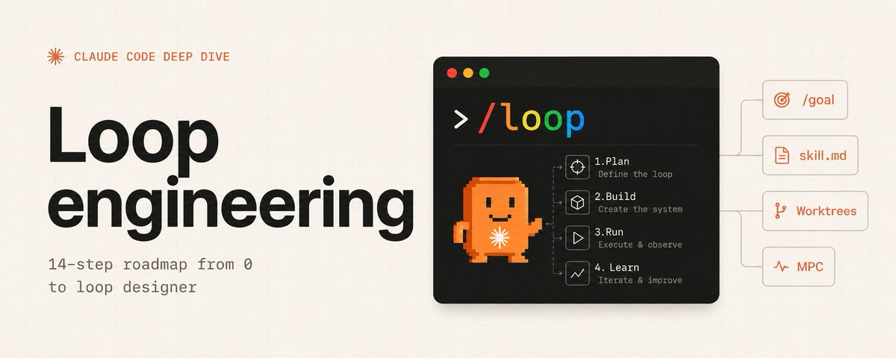

Source post text:

> https://t.co/eJB3TgyJwV

## Capture Note

This is a source-link clip and structured summary of a long X Article, not a full text mirror. Use the original X URL for quotation or detailed citation.

## Core Argument

The article argues that the leverage point in AI-assisted coding is moving from writing better prompts to designing repeatable systems that prompt, verify, remember state, and decide the next action. It calls this shift "loop engineering": building small automated loops around coding agents.

The author is careful to qualify the claim. Loop engineering is real, but most developers do not need it yet. It works best when the task repeats, verification is automated, the token budget can tolerate retries, and the agent can run code with enough context and tooling to learn from failures.

## The 14-Step Roadmap

1. **Loop engineering replaces the human as prompter.** Instead of repeatedly prompting an agent by hand, the developer designs a system that finds work, hands it to the agent, checks results, records state, and chooses the next move.
2. **Run a 4-condition test before building a loop.** The task must repeat, have automated verification, fit the token budget, and give the agent senior-engineer tools such as logs and a reproduction environment.
3. **Know who benefits.** Loops favor teams with repetitive, machine-checkable work, strong tests, and budget. They are weak fits for solo builders on small plans, codebases without automated checks, or teams bottlenecked by review capacity.
4. **Use a 30-second loop check.** A good loop candidate happens at least weekly, has an automated gate, lets the agent run the changed code, has hard stops, and keeps human review before merge/deploy/dependency changes.
5. **Automations are the heartbeat.** Loops need a schedule, event, or trigger condition. In the author's framing, automation primitives make a loop repeat instead of becoming a one-off run.
6. **Use worktrees for parallelism.** Separate worktrees let multiple agents work without clobbering the same checkout, though review bandwidth remains the real ceiling.
7. **Use skills to preserve project knowledge.** A `SKILL.md` or equivalent instruction bundle prevents each loop from re-deriving project context from scratch.
8. **Use connectors via MCP.** Connectors let loops act inside real tools such as GitHub, Linear/Jira, Slack, Sentry, staging APIs, or databases.
9. **Split maker and checker with sub-agents.** The article recommends separating the agent that writes from the agent that verifies to reduce self-grading bias.
10. **Persist state.** A state file, issue board, or database record lets the loop resume rather than restart each run.
11. **Build the minimum viable loop.** Start with one automation, one skill, one state file, and one objective gate. Measure cost per accepted change.
12. **Avoid quiet loop failure.** If completion is soft, the loop can declare victory early or keep spending without useful output. Use objective pass/fail gates.
13. **Watch comprehension debt.** Faster agent output can widen the gap between what the repository contains and what the team understands.
14. **Pay the security tax.** Unattended loops are unattended attack surfaces. Audit permissions, skill sources, logs, generated code, and dependency/security checks.

## Practical Takeaways

- Good first loops: CI failure triage, dependency bump PRs, lint-and-fix passes, flaky test reproduction, and issue-to-PR drafts on well-tested codebases.
- Bad first loops: architecture rewrites, auth or payments changes, production deploys, vague product work, and any task where "done" is mainly a judgment call.
- The simplest useful loop has four pieces: an automation, a project skill, a persistent state record, and an objective verification gate.
- The metric that matters is not tokens spent or tasks attempted, but accepted changes per unit cost.
- Human review remains part of the system, especially before merge, deployment, credential access, or dependency changes.

## Local Media

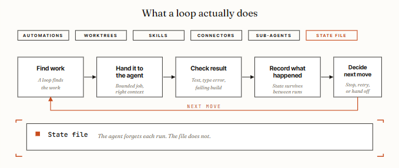

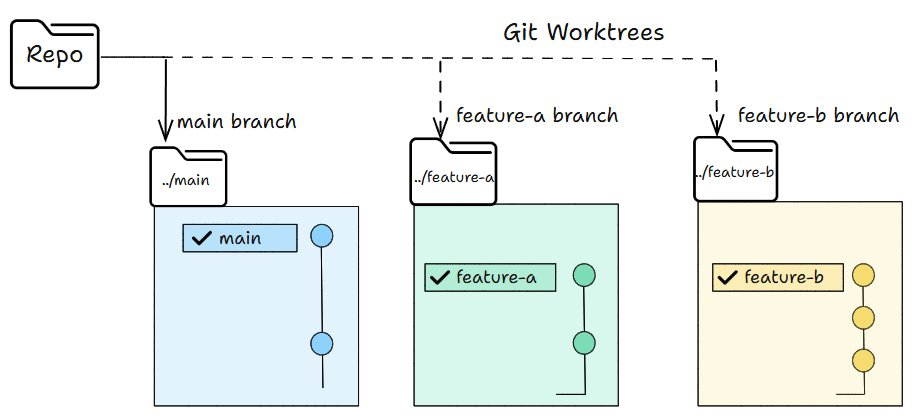

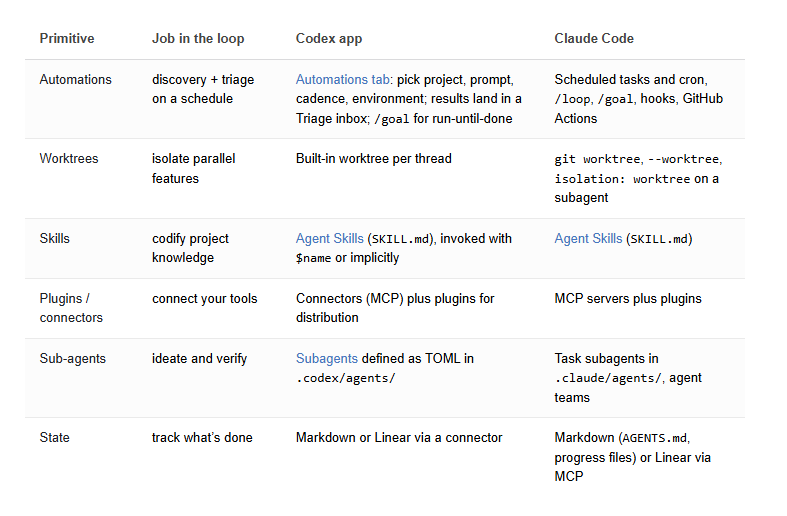

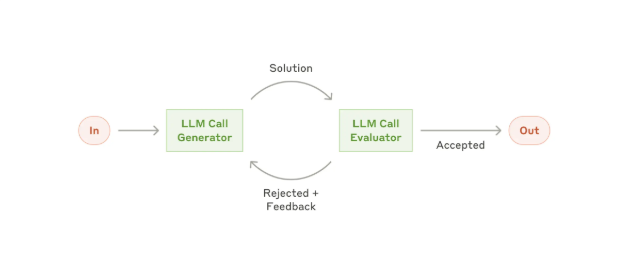

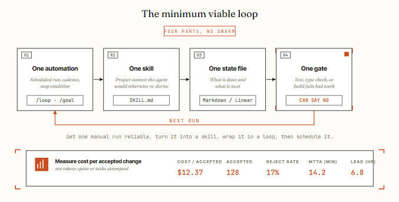

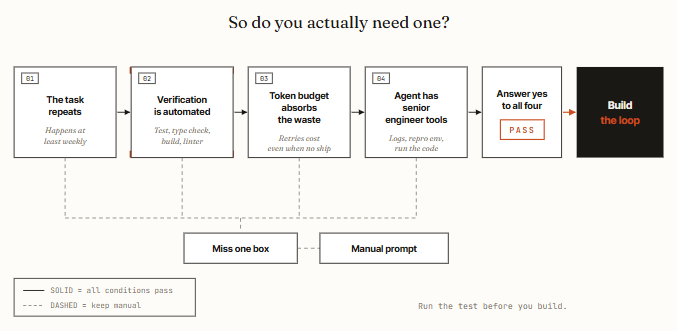

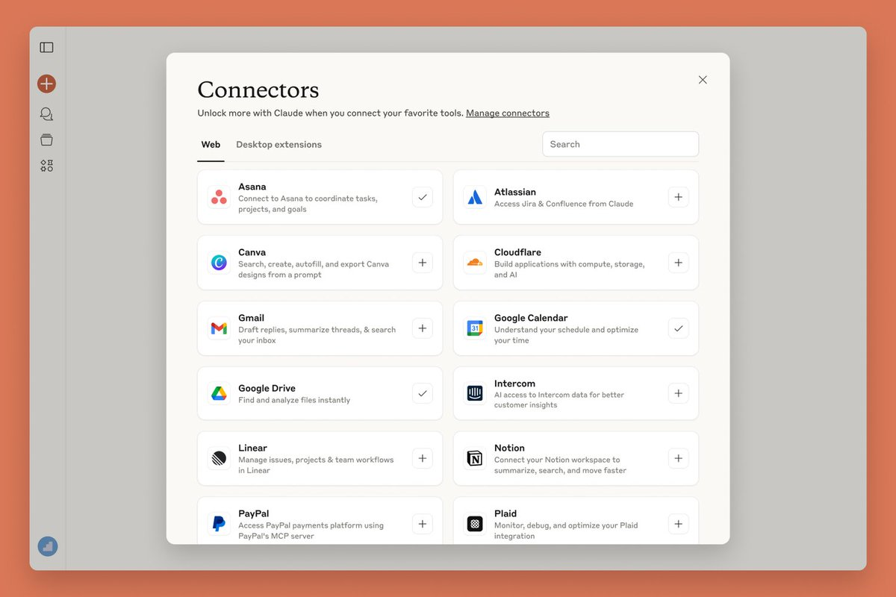

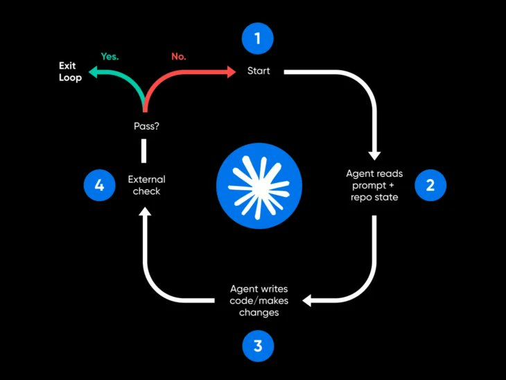

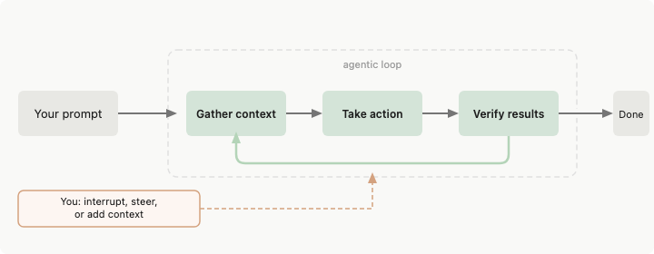

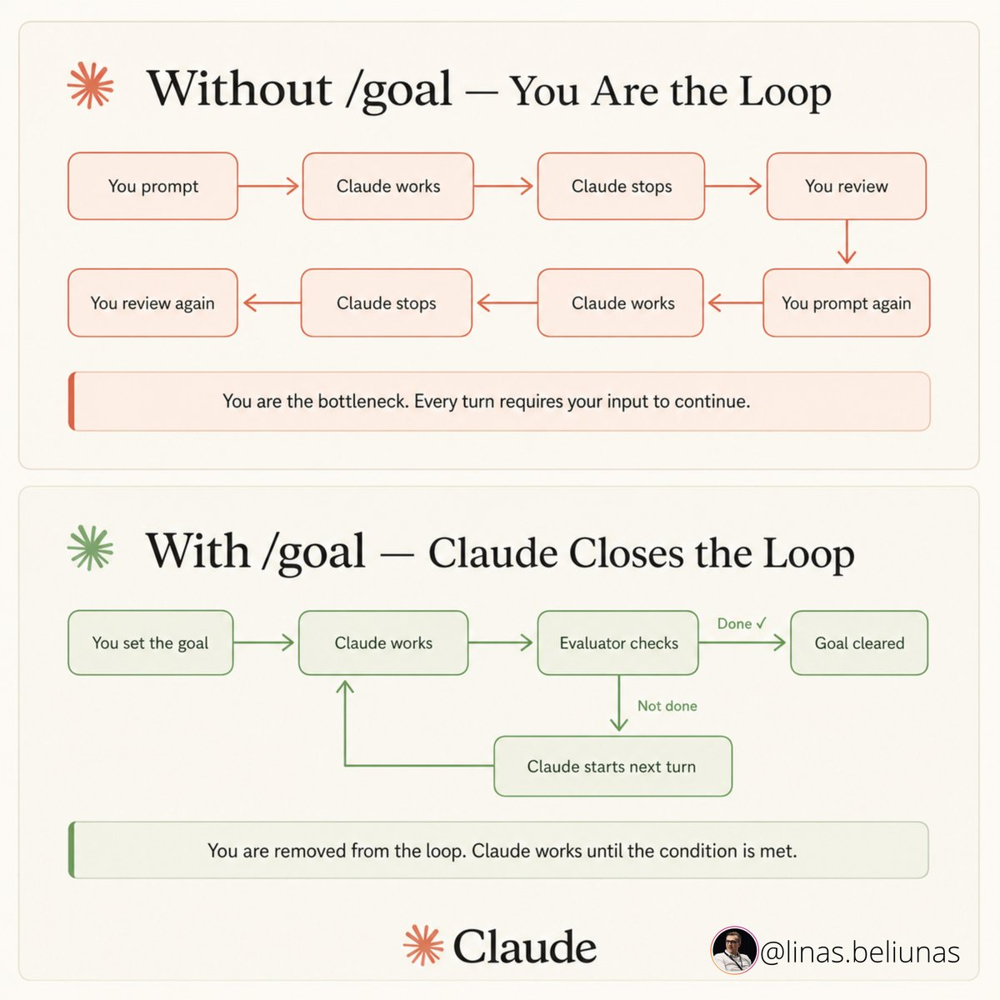
