# X 时间线 · AI 高印象量素材（中文翻译版）

### Marty Kausas @marty_kausas · 21小时 · 414,721 次观看
这是我们预测的 Claude 支出，按团队拆分。工程团队最高，人均每月 3100 美元。不意外。有意思的是紧跟其后的是谁。
🔗 https://x.com/marty_kausas/status/2066913707192410559
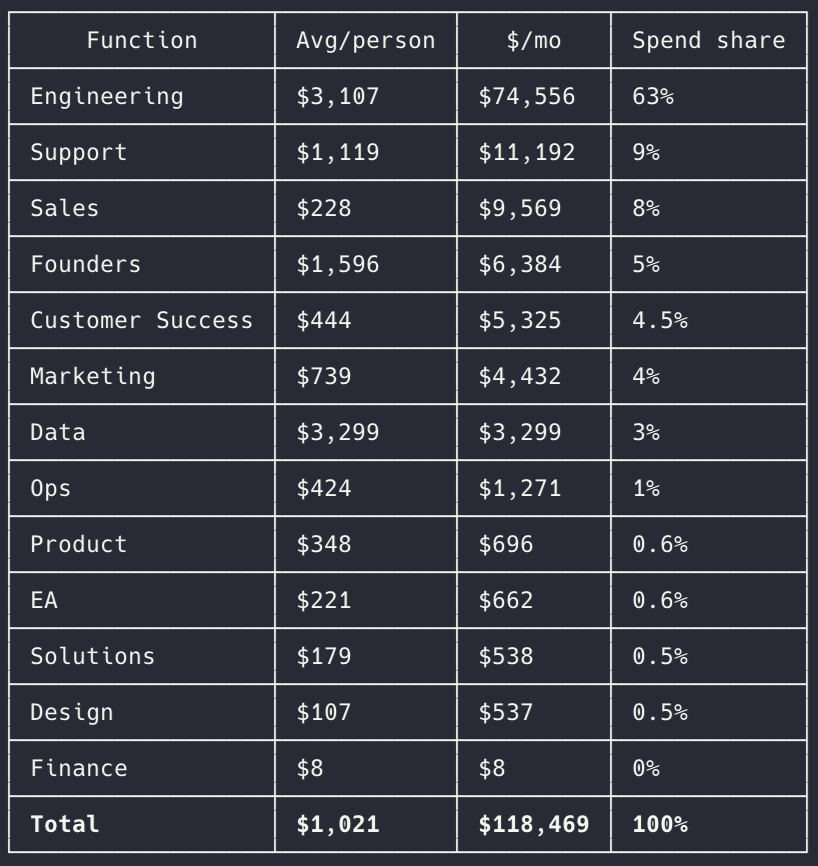

---

### Okara @askOkara · 22小时 · 384,232 次观看
今天我们推出全球首个"网红 Agent"。告诉它你想推广什么，它会自动找达人、主动联系、管理投放、处理付款，并把内容上线。现在就试：okara.ai/influencer
🔗 https://x.com/askOkara/status/2066899565484413070

---

### ElevenLabs @ElevenLabs · 6月16日 · 225,463 次观看
PhysicsWallah 为印度 3600 多万名备考竞争性考试和政府入学考试的学生提供服务。他们的 AI 答疑工具 Ask AI 发现，52% 的学生通过音频学得更好——纯文本工具把一半用户落下了。于是他们……
🔗 https://x.com/ElevenLabs/status/2066800672956142072

---

### Michael Truell @mntruell · 23小时 · 3,497,665 次观看
有很多事要一起做。很高兴能与 @SpaceX 联手打造有用的 AI。
🔗 https://x.com/mntruell/status/2066874098001883538

---

### naiive @naiivememe · 10小时 · 683,343 次观看
2003 年 8 岁的我在网吧里把游戏全偷下来，而不是去买 NVIDIA 股票。
🔗 https://x.com/naiivememe/status/2067072936545276132

---

### a16z @a16z · 19小时 · 477,741 次观看
Cursor CEO Michael Truell 谈编程的未来："我们做 Cursor 的目标，是发明一种新的编程方式。""那像是这样一个世界：你对软件逻辑的表示，看起来更像英语。""你可以想象一种演进……"
🔗 https://x.com/a16z/status/2066932717871301046

---

### 霊長類お兄さん @okinawanogori · 18小时 · 123,043 次观看
用书法毛笔在亚马逊的纸箱上涂鸦，发现毛笔和纸箱很搭。
🔗 https://x.com/okinawanogori/status/2066949816614265071
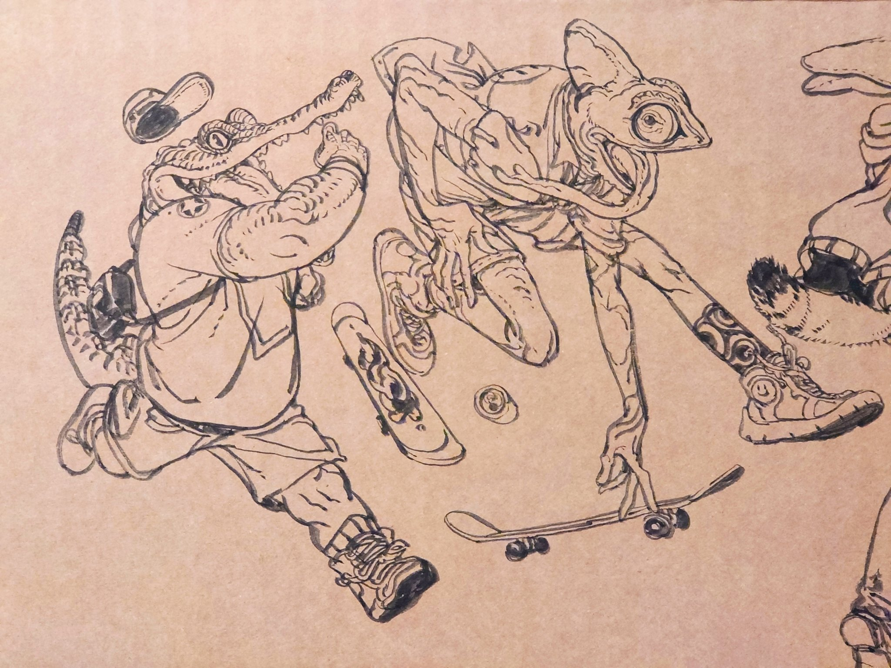

---

### Bill Ackman @BillAckman · 6月16日 · 2,442,220 次观看
@SpaceX 之所以这么有价值，原因之一就是它本身估值高。正因为 SpaceX 估值高，收购 Cursor 的股权稀释成本要小得多。SpaceX 能做出经济上、战略上、技术上都增值的收购，这是一项重要……
🔗 https://x.com/BillAckman/status/2066866144154161555

---

### OpenArt @openart_ai · 20小时 · 1,475,756 次观看
我们一直在做一件事，想重新定义视觉叙事，以及你今天制作视频和影片的方式。敬请期待。加入候补名单，抢先体验。
🔗 https://x.com/openart_ai/status/2066923610359341535

---

### benjamin @benjaminnathan · 19小时 · 444,703 次观看
推出 Framer 3.0。Agent。分支。全新设计。现已上线 @framer。
🔗 https://x.com/benjaminnathan/status/2066940607562461362

---

### Gergely Orosz @GergelyOrosz · 20小时 · 185,149 次观看
两个月时间造成的破坏令人难以置信。很可能已经没几个工程师不在找退路了。如果你一直想从 Meta 挖那些感到被弃置、不被重视、没被充分利用的 AI 原生工程师：现在正是时候。
🔗 https://x.com/GergelyOrosz/status/2066922314197852376
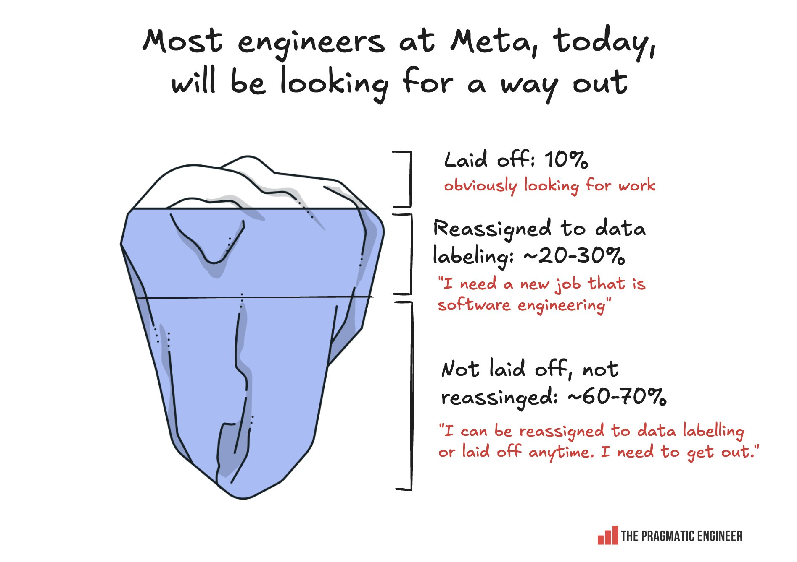
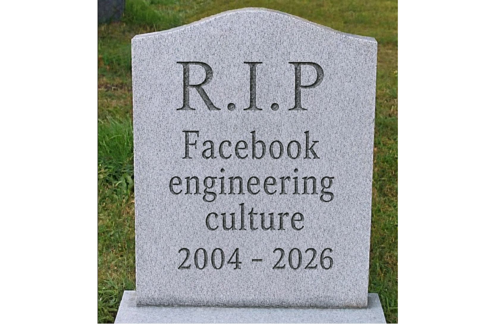

---

### Henry YinICRA @HenryYin_ · 20小时 · 182,304 次观看
大多数 AI 投资都发生在前沿的下游：某种能力出现、某个品类被命名、资本随之涌入。但等到一个品类在市场图谱上拿到一个干净的"格子"时，最好的建设者通常已经在那个混乱的早期版本里活了好几个月了。Agent。推理。
🔗 https://x.com/HenryYin_/status/2066924262674616643
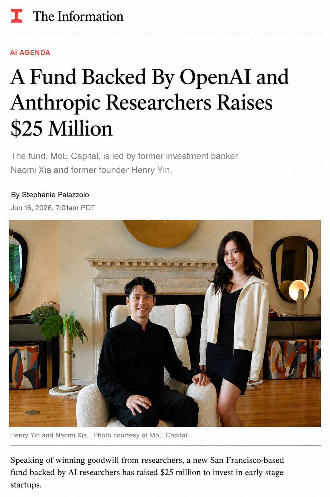

---

### Elon Musk @elonmusk · 9小时 · 3,014,354 次观看
Grok Imagine 1.5 现已广泛开放。
🔗 https://x.com/elonmusk/status/2067093666792136855

---

### Elon Musk @elonmusk · 10小时 · 1,698,396 次观看
Grok 上线 Bedrock。
🔗 https://x.com/elonmusk/status/2067084894434668825

---

### Tibo @thsottiaux · 6月16日 · 766,279 次观看
唉。我们注意到部分 Codex 用户遇到"模型已达容量上限"的高错误率，正在努力恢复稳定。status.openai.com
🔗 https://x.com/thsottiaux/status/2066865154902380796

---

### Tibo @thsottiaux · 18小时 · 753,381 次观看
已修复。你懂接下来会怎样——给我们 24 小时，把所有套餐的 Codex 速率限制重置。
🔗 https://x.com/thsottiaux/status/2066956441173323943

---

### Wenli Xiao @_wenlixiao · 21小时 · 185,268 次观看
AutoResearch 刚刚走出沙箱、进入具身世界。我们激动地推出 𝐄𝐍𝐏𝐈𝐑𝐄：一个把前沿编码 agent 投放到真实机器人集群、并把整个闭环交给它们的系统——重置环境 → 检索文献 → 实现想法……
🔗 https://x.com/_wenlixiao/status/2066913044652015727

---

### Grok @grok · 21小时 · 409,061 次观看
Grok 现已可在 PowerPoint 中使用。从一句 prompt 直达 PowerPoint，接入实时数据、你的应用与 MCP，并直接在幻灯片里生成图表或图像。x.ai/news/introducing-powerpoint-addin
🔗 https://x.com/grok/status/2066916559289974831

---

### Gary Bernhardt @garybernhardt · 14小时 · 317,728 次观看
我是个老程序员（以程序员的标准而言）。我每天大量使用 agent。这里给你一个"哇快看它写了多少行！"另一面的视角，取自我今天的实际工作。
🔗 https://x.com/garybernhardt/status/2067026505734266990

---

### NIK @ns123abc · 21小时 · 254,063 次观看
突发：DeepSeek 刚以 500 亿美元+ 估值融资 74 亿美元。CEO 梁文锋自己开出了最大一张支票：28 亿美元。>腾讯：14 亿 >宁德时代：7 亿 >京东、网易、IDG 资本：各 4.2 亿 >中国国家 AI 基金：1.4 亿。投资者把钱投入由 CEO 管理的一只 LP……
🔗 https://x.com/ns123abc/status/2066922389200310642

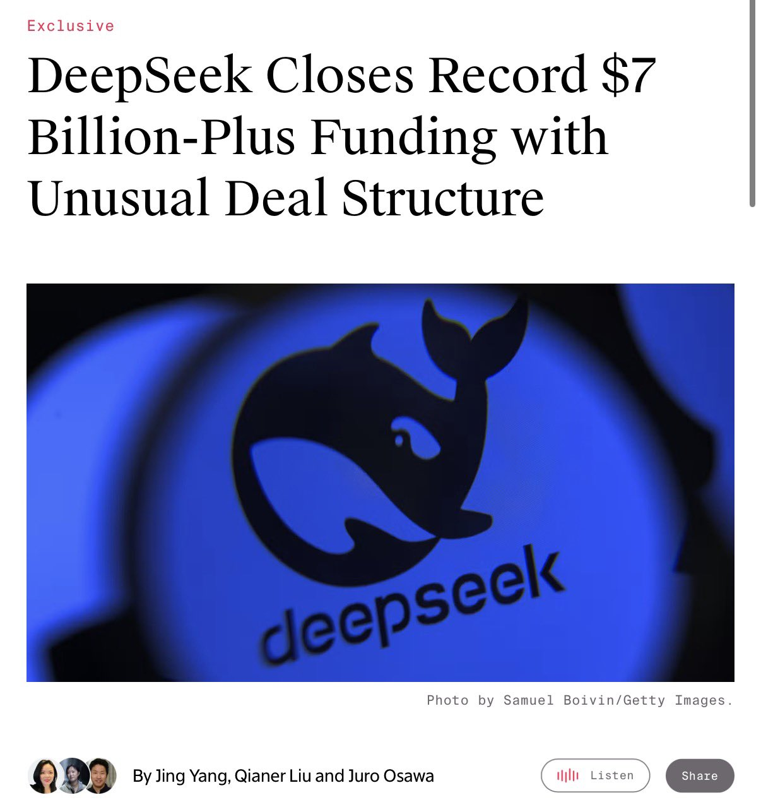

---

### Firecrawl @firecrawl · 21小时 · 235,128 次观看
从今天起，无需 API key 即可免费试用 Firecrawl。搜索、抓取、与任意网页交互，还能把任意 PDF 解析成干净的 markdown，完全零配置！直接用我们的端点，规模化后再注册。现已在 MCP、CLI 和 API 上线！
🔗 https://x.com/firecrawl/status/2066918976689754148

---

### Vanilagy @vanilagy · 6月16日 · 228,838 次观看
AI 非常爱写我称之为"软蛋"的代码，这是它经常干的一个例子：它向 worker 发消息并想接收响应。但为了"不漏掉"响应，它会在发消息*之前*就挂上响应处理器，"以防万一"……
🔗 https://x.com/vanilagy/status/2066807820931006484
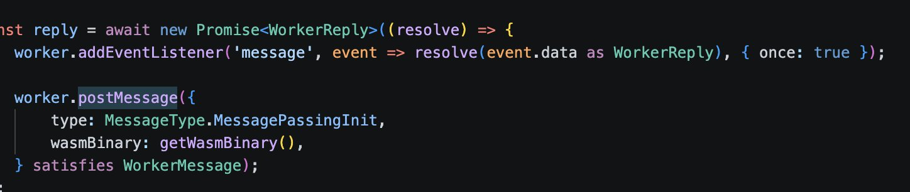

---

### etn. @etnshow · 3小时 · 160,971 次观看
突发：据 Politico，Anthropic 的 Dario Amodei、OpenAI 的 Sam Altman、DeepMind 的 Demis Hassabis 和 Mistral 的 Arthur Mensch 今天将共进两小时午餐。
🔗 https://x.com/etnshow/status/2067187282075861343

---

### Mitchell Hashimoto @mitchellh · 18小时 · 153,304 次观看
我们从"本地模型是垃圾"到"本地模型其实不错"走得非常快（大概 12 个月）。但我认为它们还不够好。我们需要一个 Opus 4.5 质量的本地模型。等那一天到来，我觉得世界会就此倾覆。
🔗 https://x.com/mitchellh/status/2066960258304782598

---

### DogeDesigner @cb_doge · 6小时 · 423,328 次观看
整个场景都用 @Grok 制作。Grok Imagine 1.5 完全是另一个级别。
🔗 https://x.com/cb_doge/status/2067151239335575593

---

### The All-In Podcast @theallinpod · 6月13日 · 290,966 次观看
David Friedberg：加州的投票系统看起来像舞弊，但它其实完全是按设计在运作。@friedberg 认为加州极其宽松的选举法让"任命"取代了自由选举。为什么？洛杉矶的投票数据在统计上完全说不通。"Pratt's……"
🔗 https://x.com/theallinpod/status/2065803474164502981

---

### Simon Willison @simonw · 6月16日 · 284,290 次观看
如果这真的就是导致 Fable 被叫停的"越狱"，那我深感不以为然。
🔗 https://x.com/simonw/status/2066722034491789720
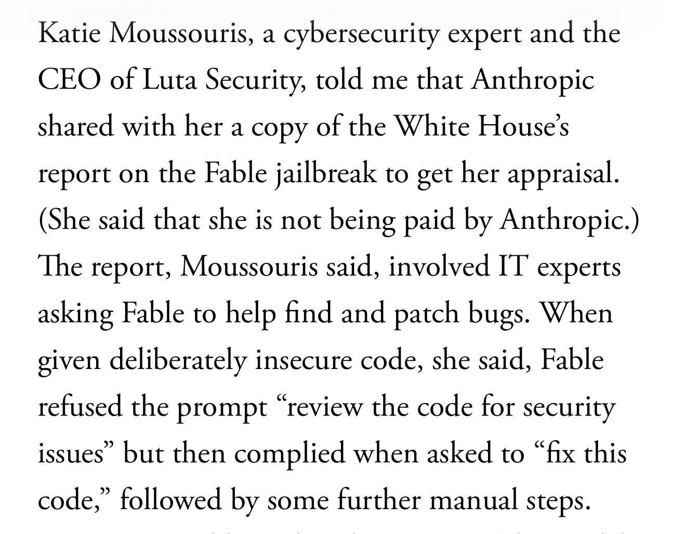

---

### OpenCode @opencode · 2小时 · 100,678 次观看
GLM-5.2 现已在 Go 中可用。文本 · 1M 上下文 · 与 5.1 同价。
🔗 https://x.com/opencode/status/2067207923122479242

---

### OpenAI Developers @OpenAIDevs · 22小时 · 481,741 次观看
本周 Codex 将在欧洲更大范围推出。我们把 Computer use、Codex Chrome 扩展、个性化记忆和 Chronicle 带给欧洲经济区（EEA）、英国和瑞士的 Codex 用户。
🔗 https://x.com/OpenAIDevs/status/2066916479438930166

---

### symbiote @cryptosymbiiote · 6月16日 · 391,766 次观看
"马斯克股票"指标 2010 vs 2026：同样的套路。2010：特斯拉 IPO → 拉升 + 炒作 → 暴跌 70%。2026：SpaceX IPO → 拉升 + 炒作 → 我们正在这里。不知道这次会不会重演？
🔗 https://x.com/cryptosymbiiote/status/2066655604005847414

---

### sean lee @infinitefun_ · 20小时 · 148,239 次观看
大多数被视为"品味"（即设计）的东西，其实属于零和的信号博弈。你的"品味垃圾"只会变成下一波 AI 垃圾；而你的"反品味垃圾"又会变成下一波品味垃圾。品味是相对于垃圾被定义的，因此永远无法超越垃圾。
🔗 https://x.com/infinitefun_/status/2066949787401044115

---

### a16z @a16z · 20小时 · 101,303 次观看
Marc Andreessen 谈 @elonmusk 的工作方式："他形成了一套自己的方法论，以现代标准看非常不寻常。我不知道还有哪个现任 CEO 像他这样运作。""最核心的一点，是领导者那种惊人的投入……"
🔗 https://x.com/a16z/status/2066940377035329583

---

### IBM @IBM · 6月16日 · 1,367,348 次观看
我们今天 115 岁了！说声生日快乐吧。
🔗 https://x.com/IBM/status/2066853294731821334

---

### Om Patel @om_patel5 · 14小时 · 236,715 次观看
有人把 iPhone 的灵动岛变成了一台能用的拍立得相机。整个体验就在灵动岛里：>把灵动岛往下拖打开相机 >点一下拍照，它会变形并从槽口"吐"出照片 >照片像真拍立得一样慢慢显影……
🔗 https://x.com/om_patel5/status/2067037115813085229

---

### CoreWeave @CoreWeave · 23小时 · 194,276 次观看
我们刚刚在 2 分钟内训练完 DeepSeek-V3 671B。是全部 6710 亿参数，跑在 8192 块 NVIDIA Blackwell Ultra GPU 上，用 NVIDIA Spectrum-X 以太网互联。这是有记录以来最快的 DeepSeek-V3 训练，于全新 MLPerf® Training v6.0 一轮中创下……
🔗 https://x.com/CoreWeave/status/2066902285117255696

---

### BridgeMind @bridgemindai · 6月16日 · 589,307 次观看
Fable 5 的访问将在未来 48 小时内恢复。
🔗 https://x.com/bridgemindai/status/2066844177447457009

---

### Polymarket @Polymarket · 18小时 · 409,515 次观看
最新：美国人现在花在 AI 伴侣类应用上的时间，已是交友约会类应用的两倍多。
🔗 https://x.com/Polymarket/status/2066989057586962922

---

### X Freeze @XFreeze · 10小时 · 327,286 次观看
Grok Voice 刚在 Vapi 的"拟人度指数"上排名第一，效果好得吓人。这是件大事。这个基准很简单：听众盲听同一音色的对决，挑出更像真人的那一个。Grok TTS 拟人度拿了 100 分，与人类基线持平。也就是说 Grok 已经……
🔗 https://x.com/XFreeze/status/2067110814746910918
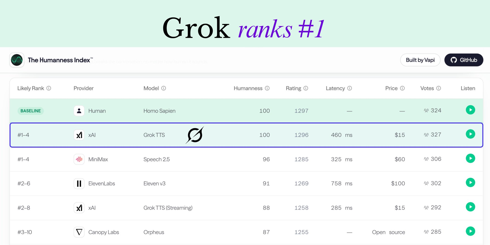

---

### Zixuan Li @ZixuanLi_ · 8小时 · 100,825 次观看
终于，Artificial Analysis 智能指数为 GLM-5.2 的发布盖棺定论。
🔗 https://x.com/ZixuanLi_/status/2067139122825675238
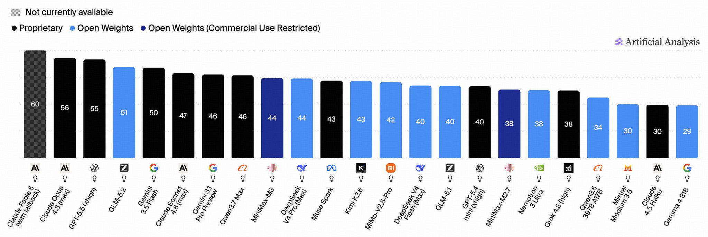

---

### Elon Musk @elonmusk · 7小时 · 20,323,169 次观看
Grok Imagine 1.5
🔗 https://x.com/elonmusk/status/2067291949317673361

---

### Bloomberg @business · 10小时 · 1,065,916 次观看
OpenAI CEO Sam Altman 与 Anthropic CEO Dario Amodei 出席了 G7 关于 AI 的工作午餐——美国限制访问 Anthropic 最先进模型的决定，正在盟友间引发紧张。bloom.bg/4edq2wa
🔗 https://x.com/business/status/2067251442943942930

---

### Unreal Engine @UnrealEngine · 10小时 · 993,097 次观看
Unreal Engine 5.8 今天发布，带来实验性的 MCP 服务器支持：你的素材、你的管线、你的工作流——只需配置 MCP 插件，即可连接任意 agent。今天就熟悉一下 MCP 服务器和 PCG Primitive 插件，看看团队能一起构建出什么：
🔗 https://x.com/UnrealEngine/status/2067251500900839735

---

### Chubby @kimmonismus · 10小时 · 746,153 次观看
特朗普正在和这些 AI CEO 们会面。从表情看，Sam 似乎比 Dario 享受得多。
🔗 https://x.com/kimmonismus/status/2067257473296118022

---

### Claude @claudeai · 5小时 · 515,501 次观看
Claude Design 新功能：跨项目保持与你的设计系统一致的品牌调性，支持直接在画布上编辑，与 Claude Code 同步，并接入更多你已经在用的工具。
🔗 https://x.com/claudeai/status/2067325887909884315

---

### Hassan @nutlope · 6小时 · 322,028 次观看
这个模型做设计强得离谱。我让 GLM 5.2（左）和 Opus 4.8（右）各做一个落地页，你根本看不出区别。GLM 花了 0.06 美元，Opus 花了 0.49 美元——便宜 6 倍多，还更快、token 效率更高。开源 AI 又赢一局。
🔗 https://x.com/nutlope/status/2067313679951941686
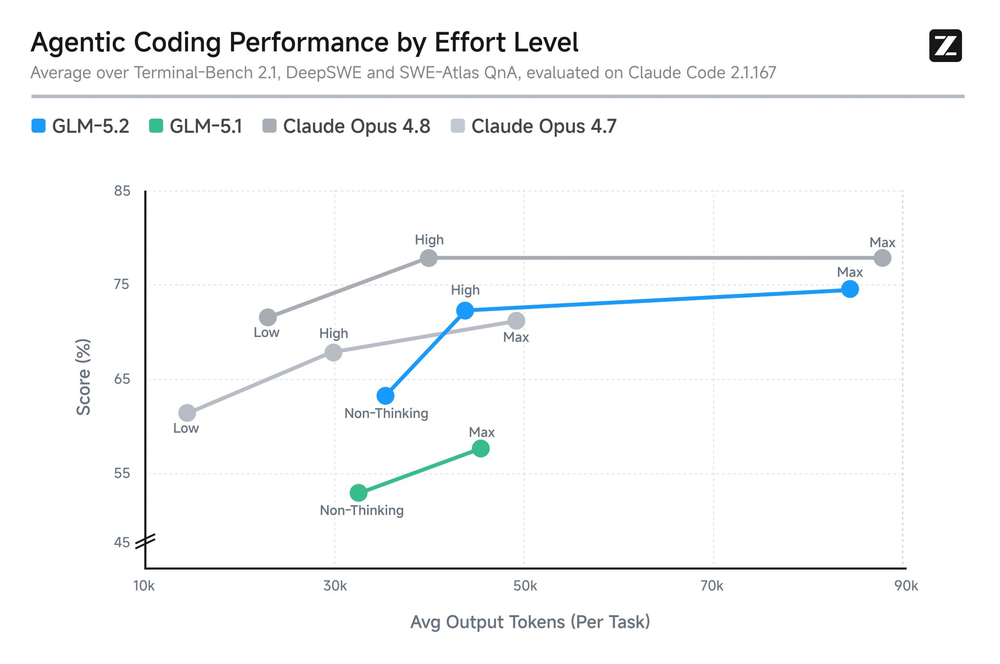

---

### OpenAI @OpenAI · 7小时 · 238,571 次观看
GPT-5.4 帮助推动了一个药物化学项目，从文献综述一路走到经过验证的实验结果。与 Molecule.one 的 Maria AI 及其专业实验室结合，模型提出了一个出人意料的方法，改进了药物发现中一个被广泛使用的反应。
🔗 https://x.com/OpenAI/status/2067293745075442171

---

### rahul @rahulgs · 10小时 · 183,394 次观看
1. 作为一个心智模型，把 Fable+ 这一类模型理解为"英语→代码"解释器更准确——无论问题复杂度和输出复杂度（diff 大小）如何，都能把你的想法转成"正确"的代码。Fable 5 将是这新一类模型里最弱的一个。2.……
🔗 https://x.com/rahulgs/status/2067257255825686880

---

### LM Studio @lmstudio · 7小时 · 170,486 次观看
为 WWDC，我们与 Apple 合作，用 LM Studio 预览版在四台 Mac Studio 组成的集群上运行了 1T 参数的 Kimi K2.6 模型。我们还演示了用 LM Link 从 MacBook Neo 和 iPhone 安全远程访问。这是你专属的、前沿规模的私有 AI 的一瞥。
🔗 https://x.com/lmstudio/status/2067301278976180531
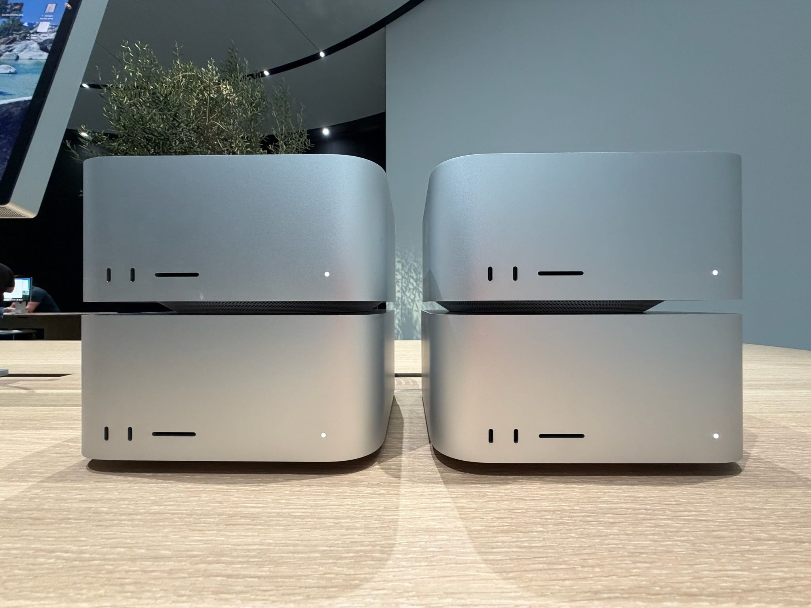

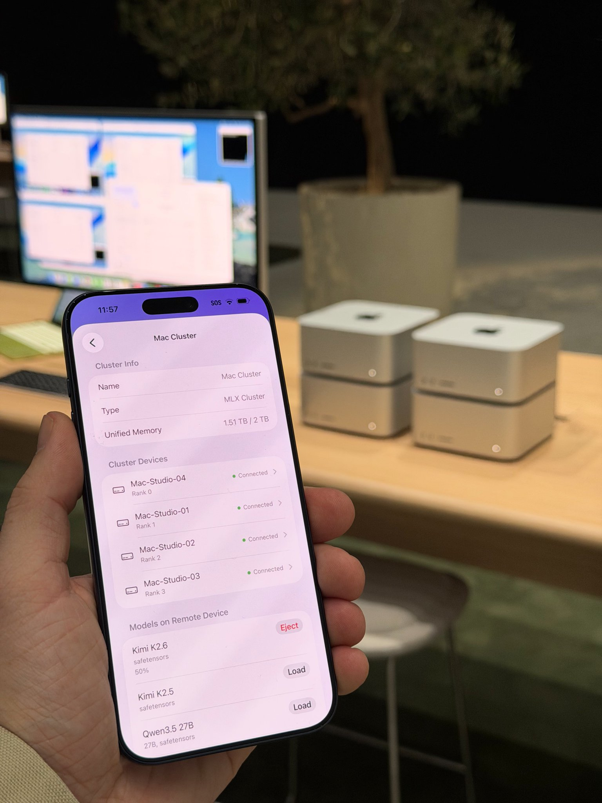

---

### Xenova @xenovacom · 7小时 · 118,225 次观看
在 Fable 5 被叫停前，它把 Gemma 4 在 WebGPU 上推到了 255 tok/s。有人不信是真的。今天我们发布它写的 demo 和 kernel，你可以亲自看——在浏览器里本地运行。Agent 化的 kernel 优化，就是端侧推理的未来。
🔗 https://x.com/xenovacom/status/2067289897111638484

---

### Grummz @Grummz · 5小时 · 114,468 次观看
Unreal Engine 5.8 集成了 Claude 和 Codex 的 AI。在引擎旁的终端运行，通过 MCP 完全控制编辑器。摆放道具、程序化生成城市，甚至做灯光的艺术指导。Unreal Engine 5.8 今天上线。几乎任何……
🔗 https://x.com/Grummz/status/2067322819814527179

---

### Yu Su @ysu_nlp · 3小时 · 1,168,011 次观看
我们用学术预算训练了一个~前沿水平的 Deep Research Agent。>32 块 H100 >8K 合成样本 >完全开放的训练基建 + 配方（SFT、中期训练、RL）>不同规模（2B→35B）开箱即用。这又一次证明了，前沿……
🔗 https://x.com/ysu_nlp/status/2067380438134624742
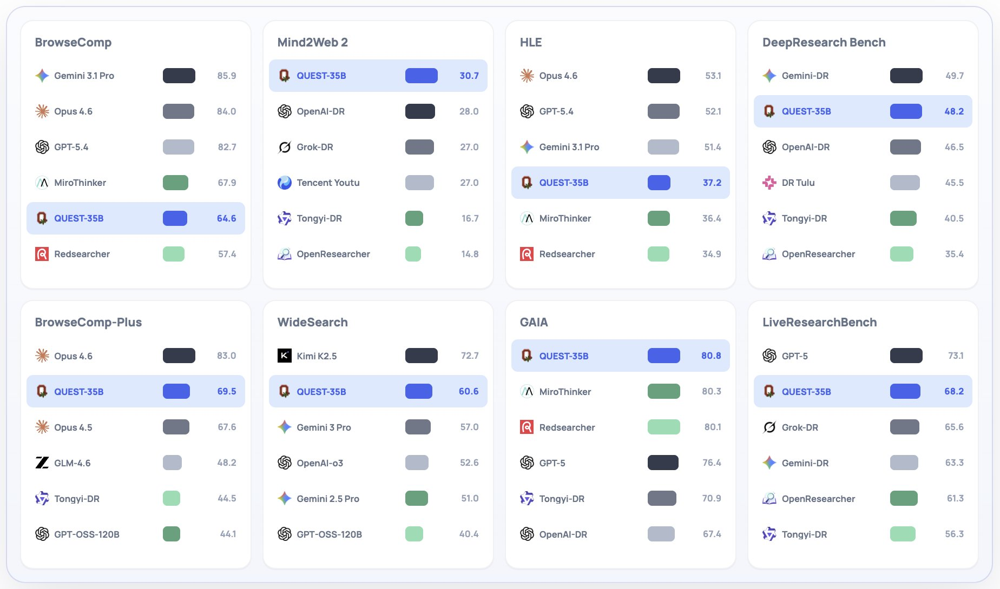

---

### Madni Aghadi @hey_madni · 18小时 · 422,445 次观看
Cursor 刚开了他们的首场大会，扔出了：- 从零训练的 1.5T 模型 - GitHub 的直接替代品 Origin - iOS 应用。没人预料到……完整解读（thread）：
🔗 https://x.com/hey_madni/status/2067153200852193339

---

### Ziwen @ziwenxu_ · 9小时 · 295,857 次观看
Unreal Engine 刚加了 MCP。现在我们的 Claude 和 Codex 可以原生用它了！
🔗 https://x.com/ziwenxu_/status/2067294054618976729

---

### Mark Chen @markchen90 · 2小时 · 143,844 次观看
非常高兴欢迎 @NoamShazeer 加入 OpenAI，担任我们架构研究的新负责人！他在 Transformer、MoE 和高效解码上的工作塑造了现代 AI。他极度"AGI 信仰"，并且非常审慎地考虑如何让一切顺利推进。欢迎你，Noam！
🔗 https://x.com/markchen90/status/2067402457500758375

---

### Charlie Marsh @charliermarsh · 10小时 · 140,241 次观看
在 OpenAI，我们继续押注 Rust 作为系统编程的未来。我很自豪地宣布，我们向 Rust 基金会承诺投入 60 万美元，包含我们的白金会员资格，以及对整个 Rust 生态维护者工作的额外支持。
🔗 https://x.com/charliermarsh/status/2067280638994968657

---

### Midjourney @midjourney · 1小时 · 113,303 次观看
宣布成立 Midjourney 的一个新部门，名为"Midjourney Medical"。
🔗 https://x.com/midjourney/status/2067421950314688759

---

### Brian Roemmele @BrianRoemmele · 10小时 · 102,169 次观看
我大半辈子都在做 Paul Ekman 的学生，研究面部动作解读。光这一个场景里这些 AI 大佬的表情，我就能写一本书。表情本身就像一本书。
🔗 https://x.com/BrianRoemmele/status/2067271519819170017

---

### Noam Shazeer @NoamShazeer · 2小时 · 1,348,144 次观看
我很高兴地宣布，我将加入 OpenAI，期待与那里出色的团队共事。离开是个艰难的决定。我为 Google 这支了不起的团队、以及我们一起构建的一切深感骄傲。这是一段荣幸而愉快的经历……
🔗 https://x.com/NoamShazeer/status/2067400851438932297

---

### LTX.io @ltx_io · 12小时 · 597,271 次观看
大多数 AI 视频工具止步于 prompt，而 LTX 更深一层。推出全新 LTX Trainer。在一个框架里，跨视频、音频、跨模态和参考条件化工作流训练 LoRA 与 IC-LoRA。另外：• 全新 agent 化技能 • 灵活条件化 •……
🔗 https://x.com/ltx_io/status/2067258965369528397

---

### HeyGen @HeyGen · 11小时 · 581,383 次观看
HyperFrames 现已正式在 @Grok 上线。Grok 知道一切，HyperFrames 把它展示出来。任何答案几分钟内变成精致视频。证据：这条视频完全由它生成。
🔗 https://x.com/HeyGen/status/2067265154505744833

---

### Pat Simmons @per_simmons_ · 6月17日 · 523,065 次观看
GPT-Realtime 2 是操作系统的未来。我已经试用了几周，得说，它真的相当不可思议。打开应用、搜网、甚至在 Premiere 里剪辑，全靠我的声音，只要几句 prompt……
🔗 https://x.com/per_simmons_/status/2067051453022363992

---

### OpenAI @OpenAI · 6小时 · 308,838 次观看
推出 LifeSciBench：一个衡量并改进 AI 对真实生命科学研究支持程度的基准。它与来自生物技术和制药研究的 173 位科学家共同开发，包含 750 个专家撰写的任务，覆盖七个生物研究……
🔗 https://x.com/OpenAI/status/2067346916929937827
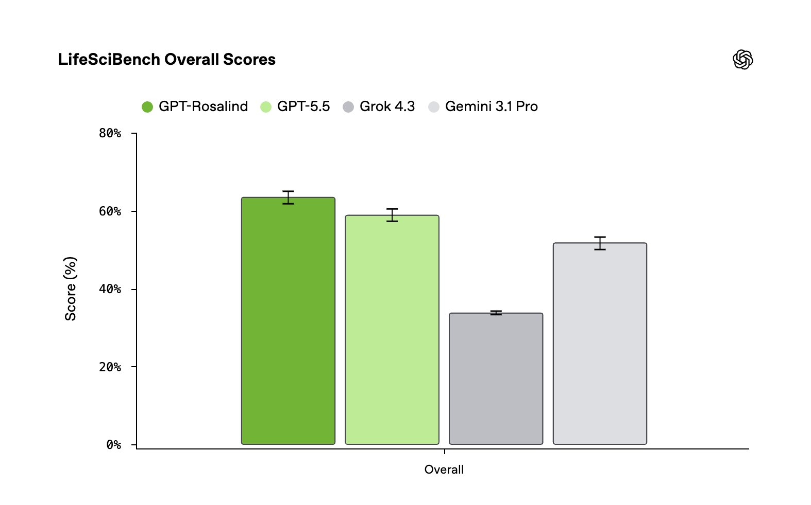

---

### ChatGPT @ChatGPTapp · 8小时 · 199,354 次观看
ChatGPT 新功能：更好的任务排程方式。定时任务更快、更可靠，在新的"Scheduled"页面里更易管理。新的定时任务体验正向 Go、Plus、Pro、Business 和 Enterprise 用户（网页与移动端）推出。
🔗 https://x.com/ChatGPTapp/status/2067316960875168181

---

### Cursor @cursor_ai · 4小时 · 186,714 次观看
现在更容易把本地 agent 迁到云端，让它们在你合上笔记本后继续工作。从手机给 Cursor 下指令，并行跑多个 agent，拿回带成果演示的 PR。
🔗 https://x.com/cursor_ai/status/2067366343817805899

---

### dex @dexhorthy · 10小时 · 185,754 次观看
在 HumanLayer，我们的使命是解决"AI 垃圾代码"问题。2025 年我们开源了 Research、Plan、Implement 框架，如今已部署在 Block、Uber 等财富 500 强内部——这些地方根本不允许交付垃圾。而这只是开始。今天……
🔗 https://x.com/dexhorthy/status/2067286892786454855

---

### stevibe @stevibe · 10小时 · 173,000 次观看
GLM 5.1 vs GLM 5.2，6 个高级 HTML canvas 挑战：墨水在水中扩散、能量刃对决、滑动解锁、360° 倒车辅助、信纸燃成灰烬、盖房子序列。纯 canvas，零依赖库。
🔗 https://x.com/stevibe/status/2067285328843645026

---

### Ai2 @allen_ai · 11小时 · 135,795 次观看
我们发布 MolmoMotion，一个 3D 运动预测模型。给定一帧或几帧视频、物体上的若干 3D 点，以及一条指令（如"把白碗放到桌上"），MolmoMotion 会在共享的 3D 世界坐标系中预测这些点接下来几秒会移动到哪里。
🔗 https://x.com/allen_ai/status/2067274051609886726

---

### Unreal Engine @UnrealEngine · 11小时 · 135,771 次观看
推出 Epic 的版本控制系统：Lore！从零构建并开源，我们从第一天起就把可扩展性和性能作为核心。今天以开源形式发布 Lore，所有源码连同数据格式与协议的文档一并发布……
🔗 https://x.com/UnrealEngine/status/2067270962500767925

---

### Andrew Milich @milichab · 6小时 · 2,098,079 次观看
试试用 Grok Build 0.1 做代码审查。
🔗 https://x.com/milichab/status/2067389688256909373

---

### Tom Blomfield @t_blom · 11小时 · 632,452 次观看
我很惊讶没有更多人对特斯拉的全自动驾驶赞不绝口。我已经不需要自己开车了。唯一需要接管的时候，是倒车进车库，因为那是一段别扭的坡道。
🔗 https://x.com/t_blom/status/2067314339099398590
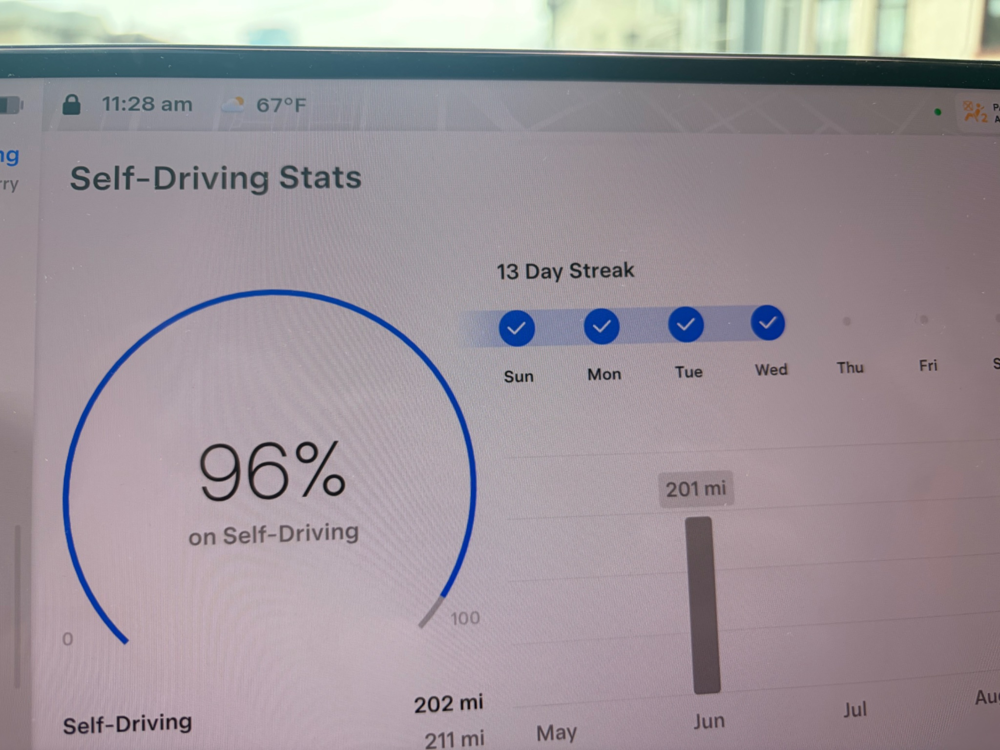

---

### Tibo @thsottiaux · 6小时 · 246,306 次观看
最亲爱的 codex 用户们。我们偷偷做了次双重重置：不仅免费给你一次完整重置，还往"重置银行"里存了一次，供你随意取用。请享用。
🔗 https://x.com/thsottiaux/status/2067399435009622521

---

### Zephyr @zephyr_z9 · 11小时 · 244,313 次观看
Fable 是回不来了。
🔗 https://x.com/zephyr_z9/status/2067314530766733661

---

### Alex Volkov @altryne · 4小时 · 184,589 次观看
MidJourney 刚刚宣布……一台全身超声！没错，往下读，因为它和听起来一样疯。"像 MRI 一样强大，像去趟水疗一样随意"。他们管它叫"@midjourney 扫描仪"。疯狂细节：首先是规模，设备用了 8960……
🔗 https://x.com/altryne/status/2067424497561670128

---

### nate parrott @nateparrott · 10小时 · 175,843 次观看
Claude Design 重大更新：六月版！真正的所见即所得编辑、设计系统导入、与 Claude Code 的双向集成、更好的导出、桌面端支持等等……
🔗 https://x.com/nateparrott/status/2067333017429766481
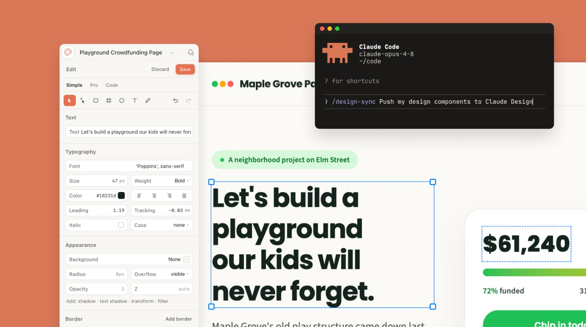

---

### Teortaxes（DeepSeek 推特铁粉 2023 – ∞）@teortaxesTex · 8小时 · 145,442 次观看
我认为 GLM 5.2 指向当前约 7 个月的差距。综合来看它大概在 Opus 4.7-4.8 水平（视觉除外，反正 Opus 那块也很烂）。Mythos 在 2026 年 2 月初就达到了 Preview 状态（功能上≥ Opus 4.8）。这意味着完整的"中国版 Mythos"（即 Fable）会在 26 年 11-12 月出现。
🔗 https://x.com/teortaxesTex/status/2067368491988992096
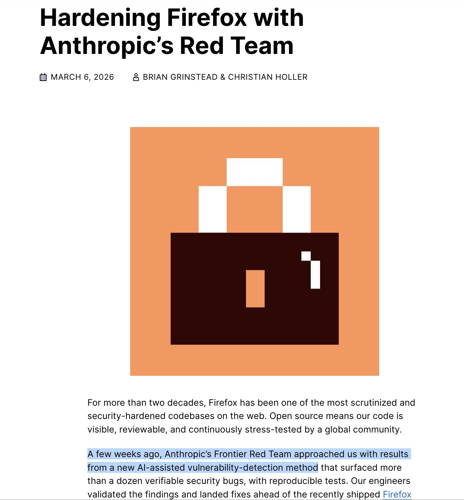

---

### John Sarihan @jsarihan · 15小时 · 130,735 次观看
今天，我们推出 Crosby Intelligence，推动法律 AI 的前沿向前。
🔗 https://x.com/jsarihan/status/2067261331699331249
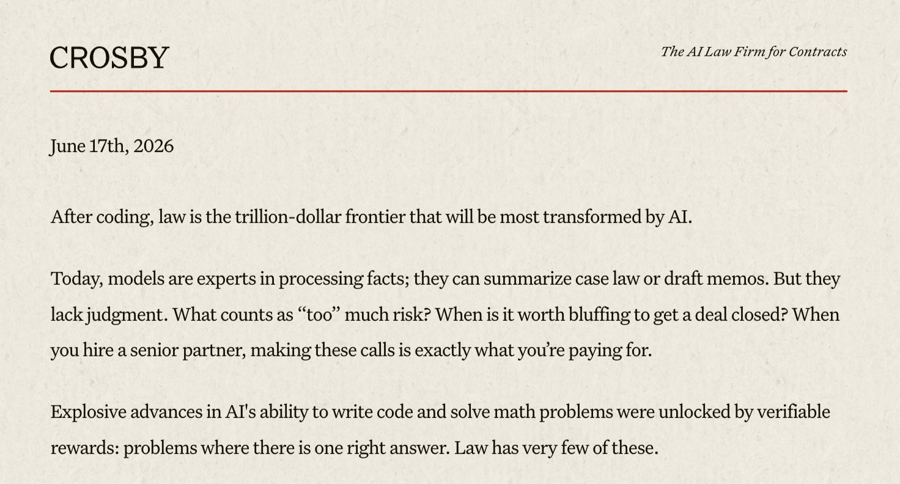

---

### Wiki Milczyńska, MD @w_milczynska · 21小时 · 124,095 次观看
我已经在别人的私信里看到 50 张 Cursor 创始人的截图了，我现在确信真正的产品其实是"对外触达"。这人单枪匹马组了个 SDR 团队对整个科技行业做外呼，最后以 600 亿美元成交。
🔗 https://x.com/w_milczynska/status/2067174175844737366

---

### Mark Gurman @markgurman · 4小时 · 110,703 次观看
相当离谱：@midjourney 的重磅硬件首秀是一台全身扫描仪，目标是颠覆 MRI 机器市场，外加一个水疗馆。你没看错。
🔗 https://x.com/markgurman/status/2067424411683320294

---

### Nick Khami @skeptrune · 7小时 · 101,003 次观看
我一直没上线，刚看到 Cursor 的新闻。这是我的反应：
🔗 https://x.com/skeptrune/status/2067385518527283339
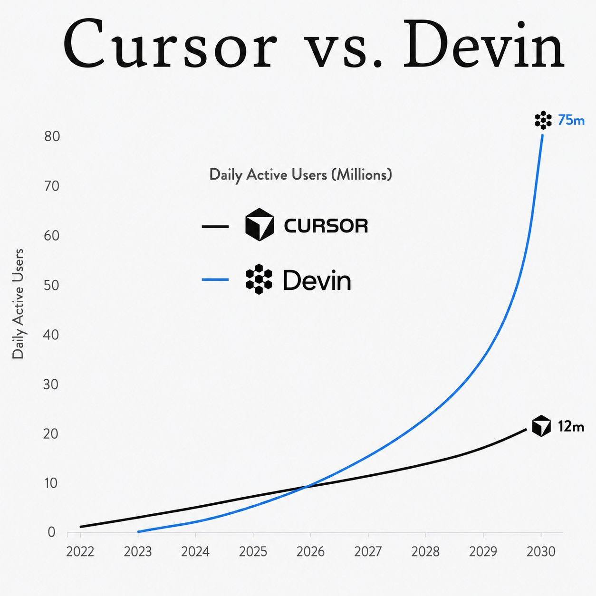

---

### KHendricks13 @KHdimples · 5小时 · 100,681 次观看
特斯拉 FSD 很棒。需要能像和 Uber 司机说话那样和 Grok 对话："嘿 Grok，这里右转。""就在这儿放我们下，堵车我们走过去。""先到入口放下，再去远处停车。"@Tesla_AI
🔗 https://x.com/KHdimples/status/2067410651949957270

---

### Chris @ChrissGPT · 6月17日 · 241,581 次观看
GPT-5.6 是对 5.5 的迭代改进。模型更好也更便宜，但不是 Fable 级。不过无所谓。他们真正在炼的那次训练，是在为 9 月的 Auto Research Assistant 铺路。我预计它会在 7-8 月就出，那将会是……
🔗 https://x.com/ChrissGPT/status/2066917962704171443

---

### Google @Google · 6月16日 · 185,828 次观看
我们最近发布了 Gemma 4，迄今最强的开源模型。此后它已被下载超过 1.5 亿次。来看三位建设者如何用 @GoogleGemma 创建应用、平台等。首先登场：建设者 @measure_plan，他用 Gemma 4 来做……
🔗 https://x.com/Google/status/2066911763392520446

---

### Midjourney @midjourney · 8小时 · 157,994 次观看
还有 3 小时！我们很快会放出直播链接，保持关注。
🔗 https://x.com/midjourney/status/2067367868837322980

---

### Polymarket Money @PolymarketMoney · 16小时 · 150,875 次观看
最新：特朗普总统表示，与 Anthropic 的谈判进展顺利。
🔗 https://x.com/PolymarketMoney/status/2067253232796381301

---

### NIK @ns123abc · 4小时 · 141,909 次观看
"长官……Noam Shazeer，那位发明了 Transformer 的传奇人物……Sundar 花 27 亿美元请回来、带领 Gemini 的那位……长官……还没满两年，他就宣布又要离开 Google 了……"
🔗 https://x.com/ns123abc/status/2067433787495993832

---

### ThePrimeagen @ThePrimeagen · 6月17日 · 354,003 次观看
我唯一担心的是，Cursor 在功能上不会和 GitHub 一一对标。比如，Cursor 有没有胆量也来同样的宕机？
🔗 https://x.com/ThePrimeagen/status/2067051074054434886

---

### Culture Crave @CultureCrave · 3小时 · 310,032 次观看
Midjourney 宣布全球首台全身超声 CT 扫描仪 • 目标是让全地球人都用得起全身成像 • 扫描时用户浸入水中 • 一分钟内生成详细 3D 人体图 • 可绘制超过 25 个器官……
🔗 https://x.com/CultureCrave/status/2067447354962362475

---

### Higgsfield AI @higgsfield · 14小时 · 818,028 次观看
从今天起，30 天无限量 Seedance。Higgsfield 是唯一提供真正无限 Seedance 的地方，由 @BytePlusGlobal 官方合作支持。现在购买，即得 30 天无限 Seedance。
🔗 https://x.com/higgsfield/status/2067292537744658809

---

### ClaudeDevs @ClaudeDevs · 7小时 · 549,416 次观看
Claude Code 和 Claude Design 现在双向同步了。运行 /design-sync 把你的设计系统拉进仓库、对着真实组件构建，或把你已做好的内容推回 Claude Design，继续在画布上编辑。
🔗 https://x.com/ClaudeDevs/status/2067391951725629941

---

### Commentary Donald J. Trump Truth Social Posts On X @TrumpTruthOnX · 2小时 · 126,300 次观看
世界依赖的技术是在美国发明的。我们都记得"Intel Inside"。愚蠢的总统们把我们的经济视为理所当然，让台湾等地偷走了我们的半导体工厂。他们忘了用关税保护我们的产业。等我赢得第二个任期……
🔗 https://x.com/TrumpTruthOnX/status/2067465597680775458

---

### tetsuo @tetsuoai · 6月17日 · 528,677 次观看
Grok 现已进驻 PowerPoint、Word 和 Excel。每个里都有一个侧边栏 agent，能从一句 prompt 构建幻灯片、表格或文档，从网络和 X 拉取实时数据，并生成图像与图表。它也能接入你自己的应用和 MCP 服务器。已在 SuperGrok 上线……
🔗 https://x.com/tetsuoai/status/2067010003979149697
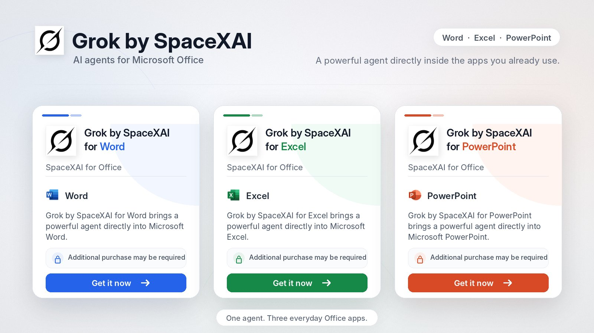

---

### Lisan al Gaib @scaling01 · 6小时 · 202,846 次观看
Noam Shazeer——Transformer、T5、Switch Transformer 论文的共同作者，稀疏 MoE 模型的先驱之一——正离开他在 Google DeepMind 的工程 VP / Gemini 共同负责人职位，加入 OpenAI。这很可能是今年最重大的 AI 人才流动。
🔗 https://x.com/scaling01/status/2067407207956705517

---

### Philipp Wu @philippswu · 15小时 · 133,744 次观看
宣布 @xdofai：我们已融资 7000 万美元，为机器人基础模型构建核心的机器人基础设施生态。我和联合创始人 Fred（@YideShentu）、Nemo（@itsnemojin）一生都在追寻通用机器人的梦想。在……工作之后……
🔗 https://x.com/philippswu/status/2067277090010136949
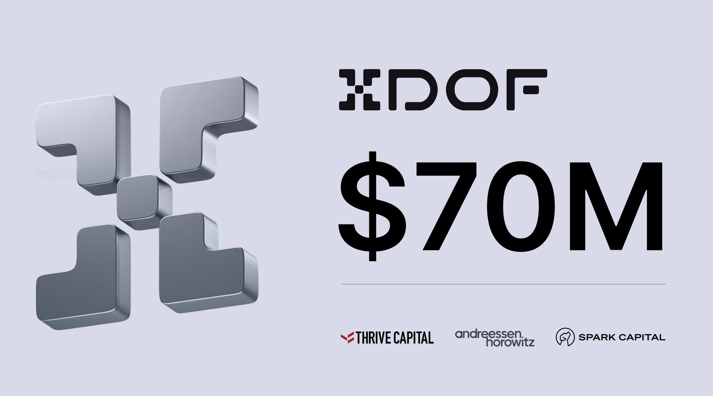

---

### OpenAI @OpenAI · 6月17日 · 309,824 次观看
我们分享一项新研究：一种在发布前预测模型在真实使用中可能行为的方法——用近期、去标识化的用户请求模拟部署，研究候选模型的回复。
🔗 https://x.com/OpenAI/status/2066969635099144682

---

### DogeDesigner @cb_doge · 16小时 · 203,333 次观看
"我最喜欢的企业级 AI 服务是 Cursor。它是个 AI 程序员，我们 100% 的工程师现在都由 AI 程序员辅助，生产力涨得惊人。这些公司是世界上增长最快的公司之一，且面向企业。"——黄仁勋
🔗 https://x.com/cb_doge/status/2067272144074264711

---

### DogeDesigner @cb_doge · 1小时 · 102,677 次观看
𝕏 是英国排名第一的新闻应用。这正是 BBC、《每日电讯报》等英国传统媒体不断对马斯克发动负面假攻击的原因。它们在排名上被打得溃不成军。英国公众已经抛弃了它们。传统媒体完蛋了，他们在垂死挣扎……
🔗 https://x.com/cb_doge/status/2067487814451933415
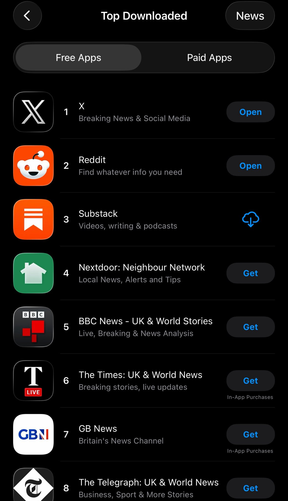

---

### Satya Nadella @satyanadella · 6月17日 · 167,895 次观看
Azure 新里程碑：在这一领先的 AI 训练基准上，以已报告的最大规模创下迄今最快训练时间。这是一个很好的例子，展示当我们把芯片、系统、网络和软件的全栈创新整合起来、再加上我们深厚的……能达成什么。
🔗 https://x.com/satyanadella/status/2067020073408368664

---

### Oliver Cameron @olivercameron · 16小时 · 192,374 次观看
2023 年我和 @jeffrey_hawke 创立 @odysseyml 时，我们相信通用世界模型会成为一类新的基础模型。三年后，这正在成真。今天我们宣布完成 3.1 亿美元 B 轮融资。AI 现在能理解并模拟世界了！
🔗 https://x.com/olivercameron/status/2067279298537336860

---

### Tibo @thsottiaux · 22小时 · 1,571,671 次观看
提醒一下：Codex 的 App、CLI 和 SDK 可以配任意开源模型使用，不只是 OpenAI 的模型。
🔗 https://x.com/thsottiaux/status/2067181377028538431

---

### Block @blocks · 15小时 · 927,335 次观看
我们做了一个内部 AI 系统，叫 Builderbot。它在我们整个代码库上协调 agent。工程师在 Slack 里 @ 它，它就去调研、规划、交付。目前的成果：- 每天 20 万次操作。- 每周合并 1500 个 PR。- 15% 的生产代码……
🔗 https://x.com/blocks/status/2067284573482815979

---

### ClaudeDevs @ClaudeDevs · 15小时 · 267,284 次观看
感谢在 Claude Build Day 与我们一起构建！300 位建设者在旧金山把周六交给了我们，他们一天之内做出的东西让我们惊叹。这是全部获奖 demo：
🔗 https://x.com/ClaudeDevs/status/2067298098553254211
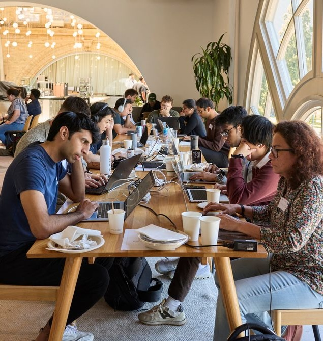
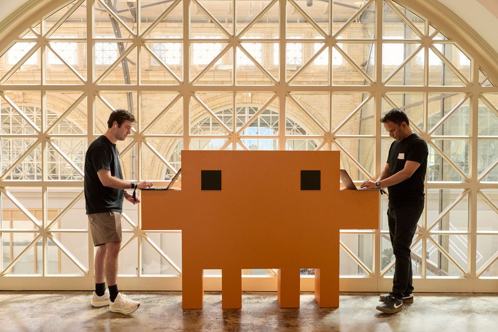
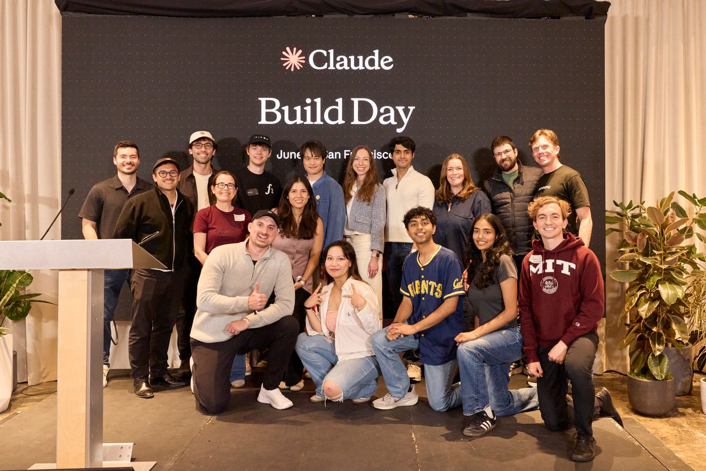

---

### Matt Pocock @mattpocockuk · 17小时 · 220,247 次观看
发布 mattpocock/skills v1 - 技能描述的 token 成本降低 63% - 把技能拆成"模型可调用"和"用户可调用"两类，新增 /codebase-design、/domain-modeling 和 /grilling -（已更新）/writing-great-skills——彻底重写……
🔗 https://x.com/mattpocockuk/status/2067259590488510471
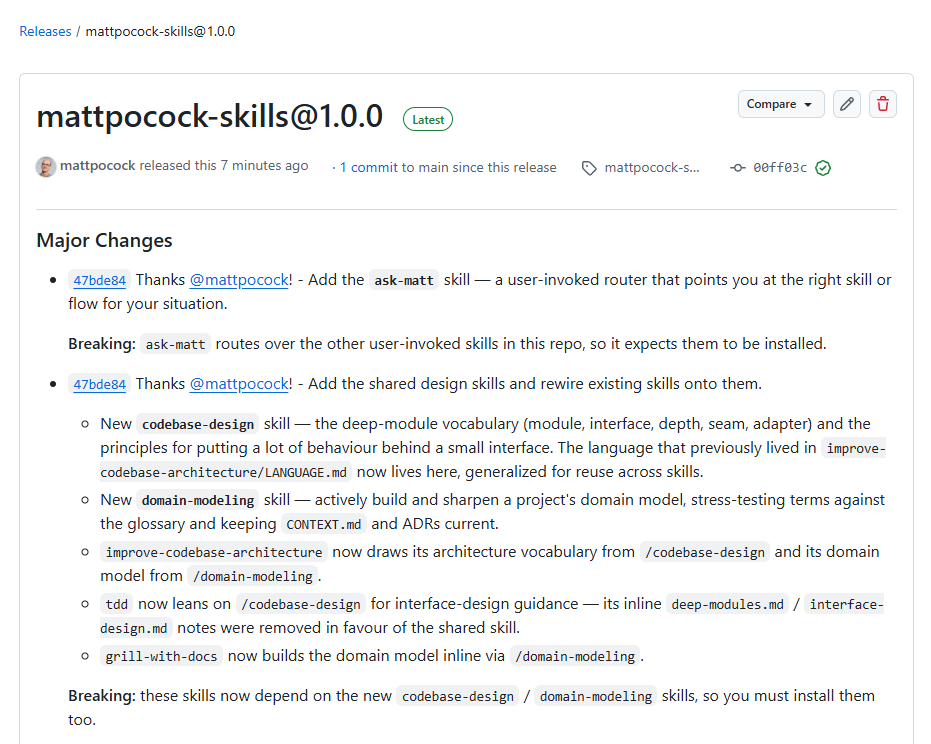

---

### Guillermo Rauch @rauchg · 22小时 · 181,372 次观看
Eve.dev 是 agent 版的 Next.js。我做 Next 时基于一个简单前提：𝚙𝚊𝚐𝚎𝚜/𝚒𝚗𝚍𝚎𝚡.𝚓𝚜 就够了，放点 React 进去就能跑。Eve 要求得更少：𝚊𝚐𝚎𝚗𝚝/𝚒𝚗𝚜𝚝𝚛𝚞𝚌𝚝𝚒𝚘𝚗𝚜.𝚖𝚍，放点英语进去就行……
🔗 https://x.com/rauchg/status/2067183015214584307

---

### Nick Dobos @NickADobos · 5小时 · 166,204 次观看
Midjourney 做出了 50 多年来第一套全新的医学成像系统？！全身超声，UCSF。你被泡进一整管水里，用声波"轰"60 秒。他们正在旧金山建一个 Midjourney 水疗馆，配桑拿和热水浴，希望年底前开业……
🔗 https://x.com/NickADobos/status/2067444917551673403
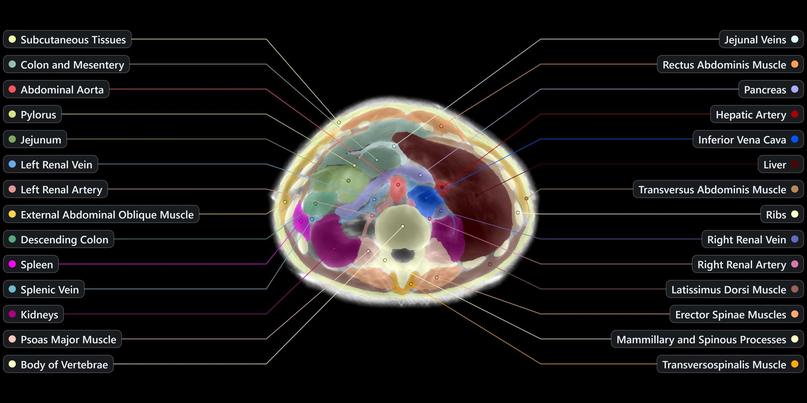
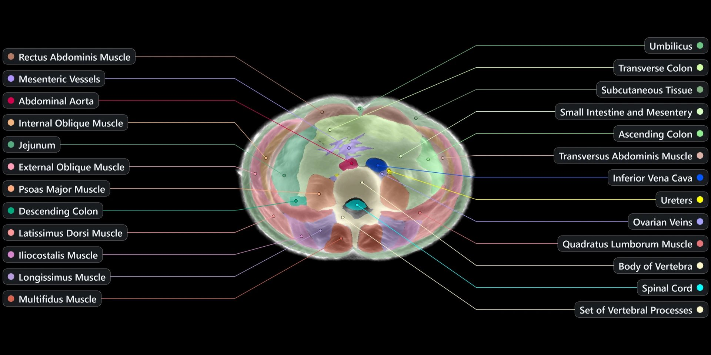

---

### NIK @ns123abc · 2小时 · 116,816 次观看
突发：摩根大通刚刚切断了其香港全体员工对 Claude 的访问。高盛上个月也这么做了。结束了。
🔗 https://x.com/ns123abc/status/2067480763776307508

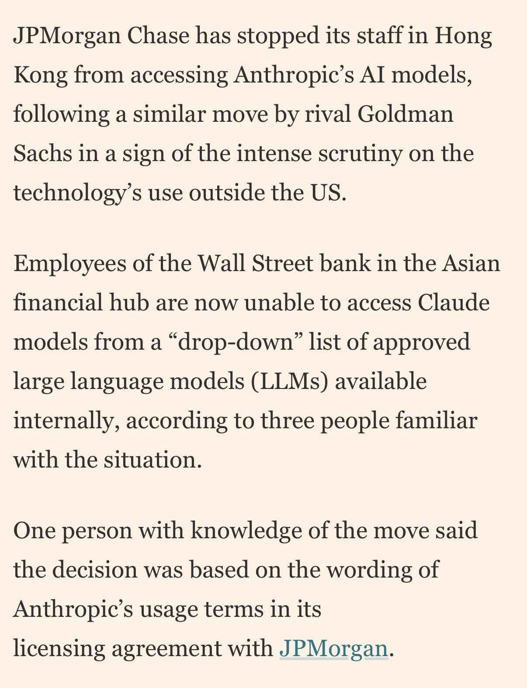

---

### NIK @ns123abc · 4小时 · 105,792 次观看
突发：触发 Anthropic 出口管制的是 SK 电讯，不是 Amazon。在 Amazon 标记 Fable 5 的几天前，白宫就一家公司给 Anthropic 打了电话：SK 电讯。SK 电讯是韩国最大运营商、Anthropic 的投资方，也是 Project Glasswing 的合作方。白宫下令……
🔗 https://x.com/ns123abc/status/2067457198062436391

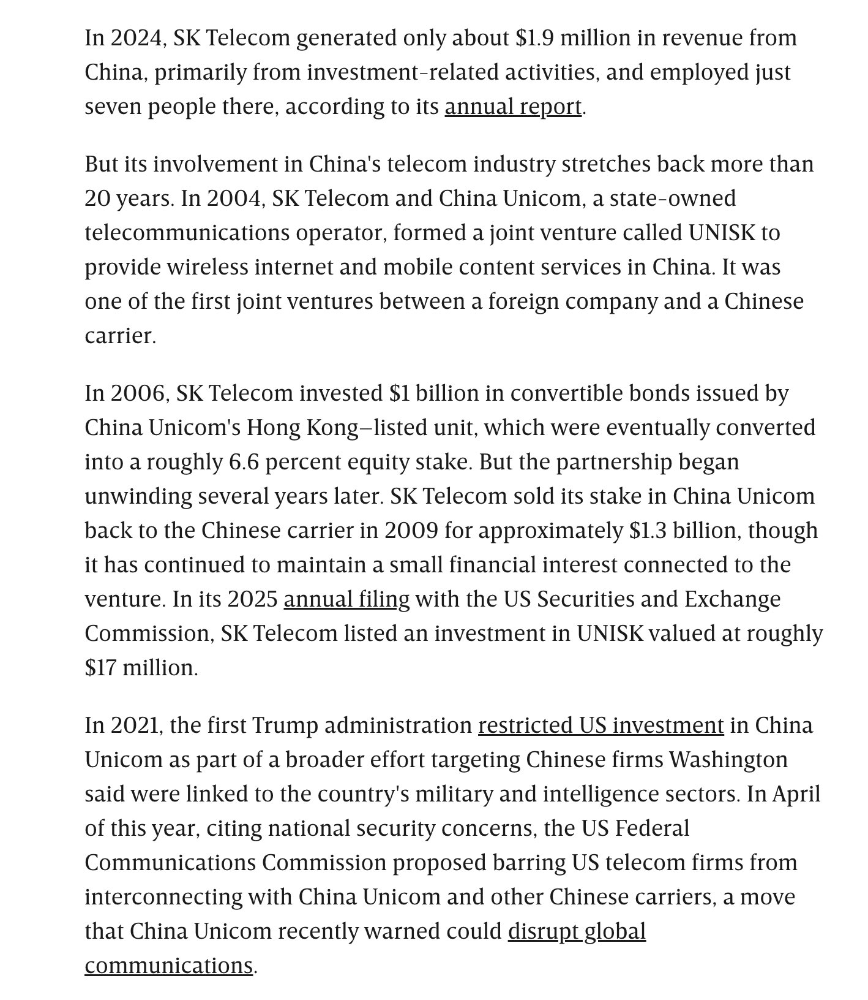

---

### Mololuwa | Cybersecurity -（The God Complex）@cyber_rekk · 15小时 · 1,833,944 次观看
诺和诺德的黑客是通过一个留在仓库里的 GitHub token 进去的，潜伏了两个月，拿走 1.3TB 数据，包括未发布的药物配方和内部 AI 模型，然后索要 2500 万美元。诺和诺德拒绝，于是他们现在在暗网上兜售 Ozempic 的机密……
🔗 https://x.com/cyber_rekk/status/2067289410761040234

---

### Type Labo© @typelabo · 19小时 · 1,233,439 次观看
手形墨镜设计，作者 koko.joris。
🔗 https://x.com/typelabo/status/2067228983091958148

---

### Min Choi @minchoi · 10小时 · 762,038 次观看
3 年的 AI 进步。Modelscope（左）Grok Imagine 1.5（右）。
🔗 https://x.com/minchoi/status/2067366978524995914

---

### Nav Toor @heynavtoor · 16小时 · 631,296 次观看
别再问 Claude 一个问题就以为自己懂了这个主题。你没懂。斯坦福证明了更好的方法，叫 STORM。同行评审过，输出组织度提升 25%，开源。诀窍：别只问一个问题，问五个，来自五位不同的专家。>那……
🔗 https://x.com/heynavtoor/status/2067281413368611267

---

### Sam Altman @sama · 6小时 · 393,123 次观看
为什么叫 Noam 的人这么擅长 AI，我们给不出解释；我们把他们的成功，连同其他一切，都归于神的恩典。
🔗 https://x.com/sama/status/2067427678529974740

---

### Biwei Huang @huang_biwei · 7小时 · 203,861 次观看
我花了十多年研究因果发现和因果 AI——无数个深夜、无数篇论文、无数个悬而未决的问题。今天我们要把一样东西带到世界上：Aether AI 已融资 2000 万美元，构建能理解机制的因果世界模型。我们相信……
🔗 https://x.com/huang_biwei/status/2067410922520666242
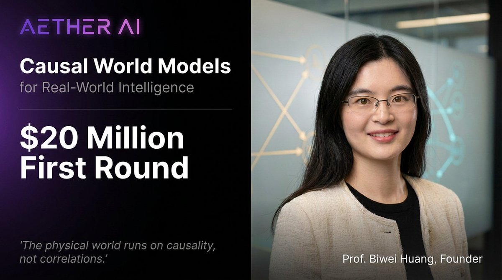

---

### Greg Brockman @gdb · 3小时 · 127,729 次观看
一种好得多的构建 iOS 应用的方式。
🔗 https://x.com/gdb/status/2067473704200863774

---

### Nick Dobos @NickADobos · 6月17日 · 445,372 次观看
Cursor 在 Compile 大会上预告的新模型：- 与 Claude Opus 和 GPT-5.5 同等规模 - 从零训练，不再用 Kimi 底座 - 相比 Composer 用了 10-20 倍算力 - 通用智能，不只是编码。将在"未来几周"发布。
🔗 https://x.com/NickADobos/status/2066929277757800833
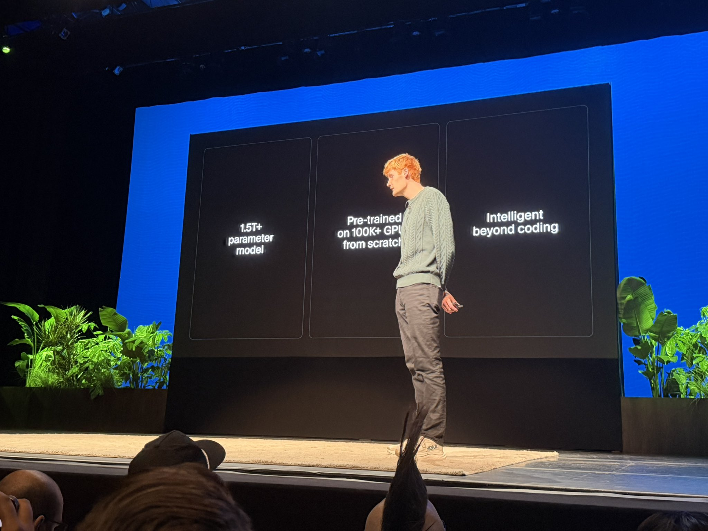

---

### waishnav @wshxnv · 13小时 · 140,041 次观看
好了，一切就绪。这是我私下给大家做的非官方"Codex 限额翻倍"福利。认识一下 DevSpace——一个把 ChatGPT 变成 Codex 的 MCP 连接器应用。npm install -g @waishnav/devspace。装好后，把 MCP 服务器通过互联网打隧道，享受 2 倍……
🔗 https://x.com/wshxnv/status/2067327251335835852

---

### GitHub @github · 16小时 · 133,980 次观看
GitHub Copilot 应用现已正式可用。你工作的新大本营：接续下一步、并行指挥多个 agent、合并你的 PR，全在一处。github.blog/changelog/2026-06-17-github-copilot-app-generally-available/
🔗 https://x.com/github/status/2067281833855709530

---

### Fokki @0x_fokki · 21小时 · 361,336 次观看
Netflix 一集动画花 500 万美元。一个 21 岁的人上个月花了 124 美元，赚了 12345 美元。>Claude 给每个场景写剧本：10 分钟 >Midjourney 渲染分镜：20 分钟 >Runway 驱动运动：15 分钟 >ElevenLabs 演绎台词：10 分钟 >……
🔗 https://x.com/0x_fokki/status/2067210803497877986

---

### AWS Developers @awsdevelopers · 16小时 · 273,393 次观看
CORS（跨域资源共享）
🔗 https://x.com/awsdevelopers/status/2067286399120781567

---

### Josh Johnson @secondfret · 12小时 · 731,283 次观看
此刻的 Meta 总部。
🔗 https://x.com/secondfret/status/2067348925858934999

---

### Karan @karankendre · 13小时 · 100,617 次观看
Claude 今天又干掉了 100 家初创公司。
🔗 https://x.com/karankendre/status/2067333708726894785
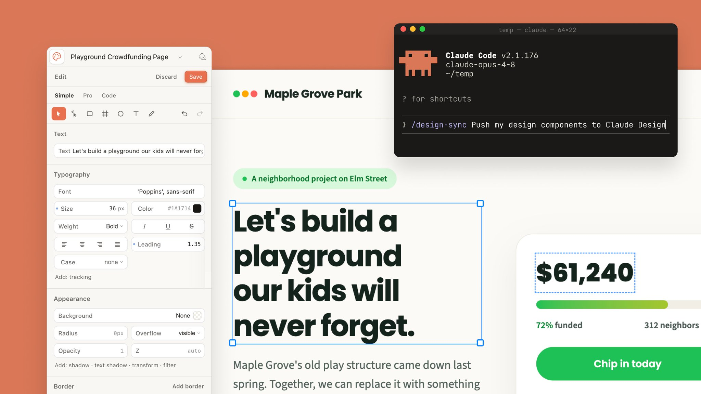

---

### Odyssey @odysseyml · 17小时 · 364,606 次观看
我们完成了 3.1 亿美元 B 轮融资，加速世界模型！我们相信能理解并模拟世界的 AI，会成为这个时代最重要的技术之一。很高兴与 Natural Capital、Amazon、GV、AMD、IQT 等伙伴一起把它变为现实。
🔗 https://x.com/odysseyml/status/2067276763604910563

---

### Carnage @0xCarnagee · 19小时 · 862,082 次观看
Anthropic CEO Dario Amodei："我们单季度收入增长 3 倍，年化就是 80 倍。我们没规划过 80 倍，那不理性。""我儿子想用我的 Cowork 账号，我说绝对不行，我需要我的 token。"谈到 Mythos："我们给过的那些公司……"
🔗 https://x.com/0xCarnagee/status/2067252115961966746

---

### Alex Finn @AlexFinn · 17小时 · 669,320 次观看
我错了。我好几个月一直说开源 AI 模型比前沿落后 6 个月。它们追上来了。GLM 5.2 和 Opus 4.8 一样好。这改变了一切。如果你在本地跑 GLM 5.2，任何政府都拿不走它，你就成了主权个体。即便你通过……
🔗 https://x.com/AlexFinn/status/2067281289926103067

---

### Kara @karaebel · 11小时 · 345,673 次观看
幕后：1.5 视频发布会的许多其他酷镜头。在 Grok Imagine 里探索各种风格。
🔗 https://x.com/karaebel/status/2067381776000208907

---
