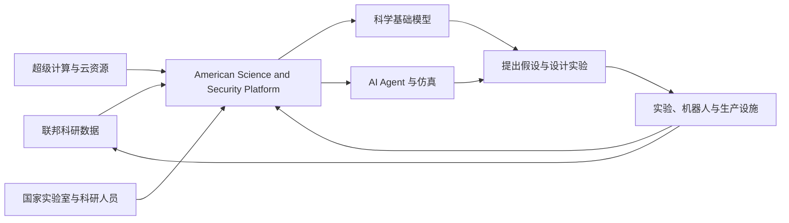

# Genesis Mission

> 资料状态：已纳入正式知识库。计划事实以本地来源记录 `sources/clips/2026-07-24-us-doe-genesis-mission.md` 为准，资料截止 2026-07-24；对战略意义的判断属于知识库综合，不是美国政府已经证明的结果。

## 一句话判断

**Genesis Mission 是美国建设国家级“AI for Science 操作系统”的计划：它不是训练一个万能科学模型，而是试图把国家实验室的算力、数据、模型、科研人员和实验设施连接成可循环运行的科学发现基础设施。**

## 它是什么

美国总统于 2025 年 11 月 24 日通过第 14363 号行政令启动 Genesis Mission。计划由美国能源部负责实施，白宫科技政策体系负责跨机构协调，并以能源部的 17 个国家实验室为主要执行网络。[来源](../../sources/clips/2026-07-24-us-doe-genesis-mission.md#计划设立)

它的核心不是发布一个聊天机器人，而是建设 **American Science and Security Platform**。该平台计划连接高性能计算、联邦科研数据、科学实验设施、AI 模型和生产能力，让科研团队能够在同一体系内训练科学基础模型、运行 AI agent、设计实验并把实验结果反馈给模型。[来源](../../sources/clips/2026-07-24-us-doe-genesis-mission.md#组织和技术结构)



这张图表达的是官方希望建立的闭环，不代表所有环节已经实现或互联。

## 为什么由能源部主导

美国能源部不仅管理能源政策，也管理国家实验室、高性能计算机、核安全设施和大量长期积累的科研数据。对于 AI for Science，稀缺资源往往不是通用语言模型本身，而是经过校准的实验设施、可信数据、超级计算能力和领域专家。

因此，能源部在这项计划中的作用更接近“科研基础设施运营者”，而不是普通 AI 产品公司。白宫负责设定国家优先级，能源部和国家实验室提供基础设施，大学与企业则提供研究团队、模型、云平台、芯片和工程能力。

## 它准备解决什么问题

Genesis Mission 最初要求识别至少 20 项国家级科技挑战，重点覆盖：

- 核裂变、核聚变和电网；
- 新材料、关键矿产和先进制造；
- 生物技术与自动化实验；
- 半导体、微电子和数据中心；
- 量子信息科学；
- 核安全与国防相关研究。

这些问题的共同特点是：搜索空间巨大、实验或仿真昂贵，而且结果必须经过物理实验和领域标准验证。AI 的潜在价值不是代替科学家给出最终答案，而是缩小搜索空间、选择更值得做的实验，并缩短“假设—仿真—实验—反馈”的周期。[来源](../../sources/clips/2026-07-24-us-doe-genesis-mission.md#重点任务)

## 当前进展

截至 2026 年 7 月 24 日，Genesis Mission 已经从行政计划进入项目执行阶段：

| 指标 | 已公开状态 | 应如何理解 |
|---|---:|---|
| DOE 项目征集 | 2.93 亿美元 | 联邦项目资金口径 |
| 入选项目 | 278 个 | 进入资助谈判，不等于全部已拨款 |
| 参与机构 | 342 家 | 包括实验室、大学、企业和非营利组织 |
| 合作伙伴承诺 | 超过 8 亿美元 | 含算力、云额度、模型、专业服务与直接资金，并非全是现金 |
| 最大单项 | 三年 6000 万美元 | 用 AI 加速核设施建设和运行相关研究 |

[来源与口径说明](../../sources/clips/2026-07-24-us-doe-genesis-mission.md#截至-2026-07-24-的执行进展)

这些数字说明组织和资金机制已经启动，但还不能证明平台已经达到跨实验室统一运行的成熟状态。

## 更值得关注的三层变化

### 1. AI for Science 从单点模型转向系统工程

过去很多项目关注一个材料模型、蛋白质模型或仿真代理模型。Genesis Mission 更强调数据标准、算力调度、模型访问、实验设施和安全权限的协同。它把科研 AI 的竞争单位从“模型”扩大为“研究系统”。

### 2. AI agent 开始接入真实实验循环

与 [[AI Scientist]] 这类主要在软件环境中完成文献、代码、实验和论文流程的系统相比，Genesis Mission 试图让 agent 接入高性能仿真、科研仪器和自动化实验室。真正困难的部分将是实验可靠性、权限控制、数据质量和结果复现，而不只是 agent 能否生成一个合理计划。

### 3. 科研数据被视为战略基础设施

[[sources/2026-07-11-polymathic-ai-the-well|The Well]] 展示了统一开放的物理仿真数据如何降低机器学习研究门槛；Genesis Mission 则把同一问题提升到国家规模，并加入敏感数据、国家安全和生产设施。这会提高科研能力，也意味着开放性、访问资格和成果共享可能受到更严格限制。

## 不应过度解读的地方

- **“十年内科研生产力翻倍”是目标，不是现有证据。**
- **278 个项目是入选谈判，不是 278 个已经完成拨款或取得突破的项目。**
- **超过 8 亿美元是合作资源承诺，不等于 8 亿美元现金预算。**
- **官方使用曼哈顿计划、阿波罗计划式语言描述其雄心，但目前仍处于基础设施和项目组合建设期。**
- **AI 可以提高候选生成和实验吞吐量，但科学结论仍需要测量、复现、误差分析和同行检验。**

判断它是否成功，应该观察平台是否真正实现跨实验室数据与计算互操作、项目是否缩短发现周期、成果能否独立复现，以及新增投入是否带来可归因的科研产出，而不是只看合作名单和资金承诺。

## 与本知识库的关系

Genesis Mission 是 [[自动化研究]] 从单个 agent workflow 扩展到国家级科研基础设施的代表案例。它提示我们，AI 科研能力至少由五层共同决定：

```text
模型能力 × 高质量数据 × 计算资源 × 实验设施 × 验证制度
```

任何一层接近零，系统都很难产生可信的科学突破。Genesis Mission 最值得持续跟踪的地方，正是它能否把这五层真正连接起来。

## Sources

- [本地官方来源摘要](../../sources/clips/2026-07-24-us-doe-genesis-mission.md)
- [Genesis Mission 官方主页](https://www.energy.gov/undersecretaryforscience/genesis-mission/genesis-mission)
- [第 14363 号行政令](https://www.whitehouse.gov/presidential-actions/2025/11/launching-the-genesis-mission/)
