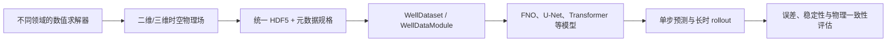

# The Well：把昂贵物理仿真变成可复用的机器学习基础设施

> Review 状态：本文是 AI 基于项目仓库、官方文档、NeurIPS 论文和 Hugging Face 数据集合生成的 Wiki 草稿。项目事实以本地来源记录 `sources/clips/2026-07-11-polymathic-ai-the-well.md` 及原始资料为准；评价与推论不作为事实源。

## 一句话判断

The Well 最重要的意义不只是“有人上传了 15TB 文件”，而是把 16 类高成本、异构的物理仿真整理成统一 HDF5 规格、PyTorch 接口和基准任务，使科学机器学习研究者可以在同一套管线上训练和比较 PDE 代理模型。

它降低的是**获得高质量仿真轨迹和接入多种物理问题的门槛**，并没有消除存储、训练、分布外泛化、物理可靠性和科学验证的成本。

## 它解决了什么稀缺性

高质量物理仿真数据难以规模化，通常同时需要：

1. 知道应解哪些方程、参数范围和边界条件的领域专家；
2. 经过验证的数值软件和复杂前后处理；
3. 大型并行计算资源与长期配额；
4. 高频保存完整物理场所需的巨大存储和 I/O；
5. 把不同代码输出转成机器学习样本的数据工程。

The Well 把已经支付过的仿真成本转成公共数据资产。最极端的例子是红超巨星对流包层数据：约两个月、80 个 NASA Pleiades 节点、约一千万 CPU 小时。中子星并合后数据的单次仿真约需三周和 300 个 CPU 核。

但集合也包含便宜得多的任务，因此不应把每个数据集都描述成“数百万美元级国家实验室仿真”。准确说法是：它把从实验室级到国家级 HPC 成本跨度很大的科研仿真统一开放出来。

## 16 类物理场景的跨度

The Well 从流体动力学向天体物理、生物启发系统、声学和反应扩散扩展，包含：

- 激波、剪切流、Rayleigh–Bénard 对流、Rayleigh–Taylor 不稳定性；
- 星际介质磁流体湍流、引力与冷却、超新星冲击波；
- 红超巨星对流包层、中子星并合后吸积盘；
- 主动物质、Gray–Scott 反应扩散；
- 声学散射、Helmholtz 周期结构散射；
- 行星浅水方程和辐射冷却混合层；
- 黏弹性流动不稳定性。

它们共同拥有时空物理场和微分方程结构，但空间维度、坐标系、分辨率、变量、边界条件、时间尺度与难点并不一致。这种差异正是数据集的价值：它能检验一个模型是真的学会了可迁移的动力学表征，还是只适配了单一 benchmark。

## 从异构仿真到统一训练接口

这层标准化比“提供下载链接”更关键。统一接口让模型代码可以跨数据集复用，也让第三方按同一规范加入新的物理数据。

## PDE 代理模型不是魔法求解器

论文的核心任务是从最近 4 个时间步预测下一时刻，再反复滚动生成更长轨迹。训练好的神经网络推理可能比重新运行高保真模拟快很多，但有四个边界：

- **不是完整轨迹只需一次前向传播。** 一次推理通常对应一个时间步，长期预测需要多次自回归调用。
- **不是精确替代。** 神经网络给出近似解，误差会积累，也可能违反守恒律或产生不稳定状态。
- **不是跨参数自动泛化。** 超出训练参数、几何、边界条件或分辨率后，可靠性必须重新验证。
- **不是免费计算。** 15TB 数据的存储、传输和训练仍需要可观资源。

因此 The Well 的近期价值主要是代理模型研究、架构比较、预训练和跨物理迁移，而不是让用户立即关停传统数值求解器。

## 为什么它适合物理基础模型

过去很多 PDE 数据集要么多样但简单，要么真实复杂但只覆盖一个问题。The Well 尝试把“广度”和“研究前沿级复杂度”放在一起。

这为物理基础模型提供了三类实验：

1. **跨数据集预训练**：学习通用的局部相互作用、输运、波动、湍流和多尺度结构。
2. **少样本迁移**：在新物理系统或参数范围内，用较少数据适配。
3. **架构压力测试**：比较卷积网络、神经算子、Transformer 等能否同时处理多种动力学。

但“物理基础模型”仍是研究方向，不是 The Well 已经实现的结果。数据集统一了输入层，尚未解决变量语义对齐、跨坐标系 tokenization、守恒约束、长时稳定性和不确定性校准。

## 数据产品层次

| 层 | The Well 提供什么 | 用户仍需解决什么 |
|---|---|---|
| 原始资产 | 已生成的高质量物理轨迹 | 是否适合自己的科学问题 |
| 数据规范 | HDF5、字段类型、元数据、数据划分 | 新数据的语义与质量审核 |
| 接入层 | 下载、HF streaming、PyTorch Dataset/DataModule | 存储、带宽、并行 I/O |
| 基准层 | FNO、TFNO、U-Net、ConvNeXt U-Net 基线 | 更强模型与公平超参比较 |
| 科学验证 | 基础误差与 rollout 评测 | 守恒、稳定、OOD、不确定性、领域指标 |

## 开放，但不是完整生成链全部开源

数据采用 CC BY 4.0，仓库软件采用 BSD 3-Clause，数据可以分项下载，工具链也可以修改复用。这已经是高度开放的科研基础设施。

但论文明确说部分数据由无法发布的专有代码生成。因此“100% 开源”会混淆三件事：最终数据开放、读取/基准代码开放、原始仿真求解器和生成流水线开放。The Well 完整实现了前两项，没有对所有数据实现第三项。

## 当前使用时应注意

1. 不要默认下载全部 15TB；先从最小数据集或 MiniWell 验证管线。
2. Hugging Face streaming 适合试验，本地存储更适合大规模训练。
3. 项目当前明确弃用了存在处理错误的 `viscoelastic_instability`，应使用 `viscoelastic_instability_v2`。
4. 官方“16 个数据集”与当前仓库目录/HF repo 数并非简单一一对应，引用时沿用正式口径并说明变体。
5. 基线是统一比较的起点，不代表最先进性能，也不证明代理模型可用于高风险科学结论。

## 对本知识库的意义

The Well 是“昂贵计算结果如何成为公共基础设施”的典型案例，也展示了 AI for Science 数据层的真正护城河：

- 稀缺性来自领域专家、算力和数据工程的组合，而不只是文件大小；
- 统一 schema 与 DataLoader 把异构科研资产变成可组合训练语料；
- 大规模科学数据集可以支撑多领域基础模型，但必须保留物理元数据；
- 代理模型的商业和科研价值取决于速度、误差、稳定性和验证成本的共同权衡。

## 结论

The Well 把过去散落在不同实验室、不同求解器和不同存储格式中的仿真结果，编译成一套可访问、可比较、可扩展的科学机器学习数据基础设施。

它真正开放的不是“免费获得一个万能物理求解器”，而是让更多研究者不必先重复支付最昂贵的数据生成成本，就能研究如何构建更快、更通用的物理代理模型。

## Sources

- 本地来源记录：[sources/clips/2026-07-11-polymathic-ai-the-well.md](../../sources/clips/2026-07-11-polymathic-ai-the-well.md)
- GitHub 仓库：https://github.com/PolymathicAI/the_well
- 官方文档：https://polymathic-ai.org/the_well/
- 论文：https://arxiv.org/abs/2412.00568
- Hugging Face：https://huggingface.co/collections/polymathic-ai/the-well-67e129f4ca23e0447395d74c

