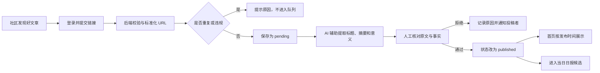
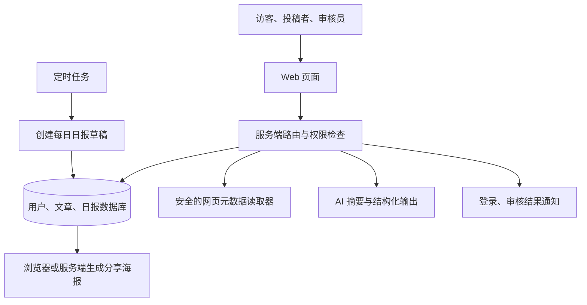
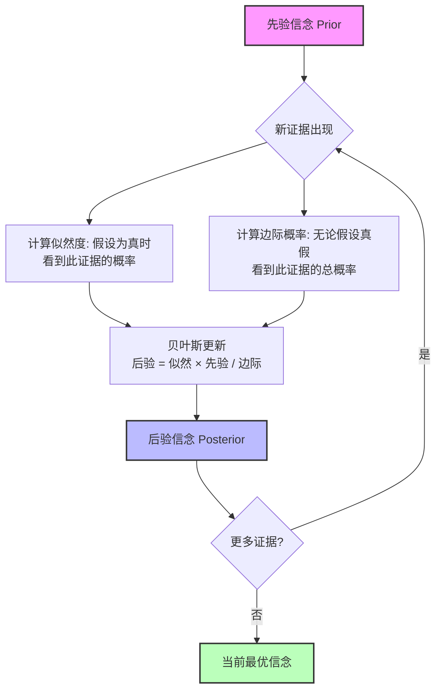
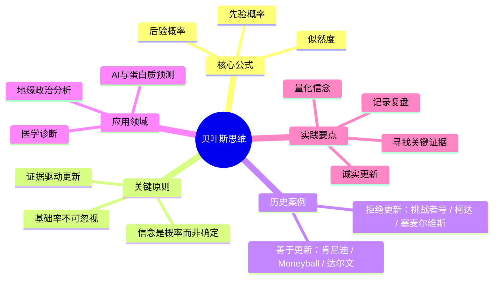
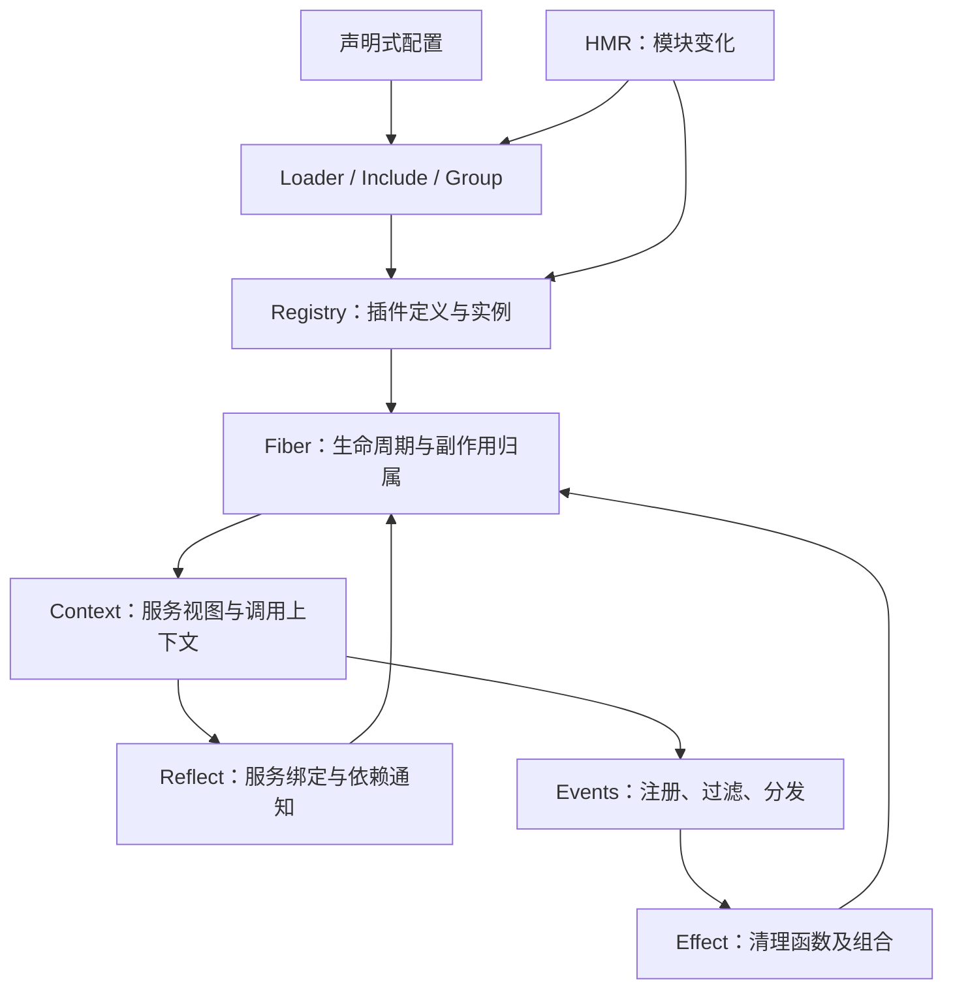
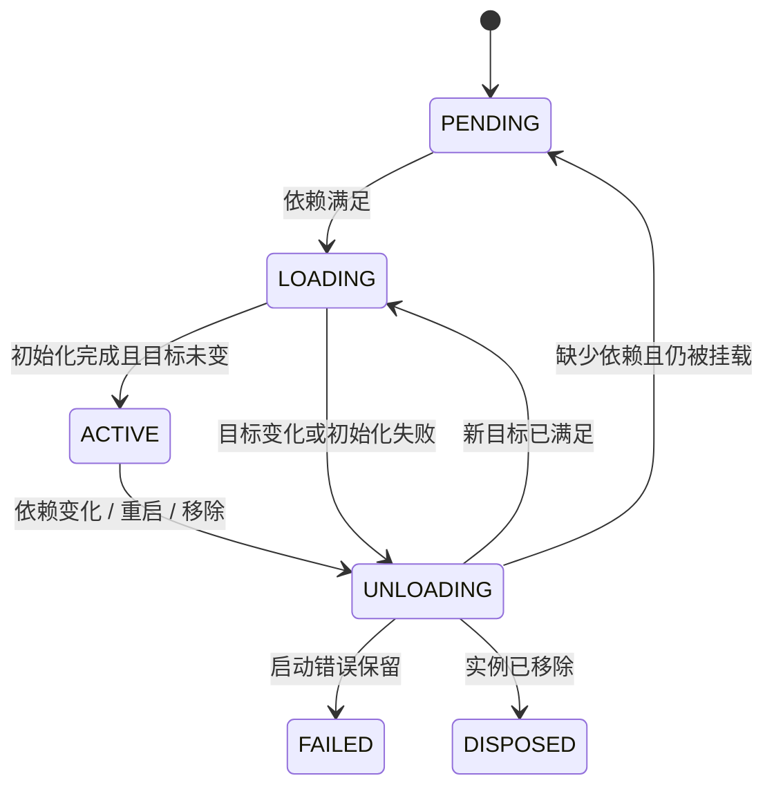
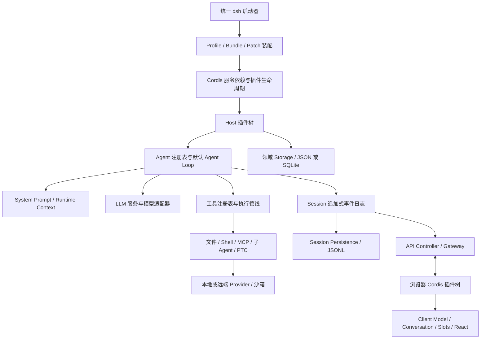
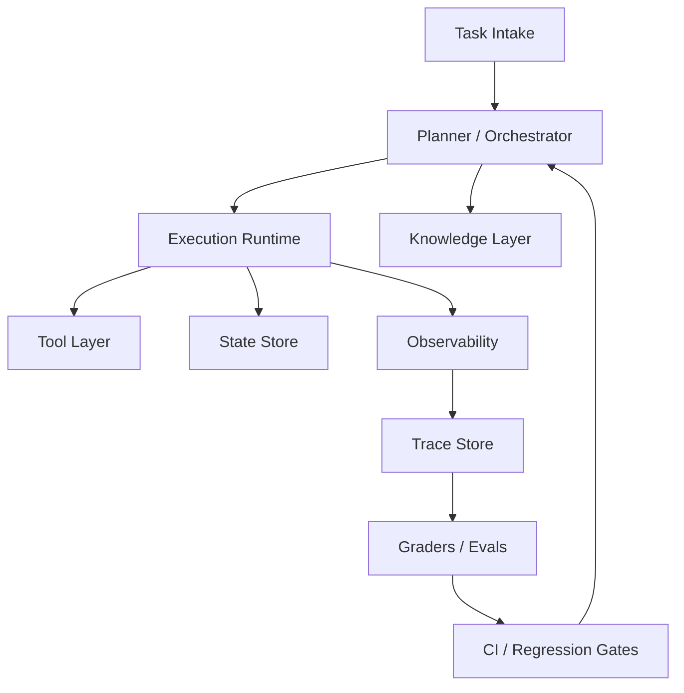
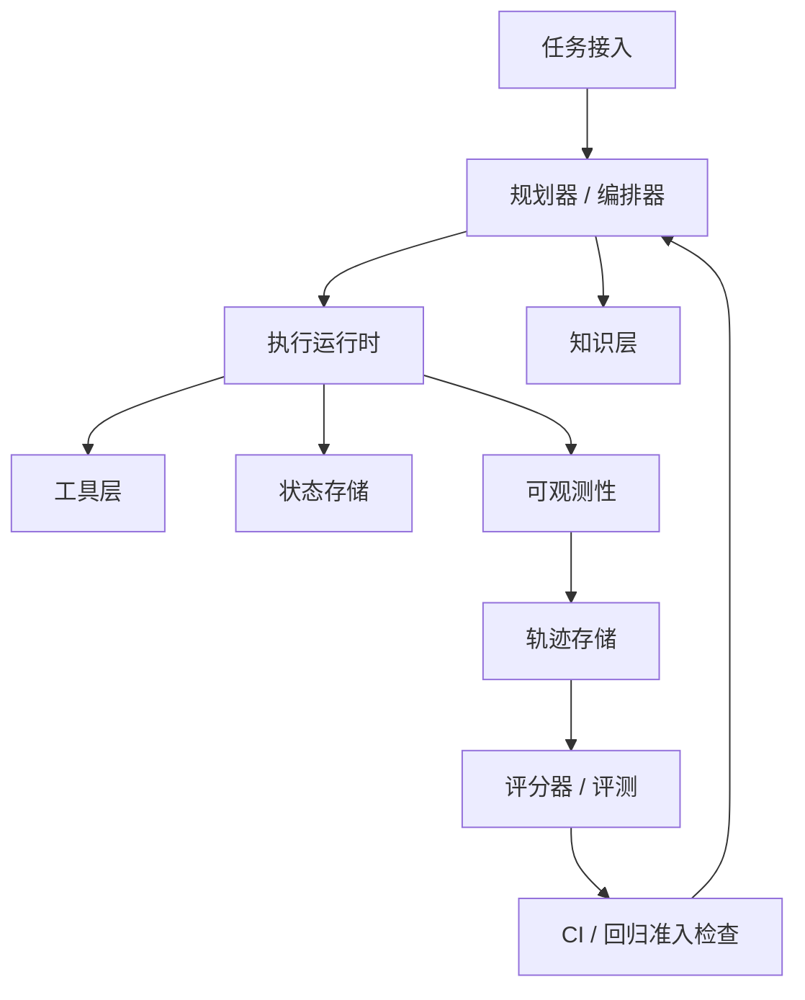

# AI 开发与 Agent 工程：文档内容合集

本文件汇集各来源 Markdown 原文，正文未作语义改写。原始层级与代码示例保留；本地 Markdown 链接改为指向 sources 中的对应文件。来源说明与推荐路线见 [README](README.md)。


---

# 来源项目：AI-Agent-Engineer


---

## 文档：Lil'Log 文章标题与描述

来源：[sources/AI-Agent-Engineer/lilianweng_articles.md](sources/AI-Agent-Engineer/lilianweng_articles.md)

# Lil'Log 文章标题与描述

> 来源：[Lil'Log](https://lilianweng.github.io/)；范围为站点 sitemap 中的全部文章页面（`/posts/YYYY-MM-DD-.../`）。
> 抓取日期：2026-07-24；共 52 篇。

## 文章目录

1. [Harness Engineering for Self-Improvement](#1-harness-engineering-for-self-improvement)
2. [Scaling Laws, Carefully](#2-scaling-laws-carefully)
3. [Why We Think](#3-why-we-think)
4. [Reward Hacking in Reinforcement Learning](#4-reward-hacking-in-reinforcement-learning)
5. [Extrinsic Hallucinations in LLMs](#5-extrinsic-hallucinations-in-llms)
6. [Diffusion Models for Video Generation](#6-diffusion-models-for-video-generation)
7. [Thinking about High-Quality Human Data](#7-thinking-about-high-quality-human-data)
8. [Adversarial Attacks on LLMs](#8-adversarial-attacks-on-llms)
9. [LLM Powered Autonomous Agents](#9-llm-powered-autonomous-agents)
10. [Prompt Engineering](#10-prompt-engineering)
11. [The Transformer Family Version 2.0](#11-the-transformer-family-version-2-0)
12. [Large Transformer Model Inference Optimization](#12-large-transformer-model-inference-optimization)
13. [Some Math behind Neural Tangent Kernel](#13-some-math-behind-neural-tangent-kernel)
14. [Generalized Visual Language Models](#14-generalized-visual-language-models)
15. [Learning with not Enough Data Part 3: Data Generation](#15-learning-with-not-enough-data-part-3-data-generation)
16. [Learning with not Enough Data Part 2: Active Learning](#16-learning-with-not-enough-data-part-2-active-learning)
17. [Learning with not Enough Data Part 1: Semi-Supervised Learning](#17-learning-with-not-enough-data-part-1-semi-supervised-learning)
18. [How to Train Really Large Models on Many GPUs?](#18-how-to-train-really-large-models-on-many-gpus)
19. [What are Diffusion Models?](#19-what-are-diffusion-models)
20. [Contrastive Representation Learning](#20-contrastive-representation-learning)
21. [Reducing Toxicity in Language Models](#21-reducing-toxicity-in-language-models)
22. [Controllable Neural Text Generation](#22-controllable-neural-text-generation)
23. [How to Build an Open-Domain Question Answering System?](#23-how-to-build-an-open-domain-question-answering-system)
24. [Neural Architecture Search](#24-neural-architecture-search)
25. [Exploration Strategies in Deep Reinforcement Learning](#25-exploration-strategies-in-deep-reinforcement-learning)
26. [The Transformer Family](#26-the-transformer-family)
27. [Curriculum for Reinforcement Learning](#27-curriculum-for-reinforcement-learning)
28. [Self-Supervised Representation Learning](#28-self-supervised-representation-learning)
29. [Evolution Strategies](#29-evolution-strategies)
30. [Meta Reinforcement Learning](#30-meta-reinforcement-learning)
31. [Domain Randomization for Sim2Real Transfer](#31-domain-randomization-for-sim2real-transfer)
32. [Are Deep Neural Networks Dramatically Overfitted?](#32-are-deep-neural-networks-dramatically-overfitted)
33. [Generalized Language Models](#33-generalized-language-models)
34. [Object Detection Part 4: Fast Detection Models](#34-object-detection-part-4-fast-detection-models)
35. [Meta-Learning: Learning to Learn Fast](#35-meta-learning-learning-to-learn-fast)
36. [Flow-based Deep Generative Models](#36-flow-based-deep-generative-models)
37. [From Autoencoder to Beta-VAE](#37-from-autoencoder-to-beta-vae)
38. [Attention? Attention!](#38-attention-attention)
39. [Implementing Deep Reinforcement Learning Models with Tensorflow + OpenAI Gym](#39-implementing-deep-reinforcement-learning-models-with-tensorflow-openai-gym)
40. [Policy Gradient Algorithms](#40-policy-gradient-algorithms)
41. [A (Long) Peek into Reinforcement Learning](#41-a-long-peek-into-reinforcement-learning)
42. [The Multi-Armed Bandit Problem and Its Solutions](#42-the-multi-armed-bandit-problem-and-its-solutions)
43. [Object Detection for Dummies Part 3: R-CNN Family](#43-object-detection-for-dummies-part-3-r-cnn-family)
44. [Object Detection for Dummies Part 2: CNN, DPM and Overfeat](#44-object-detection-for-dummies-part-2-cnn-dpm-and-overfeat)
45. [Object Detection for Dummies Part 1: Gradient Vector, HOG, and SS](#45-object-detection-for-dummies-part-1-gradient-vector-hog-and-ss)
46. [Learning Word Embedding](#46-learning-word-embedding)
47. [Anatomize Deep Learning with Information Theory](#47-anatomize-deep-learning-with-information-theory)
48. [From GAN to WGAN](#48-from-gan-to-wgan)
49. [How to Explain the Prediction of a Machine Learning Model?](#49-how-to-explain-the-prediction-of-a-machine-learning-model)
50. [Predict Stock Prices Using RNN: Part 2](#50-predict-stock-prices-using-rnn-part-2)
51. [Predict Stock Prices Using RNN: Part 1](#51-predict-stock-prices-using-rnn-part-1)
52. [An Overview of Deep Learning for Curious People](#52-an-overview-of-deep-learning-for-curious-people)

---

## 1. [Harness Engineering for Self-Improvement](https://lilianweng.github.io/posts/2026-07-04-harness/)

发布日期：2026-07-04

The concept of recursive self-improvement (RSI) dates back to I. J. Good (1965), where he defined an “ultraintelligent machine” as a system that can surpass humans in all intellectual activities and design better machines to improve itself. Yudkowsky (2008) used the phrase “recursive self-improvement” for a specific feedback loop: an AI uses its current intelligence to improve the cognitive machinery that produces its intelligence. This feedback loop in modern AI may indicate the model rewriting its own weights directly, or more broadly the model improves the training pipeline and the deployment system, which in turn enables a better successor model with improved performance across economically valuable tasks. The speed of research development in AI has been shown to drastically accelerated in frontier labs (Anthropic; OpenAI).

## 2. [Scaling Laws, Carefully](https://lilianweng.github.io/posts/2026-06-24-scaling-laws/)

发布日期：2026-06-24

Scaling laws are one of the most critical empirical findings in deep learning. The observation is simple in form: the training loss $L$ decreases predictably as we scale up model size $N$, dataset size $D$, and compute $C$, following a power-law curve, which appears as a straight line on a log-log plot. We can view scaling laws as a framework for describing the relationship between compute, loss, model size and data; at its core, it is about how to allocate precious compute optimally between $N$ and $D$.

## 3. [Why We Think](https://lilianweng.github.io/posts/2025-05-01-thinking/)

发布日期：2025-05-01

Special thanks to John Schulman for a lot of super valuable feedback and direct edits on this post. Test time compute (Graves et al. 2016, Ling, et al. 2017, Cobbe et al. 2021) and Chain-of-thought (CoT) (Wei et al. 2022, Nye et al. 2021), have led to significant improvements in model performance, while raising many research questions. This post aims to review recent developments in how to effectively use test-time compute (i.e. “thinking time”) and why it helps.

## 4. [Reward Hacking in Reinforcement Learning](https://lilianweng.github.io/posts/2024-11-28-reward-hacking/)

发布日期：2024-11-28

Reward hacking occurs when a reinforcement learning (RL) agent exploits flaws or ambiguities in the reward function to achieve high rewards, without genuinely learning or completing the intended task. Reward hacking exists because RL environments are often imperfect, and it is fundamentally challenging to accurately specify a reward function. With the rise of language models generalizing to a broad spectrum of tasks and RLHF becomes a de facto method for alignment training, reward hacking in RL training of language models has become a critical practical challenge. Instances where the model learns to modify unit tests to pass coding tasks, or where responses contain biases that mimic a user’s preference, are pretty concerning and are likely one of the major blockers for real-world deployment of more autonomous use cases of AI models.

## 5. [Extrinsic Hallucinations in LLMs](https://lilianweng.github.io/posts/2024-07-07-hallucination/)

发布日期：2024-07-07

Hallucination in large language models usually refers to the model generating unfaithful, fabricated, inconsistent, or nonsensical content. As a term, hallucination has been somewhat generalized to cases when the model makes mistakes. Here, I would like to narrow down the problem of hallucination to cases where the model output is fabricated and not grounded by either the provided context or world knowledge. There are two types of hallucination: In-context hallucination: The model output should be consistent with the source content in context. Extrinsic hallucination: The model output should be grounded by the pre-training dataset. However, given the size of the pre-training dataset, it is too expensive to retrieve and identify conflicts per generation. If we consider the pre-training data corpus as a proxy for world knowledge, we essentially try to ensure the model output is factual and verifiable by external world knowledge. Equally importantly, when the model does not know about a fact, it should say so. This post focuses on extrinsic hallucination. To avoid hallucination, LLMs need to be (1) factual and (2) acknowledge not knowing the answer when applicable.

## 6. [Diffusion Models for Video Generation](https://lilianweng.github.io/posts/2024-04-12-diffusion-video/)

发布日期：2024-04-12

Diffusion models have demonstrated strong results on image synthesis in past years. Now the research community has started working on a harder task—using it for video generation. The task itself is a superset of the image case, since an image is a video of 1 frame, and it is much more challenging because: It has extra requirements on temporal consistency across frames in time, which naturally demands more world knowledge to be encoded into the model. In comparison to text or images, it is more difficult to collect large amounts of high-quality, high-dimensional video data, let along text-video pairs. 🥑 Required Pre-read: Please make sure you have read the previous blog on “What are Diffusion Models?” for image generation before continue here.

## 7. [Thinking about High-Quality Human Data](https://lilianweng.github.io/posts/2024-02-05-human-data-quality/)

发布日期：2024-02-05

[Special thank you to Ian Kivlichan for many useful pointers (E.g. the 100+ year old Nature paper “Vox populi”) and nice feedback. 🙏 ] High-quality data is the fuel for modern data deep learning model training. Most of the task-specific labeled data comes from human annotation, such as classification task or RLHF labeling (which can be constructed as classification format) for LLM alignment training. Lots of ML techniques in the post can help with data quality, but fundamentally human data collection involves attention to details and careful execution. The community knows the value of high quality data, but somehow we have this subtle impression that “Everyone wants to do the model work, not the data work” (Sambasivan et al. 2021).

## 8. [Adversarial Attacks on LLMs](https://lilianweng.github.io/posts/2023-10-25-adv-attack-llm/)

发布日期：2023-10-25

The use of large language models in the real world has strongly accelerated by the launch of ChatGPT. We (including my team at OpenAI, shoutout to them) have invested a lot of effort to build default safe behavior into the model during the alignment process (e.g. via RLHF). However, adversarial attacks or jailbreak prompts could potentially trigger the model to output something undesired. A large body of ground work on adversarial attacks is on images, and differently it operates in the continuous, high-dimensional space. Attacks for discrete data like text have been considered to be a lot more challenging, due to lack of direct gradient signals. My past post on Controllable Text Generation is quite relevant to this topic, as attacking LLMs is essentially to control the model to output a certain type of (unsafe) content.

## 9. [LLM Powered Autonomous Agents](https://lilianweng.github.io/posts/2023-06-23-agent/)

发布日期：2023-06-23

Building agents with LLM (large language model) as its core controller is a cool concept. Several proof-of-concepts demos, such as AutoGPT, GPT-Engineer and BabyAGI, serve as inspiring examples. The potentiality of LLM extends beyond generating well-written copies, stories, essays and programs; it can be framed as a powerful general problem solver. Agent System Overview In a LLM-powered autonomous agent system, LLM functions as the agent’s brain, complemented by several key components: Planning Subgoal and decomposition: The agent breaks down large tasks into smaller, manageable subgoals, enabling efficient handling of complex tasks. Reflection and refinement: The agent can do self-criticism and self-reflection over past actions, learn from mistakes and refine them for future steps, thereby improving the quality of final results. Memory Short-term memory: I would consider all the in-context learning (See Prompt Engineering) as utilizing short-term memory of the model to learn. Long-term memory: This provides the agent with the capability to retain and recall (infinite) information over extended periods, often by leveraging an external vector store and fast retrieval. Tool use The agent learns to call external APIs for extra information that is missing from the model weights (often hard to change after pre-training), including current information, code execution capability, access to proprietary information sources and more. Overview of a LLM-powered autonomous agent system. Component One: Planning A complicated task usually involves many steps. An agent needs to know what they are and plan ahead.

## 10. [Prompt Engineering](https://lilianweng.github.io/posts/2023-03-15-prompt-engineering/)

发布日期：2023-03-15

Prompt Engineering, also known as In-Context Prompting, refers to methods for how to communicate with LLM to steer its behavior for desired outcomes without updating the model weights. It is an empirical science and the effect of prompt engineering methods can vary a lot among models, thus requiring heavy experimentation and heuristics. This post only focuses on prompt engineering for autoregressive language models, so nothing with Cloze tests, image generation or multimodality models. At its core, the goal of prompt engineering is about alignment and model steerability. Check my previous post on controllable text generation.

## 11. [The Transformer Family Version 2.0](https://lilianweng.github.io/posts/2023-01-27-the-transformer-family-v2/)

发布日期：2023-01-27

Many new Transformer architecture improvements have been proposed since my last post on “The Transformer Family” about three years ago. Here I did a big refactoring and enrichment of that 2020 post — restructure the hierarchy of sections and improve many sections with more recent papers. Version 2.0 is a superset of the old version, about twice the length. Notations Symbol Meaning $d$ The model size / hidden state dimension / positional encoding size. $h$ The number of heads in multi-head attention layer. $L$ The segment length of input sequence. $N$ The total number of attention layers in the model; not considering MoE. $\mathbf{X} \in \mathbb{R}^{L \times d}$ The input sequence where each element has been mapped into an embedding vector of shape $d$, same as the model size. $\mathbf{W}^k \in \mathbb{R}^{d \times d_k}$ The key weight matrix. $\mathbf{W}^q \in \mathbb{R}^{d \times d_k}$ The query weight matrix. $\mathbf{W}^v \in \mathbb{R}^{d \times d_v}$ The value weight matrix. Often we have $d_k = d_v = d$. $\mathbf{W}^k_i, \mathbf{W}^q_i \in \mathbb{R}^{d \times d_k/h}; \mathbf{W}^v_i \in \mathbb{R}^{d \times d_v/h}$ The weight matrices per head. $\mathbf{W}^o \in \mathbb{R}^{d_v \times d}$ The output weight matrix. $\mathbf{Q} = \mathbf{X}\mathbf{W}^q \in \mathbb{R}^{L \times d_k}$ The query embedding inputs. $\mathbf{K} = \mathbf{X}\mathbf{W}^k \in \mathbb{R}^{L \times d_k}$ The key embedding inputs. $\mathbf{V} = \mathbf{X}\mathbf{W}^v \in \mathbb{R}^{L \times d_v}$ The value embedding inputs. $\mathbf{q}_i, \mathbf{k}_i \in \mathbb{R}^{d_k}, \mathbf{v}_i \in \mathbb{R}^{d_v}$ Row vectors in query, key, value matrices, $\mathbf{Q}$, $\mathbf{K}$ and $\mathbf{V}$. $S_i$ A collection of key positions for the $i$-th query $\mathbf{q}_i$ to attend to. $\mathbf{A} \in \mathbb{R}^{L \times L}$ The self-attention matrix between a input sequence of lenght $L$ and itself. $\mathbf{A} = \text{softmax}(\mathbf{Q}\mathbf{K}^\top / \sqrt{d_k})$. $a_{ij} \in \mathbf{A}$ The scalar attention score between query $\mathbf{q}_i$ and key $\mathbf{k}_j$. $\mathbf{P} \in \mathbb{R}^{L \times d}$ position encoding matrix, where the $i$-th row $\mathbf{p}_i$ is the positional encoding for input $\mathbf{x}_i$. Transformer Basics The Transformer (which will be referred to as “vanilla Transformer” to distinguish it from other enhanced versions; Vaswani, et al., 2017) model has an encoder-decoder architecture, as commonly used in many NMT models. Later simplified Transformer was shown to achieve great performance in language modeling tasks, like in encoder-only BERT or decoder-only GPT.

## 12. [Large Transformer Model Inference Optimization](https://lilianweng.github.io/posts/2023-01-10-inference-optimization/)

发布日期：2023-01-10

[Updated on 2023-01-24: add a small section on Distillation.] Large transformer models are mainstream nowadays, creating SoTA results for a variety of tasks. They are powerful but very expensive to train and use. The extremely high inference cost, in both time and memory, is a big bottleneck for adopting a powerful transformer for solving real-world tasks at scale. Why is it hard to run inference for large transformer models? Besides the increasing size of SoTA models, there are two main factors contributing to the inference challenge (Pope et al. 2022):

## 13. [Some Math behind Neural Tangent Kernel](https://lilianweng.github.io/posts/2022-09-08-ntk/)

发布日期：2022-09-08

Neural networks are well known to be over-parameterized and can often easily fit data with near-zero training loss with decent generalization performance on test dataset. Although all these parameters are initialized at random, the optimization process can consistently lead to similarly good outcomes. And this is true even when the number of model parameters exceeds the number of training data points. Neural tangent kernel (NTK) (Jacot et al. 2018) is a kernel to explain the evolution of neural networks during training via gradient descent. It leads to great insights into why neural networks with enough width can consistently converge to a global minimum when trained to minimize an empirical loss. In the post, we will do a deep dive into the motivation and definition of NTK, as well as the proof of a deterministic convergence at different initializations of neural networks with infinite width by characterizing NTK in such a setting.

## 14. [Generalized Visual Language Models](https://lilianweng.github.io/posts/2022-06-09-vlm/)

发布日期：2022-06-09

Processing images to generate text, such as image captioning and visual question-answering, has been studied for years. Traditionally such systems rely on an object detection network as a vision encoder to capture visual features and then produce text via a text decoder. Given a large amount of existing literature, in this post, I would like to only focus on one approach for solving vision language tasks, which is to extend pre-trained generalized language models to be capable of consuming visual signals.

## 15. [Learning with not Enough Data Part 3: Data Generation](https://lilianweng.github.io/posts/2022-04-15-data-gen/)

发布日期：2022-04-15

Here comes the Part 3 on learning with not enough data (Previous: Part 1 and Part 2). Let’s consider two approaches for generating synthetic data for training. Augmented data. Given a set of existing training samples, we can apply a variety of augmentation, distortion and transformation to derive new data points without losing the key attributes. We have covered a bunch of augmentation methods on text and images in a previous post on contrastive learning. For the sake of post completeness, I duplicate the section on data augmentation here with some edits. New data. Given few or even no data points, we can rely on powerful pretrained models to generate a number of new data points. This is especially true in recent years given the fast progress in large pretrained language models (LM). Few shot prompting is shown to be effective for LM to learn within context without extra training. Data Augmentation The goal of data augmentation is to modify the input format (e.g. text wording, visual appearance) while the semantic meaning stays unchanged.

## 16. [Learning with not Enough Data Part 2: Active Learning](https://lilianweng.github.io/posts/2022-02-20-active-learning/)

发布日期：2022-02-20

This is part 2 of what to do when facing a limited amount of labeled data for supervised learning tasks. This time we will get some amount of human labeling work involved, but within a budget limit, and therefore we need to be smart when selecting which samples to label.

## 17. [Learning with not Enough Data Part 1: Semi-Supervised Learning](https://lilianweng.github.io/posts/2021-12-05-semi-supervised/)

发布日期：2021-12-05

When facing a limited amount of labeled data for supervised learning tasks, four approaches are commonly discussed.

## 18. [How to Train Really Large Models on Many GPUs?](https://lilianweng.github.io/posts/2021-09-25-train-large/)

发布日期：2021-09-24

[Updated on 2022-03-13: add expert choice routing.] [Updated on 2022-06-10]: Greg and I wrote a shorted and upgraded version of this post, published on OpenAI Blog: “Techniques for Training Large Neural Networks”

## 19. [What are Diffusion Models?](https://lilianweng.github.io/posts/2021-07-11-diffusion-models/)

发布日期：2021-07-11

[Updated on 2021-09-19: Highly recommend this blog post on score-based generative modeling by Yang Song (author of several key papers in the references)]. [Updated on 2022-08-27: Added classifier-free guidance, GLIDE, unCLIP and Imagen. [Updated on 2022-08-31: Added latent diffusion model. [Updated on 2024-04-13: Added progressive distillation, consistency models, and the Model Architecture section.

## 20. [Contrastive Representation Learning](https://lilianweng.github.io/posts/2021-05-31-contrastive/)

发布日期：2021-05-31

The goal of contrastive representation learning is to learn such an embedding space in which similar sample pairs stay close to each other while dissimilar ones are far apart. Contrastive learning can be applied to both supervised and unsupervised settings. When working with unsupervised data, contrastive learning is one of the most powerful approaches in self-supervised learning.

## 21. [Reducing Toxicity in Language Models](https://lilianweng.github.io/posts/2021-03-21-lm-toxicity/)

发布日期：2021-03-21

Large pretrained language models are trained over a sizable collection of online data. They unavoidably acquire certain toxic behavior and biases from the Internet. Pretrained language models are very powerful and have shown great success in many NLP tasks. However, to safely deploy them for practical real-world applications demands a strong safety control over the model generation process.

## 22. [Controllable Neural Text Generation](https://lilianweng.github.io/posts/2021-01-02-controllable-text-generation/)

发布日期：2021-01-02

[Updated on 2021-02-01: Updated to version 2.0 with several work added and many typos fixed.] [Updated on 2021-05-26: Add P-tuning and Prompt Tuning in the “prompt design” section.] [Updated on 2021-09-19: Add “unlikelihood training”.]

## 23. [How to Build an Open-Domain Question Answering System?](https://lilianweng.github.io/posts/2020-10-29-odqa/)

发布日期：2020-10-29

[Updated on 2020-11-12: add an example on closed-book factual QA using OpenAI API (beta). A model that can answer any question with regard to factual knowledge can lead to many useful and practical applications, such as working as a chatbot or an AI assistant🤖. In this post, we will review several common approaches for building such an open-domain question answering system.

## 24. [Neural Architecture Search](https://lilianweng.github.io/posts/2020-08-06-nas/)

发布日期：2020-08-06

Although most popular and successful model architectures are designed by human experts, it doesn’t mean we have explored the entire network architecture space and settled down with the best option. We would have a better chance to find the optimal solution if we adopt a systematic and automatic way of learning high-performance model architectures.

## 25. [Exploration Strategies in Deep Reinforcement Learning](https://lilianweng.github.io/posts/2020-06-07-exploration-drl/)

发布日期：2020-06-07

[Updated on 2020-06-17: Add “exploration via disagreement” in the “Forward Dynamics” section. Exploitation versus exploration is a critical topic in Reinforcement Learning. We’d like the RL agent to find the best solution as fast as possible. However, in the meantime, committing to solutions too quickly without enough exploration sounds pretty bad, as it could lead to local minima or total failure. Modern RL algorithms that optimize for the best returns can achieve good exploitation quite efficiently, while exploration remains more like an open topic.

## 26. [The Transformer Family](https://lilianweng.github.io/posts/2020-04-07-the-transformer-family/)

发布日期：2020-04-07

[Updated on 2023-01-27: After almost three years, I did a big refactoring update of this post to incorporate a bunch of new Transformer models since 2020. The enhanced version of this post is here: The Transformer Family Version 2.0. Please refer to that post on this topic.]

## 27. [Curriculum for Reinforcement Learning](https://lilianweng.github.io/posts/2020-01-29-curriculum-rl/)

发布日期：2020-01-29

[Updated on 2020-02-03: mentioning PCG in the “Task-Specific Curriculum” section. [Updated on 2020-02-04: Add a new “curriculum through distillation” section.

## 28. [Self-Supervised Representation Learning](https://lilianweng.github.io/posts/2019-11-10-self-supervised/)

发布日期：2019-11-10

[Updated on 2020-01-09: add a new section on Contrastive Predictive Coding]. [Updated on 2020-04-13: add a “Momentum Contrast” section on MoCo, SimCLR and CURL.] [Updated on 2020-07-08: add a “Bisimulation” section on DeepMDP and DBC.] [Updated on 2020-09-12: add MoCo V2 and BYOL in the “Momentum Contrast” section.] [Updated on 2021-05-31: remove section on “Momentum Contrast” and add a pointer to a full post on “Contrastive Representation Learning”]

## 29. [Evolution Strategies](https://lilianweng.github.io/posts/2019-09-05-evolution-strategies/)

发布日期：2019-09-05

Stochastic gradient descent is a universal choice for optimizing deep learning models. However, it is not the only option. With black-box optimization algorithms, you can evaluate a target function $f(x): \mathbb{R}^n \to \mathbb{R}$, even when you don’t know the precise analytic form of $f(x)$ and thus cannot compute gradients or the Hessian matrix. Examples of black-box optimization methods include Simulated Annealing, Hill Climbing and Nelder-Mead method.

## 30. [Meta Reinforcement Learning](https://lilianweng.github.io/posts/2019-06-23-meta-rl/)

发布日期：2019-06-23

In my earlier post on meta-learning, the problem is mainly defined in the context of few-shot classification. Here I would like to explore more into cases when we try to “meta-learn” Reinforcement Learning (RL) tasks by developing an agent that can solve unseen tasks fast and efficiently.

## 31. [Domain Randomization for Sim2Real Transfer](https://lilianweng.github.io/posts/2019-05-05-domain-randomization/)

发布日期：2019-05-05

In Robotics, one of the hardest problems is how to make your model transfer to the real world. Due to the sample inefficiency of deep RL algorithms and the cost of data collection on real robots, we often need to train models in a simulator which theoretically provides an infinite amount of data. However, the reality gap between the simulator and the physical world often leads to failure when working with physical robots. The gap is triggered by an inconsistency between physical parameters (i.e. friction, kp, damping, mass, density) and, more fatally, the incorrect physical modeling (i.e. collision between soft surfaces).

## 32. [Are Deep Neural Networks Dramatically Overfitted?](https://lilianweng.github.io/posts/2019-03-14-overfit/)

发布日期：2019-03-14

[Updated on 2019-05-27: add the section on Lottery Ticket Hypothesis.] If you are like me, entering into the field of deep learning with experience in traditional machine learning, you may often ponder over this question: Since a typical deep neural network has so many parameters and training error can easily be perfect, it should surely suffer from substantial overfitting. How could it be ever generalized to out-of-sample data points?

## 33. [Generalized Language Models](https://lilianweng.github.io/posts/2019-01-31-lm/)

发布日期：2019-01-31

[Updated on 2019-02-14: add ULMFiT and GPT-2.] [Updated on 2020-02-29: add ALBERT.] [Updated on 2020-10-25: add RoBERTa.] [Updated on 2020-12-13: add T5.] [Updated on 2020-12-30: add GPT-3.] [Updated on 2021-11-13: add XLNet, BART and ELECTRA; Also updated the Summary section.] I guess they are Elmo & Bert? (Image source: here) We have seen amazing progress in NLP in 2018. Large-scale pre-trained language modes like OpenAI GPT and BERT have achieved great performance on a variety of language tasks using generic model architectures. The idea is similar to how ImageNet classification pre-training helps many vision tasks (*). Even better than vision classification pre-training, this simple and powerful approach in NLP does not require labeled data for pre-training, allowing us to experiment with increased training scale, up to our very limit.

## 34. [Object Detection Part 4: Fast Detection Models](https://lilianweng.github.io/posts/2018-12-27-object-recognition-part-4/)

发布日期：2018-12-27

In Part 3, we have reviewed models in the R-CNN family. All of them are region-based object detection algorithms. They can achieve high accuracy but could be too slow for certain applications such as autonomous driving. In Part 4, we only focus on fast object detection models, including SSD, RetinaNet, and models in the YOLO family.

## 35. [Meta-Learning: Learning to Learn Fast](https://lilianweng.github.io/posts/2018-11-30-meta-learning/)

发布日期：2018-11-30

[Updated on 2019-10-01: thanks to Tianhao, we have this post translated in Chinese!]

## 36. [Flow-based Deep Generative Models](https://lilianweng.github.io/posts/2018-10-13-flow-models/)

发布日期：2018-10-13

So far, I’ve written about two types of generative models, GAN and VAE. Neither of them explicitly learns the probability density function of real data, $p(\mathbf{x})$ (where $\mathbf{x} \in \mathcal{D}$) — because it is really hard! Taking the generative model with latent variables as an example, $p(\mathbf{x}) = \int p(\mathbf{x}\vert\mathbf{z})p(\mathbf{z})d\mathbf{z}$ can hardly be calculated as it is intractable to go through all possible values of the latent code $\mathbf{z}$.

## 37. [From Autoencoder to Beta-VAE](https://lilianweng.github.io/posts/2018-08-12-vae/)

发布日期：2018-08-12

[Updated on 2019-07-18: add a section on VQ-VAE & VQ-VAE-2.] [Updated on 2019-07-26: add a section on TD-VAE.] Autocoder is invented to reconstruct high-dimensional data using a neural network model with a narrow bottleneck layer in the middle (oops, this is probably not true for Variational Autoencoder, and we will investigate it in details in later sections). A nice byproduct is dimension reduction: the bottleneck layer captures a compressed latent encoding. Such a low-dimensional representation can be used as en embedding vector in various applications (i.e. search), help data compression, or reveal the underlying data generative factors.

## 38. [Attention? Attention!](https://lilianweng.github.io/posts/2018-06-24-attention/)

发布日期：2018-06-24

[Updated on 2018-10-28: Add Pointer Network and the link to my implementation of Transformer.] [Updated on 2018-11-06: Add a link to the implementation of Transformer model.] [Updated on 2018-11-18: Add Neural Turing Machines.] [Updated on 2019-07-18: Correct the mistake on using the term “self-attention” when introducing the show-attention-tell paper; moved it to Self-Attention section.] [Updated on 2020-04-07: A follow-up post on improved Transformer models is here.]

## 39. [Implementing Deep Reinforcement Learning Models with Tensorflow + OpenAI Gym](https://lilianweng.github.io/posts/2018-05-05-drl-implementation/)

发布日期：2018-05-05

The full implementation is available in lilianweng/deep-reinforcement-learning-gym In the previous two posts, I have introduced the algorithms of many deep reinforcement learning models. Now it is the time to get our hands dirty and practice how to implement the models in the wild. The implementation is gonna be built in Tensorflow and OpenAI gym environment. The full version of the code in this tutorial is available in [lilian/deep-reinforcement-learning-gym].

## 40. [Policy Gradient Algorithms](https://lilianweng.github.io/posts/2018-04-08-policy-gradient/)

发布日期：2018-04-08

[Updated on 2018-06-30: add two new policy gradient methods, SAC and D4PG.] [Updated on 2018-09-30: add a new policy gradient method, TD3.] [Updated on 2019-02-09: add SAC with automatically adjusted temperature]. [Updated on 2019-06-26: Thanks to Chanseok, we have a version of this post in Korean]. [Updated on 2019-09-12: add a new policy gradient method SVPG.] [Updated on 2019-12-22: add a new policy gradient method IMPALA.] [Updated on 2020-10-15: add a new policy gradient method PPG & some new discussion in PPO.] [Updated on 2021-09-19: Thanks to Wenhao & 爱吃猫的鱼, we have this post in Chinese1 & Chinese2].

## 41. [A (Long) Peek into Reinforcement Learning](https://lilianweng.github.io/posts/2018-02-19-rl-overview/)

发布日期：2018-02-19

[Updated on 2020-09-03: Updated the algorithm of SARSA and Q-learning so that the difference is more pronounced. [Updated on 2021-09-19: Thanks to 爱吃猫的鱼, we have this post in Chinese].

## 42. [The Multi-Armed Bandit Problem and Its Solutions](https://lilianweng.github.io/posts/2018-01-23-multi-armed-bandit/)

发布日期：2018-01-23

The algorithms are implemented for Bernoulli bandit in lilianweng/multi-armed-bandit. Exploitation vs Exploration The exploration vs exploitation dilemma exists in many aspects of our life. Say, your favorite restaurant is right around the corner. If you go there every day, you would be confident of what you will get, but miss the chances of discovering an even better option. If you try new places all the time, very likely you are gonna have to eat unpleasant food from time to time. Similarly, online advisors try to balance between the known most attractive ads and the new ads that might be even more successful.

## 43. [Object Detection for Dummies Part 3: R-CNN Family](https://lilianweng.github.io/posts/2017-12-31-object-recognition-part-3/)

发布日期：2017-12-31

[Updated on 2018-12-20: Remove YOLO here. Part 4 will cover multiple fast object detection algorithms, including YOLO.] [Updated on 2018-12-27: Add bbox regression and tricks sections for R-CNN.] In the series of “Object Detection for Dummies”, we started with basic concepts in image processing, such as gradient vectors and HOG, in Part 1. Then we introduced classic convolutional neural network architecture designs for classification and pioneer models for object recognition, Overfeat and DPM, in Part 2. In the third post of this series, we are about to review a set of models in the R-CNN (“Region-based CNN”) family.

## 44. [Object Detection for Dummies Part 2: CNN, DPM and Overfeat](https://lilianweng.github.io/posts/2017-12-15-object-recognition-part-2/)

发布日期：2017-12-15

Part 1 of the “Object Detection for Dummies” series introduced: (1) the concept of image gradient vector and how HOG algorithm summarizes the information across all the gradient vectors in one image; (2) how the image segmentation algorithm works to detect regions that potentially contain objects; (3) how the Selective Search algorithm refines the outcomes of image segmentation for better region proposal.

## 45. [Object Detection for Dummies Part 1: Gradient Vector, HOG, and SS](https://lilianweng.github.io/posts/2017-10-29-object-recognition-part-1/)

发布日期：2017-10-29

I’ve never worked in the field of computer vision and has no idea how the magic could work when an autonomous car is configured to tell apart a stop sign from a pedestrian in a red hat. To motivate myself to look into the maths behind object recognition and detection algorithms, I’m writing a few posts on this topic “Object Detection for Dummies”. This post, part 1, starts with super rudimentary concepts in image processing and a few methods for image segmentation. Nothing related to deep neural networks yet. Deep learning models for object detection and recognition will be discussed in Part 2 and Part 3.

## 46. [Learning Word Embedding](https://lilianweng.github.io/posts/2017-10-15-word-embedding/)

发布日期：2017-10-15

Human vocabulary comes in free text. In order to make a machine learning model understand and process the natural language, we need to transform the free-text words into numeric values. One of the simplest transformation approaches is to do a one-hot encoding in which each distinct word stands for one dimension of the resulting vector and a binary value indicates whether the word presents (1) or not (0).

## 47. [Anatomize Deep Learning with Information Theory](https://lilianweng.github.io/posts/2017-09-28-information-bottleneck/)

发布日期：2017-09-28

Professor Naftali Tishby passed away in 2021. Hope the post can introduce his cool idea of information bottleneck to more people. Recently I watched the talk “Information Theory in Deep Learning” by Prof Naftali Tishby and found it very interesting. He presented how to apply the information theory to study the growth and transformation of deep neural networks during training. Using the Information Bottleneck (IB) method, he proposed a new learning bound for deep neural networks (DNN), as the traditional learning theory fails due to the exponentially large number of parameters. Another keen observation is that DNN training involves two distinct phases: First, the network is trained to fully represent the input data and minimize the generalization error; then, it learns to forget the irrelevant details by compressing the representation of the input.

## 48. [From GAN to WGAN](https://lilianweng.github.io/posts/2017-08-20-gan/)

发布日期：2017-08-20

[Updated on 2018-09-30: thanks to Yoonju, we have this post translated in Korean!] [Updated on 2019-04-18: this post is also available on arXiv.] Generative adversarial network (GAN) has shown great results in many generative tasks to replicate the real-world rich content such as images, human language, and music. It is inspired by game theory: two models, a generator and a critic, are competing with each other while making each other stronger at the same time. However, it is rather challenging to train a GAN model, as people are facing issues like training instability or failure to converge.

## 49. [How to Explain the Prediction of a Machine Learning Model?](https://lilianweng.github.io/posts/2017-08-01-interpretation/)

发布日期：2017-08-01

The machine learning models have started penetrating into critical areas like health care, justice systems, and financial industry. Thus to figure out how the models make the decisions and make sure the decisioning process is aligned with the ethnic requirements or legal regulations becomes a necessity.

## 50. [Predict Stock Prices Using RNN: Part 2](https://lilianweng.github.io/posts/2017-07-22-stock-rnn-part-2/)

发布日期：2017-07-22

In the Part 2 tutorial, I would like to continue the topic on stock price prediction and to endow the recurrent neural network that I have built in Part 1 with the capability of responding to multiple stocks. In order to distinguish the patterns associated with different price sequences, I use the stock symbol embedding vectors as part of the input.

## 51. [Predict Stock Prices Using RNN: Part 1](https://lilianweng.github.io/posts/2017-07-08-stock-rnn-part-1/)

发布日期：2017-07-08

This is a tutorial for how to build a recurrent neural network using Tensorflow to predict stock market prices. The full working code is available in github.com/lilianweng/stock-rnn. If you don’t know what is recurrent neural network or LSTM cell, feel free to check my previous post.

## 52. [An Overview of Deep Learning for Curious People](https://lilianweng.github.io/posts/2017-06-21-overview/)

发布日期：2017-06-21

(The post was originated from my talk for WiMLDS x Fintech meetup hosted by Affirm.) I believe many of you have watched or heard of the games between AlphaGo and professional Go player Lee Sedol in 2016. Lee has the highest rank of nine dan and many world championships. No doubt, he is one of the best Go players in the world, but he lost by 1-4 in this series versus AlphaGo. Before this, Go was considered to be an intractable game for computers to master, as its simple rules lay out an exponential number of variations in the board positions, many more than what in Chess. This event surely highlighted 2016 as a big year for AI. Because of AlphaGo, much attention has been attracted to the progress of AI.


---

## 文档：Lil'Log 文章标题与描述（中文版）

来源：[sources/AI-Agent-Engineer/lilianweng_articles_zh.md](sources/AI-Agent-Engineer/lilianweng_articles_zh.md)

# Lil'Log 文章标题与描述（中文版）

> 来源：[Lil'Log](https://lilianweng.github.io/)；范围为站点 sitemap 中的全部文章页面（`/posts/YYYY-MM-DD-.../`）。
> 原文抓取日期：2026-07-24；共 52 篇。
> 本文翻译文章标题与页面描述，论文名称、模型名称、公式及常用技术缩写酌情保留英文。

## 文章目录

1. [自我改进的 Harness 工程](#article-1)
2. [谨慎看待缩放定律](#article-2)
3. [我们为什么思考](#article-3)
4. [强化学习中的奖励黑客](#article-4)
5. [大语言模型中的外在幻觉](#article-5)
6. [用扩散模型生成视频](#article-6)
7. [关于高质量人工数据的思考](#article-7)
8. [针对大语言模型的对抗攻击](#article-8)
9. [LLM 驱动的自主智能体](#article-9)
10. [提示工程](#article-10)
11. [Transformer 家族 2.0](#article-11)
12. [大型 Transformer 模型的推理优化](#article-12)
13. [神经切线核背后的数学](#article-13)
14. [通用视觉语言模型](#article-14)
15. [数据不足时如何学习（3）：数据生成](#article-15)
16. [数据不足时如何学习（2）：主动学习](#article-16)
17. [数据不足时如何学习（1）：半监督学习](#article-17)
18. [如何在多 GPU 上训练超大模型？](#article-18)
19. [什么是扩散模型？](#article-19)
20. [对比表示学习](#article-20)
21. [降低语言模型的毒性](#article-21)
22. [可控神经文本生成](#article-22)
23. [如何构建开放域问答系统？](#article-23)
24. [神经架构搜索](#article-24)
25. [深度强化学习中的探索策略](#article-25)
26. [Transformer 家族](#article-26)
27. [强化学习中的课程学习](#article-27)
28. [自监督表示学习](#article-28)
29. [进化策略](#article-29)
30. [元强化学习](#article-30)
31. [面向 Sim2Real 迁移的领域随机化](#article-31)
32. [深度神经网络真的严重过拟合了吗？](#article-32)
33. [通用语言模型](#article-33)
34. [目标检测（4）：快速检测模型](#article-34)
35. [元学习：学会快速学习](#article-35)
36. [基于流的深度生成模型](#article-36)
37. [从自编码器到 Beta-VAE](#article-37)
38. [注意力？注意力！](#article-38)
39. [使用 TensorFlow + OpenAI Gym 实现深度强化学习模型](#article-39)
40. [策略梯度算法](#article-40)
41. [深入一窥强化学习（长文）](#article-41)
42. [多臂老虎机问题及其解决方案](#article-42)
43. [写给小白的目标检测（3）：R-CNN 家族](#article-43)
44. [写给小白的目标检测（2）：CNN、DPM 与 Overfeat](#article-44)
45. [写给小白的目标检测（1）：梯度向量、HOG 与 SS](#article-45)
46. [学习词嵌入](#article-46)
47. [用信息论剖析深度学习](#article-47)
48. [从 GAN 到 WGAN](#article-48)
49. [如何解释机器学习模型的预测？](#article-49)
50. [使用 RNN 预测股价（2）](#article-50)
51. [使用 RNN 预测股价（1）](#article-51)
52. [写给好奇者的深度学习概览](#article-52)

---

<a id="article-1"></a>
## 1. [自我改进的 Harness 工程](https://lilianweng.github.io/posts/2026-07-04-harness/)

发布日期：2026-07-04

递归式自我改进（recursive self-improvement，RSI）的概念可以追溯到 I. J. Good（1965）。他将“超级智能机器”定义为一种能够在所有智力活动中超越人类，并能设计出更好的机器来改进自身的系统。Yudkowsky（2008）用“递归式自我改进”描述一种特定的反馈循环：AI 利用当前的智能去改进产生其智能的认知机制。在现代 AI 中，这种反馈循环可能指模型直接重写自己的权重；更广义地说，也可以指模型改进训练流水线和部署系统，而后者又促成一个能力更强的后继模型，使其在具有经济价值的任务上表现得更好。已有迹象表明，前沿实验室（Anthropic、OpenAI）的 AI 研究进展速度因此显著加快。

<a id="article-2"></a>
## 2. [谨慎看待缩放定律](https://lilianweng.github.io/posts/2026-06-24-scaling-laws/)

发布日期：2026-06-24

缩放定律是深度学习中最重要的经验发现之一。其观察结果形式很简单：随着模型规模 $N$、数据集规模 $D$ 和计算量 $C$ 的增加，训练损失 $L$ 会以可预测的方式下降，并遵循幂律曲线——在双对数坐标图上表现为一条直线。我们可以把缩放定律视为描述计算量、损失、模型规模和数据之间关系的框架；其核心问题是，如何在 $N$ 与 $D$ 之间最优地分配宝贵的计算资源。

<a id="article-3"></a>
## 3. [我们为什么思考](https://lilianweng.github.io/posts/2025-05-01-thinking/)

发布日期：2025-05-01

特别感谢 John Schulman 对本文提供了大量极有价值的反馈和直接修改。测试时计算（Graves 等，2016；Ling 等，2017；Cobbe 等，2021）与思维链（Chain-of-Thought，CoT；Wei 等，2022；Nye 等，2021）显著提升了模型性能，同时也带来了许多研究问题。本文旨在回顾近期关于如何有效利用测试时计算（即“思考时间”）以及它为何有效的研究进展。

<a id="article-4"></a>
## 4. [强化学习中的奖励黑客](https://lilianweng.github.io/posts/2024-11-28-reward-hacking/)

发布日期：2024-11-28

奖励黑客是指强化学习（RL）智能体利用奖励函数中的缺陷或歧义获得高奖励，却没有真正学会或完成预期任务。它之所以存在，是因为 RL 环境往往并不完善，而精确地定义奖励函数从根本上说非常困难。随着语言模型逐渐泛化到广泛的任务，以及 RLHF 成为对齐训练事实上的标准方法，语言模型 RL 训练中的奖励黑客已成为一个关键的实践难题。例如，模型学会修改单元测试来通过编程任务，或在回答中加入迎合用户偏好的偏见，这些现象都令人担忧，也很可能是阻碍更自主的 AI 应用走向真实世界部署的主要因素之一。

<a id="article-5"></a>
## 5. [大语言模型中的外在幻觉](https://lilianweng.github.io/posts/2024-07-07-hallucination/)

发布日期：2024-07-07

大语言模型中的“幻觉”通常是指模型生成不忠实、捏造、前后不一致或毫无意义的内容。这个术语后来被一定程度地泛化，用来指代模型犯错的各种情形。本文希望将幻觉问题收窄为：模型输出是编造的，而且既没有给定上下文，也没有世界知识作为依据。幻觉有两类：**上下文内幻觉**，即模型输出应与上下文中的源内容保持一致；**外在幻觉**，即模型输出应当有预训练数据集作为依据。但由于预训练数据集规模庞大，对每次生成都进行检索并识别冲突的成本过高。如果把预训练语料库视为世界知识的代理，那么我们的目标实质上是确保模型输出符合事实，并能通过外部世界知识验证。同样重要的是，当模型不知道某个事实时，它应该坦率说明。本文聚焦外在幻觉。要避免幻觉，LLM 必须做到：（1）符合事实；（2）在适当的时候承认自己不知道答案。

<a id="article-6"></a>
## 6. [用扩散模型生成视频](https://lilianweng.github.io/posts/2024-04-12-diffusion-video/)

发布日期：2024-04-12

过去几年，扩散模型在图像合成方面取得了出色成果。如今，研究社区开始挑战一项更困难的任务——用扩散模型生成视频。视频生成本身是图像生成的超集，因为一张图像可以看作只有一帧的视频；但它的难度更高，原因包括：视频对不同时间帧之间的时间一致性有额外要求，这自然需要模型编码更多世界知识；与文本或图像相比，大规模收集高质量、高维度的视频数据更加困难，更不用说文本—视频配对数据。🥑 **必备预读：**继续阅读前，请先阅读关于图像生成的上一篇文章《什么是扩散模型？》。

<a id="article-7"></a>
## 7. [关于高质量人工数据的思考](https://lilianweng.github.io/posts/2024-02-05-human-data-quality/)

发布日期：2024-02-05

特别感谢 Ian Kivlichan 提供了许多有用的线索（例如那篇已有一百多年历史的《自然》论文《Vox populi》）以及宝贵反馈。🙏 高质量数据是训练现代深度学习模型的燃料。大多数面向特定任务的标注数据来自人工标注，例如分类任务的标签，或用于 LLM 对齐训练的 RLHF 标签（也可以构造成分类形式）。本文介绍的许多机器学习技术都能帮助提升数据质量，但从根本上说，人工数据采集需要对细节的关注和谨慎的执行。社区理解高质量数据的价值，但我们似乎又隐约存在一种印象：“人人都想做模型工作，而不是数据工作”（Sambasivan 等，2021）。

<a id="article-8"></a>
## 8. [针对大语言模型的对抗攻击](https://lilianweng.github.io/posts/2023-10-25-adv-attack-llm/)

发布日期：2023-10-25

ChatGPT 的推出极大加速了大语言模型在现实世界中的应用。我们（包括我在 OpenAI 的团队，向他们致意）投入了大量精力，在对齐过程中（例如通过 RLHF）为模型构建默认的安全行为。然而，对抗攻击或越狱提示可能诱使模型输出不符合预期的内容。对抗攻击的大量基础研究集中在图像上，它们运行于连续的高维空间。相比之下，文本等离散数据缺乏直接的梯度信号，因此通常被认为更难攻击。我之前关于“可控文本生成”的文章与这个主题密切相关，因为攻击 LLM 本质上就是控制模型输出某类（不安全的）内容。

<a id="article-9"></a>
## 9. [LLM 驱动的自主智能体](https://lilianweng.github.io/posts/2023-06-23-agent/)

发布日期：2023-06-23

以 LLM（大语言模型）作为核心控制器来构建智能体，是一个很酷的概念。AutoGPT、GPT-Engineer 和 BabyAGI 等概念验证演示提供了很有启发性的例子。LLM 的潜力远不止生成文案、故事、文章和程序；它可以被塑造成强大的通用问题求解器。

**智能体系统概览：**在一个由 LLM 驱动的自主智能体系统中，LLM 充当智能体的“大脑”，并由几个关键组件加以补充：

- **规划**
  - 子目标与分解：智能体将大型任务拆分为更小、更易管理的子目标，从而高效处理复杂任务。
  - 反思与改进：智能体可以对过去的行动进行自我批评和反思，从错误中学习，并据此改进后续步骤，提升最终结果的质量。
- **记忆**
  - 短期记忆：我把所有上下文学习（参见《提示工程》）都视为利用模型短期记忆进行学习。
  - 长期记忆：它使智能体能够长期保留并回忆（近乎无限的）信息，通常借助外部向量存储与快速检索实现。
- **工具使用**
  - 智能体学习调用外部 API，以获取模型权重中缺失、且通常很难在预训练后修改的信息，包括最新信息、代码执行能力、对专有信息源的访问等。

复杂任务通常包含许多步骤，智能体需要了解这些步骤并提前规划。本文首先从组件一“规划”展开。

<a id="article-10"></a>
## 10. [提示工程](https://lilianweng.github.io/posts/2023-03-15-prompt-engineering/)

发布日期：2023-03-15

提示工程（Prompt Engineering），又称上下文内提示（In-Context Prompting），是指在不更新模型权重的情况下，通过与 LLM 沟通来引导其行为、获得预期结果的方法。它是一门经验科学，不同模型对提示工程方法的反应可能差异很大，因此需要大量实验和启发式技巧。本文只关注自回归语言模型的提示工程，不涉及完形填空、图像生成或多模态模型。提示工程的核心目标是对齐与模型可控性。也可参阅我之前关于可控文本生成的文章。

<a id="article-11"></a>
## 11. [Transformer 家族 2.0](https://lilianweng.github.io/posts/2023-01-27-the-transformer-family-v2/)

发布日期：2023-01-27

自从大约三年前发布《Transformer 家族》以来，研究者提出了许多新的 Transformer 架构改进。本文对 2020 年的旧文进行了大规模重构与扩充：重新组织章节层级，并用较新的论文完善了多个部分。2.0 版包含旧版全部内容，篇幅约为原来的两倍。

**符号约定：**

| 符号 | 含义 |
|---|---|
| $d$ | 模型大小、隐藏状态维度或位置编码大小 |
| $h$ | 多头注意力层中的头数 |
| $L$ | 输入序列的片段长度 |
| $N$ | 模型中注意力层的总数，不考虑 MoE |
| $\mathbf{X} \in \mathbb{R}^{L \times d}$ | 输入序列，其中每个元素都映射为形状为 $d$ 的嵌入向量，与模型大小相同 |
| $\mathbf{W}^k \in \mathbb{R}^{d \times d_k}$ | 键权重矩阵 |
| $\mathbf{W}^q \in \mathbb{R}^{d \times d_k}$ | 查询权重矩阵 |
| $\mathbf{W}^v \in \mathbb{R}^{d \times d_v}$ | 值权重矩阵；通常 $d_k = d_v = d$ |
| $\mathbf{W}^k_i, \mathbf{W}^q_i \in \mathbb{R}^{d \times d_k/h}; \mathbf{W}^v_i \in \mathbb{R}^{d \times d_v/h}$ | 每个注意力头对应的权重矩阵 |
| $\mathbf{W}^o \in \mathbb{R}^{d_v \times d}$ | 输出权重矩阵 |
| $\mathbf{Q} = \mathbf{X}\mathbf{W}^q \in \mathbb{R}^{L \times d_k}$ | 查询嵌入输入 |
| $\mathbf{K} = \mathbf{X}\mathbf{W}^k \in \mathbb{R}^{L \times d_k}$ | 键嵌入输入 |
| $\mathbf{V} = \mathbf{X}\mathbf{W}^v \in \mathbb{R}^{L \times d_v}$ | 值嵌入输入 |
| $\mathbf{q}_i, \mathbf{k}_i \in \mathbb{R}^{d_k}, \mathbf{v}_i \in \mathbb{R}^{d_v}$ | 查询、键和值矩阵 $\mathbf{Q}$、$\mathbf{K}$、$\mathbf{V}$ 中的行向量 |
| $S_i$ | 第 $i$ 个查询 $\mathbf{q}_i$ 所关注的键位置集合 |
| $\mathbf{A} \in \mathbb{R}^{L \times L}$ | 长度为 $L$ 的输入序列与自身之间的自注意力矩阵，$\mathbf{A} = \text{softmax}(\mathbf{Q}\mathbf{K}^\top / \sqrt{d_k})$ |
| $a_{ij} \in \mathbf{A}$ | 查询 $\mathbf{q}_i$ 与键 $\mathbf{k}_j$ 之间的标量注意力分数 |
| $\mathbf{P} \in \mathbb{R}^{L \times d}$ | 位置编码矩阵，第 $i$ 行 $\mathbf{p}_i$ 是输入 $\mathbf{x}_i$ 的位置编码 |

**Transformer 基础：**Transformer（为与其他增强版本区分，下文称其为“原始 Transformer”；Vaswani 等，2017）采用编码器—解码器架构，这种架构在许多神经机器翻译（NMT）模型中都很常见。后来，简化的 Transformer 在语言建模任务上也展现出优异性能，例如仅编码器的 BERT 和仅解码器的 GPT。

<a id="article-12"></a>
## 12. [大型 Transformer 模型的推理优化](https://lilianweng.github.io/posts/2023-01-10-inference-optimization/)

发布日期：2023-01-10

**2023-01-24 更新：**增加关于知识蒸馏的小节。大型 Transformer 模型如今已成为主流，并在各种任务上取得了当前最佳（SoTA）结果。它们能力强大，但训练和使用成本也非常高。无论在时间还是内存方面，极高的推理成本都是将强大 Transformer 大规模用于真实任务的一大瓶颈。为什么大型 Transformer 模型难以执行推理？除 SoTA 模型不断增长的规模外，还有两个主要因素造成了推理挑战（Pope 等，2022）。

<a id="article-13"></a>
## 13. [神经切线核背后的数学](https://lilianweng.github.io/posts/2022-09-08-ntk/)

发布日期：2022-09-08

众所周知，神经网络往往处于过参数化状态，经常能够轻松地以接近零的训练损失拟合数据，同时在测试集上保持不错的泛化性能。尽管所有参数都是随机初始化的，优化过程却能持续得到相似的良好结果。即使模型参数数量超过训练数据点数量，这一点依然成立。神经切线核（Neural Tangent Kernel，NTK；Jacot 等，2018）是一种用来解释神经网络在梯度下降训练过程中如何演化的核。它为理解“足够宽的神经网络为何在最小化经验损失时能稳定收敛到全局最小值”提供了重要洞见。本文将深入介绍 NTK 的动机和定义，并通过刻画无限宽神经网络中的 NTK，证明采用不同初始化时模型仍具有确定性的收敛行为。

<a id="article-14"></a>
## 14. [通用视觉语言模型](https://lilianweng.github.io/posts/2022-06-09-vlm/)

发布日期：2022-06-09

通过处理图像来生成文本——例如图像描述和视觉问答——已经研究多年。传统上，这类系统依赖目标检测网络充当视觉编码器来提取视觉特征，再通过文本解码器生成文本。鉴于相关文献已经非常丰富，本文只聚焦解决视觉语言任务的一种路径：扩展预训练的通用语言模型，使其具备接收视觉信号的能力。

<a id="article-15"></a>
## 15. [数据不足时如何学习（3）：数据生成](https://lilianweng.github.io/posts/2022-04-15-data-gen/)

发布日期：2022-04-15

这是“数据不足时如何学习”系列的第 3 部分（前文：第 1 部分和第 2 部分）。这里考虑两种生成合成训练数据的方法。**增强数据：**给定一组现有训练样本，我们可以应用各种增强、扰动和变换，在不丢失关键属性的前提下派生新的数据点。此前关于对比学习的文章已经介绍了许多文本和图像增强方法；为了让本文内容完整，这里经过少量编辑后再次收录数据增强一节。**全新数据：**当只有很少、甚至没有数据点时，可以依靠强大的预训练模型生成大量新数据。近年来，大型预训练语言模型（LM）发展迅速，这种方法尤其可行。实践证明，少样本提示能够让 LM 无需额外训练，仅通过上下文完成学习。数据增强的目标，是在语义保持不变的同时修改输入形式（例如文本措辞或视觉外观）。

<a id="article-16"></a>
## 16. [数据不足时如何学习（2）：主动学习](https://lilianweng.github.io/posts/2022-02-20-active-learning/)

发布日期：2022-02-20

本文是“监督学习任务只有少量标注数据时该怎么办”系列的第 2 部分。这一次我们会引入一定量的人工标注，但标注预算有限，因此必须聪明地选择哪些样本值得标注。

<a id="article-17"></a>
## 17. [数据不足时如何学习（1）：半监督学习](https://lilianweng.github.io/posts/2021-12-05-semi-supervised/)

发布日期：2021-12-05

当监督学习任务面临标注数据不足的问题时，通常会讨论四种应对方法。

<a id="article-18"></a>
## 18. [如何在多 GPU 上训练超大模型？](https://lilianweng.github.io/posts/2021-09-25-train-large/)

发布日期：2021-09-24

**2022-03-13 更新：**加入专家选择路由（expert choice routing）。**2022-06-10 更新：**Greg 和我撰写了本文的精简升级版，并以《训练大型神经网络的技术》（Techniques for Training Large Neural Networks）为题发布在 OpenAI 博客上。

<a id="article-19"></a>
## 19. [什么是扩散模型？](https://lilianweng.github.io/posts/2021-07-11-diffusion-models/)

发布日期：2021-07-11

**2021-09-19 更新：**强烈推荐阅读 Yang Song（参考文献中多篇关键论文的作者）关于基于分数的生成建模的博客文章。**2022-08-27 更新：**加入无分类器引导（classifier-free guidance）、GLIDE、unCLIP 和 Imagen。**2022-08-31 更新：**加入潜在扩散模型。**2024-04-13 更新：**加入渐进式蒸馏、一致性模型及“模型架构”一节。

<a id="article-20"></a>
## 20. [对比表示学习](https://lilianweng.github.io/posts/2021-05-31-contrastive/)

发布日期：2021-05-31

对比表示学习的目标，是学习一个嵌入空间，使相似样本对彼此接近，而不相似样本彼此远离。对比学习既可用于有监督场景，也可用于无监督场景。在处理无监督数据时，对比学习是自监督学习中最强大的方法之一。

<a id="article-21"></a>
## 21. [降低语言模型的毒性](https://lilianweng.github.io/posts/2021-03-21-lm-toxicity/)

发布日期：2021-03-21

大型预训练语言模型使用海量互联网数据训练，因此不可避免地从网络中习得某些有害行为与偏见。预训练语言模型能力强大，已经在许多 NLP 任务上取得巨大成功；然而，要把它们安全地部署到现实应用中，就必须对模型的生成过程实施强有力的安全控制。

<a id="article-22"></a>
## 22. [可控神经文本生成](https://lilianweng.github.io/posts/2021-01-02-controllable-text-generation/)

发布日期：2021-01-02

**2021-02-01 更新：**升级至 2.0 版，加入多项研究并修复大量错别字。**2021-05-26 更新：**在“提示设计”一节加入 P-tuning 和 Prompt Tuning。**2021-09-19 更新：**加入“非似然训练”（unlikelihood training）。

<a id="article-23"></a>
## 23. [如何构建开放域问答系统？](https://lilianweng.github.io/posts/2020-10-29-odqa/)

发布日期：2020-10-29

**2020-11-12 更新：**加入使用 OpenAI API（测试版）实现闭卷事实问答的示例。一个能够回答任意事实知识问题的模型可以催生许多实用应用，例如充当聊天机器人或 AI 助手 🤖。本文将回顾构建这类开放域问答系统的几种常见方法。

<a id="article-24"></a>
## 24. [神经架构搜索](https://lilianweng.github.io/posts/2020-08-06-nas/)

发布日期：2020-08-06

虽然最流行、最成功的模型架构大多由人类专家设计，但这并不意味着我们已经探索了整个网络架构空间，并最终找到了最佳选择。如果采用系统化、自动化的方法来学习高性能模型架构，我们找到最优解的机会将会更大。

<a id="article-25"></a>
## 25. [深度强化学习中的探索策略](https://lilianweng.github.io/posts/2020-06-07-exploration-drl/)

发布日期：2020-06-07

**2020-06-17 更新：**在“前向动力学”一节加入“通过分歧进行探索”（exploration via disagreement）。利用与探索之间的权衡是强化学习中的核心主题。我们希望 RL 智能体尽快找到最佳解；但与此同时，如果探索不足就过早固守某个方案，可能导致局部最优，甚至彻底失败。现代 RL 算法以最优回报为目标，通常能够高效地利用已有知识，而探索仍然更像是一个开放问题。

<a id="article-26"></a>
## 26. [Transformer 家族](https://lilianweng.github.io/posts/2020-04-07-the-transformer-family/)

发布日期：2020-04-07

**2023-01-27 更新：**近三年后，我对本文进行了大规模重构，将 2020 年以来涌现的大量 Transformer 模型纳入其中。增强版见《Transformer 家族 2.0》，请以该文作为这一主题的新参考。

<a id="article-27"></a>
## 27. [强化学习中的课程学习](https://lilianweng.github.io/posts/2020-01-29-curriculum-rl/)

发布日期：2020-01-29

**2020-02-03 更新：**在“任务特定课程”一节中提及程序化内容生成（PCG）。**2020-02-04 更新：**新增“通过蒸馏构建课程”一节。

<a id="article-28"></a>
## 28. [自监督表示学习](https://lilianweng.github.io/posts/2019-11-10-self-supervised/)

发布日期：2019-11-10

**2020-01-09 更新：**新增“对比预测编码”一节。**2020-04-13 更新：**新增关于 MoCo、SimCLR 和 CURL 的“动量对比”一节。**2020-07-08 更新：**新增关于 DeepMDP 和 DBC 的“双模拟”一节。**2020-09-12 更新：**在“动量对比”一节加入 MoCo V2 和 BYOL。**2021-05-31 更新：**移除“动量对比”一节，改为指向完整文章《对比表示学习》。

<a id="article-29"></a>
## 29. [进化策略](https://lilianweng.github.io/posts/2019-09-05-evolution-strategies/)

发布日期：2019-09-05

随机梯度下降是优化深度学习模型时的通用选择，但它并非唯一选项。借助黑盒优化算法，即使不知道目标函数 $f(x)$ 的精确解析形式，因而无法计算梯度或 Hessian 矩阵，也仍然可以对 $f(x): \mathbb{R}^n \to \mathbb{R}$ 进行求值。黑盒优化方法包括模拟退火、爬山算法和 Nelder-Mead 方法等。

<a id="article-30"></a>
## 30. [元强化学习](https://lilianweng.github.io/posts/2019-06-23-meta-rl/)

发布日期：2019-06-23

在我之前关于元学习的文章中，问题主要是在少样本分类的语境下定义的。本文希望进一步探讨如何对强化学习（RL）任务进行“元学习”：开发一种能够快速、高效解决未见任务的智能体。

<a id="article-31"></a>
## 31. [面向 Sim2Real 迁移的领域随机化](https://lilianweng.github.io/posts/2019-05-05-domain-randomization/)

发布日期：2019-05-05

机器人学中最困难的问题之一，是如何让模型迁移到现实世界。由于深度 RL 算法的样本效率较低，而且在真实机器人上采集数据成本高昂，我们常常需要在理论上能够提供无限数据的模拟器中训练模型。然而，模拟器与物理世界之间的现实鸿沟，往往导致模型在真实机器人上运行时失败。这一鸿沟可能源于物理参数（如摩擦力、$k_p$、阻尼、质量和密度）的不一致；更致命的原因则是错误的物理建模，例如对柔软表面之间碰撞的错误模拟。

<a id="article-32"></a>
## 32. [深度神经网络真的严重过拟合了吗？](https://lilianweng.github.io/posts/2019-03-14-overfit/)

发布日期：2019-03-14

**2019-05-27 更新：**加入“彩票假设”一节。如果你和我一样，带着传统机器学习经验进入深度学习领域，可能经常思考这个问题：典型的深度神经网络有如此多的参数，训练误差又可以轻易趋近于零，它理应出现严重过拟合才对。可它为什么仍然能够泛化到样本外数据点？

<a id="article-33"></a>
## 33. [通用语言模型](https://lilianweng.github.io/posts/2019-01-31-lm/)

发布日期：2019-01-31

**更新记录：**2019-02-14 加入 ULMFiT 和 GPT-2；2020-02-29 加入 ALBERT；2020-10-25 加入 RoBERTa；2020-12-13 加入 T5；2020-12-30 加入 GPT-3；2021-11-13 加入 XLNet、BART 和 ELECTRA，并更新总结部分。

我猜它们是 Elmo 和 Bert？（图片来源见原文。）2018 年，我们见证了 NLP 领域的惊人进展。OpenAI GPT 和 BERT 等大规模预训练语言模型使用通用模型架构，在各种语言任务上取得了优异成绩。这一思路类似于 ImageNet 分类预训练对众多视觉任务的帮助。更胜于视觉分类预训练的是，这种简单而强大的 NLP 方法无需标注数据即可预训练，使我们能够不断扩大训练规模，直至逼近能力极限。

<a id="article-34"></a>
## 34. [目标检测（4）：快速检测模型](https://lilianweng.github.io/posts/2018-12-27-object-recognition-part-4/)

发布日期：2018-12-27

第 3 部分回顾了 R-CNN 家族中的模型，它们都是基于区域的目标检测算法。这些模型可以达到很高的精度，但对于自动驾驶等应用来说可能过于缓慢。第 4 部分只关注快速目标检测模型，包括 SSD、RetinaNet 和 YOLO 家族中的模型。

<a id="article-35"></a>
## 35. [元学习：学会快速学习](https://lilianweng.github.io/posts/2018-11-30-meta-learning/)

发布日期：2018-11-30

**2019-10-01 更新：**感谢 Tianhao，本文已有中文译本。

<a id="article-36"></a>
## 36. [基于流的深度生成模型](https://lilianweng.github.io/posts/2018-10-13-flow-models/)

发布日期：2018-10-13

到目前为止，我已经介绍过两类生成模型：GAN 和 VAE。二者都不会显式学习真实数据的概率密度函数 $p(\mathbf{x})$（其中 $\mathbf{x} \in \mathcal{D}$），因为这实在太难了。以带潜变量的生成模型为例，$p(\mathbf{x}) = \int p(\mathbf{x}\vert\mathbf{z})p(\mathbf{z})d\mathbf{z}$ 几乎无法计算，因为遍历潜在编码 $\mathbf{z}$ 的所有可能取值是不可行的。

<a id="article-37"></a>
## 37. [从自编码器到 Beta-VAE](https://lilianweng.github.io/posts/2018-08-12-vae/)

发布日期：2018-08-12

**2019-07-18 更新：**加入 VQ-VAE 与 VQ-VAE-2 一节。**2019-07-26 更新：**加入 TD-VAE 一节。自编码器通过一个中间带有狭窄瓶颈层的神经网络重建高维数据（不过，这对变分自编码器来说可能并不准确，后文会详细探讨）。它带来的一个有用副产品是降维：瓶颈层会捕获压缩后的潜在编码。这种低维表示可以作为多种应用（例如搜索）中的嵌入向量，也能用于数据压缩，或揭示数据背后的生成因素。

<a id="article-38"></a>
## 38. [注意力？注意力！](https://lilianweng.github.io/posts/2018-06-24-attention/)

发布日期：2018-06-24

**更新记录：**2018-10-28 加入 Pointer Network 以及我的 Transformer 实现链接；2018-11-06 加入 Transformer 模型实现链接；2018-11-18 加入神经图灵机；2019-07-18 修正介绍 Show, Attend and Tell 论文时误用“自注意力”一词的问题，并将相关内容移至“自注意力”一节；2020-04-07 加入关于改进型 Transformer 模型的后续文章链接。

<a id="article-39"></a>
## 39. [使用 TensorFlow + OpenAI Gym 实现深度强化学习模型](https://lilianweng.github.io/posts/2018-05-05-drl-implementation/)

发布日期：2018-05-05

完整实现见 `lilianweng/deep-reinforcement-learning-gym`。在前两篇文章中，我介绍了许多深度强化学习模型的算法。现在到了动手实践、看看如何真正实现这些模型的时候。实现将基于 TensorFlow 和 OpenAI Gym 环境构建。本教程的完整代码见 `lilian/deep-reinforcement-learning-gym`。

<a id="article-40"></a>
## 40. [策略梯度算法](https://lilianweng.github.io/posts/2018-04-08-policy-gradient/)

发布日期：2018-04-08

**更新记录：**2018-06-30 加入 SAC 和 D4PG 两种新策略梯度方法；2018-09-30 加入 TD3；2019-02-09 加入可自动调整温度参数的 SAC；2019-06-26 感谢 Chanseok 提供韩文译本；2019-09-12 加入 SVPG；2019-12-22 加入 IMPALA；2020-10-15 加入 PPG，并补充 PPO 的相关讨论；2021-09-19 感谢 Wenhao 和“爱吃猫的鱼”提供两个中文译本。

<a id="article-41"></a>
## 41. [深入一窥强化学习（长文）](https://lilianweng.github.io/posts/2018-02-19-rl-overview/)

发布日期：2018-02-19

**2020-09-03 更新：**更新 SARSA 和 Q-learning 算法，使二者的区别更加明显。**2021-09-19 更新：**感谢“爱吃猫的鱼”，本文已有中文译本。

<a id="article-42"></a>
## 42. [多臂老虎机问题及其解决方案](https://lilianweng.github.io/posts/2018-01-23-multi-armed-bandit/)

发布日期：2018-01-23

伯努利老虎机的算法实现见 `lilianweng/multi-armed-bandit`。

**利用与探索：**探索与利用的两难处境存在于生活的许多方面。假设你最喜欢的餐厅就在街角：如果每天都去，你会很清楚自己能吃到什么，却会错过发现更好选择的机会；如果总是尝试新餐厅，那么很可能时不时就会吃到难以下咽的东西。同样，在线广告推荐系统也需要在已知最具吸引力的广告与可能取得更好效果的新广告之间保持平衡。

<a id="article-43"></a>
## 43. [写给小白的目标检测（3）：R-CNN 家族](https://lilianweng.github.io/posts/2017-12-31-object-recognition-part-3/)

发布日期：2017-12-31

**2018-12-20 更新：**从本文移除 YOLO；第 4 部分将介绍包括 YOLO 在内的多种快速目标检测算法。**2018-12-27 更新：**为 R-CNN 加入边界框回归与技巧两节。在“写给小白的目标检测”系列中，第 1 部分从梯度向量和 HOG 等图像处理基础概念讲起；第 2 部分介绍了用于分类的经典卷积神经网络架构设计，以及目标识别的先驱模型 Overfeat 和 DPM。本系列第 3 篇将回顾 R-CNN（基于区域的 CNN）家族中的一组模型。

<a id="article-44"></a>
## 44. [写给小白的目标检测（2）：CNN、DPM 与 Overfeat](https://lilianweng.github.io/posts/2017-12-15-object-recognition-part-2/)

发布日期：2017-12-15

“写给小白的目标检测”系列第 1 部分介绍了：（1）图像梯度向量的概念，以及 HOG 算法如何汇总一张图像中所有梯度向量的信息；（2）图像分割算法如何检测可能包含目标的区域；（3）选择性搜索（Selective Search）算法如何优化图像分割结果，从而提出更好的候选区域。

<a id="article-45"></a>
## 45. [写给小白的目标检测（1）：梯度向量、HOG 与 SS](https://lilianweng.github.io/posts/2017-10-29-object-recognition-part-1/)

发布日期：2017-10-29

我从未在计算机视觉领域工作过，也不知道自动驾驶汽车究竟如何施展“魔法”，区分停车标志和戴红帽子的行人。为了激励自己钻研目标识别与检测算法背后的数学，我写下了“写给小白的目标检测”系列文章。作为第 1 部分，本文从非常基础的图像处理概念和几种图像分割方法开始，暂时不会涉及深度神经网络。用于目标检测与识别的深度学习模型将在第 2 和第 3 部分讨论。

<a id="article-46"></a>
## 46. [学习词嵌入](https://lilianweng.github.io/posts/2017-10-15-word-embedding/)

发布日期：2017-10-15

人类的词汇以自由文本形式存在。为了让机器学习模型理解并处理自然语言，我们需要把自由文本中的词转换为数值。最简单的转换方法之一是独热编码：每个不同的词对应结果向量中的一个维度，再用二进制值表示该词是否出现——出现为 1，不出现为 0。

<a id="article-47"></a>
## 47. [用信息论剖析深度学习](https://lilianweng.github.io/posts/2017-09-28-information-bottleneck/)

发布日期：2017-09-28

Naftali Tishby 教授于 2021 年去世。希望本文能让更多人了解他关于信息瓶颈的精彩思想。最近，我观看了 Naftali Tishby 教授题为《深度学习中的信息论》的演讲，觉得非常有趣。他介绍了如何运用信息论研究深度神经网络在训练过程中的成长与变换。由于参数数量呈指数级增长，传统学习理论不再适用；他使用信息瓶颈（Information Bottleneck，IB）方法，为深度神经网络（DNN）提出了新的学习界限。另一个敏锐的观察是，DNN 训练包含两个不同阶段：首先，训练网络充分表示输入数据并最小化泛化误差；随后，网络通过压缩输入表示，学会遗忘无关细节。

<a id="article-48"></a>
## 48. [从 GAN 到 WGAN](https://lilianweng.github.io/posts/2017-08-20-gan/)

发布日期：2017-08-20

**2018-09-30 更新：**感谢 Yoonju，本文已有韩文译本。**2019-04-18 更新：**本文也已发布在 arXiv。生成对抗网络（GAN）在许多生成任务中取得了出色结果，能够复现图像、人类语言和音乐等丰富的现实内容。它受博弈论启发：生成器和判别器两个模型彼此竞争，同时也让对方变得更强。然而，GAN 模型的训练相当困难，人们经常面临训练不稳定或无法收敛等问题。

<a id="article-49"></a>
## 49. [如何解释机器学习模型的预测？](https://lilianweng.github.io/posts/2017-08-01-interpretation/)

发布日期：2017-08-01

机器学习模型已经开始渗透医疗保健、司法系统和金融业等关键领域。因此，弄清模型如何做出决策，并确保决策过程符合伦理要求或法律法规，已经成为必要之举。

<a id="article-50"></a>
## 50. [使用 RNN 预测股价（2）](https://lilianweng.github.io/posts/2017-07-22-stock-rnn-part-2/)

发布日期：2017-07-22

在教程第 2 部分中，我将继续讨论股价预测，并让第 1 部分构建的循环神经网络具备处理多只股票的能力。为了区分不同价格序列对应的模式，我把股票代码的嵌入向量作为输入的一部分。

<a id="article-51"></a>
## 51. [使用 RNN 预测股价（1）](https://lilianweng.github.io/posts/2017-07-08-stock-rnn-part-1/)

发布日期：2017-07-08

这是一篇介绍如何使用 TensorFlow 构建循环神经网络来预测股票市场价格的教程。完整可运行代码见 `github.com/lilianweng/stock-rnn`。如果你不了解循环神经网络或 LSTM 单元，可以先查看我的上一篇文章。

<a id="article-52"></a>
## 52. [写给好奇者的深度学习概览](https://lilianweng.github.io/posts/2017-06-21-overview/)

发布日期：2017-06-21

本文源自我在 Affirm 主办的 WiMLDS × Fintech 聚会上的演讲。我相信许多人都看过或听说过 2016 年 AlphaGo 与职业围棋棋手李世石的对局。李世石是最高段位九段棋手，并多次获得世界冠军；毫无疑问，他是世界上最优秀的围棋棋手之一，但在这个系列赛中以 1:4 负于 AlphaGo。在此之前，围棋一直被认为是计算机难以掌握的游戏，因为它规则虽简单，却能产生指数级数量的棋局变化，远多于国际象棋。这一事件无疑让 2016 年成为 AI 的重要年份。AlphaGo 也让 AI 的进展吸引了大量关注。


---

# 来源项目：AI-coding-course


---

## 文档：AI Build–Verify Loop：AI 软件开发的关键流程

来源：[sources/AI-coding-course/AI Build-Verify Loop：AI 软件开发的关键流程.md](sources/AI-coding-course/AI%20Build-Verify%20Loop%EF%BC%9AAI%20%E8%BD%AF%E4%BB%B6%E5%BC%80%E5%8F%91%E7%9A%84%E5%85%B3%E9%94%AE%E6%B5%81%E7%A8%8B.md)

# AI Build–Verify Loop：AI 软件开发的关键流程

AI 可以在几分钟内生成一个页面，也可以一次修改几十个文件。但代码出现得更快，并不代表软件更容易完成。

真正让人失控的场景通常是这样的：

- AI 说功能已经完成，你却不知道应该检查什么。
- 页面可以打开，但数据没有正确保存。
- 一个问题修好了，原来正常的功能又坏了。
- AI 一次修改太多，出错后无法定位。
- 你只能不断说“再改好一点”，项目却始终无法上线。

这些问题的根源不是 AI 不会写代码，而是开发过程缺少一个稳定的反馈闭环。

核心判断是：

> AI 软件开发的关键流程不是“提出需求—等待生成”，而是“AI 构建—人工验收—证据反馈—回归验证”的持续循环；每个阶段都要留下可检查、可交接、可进入下一阶段的产出物。

我把这个流程称为 **AI Build–Verify Loop**。

---

## 从想法到上线的完整流程

一款网站、App、浏览器插件或其他软件，都可以按照下面的主线推进：

```text
需求对齐
  → 方案收敛
  → 原型验证
  → 设计系统
  → AI 小步开发
  → 人工验收
  → AI 修正
  → 回归验证
  → 部署上线
  → 收集反馈
  → 进入下一轮
```

这条主线可以分成四个阶段：

1. **需求收敛**：确认用户、问题、核心任务和第一版边界。
2. **产品验证**：通过最简单的 UI 原型和设计系统验证产品结构。
3. **开发验收**：不断执行 Build–Verify Loop。
4. **发布迭代**：部署给真实用户，使用新的反馈进入下一轮。

其中最重要的不是某一种框架或 AI 工具，而是第三阶段的开发验收循环。

## 每个阶段都要留下产出物

如果需求、设计决定和验收结果只存在于聊天记录中，下一轮对话很容易丢失上下文，AI 也会重新猜测已经确认过的内容。

因此，流程中的每个阶段都要产生一个 Artifact，也就是可以保存和检查的产出物。它可能是：

- 一份 Markdown 文档。
- 一张用户流程图或 UI 图片。
- 一个可点击的原型。
- 一组 Design Tokens 和组件代码。
- 一次数据库迁移。
- 一份测试或验收报告。
- 一个线上地址和部署记录。

完整的产出物矩阵如下：

| 阶段 | 核心产出物 | 常见形式 | 进入下一阶段的条件 |
| --- | --- | --- | --- |
| 需求对齐 | Product Brief、MVP 范围、完成标准 | `01-product-brief.md` | 人与 AI 对用户、问题、必做和不做内容理解一致 |
| 方案收敛 | 功能清单、信息架构、交互流程、技术决策 | Markdown、流程图、Architecture Decision Record | 关键选择、理由、风险和未决问题已记录 |
| 原型验证 | 最小 UI 原型和评审记录 | 线框图、PNG、可点击原型、HTML/组件代码 | 核心用户路径可以从起点走到结果 |
| 设计系统 | 设计语言、Tokens、组件与状态规范 | `design-system.md`、JSON/CSS Tokens、组件预览图或代码 | 主要页面和状态可以使用同一套规则实现 |
| AI 小步开发 | 可运行功能、数据结构和自动测试 | 源代码、数据库迁移、测试代码、README 更新 | 当前任务达到明确完成条件并通过基础检查 |
| 人工验收 | 验收记录和问题证据 | Checklist、截图、录屏、日志、问题单 | 结果被接受，或每个问题都拥有可复现证据 |
| AI 修正 | 最小修复和改动说明 | 代码 diff、修复说明、新增测试 | 已知问题不再复现 |
| 回归验证 | 自动检查与人工复验结果 | 测试报告、验收记录、版本说明 | 修复没有破坏相关正常功能 |
| 部署上线 | 生产版本、访问地址和运维说明 | 部署记录、域名与 DNS 清单、环境变量名称表、回滚说明 | 正式环境可以访问、监控并在必要时恢复 |
| 收集反馈 | 用户反馈和运行数据 | 访谈笔记、反馈表、问题列表、指标截图 | 反馈已经区分事实、判断和假设 |
| 下一轮决策 | 新一轮目标与优先级 | Roadmap、Backlog、下一版 Product Brief | 明确继续、调整或停止，并选定下一个可验收任务 |

这些产出物不是额外的形式主义。每一份都要回答一个问题：

> 下一阶段需要使用什么证据，才能不用重新猜测上一阶段做出的决定？

### 产出物应遵守四条规则

1. **足够小**：能表达决定即可，不为了“完整”写几十页文档。
2. **可以验收**：必须包含完成条件，而不只是描述做过什么。
3. **可以追踪**：文档、图片、代码和报告都应拥有明确名称和版本。
4. **能被下一阶段引用**：开发任务引用需求与设计，验收报告引用完成标准，修复引用问题证据。

聊天用于讨论，产出物负责保存结论。每轮讨论结束后，可以让 AI 把已经确认的决定更新到对应文件中：

```text
请总结本轮已经确认的决定，不要记录仍在讨论中的猜测。

更新对应阶段的产出物，并列出：
1. 新增或改变了哪些决定；
2. 依据是什么；
3. 哪些问题仍未决定；
4. 下一阶段可以引用哪些文件、图片或代码；
5. 本阶段是否已经达到退出条件。

不要把真实密钥、个人数据或临时调试信息写入文档。
```

### 推荐的最小项目结构

```text
docs/
├── 01-product-brief.md
├── 02-solution.md
├── 03-user-flow.md
├── 04-design-system.md
├── assets/
│   ├── wireframes/
│   └── ui-previews/
├── acceptance/
│   ├── feature-checklists/
│   └── issue-evidence/
└── releases/
    ├── deployment-checklist.md
    └── release-notes.md

src/或应用代码目录
数据库迁移目录
测试目录
```

项目很小时，可以把几份文档合并；项目变复杂后再拆分。关键不是目录数量，而是需求、设计、代码和验收证据之间能够互相追踪。

## 开发前，先让人和 AI 对同一件事达成理解

很多失败项目从第一句话就已经埋下问题：

> 帮我开发一个学习 App。

AI 不知道这个 App 服务谁、解决什么问题，也不知道什么结果才算完成。它只能使用训练中最常见的模式填补空白，于是很容易自动加入登录、排行榜、社交、订阅、复杂数据面板等“看起来合理”的功能。

开发前至少要确认：

- 目标用户是谁。
- 用户当前如何解决问题。
- 最重要的一条用户路径是什么。
- 第一版必须实现哪些功能。
- 哪些功能明确不做。
- 有哪些数据、权限、安全和平台限制。
- 什么条件满足后才算完成。

讨论结束时，让 AI 反过来复述需求。只有当它的复述与你的理解一致，才进入方案设计。

```text
请先不要写代码。

根据我们的讨论，复述：
1. 目标用户；
2. 需要解决的核心问题；
3. 一条最重要的用户路径；
4. 第一版必做、可选和不做的功能；
5. 正常、失败和权限边界下的完成标准；
6. 仍然存在的歧义和需要我决定的问题。

如果信息不足，请明确指出，不要自行补全重要需求。
```

需求聊透不是把未来三年的功能全部写完，而是让人和 AI 对“下一版要交付什么”拥有相同理解。

## 用原型和设计系统验证产品，而不是直接开发全部功能

需求确认后，先让 AI 创建最简单的 UI 原型。

原型只需要展示：

- 用户从哪里开始。
- 核心输入是什么。
- 主要动作是什么。
- 结果在哪里出现。
- 页面之间如何跳转。

这时可以使用假数据，不连接数据库，也不实现完整登录和支付。原型的任务是验证产品结构，而不是提前完成所有工程能力。

原型可以操作后，再让 AI 提供两种可比较的视觉方案。人选择方向，AI 把它整理成：

- 颜色、字体和间距 Tokens。
- 内容宽度、圆角、边框与阴影规则。
- 按钮、输入框、卡片和状态组件。
- 手机、桌面和深色模式规则。
- 空、加载、失败、禁用和权限状态。
- 键盘操作、焦点提示和可访问性要求。

如果没有这一步，AI 会在每次生成页面时重新猜测风格。项目页面越多，颜色、间距和交互越容易失去一致性。

## AI Build–Verify Loop 如何运行

进入正式开发后，每个功能都执行同一个循环：

```text
选择一个可验收任务
  → AI 读取上下文并制定小计划
  → AI 实现功能
  → AI 运行自动检查
  → 人亲自操作验收
  → 人提供问题证据
  → AI 完成最小修复
  → 自动测试与人工复验
  → 保存可恢复版本
```

### 第一步：只选择一个可验收任务

不要让 AI 一次“完成整个后台”，而应拆成：

```text
创建一条记录
读取记录列表
编辑一条记录
修改记录状态
删除一条记录
处理失败和权限
```

一个好任务必须拥有可观察结果。

模糊任务：

> 完善文章管理。

可验收任务：

> 只实现创建文章草稿。标题、网址标识和正文为必填；重复网址标识得到字段提示；连续点击保存不能产生重复文章；保存成功后进入预览页。暂时不要实现发布和删除。

任务越具体，AI 越容易控制改动范围，人也越容易判断结果。

### 第二步：让 AI 先计划，再实现

AI 开始修改前，应先读取当前项目、需求、设计规则和相关代码，然后回答：

- 需要修改哪些文件。
- 数据如何流动。
- 正常路径如何工作。
- 失败和权限情况如何处理。
- 准备运行哪些检查。
- 哪些操作需要人确认。

复杂任务先计划，可以提前发现错误方向。计划没有确认就直接生成大量代码，后面通常只能通过返工修正。

### 第三步：让 AI 完成自动检查

AI 写完代码后，不应该只报告“已经完成”，还应：

- 检查类型和构建。
- 运行相关单元测试。
- 验证关键用户流程。
- 检查错误和权限路径。
- 检查改动是否超出任务范围。
- 检查是否包含密钥、临时文件和调试代码。

自动检查可以发现确定性问题，但不能代替人的产品判断。

### 第四步：由人完成真实验收

人需要像真实用户一样操作软件：

- 能否找到下一步。
- 操作结果是否符合预期。
- 文案是否容易理解。
- 数据是否正确保存。
- 刷新或重新打开后状态是否仍然正确。
- 网络失败或权限被拒绝时能否恢复。
- 手机、桌面或目标设备上是否真正可用。

AI 可以证明代码通过了测试，但无法替你决定这个产品是否符合真实意图。

### 第五步：把问题变成证据

低质量反馈：

> 这里不太好，再优化一下。

高质量反馈：

```text
页面：新建文章
操作：填写内容后连续点击两次“保存”
预期：只创建一篇草稿，按钮在保存期间不可重复点击
实际：数据库中出现两篇相同草稿
复现：每次都能复现
证据：截图、两条记录的 ID 和浏览器日志
必须保持：正常保存后仍然进入预览页
```

反馈越具体，AI 越容易定位根因，而不是重新设计整个功能。

可以直接使用这个模板：

```text
我在【页面或功能】执行【操作】时遇到问题。

预期结果：【应该发生什么】
实际结果：【实际发生什么】
复现步骤：【从初始状态开始的步骤】
证据：【截图、错误、日志或测试数据】
必须保持不变：【不能破坏的现有行为】

请先定位根因并说明证据。
不要同时尝试多个猜测性修复，也不要重构无关代码。
给出最小修复方案、影响范围和验证方法。
修复后运行相关检查，并告诉我如何重新验收。
```

### 第六步：修复后必须回归验证

修复一个问题至少要验证两件事：

1. 原来的问题不再出现。
2. 相关的正常功能没有被破坏。

重复提交修复后，不只检查“现在只有一条记录”，还要检查：

- 正常保存是否仍然成功。
- 保存失败是否保留用户输入。
- 按钮是否能在请求完成后恢复。
- 编辑已有文章是否受到影响。
- 自动测试是否覆盖了这次问题。

如果只检查第一项，项目会不断出现“修好这里、弄坏那里”的回归。

### 第七步：保存可恢复版本

一轮开发和验收通过后，让 AI：

- 检查本轮改动。
- 总结实现内容和风险。
- 运行必要检查。
- 排除密钥和无关文件。
- 生成清楚的版本说明。
- 保存一个可以恢复的版本节点。

这样下一轮出现问题时，可以比较差异、定位回归或恢复到最近的稳定状态。

---

## “直到满意”为何必须变成验收标准

“满意”如果只是一种感觉，AI 会陷入无休止的颜色、圆角和文案修改。

更可靠的停止条件是：

- 核心用户能够独立完成主要任务。
- 正常、空、加载、失败和权限状态都有反馈。
- 数据在刷新、重开和重新登录后保持正确。
- 未授权操作会被可信后端拒绝。
- UI 遵守已经确认的设计系统。
- 目标设备上的布局和交互可用。
- 自动检查和人工验收都通过。
- 没有阻止上线的已知问题。

这不意味着软件已经完美，而是这一版已经达到可以交给真实用户验证的标准。

## 人与 AI 的职责边界

| AI 负责 | 人负责 |
| --- | --- |
| 读取项目和整理上下文 | 定义用户与产品目标 |
| 提供多个方案和技术计划 | 比较方案并做出取舍 |
| 创建代码、数据迁移和测试 | 确认数据与权限风险 |
| 运行检查并定位错误 | 亲自验收真实体验 |
| 完成小范围修复 | 提供复现步骤和证据 |
| 检查改动并管理版本 | 决定发布、回滚或继续 |
| 辅助部署和排错 | 完成账号、密钥、付费和外部授权 |

AI First 不是让人退出开发，而是重新分配注意力：

> AI 负责高频执行，人负责意图、判断、风险和验收。

涉及真实密钥、生产数据迁移、付款、域名购买、第三方授权和正式发布时，人必须确认。AI 可以提供步骤和检查结果，但不能替代主办者承担责任。

## 这个流程适用于什么，不适用于什么

AI Build–Verify Loop 适合：

- 网站和 SaaS 产品。
- 移动 App 与小程序。
- Chrome 插件。
- 内部工具和自动化。
- AI 功能与 Agent 产品。
- 已有软件的功能迭代和错误修复。

不同项目的测试深度和人工确认点会不同。支付、医疗、金融、身份、安全和设备控制等高风险功能，需要更严格的权限、审计、专业评审和发布流程，不能仅凭普通功能测试上线。

这个流程也不能解决需求本身没有价值的问题。它能提高实现和验证的可靠性，但产品是否值得做，仍然要通过真实用户和实际使用证据判断。

## 一张可以直接使用的检查清单

每次开始开发前：

- [ ] 用户、问题和核心任务是否明确？
- [ ] 必做、不做和完成条件是否明确？
- [ ] AI 是否正确复述了需求？
- [ ] UI、交互、技术和数据方案是否确认？
- [ ] 需求、方案、原型和设计系统是否已经保存为可引用的产出物？

每个功能开发时：

- [ ] 是否只包含一个可验收任务？
- [ ] AI 是否先读取上下文并说明计划？
- [ ] 是否覆盖正常、失败和权限路径？
- [ ] AI 是否运行了相关检查？
- [ ] 代码、迁移、测试和说明是否共同组成了本轮产出？

每次人工验收时：

- [ ] 是否在真实页面或设备上操作？
- [ ] 问题是否有复现步骤和证据？
- [ ] 修复后是否重新验证旧功能？
- [ ] 是否保存了可恢复版本？
- [ ] 验收结论是否已经写入报告，而不只存在于聊天中？

准备上线时：

- [ ] 核心路径是否完整通过？
- [ ] 是否仍有阻止上线的问题？
- [ ] 生产环境变量和权限是否正确？
- [ ] 是否完成备份、部署、域名和监控检查？
- [ ] 是否明确上线后的反馈入口？
- [ ] 是否保存线上地址、部署记录、回滚方案和版本说明？

---

## 结语

AI 让软件开发的执行速度大幅提高，但速度越快，越需要清楚的验收和反馈机制。

真正稳定的 AI 开发不是：

```text
提出想法 → AI 生成 → 直接上线
```

而是：

```text
人定义目标
  → 阶段产出物保存决定
  → AI 小步构建
  → 人实际验收
  → 证据推动修正
  → 测试证明没有回归
  → 稳定版本进入下一轮
```

当这个循环成为习惯，需求文档、原型图片、设计规则、代码、测试、验收报告和发布记录会连接成一条可追踪的产品链路。你获得的就不只是一次生成代码的能力，而是一套可以持续完成网站、App、插件和 AI 产品的软件开发方法。


---

## 文档：第一节：AI 软件开发关键流程

来源：[sources/AI-coding-course/AI 开发案例驱动课-第一节-AI 软件开发关键流程.md](sources/AI-coding-course/AI%20%E5%BC%80%E5%8F%91%E6%A1%88%E4%BE%8B%E9%A9%B1%E5%8A%A8%E8%AF%BE-%E7%AC%AC%E4%B8%80%E8%8A%82-AI%20%E8%BD%AF%E4%BB%B6%E5%BC%80%E5%8F%91%E5%85%B3%E9%94%AE%E6%B5%81%E7%A8%8B.md)

# 第一节：AI 软件开发关键流程

> 通过“今日三件事”任务应用，第一次完整走通从需求对齐到部署迭代的 AI 软件开发流程。

## 本节目标

这一节不追求复杂功能，重点是建立后续所有案例都会重复使用的开发节奏：

> 先定义本轮目标 → 让 AI 完成一个最小闭环 → 人工验收 → 用证据反馈 → AI 修正并回归 → 保存稳定版本

完成本节后，学员应该能够：

- 把模糊想法整理成明确的第一版需求。
- 理解最小功能闭环，而不是一次开发整个产品。
- 让 AI 按小任务开发并完成自动检查。
- 在浏览器中亲自验收正常、失败和边界情况。
- 使用截图、录屏、日志和复现步骤反馈问题。
- 在修复后完成回归验证并保存稳定版本。
- 把产品部署上线，再根据反馈选择下一轮目标。

## 本节案例：今日三件事

本节开发一个简单的任务应用。用户可以添加今天要完成的事情、标记完成、删除任务，并在刷新页面后保留数据。

这个案例虽然很小，却包含一次完整的软件闭环：

```text
用户输入任务
  → 应用检查输入
  → 保存任务
  → 页面显示结果
  → 用户修改状态
  → 应用更新数据
  → 刷新后恢复状态
```

第一版不加入登录、多人协作、云数据库、AI 自动拆解、日历同步和复杂统计。先完成一个能够运行、测试和发布的版本，再决定是否增加功能。

## AI Build–Verify Loop

AI 开发不是“说一句需求，等待 AI 一次生成整个软件”。本节使用完整的 **AI Build–Verify Loop**：

```text
需求对齐
  → 方案收敛
  → 最小 UI 原型
  → 设计系统
  → AI 小步开发
  → 人工验收
  → AI 修正与回归验证
  → 部署上线
  → 真实反馈
  → 下一版本
```

这是一种迭代式、增量式、风险驱动的开发方法。每一轮不追求完成整个产品，而是先交付一个可以独立运行和验收的最小功能闭环。

## 什么是最小功能闭环

最小闭环不是只完成数据库、只完成 API 或只画一张页面，而是用最小范围贯穿：

```text
用户发起操作
  → 界面接收输入
  → 执行业务规则
  → 读取或保存数据
  → 返回可见结果
  → 处理失败与权限
  → 得到验收证据
```

例如：

- 任务应用的第一个闭环是“输入一条任务，刷新页面后仍然看到它”。
- 博客的第一个闭环可以是“管理员创建草稿并预览”。
- 字幕插件的第一个闭环可以是“打开公开视频并复制字幕”。
- 专注 App 的第一个闭环可以是“创建任务并完成一次测试专注”。

第一轮成功后，再增加一个用户可见能力。不要先分别做完所有数据库、所有后端和所有 UI，直到最后才进行第一次集成。

## 八个阶段与对应产出物

| 阶段 | 学员与 AI 完成什么 | 本阶段产出物 | 进入下一阶段的条件 |
| --- | --- | --- | --- |
| 1. 需求对齐 | 聊清用户、问题、核心任务、必做和不做内容 | Product Brief、MVP 范围、验收标准 | AI 能准确复述需求，关键歧义已经解决 |
| 2. 方案收敛 | 确认功能、页面、交互、数据、权限和技术栈 | 产品方案、用户流程、信息架构、技术决策 | 主要选择、理由、风险和未决问题已经记录 |
| 3. 最小原型 | 使用假数据完成最短用户路径 | 线框图、UI 图片、可点击原型或原型代码 | 用户可以从起点走到结果 |
| 4. 设计系统 | 确定设计语言、Tokens、组件和各种状态 | 设计规范、组件清单、状态预览 | 后续页面可以使用同一套规则实现 |
| 5. 小步开发 | 选择一个最小闭环，让 AI 实现并自检 | 可运行代码、自动测试、开发说明 | 当前闭环在开发环境中可以运行 |
| 6. 人工验收 | 学员在真实浏览器或设备上操作 | 验收清单、截图、录屏、日志、问题单 | 功能被接受，或问题拥有稳定复现证据 |
| 7. 修正与回归 | AI 定位根因、最小修复并重新检查 | 代码 diff、修复说明、回归测试、稳定版本 | 问题不再出现，相关旧功能没有被破坏 |
| 8. 部署迭代 | 部署产品并收集真实反馈 | 线上地址、部署记录、版本说明、反馈清单 | 产品可以访问，并已确定下一版本目标 |

聊天用于讨论，产出物负责保存结论。每个阶段完成后，都要让 AI 把已经确认的决定写入对应文档、图片、代码或报告。下一阶段引用这些产出物，不重新猜测上一阶段的决定。

## 三轮完成第一个产品

### 第一轮：跑通主路径

- 添加一条任务。
- 保存任务。
- 刷新页面后恢复任务。
- 让 AI 运行基础检查，由学员亲自复验。

### 第二轮：补齐状态和失败路径

- 完成、恢复和删除任务。
- 增加空输入、空列表和任务数量限制。
- 用问题证据让 AI 完成最小修复。

### 第三轮：统一体验并发布

- 应用统一的设计规则和组件状态。
- 检查键盘操作和移动端体验。
- 部署静态站点并保存版本说明。
- 根据真实体验选择一个下一版本目标。

每轮都交付一个稳定版本。上一轮还不能可靠运行时，不同时增加登录、数据库和 AI 功能。

## 每一轮如何螺旋生长

```text
确定本轮目标与最大风险
  → 选择最小闭环
  → AI 实现并运行检查
  → 人工验收
  → 用证据反馈问题
  → AI 最小修复
  → 自动测试与人工复验
  → 保存稳定版本
  → 根据反馈规划下一轮
```

“直到满意”不能只依赖感觉。每轮结束前，都要确认核心任务、设计一致性、数据、权限、失败状态、目标设备体验和测试结果是否达到本轮验收标准。

## 本节最终产出

学员在本节结束时应拥有：

- 一个可以运行和部署的“今日三件事”应用。
- 一份 Product Brief 和 MVP 范围。
- 一份用户流程和页面原型。
- 一套最小设计规则。
- 三个逐步稳定的产品版本。
- 自动检查结果和人工验收证据。
- 线上地址、版本说明和下一轮目标。

更完整的方法论说明参见：[AI Build–Verify Loop：AI 软件开发的关键流程](sources/AI-coding-course/AI%20Build-Verify%20Loop%EF%BC%9AAI%20%E8%BD%AF%E4%BB%B6%E5%BC%80%E5%8F%91%E7%9A%84%E5%85%B3%E9%94%AE%E6%B5%81%E7%A8%8B.md)。


---

## 文档：AI Building Everything：案例驱动的 AI 开发实战课

来源：[sources/AI-coding-course/AI 开发案例驱动课.md](sources/AI-coding-course/AI%20%E5%BC%80%E5%8F%91%E6%A1%88%E4%BE%8B%E9%A9%B1%E5%8A%A8%E8%AF%BE.md)

# AI Building Everything：案例驱动的 AI 开发实战课

> 一门面向零基础和初级开发者的实践优先课程。先看一个真实产品，马上让 AI 帮你动手；遇到具体问题时再学习必要知识，最后把九个项目中的经验收束成一套系统的 AI Building Everything 能力。

---

## 一、课程定位

### 这门课解决什么问题

很多人已经能让 AI 生成一个页面，却仍然做不出真正可用的产品。常见卡点不是“不会写某一行代码”，而是：

- 不知道如何把模糊想法变成明确需求。
- UI 做出来了，但没有统一的设计规则，越改越乱。
- 不理解前端、后端、数据库、HTTP 和 API 如何协作。
- 一次让 AI 改太多，出错后不知道从哪里排查。
- 只验证了正常情况，没有测试权限、支付、失败和边界情况。
- Web 能运行，却不知道如何迁移到小程序和 App。
- 把“代码生成完成”误认为“产品开发完成”。

这门课通过九个逐级进阶的项目，让学员反复练习同一套开发流程，并逐步加入数据库、浏览器扩展、第三方 API、用户系统、支付、AI 驱动 UI 设计、多端适配、Android 自动化和产品发布。

课程不会先用数小时完整讲完编程语言、框架、数据库和网络原理，再让学员开始第一个项目。每个知识点都必须由案例中的真实任务触发：要保存文章时再理解数据库，要读取 YouTube 页面时再理解 DOM 和插件权限，要接语音服务时再理解 HTTP 和 API，要处理支付结果时再理解 Webhook 和幂等。

### 核心判断

> 学员先在 AI 的帮助下做出可运行结果，再从遇到的问题中学习知识，最后通过复盘把局部经验连接成完整系统。

实践先于理论，不等于不要理论。先动手让每个概念拥有具体上下文，随后再解释原理、边界和迁移方法，学员才知道知识为什么有用、什么时候使用，以及离开当前案例后如何复用。课程不要求学员先成为传统程序员，也不鼓励“只说一句话就让 AI 做完整个项目”。

### 目标学员

- 想独立开发 Web、浏览器插件、小程序、App 或 AI 自动化工具的产品经理、设计师、运营和创业者。
- 会使用电脑，但没有系统编程经验的零基础学员。
- 能做简单页面，想补齐后端、API、支付和上线能力的初级开发者。
- 已经在使用 Cursor、Claude Code、Codex 等工具，但开发过程不稳定的人。

### 前置要求

- 能安装和使用桌面软件。
- 能按引导注册开发平台账号。
- 愿意阅读 AI 的解释，并对最终结果进行人工验收。
- 不要求提前掌握编程语言、数据库或命令行。

### 课程完成后的能力

学员完成课程后，应该能够：

1. 使用“需求对齐—方案收敛—原型验证—设计系统—小步开发—人工验收—AI 修正—部署迭代”的基本流程，把一个想法推进为可用软件。
2. 让 AI 生成 UI 原型、设计系统和可执行的开发计划。
3. 看懂前端、后端、数据库、HTTP、API、Web、浏览器插件、小程序和 App 的基本关系。
4. 用 TypeScript 为主的技术栈完成一个带数据库的 Web 产品。
5. 开发一个遵守最小权限原则、可以本地安装的 Chrome 插件。
6. 安全接入语音、LLM、登录、支付等第三方能力。
7. 将同一业务迁移到小程序和 React Native App。
8. 用 AI 完成信息架构、设计系统、组件和状态设计，并开发一款专注学习与工作的 App。
9. 为自有 Android 模拟器或测试设备构建有边界、可审计的 AI 自动化。
10. 让 AI 编写并运行测试、检查改动、管理版本和辅助排错。
11. 完成部署、监控、发布和第一次真实用户验证。

这些能力最终组成 AI Building Everything 的完整闭环：

> 发现问题 → 与 AI 对齐需求 → 确认功能、UI、交互和技术方案 → 完成最小原型与设计系统 → 开发最小功能闭环 → 人工验收 → AI 修正与回归验证 → 部署发布 → 获取反馈 → 进入下一版本

### 课程边界

这不是一门算法、计算机科学或某种语言的系统课。课程会解释完成独立产品所需的最小技术概念，但不会深入编译器、操作系统、复杂分布式架构或底层性能优化。

支付资格、浏览器扩展商店和应用商店审核、隐私合规及平台规则会随地区、主体类型和时间变化。课程讲清工作原理、接入流程和风险检查，但不承诺每位学员都能以个人身份开通所有能力，也不保证提交后一定通过平台审核。

Android 自动化主线只面向自有模拟器、测试设备和白名单测试应用。课程不教授绕过设备安全、操作他人账号、批量制造平台行为或无人监督的敏感操作，也不把开发测试工具描述成可直接上架的通用手机控制应用。

---

## 二、课程结构

课程采用“八个跟做项目 + 一个独立结课项目”的结构。前八节由老师提供默认需求和验收标准，第九节由学员选择自己的问题独立完成。

| 实战课 | 项目 | 新增难度 | 核心产出 |
| --- | --- | --- | --- |
| 第一节 | [AI 软件开发关键流程：今日三件事](sources/AI-coding-course/AI%20%E5%BC%80%E5%8F%91%E6%A1%88%E4%BE%8B%E9%A9%B1%E5%8A%A8%E8%AF%BE-%E7%AC%AC%E4%B8%80%E8%8A%82-AI%20%E8%BD%AF%E4%BB%B6%E5%BC%80%E5%8F%91%E5%85%B3%E9%94%AE%E6%B5%81%E7%A8%8B.md) | 需求、原型、设计系统、最小闭环、验收与版本 | 可部署的任务小应用 + 完整产出物链 |
| 第二节 | 个人博客系统 | 数据库、内容管理、审核、SEO | 可发布的博客 + 可复刻的内容社区方案 |
| 第三节 | YouTube 字幕提取 Chrome 插件 | Manifest V3、页面脚本、权限、商店发布 | 可本地安装的字幕提取插件 |
| 第四节 | 语音转文字 Web 应用 | 外部 API、登录、支付 | 可收费的语音工具 |
| 第五节 | AI 口语练习小程序 | 小程序运行环境、LLM、微信能力 | 可完成口语练习的小程序 |
| 第六节 | AI 口语练习 App | React Native、原生设备能力、上架 | iOS/Android 测试版本 |
| 第七节 | FocusFlow 专注学习与工作 App | AI 驱动 UI、设计系统、计时、通知、本地数据 | 可安装的专注效率 App |
| 第八节 | AI 控制 Android 手机完成自动化 | Appium、UiAutomator2、Agent 循环与安全策略 | 可审计的 Android 自动化 Agent |
|        |                                                              |                                            |                                     |

这九个项目不是九套互不相关的知识。它们共同练习同一条实践优先主线：

> 先看案例 → 马上做出第一个结果 → 遇到真实问题 → 学习必要知识 → 继续完成产品 → 测试与发布 → 复盘并连接知识

测试不只出现在开发结束后。每完成一个可观察的小功能，就要让 AI 运行相应检查，并由学员亲自体验关键路径。

### 每节课如何做到“先实践，后理论”

每节实战课按同一个节奏展开：

| 阶段 | 学员在做什么 | 教师讲什么 |
| --- | --- | --- |
| 1. 先看成品 | 亲自操作最终案例，明确要做出的结果 | 用户问题、核心流程和第一版边界 |
| 2. 马上动手 | 在前 15 分钟内运行项目或完成第一次可见修改 | 只讲完成当前动作所需的信息 |
| 3. AI 带着做 | 把任务拆小，让 AI 修改、检查并解释 | 示范如何给上下文、确认计划和验收结果 |
| 4. 问题触发知识 | 遇到数据、权限、网络、状态或平台问题 | 补充与问题直接相关的最小知识点 |
| 5. 继续完成产品 | 使用刚学的知识解决问题并完成里程碑 | 正常、失败和边界情况下如何判断成功 |
| 6. 项目复盘 | 解释本节做了什么、为什么这样做 | 把零散知识连接到统一系统地图 |
| 7. 迁移挑战 | 把能力改造成另一个小功能或产品 | 说明哪些可以复用，哪些必须重新设计 |

每节课的前 15 分钟必须出现可观察结果。第一节让“今日三件事”起始应用运行，并完成第一次任务修改；后续可以是博客首页成功运行、插件弹窗第一次打开、语音 API 返回第一段文字或 Android 自动化完成第一次受控点击，不能只完成账号注册、环境介绍或概念讲解。

知识讲解采用三层递进：

1. **当下够用**：先讲完成眼前任务必须知道的 20%。
2. **问题出现后补深**：在错误、边界和真实业务中解释原因。
3. **案例结束后系统化**：把本节知识放回完整架构，形成可迁移的理解。

这样做不是降低知识要求，而是改变知识出现的顺序。结课时仍然要求学员系统掌握产品、AI 驱动 UI、设计系统、前端、后端、数据库、API、AI、Agent、自动化、测试、安全、部署、增长和多端开发之间的关系。

---

## 第一节实战课：AI 软件开发关键流程——完成第一个 Build–Verify Loop

### 1.1 本节目标

用一个足够小、但可以真实运行和部署的“今日三件事”应用，完整走过一次 AI 软件开发流程。学员先做出可见结果，再理解需求、原型、设计系统、最小功能闭环、验收、回归和版本迭代各自解决什么问题。

这一节不追求复杂技术。重点是建立今后每个项目都会重复的工作节奏：

> 先定义本轮目标 → 让 AI 完成一个小闭环 → 人工验收 → 用证据反馈 → AI 修正并回归 → 保存稳定版本

### 1.2 最终成品

“今日三件事”第一版包含：

- 添加一至三件今天要完成的事。
- 将任务标记为完成或恢复为未完成。
- 删除不再需要的任务。
- 刷新页面后仍保留任务和完成状态。
- 空内容不能提交，并显示清楚的错误提示。
- 在手机和电脑浏览器中都可以正常使用。
- 通过公开网址访问。

同时保存一条完整产出物链：

```text
Product Brief
  → MVP 范围与验收标准
  → 用户流程与页面草图
  → 设计规则
  → 开发计划
  → 可运行代码
  → 测试与验收证据
  → 版本说明与线上地址
```

### 开场 15 分钟：先得到第一个可见结果

学员打开老师提供的起始项目，让 AI 阅读项目说明并运行预览，然后完成三个动作：

1. 把页面标题改成“我的今日三件事”。
2. 新增一条示例任务，并在页面上显示出来。
3. 让 AI 检查改动，自己刷新页面并确认应用仍能打开。

这时不先讲框架、组件或状态管理。学员已经获得“我提出一个明确改动，AI 实现，我来验收”的第一次短循环，再从实际问题进入方法学习。

### 1.3 MVP 边界

第一版必做：

- 单页面、单用户、本地使用。
- 任务的新增、完成、删除和本地持久化。
- 空状态、输入错误和基础移动端适配。
- 静态部署。

第一版不做：

- 登录、多人协作和云端数据库。
- AI 自动拆解任务、日历同步和提醒通知。
- 标签、统计、积分和复杂动画。
- 同时开发 Web、小程序和 App。

边界的目的不是降低质量，而是让第一轮在一节课内形成可以运行、可以测试、可以发布的闭环。

### 1.4 第一次完整走过八个阶段

| 阶段 | 本节要做的事 | 必须留下的产出物 |
| --- | --- | --- |
| 1. 需求对齐 | 明确用户、使用场景、核心任务和不做什么 | 一页 Product Brief、MVP 清单、验收标准 |
| 2. 方案收敛 | 确认页面、交互、数据和默认技术方案 | 用户流程、数据字段、技术决策记录 |
| 3. 最小原型 | 用假数据画出输入、任务列表和完成状态 | 页面草图、原型图片或原型代码 |
| 4. 设计系统 | 确认字体、颜色、间距、圆角和组件状态 | 一页设计规范、组件与状态清单 |
| 5. 小步开发 | 每次只完成一个可观察能力 | 可运行代码、AI 自检结果 |
| 6. 人工验收 | 在浏览器中操作正常、失败和边界路径 | 验收清单、截图或录屏、问题单 |
| 7. 修正与回归 | 用复现步骤让 AI 定位并最小修复 | 代码 diff、修复说明、回归结果 |
| 8. 部署迭代 | 发布公开版本并决定下一轮目标 | 线上地址、版本说明、反馈清单 |

每个阶段结束时，让 AI 把结论写入文件。下一阶段引用已经确认的产出物，不依赖聊天记录重新猜测需求。

### 1.5 第一个最小功能闭环

本节的第一个闭环只有一件事：“输入一条任务并在刷新页面后仍然看到它”。

```text
用户输入任务
  → 点击添加
  → 应用校验内容
  → 保存到浏览器本地存储
  → 页面显示任务
  → 刷新页面
  → 应用读取数据并恢复任务
```

这个闭环同时经过输入、业务规则、状态、数据保存和可见结果，比“先把所有 UI 做完”或“先建完整数据库”更容易验收和排错。

### 1.6 三轮螺旋开发

#### 第一轮：跑通主路径

- 添加一条任务。
- 保存到本地存储。
- 刷新后恢复任务。
- 让 AI 运行基础检查，学员亲自复验。

#### 第二轮：补齐状态和失败路径

- 完成、恢复和删除任务。
- 增加空输入校验、空列表提示和三条任务上限。
- 用验收证据反馈问题，让 AI 做最小修复并回归。

#### 第三轮：统一体验并发布

- 应用设计 Tokens 和组件状态。
- 检查键盘操作、手机宽度和刷新恢复。
- 部署静态站点，保存线上地址和版本说明。
- 只从真实体验中选择一个下一版本目标。

每轮都交付一个稳定版本。不要在上一轮还不能可靠运行时，同时增加登录、数据库和 AI 功能。

### 1.7 验收标准

- [ ] 可以添加合法任务，空内容和超过上限时有明确反馈。
- [ ] 可以完成、恢复和删除任务。
- [ ] 刷新或重新打开页面后，数据和状态保持一致。
- [ ] 无任务时有空状态，按钮的正常、悬停、聚焦和禁用状态清楚。
- [ ] 核心流程可以只用键盘完成。
- [ ] 在常见手机宽度下没有横向滚动和按钮遮挡。
- [ ] AI 已运行项目现有检查，学员已亲自完成正常、失败和边界路径。
- [ ] 线上版本可访问，版本说明记录了本轮功能、已知问题和下一步。

### 1.8 本节基础概念

- **需求不是一句想法**：需求要说明谁在什么场景完成什么任务，以及怎样算成功。
- **MVP 是最小可验证产品**：保留验证核心价值所需的最少能力，而不是做一个低质量半成品。
- **垂直切片**：一个小功能从界面贯穿规则、数据和结果，而不是按技术层横向堆积。
- **状态与持久化**：页面当前显示的数据是状态；关闭或刷新后还能恢复，需要持久化。
- **验收与测试不同**：自动测试负责稳定检查规则，人负责判断产品是否真的好用、是否符合意图。
- **回归验证**：修复新问题后重新检查相关旧功能，避免修好一处、破坏另一处。
- **版本**：每轮结束保存一个可识别、可回退的稳定状态。

### 1.9 常见误区

- 需求还没对齐，就让 AI 一次生成整个产品。
- 把原型当最终设计，或在最小闭环完成前反复美化页面。
- 同时修改很多功能，失败后无法定位是哪次改动造成的。
- 只告诉 AI“有问题”，不给操作步骤、预期、实际结果和证据。
- AI 说“测试通过”就直接接受，自己没有操作关键路径。
- 第一版加入登录、云数据库、AI 助手和多端同步，迟迟得不到可发布结果。

### 1.10 课后作业

选择一个小改动，例如“编辑任务”“一键清空已完成任务”或“显示今日完成数量”，独立完成一轮 Build–Verify Loop：

1. 写清本轮目标、不做内容和验收标准。
2. 让 AI 给出最小实现计划并确认影响范围。
3. 让 AI 开发、运行检查并说明改动。
4. 自己验收正常、失败和边界路径。
5. 用证据反馈问题，完成修正和回归。
6. 保存版本说明，并解释下一轮为什么只选择一个目标。

---

## 第二节实战课：给自己开发一个博客系统

### 2.1 本节目标

完成一个真正可以日常使用的个人博客。它不是静态页面截图，而是一个有数据库、有内容状态、有管理入口、能被搜索和社交平台正确识别的内容系统。

本节在第一节方法课的基础上，第一次把完整流程用于带数据库的 Web 产品。重点是把本地任务应用中学到的最小闭环，迁移到内容创建、保存、发布和公开访问。

### 2.2 最终成品

- 公开首页：展示已发布文章。
- 文章详情页：使用稳定链接访问单篇文章。
- 管理入口：创建、编辑、预览、发布、撤回和删除文章。
- 数据库：保存标题、摘要、正文、封面、状态、链接别名和时间。
- 分享能力：每篇文章拥有正确标题、摘要和 OG 图。
- 基础 SEO：页面元数据、站点地图、robots 和语义化结构。
- 线上地址：通过公开网址访问。

### 开场 15 分钟：先让博客跑起来

学员打开老师提供的起始项目，先让 AI 阅读项目说明并启动预览。看到博客首页后，马上完成三个动作：

1. 把站点名称改成自己的名字。
2. 修改首页一句介绍并替换一张图片。
3. 让 AI 检查改动，确认页面仍能正常打开。

这时不讲 Next.js 路由、组件原理和数据库。学员先获得“我已经改变了一个真实产品”的结果，再从“这段文字在哪个文件里”“为什么修改后页面自动更新”两个具体问题进入页面、组件和开发环境知识。

### 2.3 MVP 边界

第一版必做：

- 单管理员使用。
- 文章草稿和已发布两种状态。
- Markdown 或富文本二选一，不同时做两个编辑器。
- 文章列表、详情和基本管理功能。
- 默认 OG 图，进阶再做动态 OG 图。

第一版不做：

- 多作者协作和复杂角色权限。
- 评论系统、推荐算法和站内消息。
- 自研富文本编辑器。
- 复杂 CMS 插件系统。

### 2.4 核心数据表

`posts` 表建议包含：

- `id`：文章唯一标识。
- `title`：标题。
- `slug`：用于文章网址的稳定标识。
- `summary`：列表和分享摘要。
- `content`：正文。
- `cover_url`：封面地址。
- `status`：`draft` 或 `published`。
- `published_at`：发布时间。
- `created_at`、`updated_at`：创建和更新时间。

如果使用登录系统，再增加 `author_id` 并设置权限。数据库的公开读取权限只允许访问已发布文章；创建、修改和删除只能由管理员完成。

### 2.5 跟做流程

#### 步骤一：把需求写清楚

让 AI 把“我想做一个博客”整理成用户故事、页面清单、数据字段、MVP 边界和验收标准。学员确认文章发布流程，再开始设计。

#### 步骤二：设计页面与设计系统

先做首页、文章详情、编辑页三个核心页面。确定内容宽度、字号层级、代码块、引用、图片和移动端阅读体验。

#### 步骤三：让 AI 制定技术计划

计划至少拆成：项目外壳、数据库、公开读取、管理权限、文章 CRUD、元数据与 OG 图、测试、部署。

#### 步骤四：连接数据库

由 AI 生成数据表方案和迁移，学员确认不会覆盖已有数据后再执行。先插入一篇示例文章，验证公开页面能正确读取。

#### 步骤五：完成文章 CRUD

CRUD 分别表示创建、读取、更新和删除。按“列表 → 新建 → 编辑 → 发布 → 删除”逐步完成，每一步都检查成功和失败状态。

#### 步骤六：完成分享和 SEO

为每篇文章生成标题、摘要、规范链接和 OG 图。用社交平台调试工具或页面元数据检查工具确认分享预览，而不是只看浏览器页面。

#### 步骤七：测试与部署

让 AI 至少验证：

- 草稿不会出现在公开列表。
- 发布后可通过稳定链接访问。
- 重复 `slug` 会得到清楚提示或自动处理。
- 未授权用户不能进入写作接口。
- 删除前有确认，删除后链接返回合理状态。
- 首页和文章页在手机尺寸下可阅读。

### 2.6 验收标准

- 学员可以创建一篇草稿并预览。
- 发布后，文章出现在公开首页。
- 修改文章后，公开页面显示新内容。
- 未登录或非管理员不能修改文章。
- 分享链接能显示正确标题、摘要和图片。
- 线上地址在桌面和手机上都能打开。

### 2.7 本节基础概念

- 页面、组件和路由。
- 前端与后端的边界。
- 数据库表、字段和记录。
- CRUD。
- 身份认证与权限。
- SEO、元数据、OG 图和社交分享。
- 部署、域名和环境变量。

### 2.8 常见误区

- 把管理入口藏起来就当作权限控制。
- 在前端代码里放数据库高权限密钥。
- 用标题直接当网址，修改标题后导致旧链接失效。
- 只做编辑成功，不处理保存失败和重复提交。
- 误以为有一张封面图就自动拥有正确的社交分享预览。
- 博客第一版就加入评论、推荐、订阅和多作者，导致主流程无法完成。

### 2.9 课后作业

发布三篇真实文章；邀请一位同学分别从手机和电脑打开；记录一个阅读体验问题并完成一次小迭代。

### 2.10 进阶案例：中文 Hacker News（ZHN）是如何搭建的

个人博客解决的是“作者如何发布自己的文章”，中文 Hacker News 解决的是另一个更复杂的问题：如何让社区共同发现好文章，同时通过编辑审核控制信息质量。

ZHN 的价值不在于复制 Hacker News 的界面，也不在于把英文标题自动翻译成中文。它把一篇外部文章整理成四层信息：原文链接、中文标题、事实摘要和“为什么值得关注”。这使读者不打开每一个链接，也能快速判断是否值得继续阅读。

#### 从公开页面可以确认什么

截至 2026 年 7 月，ZHN 公开页面可以确认以下产品能力：

- 首页展示人工智能、编程、创业与科技文章，包含中文标题、来源域名、摘要、“意义”和投稿者。
- 注册用户可以提交文章链接、标题和简短介绍。
- 投稿不会直接公开，而是先进入人工审核，通过后按发布时间出现在首页。
- 支持邮箱密码注册登录，也提供“使用 ChatGPT 登录”的入口。
- 首页支持分页，另有关于页、投稿页和每日日报。
- 每日日报从当日内容中选择若干条目，生成适合分享和保存为 PNG 的海报。
- 公开 HTML 包含标题、描述、Canonical、Open Graph、Twitter Card、结构化数据、`robots.txt` 和站点地图。

从站点响应头和公开 HTML 还能观察到：当前前端使用 Vinext/Vite 的 React Server Components 构建产物，并通过 Cloudflare 提供服务。但数据库、密码散列、会话存储、AI 模型和内部审核工具没有公开，不能只凭浏览器页面猜测。

下面讲的是一套可以复刻 ZHN 核心体验的课程实现，不声称还原其未公开的私有代码和基础设施。

#### 一句话产品定位

> 帮助中文技术读者从大量信息中快速发现经过人工筛选、事实表述清楚、值得深入阅读的 AI、编程、创业与科技文章。

它的核心指标不是“每天抓取多少篇”，而是：读者能否更快找到值得阅读的内容，投稿者能否顺利推荐文章，审核者能否用可控成本维持质量。

#### 三类用户与权限

| 角色 | 可以做什么 | 不可以做什么 |
| --- | --- | --- |
| 访客 | 浏览首页、翻页、打开原文、查看日报 | 提交文章、进入审核后台 |
| 注册用户 | 提交链接、查看自己的投稿状态 | 直接发布、修改他人投稿、审核内容 |
| 审核员/管理员 | 补充摘要、审核、拒绝、发布、生成日报 | 绕过操作记录、把密钥暴露给前端 |

不要通过“隐藏后台链接”实现管理员权限。每一次读取待审核内容、修改状态和发布文章，都要在后端验证当前用户角色。

#### 核心业务流程



这里最重要的设计是“AI 辅助，人工发布”。AI 可以压缩原文、规范标题和指出文章意义，但不能代替审核者确认来源是否可信、摘要是否遗漏限定条件、厂商声明是否被写成客观事实。

#### 页面与信息架构

第一版只需要七类页面：

| 页面 | 主要任务 |
| --- | --- |
| 首页 `/` | 展示已发布文章和分页入口 |
| 日报 `/daily` | 按日期查看精选条目和分享海报 |
| 投稿 `/submit` | 提交链接及可选说明 |
| 登录 `/login` | 恢复用户身份，并返回原来页面 |
| 注册 `/register` | 创建投稿账户 |
| 关于 `/about` | 解释内容范围和审核机制 |
| 审核后台 `/admin/submissions` | 查看队列、编辑摘要、批准或拒绝 |

其中审核后台是课程实现建议，具体内部路径不是公开事实。第一版不必复制 Hacker News 的评论、投票、Karma、用户主页和复杂排序算法。

#### 最小数据模型

`users`：

- `id`：用户唯一标识。
- `email`、`password_hash`：邮箱登录所需信息；数据库不保存明文密码。
- `display_name`：首页显示的投稿者名称。
- `role`：`member`、`reviewer` 或 `admin`。
- `created_at`：注册时间。

`stories`：

- `id`：内容唯一标识。
- `submitter_id`：投稿用户。
- `url`：用户提交的原始链接。
- `canonical_url`：清理跟踪参数、重定向后用于去重的链接。
- `domain`：首页显示的来源域名。
- `source_title`：原文标题。
- `title_zh`：审核后的中文标题。
- `description_zh`：只包含原文可支持事实的中文摘要。
- `significance_zh`：为什么值得关注。
- `status`：`pending`、`approved`、`rejected` 或 `published`。
- `review_note`：拒绝或修改原因。
- `reviewed_by`、`reviewed_at`：审核人和审核时间。
- `submitted_at`、`published_at`：投稿和发布时间。

`daily_issues`：

- `id`、`issue_date`、`status`、`published_at`。

`daily_issue_items`：

- `daily_issue_id`、`story_id`、`position`。

日报与文章使用关联表，而不是把一组文章 ID 塞进一个文本字段。这样可以稳定排序、避免重复，并允许同一篇文章出现在不同专题中。

#### 推荐架构



零基础主线可以继续使用课程默认的 TypeScript、Next.js 和托管数据库。想学习边缘部署的学员，可以把 Vinext + Cloudflare Workers + D1 作为进阶路线，但 Vinext 仍属于快速发展的实验性方案，不能因为 ZHN 当前采用它，就把它写成所有学员的默认选择。

#### 八个开发里程碑

##### 里程碑一：用假数据完成信息流首页

先让 AI 根据 ZHN 的信息层级制作首页：序号、中文标题、来源域名、摘要、意义、投稿者和发布时间。完成移动端布局、长标题、空列表和分页状态，再连接数据库。

验收结果：使用 30 条假数据时，第一页、下一页和移动端都能正常阅读。

##### 里程碑二：连接数据库与公开列表

让 AI 创建最小 `stories` 表和迁移，只读取 `published` 状态的数据，并按 `published_at` 倒序分页。不要一次读取全部文章后在浏览器切页。

验收结果：待审核和已拒绝内容不会出现在任何公开列表中；翻页不会重复或遗漏文章。

##### 里程碑三：完成注册、登录和会话

先完成邮箱注册、登录和退出。OAuth 或 ChatGPT 登录可以作为进阶能力，不影响主线。注册表单加入长度校验、重复邮箱提示、隐藏蜜罐字段和基础限流；密码由成熟认证方案处理，学员不自行发明密码加密算法。

验收结果：未登录用户访问投稿页会被引导登录，成功后返回原页面；登录失败不泄露账号是否存在等多余信息。

##### 里程碑四：完成投稿与去重

投稿接口依次处理：

1. 验证用户身份和提交频率。
2. 验证 URL 协议，只允许合理的 HTTP/HTTPS 地址。
3. 规范化域名和链接，移除常见跟踪参数。
4. 检查原始 URL、Canonical URL 和最终跳转地址是否重复。
5. 安全读取有限的网页元数据。
6. 保存为 `pending`，而不是直接发布。

读取用户提供的网址可能造成服务端请求伪造（SSRF）：攻击者可以诱导后端访问内网、云服务元数据地址或超大文件。必须阻止私有 IP 和危险端口，限制重定向、响应大小、内容类型和超时。

验收结果：相同文章换一个跟踪参数再次提交时会被识别；危险地址和异常网页得到明确但不过度暴露内部信息的错误提示。

##### 里程碑五：建立人工审核后台

审核页按时间展示 `pending` 投稿，并允许审核员：

- 打开原文和查看来源域名。
- 对照原文编辑中文标题、摘要和“意义”。
- 标记厂商声明、推断和不确定信息。
- 批准、拒绝并填写原因。
- 查看谁在什么时间修改了什么状态。

状态变更应由后端检查合法路径，例如只能从 `pending` 进入 `approved` 或 `rejected`，不能让普通用户直接提交 `status=published`。

验收结果：普通注册用户无法调用审核接口；两个审核员同时处理同一条内容时不会产生互相覆盖且无提示的结果。

##### 里程碑六：加入 AI 编辑助手

AI 接收经过安全提取的正文或摘要，不直接自由浏览未知网址。让 AI 返回固定结构：

```json
{
  "source_title": "原文标题",
  "title_zh": "克制、准确的中文标题",
  "description_zh": "原文可以支持的事实摘要",
  "significance_zh": "为什么值得关注",
  "claims_to_verify": ["需要人工核实的数字或厂商声明"]
}
```

提示词要求区分“已经发生的事实”“公司宣布的计划”“作者观点”和“编辑推断”。AI 结果先进入审核表单，审核员确认后才能发布。保存模型、提示词版本和人工改动结果，方便分析哪些字段最容易出错。

验收结果：关闭 AI 服务后仍可以人工投稿和审核；AI 返回格式错误、超时或捏造信息时不会自动公开内容。

##### 里程碑七：生成每日日报与分享海报

让定时任务创建当日“日报草稿”，由审核员从已发布文章中选择条目并调整顺序。海报可以在浏览器使用 Canvas/DOM 截图生成，也可以由服务端生成；两种方案先选一种。

海报只展示标题、摘要和原文来源，不复制大段受版权保护的文章内容。为海报提供可访问的网页版本和固定链接，图片只是分享载体，不是唯一内容形态。

验收结果：同一天不会生成多个正式日报；跨时区边界、空日报、长标题和图片保存失败都有处理方式。

##### 里程碑八：SEO、安全、监控与部署

让 AI 检查并补齐：

- 首页和日报的标题、描述、Canonical 和 OG 图。
- `robots.txt`、站点地图和结构化数据。
- 外部链接的安全属性。
- 登录、投稿和审核接口的 CSRF、防刷、限流与日志。
- 数据库备份、错误监控和审核操作记录。
- 生产环境变量和密钥范围。

上线后观察投稿成功率、重复链接比例、审核等待时间、通过率、原文点击率和日报分享率。不要只统计页面访问量。

#### 最小 API 设计

| 接口 | 用途 | 关键保护 |
| --- | --- | --- |
| `GET /api/stories?page=1` | 读取公开文章 | 只返回已发布字段、限制分页大小 |
| `POST /api/submissions` | 创建投稿 | 登录、限流、URL 安全、去重、CSRF |
| `GET /api/me/submissions` | 查看自己的投稿 | 只能读取当前用户数据 |
| `GET /api/admin/submissions` | 读取审核队列 | 审核员角色检查、分页 |
| `POST /api/admin/submissions/:id/review` | 审核和修改状态 | 角色、状态机、并发检查、审计日志 |
| `GET /api/daily?date=YYYY-MM-DD` | 读取日报 | 日期校验、只返回已发布日报 |

接口名称是课程建议，不代表 ZHN 私有接口的实际命名。

#### 完整验收标准

- 访客能浏览首页、翻页、打开原文和查看日报。
- 注册用户能提交文章，并看到待审核、已通过或已拒绝状态。
- 同一篇文章使用不同跟踪参数时不会重复进入审核队列。
- 普通用户无法读取完整审核队列或直接发布内容。
- AI 只生成审核草稿，服务失败时不阻断人工流程。
- 审核员能核对来源、编辑内容、记录理由并发布。
- 已发布文章拥有稳定排序、来源域名和正确分享元数据。
- 日报可以按日期访问、保存和分享，长标题不会破坏版式。
- 危险 URL、垃圾投稿、重复请求和并发审核都有保护。
- 日志中没有明文密码、完整会话、API Key 或不必要的用户内容。

#### 常见误区

- 把 ZHN 理解成“Hacker News 自动翻译站”，忽略人工筛选和中文编辑价值。
- 一开始抓取几十个数据源，尚未验证读者是否需要这种内容。
- 允许投稿后立即公开，把审核和反垃圾留到出现问题以后。
- 只按原始字符串去重，导致同一文章带不同参数重复出现。
- 让后端不受限制地访问用户提交的网址，造成 SSRF 风险。
- 让 AI 自动发布摘要，把厂商宣传、计划和推断写成事实。
- 先实现复杂投票和热度算法，却没有稳定的投稿、审核和发布流程。
- 日报只生成图片，没有可搜索、可访问、可长期链接的网页版本。
- 根据浏览器能看到的框架标记，猜测并宣称未公开的数据库和内部架构。

#### 课堂作业

学员不必做出完整 ZHN。第一阶段只完成：

1. 一个支持分页的公开文章列表。
2. 一个登录后可提交链接的表单。
3. 一个只有管理员能访问的审核页。
4. 一条从 `pending` 到 `published` 的完整流程。
5. 一份包含 5 条内容的日报网页。

完成后邀请三个人分别扮演读者、投稿者和审核员。记录他们是否理解“意义”字段、能否判断投稿状态，以及审核员最耗时间的步骤，再决定是否加入 AI 摘要、海报或更多内容源。

---

## 第三节实战课：提取 YouTube 视频字幕的 Chrome 插件

### 3.1 本节目标

开发一个本地优先的 Chrome 插件：用户打开带字幕的 YouTube 视频和原生字幕面板，点击插件后提取当前字幕，预览并复制为纯文本或带时间戳文本。

这个案例解决一个非常具体的问题：学习者、研究者和内容创作者经常需要引用自己有权使用的视频字幕，但手工逐段复制很慢。它也让学员第一次理解，插件并不是“另一个网页”，而是运行在浏览器权限体系内、与当前网页交互的小型产品。

本节的核心判断是：

> 第一版只做“用户主动点击后，读取当前页面已经展示的字幕并在本地处理”。不接后端、不申请全站权限、不把字幕上传到服务器。

这个边界既降低开发难度，也能减少权限、隐私、成本和商店审核风险。

### 3.2 核心用户路径

> 打开 YouTube 普通视频 → 打开视频的原生字幕记录面板 → 点击插件 → 检查标题、语言和字幕段落 → 选择是否保留时间戳 → 复制或下载

如果当前页面没有打开字幕面板、视频没有可用字幕，或者页面不是普通视频页，插件要给出明确说明，不能返回一个空白框让用户猜发生了什么。

### 开场 15 分钟：先加载第一个插件

学员先打开完成版插件，亲自提取一段字幕，确认这个产品解决了什么问题。然后加载老师提供的最小起始插件，只完成三件事：

1. 在 Chrome 扩展管理页加载未打包插件。
2. 点击工具栏图标，看到写着“准备提取字幕”的弹窗。
3. 修改按钮文案或颜色，让 AI 检查并重新加载插件。

做到这里再解释 `manifest.json`、扩展弹窗和浏览器权限。学员先知道每个文件会改变什么，再学习 Manifest V3 的结构，不从背配置字段开始。

### 3.3 MVP 功能

第一版必做：

- 只在用户点击插件后读取当前标签页。
- 识别当前页面是否为 YouTube 普通视频页。
- 读取视频标题、网址和当前字幕面板中的字幕段落。
- 规范化多余空格和换行，但保留原始内容顺序。
- 支持“纯文本”和“时间戳 + 文本”两种预览。
- 一键复制；下载 `.txt` 或 `.md` 文件二选一。
- 显示“未打开字幕面板”“视频无字幕”“页面结构可能已变化”等错误。
- 全部在本地处理，不把视频网址、观看记录或字幕发送到外部服务器。

第一版不做：

- 不下载视频或音频，也不绕过登录、付费、地区或访问限制。
- 不通过语音识别为无字幕视频生成新字幕。
- 不批量抓取播放列表或频道。
- 不自动翻译、总结、改写或同步到第三方笔记服务。
- 不承诺支持直播、Shorts、嵌入式播放器和所有历史页面结构。
- 不导出 SRT/VTT。原生字幕面板不一定提供精确的结束时间，第一版不应该伪造专业字幕时间轴。

### 3.4 为什么不把 YouTube Data API 作为普通视频主线

YouTube Data API 提供字幕资源接口，但官方 `captions.download` 要求经过 OAuth 授权，并要求当前用户拥有编辑该视频的权限。它适合创作者管理自己频道中的字幕，不适合“观看任意公开视频时提取当前字幕”的普通用户场景。

因此，本案例不把官方 API 包装成一个实际上无法工作的方案。课程实现读取用户当前已经打开的 YouTube 字幕面板，并明确承认这是对页面结构的适配，不是 YouTube 提供的稳定字幕 API。

这会带来一个重要工程边界：YouTube 更新页面结构后，插件可能失效。课程要让学员学会集中管理页面选择器、显示“结构已变化”的错误、保留回归样本，并发布兼容性更新，而不是把脆弱性藏起来。

### 3.5 插件架构

第一版建议保持四个组成部分：

| 文件或模块 | 职责 |
| --- | --- |
| `manifest.json` | 声明 Manifest V3、插件名称、图标、入口和最小权限 |
| `popup.html` / `popup.ts` | 展示提取按钮、状态、预览、复制和下载操作 |
| `extractTranscript.ts` | 在当前页面中查找标题和字幕段落，返回结构化结果 |
| `normalizeTranscript.ts` | 清理文本、处理重复段落、生成纯文本或时间戳文本 |

建议的数据结构：

```ts
type TranscriptSegment = {
  startLabel: string
  text: string
}

type TranscriptResult = {
  videoTitle: string
  videoUrl: string
  languageLabel?: string
  segments: TranscriptSegment[]
}
```

MVP 不需要数据库、登录、后端和常驻 Service Worker。用户点击插件图标后，弹窗使用 `activeTab` 获得当前标签页的临时访问权，再通过 `chrome.scripting.executeScript` 执行提取函数。用户离开页面后，这个临时访问权会被收回。

推荐从以下最小权限开始：

- `activeTab`：只在用户主动调用时临时访问当前页面。
- `scripting`：把提取逻辑注入当前页面。

如果后续确实要保存用户格式偏好，再增加 `storage`。不要为了“以后可能会用”提前申请 `<all_urls>`、浏览历史或长期 YouTube 站点权限。

### 3.6 跟做流程

#### 步骤一：先用人工方式确认可提取内容

打开一个自己拥有、获得授权或允许合理使用的带字幕视频，打开 YouTube 原生字幕记录面板。先确认页面中确实存在时间戳和字幕文本，再让 AI 分析页面结构。

这一步的目的不是复制一组永远不变的选择器，而是明确输入事实：插件只能处理浏览器当前已经拿到并展示出来的内容。

#### 步骤二：让 AI 生成最小 Manifest V3 工程

让 AI 创建 `manifest.json`、弹窗页面和 TypeScript 构建配置。要求 AI 逐项解释每个权限的用途，并删除完成 MVP 不需要的权限。

加载未打包插件后，先验证：

- Chrome 扩展管理页能正确加载。
- 点击工具栏图标能打开弹窗。
- 非 YouTube 页面会显示“请先打开 YouTube 视频”。

#### 步骤三：提取标题和字幕段落

让 AI 把页面读取逻辑放在独立模块中。提取函数只返回可序列化数据，不直接操作弹窗 UI。

页面选择器集中定义，并优先寻找字幕段落的结构与语义，不把几十个零散选择器散落在各个文件。找不到字幕容器时，返回有类型的错误，例如：

- `NOT_YOUTUBE_VIDEO`
- `TRANSCRIPT_PANEL_NOT_OPEN`
- `NO_TRANSCRIPT_SEGMENTS`
- `PAGE_STRUCTURE_CHANGED`

提取后显示段落数量、第一条和最后一条字幕，方便用户检查完整性。如果页面采用延迟加载而插件无法确认是否读到全部段落，就要明确提示用户继续滚动字幕面板后重试，不能直接宣称“完整字幕已提取”。

#### 步骤四：清洗文本但不篡改内容

规范化连续空格、空行和重复显示的段落。不要擅自改写原句、补标点、翻译或把自动字幕包装成准确人工字幕。

纯文本格式只拼接字幕内容；时间戳格式每行保留页面显示的开始时间。输出顶部可以包含视频标题和原始链接，帮助用户保留来源。

#### 步骤五：完成预览、复制和下载

弹窗至少提供：

- 提取状态和字幕段落数量。
- 是否保留时间戳的切换。
- 可滚动的文本预览。
- 复制按钮和复制成功反馈。
- 下载按钮和安全文件名。

下载文件名不能直接使用未经处理的视频标题。需要移除文件系统不支持的字符，并为标题为空的情况提供默认文件名。

#### 步骤六：让 AI 编写测试

把字幕清洗和格式化设计成纯函数，使用固定 HTML 样本和数据样本测试：

- 正常人工字幕。
- 自动生成字幕。
- 同一时间戳下出现多个文本节点。
- 文本含特殊字符、Emoji 和多语言。
- 字幕面板存在但没有段落。
- 页面结构改变后不会静默输出错误内容。
- 很长字幕不会让弹窗失去响应。

页面集成测试至少覆盖一个当前可用的测试视频。固定保存一份只用于测试的简化 HTML 样本，避免自动测试完全依赖实时 YouTube 页面。

#### 步骤七：本地安装与真实浏览器验收

让 AI 检查构建产物，然后由学员在 Chrome 扩展管理页开启开发者模式并加载未打包扩展。人工测试普通视频、无字幕视频、未打开字幕面板和非 YouTube 页面。

课程先以本地安装为完成线。只有本地版本稳定后，再准备商店图标、截图、单一用途说明、隐私披露和审核材料。

### 3.7 验收标准

- 插件只在用户点击后读取当前标签页。
- 打开字幕面板的视频可以得到顺序正确的字幕。
- 用户可以通过段落数量、第一条和最后一条字幕检查提取是否完整。
- 纯文本与带时间戳文本都能复制。
- 下载文件包含视频标题、原始链接和字幕内容。
- 未打开字幕面板、无字幕和错误页面都有不同的提示。
- 插件不请求 `<all_urls>`、浏览历史或与功能无关的权限。
- 断网后，对已经显示在页面中的字幕仍能完成本地整理和复制。
- 没有把视频网址、观看记录或字幕内容发送到第三方服务器。
- YouTube 页面结构变化时，插件显示可诊断错误，而不是生成看似成功的空文件。

### 3.8 本节基础概念

- Chrome Extension 与普通 Web 页面的区别。
- Manifest V3、扩展弹窗和插件入口。
- 当前页面、扩展页面和隔离执行环境。
- `activeTab`、`scripting` 与最小权限原则。
- DOM、选择器和页面结构适配。
- 消息与可序列化数据。
- 纯函数、固定样本测试和浏览器集成测试。
- 本地安装、打包和 Chrome Web Store 审核。

### 3.9 隐私、版权与发布边界

字幕属于网页内容。即使插件只在本地处理，Chrome Web Store 仍要求开发者披露插件如何处理网站内容和浏览活动。插件商店说明应明确：

- 插件的单一用途是提取用户当前打开的字幕。
- 读取只发生在用户主动点击后。
- 哪些数据只在本地处理，哪些数据会被保存或传输。
- 如果未来加入翻译或 AI 总结，发送字幕前必须清楚告知用户并取得必要同意。

Manifest V3 不允许把可执行 JavaScript 放在远程服务器或 CDN 后再动态加载。所有执行代码都应随插件包提交审核。

课程只演示处理用户有权使用的内容，例如自己的视频、明确授权的资料、公共领域或符合当地法律的合理使用场景。插件不应被宣传为批量复制他人内容的工具，也不应移除来源信息、绕过访问控制或声称用户自动获得字幕版权。

### 3.10 常见误区

- 使用 `<all_urls>`，只是因为这样写最省事。
- 把 YouTube Data API 当作可以下载任意公开视频字幕的接口。
- 只测试一个英文视频，忽略自动字幕、多语言和无字幕状态。
- 把页面选择器写得到处都是，页面一改就无法定位问题。
- 没有检测空结果，仍然提示“提取成功”。
- 在本地版本尚不稳定时就加入翻译、总结、账号同步和收费。
- 以为“数据不上传服务器”就不需要隐私披露。
- 从 CDN 动态加载执行代码，违反 Manifest V3 和商店政策。

### 3.11 课后作业

使用三类视频验收插件：自己上传且有人工字幕的视频、带自动字幕的视频、没有字幕的视频。记录每类视频的结果、一个失败原因和一次修复。

进阶作业只选一个：

- 增加 Markdown 导出，并保留标题与来源链接。
- 增加字幕关键词搜索，但仍然只在本地处理。
- 增加“复制选中片段”，而不是一次复制全部字幕。

不要在同一次作业中加入翻译、总结、云同步和批量提取。先证明单一用途稳定，再决定是否扩展产品边界。

---

## 第四节实战课：语音转文字 Web 应用

### 4.1 本节目标

开发一个可以录音或上传音频、转换为文字、编辑结果并生成语音的 Web 应用。在第二节的数据库基础上，加入外部 API、用户系统、用量控制和测试支付，形成最小商业闭环。

### 4.2 核心用户路径

> 注册或登录 → 录音/上传 → 语音转文字 → 编辑文本 → 文字转语音 → 保存历史 → 查看或升级额度

### 开场 15 分钟：先得到第一段转写

先不做登录、支付和完整 UI。课程提供一段十秒左右的测试音频和一个最小服务端调用入口，学员让 AI 检查环境变量后发起第一次语音转文字请求，并在页面上看到返回文字。

第一次调用成功后，再追问三个问题：请求发到了哪里、为什么密钥不能放在浏览器、失败时页面应该显示什么。HTTP、API、前后端和环境变量由这次真实调用触发，而不是提前集中讲授。

### 4.3 MVP 功能

- 浏览器录音或上传一个受支持的音频文件。
- 语音转文字，并显示处理、成功和失败状态。
- 用户可以编辑转写结果。
- 将文本转换成语音并播放。
- 登录、注册、退出和找回访问入口。
- 保存当前用户的历史记录。
- 免费额度和付费权益。
- 支付测试流程和服务端状态同步。

第一版不做实时会议转写、多人说话人分离、专业字幕时间轴、无限长度文件和声音克隆。

### 4.4 建议数据模型

| 表 | 用途 |
| --- | --- |
| `profiles` | 用户资料和基础设置 |
| `transcriptions` | 音频信息、转写文本、状态和错误 |
| `speech_outputs` | 文字转语音结果 |
| `usage_events` | 每次 API 调用的类型、数量和结果 |
| `orders` | 每笔支付流水 |
| `subscriptions` 或 `credit_balances` | 当前订阅或剩余额度 |

不要只在用户表里放一个 `is_pro = true`。订单流水、支付状态和当前权益承担不同职责，混在一起会让退款、过期和重复通知难以处理。

### 4.5 跟做流程

#### 步骤一：先验证最小 API 调用

先用一段短音频验证语音转文字，再用一段短文本验证文字转语音。不要在 UI、登录、数据库都完成后才第一次调用外部 API。

#### 步骤二：把密钥和调用放在后端

浏览器只把必要数据发送给自己的后端，后端验证用户、文件和额度后再调用第三方服务。日志中不打印完整密钥、用户敏感内容或支付凭证。

#### 步骤三：完成录音和上传体验

处理麦克风授权、拒绝授权、无设备、文件过大、格式不支持、上传中断和重复点击。界面必须告诉用户当前在录音、上传还是处理中。

#### 步骤四：接入用户和数据隔离

完成注册、登录、退出和会话恢复。用两个测试账号验证：A 用户看不到 B 用户的音频、文本、用量和订单。

#### 步骤五：设计用量和成本控制

明确按次数、时长还是字符计量。在调用付费 API 前检查额度，调用完成后记录真实用量；失败是否扣费必须有清楚规则。

#### 步骤六：接入测试支付

流程包含创建支付、跳转或确认、接收服务端通知、记录订单、更新权益和处理重复通知。学员需要理解成功页面只代表用户返回，不是最终支付凭证。

#### 步骤七：补齐测试和部署

重点测试：未登录调用、超出额度、空音频、超大文件、API 超时、支付取消、重复 Webhook、支付成功但前端未刷新。

### 4.6 验收标准

- 新用户能够完成注册和登录。
- 一段有效音频能得到可编辑文字。
- 一段有效文字能生成并播放语音。
- 刷新页面后仍能看到自己的历史记录。
- 两个账号的数据互相隔离。
- 免费额度用完后，后端会拒绝继续调用并给出明确提示。
- 测试支付成功后权益更新，重复通知不会重复增加权益。
- 密钥没有出现在浏览器代码、网络响应或公开仓库中。

### 4.7 本节基础概念

- HTTP 请求、响应、状态码、JSON 和超时。
- 第三方 API 和自己的后端 API。
- API Key 与环境变量。
- 身份认证、授权和行级权限。
- 文件上传与对象存储。
- 同步任务、异步任务和处理状态。
- 订单、权益、Webhook 和幂等。
- API 成本与滥用防护。

### 4.8 常见误区

- 把第三方密钥直接写在浏览器代码中。
- 只在按钮上判断剩余额度，后端仍可被直接调用。
- 上传后一直显示转圈，没有超时、失败和重试入口。
- 只保存最终文字，不保存处理状态，任务失败后无法追踪。
- 把支付跳转成功当作支付完成。
- 测试只使用一段完美音频，没有验证静音、噪音和错误格式。

### 4.9 课后作业

找三段不同长度和质量的真实音频，记录转写效果、等待时间和成本；选择一个高频失败情况，改进提示或处理策略。

---

## 第五节实战课：AI 练口语小程序

### 5.1 本节目标

把语音能力升级为完整的口语练习产品，并迁移到小程序。学员将理解平台型应用与普通 Web 的差异，接入小程序登录、录音、LLM 反馈、历史记录和符合条件时的支付能力。

### 5.2 核心用户路径

> 选择练习场景 → 查看角色和目标 → 录制回答 → 转写 → LLM 给出反馈 → 播放示范表达 → 保存本次练习

### 开场 15 分钟：先完成一次假数据练习

学员先运行课程提供的小程序起始项目，从三个场景中选择一个，录入或选择一段假回答，进入反馈页并看到固定的改进建议。第一轮只验证页面、导航和核心用户路径，不接登录、录音和 LLM。

当学员能完整走一遍练习后，再把假数据逐步换成真实能力。这样，平台登录、录音权限和结构化 LLM 输出都有明确位置，不会在一开始同时调试五个系统。

### 5.3 MVP 功能

- 场景列表：面试、旅行、餐厅或商务沟通中先选 3 个。
- 单轮练习：一次回答，一次反馈。
- 录音、上传、转写和播放。
- LLM 返回结构化反馈：原句、改进句、一个语法点、一个表达建议。
- 练习历史和简单进度统计。
- 平台登录与用户数据关联。
- 免费次数和付费解锁；不具备支付条件时使用模拟支付完成教学。

第一版不做无限开放对话、真人实时语音通话、音素级发音评分、复杂课程体系和排行榜社交。

### 5.4 LLM 输出设计

不要只提示“请评价这段英语”。先定义稳定的结构：

- `transcript`：识别文本。
- `corrected_sentence`：纠正后的表达。
- `natural_alternative`：更自然的说法。
- `grammar_note`：一个最重要的语法说明。
- `vocabulary_tip`：一个可替换词或短语。
- `encouragement`：简短鼓励。

后端验证输出结构，失败时允许重试或降级为纯文本反馈。课程要明确：对转写文字的语言建议不等于精确发音测评，产品文案不能夸大能力。

### 5.5 跟做流程

#### 步骤一：把 Web 能力拆成可复用与不可复用部分

可复用：数据表、后端 API、鉴权规则、用量计算、Prompt 和错误定义。

需要重做：小程序页面、导航、登录适配、录音权限、上传方式和平台支付调用。

#### 步骤二：搭建小程序页面和状态

先用假数据完成场景列表、练习页、反馈页和历史页，再接真实接口。每页都要有加载、空、失败和无权限状态。

#### 步骤三：接入登录与后端身份映射

平台登录结果要在后端换取自己的用户会话。平台 AppSecret 等敏感信息只能存在后端，不能打包进小程序。

#### 步骤四：接入录音和 AI 反馈

先完成短录音，处理授权拒绝、录音中断、文件上传和重试。再串联转写与 LLM，避免一次调试整条长链路。

#### 步骤五：接入支付或模拟支付

小程序支付涉及账号认证、商户主体、产品权限、APPID 绑定、服务端下单和支付通知。授课时必须以最新官方规则为准。如果学员暂不具备资格，课程提供模拟订单和测试回调，先掌握订单状态、验签、幂等和权益发放，不用非正规方式绕过平台要求。

#### 步骤六：隐私与发布前检查

明确说明为什么使用麦克风、音频保存多久、用户如何删除记录。检查隐私声明、权限申请、服务类目、测试账号和核心流程。

### 5.6 验收标准

- 用户可以进入一个场景并完成一次录音。
- 转写完成后能得到结构化语言反馈。
- API 失败时不会丢失已录音内容，并提供合理重试方式。
- 用户只能读取自己的练习历史。
- 免费次数由后端控制。
- 支付或模拟支付能完整走通订单创建、通知、权益更新和重复通知测试。
- 敏感密钥不在小程序包中。
- 权限和隐私说明与产品实际行为一致。

### 5.7 本节基础概念

- 小程序页面、组件、生命周期和平台 API。
- 平台登录与自己的用户系统。
- 录音权限、临时文件和上传。
- LLM Prompt、结构化输出和内容安全。
- 服务端下单、支付通知与订单状态机。
- 平台审核、隐私说明和主体资格。

### 5.8 常见误区

- 认为 Web 页面可以不改代码直接放进小程序。
- 把平台密钥写进小程序配置文件。
- 一开始就做连续实时对话，调试链路过长。
- 让 LLM 自由返回长文，界面无法稳定展示。
- 用前端变量记录免费次数，重新安装后即可绕过。
- 没有支付资格仍把真实支付设为结课硬要求。
- 将语法和表达反馈宣传为专业发音评分。

### 5.9 课后作业

邀请两位用户各完成三个场景，观察他们在哪一步停顿、是否理解 AI 反馈，并根据证据优化一个场景或提示。

---

## 第六节实战课：AI 练口语 App

### 6.1 本节目标

使用 React Native 和 Expo 开发 iOS/Android App，复用上一节的后端和业务规则，补齐原生导航、设备权限、录音、缓存、推送准备、打包和应用商店提交认知。

重点不是把小程序页面逐行翻译成 React Native，而是学习如何围绕共享业务能力为移动设备重新设计体验。

### 开场 15 分钟：先在设备上看到第一个页面

学员让 AI 检查移动端起始项目，在模拟器或真机上运行，然后修改首页标题、主题色和一个按钮。第一轮目标只是确认代码修改可以稳定到达设备。

出现模拟器连接、真机权限或布局差异后，再解释 React Native 组件、Expo 运行方式和移动端调试。不要先用一整节课罗列 Web 与 App 的全部差异。

### 6.2 MVP 功能

- 注册、登录和会话保持。
- 场景列表、练习页、反馈页和历史页。
- 麦克风授权、录音、上传、播放和失败恢复。
- 调用同一套后端完成转写与 LLM 反馈。
- 弱网提示和最小本地缓存。
- 基础设置、隐私入口和删除账号入口。
- 内部测试构建；具备条件时提交应用商店审核。

进阶功能：每日练习提醒、离线草稿、深色模式、崩溃监控和订阅权益恢复。

### 6.3 共享架构

建议共享：

- 用户、练习、用量、订单等数据库表。
- 服务端 API 和权限策略。
- LLM Prompt、结构化输出和业务校验。
- TypeScript 类型、错误码和部分纯函数。

不强行共享：

- Web、小程序和 App 的页面组件。
- 导航、录音权限、文件路径和本地存储实现。
- 各平台支付界面和发布配置。

### 6.4 跟做流程

#### 步骤一：让 AI 创建移动端项目并解释结构

学员要能找到页面、组件、资源、配置和环境变量的位置。先在模拟器或真机显示一个页面，再加入业务。

#### 步骤二：完成导航与静态页面

建立登录流程、主 Tab、练习详情和反馈页面。先使用假数据验证返回、切换和恢复流程。

#### 步骤三：连接共享后端

适配移动端会话保存、API 地址和安全配置。公开客户端所需的可发布配置与服务端密钥必须分开。

#### 步骤四：接入原生录音能力

处理首次授权、拒绝后再次引导、后台切换、耳机变化、录音中断、上传进度和临时文件清理。至少在一台真实 iOS 或 Android 设备上验收。

#### 步骤五：补齐弱网和恢复体验

网络失败时保留本地录音和待提交状态；重复点击不会创建多个练习；重新打开 App 后能看到明确的恢复入口。

#### 步骤六：测试与打包

让 AI 检查类型、测试、权限文案、图标、启动图、版本号和构建配置。使用云端构建服务生成可安装的测试版本，并交给至少一名外部测试者。

#### 步骤七：准备应用上架

准备应用名称、描述、截图、隐私政策、支持网址、年龄分级、数据使用说明和测试账号。开发者账号注册、证书确认、隐私问卷和最终提交属于需要学员人工确认的外部操作。

应用内数字内容的支付规则、账号删除要求、隐私标签和审核政策可能变化，正式提交前必须逐项核对目标商店当时的官方规则。

### 6.5 验收标准

- App 能安装到至少一台真实设备。
- 用户能登录并完成一次完整口语练习。
- 拒绝麦克风权限后能得到清楚解释，不会直接崩溃。
- 弱网或上传失败后，录音仍可恢复或重试。
- App 与 Web/小程序看到的是同一用户的练习数据。
- 服务端密钥没有打包进 App。
- 测试构建可以发给另一位用户安装或通过内部测试渠道访问。
- 上架资料清单完整；具备开发者账号和合规条件时完成提交。

### 6.6 本节基础概念

- React Native 组件、样式和导航。
- Expo 开发、构建和提交服务。
- 模拟器、真机和内部测试。
- 设备权限、原生能力和平台差异。
- 安全存储、本地缓存、弱网与同步。
- Bundle Identifier、Package Name、签名、构建和版本。
- 应用商店资料、隐私披露和审核。

### 6.7 常见误区

- 只在模拟器测试录音和权限。
- 假设 iOS 和 Android 行为完全一致。
- 把后端密钥放进 App，认为打包后用户看不到。
- 网络失败后直接丢弃用户刚录制的内容。
- 临近提交才准备隐私政策、截图和账号删除流程。
- 把“构建成功”“上传成功”和“审核通过”当成同一件事。
- 为了追求一套代码，写出大量平台判断并破坏三端体验。

### 6.8 课后作业

将测试版交给一位没有参与开发的人，让对方在真实设备上完成一次练习；记录设备、系统、网络和失败步骤，并修复一个真实问题。

---

## 第七节实战课：FocusFlow——专注学习与工作的 App

### 7.1 本节目标

开发一款本地优先的专注效率 App。用户先确定今天最重要的学习或工作任务，再启动一次专注计时；中途出现杂念时快速记下而不离开任务，结束后回顾本次专注结果和当天进度。

这个案例不把“AI 生成一张漂亮界面”当作 UI 设计，而是完整练习：

```text
人定义用户、任务和约束
  → AI 生成信息架构与多个候选方案
  → 人比较、选择并说明理由
  → AI 落地设计系统、组件、交互状态和代码
  → 人用真实任务验收
  → AI 根据反馈继续收敛
```

核心判断是：

> AI 负责扩大设计探索空间和加速实现，人负责定义意图、做取舍并最终验收；计时、数据和通知等确定性业务规则不能交给模型在运行时猜测。

### 开场 15 分钟：先完成一次专注

学员在模拟器或真机上运行课程提供的起始项目，将首页标题、主题强调色和主按钮文案改成自己的版本，然后启动一个 10 秒测试计时。计时结束后，首页立即出现一条专注记录。

看到第一个完整结果后，再解释信息架构、Design Tokens、组件、状态和本地数据。开场不先讲一小时设计理论，也不要求学员先画完所有页面。

### 7.2 核心用户路径与 MVP 边界

核心用户不是“所有想提高效率的人”，而是：

> 经常学习或进行深度工作的个人，希望开始任务时少犹豫、专注时少切换、结束后能看见真实投入。

第一版核心路径：

```text
写下今天 1～3 个重点任务
  → 选择一个任务
  → 选择 25、50 分钟或自定义时长
  → 开始 / 暂停 / 继续专注
  → 中途快速记录杂念
  → 完成或主动结束
  → 查看本次总结与当天记录
```

第一版必做：

- 今日任务，最多标记 3 个重点。
- 25 分钟、50 分钟和自定义专注时长。
- 开始、暂停、继续、完成和取消。
- 专注中快速记录一个杂念，记录后立即回到计时页。
- 本次总结、当天累计时长和最近记录。
- 计时完成时的本地通知；用户允许时提供轻触觉反馈。
- 任务、专注记录、杂念和设置保存在本地。
- 正常、空、运行、暂停、完成、失败和权限被拒绝状态。

第一版不做：

- 不做登录、云同步、团队协作和社交排名。
- 不阻止或强行关闭其他 App，不控制系统专注模式。
- 不做积分商城、虚拟花园和复杂游戏化。
- 不做 AI 聊天助手、自动人生规划和情绪诊断。
- 不做订阅付费和复杂数据看板。
- 不宣称治疗注意力问题，也不保证提升学习成绩或工作绩效。

范围的判断标准是：第一版只验证用户能否更顺畅地“选择任务—开始专注—完成复盘”，不是一次做出完整生产力平台。

### 7.3 AI 驱动 UI 的收敛流程

#### 步骤一：先写设计意图，不先选风格

让 AI 把需求整理成一页 Design Brief：

- 目标用户与使用场景。
- 用户此刻最想完成的任务。
- 页面承担的唯一主要动作。
- 需要减少的干扰和认知负担。
- 平台、可访问性、离线和通知约束。
- 第一版明确不做的内容。

“极简、好看、像某某产品”不能替代产品意图。FocusFlow 首页首先要让用户快速开始一个明确任务，其次才是视觉风格。

#### 步骤二：先生成信息架构与线框候选

AI 先输出页面关系和两种低保真方案，不直接生成最终视觉：

1. **行动优先方案**：今日重点和“开始专注”位于首页首屏。
2. **数据优先方案**：当天时长和连续天数位于首页首屏。

学员根据核心用户任务选择行动优先方案，并记录理由：新用户首先需要开始行动，历史数据只有在积累记录后才有价值。

#### 步骤三：用约束收窄视觉方向

选定结构后再规定：

- 使用 4/8 倍数的间距体系。
- 正文与背景达到可读对比度，不只依赖颜色表达状态。
- 单个页面只有一个主要按钮。
- 计时页减少导航和无关信息。
- 动效服务于状态反馈，并尊重系统的“减少动态效果”偏好。
- 手机小屏、字体放大和深色模式下仍能完成核心任务。

让 AI 生成两种可比较的视觉候选，每种说明取舍。人选择方向后，AI 才继续写组件代码，避免把模型的第一个答案直接当成成品。

#### 步骤四：补齐交互和失败状态

静态首页只代表一个瞬间。AI 必须同时设计：

- 任务为空、已有任务和达到 3 个重点上限。
- 计时未开始、运行、暂停、完成、中断和恢复。
- 通知未询问、已允许、被拒绝和系统不可用。
- 数据正在读取、保存失败和数据恢复。
- 按钮默认、按下、禁用和处理中。
- 切到后台、重新打开 App 和设备重启后的状态。

#### 步骤五：生成组件代码并持续迭代

AI 按设计系统逐个实现组件和页面。每次只完成一个可验收切片，学员在设备上检查可读性、触控区域、键盘遮挡、状态切换和真实操作节奏，再用具体反馈继续修改：

```text
不要只说“更高级”或“更好看”。
请指出：
- 哪个页面；
- 哪个用户任务；
- 当前哪里造成犹豫；
- 希望改变什么；
- 哪些约束必须保留。
```

### 7.4 页面与信息架构

| 页面或浮层 | 主要任务 | 关键状态 |
| --- | --- | --- |
| 今日 | 查看 1～3 个重点任务并开始专注 | 空任务、已有任务、任务完成 |
| 专注 | 看清剩余时间，暂停、继续或结束 | 未开始、运行、暂停、完成、中断 |
| 快速记录 | 写下杂念后立即返回专注 | 空输入、保存中、保存失败 |
| 记录 | 查看当天累计时长和最近专注 | 无记录、有记录、筛选为空 |
| 设置 | 调整默认时长、通知、触觉和主题 | 权限未知、允许、拒绝 |
| 本次总结 | 确认结果并决定下一步 | 完成、提前结束、保存失败 |

导航层级保持浅：

```text
底部导航
├── 今日
├── 记录
└── 设置

今日 → 专注 → 本次总结
专注 → 快速记录浮层 → 专注
```

“专注”不是常驻底部标签，而是从一个具体任务进入的临时工作状态。这样可以减少用户进入计时页后继续浏览的诱惑。

### 7.5 设计系统与组件

先让 AI 创建语义化 Design Tokens，再实现页面：

```text
颜色：background、surface、text、text-muted、accent、success、warning、danger
文字：display、title、body、label、caption
间距：4、8、12、16、24、32、48
圆角：small、medium、large、full
动效：fast、normal、slow，以及 reduced-motion 降级
```

Token 表达角色，不把某个具体蓝色命名为 `blue500` 后散落在业务组件中。未来切换主题时，组件仍然使用 `accent`、`surface` 等稳定语义。

第一版组件清单：

- `TaskCard`：任务标题、完成状态和开始入口。
- `FocusTimer`：剩余时间、当前任务和计时状态。
- `ProgressRing`：辅助表达进度，但必须同时显示数字时间。
- `PrimaryButton`：统一主要动作、禁用和处理中状态。
- `DistractionSheet`：单输入框快速记录。
- `SessionSummary`：计划时长、实际时长、结果和下一步。
- `EmptyState`：解释为什么为空，并提供唯一下一步。
- `SettingRow`：设置项、说明、当前值和权限状态。

组件优先不等于为了抽象而抽象。只有样式、交互或语义会复用时才提取组件，页面中仍允许存在一次性的布局结构。

### 7.6 本地数据与可靠计时

建议本地数据模型：

```text
tasks
- id
- title
- is_priority
- status
- created_at
- completed_at

focus_sessions
- id
- task_id
- planned_duration_seconds
- started_at
- paused_duration_seconds
- ended_at
- status

distractions
- id
- session_id
- content
- created_at

settings
- default_duration_seconds
- notifications_enabled
- haptics_enabled
- theme
```

第一版使用本地 SQLite 持久化，不需要为了“以后可能多端同步”提前加入账号和服务器。

计时器不能只依赖每秒执行一次的递减变量。App 进入后台后，系统可能暂停 JavaScript 计时；重新打开时如果仍从旧数字继续，剩余时间就会漂移。

可靠做法是保存：

```text
剩余时间
= 计划时长
-（当前时间 - 开始时间）
+ 已暂停时长
```

界面上的每秒刷新只是显示机制，时间戳才是事实来源。暂停、继续、切到后台和重新打开都从已保存时间重新计算。

开始计时后安排一次本地完成通知；暂停、取消或修改结束时间时，取消旧通知并重新安排。通知权限应在用户开启提醒功能时再请求，而不是首次启动 App 就弹出。

### 7.7 跟做流程

#### 步骤一：运行起始项目并完成测试计时

让 AI 检查项目、启动模拟器或开发构建，并开启仅在开发环境出现的 10 秒测试时长。学员完成一次计时，确认当前环境和核心路径可运行。

#### 步骤二：用 AI 生成两套信息架构候选

提供 Design Brief，让 AI 先输出页面清单、用户流程和两套线框说明。学员选择行动优先方案，删除与 MVP 无关的社交、成就和复杂统计模块。

#### 步骤三：建立 Tokens 与基础组件

让 AI 先实现语义化 Tokens、文字、按钮、卡片和空状态。用组件预览或独立示例检查浅色、深色、字体放大和禁用状态，再组装首页。

#### 步骤四：完成任务和专注状态机

先用内存假数据走通：

```text
idle → running → paused → running → completed
                    └────────────→ cancelled
```

让 AI 把状态转换写成明确规则和纯函数测试，界面按钮只能触发允许的转换。

#### 步骤五：接入 SQLite 持久化

让 AI 创建本地数据访问层和迁移，页面不直接拼写 SQL。完成任务、专注记录和杂念的创建与查询，然后关闭并重新打开 App 验证数据仍在。

#### 步骤六：处理后台恢复、通知和触觉

保存关键时间戳，监听 App 前后台变化并重新计算剩余时间。用户主动开启提醒后再请求通知权限；权限被拒绝时，计时仍然正常，只在 App 内完成反馈。

#### 步骤七：补齐所有状态并做真机验收

让 AI 根据状态清单逐项检查遗漏，再在至少一种小屏尺寸、字体放大、深色模式和真实设备上完成核心路径。不要只用静态截图判断触控体验。

### 7.8 验收标准

- 用户能创建重点任务并完成一次完整专注。
- 开发模式下的 10 秒计时和正常时长使用同一套业务规则。
- 暂停、继续、提前结束和取消会得到正确记录。
- App 进入后台再回来，剩余时间不会明显漂移。
- 关闭并重新打开 App 后，任务和专注记录仍然存在。
- 通知被拒绝或不可用时，核心计时功能仍能完成。
- 开启通知后，计时完成会触发本地提醒；取消计时不会收到旧提醒。
- 颜色、间距、圆角和文字使用统一 Tokens，关键组件可以复用。
- 空、加载、失败、禁用、运行、暂停、完成和权限拒绝状态都有明确反馈。
- 核心信息不只通过颜色表达，字体放大后主要操作仍可完成。
- 运行时的任务、计时和数据逻辑不依赖 LLM。
- 学员能说明为什么选择当前设计方案，而不是只说“AI 生成得更好看”。

### 7.9 本节基础概念

- Design Brief、信息架构、用户流程和低保真线框。
- 发散生成、候选比较、约束设计和人工收敛。
- Design Tokens、组件复用和视觉一致性。
- 界面状态、交互状态、权限状态和错误恢复。
- React Native 页面、导航、触控和可访问性。
- 有限状态机与确定性业务规则。
- SQLite、本地优先数据和迁移。
- App 前后台生命周期、时间戳计时和本地通知。
- 深色模式、字体放大、对比度和减少动态效果。

### 7.10 常见误区

- 只生成一张漂亮静态首页，没有完成真实任务路径。
- 把 AI 的第一个方案直接交付，没有候选、约束和选择理由。
- 一开始模仿某个品牌视觉，却没有定义用户、场景和主要动作。
- 每个页面硬编码颜色和间距，修改主题时逐个文件修补。
- 把整页写成一个巨大组件，或把每一行都过度抽象成组件。
- 只用 `setInterval` 递减数字，App 进入后台后计时漂移。
- 首次启动就请求通知权限，没有先说明用户能得到什么。
- 只用颜色区分运行、暂停和完成，忽略文字与图标提示。
- 为了显得“AI 原生”，把稳定的计时和任务逻辑也交给 LLM。
- 第一版加入社交、排行榜、游戏化和复杂数据分析，反而拖延核心验证。

### 7.11 课后作业

把 App 交给两位学习或需要深度工作的用户。请他们在没有讲解的情况下：

1. 创建一个真实任务。
2. 启动一次测试计时或 25 分钟专注。
3. 中途记录一个杂念。
4. 完成后找到本次记录。

记录他们在哪一步犹豫、误触或找不到下一步。把证据交给 AI，让它提出两个不同的改进方案；学员选择其中一个或组合方案，说明判断依据并完成修改。

进阶作业可以增加“AI 拆解任务建议”，但必须由用户主动触发、确认后保存，并在 AI 不可用时保持手动创建任务和专注计时完整可用。

---

## 第八节实战课：让 AI 控制 Android 手机完成自动化

### 8.1 本节目标

开发一个本地运行的 Android 自动化 Agent。用户用自然语言描述一个测试任务，AI 观察 Android 模拟器当前界面，选择一个受允许的动作，由执行器操作界面，再重新观察并判断任务是否完成。

主线任务使用上一节完成的 FocusFlow 测试版：

> 打开 FocusFlow → 创建“写课程大纲”任务 → 启动 10 秒测试专注 → 等待完成 → 在记录页确认任务和专注记录出现

这个案例不是教 AI 任意控制他人的手机，而是把 AI 用作自有 App 的自然语言测试员和受控自动化助手。学员将第一次完整实现 Agent 的“观察—计划—执行—验证”循环。

核心判断是：

> AI 负责理解目标和选择下一步，确定性的自动化工具负责执行；所有动作先经过策略检查，敏感操作必须停止并交给人确认。

### 开场 15 分钟：先让 AI 点击一次

学员启动课程提供的 Android 模拟器和 FocusFlow 测试版，让 AI 检查设备连接并读取当前界面。第一轮只完成一件事：找到“添加任务”按钮，点击后确认任务输入界面已经出现。

界面成功变化后，再解释 Appium、UiAutomator2、页面层级、定位器和设备会话。开场不先讲一整套 Android 测试框架，也不要求学员手写设备命令。

### 8.2 核心任务与完成标准

Agent 接收的不只是“帮我操作手机”，而是一份可验收任务：

```text
目标：在 FocusFlow 测试版中创建“写课程大纲”任务并完成一次 10 秒测试专注。
允许应用：课程 FocusFlow 测试版。
允许数据：课程提供的测试任务名称和测试时长。
禁止动作：登录真实账号、支付、发消息、修改系统设置。
最大步骤：20。
完成条件：记录页出现任务为“写课程大纲”、状态为“已完成”的新专注记录。
```

任务必须同时包含目标、允许范围、禁止动作、最大步骤和完成条件。没有完成条件，Agent 只能不断操作，无法知道什么时候应该停止。

### 8.3 MVP 功能

第一版必做：

- 只连接一台由学员拥有的 Android 模拟器。
- 只允许操作课程测试 App 的包名。
- 读取当前应用、屏幕截图和可访问的 UI 元素树。
- 使用 `resource-id`、可访问性标识或文字查找元素。
- 支持启动白名单 App、点击元素、输入测试文字、滑动、返回和等待。
- 每次只规划并执行一个动作，然后重新观察。
- 执行动作前经过策略检查。
- 设置最大步骤、单步超时、总超时和紧急停止。
- 保存目标、观察摘要、动作、执行结果、截图和最终判断。
- 完成后根据明确断言验证结果，不让 AI 只说“看起来成功”。

第一版不做：

- 不控制不属于学员的设备或账号。
- 不操作银行、支付、购物、社交、邮件、短信、联系人、相册和身份验证 App。
- 不读取、转发或自动填写验证码、密码和支付信息。
- 不绕过锁屏、权限提示、验证码、设备安全策略或平台限制。
- 不批量注册、关注、点赞、发帖、发消息或制造虚假流量。
- 不让 AI 执行任意 Shell 命令、安装未知 APK、删除数据或修改系统安全设置。
- 不做无人值守的长期后台自动化。
- 不把 AccessibilityService 包装成可上架的通用自主控制助手。

### 8.4 为什么主线选择电脑端测试工具

主线采用下面的边界：

- **Android Emulator**：提供可重置、无个人数据的测试设备。
- **ADB**：负责电脑与模拟器或授权测试设备之间的连接、调试和基础设备操作。
- **Appium + UiAutomator2 Driver**：建立自动化会话，读取页面结构、查找元素并执行交互。
- **TypeScript Agent Controller**：把自然语言目标转换成受限制的结构化动作。
- **本地日志与截图**：记录每一步，支持复盘和失败定位。

不建议第一版直接开发一个安装在手机里的 AccessibilityService，让 LLM 在后台自主控制其他 App。Google Play 对 Accessibility API 的自动化用途有严格限制，普通应用不能利用它自主发起、规划并执行操作或决策。

课程的完成物是开发和测试环境中的本地工具，不默认作为 Google Play 消费者应用发布。如果未来有真实无障碍辅助需求，需要以残障用户为核心目标重新进行用户研究、权限设计、披露、同意和政策审核，不能把普通自动化工具伪装成无障碍应用。

### 8.5 Agent 架构

| 模块 | 职责 |
| --- | --- |
| Goal Parser | 把用户目标整理成允许范围、禁止动作和完成条件 |
| Observer | 获取当前包名、截图、UI 元素树和上一步结果 |
| Planner | 根据目标与观察只选择下一步动作 |
| Policy Engine | 检查包名、动作类型、元素、敏感词、步数和确认要求 |
| Executor | 通过 Appium/UiAutomator2 执行已批准动作 |
| Verifier | 检查界面是否达到预期状态或最终完成条件 |
| Audit Log | 保存每一步输入摘要、动作、结果、截图和停止原因 |
| Emergency Stop | 用户随时终止会话并关闭后续动作 |

推荐循环：

```text
OBSERVE
  → PLAN_ONE_ACTION
  → POLICY_CHECK
  → EXECUTE
  → OBSERVE_AGAIN
  → VERIFY
  → DONE / CONTINUE / STOP
```

Planner 不直接接触 Appium 驱动，也不能输出任意代码。它只能从预先定义的动作中选择：

```ts
type ElementLocator = {
  strategy: "id" | "accessibility_id" | "text"
  value: string
}

type AndroidAction =
  | { type: "launch_app"; packageName: string }
  | { type: "tap"; locator: ElementLocator }
  | { type: "type_text"; locator: ElementLocator; text: string }
  | { type: "swipe"; direction: "up" | "down" }
  | { type: "press_back" }
  | { type: "wait"; milliseconds: number }
  | { type: "finish"; evidence: string }
  | { type: "request_confirmation"; reason: string }
```

Executor 收到动作后仍要再次检查。即使模型输出了一个策略外动作，也不能因为“AI 已经决定”就执行。

### 8.6 元素定位策略

自动化优先操作“元素”，不优先操作“屏幕坐标”：

1. `resource-id`：最稳定，适合自己维护的 App。
2. accessibility id / content description：同时提升可访问性和可测试性。
3. 可见文字与控件角色：适合稳定文案。
4. 结构关系：在父容器中查找子元素。
5. 坐标：只作为最后的受控降级方案。

自己的 App 应主动为关键按钮、输入框和页面状态提供稳定测试标识。原始坐标会受分辨率、系统栏、键盘、横竖屏和布局变化影响，不能作为主线定位方式。

AI 观察信息也要压缩。不要把完整高分辨率截图和庞大 XML 无限制反复发送给模型。可以先保留当前包名、可交互元素、文字、标识、位置和上一步变化，只有定位失败时再使用截图辅助判断。

### 8.7 跟做流程

#### 步骤一：准备隔离的测试设备

由 AI 指导学员创建 Android 模拟器、安装课程测试 App、准备固定测试数据并检查连接。模拟器中不登录个人 Google 账号，不存放真实联系人、照片、消息或支付信息。

真实 Android 手机只作为选修验收。必须使用自有设备、独立测试账号，人工开启开发者选项并确认 USB 调试授权；课程结束后撤销授权。

#### 步骤二：先写一条确定性自动化

暂时不用 LLM。先让 AI 使用 Appium + UiAutomator2 写一条固定脚本：

> 启动 FocusFlow → 点击“添加任务” → 断言任务输入界面出现

确定性脚本跑通后，学员才能判断后续错误来自设备连接、元素定位、执行器还是 AI 计划。

#### 步骤三：把设备能力封装成有限工具

让 AI 创建 Observer 与 Executor，但只暴露 MVP 需要的结构化动作。禁止向 Planner 暴露原始 ADB Shell、文件系统、安装、卸载、权限修改和任意 Intent。

每个工具返回可验证结果，例如目标元素是否存在、点击前后页面是否变化、输入框是否包含预期文本，而不是只返回 `success: true`。

#### 步骤四：加入单步 Planner

Planner 每轮接收：

- 用户目标与完成条件。
- 当前允许的包名和动作。
- 当前页面的元素摘要。
- 最近三步动作与结果。
- 剩余步骤和时间。

Planner 只能输出一个动作和简短理由。Executor 完成后必须重新观察，不能一次生成十步坐标脚本连续执行。

#### 步骤五：加入策略引擎与人工确认

策略引擎至少检查：

- 当前 App 是否在白名单中。
- 动作是否属于允许类型。
- 输入文字是否来自测试数据。
- 目标元素是否含支付、转账、删除、授权、密码或验证码等敏感含义。
- 是否超出步数、时间或重复动作限制。
- 是否出现系统权限、账号登录或安全确认页面。

命中敏感条件时默认停止。主线任务不通过“点一下确认就继续”绕过禁止项；只有课程明确设计的低风险确认动作才允许人工批准。

#### 步骤六：验证、恢复与停止

每个动作后检查预期变化。如果连续两次没有变化，Agent 应重新观察或停止，不能无限点击。

出现以下情况立即停止：

- 离开允许的应用。
- UI 元素树和截图都无法确认当前状态。
- 重复执行相同动作。
- 出现真实账号、个人数据、支付或系统安全页面。
- 达到最大步骤或总超时。
- 用户按下紧急停止。

#### 步骤七：生成执行报告

报告包含：

- 原始目标和完成条件。
- 设备与测试 App 版本。
- 每一步观察、动作和结果。
- 关键截图。
- 最终成功、失败或人工停止状态。
- 失败原因和下一次改进建议。

报告用于测试和排错，不保存真实密码、验证码、完整个人页面或不必要的敏感截图。

### 8.8 验收标准

- Agent 只能连接课程模拟器和白名单测试 App。
- 一条固定 Appium 自动化脚本能够稳定通过。
- AI 能创建“写课程大纲”任务、完成 10 秒测试专注，并用记录页断言验证结果。
- 每轮只执行一个结构化动作，执行后重新观察。
- 元素定位优先使用 `resource-id` 或 accessibility id。
- 非白名单 App、任意 Shell 和敏感动作会被策略引擎拒绝。
- 达到最大步骤、重复动作或状态不明时会自动停止。
- 学员能在执行过程中随时触发紧急停止。
- 日志能够解释每一步为什么执行以及结果如何。
- 失败任务不会被标记为成功，也不会继续盲目点击。

### 8.9 本节基础概念

- Android Emulator、ADB、设备会话和 USB 调试授权。
- Appium、UiAutomator2、UI 元素树和定位器。
- screenshot、page source、等待与界面稳定。
- Agent 的观察、计划、动作、验证循环。
- Tool calling、结构化输出和最小工具面。
- 策略引擎、白名单、确认点、步数预算和紧急停止。
- 确定性自动化与概率性 AI 计划的职责边界。
- 执行日志、重放、失败分类和自动化测试报告。

### 8.10 常见误区

- 一开始就让 AI 控制装有个人数据的真实手机。
- 给 Planner 暴露任意 ADB Shell，依赖提示词约束危险动作。
- 只依赖截图和像素坐标，不使用稳定元素标识。
- 一次生成几十步操作，中间不重新观察。
- AI 说“完成了”就算成功，没有检查最终页面和数据。
- 把“测试自动化”扩展成账号、流量、消息或交易自动化。
- 遇到权限或系统安全页面仍尝试自动点击。
- 使用 AccessibilityService 构建自主控制助手，却忽略平台政策和用户同意。
- 日志保存完整个人页面、密码、验证码或其他敏感信息。
- 没有最大步骤、重复检测和紧急停止。

### 8.11 课后作业

在课程测试 App 中设计两个低风险任务：

1. 一个正常任务，例如创建任务并完成一条测试专注记录。
2. 一个必须停止的任务，例如自然语言目标中要求打开非白名单应用。

提交两份执行报告，说明 Agent 如何判断成功、为什么拒绝第二个任务，以及哪一个定位器最容易受界面变化影响。

进阶作业可以增加一个“只规划不执行”模式：AI 根据当前页面生成操作计划，由学员逐步批准，但仍不能加入支付、通信、账号或系统安全相关动作。

---

## 第九节实战课：独立完成并发布自己的 AI 产品

### 9.1 本节目标

前八节是在清楚答案的情况下跟做，第九节要验证学员能否迁移方法。每位学员从自己的真实问题出发，独立完成一个范围受控、公开可访问、有人实际使用的 MVP。

结课标准不是功能数量，也不是代码行数，而是：一个明确用户能够完成一件有价值的事，并且产品在正常、失败和权限边界下都可解释、可恢复。

### 开场 30 分钟：先做最小垂直切片

独立项目不从撰写几十页文档开始。学员先用一句话说清用户和任务，让 AI 生成一个只有核心输入、主要动作和结果区域的可运行外壳。可以使用假数据，但用户必须能够从起点走到结果。

完成第一个垂直切片后，再通过三次用户访谈修正问题、补需求和决定技术方案。原型、数据表、API 和架构服务于已经看得见的核心路径，而不是变成推迟动手的前置作业。

### 9.2 选题规则

选题必须同时满足：

- 学员能接触到至少 3 名潜在用户。
- 核心任务可以用一句话描述。
- 第一版最多包含一条主要用户路径。
- 能在课程结课周期内完成。
- 不依赖暂时无法获得的资质、数据或高成本能力。
- 不进入医疗诊断、投资建议等高风险领域，除非具备相应专业和合规能力。

不合格选题示例：“做一个什么都能回答的超级 AI 助手。”

合格选题示例：“帮助自由职业设计师把客户的零散反馈整理成一份可勾选的修改清单。”

### 9.3 五个里程碑

#### 里程碑一：问题与需求

产出：

- 一句话定位。
- 三次真实用户访谈或观察记录。
- 核心用户路径。
- MVP 必做、不做清单。
- 可验收需求文档。

通关条件：能解释为什么有人需要它，以及第一版为什么只做这些。

#### 里程碑二：原型与技术方案

产出：

- 可点击原型。
- 最小设计系统。
- 页面、数据表、API 和第三方服务清单。
- 风险、成本和人工配置清单。
- 分阶段开发计划。

通关条件：用户只看原型就能理解并完成核心任务。

#### 里程碑三：核心功能

产出：

- 可以运行的产品外壳。
- 一条真实工作的核心流程。
- 必要的数据库和后端接口。
- 清楚的加载、空、成功和失败状态。

通关条件：不使用演示假数据也能完成核心任务。

#### 里程碑四：上线合格线

产出：

- 权限和密钥检查。
- 核心单元测试与流程测试。
- 错误监控、基础分析和反馈入口。
- 隐私、服务条款和用户数据处理说明。
- 生产环境部署或可安装测试版本。

通关条件：关键路径通过，严重问题有发现和恢复方式。

#### 里程碑五：真实用户验证

产出：

- 至少 3 名目标用户的使用记录。
- 核心漏斗数据或观察结果。
- 问题优先级列表。
- 一次基于证据的产品迭代。
- 下一阶段继续、调整或停止的判断。

通关条件：迭代理由来自用户行为和问题证据，而不是临时增加功能的冲动。

### 9.4 结课演示结构

每位学员用 8 分钟完成演示：

1. 用户是谁，他遇到什么具体问题。
2. 为什么选择这个 MVP 范围。
3. 现场走通核心用户路径。
4. 展示一个失败情况如何处理。
5. 展示一项安全、权限或成本控制。
6. 分享真实用户反馈和一次迭代。
7. 说明下一步做什么，以及暂时不做什么。

### 9.5 结课评分标准

| 维度 | 权重 | 合格表现 |
| --- | ---: | --- |
| 问题与范围 | 20% | 用户、问题、核心任务和不做清单明确 |
| 核心价值 | 25% | 真实数据下可以完成主要任务 |
| 可靠与安全 | 20% | 权限、密钥、异常和关键测试达标 |
| 体验与一致性 | 15% | 页面清楚，状态完整，移动端可用 |
| 上线与验证 | 20% | 可访问，有真实用户记录并完成一次迭代 |

视觉效果不是唯一标准。一个范围小但可靠、有人使用的产品，高于一个页面很多但核心流程无法完成的项目。

### 9.6 常见误区

- 选题过大，直到结课仍没有一条真实工作的路径。
- 把换模型、换框架当作产品迭代。
- 只展示成功录屏，不允许老师现场操作。
- 没有真实用户，就用自己的主观感受代替反馈。
- 发布后立刻增加功能，没有先观察漏斗和失败原因。
- 遇到 AI 改坏代码时继续叠加修改，没有回到最近可用版本。

---

## 三、从九个案例复盘 AI Build–Verify Loop

课程结构部分先给出流程全貌，这一部分在完成或推进案例后再次复盘。学员要把九个项目中反复出现的动作、产出物和验收证据连接起来，把“这次跟着做出来了”升级成“下次可以独立推进一个新产品”。

### 3.0 第零步：先获得一个最小结果

跟做项目先运行老师提供的起始版本。独立项目先用一句话确认目标用户、核心任务和 MVP 边界，再让 AI 做一个可以点击的垂直切片。这个结果可以使用假数据，也可以只完成核心路径的一小段，但必须可观察、可修改、可丢弃。

它不是跳过需求直接开发完整产品，而是用最低成本获得共同上下文。学员看到结果后，才能更具体地讨论哪里不对、用户真正要完成什么、哪些功能可以删掉，以及下一步需要学习什么。

### 3.1 第一步：定义需求

先回答三个问题：

1. 谁会使用这个产品？
2. 用户最想完成的一件事是什么？
3. 第一版明确不做什么？

AI 在这一步可以帮助学员：

- 把口语化想法整理成一页需求文档。
- 找出需求里的歧义、缺失条件和异常情况。
- 生成用户故事、页面清单和验收标准。
- 把“大而全”的想法缩小成可以在一周内验证的 MVP。

本阶段产出：

- 一句话产品定位。
- 一个主要目标用户。
- 一条核心用户路径。
- 必做、可选、不做三张功能清单。
- 可以逐项勾选的验收标准。

常见误区：让 AI 自己猜目标用户；把竞品的全部功能都列为第一版；使用“体验要好”“足够智能”等无法验收的描述。

### 3.2 第二步：设计 UI

UI 设计不是先挑颜色，而是先确定用户如何完成任务。

建议顺序：

1. 画出核心用户流程。
2. 列出每个页面的目的和主要操作。
3. 先生成低保真线框图。
4. 确认信息层级后再生成高保真页面。
5. 检查桌面端、移动端、空状态、加载状态和错误状态。

本阶段产出：可点击原型、页面清单、关键交互说明。

常见误区：只做一张漂亮首页；没有表单校验和失败状态；在原型未确认前就让 AI 开始写完整业务。

### 3.3 第三步：建立设计系统

设计系统是一组可重复使用的视觉和交互规则，至少包含：

- 颜色：品牌色、背景色、文字色、成功、警告和错误色。
- 字体：标题、正文、辅助文字的字号和字重。
- 间距：页面边距、卡片内边距和组件间距。
- 圆角、阴影、边框和图标风格。
- 按钮、输入框、卡片、弹窗、导航等基础组件。
- 组件在正常、悬停、禁用、加载和错误状态下的表现。

AI 可以根据原型生成设计规范和组件清单，再使用现有组件库实现。学员要验收页面之间是否一致，而不是逐页接受 AI 随机生成的风格。

本阶段产出：设计变量、组件清单、页面复用规则。

### 3.4 第四步：制定开发计划

不要直接发送“帮我把整个项目做完”。先让 AI 阅读需求、原型和当前项目，再输出开发计划。

一个合格的计划应包含：

- 技术方案和选择理由。
- 页面、组件、数据表和 API 清单。
- 任务依赖关系。
- 当前最大风险，以及准备如何尽早验证。
- 每个任务的完成标准。
- 测试方法和风险点。
- 环境变量、第三方账号和人工操作清单。
- 每一步需要引用和更新的阶段产出物。

建议把任务拆成贯穿界面、逻辑、数据与验收的垂直切片。例如，“完成博客”太大；“管理员创建草稿，保存到数据库并进入预览页”才是一个有用户价值、可以独立验证的闭环。

本阶段产出：按里程碑排序的任务列表、风险清单、产出物引用和每一步的验收方法。

### 3.5 第五步：小步开发

推荐循环：

1. 让 AI 读取相关文件并说明本次改动范围。
2. 一次只实现一个可以观察的结果。
3. 让 AI 运行格式、类型和测试检查。
4. 学员在浏览器或设备上亲自验收。
5. 让 AI 检查改动并保存一个可恢复的版本。
6. 再进入下一个任务。

学员不需要手动完成常规文件编辑、Git 命令或测试命令，但必须理解 AI 正在改变什么、如何判断成功、失败后如何恢复。

### 3.6 第六步：持续测试

课程采用四层验收：

| 层级 | 检查什么 | 典型方式 |
| --- | --- | --- |
| 静态检查 | 语法、类型、格式、构建 | 让 AI 运行项目检查 |
| 单元测试 | 费用计算、状态转换、数据处理 | AI 编写测试并解释断言 |
| 流程测试 | 注册、发布、支付等完整路径 | 浏览器自动化测试 |
| 人工验收 | 文案、体验、视觉、真实设备行为 | 学员亲自操作 |

测试的目标不是追求一个漂亮的覆盖率数字，而是保护关键业务：用户数据不能串号、支付状态不能伪造、失败时不能悄悄丢数据、核心任务必须能完成。

### 3.7 第七步：人工验收、证据反馈与回归验证

AI 的检查通过后，学员必须站在真实用户角色下完成操作。验收不只检查页面是否打开，还要检查：

- 用户是否知道下一步。
- 数据是否正确保存，刷新和重开后是否仍然存在。
- 网络失败、权限拒绝和重复提交时能否恢复。
- UI 是否遵守已经确认的设计系统。
- 未授权操作是否被服务端和数据库拒绝。
- 目标浏览器、手机或模拟器中的行为是否正确。

发现问题时，反馈必须包含页面、操作、预期、实际结果、复现步骤和证据：

```text
页面或功能：【位置】
执行操作：【做了什么】
预期结果：【应该发生什么】
实际结果：【实际发生什么】
复现步骤：【从初始状态开始的步骤】
证据：【截图、录屏、错误、日志或测试数据】
必须保持：【修复不能破坏的已有行为】
```

AI 先根据证据定位根因，再完成最小修复。修复后既要证明原问题消失，也要重新验证相关正常路径。验收通过后，让 AI 检查 diff、补充回归测试、更新验收记录并保存稳定版本。

本阶段产出：

- 人工验收清单。
- 截图、录屏、日志或问题单。
- 修复代码与改动说明。
- 回归测试和复验结论。
- 可以恢复的稳定版本。

### 3.8 第八步：部署、真实反馈与下一版本

部署前由 AI 检查生产构建、环境变量名称、数据库迁移、权限、备份、监控和回滚方案。登录平台、填写真实密钥、付款、确认生产迁移、配置域名和正式发布等敏感操作由学员本人完成，AI 负责指导和检查。

上线后用正式环境重新走一遍核心路径。然后收集：

- 用户是否完成核心任务。
- 在哪一步离开或失败。
- 哪些问题反复出现。
- 哪些建议来自真实使用，哪些只是个人偏好。
- 哪一个问题最值得进入下一轮。

不要发布后立即把所有建议变成功能。先把反馈分成事实、判断和假设，再根据用户价值、风险和实现成本选择下一个最小闭环。

本阶段产出：

- 线上地址和部署记录。
- 版本说明、环境变量名称表和回滚方法。
- 真实用户反馈、问题清单和关键数据。
- 下一版本的 Product Brief 与优先级。

### 阶段产出物如何连接

```text
Product Brief
  → 产品方案与用户流程
  → UI 原型
  → 设计系统
  → 里程碑与风险计划
  → 代码、迁移与自动测试
  → 人工验收证据
  → 修复与稳定版本
  → 部署记录与真实反馈
  → 下一版本 Product Brief
```

聊天用于探索和讨论，产出物负责保存已经确认的结论。下一阶段必须引用上一阶段的文档、图片、代码或报告；如果 AI 开始重新猜测已确认需求，先让它重新读取产出物，而不是继续生成。

---

## 四、从案例中补齐的开发基础认知

这些知识点都应先在案例中出现，再集中解释。教师讲解时要回指具体功能、错误或验收结果，不脱离项目单独背概念。

### 4.1 前端与后端

前端是用户看到和操作的部分，例如页面、按钮、表单、动画和提示。后端负责用户看不到但产品必须完成的工作，例如鉴权、读取数据库、调用付费 API、计算额度和处理支付通知。

判断代码应该放在哪里，可以先问两个问题：

- 这段代码是否需要接触密钥？如果需要，通常放在后端。
- 这条规则是否关系到权限、金额或额度？如果关系到，不能只相信前端。

### 4.2 数据库

数据库用于长期保存结构化数据。表可以理解为一张有规则的表格，行是一条记录，列是这类记录拥有的字段。

课程重点不在背 SQL，而在学会：

- 从业务对象推导数据表。
- 使用主键、外键和状态字段表达关系。
- 区分公开数据与用户私有数据。
- 为用户数据建立行级权限。
- 修改表结构前让 AI 评估迁移和数据丢失风险。

### 4.3 网络与 HTTP

Web、浏览器插件、小程序和 App 都可能通过网络与后端通信。一次最简单的 HTTP 过程是：客户端发出请求，服务端处理后返回状态码和数据。

学员需要看懂：

- URL：请求发到哪里。
- Method：读取、创建、修改还是删除。
- Headers：身份、内容类型等附加信息。
- Body：发送的数据。
- Status：成功、参数错误、未授权、服务异常等结果。
- Timeout 与 Retry：请求太慢或失败时如何处理。

### 4.4 API 与 Webhook

API 是不同程序之间约定好的调用方式。你的产品主动调用语音或 LLM 服务，是调用对方 API；支付平台在支付状态变化后主动通知你的后端，是 Webhook。

必须掌握的安全边界：

- 密钥不能写进公开前端、小程序包或 App 安装包。
- 重要 API 由自己的后端代为调用。
- 支付结果以服务端验证的通知或主动查询为准，不能只相信成功页面。
- Webhook 要验签、允许重复通知，并保证重复处理不会重复发放权益。

### 4.5 Web、Chrome 插件、小程序和 App

| 形态 | 用户如何打开 | 优势 | 主要限制 |
| --- | --- | --- | --- |
| Web | 浏览器和链接 | 发布快、跨平台、适合搜索和分享 | 设备能力和分发入口有限 |
| Chrome 插件 | 安装后从浏览器工具栏或页面触发 | 能读取和增强当前网页，适合高频浏览器工作流 | 权限敏感、依赖网页结构、需要扩展商店审核 |
| 小程序 | 平台内部入口 | 登录、分享、支付等平台能力集中 | 受平台规范、审核和运行环境限制 |
| App | 安装到手机 | 设备能力、通知、离线和长期留存更强 | 开发测试更复杂，需要应用商店发布 |

四者可以共用产品逻辑和后端接口，但界面代码通常不能原样全部复用。课程强调复用数据模型、API、权限规则和业务逻辑，而不是承诺“一套界面代码无差别运行在所有平台”。

### 4.6 AI 友好的语言与默认技术路线

“AI 友好”不只取决于训练数据多少，还取决于生态是否成熟、类型信息是否明确、文档是否完整、测试是否容易运行。

| 场景 | 推荐选择 | 课程中的定位 |
| --- | --- | --- |
| Web 页面 | HTML、CSS、TypeScript | 主线必学 |
| Web 前后端 | TypeScript + Next.js | 默认全栈路线 |
| 运行 JavaScript/TypeScript | Node.js | 它是运行环境，不是编程语言 |
| Chrome 插件 | TypeScript + Manifest V3 + Chrome Extension APIs | 学习网页、浏览器与扩展之间的边界 |
| 小程序 | TypeScript + 小程序框架 | 学习平台差异和 API 复用 |
| App | TypeScript + React Native + Expo | 移动端主线 |
| Android 自动化 | TypeScript + Appium + UiAutomator2 | 学习 Agent、设备观察、受控动作与自动化验收 |
| 数据与 AI 原型 | Python | 选修，适合脚本、数据和模型生态 |
| 独立后端服务 | Go | 有明确性能或部署需求时选用 |
| 高安全、高性能底层服务 | Rust | 进阶选修，不作为零基础首选 |
| 系统、驱动、游戏引擎等底层场景 | C/C++ | 不属于本课程主线 |

课程默认使用 TypeScript 贯穿 Web、Chrome 插件、后端、小程序、App 和 Android 自动化控制器，减少学员在语言切换上的负担。Go、Rust 和 C/C++ 都有价值，但“性能更高”不等于“更适合第一版产品”。在用户量和瓶颈尚未出现前，开发速度、可维护性和正确性更重要。

### 4.7 默认工具链

工具会变化，课程以职责而不是品牌记忆为主：

| 职责 | 默认选择 | AI 负责什么 | 学员负责什么 |
| --- | --- | --- | --- |
| AI 开发代理 | Cursor、Claude Code 或 Codex | 读项目、改代码、测试、排错、版本管理 | 提需求、确认范围、验收 |
| Web 框架 | Next.js + TypeScript | 生成页面和服务端逻辑 | 理解目录和前后端边界 |
| UI | Design Tokens + 平台组件库 | 生成候选、落地设计系统、组件和状态 | 定义意图、选择方案并检查一致性与可用性 |
| 数据与认证 | Postgres/Supabase | 设计表、迁移、权限和接入代码 | 配置账号、密钥并验证数据隔离 |
| Web 部署 | 托管平台 | 检查构建并辅助部署 | 配置生产环境变量和域名 |
| Chrome 插件 | Manifest V3 + TypeScript | 生成扩展结构、页面脚本、测试和打包 | 确认权限、页面兼容性和商店披露 |
| App | React Native + Expo | 创建页面、接设备 API、测试和打包 | 真机授权、开发者账号和商店提交 |
| Android 自动化 | Appium + UiAutomator2 + Android Emulator | 生成受限工具、Agent 循环、测试和执行报告 | 授权设备、确认白名单、监督与紧急停止 |
| 测试 | 单元测试 + 浏览器流程测试 | 生成、运行和修复测试 | 确认测试覆盖真实业务 |

不要同时安装大量同类工具。每个职责先选一个默认方案，只有遇到明确限制时再替换。

---

## 五、九节课的知识递进

| 能力 | 流程入门 | 博客 / ZHN | 字幕插件 | 语音 Web | 口语小程序 | 口语 App | FocusFlow | Android 自动化 | 独立项目 |
| --- | --- | --- | --- | --- | --- | --- | --- | --- | --- |
| 需求与原型 | 第一次走通完整流程 | 带数据库产品的完整练习 | 收窄为一个浏览器动作 | 增加商业流程 | 适配平台路径 | 适配移动体验 | AI 发散候选、人工选择与收敛 | 目标、允许范围和完成条件 | 独立决策 |
| 数据与状态 | 任务、完成状态、本地持久化 | 文章 CRUD、投稿审核、日报 | 页面、字幕、错误类型 | 用户、历史、用量、订单 | 练习与进度 | 复用同一后端 | 任务、计时、杂念和专注记录 | 观察、动作、日志和停止状态 | 自行建模 |
| 外部能力 | 浏览器本地存储 | 可选 | Chrome APIs、YouTube 页面 | 语音 API | 语音 + LLM | 复用服务端 API | SQLite、本地通知和触觉反馈 | Appium、UiAutomator2、模拟器 | 按需求选择 |
| 用户与权限 | 单人本地、无登录 | 作者、投稿者、审核员权限 | `activeTab` 与最小权限 | 个人数据隔离 | 平台登录映射 | 移动会话 | 本地优先、通知按需授权 | 设备授权、App 白名单、策略引擎 | 独立设计 |
| 支付 | 不做 | 不做 | 不做 | Web 测试支付 | 小程序支付或模拟 | 理解商店规则 | 不做 | 明确禁止 | 按资格选做 |
| 测试 | 最小闭环、验收与回归 | 发布、投稿、审核流程 | DOM 样本与兼容性 | API、额度、支付 | 平台权限与 AI 输出 | 真机、弱网、恢复 | 状态机、后台恢复、通知与可访问性 | Agent 循环、停止条件、审计报告 | 完整关键路径 |
| 发布 | 静态 Web 部署 | Web 部署 | 本地安装与商店审核准备 | 商业 Web 部署 | 小程序提审准备 | 内测与商店提交 | 移动端测试构建 | 本地开发测试工具，不默认上架 | 公开 MVP |

### AI Building Everything 最终知识地图

案例负责让知识发生，系统地图负责防止学员只会照着案例复制。九个案例结束后，学员要能把自己的产品放进下面十一层系统中：

| 系统层 | 在案例中如何出现 | 结课时要能独立回答 |
| --- | --- | --- |
| 问题与产品 | 博客发布、字幕提取、口语练习、专注工作等具体任务 | 用户是谁、核心问题是什么、MVP 为什么这样取舍 |
| 体验与设计 | 页面流程、AI 生成的候选、Design Tokens、组件和各种状态 | 用户如何完成任务，如何比较设计方案，正常、空、加载、失败状态如何设计 |
| AI 协作 | 让 AI 读上下文、制定小计划、改代码、测试和排错 | 什么交给 AI，什么必须自己决策和验收 |
| 前端与多端 | Web、Chrome 插件、小程序、React Native | 各端界面和运行环境有什么差异，哪些业务能力可以复用 |
| 后端与数据库 | 内容、用户、练习、用量、订单和状态 | 数据如何建模，服务端为什么可信，权限在哪里执行 |
| 网络、API 与 AI | 语音 API、LLM、Webhook 和错误处理 | 一次请求如何流动，密钥放哪里，失败、超时和成本如何处理 |
| Agent 与自动化 | Android 观察、单步计划、受控动作、验证和停止 | AI 能看到什么、允许做什么、谁负责执行、何时必须停下 |
| 身份、支付与安全 | 登录、数据隔离、额度、订单和权益 | 如何防止串号、伪造支付、重复发权益和敏感信息泄露 |
| 测试、版本与恢复 | 纯函数测试、浏览器流程、真机和弱网检查 | 如何证明功能可用，AI 改坏后如何定位并恢复 |
| 部署与分发 | Web 部署、插件安装、平台提审和 App 内测 | 不同产品如何发布，环境变量、审核和回滚如何处理 |
| 数据、反馈与增长 | 真实用户、核心漏斗、问题优先级和迭代 | 上线后看什么证据，如何决定继续、调整或停止 |

系统掌握不以“听完十一层知识”判断，而以三个动作验收：

1. 学员能画出一次核心用户操作如何经过界面、后端、数据库和外部服务。
2. 学员能指出这条链路中的权限、成本、失败和数据风险。
3. 学员能让 AI 实现一个变化，并用测试、人工验收和版本记录证明它没有破坏主流程。

做到这三点，学员得到的就不只是九个案例代码，而是一套可以继续构建网站、插件、自动化、AI 工具、小程序和 App 的 AI Building Everything 方法。

---

## 六、每节课的统一教学模板

为了让学员形成稳定习惯，每个功能都按同一模板推进：

1. **先玩成品**：学员亲自完成一次核心任务，知道今天要做出什么。
2. **马上修改**：在 15 分钟内运行起始项目并完成第一次可见变化。
3. **说清问题**：用刚才的体验说明用户、核心任务、第一版不做什么，并更新 Product Brief。
4. **让 AI 先计划下一步**：读取当前项目和阶段产出物，只规划下一个最小闭环及其最大风险。
5. **问题触发知识**：遇到具体障碍后，只解释解决它必须知道的概念。
6. **继续小步实现**：使用刚学的知识完成一个贯穿界面、逻辑、数据和结果的垂直切片。
7. **AI 自检**：检查类型、构建、测试、日志和改动范围。
8. **人工验收**：学员亲自操作正常、失败和边界情况，用截图、录屏或日志记录问题。
9. **修正与回归**：AI 根据证据最小修复，自动检查后由学员重新验收。
10. **更新产出物并保存版本**：把结论写回文档、图片、代码或报告，再保存可恢复节点。
11. **系统复盘与下一轮**：画出本节知识在完整系统中的位置，并选择下一个最小闭环。

教师连续讲解一个知识点原则上不超过 10 分钟。超过 10 分钟的理论，应拆到新的实践动作、错误演示或系统复盘之后。

---

## 七、可复用的 AI 指令模板

### 需求整理

```text
我想为【目标用户】解决【具体问题】。
他们目前通过【现有方式】完成任务，主要困难是【困难】。
请先不要写代码。请把它整理成一页 MVP 需求文档，包括：
1. 一句话定位；
2. 核心用户路径；
3. 必做、可选、不做功能；
4. 页面清单；
5. 正常、失败和权限边界下的验收标准；
6. 你仍需向我确认的问题。
```

### 制定开发计划

```text
请先阅读项目中的需求文档、设计说明和现有代码，不要立刻修改文件。
请输出：
1. 当前项目结构和已具备能力；
2. 本次功能涉及的页面、组件、数据表和接口；
3. 按依赖排序的小任务；
4. 每一步的可观察结果；
5. 当前最大风险和最早验证它的方法；
6. 安全、数据迁移、成本和兼容性风险；
7. 每一步应运行的检查和人工验收方法；
8. 本次任务需要引用和更新的阶段产出物。
等我确认计划后再开始实现。
```

### AI 驱动 UI 方案

```text
产品：【产品与平台】
目标用户：【具体用户】
核心任务：【用户这次必须完成的一件事】
使用场景：【时间、地点、设备与注意力状态】
必须包含：【功能】
明确不做：【功能】
约束：【品牌、可访问性、技术和交付约束】

请先不要写代码，也不要只给一套高保真视觉稿。请输出：
1. 一句话设计意图；
2. 信息架构和核心用户流程；
3. 两套可比较的低保真布局方案；
4. 每套方案的优点、代价和适用条件；
5. 建议的 Design Tokens 和组件清单；
6. 正常、空、加载、失败、禁用和权限状态；
7. 触控、键盘、字体放大、深色模式和减少动态效果检查项。

等我选择方案并说明理由后，再基于同一设计系统实现组件和页面。
不要把“像某个产品”当成完整需求，不要用装饰代替信息层级。
```

### 实现单个任务

```text
只实现计划中的【任务名称】，不要顺手重构无关文件。
完成后请：
1. 说明修改了什么；
2. 运行与本次改动相关的类型、构建和测试检查；
3. 告诉我如何在浏览器或设备上验收；
4. 列出尚未覆盖的边界情况；
5. 不要替我填写或输出任何真实密钥。
```

### 排查错误

```text
这是我执行【操作】时看到的完整错误和复现步骤：【错误与步骤】。
请先定位原因，不要同时尝试多个猜测性修复。
请说明：
1. 最可能的根因和证据；
2. 还需要检查的日志或文件；
3. 最小修复方案；
4. 需要增加或更新的回归测试；
5. 如何验证修复没有破坏其他功能；
6. 修复后应更新哪一份验收记录或问题单。
```

### Android 自动化单步计划

```text
你正在控制【课程 Android 模拟器】中的【白名单测试 App】。
目标：【任务目标】
完成条件：【可以直接验证的页面或数据状态】
允许动作：【启动白名单 App、按元素点击、输入测试文字、滑动、返回、等待】
禁止动作：【其他 App、账号、密码、验证码、支付、通信、系统设置、任意 Shell】
剩余步骤：【数字】
当前页面元素摘要：【Observer 输出】
最近动作与结果：【最近三步】

请只返回一个结构化动作。
如果状态不明、出现敏感页面、需要禁止动作或无法安全继续，返回 stop 或 request_confirmation。
不要生成连续操作脚本，不要用“看起来完成”代替完成条件验证。
```

### 版本检查

```text
请检查当前改动，只处理本次任务相关文件。
请总结改动、指出潜在风险、运行必要检查，并生成清楚的版本说明。
确认没有密钥、临时文件或无关改动后，再帮我保存版本。
```

### 更新阶段产出物

```text
请总结本轮已经确认的决定和验收证据，不要记录仍在讨论中的猜测。

更新对应阶段的产出物，并说明：
1. 新增或改变了哪些决定；
2. 依据是什么；
3. 哪些问题仍未决定；
4. 下一阶段需要引用哪些文档、图片、代码或报告；
5. 本阶段是否已经达到退出条件。

不要写入真实密钥、个人数据和不必要的完整日志。
```

---

## 八、课程统一的常见误区

### 误区一：AI 能写代码，所以不需要需求

需求越模糊，AI 越容易用看似合理的猜测填空。后期返工往往不是代码能力问题，而是目标和边界没有提前说清楚。

### 误区二：一次做得越多，效率越高

任务过大时，问题会互相遮挡，学员也无法判断哪一步开始出错。可验证的小步更快，因为失败可以定位、成功可以保存。

### 误区三：运行起来就代表安全

公开前端隐藏按钮、客户端额度判断和成功页面都不能代替服务端权限。凡是关系用户数据、密钥、金额和权益的规则，都要在可信后端验证。

### 误区四：技术栈越先进，产品越好

第一版优先选择 AI 熟悉、文档完整、部署简单且团队能维护的方案。只有出现明确瓶颈时，才为性能或特殊能力引入 Go、Rust 等额外技术。

### 误区五：Web、浏览器插件、小程序和 App 可以百分之百复用

最值得复用的是业务规则、后端 API、数据模型和类型。界面、导航、权限和支付受平台影响，需要针对各端重新验收。

### 误区六：测试是最后一周的工作

越晚测试，越难知道问题来自哪一次修改。每个里程碑都要有对应的自动检查和人工验收。

### 误区七：发布就是结束

发布只是第一次得到真实证据。产品是否值得继续，取决于目标用户能否完成核心任务、是否愿意回来，以及问题是否值得付费解决。

### 误区八：告诉 AI “不要做危险操作”就足够了

提示词不是权限系统。Agent 能调用的工具、允许的目标、敏感动作确认、步骤预算和紧急停止都必须由确定性代码强制执行；模型违反规则时，执行器仍然要拒绝。

---

## 九、建议课时与学习节奏

| 阶段 | 建议课时 | 课后实践 |
| --- | ---: | ---: |
| 开场：运行项目并完成第一次 AI 修改 | 0.5 小时 | 0.5 小时 |
| 第一节：AI 软件开发关键流程 | 4 小时 | 3 小时 |
| 第二节：博客系统 + ZHN 拆解 | 8 小时 | 5 小时 |
| 第三节：YouTube 字幕 Chrome 插件 | 4 小时 | 3 小时 |
| 第四节：语音 Web | 8 小时 | 6 小时 |
| 第五节：口语小程序 | 8 小时 | 6 小时 |
| 第六节：口语 App | 8 小时 | 8 小时 |
| 第七节：FocusFlow 专注学习与工作 App | 6 小时 | 5 小时 |
| 第八节：AI 控制 Android 自动化 | 6 小时 | 5 小时 |
| 第九节：独立项目 | 6 小时辅导 | 20 小时以上 |
| 系统收束：AI Building Everything 知识地图 | 3 小时，分散在案例复盘中 | 2 小时 |

建议每节实战课拆成“先做出第一个结果、问题驱动的核心开发、测试与系统复盘”三个教学单元。无法开通支付或应用商店账号的学员，使用课程提供的模拟流程和内部测试版本完成学习，不因此中断主线。

---

## 十、课程配套材料

每节课应提供：

- 完成版演示地址或演示视频。
- 课程方法论文章《AI Build–Verify Loop：AI 软件开发的关键流程》。
- “开场 15 分钟”操作卡，明确第一个可观察结果。
- 无需真实密钥即可运行的起始项目、假数据或模拟服务。
- 一页需求文档模板。
- 产品方案、技术决策与风险清单模板。
- 页面与用户流程图。
- 低保真原型、UI 预览图与设计系统文件。
- 数据模型说明。
- 分阶段开发任务清单。
- 环境变量示例文件，不包含真实密钥。
- AI 指令模板。
- 正常、失败和权限边界验收清单。
- 截图、录屏、日志和问题证据模板。
- 回归测试与人工复验报告模板。
- 起始代码和每个里程碑的可恢复版本。
- 部署记录、版本说明、回滚方法和用户反馈模板。
- 常见错误手册。
- 课后作业和评分表。
- 本节“实践触发了哪些知识”的复盘卡。
- 持续更新的 AI Building Everything 系统知识地图。

对支付、Chrome Web Store、小程序、应用商店和 Android 设备授权等外部平台或敏感能力，还应提供“人工操作卡”：明确哪些步骤必须由学员登录平台、配置密钥、确认协议、授权测试设备或提交审核，AI 只能指导和检查，不能替代本人授权。

---

## 十一、结语

这门课不从一张完整知识清单开始，而从第一个能运行、能点击、能改变的案例开始。学员先获得真实反馈，再理解背后的框架、数据、网络、权限、测试和发布知识。

从“今日三件事”的第一次最小闭环，到博客、Chrome 插件、语音 Web、小程序、口语 App、FocusFlow 和 Android 自动化 Agent，变化的是平台和功能；不变的是“最小闭环—人工验收—证据修正—稳定版本—下一轮”的螺旋开发主线：

> 先看案例，马上动手；每轮只完成一个最小闭环；让 AI 构建和检查，由人判断和验收；把需求、设计、代码、测试、验收与发布记录连接成产出物链；经过九次循环，形成一套可以继续构建各种数字产品的 AI Building Everything 系统。

---

## 附：授课时应复核的官方资料

以下平台能力和规则可能更新，正式录课或更新课件前，应以官方文档为准：

- [Next.js：Metadata 与 OG Images](https://nextjs.org/docs/app/getting-started/metadata-and-og-images)
- [Supabase：Row Level Security](https://supabase.com/docs/guides/database/postgres/row-level-security)
- [Expo：EAS 与应用商店提交](https://docs.expo.dev/deploy/submit-to-app-stores/)
- [Expo：跨平台录音与播放](https://docs.expo.dev/versions/latest/sdk/audio/)
- [Expo：本地与远程通知](https://docs.expo.dev/versions/latest/sdk/notifications/)
- [Expo：SQLite 本地持久化](https://docs.expo.dev/versions/latest/sdk/sqlite/)
- [Expo：Haptics 触觉反馈](https://docs.expo.dev/versions/latest/sdk/haptics/)
- [Playwright：编写流程测试](https://playwright.dev/docs/writing-tests)
- [Barry Boehm：A Spiral Model of Software Development and Enhancement](https://doi.org/10.1109/2.59)
- [Agile Alliance：Incremental Development](https://agilealliance.org/glossary/incremental-development/)
- [Chrome Extensions：入门与 Manifest V3](https://developer.chrome.com/docs/extensions/get-started)
- [Chrome Extensions：`activeTab` 临时权限](https://developer.chrome.com/docs/extensions/develop/concepts/activeTab)
- [Chrome Web Store：用户数据与最小权限要求](https://developer.chrome.com/docs/webstore/program-policies/user-data-faq)
- [YouTube Data API：字幕下载权限边界](https://developers.google.com/youtube/v3/docs/captions/download)
- [YouTube API Services Terms of Service](https://developers.google.com/youtube/terms/api-services-terms-of-service)
- [Android Developers：Android Debug Bridge](https://developer.android.com/tools/adb)
- [Android Developers：Android Emulator](https://developer.android.com/studio/run/emulator)
- [Android Developers：UI Automator](https://developer.android.com/training/testing/other-components/ui-automator)
- [Appium：UiAutomator2 Driver](https://github.com/appium/appium-uiautomator2-driver)
- [Google Play：AccessibilityService API 自动化政策](https://support.google.com/googleplay/android-developer/answer/10964491)
- [微信支付：小程序支付开发接入准备](https://pay.wechatpay.cn/doc/v3/merchant/4015459512)
- [ZHN：首页](https://ishell.online/)
- [ZHN：关于与社区审核机制](https://ishell.online/about)
- [ZHN：每日日报](https://ishell.online/daily)
- [Vinext：官方项目与部署边界](https://github.com/cloudflare/vinext)


---

## 文档：**第一部分：重新认识 Twitter**

来源：[sources/AI-coding-course/《从 0 开始玩转中文 Twitter（X）：享受内容创作与互动的乐趣》.md](sources/AI-coding-course/%E3%80%8A%E4%BB%8E%200%20%E5%BC%80%E5%A7%8B%E7%8E%A9%E8%BD%AC%E4%B8%AD%E6%96%87%20Twitter%EF%BC%88X%EF%BC%89%EF%BC%9A%E4%BA%AB%E5%8F%97%E5%86%85%E5%AE%B9%E5%88%9B%E4%BD%9C%E4%B8%8E%E4%BA%92%E5%8A%A8%E7%9A%84%E4%B9%90%E8%B6%A3%E3%80%8B.md)


**《从 0 开始玩转中文 Twitter（X）：享受内容创作与互动的乐趣》**

**课程定位**

这不是一门教你「快速涨粉」「流量密码」的课程，而是一门帮助普通人建立长期内容能力、表达能力和社交能力的课程。

课程核心理念：

Twitter 最有价值的不是粉丝数量，而是它让你成为一个更会思考、更会表达、更容易连接优秀人的平台。

---

# **第一部分：重新认识 Twitter**

## **第一课：为什么要玩 Twitter？**

- Twitter 和微信、知乎、小红书有什么区别
- 中文 Twitter 的生态是什么
- 为什么优秀的人越来越多出现在 Twitter
- Twitter 是一个学习平台，而不是娱乐平台

目标：

- 建立正确认知
- 理解 Twitter 的价值

---

## **第二课：什么叫健康地玩 Twitter？**

避免：

- 焦虑涨粉
- 流量崇拜
- 骂战
- 制造情绪

建立：

- 长期主义
- 分享价值
- 保持好奇
- 真诚交流

目标：

享受创作，而不是被数据绑架。

---

## **第三课：打造自己的账号定位**

如何找到：

- 我是谁
- 我能分享什么
- 我想吸引谁

几个适合中文用户的方向：

- AI
- 编程
- 创业
- 阅读
- 产品
- 设计
- 投资
- 职场
- 英语学习
- 日常成长

重点：

定位不是限制，而是帮助别人认识你。

---

# **第二部分：内容创作**

## **第四课：为什么没人愿意看你的内容？**

内容没人看的几个原因：

- 没有观点
- 没有故事
- 没有细节
- 没有价值

理解：

Twitter 用户为什么停下来阅读。

---

## **第五课：内容从哪里来？**

建立素材系统：

- 阅读
- 工作
- 聊天
- 生活
- 失败经历
- 学习过程

每天都有内容可以写。

---

## **第六课：如何把生活变成内容？**

练习：

一件小事如何写成 Tweet。

例如：

今天学到了什么

为什么改变了一个想法

踩了一个坑

发现一个工具

总结一个经验

重点：

记录，而不是编故事。

---

## **第七课：如何写出容易传播的 Tweet？**

常见结构：

- 一个观点
- 一个故事
- 一个案例
- 一个教程
- 一个清单
- 一个反常识
- 一个问题

学习优秀 Tweet 的结构，而不是复制内容。

---

## **第八课：持续输出的方法**

为什么很多人坚持不了。

建立：

输入

↓

思考

↓

记录

↓

发布

↓

互动

↓

继续输入

形成正循环。

---

# **第三部分：互动能力**

## **第九课：为什么互动比发推更重要？**

Twitter 本质：

不是发广播。

而是参与讨论。

理解：

为什么很多人几乎不发原创也能拥有影响力。

---

## **第十课：如何回复别人？**

高质量回复原则：

不要：

- “Great!”
- “Nice!”

而是：

增加信息

增加案例

增加思考

增加经验

做到：

让作者觉得你的回复值得点赞。

---

## **第十一课：如何建立自己的社交圈？**

找到：

同领域的人

同阶段的人

优秀的人

建立：

持续互动

长期出现

自然认识

不要：

上来就私信合作。

---

## **第十二课：如何和大 V 建立连接？**

错误方式：

求带

求转发

求关注

正确方式：

长期高质量回复

持续贡献价值

让别人主动认识你。

---

# **第四部分：建立自己的表达能力**

## **第十三课：写作能力如何提高？**

每天训练：

一句话

三句话

一个观点

一个故事

一篇 Thread

表达能力来自练习，而不是灵感。

---

## **第十四课：如何形成自己的观点？**

不要重复别人。

学习：

观察

思考

验证

表达

拥有属于自己的判断。

---

## **第十五课：如何面对批评？**

Twitter 一定会遇到：

- 不同观点
- 杠精
- Troll
- 情绪攻击

学习：

什么时候回应

什么时候忽略

什么时候拉黑

保护自己的创作热情。

---

# **第五部分：长期成长**

## **第十六课：建立自己的学习系统**

Twitter 是学习工具。

如何：

Follow

Bookmark

List

AI

RSS

Newsletter

构建持续学习系统。

---

## **第十七课：如何建立内容资产？**

不要只写 Tweet。

学会沉淀：

- Thread
- Newsletter
- Blog
- 网站
- 视频
- 知识库

把每天输出变成长期资产。

---

## **第十八课：如何保持长期创作？**

创作者最大的敌人：

不是没人看。

而是：

没有表达欲。

建立：

兴趣

好奇

分享

反馈

形成长期创作循环。

---

# **第六部分：AI 时代的 Twitter**

## **第十九课：如何利用 AI 提高创作效率？**

AI 可以帮助：

- 找角度
- 优化表达
- 翻译
- 总结
- 生成配图
- 内容整理

AI 负责提高效率。

思考仍然属于你。

---

## **第二十课：未来十年的个人品牌**

Twitter 不只是社交平台。

它更像：

- 个人主页
- 名片
- 简历
- 作品集
- 社区

长期经营一个账号，本质是在经营自己的影响力。

---

# **课程实践体系**

建议每周完成以下练习：

### **第一周：观察**

- 完善个人资料
- 关注 100 位优质创作者
- 收藏 50 条喜欢的 Tweet
- 写 10 条观察笔记

### **第二周：表达**

- 每天发布 1 条 Tweet
- 每天回复 10 条高质量评论
- 每周写 1 篇 Thread

### **第三周：互动**

- 主动参与讨论
- 找到 20 位同领域创作者
- 建立 Twitter List
- 每天新增 3 个有价值连接

### **第四周：复盘**

- 哪些内容最受欢迎？
- 哪些互动最有价值？
- 自己最大的成长是什么？
- 下一阶段准备优化什么？

---

# **课程核心价值观**

整个课程围绕四个关键词展开：

1. **真实（Authenticity）**：分享真实的思考与经历，而不是迎合流量。
2. **价值（Value）**：持续输出能帮助他人的内容，建立长期信任。
3. **连接（Connection）**：把 Twitter 当作结识优秀同行、参与高质量讨论的社区。
4. **长期（Consistency）**：把内容创作和互动变成一种生活方式，让表达、学习和成长形成正循环。

最终，希望学员离开课程时获得的不只是一个粉丝更多的账号，而是拥有持续创作的能力、独立思考的习惯，以及在中文 Twitter 社区中享受分享、交流和共同成长的乐趣。


---

## 文档：一个人用 AI 从零到一做出海 Web 项目——零基础友好版课程大纲

来源：[sources/AI-coding-course/一个人从零到一做出海Web项目-课程大纲-零基础友好版.md](sources/AI-coding-course/%E4%B8%80%E4%B8%AA%E4%BA%BA%E4%BB%8E%E9%9B%B6%E5%88%B0%E4%B8%80%E5%81%9A%E5%87%BA%E6%B5%B7Web%E9%A1%B9%E7%9B%AE-%E8%AF%BE%E7%A8%8B%E5%A4%A7%E7%BA%B2-%E9%9B%B6%E5%9F%BA%E7%A1%80%E5%8F%8B%E5%A5%BD%E7%89%88.md)

# 一个人用 AI 从零到一做出海 Web 项目——零基础友好版课程大纲

> 面向没有编程经验、但希望独立做出海外 Web 产品的学习者。
>
> 课程不要求学员先成为程序员，而是带领学员沿着一条固定主线，完成“验证问题 → 做出核心功能 → 加入用户和收费 → 上线给真人使用 → 根据数据迭代”的完整闭环。

---

## 一、课程定位

### 目标学员

- 没有编程基础，或者只接触过少量 HTML、CSS、JavaScript。
- 有一个产品想法，但不知道如何把它变成可以使用的网站。
- 愿意描述需求、检查结果、反馈问题，并让 AI 完成大部分编码工作。
- 希望一个人完成产品验证、开发、上线和初步推广。

### 前置要求

- 会使用浏览器、安装桌面软件和管理本地文件。
- 能阅读基础英文界面；产品英文文案可以交给 AI 辅助完成。
- 每周可以投入 5～8 小时跟做和练习。
- 可以手动完成账号授权、API Key、环境变量和支付平台等安全敏感配置。

### 课程承诺

完成全部必修里程碑后，学员将拥有一个：

- 可以通过公开网址访问的 Web 产品。
- 能让真实用户完成一项明确核心任务的 MVP。
- 具备注册、登录、个人数据保存和基础权限控制。
- 能在支付平台测试模式下完成一次完整支付流程。
- 具备基础测试、数据分析、错误监控和反馈入口。
- 已邀请至少 5 名目标用户试用，并根据反馈完成一次迭代。

课程不承诺学员一定获得 1000 名用户、稳定 MRR 或特定收入。这些是产品持续经营的结果，不是课程能够直接保证的结课交付物。

---

## 二、课程设计原则

### 1. 先成功一次，再解释原理

学员在第 0 章就让一个真实网页运行并部署上线。技术概念只在第一次用到时解释，避免连续学习大量名词后才开始动手。

### 2. 一条默认路线，不让新手反复选工具

必修课只演示一套固定技术栈：

- 一个主力 AI 编码助手。
- Next.js。
- shadcn/ui + Tailwind CSS。
- Supabase。
- Vercel。
- 一种默认支付平台的测试模式。

其他 AI 工具、部署平台、支付方案和 App 开发都放入选修课。涉及产品价格、免费额度、地区政策和平台 UI 的内容，统一维护在带核验日期的“课程更新页”，不写死在稳定主课中。

### 3. AI First，但由学员验收

课程默认工作方式是：

> 学员描述目标和约束 → AI 检查项目并提出方案 → 学员确认 → AI 修改和测试 → 学员按验收表检查 → AI 保存版本。

学员不需要手动记忆日常 CLI 和 Git 命令。AI 负责创建项目、修改文件、运行检查、排查错误、查看差异、生成提交说明、保存版本和处理回退。学员负责产品判断、安全配置和最终验收。

### 4. 一章只解决一个阶段问题

每章都必须有一个可以看到、可以操作、可以截图或可以测量的结果。不以“听懂概念”作为完成标准。

### 5. 主线、补给站和选修课分开

- **主线课**：做出第一个 MVP 必须完成。
- **知识补给站**：遇到具体任务时，用 10～20 分钟补充必要概念。
- **选修课**：产品复杂度提高后再学习，不阻塞第一次上线。

---

## 三、贯穿全课的双轨项目

### A 轨：标准跟做项目

全课使用统一参考项目 **SpeakMate**：一个帮助英语学习者进行情景口语练习，并获得即时反馈的 Web App。

它的最小核心流程是：

> 选择口语场景 → 查看问题 → 录制 30～60 秒回答 → 转写语音 → 获得表达反馈 → 保存练习记录。

SpeakMate 的参考定位是：

- **目标用户**：需要参加英文面试、远程会议或日常工作沟通的非英语母语职场人。
- **具体问题**：能够阅读英文，却很少有机会在低压力环境中开口练习，也无法及时发现表达问题。
- **第一版承诺**：每天用 5 分钟完成一次情景回答，并获得可以立即模仿的改进版本。
- **首批场景**：英文自我介绍、面试问答、会议发言和职场寒暄。
- **收费假设**：免费用户每天完成少量练习；付费用户获得更多练习次数、场景和历史复习能力。

第一版只对转写后的文本提供语法、词汇、表达自然度和改写建议，不宣称能够精确评估发音。真正的音素级发音评分需要专门的语音评测服务，放在进阶专题中。

选择这个项目，是因为它既有直观的学习价值，也能覆盖 Web 产品常见能力：页面、麦克风权限、录音、文件处理、语音转写、AI 反馈、异步状态、数据库、用户、权限、支付、用量限制和练习历史。

主课先做响应式 Web App，让学员用电脑或手机浏览器完成口语练习。原生 App、实时语音通话和复杂发音评分不进入第一次 MVP 主线。

SpeakMate 第一版明确不做：实时 AI 语音通话、完整英语课程体系、社交社区、排行榜、教师后台和音素级发音评分。

### B 轨：学员自定义项目

每章都增加“迁移到你的产品”小节，帮助学员回答：

- 参考项目中哪些部分可以直接复用。
- 哪些页面、数据和流程需要重新设计。
- 本章在自定义项目中的最小完成标准是什么。
- 如果自定义项目太复杂，应该砍掉哪些功能。

零基础学员可以先完整完成 A 轨，再迁移到自己的产品；有清晰想法的学员可以 A、B 两轨同步进行。

---

## 四、课程地图

| 阶段 | 章节 | 核心问题 | 阶段产出 |
| --- | --- | --- | --- |
| 第一次成功 | 第 0 章 | 我真的能做出来吗？ | 一个自己修改并部署的网页 |
| 验证方向 | 第 1 章 | 谁真的需要它？ | 用户问题证据 + 继续/调整判断 |
| 定义产品 | 第 2 章 | 第一版到底做什么？ | 产品画布 + 可点击原型 + 验收清单 |
| 做出外壳 | 第 3 章 | 用户能否看懂并完成流程？ | 可点击的完整产品外壳 |
| 核心价值 | 第 4 章 | 产品最重要的功能能否工作？ | 可以真实完成一次核心任务 |
| 用户与数据 | 第 5 章 | 如何保存数据并隔离权限？ | 登录、个人数据和权限闭环 |
| 商业闭环 | 第 6 章 | 如何测试收费和权益控制？ | 测试支付 + 订阅权限 |
| 安全上线 | 第 7 章 | 能否放心邀请陌生用户？ | 测试、监控、分析和正式版本 |
| 真人验证 | 第 8 章 | 真实用户能否独立使用？ | 5 次试用记录 + 一次修复迭代 |
| 增长迭代 | 第 9 章 | 下一步怎样获得更多有效用户？ | 一次可度量增长实验 + 下一轮计划 |

---

# 第一阶段：第一次成功

## 第 0 章 90 分钟做出第一个在线网页

> 本章不追求理解所有技术，只让学员完整体验一次 AI 开发闭环。

### 0.1 先看最终成品和通关地图

- 演示 SpeakMate 从选择场景、录音到获得反馈的完整用户流程。
- 解释课程十个里程碑和结课合格线。
- 区分“课程可以保证的产出”和“需要长期经营的结果”。
- 建立第一个规则：每次只让 AI 完成一个可验收任务。

**本节产出**：选择 A 轨、B 轨或双轨学习方式。

### 0.2 让 AI 检查并准备开发环境

- 安装课程默认 AI 编码助手。
- 让 AI 检查系统、Node.js、Git 和项目运行条件。
- 由 AI 给出缺失项、风险和逐项处理方案。
- 学员只执行必要的软件安装、登录和授权。
- 认识项目文件夹、终端和本地网址，不要求记命令。

**知识补给站：三个最小概念**

- 项目文件夹是什么。
- 终端为什么能让 AI 操作项目。
- 本地运行和公开上线有什么区别。

### 0.3 修改、预览并部署第一个网页

- 打开课程起始项目。
- 让 AI 修改产品名称、主标题、说明和按钮颜色。
- 让 AI检查改动并启动本地预览。
- 学员根据验收表检查电脑和手机宽度下的页面。
- 让 AI 保存第一个版本并协助部署到临时网址。

**里程碑 0：第一次成功**

- [ ] 网页可以在本地打开。
- [ ] 页面至少有三处由学员提出的修改。
- [ ] 公开网址可以在手机或另一台设备打开。
- [ ] AI 已保存一个可恢复版本。

**恢复检查点**：`checkpoint-00-first-page`

---

# 第二阶段：验证方向

## 第 1 章 找到一个值得解决的真实问题

> 本章不写产品功能。先确认问题来自目标用户，而不是只来自自己的想象。

### 1.1 从“点子”变成“用户问题”

- 区分产品想法、用户问题和解决方案。
- 用“谁在什么场景下，因为何事损失了什么”描述问题。
- 用 AI 把模糊想法整理成三个可验证假设。
- 识别过大、过泛或无法接触用户的选题。

**SpeakMate 示例**：不使用“很多人想学英语”这种宽泛判断，而是验证“需要英文面试或远程会议的非母语职场人，是否缺少低压力、可重复、带反馈的开口练习”。

**本节产出**：三条用户问题假设。

### 1.2 桌面调研：找证据，不做资料收藏

- 让 AI 帮助制定竞品和社区调研任务。
- 查找竞品定位、定价、用户评价和高频抱怨。
- 区分竞品“存在”与需求“已经得到证明”。
- 建立竞品分析表，只记录与判断有关的信息。

**SpeakMate 调研重点**：用户为什么没有坚持现有口语 App、是否认为反馈过于笼统、是否愿意为面试或职场场景付费，以及他们目前使用真人陪练、录音复盘还是通用 AI 对话。

**本节产出**：至少三个竞品和十条真实用户表达。

### 1.3 与目标用户对话

- 找到最容易接触的第一批目标用户。
- 用 AI 生成不诱导答案的访谈问题。
- 重点询问过去行为、当前替代方案、损失和付费经历。
- 让 AI 整理访谈记录，但由学员判断是否真的重复出现。

**SpeakMate 访谈示例**：询问用户最近一次必须说英语的真实场景、当时最困难的部分、事前如何准备、事后如何判断自己说得好不好，以及是否为口语练习付过钱。不要直接问“你会不会使用 AI 口语 App”。

**本节产出**：至少五次目标用户对话记录，或者五份符合要求的异步回答。

### 1.4 做出继续、调整或放弃的判断

- 找出至少三个重复出现的问题证据。
- 判断问题频率、严重程度、现有替代方案和触达难度。
- 设定继续、调整或放弃选题的最低条件。
- 用一句话写清楚“为谁，在什么场景，解决什么问题”。

**SpeakMate 参考定位**：帮助需要英文面试和远程协作的非母语职场人，在真实场景前完成短时口语练习，并获得具体的表达改进建议。

**里程碑 1：问题验证**

- [ ] 已明确一类具体目标用户。
- [ ] 已获得至少五份目标用户证据。
- [ ] 至少三个用户提到相同或相近问题。
- [ ] 已写出继续、调整或放弃的理由。

**恢复检查点**：自定义选题无法通过时，直接使用 SpeakMate 继续 A 轨，不阻塞后续学习。

---

# 第三阶段：定义第一版产品

## 第 2 章 把问题变成最小产品方案

### 2.1 定义唯一核心任务

- 写出用户进入产品后最想完成的一件事。
- 区分核心功能、支撑功能和以后再做的功能。
- 用 AI 把功能清单压缩成最小闭环。
- 建立“不做清单”，阻止第一版持续膨胀。

**SpeakMate 示例**：唯一核心任务是“回答一个口语问题并获得可执行反馈”；注册、历史和支付都只是支撑功能，实时对话、课程体系和社交功能暂不开发。

**本节产出**：一个核心任务和一份不做清单。

### 2.2 设计最短用户流程

- 从进入首页到获得结果，最多保留 3～5 个关键步骤。
- 补齐正常、加载、无数据、输入错误和服务失败状态。
- 区分必须登录后使用和可以先体验再注册的功能。
- 让 AI 找出流程中的多余步骤和潜在阻塞点。

**SpeakMate 最短流程**：选择场景 → 看到一个问题 → 允许麦克风并录音 → 查看转写和反馈。第一次体验后再引导注册保存记录，不要求用户在开口前填写大量资料。

**本节产出**：一张最短用户流程图。

### 2.3 完成一页产品画布

- 目标用户。
- 核心问题。
- 当前替代方案。
- 产品承诺。
- 核心功能。
- 收费假设。
- 第一批用户从哪里来。
- 成功和失败的判断指标。

**本节产出**：一页产品画布。

**SpeakMate 判断指标示例**：多少访问者开始录音、多少人完成录音、多少人成功获得反馈、多少人进行第二次练习。第一阶段不把注册数当作唯一成功指标。

### 2.4 用 AI 做可点击原型

- 让 AI 根据产品画布生成页面清单和设计约束。
- 先完成首页、核心功能页和结果页。
- 使用真实示例文案，避免全部使用占位文本。
- 邀请三名目标用户只看原型并说出他们理解的产品用途。
- 根据误解修改结构和文案。

**SpeakMate 原型页面**：首页、场景选择、录音练习、反馈结果、练习历史、定价和设置。原型阶段使用模拟录音和反馈，不接真实语音服务。

**知识补给站：UI 不等于产品设计**

- 视觉是否漂亮不是第一优先级。
- 用户能否理解下一步比动画和装饰更重要。

**里程碑 2：产品蓝图**

- [ ] 有且只有一个第一版核心任务。
- [ ] 有明确的不做清单。
- [ ] 有完整的用户流程和异常状态。
- [ ] 三名目标用户中至少两名能正确说出产品用途和下一步操作。

**恢复检查点**：`checkpoint-02-prototype`

---

# 第四阶段：做出产品外壳

## 第 3 章 把原型变成可以操作的网站

### 3.1 让 AI 先理解项目，再制定修改计划

- 把产品画布、页面清单和设计要求加入项目上下文。
- 让 AI 检查现有代码和可复用组件。
- 要求 AI 先输出实施步骤、影响文件和验收方法。
- 学员确认范围后，再让 AI 分步修改。

**本节产出**：经过确认的开发计划。

### 3.2 完成首页和基础导航

- 首页首屏、价值说明、口语反馈示例、行动按钮和基础页脚。
- 顶部导航和手机端菜单。
- 登录前后暂时使用模拟状态。
- 用 AI 检查移动端布局和明显可访问性问题。

**SpeakMate 首页表达重点**：不要泛泛写“用 AI 提升英语”，而要展示一个真实问题、用户原回答、改进建议和更自然的参考表达。

**本节产出**：用户可以理解并进入核心功能页。

### 3.3 完成核心功能页面

- 口语场景和练习问题。
- 麦克风授权提示。
- 开始录音、停止录音和重新录制按钮。
- 录音时长和处理中状态。
- 转写文本、表达反馈和参考回答区域。
- 麦克风不可用、录音过短和服务失败提示。
- 暂时使用模拟数据跑通交互。

**本节产出**：无需真实后端也能演示完整核心流程。

### 3.4 完成产品必要页面

- 登录/注册页外壳。
- 练习历史页外壳。
- 定价页。
- 设置页外壳。
- 404 和通用错误页面。

不在这一阶段开发复杂后台、团队系统和运营管理平台。

### 3.5 进行第一次完整体验验收

- 让 AI 检查页面之间的链接和明显错误。
- 学员从首页开始完成一次端到端点击。
- 检查电脑和手机宽度。
- 记录所有阻塞问题，但只修复影响核心流程的问题。
- 让 AI 总结改动并保存版本。

**知识补给站：只认识当前需要的项目结构**

- 页面放在哪里。
- 可复用组件放在哪里。
- 配置和密钥不应该放在哪里。

**里程碑 3：可操作产品外壳**

- [ ] 首页可以清楚说明产品用途。
- [ ] 核心流程可以用模拟数据从头点到尾。
- [ ] 加载、错误和空状态都有明确反馈。
- [ ] 手机端没有阻塞使用的布局问题。

**恢复检查点**：`checkpoint-03-clickable-shell`

---

# 第五阶段：做出核心价值

## 第 4 章 让最重要的功能真正工作

### 4.1 把核心功能拆成小任务

- 将核心流程拆为场景选择、麦克风授权、录音、语音转写、AI 反馈、结果展示和异常处理。
- 每个任务都写明输入、输出和验收方法。
- 让 AI 标记浏览器兼容性、第三方服务、环境变量、用户隐私和成本风险。
- 一次只实现一个可测试任务。

**本节产出**：5～10 个有验收条件的小任务。

### 4.2 接入录音、语音转写和 AI 反馈

- 让 AI 使用浏览器录音能力获取一段短音频。
- 让 AI 阅读语音转写与 AI 服务的官方文档上下文。
- 学员手动创建并配置必要的密钥。
- AI 编写服务端调用逻辑，将音频转为文本，再生成结构化反馈。
- 避免把 Secret Key 暴露到浏览器或提交到版本库。
- 用一段 30 秒英语回答完成第一次真实练习。

第一版反馈固定为四部分：

- 用户说了什么。
- 可以改进的语法或表达。
- 更自然的说法。
- 一段可模仿的参考回答。

**知识补给站：API、请求、响应和 JSON**

- 浏览器为什么不能直接保存 Secret Key。
- 请求成功、用户错误和服务错误有什么区别。
- 哪些报错信息应该完整交给 AI。

### 4.3 补齐录音验证和异常处理

- 用户拒绝麦克风权限或设备没有可用麦克风。
- 录音为空、时间过短、时间过长或音频格式不支持。
- 语音转写超时、AI 反馈失败和网络中断。
- 防止重复点击和重复提交。
- 提供重新授权、重新录制或稍后重试等明确恢复动作。

**本节产出**：核心功能失败时不会只有空白页或技术报错。

### 4.4 控制 AI 或第三方 API 成本

- 限制单次录音时长和音频大小。
- 限制匿名体验和单用户每日练习次数。
- 只把必要音频发送给转写服务；第一版默认不长期保存原始录音。
- 记录转写和反馈调用的成功、失败及基础用量。
- 设置成本上限或用量提醒。
- 明确转写或反馈服务不可用时的降级体验。

### 4.5 验收真实核心流程

- 准备清晰英语、安静无声、超短录音、拒绝权限和服务失败等测试样例。
- 让 AI 执行检查并说明结果。
- 学员亲自完成一次从选择场景到查看反馈的口语练习。
- 邀请一名不了解实现细节的人尝试。
- 修复阻塞使用的问题并保存版本。

**里程碑 4：核心价值可用**

- [ ] 用户可以录制一段 30～60 秒英语回答。
- [ ] 产品可以显示转写文本和四部分表达反馈。
- [ ] 用户拒绝麦克风权限或录音无效时有明确反馈。
- [ ] 服务失败后用户知道怎样重试或退出。
- [ ] Secret Key 未出现在前端和版本记录中。
- [ ] 已限制录音时长、文件大小和练习次数。
- [ ] 产品没有把文本反馈包装成精确发音评分。

**恢复检查点**：`checkpoint-04-core-feature`

---

# 第六阶段：用户、数据与权限

## 第 5 章 让每位用户拥有自己的数据

### 5.1 创建后端项目并安全连接

- 创建 Supabase 项目。
- 让 AI 根据课程模板检查需要的环境变量。
- 学员手动复制公开配置和密钥到正确环境。
- AI 检查配置文件是否会被错误提交。

**知识补给站：数据库、认证和存储分别做什么**

只解释当前项目实际使用的能力，不提前讲复杂查询和后端架构。

### 5.2 完成注册、登录和退出

- 邮箱注册和登录主线。
- 登录状态和会话保持。
- 清楚的成功、失败和等待反馈。
- 找回密码或重设密码的最小流程。
- 社交登录作为可选增强，不阻塞主线。

**本节产出**：新用户可以独立完成注册、登录和退出。

### 5.3 设计并创建最小数据表

- 从一条练习记录倒推字段：用户、场景、问题、转写文本、反馈、录音时长和创建时间。
- 只创建 `practice_sessions` 等当前功能真正需要的表和字段。
- 让 AI 解释每个字段的用途和约束。
- 使用测试数据验证新增、读取和删除。
- 第一版默认不保存原始音频；如果确有需要，必须说明保存期限和删除方式。

**本节产出**：一份与核心功能匹配的最小数据模型。

### 5.4 保存并展示当前用户的数据

- 口语反馈生成后保存本次练习结果。
- 练习历史页只展示当前用户的数据。
- 支持查看场景、转写、反馈和练习时间。
- 支持删除单条练习记录。
- 补齐空状态、加载状态和保存失败提示。

### 5.5 用两个账号验证权限

- 开启并配置 RLS。
- 让 AI 解释策略保护的对象，不要求学员背 SQL。
- 创建两个测试账号和两组测试数据。
- 验证 A 用户无法查看、修改或删除 B 用户数据。
- 验证未登录用户不能访问受保护页面。

**知识补给站：身份、权限和 RLS**

- 登录成功不等于数据已经安全。
- 前端隐藏按钮不等于权限控制。
- 数据库应成为最后一道权限边界。

**里程碑 5：用户数据闭环**

- [ ] 用户可以注册、登录、退出和恢复访问。
- [ ] 登录用户可以保存、查看和删除自己的练习记录。
- [ ] 两个账号的数据互不可见。
- [ ] 未登录用户无法访问受保护数据。
- [ ] 环境变量和密钥没有进入公开代码。

**恢复检查点**：`checkpoint-05-auth-data`

---

# 第七阶段：商业闭环

## 第 6 章 完成测试支付和权益控制

> 主线只使用课程指定的一种支付方案。替代平台、地区适用性和最新准入条件放在持续更新页。

### 6.1 先设计收费边界

- 免费用户每天可以完成少量基础口语练习并看到完整反馈。
- 付费方案可以提高练习次数、解锁更多场景并保留更长历史，但不故意降低基础反馈质量。
- 订阅、一次性购买或按量收费的最小判断方法。
- 第一版只保留一个付费方案，降低开发和决策复杂度。

**本节产出**：免费与付费权益表。

### 6.2 在测试模式接入支付

- 创建测试产品和价格。
- 学员手动配置支付平台密钥。
- 让 AI 完成 Checkout 跳转和成功/取消页面。
- 使用测试付款信息完成一次付款。
- 不在课程练习中处理真实资金。

### 6.3 用 Webhook 同步订阅状态

- 支付平台是付款事实来源，数据库保存产品需要的状态。
- 让 AI 实现 Webhook 验签、事件处理和重复事件保护。
- 将订阅状态写入当前用户记录。
- 记录失败日志，方便排查回调问题。

**知识补给站：Webhook、验签和幂等**

- Webhook 为什么不是用户点击按钮后直接返回的数据。
- 为什么同一个事件可能到达多次。
- 为什么不能只相信成功页面。

### 6.4 根据订阅状态控制权益

- 免费用户的每日练习次数和基础场景限制。
- 付费用户解锁更多练习次数、场景或复习能力。
- 取消、到期、付款失败和宽限期。
- 到期不直接删除用户已有练习记录。
- 使用两个测试账号验证免费和付费状态。

### 6.5 验收完整商业流程

- 注册新账号。
- 完成一次免费口语练习。
- 触发升级入口。
- 完成测试支付。
- 验证每日次数或场景权益变化。
- 模拟取消或到期并再次验证。

**里程碑 6：测试商业闭环**

- [ ] 免费和付费权益有明确边界。
- [ ] 测试模式支付成功和取消页面正常。
- [ ] Webhook 可以更新数据库状态。
- [ ] 权限根据服务端订阅状态生效。
- [ ] 重复事件不会重复发放权益或创建重复订单。

**恢复检查点**：`checkpoint-06-payment`

---

# 第八阶段：达到公开上线合格线

## 第 7 章 测试、监控、分析、安全与正式部署

### 7.1 让 AI 为关键路径补上测试

- 只优先测试注册、练习次数规则、反馈数据结构、数据权限和支付权益。
- 单元测试覆盖稳定的业务规则。
- 端到端测试覆盖最重要的用户流程；自动化测试中模拟录音输入，真实麦克风另做人工验收。
- 识别“永远通过但没有验证价值”的测试。
- AI 运行测试、解释失败，学员确认断言是否符合业务。

**知识补给站：测试不是为了追求覆盖率**

测试首先保护影响用户价值、数据安全和收入的流程。

### 7.2 建立最小数据漏斗

- 接入课程默认分析工具。
- 只设计对决策有帮助的事件。
- 建立第一条漏斗：访问首页 → 开始练习 → 允许麦克风 → 完成录音 → 获得反馈 → 注册 → 第二次练习 → 查看定价 → 开始支付 → 支付成功。
- 验证事件是否真的上报，而不是只安装代码。

**本节产出**：可以看到真实测试数据的基础漏斗。

### 7.3 建立错误监控和运营观察入口

- 接入错误追踪或最小日志方案。
- 学会让 AI 查看部署日志和服务端错误。
- 配置基础可用性检查。
- 为 API 用量、数据库容量和成本异常设置观察方式。
- 准备密钥泄漏后的轮换步骤。

### 7.4 完成安全、合规和用户支持基础

- 隐私政策、服务条款和退款说明占位模板。
- 数据删除和账户注销入口。
- 清楚说明音频是否保存、保存多久、发送给哪些第三方服务以及如何删除。
- API 限流和免费额度滥用保护。
- 客服或反馈入口。
- 移动端、主流浏览器、空状态、错误状态和无障碍基础检查。
- 让 AI 做上线审查，但由学员确认政策文本和实际业务一致。

### 7.5 正式部署和生产环境验收

- 让 AI 检查未提交改动、测试结果和构建状态。
- 学员手动配置生产环境变量和第三方回调地址。
- 部署正式版本并绑定域名。
- 确认生产环境使用 HTTPS；麦克风授权和录音在主要浏览器中正常。
- 使用全新账号，从手机和电脑浏览器分别完成一次录音与反馈流程。
- 检查数据库、分析事件、监控和支付测试状态。
- 记录版本号和明确的回退方案。

**里程碑 7：公开上线合格线**

- [ ] 正式网址可以稳定访问。
- [ ] 新用户可以独立完成注册、麦克风授权、录音和反馈查看。
- [ ] 关键路径测试通过。
- [ ] 数据漏斗可以收到事件。
- [ ] 错误监控或日志入口可用。
- [ ] 有隐私、条款、退款和反馈入口。
- [ ] 有明确的当前稳定版本和回退方法。

**恢复检查点**：`checkpoint-07-production-ready`

---

# 第九阶段：让真实用户使用

## 第 8 章 完成第一次封闭测试

### 8.1 找到五名真正的目标用户

- 优先邀请第 1 章访谈过的用户。
- 不用“朋友觉得不错”代替目标用户测试。
- 用 AI 编写简短邀请信息和试用任务。
- 覆盖至少两种英语水平和两类常见设备。
- 不提前讲解操作，让用户自己选择场景、录音并查看反馈。

**本节产出**：五名试用用户名单和预约记录。

### 8.2 观察使用，不急着解释

- 记录用户在哪里停顿、误解、放弃和报错。
- 记录用户是否敢开口、是否理解反馈，以及反馈是否帮助他重新表达。
- 询问他们原本期待发生什么。
- 将问题分为阻塞、严重、一般和建议。
- 对照分析漏斗判断问题发生在哪一步。
- 让 AI 汇总记录，但不让 AI 替代产品判断。

**本节产出**：五份结构化试用记录和问题优先级列表。

### 8.3 完成一次基于证据的迭代

- 优先修复阻塞核心任务的问题。
- 每次修改前保留可恢复版本。
- 让 AI 修改、检查和执行关键测试。
- 请至少两名原试用用户再次验证。
- 对比修改前后的完成情况。

**里程碑 8：真实用户验证**

- [ ] 至少五名目标用户尝试过产品。
- [ ] 已记录事实行为，而不只有主观评价。
- [ ] 已修复至少一个重复出现的阻塞问题。
- [ ] 至少两名用户完成第二次验证。
- [ ] 已决定继续、调整定位或缩小范围。

---

# 第十阶段：完成第一次增长实验

## 第 9 章 从发布到可持续迭代

### 9.1 根据目标用户选择一个渠道

- 先判断用户在哪里发现和比较解决方案。
- 区分搜索、社区、内容、公开发布、直接外联和合作渠道。
- 不默认所有产品都适合 Product Hunt 或 Building in Public。
- 第一轮只选择一个最有可能接触目标用户的渠道。

**SpeakMate 候选渠道**：求职与远程工作社区、英语学习社区、职业教练合作、面试准备内容或面向非母语职场人的定向触达。学员根据第 1 章访谈来源选择一个，不同时铺开。

**本节产出**：渠道选择理由和明确排除项。

### 9.2 设计一周增长实验

- 明确假设、目标用户、行动、预算和停止条件。
- 记录曝光、访问、注册、激活、付费意向或真实付费。
- 用 AI 辅助制作内容和名单，但避免无差别群发。
- 为实验设置开始和结束时间。

**SpeakMate 实验示例**：发布一段“普通回答与改进回答”的对比演示，引导目标用户免费完成一个面试口语题；观察访问、开始录音、完成反馈和第二次练习，而不只统计内容播放量。

**本节产出**：一页增长实验卡。

### 9.3 执行一次公开发布或定向触达

- 准备一句话介绍、产品截图、演示和常见问题。
- 根据渠道规则调整表达方式。
- 回复真实问题并记录反对理由。
- 不以点赞数代替有效访问、激活和用户反馈。

### 9.4 用数据和反馈决定下一步

- 判断问题出在流量、注册、激活、留存还是付费。
- 区分“没人看见”和“看见但不需要”。
- 让 AI 汇总数据、提出解释和候选实验。
- 学员选择下一轮只改变一个关键变量。
- 制定未来四周的产品与增长节奏。

**里程碑 9：第一次增长闭环**

- [ ] 已执行一次有起止时间的增长实验。
- [ ] 已记录投入、访问、注册和激活结果。
- [ ] 已收集用户问题或拒绝理由。
- [ ] 已基于证据决定继续、调整或停止。
- [ ] 已制定下一轮产品和增长计划。

---

## 五、结课项目与验收标准

### 必须提交的结课材料

1. 一句话产品定位和目标用户说明。
2. 五份需求访谈或问题验证记录。
3. 产品正式网址。
4. 一段从首页、选择场景、录音到获得口语反馈的演示视频。
5. 两个测试账号的数据权限验证记录。
6. 一次支付测试和权益变化记录。
7. 关键路径测试结果。
8. 数据漏斗和错误监控截图。
9. 五份真实用户试用记录。
10. 一次增长实验记录和下一轮计划。

### 结课合格线

| 维度 | 合格标准 |
| --- | --- |
| 问题 | 有真实目标用户证据，不只依赖桌面调研 |
| 产品 | 用户可以完成一项明确核心任务 |
| 工程 | 可以公开访问，有稳定版本和恢复方法 |
| 用户 | 注册、登录、数据保存和隔离正常 |
| 商业 | 测试支付和权益控制流程完整 |
| 质量 | 关键路径测试、错误观察和异常提示可用 |
| 数据 | 能看到访问、注册、激活和支付漏斗 |
| 反馈 | 至少五名目标用户实际试用 |
| 迭代 | 已根据行为或数据完成一次修改 |
| 增长 | 已执行一次可度量的获客实验 |

“获得多少用户”和“赚到多少钱”作为优秀案例指标记录，但不作为是否完成课程的唯一标准。

---

## 六、每节课的统一教学模板

所有跟做课使用相同结构，降低学员理解和操作成本：

1. **本节结果**：完成后能看到什么。
2. **开始状态**：开始前项目应该处于什么状态。
3. **最小概念**：最多引入 3～5 个必要术语。
4. **给 AI 的任务模板**：包含目标、上下文、约束和验收条件。
5. **学员确认点**：哪些产品判断或安全配置不能交给 AI 决定。
6. **预期结果**：提供页面、数据或流程示例。
7. **验收清单**：用可观察结果判断是否完成。
8. **三个常见错误**：说明表现、可能原因和应提供给 AI 的信息。
9. **恢复方法**：卡住 30 分钟后如何回到检查点继续课程。
10. **保存版本**：让 AI 检查差异、测试并保存当前稳定版本。
11. **迁移到你的产品**：A 轨内容如何转化为 B 轨实现。

---

## 七、课程检查点与掉队恢复机制

### 每章三色状态

- **绿色**：所有必做验收通过，可以进入下一章。
- **黄色**：非关键增强项未完成，但核心流程可用，可以先继续。
- **红色**：核心流程或数据安全验收失败，先恢复或修复，不进入下一章。

### 每章提供的配套资产

- 章节开始代码。
- 章节完成代码。
- AI 任务模板。
- 标准结果截图或演示。
- 自定义项目迁移表。
- 常见问题排查表。
- 红色状态恢复步骤。
- 本章稳定检查点。

### 卡住后的处理顺序

1. 让 AI 重新说明当前错误和可能原因，不立即大范围改代码。
2. 提供完整报错、相关页面、预期结果和最近改动。
3. 让 AI 检查当前版本与本章开始版本的差异。
4. 只修复一个最可能原因并重新验收。
5. 仍无法解决时恢复到本章检查点，先完成 A 轨再处理自定义需求。

---

## 八、选修专题

选修内容不计入第一次 MVP 上线的必修路径。

### 选修 A：AI 编码工具进阶

- Prompt、Context 与 Harness Engineering。
- 项目规则、长期上下文和任务拆分。
- 多个 AI 工具如何分工。
- 何时使用子 Agent、并行任务和自动化工作流。

### 选修 B：Web 与 API 原理

- HTTP(S)、状态码和请求生命周期。
- API、JSON、Server Actions 和 Webhook。
- 浏览器 Network 面板。
- 跨域、超时、403 和回调失败排查。

### 选修 C：Supabase 深度使用

- 数据库约束、索引和关联查询。
- RLS 复杂策略。
- Storage、Realtime、RPC 和 Edge Functions。
- 事务、备份、恢复和容量管理。

### 选修 D：测试与持续集成

- Vitest 单元测试。
- Mock 和边界测试。
- Playwright 端到端测试。
- CI 自动检查和发布保护。

### 选修 E：多平台部署与运维

- Cloudflare Workers 和 Pages。
- Railway、VPS 和 Coolify。
- 日志、告警、备份、回滚和故障处理。
- 不同平台的适用边界和迁移判断。

### 选修 F：语言与本地化

- 第一版英文产品文案。
- 用 AI 减少翻译腔。
- 日期、货币、时区和地区格式。
- 产品验证后再加入多语言。

### 选修 G：用 React Native 做 App

- Web 产品得到验证后，判断是否值得做 App。
- React Native + Expo 的最小技术路线。
- 复用 Supabase 后端。
- App 特有交互、推送、打包和上架。

### 选修 H：从 MVP 到稳定经营

- 定价实验和留存分析。
- SEO、GEO、内容营销和社区增长。
- B2B 直接外联、演示和合作渠道。
- 客服、退款、滥用处理和成本控制。
- 从单人项目到外包或小团队的判断节点。

---

## 九、建议课时与学习节奏

### 必修课规模

- 10 章，共 43 个短课时。
- 每个视频建议 12～20 分钟。
- 每节跟做练习预计 30～90 分钟。
- 总学习周期建议 8～10 周。
- 零基础学员实际投入约 60～90 小时。

### 建议周计划

| 周次 | 学习内容 | 当周必须交付 |
| --- | --- | --- |
| 第 1 周 | 第 0～1 章 | 在线网页 + 五份用户证据 |
| 第 2 周 | 第 2 章 | 产品画布 + 可点击原型 |
| 第 3 周 | 第 3 章 | 可操作产品外壳 |
| 第 4 周 | 第 4 章 | 真实核心功能 |
| 第 5 周 | 第 5 章 | 用户与数据闭环 |
| 第 6 周 | 第 6 章 | 测试支付和权益控制 |
| 第 7 周 | 第 7 章 | 正式上线合格版本 |
| 第 8 周 | 第 8 章 | 五次真人试用 + 一次迭代 |
| 第 9 周 | 第 9 章 | 一次增长实验 |
| 第 10 周 | 补交与结课演示 | 完整结课材料 |

---

## 十、课程结束后，学员真正掌握的能力

学员不一定能够脱离 AI 手写复杂代码，但应该能够：

- 把模糊想法变成可验证的用户问题。
- 把产品需求拆成 AI 可以逐步完成的小任务。
- 给 AI 提供足够上下文、约束和验收标准。
- 看懂项目的基本结构和关键数据流。
- 判断 AI 的结果是否满足产品、安全和业务要求。
- 把完整报错、日志和复现步骤交给 AI 排查。
- 使用稳定版本、测试和检查点降低修改风险。
- 独立完成环境变量、第三方授权和生产配置。
- 邀请真实用户、观察行为并根据数据迭代。
- 在新的产品项目中复用同一套 AI First 工作方法。

这门课最终不是让学员“听懂一套技术栈”，而是让学员形成一种可重复的独立产品能力：

> 找到真实问题，用 AI 做出最小解决方案，让真人使用，用数据判断下一步。


---

## 文档：一个人用 AI 从零到一做出海 Web 项目——课程大纲

来源：[sources/AI-coding-course/一个人从零到一做出海Web项目-课程大纲.md](sources/AI-coding-course/%E4%B8%80%E4%B8%AA%E4%BA%BA%E4%BB%8E%E9%9B%B6%E5%88%B0%E4%B8%80%E5%81%9A%E5%87%BA%E6%B5%B7Web%E9%A1%B9%E7%9B%AE-%E8%AF%BE%E7%A8%8B%E5%A4%A7%E7%BA%B2.md)

# 一个人用 AI 从零到一做出海 Web 项目——课程大纲

> 面向零编程基础的创业者，用 AI 工具链从想法到上线收美元。
> 本大纲按「**找需求做设计 → 写代码搭架构 → 做业务上功能 → 上线后增长运营**」四段式组织，
> 让学习路径跟真实开发流程一一对应。

---

## 课程地图（四个部分）

| 部分   | 名字                      | 章节        | 你会得到什么                  |
| ---- | ----------------------- | --------- | ----------------------- |
| 第一部分 | 找需求、做定位、设计产品            | 第 1-3 章   | 一句话产品定位 + 竞品分析 + UI 原型图 |
| 第二部分 | 写代码——AI 工具、技术架构、测试、运维部署 | 第 4-11 章  | 跑得起来、部署上线、有测试的技术底座      |
| 第三部分 | 业务开发——用户、核心功能、支付、订单、设置  | 第 12-17 章 | 能注册、能付钱、能管订单的完整产品       |
| 第四部分 | 上线之后——出海增长与运营           | 第 18-20 章 | 前 1000 个用户 + 稳定 MRR     |

> 标注说明：每个小节后用 `〔来源〕` 标明对应的原始文稿；标 `〔新增〕` 的是待补写的内容。

---

# 第一部分：找需求、做定位、设计产品

> 这一部分不写一行代码。先想清楚做什么、给谁做、怎么收钱，再用 AI 设计工具把产品的样子画出来。
> 方向错了，技术再好也白搭——AI 能帮你写代码，不能帮你想清楚做什么。

## [第 1 章 认知重建——一个人能做什么](sources/AI-coding-course/%E8%AF%BE%E7%A8%8B%E6%96%87%E7%A8%BF/%E7%AC%AC01%E7%AB%A0-%E8%AE%A4%E7%9F%A5%E9%87%8D%E5%BB%BA.md)

### 1.1 一个人出海的时代已经到来
- 真实案例：Pieter Levels（$300万/年）、Marc Lou、Danny Postma
- 共同模式：一个人 + AI + 全球市场
- AI 编程工具的成熟改变了什么
〔来源：模块一 1.1〕

### 1.2 你不需要成为程序员
- 「学会编程」vs「读懂编程」的能力边界
- 三个核心能力：会用终端、会用 Git、能看懂文件结构
- 心态校准：完美主义是最大的敌人
〔来源：模块一 1.2〕

### 1.3 出海 vs 国内——为什么选全球市场
- 英文市场的付费意愿和市场规模
- 全球化工具链原生支持（Stripe、Vercel、Supabase）
- 中国创业者出海的优势和劣势
〔来源：模块一 1.3〕

## [第 2 章 找到值得做的事——产品定位](sources/AI-coding-course/%E8%AF%BE%E7%A8%8B%E6%96%87%E7%A8%BF/%E7%AC%AC02%E7%AB%A0-%E4%BA%A7%E5%93%81%E5%AE%9A%E4%BD%8D.md)

### 2.1 三个必答题
- 你要解决谁的什么问题？
- 用户凭什么用你的而不是别人的？
- 你打算怎么收钱？
〔来源：模块二 2.1〕

### 2.2 需求验证实战
- 从自身需求找灵感：scratch your own itch + 一周「摩擦日记」
- 用排行榜网站找方向：Product Hunt / Toolify / There's An AI For That / Indie Hackers / acquire.com 等
- 趋势工具：Google Trends 看需求涨落，GitHub Trending 找可产品化的开源项目
- 用 Product Hunt 做竞品调研、用 Reddit 挖掘真实用户痛点（实操）
- 竞品分析表格模板：功能、定价、差评
〔来源：模块二 2.2 + 本次扩写〕

### 2.3 最小商业概念速通
- SaaS、MRR、PMF、MVP——四个词搞懂底层逻辑
- 商业模式对比：订阅 vs 买断 vs 按量 vs 免费增值
〔来源：模块二 2.3〕

### 2.4 选题练习
- 课程作业：完成你的「一句话产品定位」
- 产品画布模板：目标用户、核心问题、解决方案、收费模式
〔来源：模块二 2.4〕

## [第 3 章 产品设计——从想法到原型](sources/AI-coding-course/%E8%AF%BE%E7%A8%8B%E6%96%87%E7%A8%BF/%E7%AC%AC03%E7%AB%A0-%E4%BA%A7%E5%93%81%E8%AE%BE%E8%AE%A1.md)

### 3.1 AI 设计工具全景
- Cursor / Claude Code / Codex：直接生成 HTML UI 原型（实操：生成可点击产品原型）
- Claude：对话式生成和迭代 UI/UX 设计文档
- ChatGPT 生图：生成高保真 UI 原型图（实操：产品首页视觉稿）
- shadcn/ui：现成组件和页面区块，找起点不从零造轮子
〔来源：模块三 3.2〕

### 3.2 先设计再编码的工作流
- 完整流程：需求分析 → 需求文档 → HTML UI 原型 + UI/UX 设计文档 → AI Coding
- 为什么这个顺序比「直接让 AI 写代码」效果好
- 什么时候可以跳过设计直接编码
〔来源：模块三 3.3〕

> **第一部分产出**：一句话产品定位 + 竞品分析表 + 产品 UI 原型图。

---

# 第二部分：写代码——AI 工具、技术架构、测试、运维部署

> 这是整门课的工程底座。先搞清楚你手里有哪些 AI 工具、它们背后的模型、怎么跟它们高效协作，
> 再认识网络原理和这一套技术栈，最后把环境搭好、项目跑起来、加上测试、部署上线。

## [第 4 章 AI 编码工具与协作](sources/AI-coding-course/%E8%AF%BE%E7%A8%8B%E6%96%87%E7%A8%BF/%E7%AC%AC04%E7%AB%A0-AI%E7%BC%96%E7%A0%81%E5%B7%A5%E5%85%B7%E4%B8%8E%E5%8D%8F%E4%BD%9C.md)

### 4.1 三大 AI 编码工具全景
- Cursor：AI 原生编辑器，新手主力
- Claude Code：终端里的 AI 程序员
- Codex：OpenAI 云端编程 Agent
- 三者对比：什么场景用什么工具
〔来源：模块三 3.1〕

### 4.2 跟 AI 协作的四个核心原则
- 给完整上下文（好 prompt vs 坏 prompt 对比）
- 一次只做一件事（任务拆解示范）
- 出错了喂报错信息（debug 实操）
- 每完成一步让 AI 做版本管理
〔来源：模块三 3.4〕

### 4.3 Prompt / Context / Harness Engineering——把 AI 用到极致
- **Prompt engineering**：把模糊需求写成 AI 能一次做对的指令
- **Context engineering**：用 Rules、@ 引用、项目文档给 AI 喂对上下文
- **Harness engineering**：用 hooks、子 agent、工作流把 AI 编织进开发流程
- 这三件套如何成倍提升单兵产能
〔新增，并入本章作为进阶小节〕

## [第 5 章 AI/LLM 高效率指南](sources/AI-coding-course/%E8%AF%BE%E7%A8%8B%E6%96%87%E7%A8%BF/%E7%AC%AC05%E7%AB%A0-AILLM%E9%AB%98%E6%95%88%E7%8E%87%E6%8C%87%E5%8D%97.md)

### 5.1-5.5 模型、工具与选型
- 模型、工具、工作流三者的区别
- 主流 AI Coding 模型家族：OpenAI、Anthropic、Kimi、GLM、DeepSeek
- 模型选择的实用规则 + Cursor、Claude Code、Codex 的任务分工
〔来源：模块八 8.1-8.5〕

### 5.6-5.8 三大工具深度使用
- Cursor：Tab 补全、Cmd+K、Chat、Agent 模式、Rules
- Claude Code：CLAUDE.md、斜杠命令、多文件任务、Git 交给 AI
- Codex：云端异步任务的写法与边界
〔来源：模块八 8.6-8.9〕

### 5.9-5.12 协作模式与稳定工作流
- 三个工具的协作比例（80/15/5）与实战分工
- 高效 Vibe Coding 标准流程：目标 → 上下文 → 方案 → 小步执行 → 验证 → AI 处理 Git
- 稳定、合规、可替代地使用 AI 编程工具
〔来源：模块八 8.10-8.12〕

## [第 6 章 HTTP(S) 与 API 调用原理](sources/AI-coding-course/%E8%AF%BE%E7%A8%8B%E6%96%87%E7%A8%BF/%E7%AC%AC06%E7%AB%A0-HTTP%E4%B8%8EAPI%E8%B0%83%E7%94%A8.md)

- 一次 HTTP 通信到底发生了什么：请求、响应、方法、状态码
- API、JSON、Server Actions、Webhook 的最小认知
- 三个高频问题：超时、403、Webhook 收不到数据
- 看懂浏览器 Network 面板，把对的信息喂给 AI
- API Key 安全：Public 与 Secret 的边界
〔来源：模块五 5.5〕

## [第 7 章 技术栈与架构](sources/AI-coding-course/%E8%AF%BE%E7%A8%8B%E6%96%87%E7%A8%BF/%E7%AC%AC07%E7%AB%A0-%E6%8A%80%E6%9C%AF%E6%A0%88%E4%B8%8E%E6%9E%B6%E6%9E%84.md)

### 7.1 为什么是这套技术栈
- Next.js + shadcn/ui + Tailwind + Supabase + Vercel + Stripe + Cloudflare
- 核心逻辑：AI 对它最熟悉 = 你的生产力最高
- 费用结构：前期只花域名钱；Stripe vs Creem 一览
〔来源：模块四 4.1〕

### 7.2 Next.js 最小认知
- 全栈框架、前后端一体意味着什么
- App Router 文件结构：页面、布局、API 路由
- 标准项目目录结构：`app/`、`components/`、`lib/`、`public/`、`.env.local`
- 不需要深入的部分
〔来源：模块四 4.2〕

### 7.3 shadcn/ui + Tailwind CSS 最小认知
- 组件库的复制粘贴式用法
- Tailwind：看名字就懂的 CSS 类名
- 实操：搭建一个完整页面
〔来源：模块四 4.3〕

### 7.4 Supabase 最小认知
- BaaS：数据库 + 认证 + 存储一站式
- 可视化建表、加字段、设权限；RLS 概念
〔来源：模块四 4.4〕

### 7.5 Vercel 最小认知
- 推代码自动部署、免费额度、环境变量、域名、HTTPS
〔来源：模块四 4.5〕

### 7.6 Cloudflare Workers 和 Pages 最小认知
- Cloudflare 在这套技术栈里的角色：域名 + DNS + CDN + 防护 + 低成本部署
- Pages：静态页面、Landing Page、博客、文档、SEO 内容页
- Workers：API、服务端逻辑、全栈 Next.js、低成本或零成本部署
- 目标是 Workers 就用 Cloudflare CLI 初始化：`npm create cloudflare@latest -- my-app --framework=next`
- Workers 限制：不是完整 Node.js 环境；其他方案：VPS + Coolify、Railway
〔来源：模块四 4.6〕

## [第 8 章 实战：环境搭建到项目跑起来](sources/AI-coding-course/%E8%AF%BE%E7%A8%8B%E6%96%87%E7%A8%BF/%E7%AC%AC08%E7%AB%A0-%E5%AE%9E%E6%88%98-%E7%8E%AF%E5%A2%83%E6%90%AD%E5%BB%BA%E5%88%B0%E9%A1%B9%E7%9B%AE%E8%B7%91%E8%B5%B7%E6%9D%A5.md)

### 8.1 环境准备（跟做课）
- 安装 Node.js、Cursor、Git
- 注册 GitHub、Vercel、Supabase、Stripe
- 让 AI 配置 Git 身份信息、验证环境就绪
〔来源：模块五 5.1〕

### 8.2 创建项目（跟做课）
- create-next-app 配置项（或 Cloudflare CLI）
- 安装 shadcn/ui
- 第一次 npm run dev，看到网站跑起来
- 第一次让 AI 保存版本、推到 GitHub
〔来源：模块五 5.2〕

## [第 9 章 测试——让改代码不再提心吊胆](sources/AI-coding-course/%E8%AF%BE%E7%A8%8B%E6%96%87%E7%A8%BF/%E7%AC%AC09%E7%AB%A0-%E6%B5%8B%E8%AF%95.md)

### 9.1 为什么独立开发者也要写测试
- 改 A 坏 B 的代价；测试的四个目的
- 测试是你验收 AI 输出的自动化手段
〔来源：加餐五〕

### 9.2-9.6 单元测试实战
- 什么是单元测试；Vitest 框架与基本写法
- 该测什么（纯函数、边界、数据转换）、不该测什么（UI、框架、覆盖率）
- Mock 隔离外部依赖
〔来源：加餐五〕

### 9.7 用 AI 生成和维护测试
- 提示词技巧 + 三个陷阱（永真测试、幻觉依赖、猜的断言值）
〔来源：加餐五〕

### 9.8 功能测试：验证完整的用户流程
- 单元测试测零件，功能测试测整车
- Playwright + AI 写端到端测试；只覆盖关键路径，少而精
〔来源：本次扩写〕

### 9.9-9.10 开发节奏与 CI
- 独立开发者的实用节奏 + 高效测试四原则
- GitHub Actions 自动跑测试
〔来源：加餐五〕

## [第 10 章 运维与部署](sources/AI-coding-course/%E8%AF%BE%E7%A8%8B%E6%96%87%E7%A8%BF/%E7%AC%AC10%E7%AB%A0-%E8%BF%90%E7%BB%B4%E4%B8%8E%E9%83%A8%E7%BD%B2.md)

### 10.1 部署上线（跟做课）
- 让 AI 检查改动、提交版本并推送到 GitHub
- Vercel 主线部署：导入项目 + 手动配置环境变量 + 点击 Deploy
- 可选：Cloudflare Workers（低成本全栈）、Cloudflare Pages（内容页）
- 购买域名 + 绑定自定义域名 + HTTPS
- 上线后回环：更新 Stripe Webhook（第 15 章后）和 Supabase OAuth 回调（第 13 章后）
〔来源：模块五 5.7〕

## [第 11 章 用 React Native 做 App（可选）](sources/AI-coding-course/%E8%AF%BE%E7%A8%8B%E6%96%87%E7%A8%BF/%E7%AC%AC11%E7%AB%A0-%E7%94%A8React-Native%E5%81%9AApp.md)

- 为什么要做 App、React Native + Expo 是什么
- 环境搭建；与 Web 的差异：组件对照、NativeWind、Flexbox、导航
- 连接 Supabase 复用后端；推送通知、离线缓存、相机等 App 特有能力
- 一套代码的复用策略；EAS 打包上架（先 Android 后 iOS）
〔来源：模块六 6.1-6.9〕

> **第二部分产出**：一个能本地运行、已部署上线、带基础测试的技术底座。

---

# 第三部分：业务开发——用户、核心功能、支付、订单、设置

> 技术底座搭好后，往里填真正赚钱的业务逻辑。
> 先把后端业务基础打牢（Supabase 深度），再依次做用户、核心功能、支付、订单、设置五块业务。

## [第 12 章 后端业务基础——深度结合 Supabase（进阶可选）](sources/AI-coding-course/%E8%AF%BE%E7%A8%8B%E6%96%87%E7%A8%BF/%E7%AC%AC12%E7%AB%A0-%E5%90%8E%E7%AB%AF%E4%B8%9A%E5%8A%A1%E5%9F%BA%E7%A1%80Supabase%EF%BC%88%E8%BF%9B%E9%98%B6%E5%8F%AF%E9%80%89%EF%BC%89.md)

### 12.1-12.2 数据库设计：从「能用」到「好用」
- 表结构设计原则、外键、check 约束、索引、用 AI 设计数据库
〔来源：加餐八 一〕

### 12.3 RLS——数据库层面的权限控制
- 什么是 RLS、四种操作策略、常见模式、调试技巧
〔来源：加餐八 二〕

### 12.4 Server Actions——Next.js 里的后端逻辑
- 为什么用 Server Actions 而不是 API Routes
- 基本写法 + 在页面里调用
〔来源：加餐八 三〕

### 12.5-12.9 复杂查询与高级能力
- 关联查询、分页、全文搜索、数据库函数（RPC）
- Realtime 实时功能、Storage 文件存储、Edge Functions
- 事务：多步操作的原子性；用 AI 写后端代码的提示词模板
〔来源：加餐八 四/五/六/七/八〕

## [第 13 章 用户业务](sources/AI-coding-course/%E8%AF%BE%E7%A8%8B%E6%96%87%E7%A8%BF/%E7%AC%AC13%E7%AB%A0-%E7%94%A8%E6%88%B7%E4%B8%9A%E5%8A%A1.md)

### 13.1 搭建用户认证（跟做课）
- Supabase 建项目、配环境变量
- AI 生成 Supabase 客户端配置
- 登录/注册页面（邮箱密码 + Google OAuth）
- 测试登录流程
〔来源：模块五 5.3〕

### 13.2 用户资料与权限
- profiles 表设计 + 注册自动建档触发器
- 用 RLS 保证「每个人只能看自己的数据」，双账号亲手验证
〔来源：加餐八 二 + 模块五 5.3 延伸〕

## [第 14 章 核心功能业务](sources/AI-coding-course/%E8%AF%BE%E7%A8%8B%E6%96%87%E7%A8%BF/%E7%AC%AC14%E7%AB%A0-%E6%A0%B8%E5%BF%83%E5%8A%9F%E8%83%BD%E4%B8%9A%E5%8A%A1.md)

### 14.1 构建核心功能（跟做课）
- 任务拆解方法论：大功能拆成 5-10 个小任务
- 实操（以 AI 摘要工具为例）：输入框 + 调 AI API + 显示结果
- 历史记录保存到 Supabase + 体验优化
- 每完成一个功能就让 AI 检查改动、提交版本并推送
〔来源：模块五 5.4〕

## [第 15 章 支付业务](sources/AI-coding-course/%E8%AF%BE%E7%A8%8B%E6%96%87%E7%A8%BF/%E7%AC%AC15%E7%AB%A0-%E6%94%AF%E4%BB%98%E4%B8%9A%E5%8A%A1.md)

### 15.1 接入支付（跟做课）
- 先选方案：Stripe vs Creem（MoR 记录商户，身份证注册、支付宝提现）
- Stripe 主线：API Key → 产品价格 → Checkout → Webhook → 订阅权限控制
- 收款主体取舍：中国香港公司 / 美国 LLC / Stripe Atlas；验证阶段用测试模式
- Creem 集成与从 Creem 迁移到 Stripe 的时机
〔来源：模块五 5.6〕

## [第 16 章 订单业务](sources/AI-coding-course/%E8%AF%BE%E7%A8%8B%E6%96%87%E7%A8%BF/%E7%AC%AC16%E7%AB%A0-%E8%AE%A2%E5%8D%95%E4%B8%9A%E5%8A%A1.md)

### 16.1 Webhook 与订单状态
- Stripe 是事实来源，你的数据库是镜像；orders 记流水、subscriptions 记状态
- Webhook 三个坑：验签、幂等（唯一索引 + upsert）、多事件
- 用数据库事务保证订单入库的原子性
〔来源：模块五 5.6 + 加餐八 事务〕

### 16.2 根据订阅状态控制权限
- 订阅状态机：active / trialing / past_due / canceled
- 续费、到期、退款的 Webhook 事件处理
- getUserPlan 统一权限门；宽限期与「到期不删数据」
〔来源：模块五 5.6 延伸〕

## [第 17 章 设置](sources/AI-coding-course/%E8%AF%BE%E7%A8%8B%E6%96%87%E7%A8%BF/%E7%AC%AC17%E7%AB%A0-%E8%AE%BE%E7%BD%AE.md)

### 17.1 账户与偏好设置
- 用户设置页：资料修改、密码邮箱、注销账户（危险区域 + 二次确认）
- 订阅管理别自己造：Stripe Customer Portal 托管
〔来源：整合模块五 5.3/5.6 的设置相关片段〕

> **第三部分产出**：一个能注册、能用、能付钱、能管订单和账户的完整产品。

---

# 第四部分：上线之后——出海增长与运营

> 产品上线只是开始。这一部分讲语言和本地化、怎么获取前 1000 个用户、怎么把它持续运营成稳定收入。

## [第 18 章 语言和本地化](sources/AI-coding-course/%E8%AF%BE%E7%A8%8B%E6%96%87%E7%A8%BF/%E7%AC%AC18%E7%AB%A0-%E8%AF%AD%E8%A8%80%E5%92%8C%E6%9C%AC%E5%9C%B0%E5%8C%96.md)

### 18.1 语言策略与文案润色
- 第一版只做英文的理由
- 用 AI 润色英文文案（避免翻译腔，给 AI 参考标杆）
- 后续多语言方案：next-intl
〔来源：模块七 7.1〕

## [第 19 章 推广和增长——获取前 1000 个用户](sources/AI-coding-course/%E8%AF%BE%E7%A8%8B%E6%96%87%E7%A8%BF/%E7%AC%AC19%E7%AB%A0-%E6%8E%A8%E5%B9%BF%E5%92%8C%E5%A2%9E%E9%95%BF.md)

### 19.1 三种免费流量
- SEO：Meta 标签、Sitemap、关键词博客
- GEO：让 AI 助手推荐你的产品
- 社交媒体：Building in Public
〔来源：模块九 9.1〕

### 19.2 冷启动策略
- Product Hunt 发布全流程
- Reddit 社区运营、Hacker News Show HN、IndieHackers
〔来源：模块九 9.2〕

### 19.3 内容营销
- SEO 博客写作、GEO 内容优化、AI 批量生成多语言内容
〔来源：模块九 9.3〕

### 19.4 Building in Public
- 为什么公开构建是独立开发者最好的获客方式
- Twitter/X 发推策略 + Marc Lou 案例
〔来源：模块九 9.4〕

### 19.5 从免费到付费
- 免费增值策略、转化率优化、用户反馈循环
〔来源：模块九 9.5〕

## [第 20 章 运营和迭代——从 MVP 到稳定收入](sources/AI-coding-course/%E8%AF%BE%E7%A8%8B%E6%96%87%E7%A8%BF/%E7%AC%AC20%E7%AB%A0-%E8%BF%90%E8%90%A5%E5%92%8C%E8%BF%AD%E4%BB%A3.md)

### 20.1 预算管理
- 最低 $5-$40/月成本结构、什么时候花钱、关键里程碑
〔来源：模块十 10.1〕

### 20.2 用户反馈驱动迭代
- 收集渠道、哪些该听哪些该忽略、用 AI 加速迭代
〔来源：模块十 10.2〕

### 20.3 常见误区和避坑
- 先学完再开始 / 想法太简单 / 功能做全再上线 / 英语不够好 / 一个人做不了
〔来源：模块十 10.3〕

> **第四部分产出**：完成 Product Hunt 发布，获得前 100-1000 个用户，跑通从 0 到 $1000 MRR 的路径。

---

# 拓展加餐（独立专题，按需选学）

### 加餐 A：独立游戏开发
- 一个人做游戏的市场机会与起步路径，与 SaaS 的异同
〔来源：加餐三；文稿暂缺，待补〕

---

## 课程项目里程碑

| 阶段 | 产出 |
|------|------|
| 第一部分结束（第 3 章） | 产品定位 + 竞品分析 + UI 原型 |
| 第二部分结束（第 11 章） | 技术底座搭好、项目部署上线、带基础测试 |
| 第三部分结束（第 17 章） | 能注册、能用、能付钱、能管订单的完整产品 |
| 第四部分结束（第 20 章） | 完成 Product Hunt 发布，获得前 100 个用户 |

---

## 课程信息

- **目标学员**：零编程基础，想用 AI 做一个出海 Web 产品的创业者
- **前置要求**：会用电脑、有基本英文阅读能力
- **课程形式**：视频课 + 跟做实操 + 课程作业
- **预估时长**：约 35-45 课时（每课时 15-20 分钟）
- **课程产出**：一个上线的、能收钱的出海 Web 产品


---

## 文档：一个人从零到一做出海 Web 项目——视频演讲稿

来源：[sources/AI-coding-course/一个人从零到一做出海Web项目完全指南-演讲稿.md](sources/AI-coding-course/%E4%B8%80%E4%B8%AA%E4%BA%BA%E4%BB%8E%E9%9B%B6%E5%88%B0%E4%B8%80%E5%81%9A%E5%87%BA%E6%B5%B7Web%E9%A1%B9%E7%9B%AE%E5%AE%8C%E5%85%A8%E6%8C%87%E5%8D%97-%E6%BC%94%E8%AE%B2%E7%A8%BF.md)

# 一个人从零到一做出海 Web 项目——视频演讲稿

> 对应 slides 共 14 页，预估总时长 15-18 分钟

---

## 【Slide 1】开场（约 40 秒）

大家好，今天聊一个我觉得特别值得聊的话题——一个人，零编程基础，怎么用 AI 从零做一个出海的 Web 产品，然后靠它赚美元。

你可能会觉得这听起来像是在画大饼，但我接下来要讲的每一个案例、每一个工具、每一个步骤，都是 2025、2026 年正在发生的真实故事。

这不是一个技术教程，这是一份路线图——告诉你从想法到收钱，中间到底要经过哪些站。

---

## 【Slide 2】真实案例（约 60 秒）

先看三个真实的人。

第一个，Pieter Levels。这个荷兰人一个人做了十几个产品——PhotoAI、RemoteOK、NomadList，2024 年他公开的收入超过 300 万美元一年。不融资，不招人，就是他自己。

第二个，Marc Lou。他用 Next.js 加 Supabase 这套技术栈批量做出海 SaaS，光一个 ShipFast 模板就做到了 70 万美元的年收入。

第三个，Danny Postma。这哥们之前是个设计师，转型用 AI 做了 HeadshotPro——就是用 AI 生成职业照——上线第一年收入突破 100 万美元。

这三个人有什么共同点？团队规模都是一个人。不融资、不招人，一个人加 AI。

所以问题来了——他们能做到，你能不能？我的答案是：2025 年之后，门槛已经低到你真的可以试一试了。

---

## 【Slide 3】全景路线图（约 50 秒）

在展开细节之前，我先让你看到全貌。从「我有一个想法」到「上线收钱」，完整路径其实就五步。

第一步，想法验证——去 Product Hunt、Reddit 看真实用户的痛点，确认你要做的东西有人需要。

第二步，设计界面——先生成需求文档，再用 Cursor、Claude Code 或 Codex 跑出 HTML 原型，用 Claude Design 整理 UI/UX 文档，需要高保真效果时再用 ChatGPT 生图。

第三步，编写代码——用 Cursor、Claude Code 或者 Codex，让 AI 帮你把设计变成真正能跑的代码。

第四步，部署上线——推代码到 GitHub，Vercel 自动帮你部署，30 分钟搞定。

第五步，获取用户——SEO、GEO、社交媒体，三种免费流量同时推。

整个过程 AI 全程参与，你负责的是做决策和验收结果。接下来我一步一步展开讲。

---

## 【Slide 4】产品定位（约 70 秒）

第一步，也是最容易被跳过、但最不应该跳过的一步——搞清楚你要做什么。

很多人一上来就想着「我要学 React」「我要装 Cursor」，但你连做什么都没想清楚，学再多工具也是白搭。

你需要回答三个问题。

第一，你要解决谁的什么问题？一句话说清楚。比如「帮设计师批量去除图片背景」「帮远程团队做异步站会」。如果你一句话说不清楚，说明你还没想明白。

第二，用户凭什么用你的而不用别人的？可以是更便宜、更快、更聚焦某个细分场景——但不能是「别人做了我也做一个」。

第三，你打算怎么收钱？订阅制、一次性买断、按量付费？第一天就要想清楚，因为它会影响你后面整个产品的设计。

我想强调一句话：AI 能帮你写代码，但不能帮你想清楚做什么。产品方向错了，技术再好也白搭。

怎么验证方向对不对？去 Product Hunt 看同类产品的评论区——用户在夸什么、骂什么；去 Reddit 搜关键词，看真实用户的痛点；找三到五个竞品，列个表格对比功能和定价。

---

## 【Slide 5】最小知识集（约 60 秒）

好，方向想清楚了。下一个问题——我完全不会写代码，需要先去学编程吗？

答案是：不需要。

2025 年之后，AI 写代码的能力已经强到，你不需要「学会编程」，你只需要能跟它对话、能看懂它在干什么就够了。

你真正需要掌握的只有三件事。

第一件，会用终端。就是打开那个黑色的窗口，能输入命令、切换目录、运行 npm run dev。Mac 自带终端，Windows 用 PowerShell。

第二件，理解 Git 的最小概念。你不需要手动背具体 Git 命令，这些可以交给 AI。你需要知道什么是版本、分支、fork 新分支、合并、回退和 git log。

第三件，知道项目的文件是怎么组织的。一个 Next.js 项目里，页面在 app 文件夹，样式在 CSS 文件，配置在根目录。AI 会告诉你改哪个文件，你能找到就行。

至于 HTML、CSS、JavaScript 的语法细节，完全不需要提前学。遇到看不懂的代码，直接问 AI「这段在干什么」，它会用大白话给你解释。边做边学，比看教程快十倍。

---

## 【Slide 6】技术栈选择（约 50 秒）

接下来讲技术栈——也就是你要用哪些工具和框架来搭你的产品。

我的建议是：只用这一套，不要纠结。

前端框架用 Next.js，它是一个全栈框架，前后端一体，AI 对它的代码生成质量是最高的。

UI 组件用 shadcn/ui 加 Tailwind CSS，好看、开箱即用，复制粘贴就能用。

数据库用 Supabase，免费额度慷慨，自带用户认证、文件存储，还有一个可视化的管理界面。

部署用 Vercel，推代码自动部署，免费额度完全够你的 MVP 用。

支付用 Stripe，全球通用。域名去 Cloudflare 买，便宜。

你可能会问：这真的是最好的选择吗？可能不是。但这套方案有一个别的方案没有的巨大优势——AI 对它最熟悉。当你用 Cursor 或 Claude Code 生成代码时，这套技术栈的准确率远高于小众框架。对零基础的人来说，这就是最大的优势。

---

## 【Slide 7】AI 编码工具（约 50 秒）

技术栈选好了，接下来你需要一个 AI 编程工具——把它理解成你的「虚拟 CTO」。

目前最成熟的有三个。

第一个是 Cursor。这是我最推荐新手用的。它是一个 AI 原生的代码编辑器，有可视化界面，能看到你整个项目的上下文，内置了多个 AI 模型。你打开它，就像打开一个超级聪明的 Word——你告诉它要做什么，它直接帮你写代码、改代码。

第二个是 Claude Code。它是一个终端里的 AI 程序员，能直接读写文件、运行命令、搜索代码。自主性最强，但需要你有一点命令行基础。

第三个是 Codex，OpenAI 推出的云端编程 agent。它的特点是能并行处理多个任务，适合你同时推进好几个功能的开发。

如果你是完全的新手，先从 Cursor 开始就好。

---

## 【Slide 8】AI 设计工具（约 60 秒）

除了写代码，还有一个环节很多人忽略了——设计。你的产品长什么样？页面怎么排？按钮放哪？

以前你需要会 Figma，或者花钱找设计师。现在不需要了。

第一类是 HTML 原型。你可以让 Cursor、Claude Code 或 Codex 根据需求文档，直接生成一个可点击的 HTML 原型，先确认页面结构和用户流程。

第二类是 ChatGPT 生图。你可以让它生成高保真的 UI 原型图——不是线框图，是看起来就像真实产品截图的视觉稿。你拿着这个视觉稿去跟编码工具对接，效率非常高。

第三类是 Claude Design。它适合生成 UI/UX 设计文档，把页面结构、视觉规范、组件风格和交互说明整理清楚，后面 AI Coding 的稳定性会高很多。

还有 Open Design，是一个社区驱动的开源设计系统，有大量现成的页面模板和组件可以直接拿来用。

我建议的流程是：先用这些设计工具把界面跑出来，看到效果满意了，再让编码工具把设计变成真正能跑的代码。这比直接让 AI 从零写代码靠谱得多，因为你在每一步都能看到结果、给出反馈。

---

## 【Slide 9】AI 协作技巧（约 50 秒）

工具选好了，怎么用才高效？四个原则。

第一，给 AI 完整的上下文。不要说「帮我做一个登录页面」，要说「我用 Next.js 加 Supabase，需要一个登录页面，支持邮箱密码登录和 Google OAuth，登录成功后跳转到 dashboard，用 shadcn/ui 的组件，风格参考 linear.app 的登录页」。你给的上下文越具体，AI 生成的代码就越准。

第二，一次只做一件事。不要一口气让 AI 做完整个项目。今天做登录注册，明天做首页，后天做核心功能。每次一个明确的小任务。

第三，出错了先把报错信息喂给 AI。终端里的红色报错，完整复制给它，它通常能直接修好。

第四，每完成一个功能就让 AI 保存版本。搞砸了可以回退。你负责验收功能和理解版本历史，具体提交、推送、合并这些操作交给 AI。

---

## 【Slide 10】完整开发路径（约 70 秒）

好，现在我把整个开发流程串起来，让你看到每一步具体要花多少时间。

第零步，环境准备，大概一到两个小时。安装 Node.js、安装 Cursor、注册 GitHub、Vercel、Supabase 的账号。这些都是免费的，跟着官网点就行。

第一步，创建项目，30 分钟。在终端运行一行命令 npx create-next-app，选几个选项，然后 npm run dev，你就能在浏览器里看到你的网站了。

第二步，搭建数据库和用户认证，两到四个小时。在 Supabase 控制台创建项目，用 AI 生成登录注册页面。

第三步，做核心功能，三到七天。这是最关键的阶段。把你的核心功能拆成五到十个小任务，每个任务用自然语言描述清楚，交给 AI 生成代码，生成后在浏览器里试一试，不对就反馈给 AI。

第四步，接入支付，一到两天。用 Stripe，让 AI 帮你生成集成代码。

第五步，部署上线，30 分钟。把代码推到 GitHub，在 Vercel 里导入，点击 Deploy，完事。

加起来，一到两周，从零到上线。

---

## 【Slide 11】三种免费流量（约 80 秒）

产品上线了，但没人知道怎么办？你需要流量。好消息是，出海项目有三种免费流量可以做。

第一种，SEO，搜索引擎优化。让你的网站出现在 Google 搜索结果里。这是最经典的免费流量来源，效果最持久。你需要做的事很具体——每个页面设置好标题和描述，生成 Sitemap，围绕目标关键词写博客文章。Next.js 对 SEO 天然友好，这些让 AI 帮你搞定就行。

第二种，GEO，生成式引擎优化。这是 2025 年之后的新战场。越来越多的用户不去 Google 搜索了，而是直接问 ChatGPT、问 Perplexity。当用户问「有什么好用的 AI 摘要工具」时，你的产品能不能被 AI 推荐？要做到这一点，你需要在网站上提供结构化的、事实性的内容。写清楚你的产品是什么、解决什么问题、跟竞品有什么区别。这些内容会被 AI 的爬虫索引。

第三种，社交媒体流量。Twitter、Reddit、Product Hunt、Hacker News——这些平台的流量是爆发式的。关键是真诚地分享你的构建过程，英文叫 Building in Public。Marc Lou 就是靠在 X 上持续分享开发过程，积累了 20 万粉丝，每次发新产品都有天然流量。

我的建议是三种流量同时做，但权重不同。初期靠社交媒体冷启动，中期靠 SEO 做稳定增长，长期把 GEO 作为新的增长点。

---

## 【Slide 12】预算（约 40 秒）

很多人关心钱的问题——从零做一个出海产品，到底要花多少钱？

答案可能比你想象的低得多。

域名 10 到 15 美元一年。Vercel 部署免费。Supabase 数据库免费。这些都有慷慨的免费额度，完全够你的 MVP 用。

最大的开销是 AI 编程工具的订阅，Cursor Pro 20 美元一个月，Claude Pro 也是 20 美元一个月。加上域名分摊下来，前期最低投入大概 30 美元一个月。

Stripe 的手续费是从你的收入里扣的，没收入就不花钱。如果你需要一个美国 LLC 来做 Stripe 的收款主体，通过 Stripe Atlas 注册大概 300 到 500 美元，但这个可以等你验证了产品之后再做。

所以总结一下：每个月 30 美元，你就能跑起来。

---

## 【Slide 13】常见误区（约 70 秒）

最后讲五个我见过最多的误区。

第一个，「我要先学完 React 再开始」。不需要。你永远不会「准备好」。边做边学，遇到不懂的问 AI，这是 2026 年最高效的学习方式。

第二个，「我的想法太简单了，不值得做」。Remove.bg 就是一个「去背景」的功能，后来被 Canva 收购，估值上亿美元。简单的产品只要解决了真实问题，就有巨大的价值。

第三个，「我要把所有功能都做完再上线」。先做一个核心功能上线，看有没有人用。没人用的产品，功能再多也没意义。这就是 MVP 的精髓。

第四个，「出海太难了，我英语不够好」。你的用户需要用你的产品，不需要跟你聊天。界面文案让 AI 写，客服邮件让 AI 回。英语在 AI 时代已经不是门槛了。

第五个，「一个人做不了一个完整的产品」。开头我讲的三个案例已经证明了——一个人加 AI 的产出力相当于一个小团队。真正的约束是你的判断力和执行力，不是人数。

---

## 【Slide 14】结尾（约 30 秒）

做出海产品的门槛，从来没有这么低过。

AI 把「会写代码」这个最大的壁垒几乎抹平了。剩下的比拼是什么？是你能不能找到一个值得解决的问题，然后坚持把它做出来。

别想太多。打开 Cursor，开始你的第一行对话。

如果这个视频对你有帮助，点个关注，我会持续分享 AI 时代一个人做产品的实战经验。我们下期见。


---

## 文档：一个人从零到一做出海 Web 项目完全指南

来源：[sources/AI-coding-course/一个人从零到一做出海Web项目完全指南.md](sources/AI-coding-course/%E4%B8%80%E4%B8%AA%E4%BA%BA%E4%BB%8E%E9%9B%B6%E5%88%B0%E4%B8%80%E5%81%9A%E5%87%BA%E6%B5%B7Web%E9%A1%B9%E7%9B%AE%E5%AE%8C%E5%85%A8%E6%8C%87%E5%8D%97.md)

# 一个人从零到一做出海 Web 项目完全指南

Pieter Levels 一个人做了 PhotoAI、RemoteOK、NomadList 等十几个产品，2024 年公开收入超过 $300 万/年。Marc Lou 用 Next.js + Supabase 的技术栈批量做出海 SaaS，靠 ShipFast 模板一个产品就做到 $70 万年收入。Danny Postma 从设计师转型，用 AI 做了 HeadshotPro（AI 职业照），上线第一年收入突破 $100 万。

这些人有一个共同特点——团队规模是一个人。

2025 年之后，这个趋势加速了。Cursor 的 CEO Michael Truell 在采访中说，他们观察到大量非程序员用户开始用 Cursor 构建完整产品。OpenAI 发布 Codex 的目标更直接——让所有人都能写软件。

但问题是——大多数教程要么假设你已经会写代码，要么停留在「注册一个 Vercel 账号」就结束了。中间那段最关键的路径，从「我有一个想法」到「用户能打开、能用、能付钱」，没人系统讲过。

**这篇文章就是那个中间路径。** 我会用最小知识集的思路，告诉你一个零基础的人，要做一个能赚美元的出海 Web 项目，到底需要知道哪些东西、用哪些平台、按什么顺序来。

### 整个流程一张图

从「我有一个想法」到「上线收钱」，完整路径是这样的：

```
想法验证          设计界面          编写代码          部署上线          获取用户
  │                │                │                │                │
  ▼                ▼                ▼                ▼                ▼
┌──────────┐  ┌──────────┐  ┌──────────┐  ┌──────────┐  ┌──────────┐
│ 找到真实  │  │ 用 AI 生 │  │ 用 AI 编 │  │ 推代码到 │  │ SEO +    │
│ 用户痛点  │─▶│ 成页面原 │─▶│ 码工具写 │─▶│ GitHub   │─▶│ GEO +    │
│          │  │ 型和 UI  │  │ 功能代码 │  │ 自动部署 │  │ 社交媒体 │
└──────────┘  └──────────┘  └──────────┘  └──────────┘  └──────────┘
  Product Hunt     HTML 原型     Cursor       Vercel       Google
  Reddit         Claude Design Claude Code    Cloudflare   Twitter/X
  竞品分析        ChatGPT 生图  Codex        Supabase     Product Hunt

              ◀── AI 全程参与，你负责决策和验收 ──▶
```

五个阶段，每个阶段都有对应的 AI 工具。你不需要一次搞懂所有东西，按顺序走就行——每一步的详细操作，下面会逐个展开。

---

## 一、先搞清楚你要做什么——产品定位

在打开任何工具之前，你需要想清楚三件事：

1. **你要解决谁的什么问题？** 一句话说清楚。比如「帮英语母语者把长文章变成要点摘要」「帮设计师批量去除图片背景」「帮远程团队做异步站会」
2. **用户凭什么用你的而不是别人的？** 可以是更便宜、更快、更好看、更聚焦某个细分场景——但不能是「我也做一个」
3. **你打算怎么收钱？** 订阅制、一次性买断、按量付费、免费增值（freemium）——第一天就想清楚

**不要跳过这一步。AI 能帮你写代码，但不能帮你想清楚做什么。产品方向错了，技术再好也白搭。**

### 推荐做的事

- 去 Product Hunt 看最近上线的同类产品，看评论区用户在夸什么、骂什么
- 去 Reddit 的相关 subreddit 搜关键词，看真实用户的痛点
- 找 3-5 个竞品，用表格列出它们的功能、定价、差评

### 需要知道的最小概念

| 概念 | 一句话解释 |
|------|-----------|
| SaaS | 软件即服务，用户按月/年付费使用你的在线工具 |
| MRR | 月经常性收入，你每月稳定进账的订阅收入 |
| PMF | 产品市场匹配，你做的东西确实有人愿意掏钱用 |
| MVP | 最小可行产品，能验证想法的最简版本 |

---

## 二、你真正需要知道的东西

好消息：2025 年之后，你不需要「学会编程」。AI 写代码的能力已经强到，你只需要能跟它对话、能看懂它在干什么就够了。

**你要掌握的不是语法，而是三个能力：能在终端里运行必要命令，能看懂项目的文件结构，能理解 Git 的版本管理概念。**

具体来说，花半天时间搞定这几件事：

1. **会用终端**——打开终端，能输入命令、切换目录、运行 `npm run dev`。Mac 自带终端，Windows 用 PowerShell
2. **理解 Git 的最小概念**——版本、分支、合并、fork 新分支、回退、git log。提交、推送、合并这些具体操作可以交给 AI 处理
3. **知道项目文件怎么组织的**——一个 Next.js 项目里，页面在 `app/` 文件夹，样式在 CSS 文件，配置在根目录。AI 会告诉你改哪个文件，你能找到就行

至于 HTML、CSS、JavaScript 的语法细节？不需要提前学。遇到看不懂的代码，直接问 AI「这段代码在干什么」，它会用大白话给你解释。边做边学，比看教程快十倍。

---

## 三、技术栈选择——只用这一套

选技术栈最怕的不是选错，而是选多了。下面这套组合是 2025-2026 年独立开发者出海的「最大公约数」方案——社区活跃、教程最多、AI 最熟悉、部署最简单。

| 层 | 选择 | 为什么 |
|----|------|--------|
| 前端框架 | **Next.js**（React） | 全栈框架，前后端一体，Vercel 原生支持，AI 代码生成质量最高 |
| UI 组件库 | **shadcn/ui** + **Tailwind CSS** | 好看、开箱即用、复制粘贴即可使用 |
| 数据库 | **Supabase** | 免费额度慷慨，自带用户认证、存储、实时数据库，可视化界面友好 |
| 部署 | **Vercel** | 推代码自动部署，免费额度够 MVP 用，自带域名和 HTTPS |
| 支付 | **Stripe** | 全球通用，文档清晰，支持订阅/一次性付款 |
| 域名 | **Cloudflare** 或 **Namecheap** | 便宜、DNS 解析快 |

**不要纠结「是不是最好的选择」。这套方案的核心优势是：AI 对它最熟悉。** 当你用 Claude 或 Cursor 生成代码时，这套技术栈的生成质量和准确率远高于小众框架。这对零基础的人来说，就是最大的优势。

---

## 四、AI 编程工具——你的「虚拟 CTO」

你不需要雇一个程序员，你需要学会跟 AI 协作。2026 年，AI 编程工具已经形成了一个完整的工具链——从设计到编码到部署，每个环节都有 AI 能接手。

### 编码工具（写代码用的）

| 工具 | 特点 | 适合谁 |
|------|------|--------|
| **Cursor** | AI 原生代码编辑器，能看到整个项目上下文，内置多个 AI 模型 | 最推荐新手，有可视化界面，上手最快 |
| **Claude Code** | 终端里的 AI 程序员，能直接读写文件、运行命令、搜索代码 | 适合稍有命令行基础的人，自主性最强 |
| **Codex** | OpenAI 推出的云端编程 agent，能并行处理多个任务 | 适合同时推进多个功能开发 |

### 设计工具（做界面用的）

你不需要会 Figma，也不需要懂设计。用自然语言描述你想要的界面，AI 直接帮你生成。

| 工具 | 特点 |
|------|------|
| **Cursor / Claude Code / Codex** | 根据需求文档直接生成 HTML UI 原型，先把页面结构和核心流程跑出来 |
| **Claude Design** | 对话式生成 UI/UX 设计文档，明确页面结构、视觉规范和交互说明 |
| **ChatGPT 生图** | 用自然语言生成高保真 UI 原型图，适合探索产品首页和核心页面的视觉方向 |
| **Open Design** | 社区驱动的开源设计系统和模板集合，提供现成的页面模板和组件 |

**写代码之前，先把需求文档、HTML 原型和 UI/UX 文档跑出来。** 看到结构和视觉方向都满意了，再让编码工具把设计变成真正的代码。这个流程比直接让 AI 从零写代码靠谱得多——因为你能在每一步看到结果、给出反馈。

### 跟 AI 协作的核心技巧

**第一步，给 AI 完整的上下文。** 不要说「帮我做一个登录页面」，要说「我用 Next.js + Supabase，需要一个登录页面，支持邮箱密码登录和 Google OAuth，登录成功后跳转到 /dashboard，用 shadcn/ui 的组件，页面风格参考 linear.app 的登录页」。

**第二步，一次只做一件事。** 不要一口气让 AI 做完整个项目。今天做登录注册，明天做首页，后天做核心功能——每次一个明确的小任务。

**第三步，出错了先读报错信息。** 把终端里的红色报错完整复制给 AI，它通常能直接修好。如果修不好，把报错信息搜一下 Google 或 Stack Overflow。

**第四步，每做完一个功能就让 AI 保存版本。** 这样搞砸了可以回退。你只需要让 AI 检查当前改动、提交一个清晰版本、必要时推送到 GitHub；你负责理解版本、分支、合并、回退和 git log。

---

## 五、从零开始的完整路径

下面是一个零基础的人从「打开电脑」到「产品上线」的具体步骤。按顺序来，不要跳步。

### 第 0 步：环境准备（1-2 小时）

1. 安装 **Node.js**（去官网下载 LTS 版本，一路下一步）
2. 安装 **VS Code** 或 **Cursor**（推荐直接用 Cursor）
3. 注册 **GitHub** 账号
4. 安装 **Git**（Mac 自带，Windows 去官网下载）
5. 注册 **Vercel** 账号（用 GitHub 登录）
6. 注册 **Supabase** 账号

### 第 1 步：创建项目（30 分钟）

打开终端，运行：

```bash
npx create-next-app@latest my-saas-app
```

选择 TypeScript、Tailwind CSS、App Router——全部选 Yes。

如果你从一开始就确定要部署到 Cloudflare Workers，不要只用标准 Next.js 初始化命令，改用 Cloudflare CLI：

```bash
npm create cloudflare@latest -- my-saas-app --framework=next
```

然后安装 shadcn/ui：

```bash
cd my-saas-app
npx shadcn@latest init
```

运行 `npm run dev`，打开 `localhost:3000`，你应该能看到 Next.js 的默认页面。

**恭喜，你的项目已经跑起来了。**

### 第 2 步：搭建数据库和认证（2-4 小时）

1. 在 Supabase 控制台创建一个新项目
2. 把 Supabase 的 URL 和 API Key 复制到项目的 `.env.local` 文件里
3. 用 AI 生成 Supabase 客户端配置代码
4. 用 AI 生成登录/注册页面（邮箱密码 + 第三方登录）
5. 在 Supabase 控制台用可视化界面创建你需要的数据表

提示：告诉 AI 你要用 `@supabase/ssr` 这个库，它是 2024 年之后推荐的 Next.js 集成方式。

### 第 3 步：做核心功能（3-7 天）

这是最关键的阶段，也是 AI 发挥最大价值的阶段。

- 把你的核心功能拆成 5-10 个小任务
- 每个任务用一段自然语言描述清楚，交给 AI 生成代码
- 生成后在浏览器里试一试，不对就把问题反馈给 AI
- 每完成一个小任务就让 AI 检查改动并提交一个版本

举个例子，如果你做的是一个 AI 摘要工具：

1. 做一个输入框，用户可以粘贴长文本
2. 点按钮后调用 AI API（比如 Claude API）生成摘要
3. 把摘要显示在页面上
4. 加一个历史记录功能，保存到 Supabase
5. 加一个复制按钮

每一步都很具体，AI 都能给你写出能跑的代码。

### 第 4 步：加上支付（1-2 天）

出海项目收款用 Stripe。流程：

1. 注册 Stripe 账号，拿到 API Key
2. 用 AI 生成 Stripe Checkout 集成代码
3. 创建定价页面（pricing page）
4. 设置 Stripe Webhook 处理支付成功事件
5. 在数据库里记录用户的订阅状态
6. 根据订阅状态控制功能权限

**注意：** 中国大陆身份注册 Stripe 需要一个境外主体（中国香港公司、美国 LLC 等）。如果暂时没有，可以先用 Stripe 测试模式开发，上线后再解决主体问题。常见方案是通过 Firstbase 或 Stripe Atlas 注册一个美国 LLC，费用大约 $300-$500。

### 第 5 步：部署上线（30 分钟）

1. 把代码推到 GitHub
2. 在 Vercel 里导入这个 GitHub 仓库
3. 在 Vercel 后台添加环境变量（Supabase Key、Stripe Key 等）
4. 点击 Deploy

Vercel 会自动构建、部署，给你一个 `.vercel.app` 的域名。

然后去 Cloudflare 或 Namecheap 买一个域名（`.com` 通常 $10/年），在 Vercel 里绑定自定义域名。

**从此以后，你每次 push 代码到 GitHub，Vercel 都会自动重新部署。**

---

## 六、开发自己的 App

Web 产品上线之后，如果你的用户大量来自移动端，可以考虑把产品拓展成 iOS 和 Android App。

不需要从头学 Swift 和 Kotlin。推荐路线是 **React Native + Expo**：

- React Native 让你用 React + TypeScript 写原生 App
- Expo 负责环境、打包、权限、上架等复杂流程
- Supabase 后端可以继续复用，不需要重写一套后端
- NativeWind 可以让你在 App 里继续使用接近 Tailwind 的写法

但 App 不是第一天必须做。课程建议是：**先把 Web MVP 跑通，再根据用户场景决定是否做 App。** 如果你的产品需要推送通知、离线使用、相机/相册、本地存储，或者你希望获取 App Store / Google Play 的自然流量，再进入 App 开发。

---

## 七、语言和本地化

做出海产品和做国内产品，首先要解决语言问题。你的产品不需要一开始支持很多语言，但需要像一个真正的英文产品。

### 语言和本地化

- 第一版只做英文。英文市场最大，付费意愿最高
- 页面文案让 AI 帮你润色成地道的英文，不要直接用中文翻译腔
- 后续考虑多语言时，用 `next-intl` 库

---

## 八、AI/LLM 高效率指南

AI 编程不是只会打开一个工具聊天。你要理解三件事：

- **模型**：GPT、Claude、Kimi、GLM、DeepSeek，各自适合不同任务
- **工具**：Cursor、Claude Code、Codex，把模型接进开发流程
- **工作流**：需求、上下文、代码、测试、Git、部署怎么串起来

推荐的分工很简单：

- **Cursor** 做日常开发：页面、组件、样式、小功能、快速反馈
- **Claude Code** 做重活：跨文件修改、重构、测试、Git diff 总结
- **Codex** 做并行任务：独立模块、补测试、写文档、后台异步开发

高效 Vibe Coding 的标准流程是：

```
目标 → 上下文 → 方案 → 小步执行 → 验证 → AI 处理 Git
```

你负责描述需求、确认方向和验收结果。AI 负责读代码、改代码、跑检查、总结 diff、写 commit message。开发者要理解 Git 的版本、分支、合并、回退和 `git log`，但不需要把时间花在手动敲 Git 命令上。

---

## 九、推广和获取第一批用户

产品上线只是起点。一个没人知道的产品等于不存在。

### 三种免费流量——SEO、GEO、社交媒体

出海项目不花钱也能获客，但你需要理解三种免费流量的逻辑：

**第一种：SEO（搜索引擎优化）。** 让你的网站出现在 Google 搜索结果里。这是最经典的免费流量来源，长期价值最高。

你需要做的事很具体：每个页面设置好 title 和 description（Meta 标签）、生成 Sitemap 让 Google 发现你的页面、围绕目标关键词写博客文章。Next.js 对 SEO 天然友好，这些 AI 都能帮你搞定。

**第二种：GEO（生成式引擎优化）。** 这是 2025 年之后的新战场。越来越多用户不去 Google 搜索，而是直接问 ChatGPT、Perplexity、Claude 这类 AI 助手。当用户问「有什么好用的 AI 摘要工具」时，你的产品能不能被 AI 推荐？

GEO 的做法和 SEO 有交集但不完全一样——你需要在网站上提供结构化、事实性的内容，让 AI 能准确理解和引用你的产品。写清楚你的产品是什么、解决什么问题、跟竞品有什么区别。在官网的 FAQ、产品文档、博客文章里大量使用自然语言描述。Perplexity 和 ChatGPT 的爬虫会索引这些内容。

**第三种：社交媒体流量。** Twitter/X、Reddit、Product Hunt、Hacker News——这些平台的流量是爆发式的，一篇帖子火了可以带来几千个用户。关键是真诚分享你的构建过程（Building in Public），而不是硬广。Marc Lou 就是靠在 X 上持续分享开发过程，积累了 20 万粉丝，每次发新产品都有天然流量。

**三种流量要同时做，但权重不同。** 初期靠社交媒体冷启动，中期靠 SEO 做稳定增长，长期把 GEO 作为新增长点。

### 冷启动阶段（前 100 个用户）

**第一步，去用户聚集的地方发帖。** 不是打广告，是真诚地分享你做了什么、为什么做、解决了什么问题。

| 渠道 | 适合什么产品 | 注意事项 |
|------|-------------|---------|
| **Product Hunt** | 所有出海产品 | 准备好 5 张截图 + 一段演示视频，找朋友帮你投票 |
| **Reddit** | 有明确目标用户群的产品 | 先在社区里活跃，不要上来就发广告 |
| **Hacker News** | 技术类或开发者工具 | Show HN 帖子，写清楚技术实现 |
| **Twitter/X** | 所有产品 | 建设中就开始发推，记录 building in public 过程 |
| **IndieHackers** | SaaS 和独立开发项目 | 分享收入数据和经验，社区氛围友好 |

**第二步，同步启动 SEO 和 GEO。** 写 5-10 篇博客文章，围绕目标关键词，同时确保产品页面上有清晰、结构化的描述——让 Google 能搜到，让 AI 助手能推荐（详见本节的免费流量部分）。

**第三步，在社交媒体上持续输出。** Building in public（公开构建）是出海独立开发者最有效的获客方式之一。每天花 10 分钟发一条推文，讲你今天做了什么、遇到什么问题、学到什么。

---

## 十、需要花钱的地方和预算

一个人做出海项目，前期投入可以非常低：

| 项目 | 费用 | 备注 |
|------|------|------|
| 域名 | $10-15/年 | Cloudflare 或 Namecheap |
| Vercel 部署 | $0 | 免费额度够 MVP |
| Supabase 数据库 | $0 | 免费额度够 MVP |
| AI 编程工具 | $20-200/月 | Cursor Pro $20/月，Claude Pro $20/月 |
| AI API 调用 | $5-50/月 | 取决于用量，初期很少 |
| Stripe 手续费 | 2.9% + $0.30/笔 | 从收入里扣，没收入就不花钱 |
| 美国 LLC（可选） | $300-500 一次性 | 用于 Stripe 收款主体 |

**总结：前期最低投入约 $30/月（AI 工具订阅 + 域名分摊），其他都可以免费起步。**

---

## 十一、常见误区

**「我要先学完 React 再开始」**——不需要。边做边学，遇到不懂的问 AI。你永远不会「准备好」。

**「我的想法太简单了，不值得做」**——Remove.bg 就是一个「去背景」功能，估值上亿美元。简单的产品只要解决真实问题，就有价值。

**「我要把所有功能都做完再上线」**——先做一个核心功能，上线，看有没有人用。没人用的产品，功能再多也没用。

**「出海太难了，我英语不够好」**——你的用户不需要跟你聊天，他们需要用你的产品。界面文案让 AI 写，客服邮件让 AI 回。

**「一个人做不了一个完整的产品」**——2025 年之后，一个人 + AI 的产出力相当于一个小团队。约束条件是你的判断力和执行力，不是人数。

---

## 写在最后

做出海产品的门槛从来没有这么低过。AI 把「会写代码」这个最大的壁垒几乎抹平了，剩下的比拼是——你能不能找到一个值得解决的问题，然后坚持把它做出来。

别想太多，打开 Cursor，开始你的第一行对话。


---

## 文档：《地表最强的智能体——课程》课程大纲

来源：[sources/AI-coding-course/地表最强的智能体-课程大纲.md](sources/AI-coding-course/%E5%9C%B0%E8%A1%A8%E6%9C%80%E5%BC%BA%E7%9A%84%E6%99%BA%E8%83%BD%E4%BD%93-%E8%AF%BE%E7%A8%8B%E5%A4%A7%E7%BA%B2.md)

# 《地表最强的智能体——课程》课程大纲

> 副标题：14 天掌握 Codex / Claude Code，把 AI 从聊天工具变成真正会干活的智能体

## 一、课程定位

这不是一门教你背提示词、背命令或围观 AI 演示的课程。

这是一门以真实工作为主线的实战课。学员会把自己的文件、知识、内容、网页和代码库交给智能体，在可控、可检查、可回退的前提下，让 Codex / Claude Code 帮自己完成研究、写作、设计、开发、测试、发布和自动化。

课程遵循一个核心原则：

> 学员负责说清目标、提供上下文、确认风险和验收结果；能由智能体完成的搜索、编辑、运行、测试、版本管理和重复操作，都交给智能体完成。

## 二、适合谁

- 想把 Codex / Claude Code 用到日常工作的内容创作者、产品经理、独立开发者和创业者
- 不会编程，但愿意学习文件、目录、版本和权限等最小概念的人
- 已经在用 AI 写代码，却经常遇到需求跑偏、改坏项目、无法复用和难以验收的人
- 想建立个人知识库、内容系统、研究系统或产品开发系统的人

## 三、学完能得到什么

完成 14 天训练后，每位学员至少拥有：

1. 一套配置好的 Codex / Claude Code 工作环境
2. 一个能持续维护的 Markdown 个人知识库
3. 一个可访问的个人网页
4. 一套从选题、研究、写作到发布的内容工作流
5. 一套让智能体安全维护代码库的开发流程
6. 一份有来源、有对比、有结论的竞品调研报告
7. 一个由 Claude Design 完成并可交互的产品原型
8. 一条“网页文章 → Markdown → 中文翻译 → 知识库”的采集流水线
9. 至少一个自己创建的可复用 Skill
10. 至少一个可审阅的定时自动化任务
11. 一套多任务并行、结果汇总和人工验收的方法
12. 一个能综合使用以上能力的毕业项目

## 四、课程不承诺什么

- 不承诺“一句话生成完美产品”，而是教会学员通过拆解、验证和迭代提高成功率
- 不要求学员成为程序员，但要求学员能看懂文件结构、改动摘要、测试结果和风险提示
- 不追逐某个短期最强模型；课程重点是可迁移的智能体协作方法
- 不鼓励绕过网站访问限制、付费墙、版权约束、平台规则或账号安全确认
- 不把 AI 的回答当事实；研究、引用、发布和代码变更都必须有验收环节

---

# 第一阶段：先让智能体真正接手你的工作

## 第一天：安装与设置——把工作环境搭起来

### 学习目标

- 理解 Codex App、Codex CLI、Claude Code、模型和 Skill 之间的区别
- 完成安装、登录、工作目录授权和基础安全设置
- 建立第一个适合智能体工作的项目目录
- 学会判断智能体当前能读什么、能改什么、哪些操作需要确认

### 核心内容

1. 智能体与普通聊天机器人的区别：它可以读取文件、修改文件、运行工具并检查结果
2. Codex 与 Claude Code 的分工：不是二选一，而是根据界面、任务和上下文选择
3. 安装前检查：操作系统、网络、账号、订阅、Git 和必要运行环境
4. 让 AI 检查环境、解释缺失项并指导安装；学员不需要背安装命令
5. 建立课程专用工作目录，认识文件、文件夹、项目和代码库
6. 权限边界：只读、可写、联网、执行命令、浏览器操作和外部发布
7. 敏感信息边界：API Key、密码、Cookie、`.env` 文件和公开仓库
8. 创建第一份项目说明：`AGENTS.md` / `CLAUDE.md`
9. 第一次完整对话：目标 → 执行 → 查看改动 → 验收 → 保存结果

### 跟做任务

让 Codex 或 Claude Code 在课程目录中创建一份“我的智能体使用说明”，包含个人背景、常做任务、写作偏好、禁止事项和验收要求。

### 当天产物

- 可正常使用的 Codex / Claude Code 环境
- 一个独立的课程练习目录
- 第一份个人 `AGENTS.md` 或 `CLAUDE.md`
- 一份环境检查报告

### 验收标准

- 智能体能正确读取课程目录中的文件
- 智能体只能在学员授权的范围内修改文件
- 学员知道如何查看智能体改了什么
- 学员知道遇到登录、密钥、付款和公开发布时必须亲自确认

### 常见坑

- 一开始就授权整个电脑目录
- 把密码、私钥或生产环境密钥写进项目说明
- 同时安装过多工具，出现问题后不知道是哪一层导致的
- 只确认“AI 说完成了”，没有检查真实文件和最终结果

## 第二天：用 Codex 维护自己的知识库

### 学习目标

- 把散落的笔记整理成可被人和智能体共同使用的知识库
- 建立稳定的目录、命名、元数据、索引和引用规则
- 学会让 Codex 增量维护知识库，而不是每次重新整理全部内容

### 核心内容

1. 为什么选择本地 Markdown：开放、可搜索、可迁移、可版本管理
2. 知识库最小结构：收件箱、主题笔记、项目、资料、模板和归档
3. 一条笔记的最小字段：标题、摘要、正文、来源、标签和更新时间
4. `README.md` 作为入口，`AGENTS.md` 作为维护规则
5. 让 Codex 扫描已有材料，先提出整理方案，再执行移动、重命名和补索引
6. 去重与合并：区分完全重复、局部重复、观点冲突和版本更新
7. 用自然语言查询知识库，并要求回答附上本地文件来源
8. 用 Git 保留知识库演变记录；提交、查看历史和回退都让 AI 完成
9. 建立“新内容进入知识库”的固定流程

### 跟做任务

导入至少 10 条真实笔记，让 Codex 完成分类、重命名、补元数据、生成总索引和主题导航。

### 当天产物

- 一个可持续维护的 Markdown 知识库
- 一份知识库规则文件
- 一个总索引和至少一个主题索引
- 一份重复内容与待确认问题清单

### 验收标准

- 新用户能从入口文件找到主要内容
- 任意笔记都能追溯来源
- Codex 不会在没有证据时擅自合并冲突观点
- 新增一条笔记后，索引能够按规则更新

### 常见坑

- 一开始设计过于复杂的标签体系
- 为了“整洁”丢失原文、来源或时间信息
- 让 AI 大批量重命名，却没有先预览变更清单
- 把知识库等同于向量数据库，忽略内容质量和结构

## 第三天：用 Codex 创建并上线一个网页

### 学习目标

- 从一句模糊想法得到清晰的网页需求
- 让 Codex 创建、运行、检查并迭代网页
- 掌握“参考图 + 约束 + 验收标准”的视觉协作方式
- 获得一个能通过链接访问的页面

### 核心内容

1. 先定义页面目标：给谁看、希望对方做什么、最重要的信息是什么
2. 把需求拆成页面结构、内容、视觉风格、交互和移动端表现
3. 用截图、品牌色和参考网站提供设计上下文
4. 让 Codex 选择最小可行技术方案并解释理由
5. 生成第一版后，不评价“好不好看”，而是按明确标准逐项修改
6. 本地预览：让 Codex 启动页面，学员在浏览器中检查
7. 视觉验收：桌面端、移动端、文字溢出、按钮状态和空白区域
8. 内容验收：标题、行动按钮、链接、联系方式和基础 SEO 信息
9. 让 Codex 完成版本保存、部署前检查和部署操作；学员完成第三方授权与最终确认

### 跟做任务

创建一个真实用途的个人介绍页、活动页、产品等待名单页或作品集首页，并部署成可访问链接。

### 当天产物

- 网页需求卡
- 可运行的网页项目
- 桌面端和移动端验收截图
- 一个线上预览链接

### 验收标准

- 首屏能在 5 秒内说明“这是什么、适合谁、下一步做什么”
- 手机与电脑上均可正常阅读和操作
- 页面中没有失效按钮、占位文字和明显报错
- 项目文件和部署方式有简短说明

### 常见坑

- 只说“做得高级一点”，不给参考和判断标准
- 一次要求加入登录、支付、后台等全部功能
- 只看截图，不实际点击页面
- 未检查部署环境和公开内容中是否包含敏感信息

## 第四天：用 Codex 搞定 X / 公众号文章写作和发布

### 学习目标

- 建立从选题、资料、观点到成稿的内容生产线
- 同一份核心内容适配 X 和微信公众号，而不是机械复制
- 让 Codex 协助发布，同时保留事实核查和最终发送权

### 核心内容

1. 内容不是让 AI 凭空写：个人观点、真实经历、读者问题和事实来源是输入
2. 建立选题库：问题、目标读者、核心判断、证据和发布渠道
3. 从资料生成“事实卡”和“观点卡”，区分事实、推断和个人判断
4. 公众号长文结构：问题 → 背景 → 判断 → 论证 → 边界 → 行动
5. X 内容结构：单条短帖、长帖和 Thread 的信息密度与开头差异
6. 一稿多用：先完成核心母稿，再按平台重写标题、开头、长度和行动引导
7. 保留个人声音：建立禁用词、常用表达、句长和案例偏好
8. 配图、封面、链接和引用的检查清单
9. 发布工作流：草稿 → 预览 → 人工核查 → 学员确认 → 发布 → 记录链接
10. 复盘工作流：记录曝光、互动、收藏、关注和有效反馈，不只看阅读量

### 跟做任务

选择一个学员真正想表达的主题，完成一篇公众号文章和一组 X 帖子，将内容保存为 Markdown，并至少发布到一个渠道。

### 当天产物

- 一张选题卡
- 一篇公众号长文
- 一组 X 短帖或 Thread
- 一份发布前检查清单
- 已发布链接或平台草稿链接

### 验收标准

- 关键事实有可追溯来源
- X 版本和公众号版本符合各自阅读场景
- 文章中包含学员自己的观点、案例或经验
- 公开发布前由学员本人完成最终确认

### 常见坑

- 把 AI 生成的数字、引语和案例直接发布
- 同一份内容在所有平台原样复制
- 为追求“爆款”写出不符合个人长期定位的内容
- 未经确认让智能体直接公开发帖

---

# 第二阶段：让智能体进入开发、研究和设计

## 第五天：用 Codex 开发和管理代码库

### 学习目标

- 让 Codex 快速理解一个陌生代码库
- 用 Issue、计划、分支、测试和评审管理一次真实改动
- 理解最少量的 Git 概念，但把具体 Git 操作交给 AI

### 核心内容

1. 代码库不等于一堆代码：入口、模块、依赖、配置、测试和文档共同组成项目
2. 第一次进入代码库，让 Codex 先生成项目地图和运行说明
3. 用 `AGENTS.md` 固化技术栈、目录、命令、编码规则、禁改区域和验收方式
4. 从一句需求生成可执行 Issue：背景、范围、非目标、验收标准和风险
5. 先让 AI 调研相关代码，再给出改动计划，避免直接盲改
6. 小步修改：一个功能 → 验证 → 查看 diff → 保存版本
7. 让 AI 运行现有测试、补必要测试、解释失败原因并继续修复
8. 让 AI 创建分支、总结改动、生成提交信息和准备 Pull Request
9. 人工代码验收的最小清单：功能、回归、安全、数据和可维护性
10. 改坏之后怎么办：停止扩大修改、定位最后稳定版本、让 AI 提供可回退方案

### 跟做任务

在课程示例仓库或个人项目中完成一个边界清晰的小功能或 bug 修复，并留下完整的 Issue、改动、测试和版本记录。

### 当天产物

- 一份代码库地图
- 一份项目级智能体说明
- 一个结构完整的 Issue
- 一次通过验证的代码改动
- 一份 diff 总结和版本记录

### 验收标准

- 学员能解释改动解决了什么问题，而不是逐行解释代码
- 实际运行或测试结果支持“任务已完成”
- diff 中没有无关的大范围修改
- 密钥、个人数据和生产环境配置没有被提交

### 常见坑

- 需求没想清楚就让 AI 开始改
- 一次修改几十个文件且中途没有保存稳定版本
- 只看测试绿色，不验证真实用户流程
- AI 说“已修复”后没有查看 diff 和运行结果

## 第六天：用 Codex 做竞品调研

### 学习目标

- 把“帮我调研竞品”变成有边界、有证据、有结论的研究任务
- 同时使用搜索、官网、产品页面、帮助文档、公开评价等不同来源
- 输出能指导产品决策的报告，而不是资料堆砌

### 核心内容

1. 先写研究问题：决定是否进入、找差异化、定价，还是学习增长渠道
2. 定义竞品范围：直接竞品、间接竞品、替代方案和“不做任何事”
3. 设计对比维度：目标用户、核心任务、功能、体验、价格、渠道、口碑和风险
4. 来源优先级：官方一手资料优先，用户反馈用于补充体验，不把搜索摘要当证据
5. 让多个任务并行收集不同信息，再由主任务统一去重和核查
6. 建立证据表：结论、来源链接、发布日期、访问日期、证据强度和不确定性
7. 区分“页面上写了什么”“用户怎么评价”“我们据此做出的推断”
8. 从差异对比走向决策：值得学什么、不要学什么、机会在哪里、下一步验证什么
9. 研究时效：价格、功能、政策和团队信息必须注明日期

### 跟做任务

选择一个真实产品方向，研究 3—5 个竞品，形成一份对比表、一份证据库和一页决策摘要。

### 当天产物

- 竞品名单与选择理由
- 竞品证据矩阵
- 竞品对比报告
- 三条产品机会假设
- 下一轮用户验证问题

### 验收标准

- 每个重要事实都能打开原始来源核查
- 报告明确区分事实、用户观点和研究者推断
- 不确定信息被标注，而不是被补写成确定结论
- 最终建议能直接影响定位、功能、价格或验证动作

### 常见坑

- 让 AI 根据记忆列价格和功能
- 只看竞品官网，不看真实用户使用反馈
- 研究范围无限扩大，最后没有决策
- 把竞品功能最多误认为产品最好

## 第七天：用 Claude Design 设计一个产品原型

### 学习目标

- 把产品想法变成结构化的设计 Brief
- 使用 Claude Design 快速探索多个视觉方向
- 完成一个可展示、可点击、可交接的产品原型

### 核心内容

1. 原型的目的不是“做漂亮图片”，而是尽早暴露产品和交互问题
2. 设计 Brief 六要素：用户、场景、目标、页面、内容、风格与限制
3. 准备输入材料：品牌信息、真实文案、参考图、竞品截图和必须保留的元素
4. 第一轮追求方向数量：快速得到多个不同方案
5. 第二轮追求结构正确：信息层级、页面流程、关键操作和状态
6. 第三轮追求视觉一致：字体、颜色、间距、组件、图片和响应式布局
7. 必须覆盖的产品状态：空状态、加载、成功、失败、无权限和移动端
8. 可用性走查：让目标用户完成一个任务，而不是只问“好不好看”
9. 从 Claude Design 向 Claude Code / Codex 交接设计意图、页面清单、组件规则和验收截图

### 跟做任务

为一个真实产品制作核心流程原型，至少包含首页、主功能页和一个关键状态页面，并找一位同学完成可用性走查。

### 当天产物

- 产品设计 Brief
- 两到三个视觉方向
- 一个可交互原型
- 一份设计规范摘要
- 一份开发交接说明

### 验收标准

- 原型能完成一条完整的核心用户路径
- 关键页面使用真实或接近真实的内容
- 设计不仅有默认状态，也覆盖异常和边界状态
- Codex / Claude Code 能依据交接说明理解需要实现什么

### 常见坑

- 只写“做一个高级、简洁的 SaaS 页面”
- 第一版不满意就全部推倒，没有指出具体问题
- 用假文案和占位数据掩盖信息结构问题
- 把高保真原型误当作已经可上线的产品

## 第八天：用 Codex 获取网页文章并加入知识库

### 学习目标

- 建立可重复的网页文章采集、清洗、翻译和入库流程
- 在中文可读性与原文忠实度之间取得平衡
- 保留来源、版权信息、图片和可追溯关系

### 核心内容

1. 输入一条文章链接后，智能体实际要完成哪些步骤
2. 获取正文：识别标题、作者、日期、正文、图片、图注和原始链接
3. 清洗内容：去除导航、广告、推荐阅读和重复页脚，不误删正文
4. 转换为规范 Markdown：标题层级、列表、引用、代码块、表格和图片
5. 翻译策略：专有名词表、语气、段落结构、链接和代码保持规则
6. 原文、译文、摘要和个人解读如何分开保存
7. 入库规则：文件命名、元数据、主题标签、索引更新和关联已有笔记
8. 质量检查：是否缺段、漏图、错链、代码损坏、术语漂移或标题误译
9. 合规边界：尊重版权、robots、登录限制和付费墙，不绕过访问控制
10. 批量任务先小样验证，确认格式后再扩大范围

### 跟做任务

选择 3 篇可以合法访问的英文文章，完成抓取、Markdown 转换、中文翻译、摘要、来源记录和知识库索引更新。

### 当天产物

- 三篇规范 Markdown 文章
- 对应中文译文或双语版本
- 一份术语表
- 更新后的知识库索引
- 一份转换质量检查报告

### 验收标准

- 原始链接、作者和日期在可获得时被完整保留
- 标题层级、列表、代码和图片可正常显示
- 翻译没有擅自增加原文不存在的事实
- 任意摘要或个人解读都与原文明确区分

### 常见坑

- 只保存译文，不保存原文地址和采集日期
- 让 AI 为读起来顺畅而改变作者观点
- 批量抓取前没有测试一篇文章的格式
- 绕过付费墙、登录或网站明确限制

---

# 第三阶段：把一次成功变成稳定系统

## 第九天：把工作流封装成 Skill

### 学习目标

- 理解提示词、项目规则、Skill 和插件的层级差异
- 把前八天中一个成功流程变成可重复调用的 Skill
- 通过样例和验收标准提升输出一致性

### 核心内容

1. 什么任务值得封装：高频、步骤稳定、输入输出明确、结果可检查
2. Skill 的组成：触发条件、工作步骤、参考资料、模板、脚本和输出格式
3. 把隐含经验写出来：什么时候暂停、什么时候向用户确认、什么不能做
4. 正例与反例：展示“合格结果”比堆叠抽象形容词更有效
5. 让 Codex 根据已完成任务起草 Skill，再由学员删减和校准
6. 用三个不同输入测试 Skill，记录失败模式并迭代
7. 版本管理与共享：个人 Skill、项目 Skill 和团队 Skill 的边界

### 跟做任务

从知识库整理、文章发布、竞品调研或网页转 Markdown 中选择一个流程，创建并测试一个个人 Skill。

### 当天产物

- 一个可调用的 Skill
- 三组测试输入与输出
- 一份失败案例和改进记录

### 验收标准

- Skill 能在正确任务出现时被调用
- 输入不足时会指出缺失信息，不会偷偷猜测
- 三次测试的结构和质量基本稳定
- Skill 中包含安全边界和验收步骤

### 常见坑

- 把一整本说明书塞进一个 Skill
- 触发条件过宽，导致不相关任务也被接管
- 只写步骤，不定义合格输出长什么样
- 没有用真实输入测试

## 第十天：用 Automations 自动完成重复工作

### 学习目标

- 识别适合自动化和不适合自动化的任务
- 配置一个定时执行、结果可审阅、失败可发现的工作流
- 理解“自动执行”不等于“自动公开发布”

### 核心内容

1. 自动化四条件：重复发生、输入稳定、风险可控、结果可验收
2. 适合案例：每日资讯候选、每周知识库整理、项目状态总结、链接失效检查
3. 不适合案例：未经审核的公开发布、付款、删除重要数据和高风险生产操作
4. 写自动化任务：时间、输入范围、执行步骤、输出位置、异常处理和通知方式
5. 让自动化调用已有 Skill，避免在任务中重复写一大段规则
6. 设置审阅队列：自动化先产出草稿或报告，再由人决定下一步
7. 空结果、网络失败、来源失效和格式变化时如何处理
8. 每月检查自动化是否仍然有用、准确且符合平台规则

### 跟做任务

创建一个每周运行的自动化：扫描指定知识库或资料目录，输出新增内容摘要、待整理条目和下周行动建议。

### 当天产物

- 一个可运行的定时自动化
- 一份成功执行结果
- 一份失败处理规则
- 一张人工确认点清单

### 验收标准

- 自动化只访问明确指定的目录和来源
- 输出有固定位置，不覆盖原始文件
- 没有新内容时能正常结束并说明原因
- 任何公开发布和高风险操作都保留人工确认

### 常见坑

- 把一次性任务强行做成自动化
- 只设置执行时间，没有设置失败提醒
- 自动化输出不断累积，却从未有人审阅
- 让定时任务直接修改或删除唯一原件

## 第十一天：多智能体并行——像负责人一样分工和验收

### 学习目标

- 判断什么任务值得并行，什么任务必须串行
- 为多个智能体划清边界、减少冲突并汇总结果
- 从“自己干活”转向“定义问题、分配工作和验收结果”

### 核心内容

1. 并行不是同时打开很多聊天，而是找到互不依赖的工作单元
2. 适合并行：多个竞品、多个资料源、独立页面、测试与文档
3. 不适合并行：共享同一份未稳定文件、需求仍在变化、结果彼此强依赖
4. 主任务负责目标、边界和最终决策；子任务负责独立调查或实现
5. 每个任务都写清输入、输出格式、禁止范围和完成标准
6. 代码任务使用隔离分支或 worktree，知识任务使用独立输出文件
7. 汇总不是拼接：去重、解决冲突、标注不确定性、形成统一结论
8. 何时中断、改派、继续追问或放弃一个任务
9. 并行的真实成本：上下文准备、检查负担和整合时间

### 跟做任务

并行完成一次小型研究或网页项目：至少拆出三个互相独立的子任务，最后由主任务统一验收和汇总。

### 当天产物

- 一张任务分解图
- 三份子任务结果
- 一份冲突与取舍记录
- 一个统一的最终交付物

### 验收标准

- 子任务之间没有同时修改同一目标造成的覆盖
- 每份结果都能独立核查
- 最终交付物不是未经处理的内容拼接
- 并行实际缩短了时间或提高了覆盖面

### 常见坑

- 为了显得高级而强行使用多智能体
- 给所有任务同一句模糊指令
- 子任务完成后无人整合和验收
- 多个智能体同时改同一个文件或同一段代码

## 第十二天：用 Codex 处理文档、表格和演示稿

### 学习目标

- 把 Codex 从代码工具扩展成通用知识工作台
- 从杂乱资料生成结构化文档、可计算表格和可演示幻灯片
- 学会对内容正确性和视觉布局分别验收

### 核心内容

1. 不同交付物解决不同问题：文档讲清楚，表格算清楚，幻灯片演清楚
2. 先定义交付物受众、用途、长度、格式和数据来源
3. 文档：结构、事实、引用、语气、修订和最终版管理
4. 表格：原始数据保护、字段定义、公式、异常值、图表和可复算性
5. 演示稿：故事线、每页一个重点、视觉层级、讲稿和时间控制
6. 让 Codex 生成后进行真实渲染，检查分页、截断、字体、公式和图表
7. 同一份研究材料如何生成报告、数据表和汇报稿
8. 不把未经核对的 AI 补全内容包装成正式文件

### 跟做任务

使用第六天的竞品资料，生成一份简报文档、一张竞品对比表和一份 5—8 页汇报稿。

### 当天产物

- 一份可阅读的研究简报
- 一份可编辑、可复算的表格
- 一份可演示的幻灯片
- 一份视觉与数据验收报告

### 验收标准

- 三种交付物中的关键数据一致
- 表格公式正确，原始数据未被覆盖
- 文档引用可追溯
- 幻灯片经过渲染检查，没有溢出、遮挡和不可读内容

### 常见坑

- 只生成文件，没有打开检查
- 表格看起来有数字，但公式或单位错误
- 幻灯片堆满段落，无法用于讲述
- 三份文件分别生成，导致结论和数字互相冲突

## 第十三天：可靠性与安全——让智能体敢用、可控、可回退

### 学习目标

- 建立适用于内容、研究、代码和自动化的统一验收方法
- 识别权限、隐私、版权、依赖和公开发布风险
- 在失败时保留证据并快速恢复

### 核心内容

1. 智能体最危险的不是报错，而是给出看起来正确的错误结果
2. 统一的 Build—Verify Loop：定义 → 执行 → 验证 → 记录 → 再迭代
3. 验证金字塔：AI 自检、自动检查、人工抽查、真实场景验收
4. 最小权限：只给完成当前任务所需的目录、工具、账号和时间范围
5. 高风险动作清单：删除、覆盖、付款、群发、公开发布、生产部署和权限修改
6. 内容安全：事实、引用、版权、隐私和平台规则
7. 代码安全：密钥、依赖、数据库变更、权限控制和用户数据
8. 可回退设计：保留原件、生成新文件、版本记录、预览环境和备份
9. 失败报告应该包含什么：目标、已做操作、失败位置、证据、影响和建议
10. 建立个人“永不自动执行”清单

### 跟做任务

选择前面一天的成果，故意制造一个可恢复的小问题，让 Codex 发现、解释、修复并留下验证证据和恢复记录。

### 当天产物

- 一份个人风险分级表
- 一份统一验收清单
- 一份失败与恢复报告
- 一份“永不自动执行”清单

### 验收标准

- 学员能指出哪些动作可自动完成、哪些必须人工确认
- 失败可以恢复，且原始内容没有丢失
- “完成”由证据支持，而不是由 AI 自述支持
- 敏感信息不出现在公开文件、日志和截图中

### 常见坑

- 为了少点一次确认而长期开放高风险权限
- 只关注模型能力，不关注输入数据和工具权限
- 发生错误后让 AI 继续盲改，导致影响不断扩大
- 没有原件、版本或备份，只能从头重做

## 第十四天：毕业挑战——建立你的个人智能体工作台

### 学习目标

- 综合使用研究、知识库、设计、网页、内容、代码、Skill 和 Automation
- 从“完成一个任务”升级为“建立一套长期工作的系统”
- 形成适合自己的 Codex / Claude Code 分工方法

### 毕业项目四选一

1. **个人内容引擎**：采集资料 → 入知识库 → 选题 → 写作 → 多平台草稿 → 发布复盘
2. **独立产品工作台**：竞品研究 → 产品定位 → Claude Design 原型 → Codex 网页实现 → 部署验收
3. **代码库维护助手**：项目地图 → Issue → 开发 → 测试 → diff 评审 → 周报自动化
4. **行业研究雷达**：定时采集 → 来源核查 → 分类入库 → 趋势报告 → 演示稿

### 项目要求

- 至少使用 Codex 和 Claude Code / Claude Design 中的两种能力
- 至少包含一个本地知识库或代码库
- 至少封装一个 Skill
- 至少设置一个需要人工审阅的 Automation
- 至少有一次实际验证、失败修复或版本回退记录
- 最终成果必须能被另一个人打开、理解和复用

### 路演结构

1. 原来有什么问题
2. 现在的工作流如何运行
3. 智能体负责什么，人负责什么
4. 哪一步最容易失败，如何验证和恢复
5. 实际节省了什么时间，质量发生了什么变化
6. 接下来 30 天如何继续使用和迭代

### 毕业验收

- **有用**：解决学员真实存在的问题
- **可复现**：换一份同类输入仍能运行
- **可检查**：关键结论、文件和改动有证据
- **可回退**：失败不会毁掉原始数据或稳定版本
- **可持续**：一周后仍愿意继续使用，而不是只为交作业

---

# 五、贯穿全课的智能体协作方法

## 1. 五段式任务说明

每次给智能体任务时，尽量包含：

1. **目标**：最终要解决什么问题
2. **上下文**：相关文件、用户、历史和限制
3. **任务**：这一次具体要做什么
4. **边界**：不要做什么，哪些动作必须先确认
5. **验收**：用什么证据判断完成

示例：

> 请阅读这个知识库的入口文件和维护规则，找出尚未归类的笔记。先给出分类和重命名预览，不要直接移动文件。预览中保留原文件名、建议位置、判断理由和不确定项；等我确认后再执行。

## 2. 标准 Build—Verify Loop

> 说清目标 → 读取上下文 → 提出计划 → 小步执行 → 查看真实结果 → 修复问题 → 保存稳定版本 → 总结下一步

所有课程案例都使用同一套循环。学员需要形成的不是某一句“万能提示词”，而是一套稳定的协作节奏。

## 3. 三种任务模式

| 模式 | 适合任务 | 人的角色 | 智能体的角色 |
| --- | --- | --- | --- |
| 结对模式 | 需求不清、视觉调整、探索方案 | 高频反馈和选择 | 快速尝试和解释 |
| 委派模式 | 边界清楚、结果可验证的独立任务 | 定义标准、最终验收 | 自主执行和修复 |
| 并行模式 | 多来源研究、独立模块、批量检查 | 拆分、协调、整合 | 分头执行并提交证据 |

## 4. 四类必须人工确认的动作

1. 账号登录、第三方授权和敏感权限变更
2. API Key、生产环境变量和支付信息配置
3. 公开发布、群发消息、生产部署和付款
4. 删除原始数据、大范围覆盖和不可逆操作

---

# 六、课程组织建议

## 每天建议节奏

- 15 分钟：讲清当天的核心概念与边界
- 30 分钟：老师演示一个从输入到验收的完整案例
- 45—90 分钟：学员使用自己的真实材料跟做
- 15 分钟：互相检查结果，记录失败和改进点

## 每日提交模板

```markdown
# 第 N 天学习记录

## 我今天要解决的问题

## 我给智能体的上下文和限制

## 智能体完成了什么

## 我如何验收

## 出现了什么问题，如何修复

## 今天沉淀的文件、规则或 Skill

## 明天继续做什么
```

## 评分方式

| 维度 | 权重 | 判断标准 |
| --- | ---: | --- |
| 真实价值 | 25% | 是否解决真实问题，而不是完成玩具演示 |
| 任务定义 | 15% | 目标、上下文、边界和验收是否清楚 |
| 结果质量 | 20% | 内容、设计、代码或研究结果是否可用 |
| 验证证据 | 20% | 是否有来源、测试、截图、diff 或运行结果 |
| 可复用性 | 10% | 是否沉淀为模板、规则、Skill 或 Automation |
| 安全边界 | 10% | 是否正确处理权限、隐私、发布和回退 |

---

# 七、录课与更新注意事项

Codex、Claude Code 和 Claude Design 都处于快速迭代期。正式录制每一课前，老师需要重新确认：

- 官方支持的操作系统、安装方式和登录方式
- 功能名称、界面位置、权限提示和可用地区
- 套餐、额度和价格；课程正文尽量不写死数字
- Skill、Automation、多智能体和浏览器能力的当前边界
- X、微信公众号和其他平台的发布规则及接口限制
- 网页采集、版权、隐私和平台政策

本课程大纲依据 2026 年 8 月可获得的官方资料设计。功能事实应优先查看以下官方页面：

- [OpenAI：Introducing the Codex app](https://openai.com/index/introducing-the-codex-app/)
- [OpenAI Developers：Codex use cases](https://developers.openai.com/codex/use-cases)
- [OpenAI Academy：Codex Automations](https://openai.com/academy/codex-automations/)
- [Anthropic：Claude Code setup](https://docs.anthropic.com/en/docs/claude-code/getting-started)
- [Anthropic：Claude Code CLI reference](https://docs.anthropic.com/en/docs/claude-code/cli-usage)
- [Anthropic：Introducing Claude Design](https://www.anthropic.com/news/claude-design-anthropic-labs)


---

## 文档：如何用 Codex 开发一个带数据库的个人博客系统

来源：[sources/AI-coding-course/如何用 Codex 开发一个带数据库的个人博客系统.md](sources/AI-coding-course/%E5%A6%82%E4%BD%95%E7%94%A8%20Codex%20%E5%BC%80%E5%8F%91%E4%B8%80%E4%B8%AA%E5%B8%A6%E6%95%B0%E6%8D%AE%E5%BA%93%E7%9A%84%E4%B8%AA%E4%BA%BA%E5%8D%9A%E5%AE%A2%E7%B3%BB%E7%BB%9F.md)

# 如何用 Codex 开发一个带数据库的个人博客系统

很多人第一次用 AI 开发博客，会从一句话开始：

> 帮我生成一个个人博客。

几分钟后，首页、文章卡片和详情页都出现了，看起来已经完成大半。但只要真的准备写文章，问题就会接连出现：

- 文章保存在哪里？
- 草稿为什么也能被公开访问？
- 谁都能调用删除接口吗？
- 修改文章后，首页为什么还是旧内容？
- 分享到社交平台时，为什么只有网址，没有标题和封面？
- AI 一次改了几十个文件，出错后应该从哪里查？

这说明你得到的只是一个博客界面，还不是一个可以长期使用的内容系统。

这篇文章将完成一个具体目标：使用 Codex 开发一个单管理员个人博客，让文章真正进入数据库，并走通创建、预览、发布、修改、撤回和删除的完整流程。

核心判断是：

> 用 Codex 开发完整产品，关键不是写出一句“万能提示词”，而是把产品拆成可验收的小闭环，让 Codex 持续完成计划、实现、测试和复核，人负责范围、权限、风险和最终验收。

完整流程可以先记成四个阶段：

```text
需求收敛（第 1～2 步）
  → UI 验证（第 3～4 步）
  → 开发—验收循环（第 5～7 步）
  → 部署上线（第 8 步）
```

前四步决定“做什么、长什么样”，第五至第七步决定“能否稳定工作”，最后一步才让真实用户访问。下面用个人博客把这八步完整走一遍。

---

## 第一步：先和 AI 把需求聊透

在讨论框架和数据库之前，先写清楚最终结果。

这个博客面向一位独立作者，第一版只需要六项能力：

1. 公开首页只展示已经发布的文章。
2. 每篇文章都有稳定链接，例如 `/posts/ai-first-blog`。
3. 管理员可以创建、编辑、预览、发布、撤回和删除文章。
4. 文章保存在数据库中，关闭浏览器或重新部署后仍然存在。
5. 未登录用户不能修改文章，也不能读取草稿。
6. 每篇文章都有正确的标题、摘要、规范链接和社交分享图片。

第一版明确不做：

- 多作者与复杂角色系统。
- 评论、点赞、推荐和站内消息。
- 自研富文本编辑器。
- 会员订阅和付费墙。
- 自动生成整篇文章的 AI 写作平台。
- 复杂 CMS 插件系统。

这些功能不是没有价值，而是它们不能帮助我们验证最重要的问题：作者能否安全地把一篇草稿发布成一篇公开文章。

第一次讨论结束时，不急着让 Codex 写代码。请让它反过来复述：

- 目标用户是谁。
- 用户最重要的一件事是什么。
- 第一版必须完成什么。
- 第一版明确不做什么。
- 哪些地方仍然存在歧义。
- 它准备如何判断产品已经完成。

如果 Codex 的复述与你的想法不同，继续补充场景、示例和反例。这里的“聊透”不是把所有未来需求一次写完，而是双方对第一版核心路径和边界拥有相同理解。

## 第二步：确认功能、UI、交互和技术栈

本文使用一条适合个人项目和教学的默认路线：

| 职责 | 默认选择 | 为什么 |
| --- | --- | --- |
| Web 应用 | Next.js App Router + TypeScript | 页面、服务端逻辑、元数据和部署可以放在同一项目 |
| 数据库 | Supabase Postgres | 提供托管 Postgres、认证和 Row Level Security |
| 登录 | Supabase Auth | 第一版只保留一个管理员账号 |
| 正文 | Markdown | 容易编辑、迁移和版本化 |
| 样式 | Tailwind CSS 或现有组件系统 | 让 AI 更容易保持页面一致 |
| 测试 | 单元测试 + 关键流程测试 | 同时验证业务规则和真实用户路径 |

技术栈只是这一阶段的一部分，还要确认产品结构。

第一版页面：

- 首页：个人介绍和已发布文章。
- 文章详情：阅读正文并复制或分享链接。
- 登录页：只供管理员进入。
- 文章管理页：查看草稿和已发布文章。
- 编辑页：创建、预览、发布、撤回和删除。

核心交互：

```text
访客：首页 → 文章详情

管理员：登录 → 新建草稿 → 预览 → 发布
                         ↘ 修改 / 撤回 / 删除
```

同时让 AI 列出正常、空、加载、失败、未授权和重复提交状态。UI 不能只描述静态页面，还要说明用户点击之后发生什么、失败后如何继续。

可以这样让 Codex 收敛方案：

```text
根据已经确认的博客需求，先不要写代码。

请输出：
1. 功能清单，以及必做、可选、不做的分类；
2. 页面信息架构和核心用户流程；
3. 每个页面的主要动作和各种状态；
4. 两套可比较的 UI 布局方向及其取舍；
5. 推荐技术栈、选择理由和主要风险；
6. 数据、登录、权限、SEO、测试和部署方案；
7. 仍然需要我做决定的问题。

不要只罗列工具。说明每个选择如何服务核心用户路径。
```

这不是唯一正确的组合。你也可以使用其他数据库、认证和部署平台。真正重要的是保持职责清楚：

```text
浏览器
  → Next.js 页面与服务端逻辑
  → 身份与权限检查
  → Postgres 数据库
```

文章读取、权限判断和数据修改都不能只靠浏览器界面完成。公开页面隐藏了“删除”按钮，不代表删除接口是安全的。

技术版本会继续变化，因此不要把文章里的某个命令或目录结构当成永久答案。开始实现前，让 Codex 检查当前项目、锁文件和相关官方文档，再给出与当前版本匹配的计划。

---

### 开发前准备：把 Codex 放到正确的工作环境里

你可以在 Codex App、IDE 扩展或 CLI 中完成这个项目。无论使用哪一个入口，首先都要确保 Codex 打开的工作目录就是博客项目，而不是一个无关目录或整个个人文件夹。

如果仓库已经有 `AGENTS.md`，让 Codex 先阅读。这个文件适合记录长期有效的项目约定，例如：

- 目录结构。
- 默认技术栈。
- 如何启动、构建和测试。
- 数据库迁移规则。
- 哪些文件不能修改。
- 什么条件才算任务完成。

OpenAI 的 Codex 指南建议，在重要任务中至少提供四类信息：**Goal、Context、Constraints 和 Done when**。也就是目标、上下文、约束和完成条件。它们比堆砌大量技术术语更能减少误解。

第一次可以这样告诉 Codex：

```text
目标：
开发一个单管理员个人博客，文章保存在数据库中。

上下文：
这是一个新项目。请先检查当前目录和已有文件。
默认使用 Next.js App Router、TypeScript、Supabase Postgres 和 Markdown。

约束：
- 第一版只做首页、文章详情、登录和文章管理。
- 只有 published 文章可以公开读取。
- 数据修改必须在服务端验证身份和权限。
- 不把 `service_role` key 或其他高权限密钥放进浏览器代码。
- 不加入评论、多作者、推荐和付费功能。
- 日常建项目、改文件、运行检查和版本管理由你完成。
- 需要填写密钥、登录第三方平台或确认生产迁移时停下来告诉我。

完成条件：
- 能创建草稿、预览、发布、修改、撤回和删除。
- 未登录用户看不到草稿，也不能修改文章。
- 发布文章拥有稳定链接、正确元数据和分享预览。
- 构建、类型检查和关键测试通过。

请先不要修改文件。
先输出项目结构、数据模型、权限方案、里程碑和每一步验收方法。
```

这段提示词没有告诉 Codex 每个文件应该怎么写。我们定义的是结果和边界，让它先读取环境，再选择具体实现。

## 第三步：先开发最简单的 UI 原型

计划确认后，不要马上连接数据库。先让 Codex 创建最小页面：

- 首页标题。
- 一段个人介绍。
- 一张假数据文章卡片。
- 一篇可以点击进入的假文章。

给 Codex 的任务要足够小：

```text
只完成第一个垂直切片：
1. 创建博客首页；
2. 用一条本地假数据展示文章卡片；
3. 点击后进入文章详情；
4. 页面支持手机和桌面阅读。

暂时不要连接数据库、登录和管理后台。
完成后启动项目，检查页面，并告诉我如何验收。
```

这一步的意义不是“先写假代码”，而是尽快验证三个基础问题：

1. 项目能否运行。
2. 页面路径是否符合预期。
3. 文章的阅读结构是否合理。

如果连假数据页面都无法稳定运行，加入数据库只会让错误来源变得更多。

此时由你完成第一次人工验收：修改站点名称和介绍，从首页点进文章，在手机尺寸下阅读。看到真实页面后，再决定内容宽度、字号、代码块、引用和图片应该如何展示。

---

## 第四步：让 AI 建立设计语言和整体风格

最简单的 UI 原型验证的是页面结构，设计系统解决的是“后面增加页面时会不会越做越乱”。

先让 Codex 根据博客的内容气质提出两种视觉方向，例如“克制的编辑部风格”和“更个人化的创作者风格”。两种方案使用同一批假文章和同一套页面结构，才能比较字体、间距、颜色和信息层级，而不是被不同内容干扰。

选定方向后，要求 AI 把视觉判断变成明确规则：

- 颜色：背景、表面、正文、次要文字、强调、成功、警告和错误。
- 字体：站点标题、文章标题、正文、引用、代码和辅助信息。
- 间距：使用固定倍数，不在每个页面随意填写数值。
- 内容宽度：文章正文保持舒适行长，图片和代码块有明确溢出规则。
- 圆角、边框和阴影：说明何时使用，而不是所有卡片都添加。
- 交互：链接、按钮、输入框的默认、悬停、聚焦、禁用和处理中状态。
- 响应式：手机、平板和桌面如何改变布局。
- 可访问性：颜色对比、键盘操作、焦点提示和语义化结构。

可以直接使用下面的指令：

```text
基于已确认的博客 UI 原型，建立一套可执行的设计系统。

请先提供两种视觉方向，并说明各自如何服务“长期阅读”和“个人表达”。
等我选择后，再输出：
1. Design Tokens；
2. 字体、颜色、间距、宽度、圆角和动效规则；
3. Button、ArticleCard、ArticleBody、FormField、EmptyState、ErrorState 等组件规范；
4. 手机、桌面、深色模式和键盘操作规则；
5. 一页可预览的组件与状态样例。

不要只生成效果图。最终规则必须能落实为可复用组件和代码。
```

人负责选择哪一种更符合自己的内容和读者，AI 负责把选择落实成 Tokens、组件和页面。确认设计系统后，再进入真实项目开发。

---

## 第五步：让 Codex 创建项目并开始开发

如果第三步的原型就在最终项目中，不需要重新创建一次项目。让 Codex 检查原型结构，把它演进成正式代码。如果原型来自独立设计工具或一次性页面，则让 Codex 创建正式仓库，只迁移已经确认的信息架构、设计规则和组件，不复制无关的演示代码。

这一阶段仍然不能一句话完成整个博客。把开发拆成数据、公开读取、权限、内容管理和传播能力五个里程碑。

### 5.1 从业务对象设计数据表

数据库不是为了让项目显得“完整”，而是为了保存产品中的长期事实。

博客最重要的业务对象是文章。第一版的 `posts` 表可以包含：

| 字段 | 作用 |
| --- | --- |
| `id` | 不随标题变化的唯一标识 |
| `title` | 文章标题 |
| `slug` | 稳定网址标识，必须唯一 |
| `summary` | 首页、搜索和分享使用的摘要 |
| `content` | Markdown 正文 |
| `cover_url` | 可选封面地址 |
| `status` | `draft` 或 `published` |
| `author_id` | 文章所属管理员 |
| `published_at` | 第一次或最近一次发布时间 |
| `created_at` | 创建时间 |
| `updated_at` | 最近修改时间 |

`slug` 不应该直接依赖当前标题。标题可能修改，而已经分享出去的网址应该尽量保持稳定。数据库需要唯一约束，防止两篇文章占用同一个地址。

让 Codex 负责生成迁移文件，而不是直接在生产数据库里临时点选字段：

```text
根据已经确认的 posts 数据模型生成数据库迁移。

要求：
- 使用稳定主键和唯一 slug；
- status 只能是 draft 或 published；
- author_id 关联登录用户；
- 时间字段使用明确的时区类型；
- 说明删除、修改字段可能造成的数据风险；
- 同时提供一条可回滚或可修正的迁移策略；
- 不执行生产迁移，先让我检查生成的文件和权限设计。
```

迁移文件把数据库变化变成可以审查、重复执行和保存版本的代码。以后增加字段或更换环境时，不需要依赖“我记得自己曾经在控制台点过什么”。

数据库账号、项目创建和密钥配置是少数需要你亲自完成的步骤：

1. 创建自己的 Supabase 项目。
2. 在本地环境变量文件中填写项目 URL 和需要的密钥。
3. 在部署平台配置生产环境变量。
4. 确认 Codex 不会打印、提交或复制真实密钥。

你只需要告诉 Codex“这些变量已经配置”，不需要把密钥内容粘贴进聊天。

### 5.2 先完成公开读取，再做管理后台

数据库连接成功后，先插入一篇测试文章，只完成公开阅读路径：

```text
数据库
  → 查询 published 文章
  → 首页文章列表
  → 根据 slug 打开详情页
```

在 Next.js App Router 中，公开页面可以在服务端读取数据库。这样数据库访问逻辑和服务端环境变量不必进入浏览器包。动态文章页根据 `slug` 查找文章；找不到、仍是草稿或已经删除时，应返回明确的空状态或 404。

给 Codex 的任务可以写成：

```text
只实现公开文章读取：
- 首页按发布时间倒序读取 published 文章；
- /posts/[slug] 读取单篇 published 文章；
- 草稿和不存在的 slug 都不能返回正文；
- 数据库错误显示可恢复的错误状态，不泄露连接信息；
- 页面不要直接包含高权限数据库密钥。

请为数据访问建立独立的 server-only 模块，不要把查询散落在页面组件中。
完成后运行检查，并用 published、draft 和不存在三种数据验收。
```

把数据访问集中在服务端模块有两个好处：

- 页面只负责展示，权限和查询规则不会散落在多个组件中。
- 以后修改数据库、缓存或字段时，Codex 能更容易定位影响范围。

Markdown 正文默认不应该允许任意原始 HTML。如果产品确实需要 HTML，必须加入可靠的清理规则并测试脚本注入。文章内容来自自己，也不能因此取消安全边界，因为账号泄露、数据导入和后续多作者功能都可能改变原来的信任假设。

---

### 5.3 把登录和数据库权限放在一起设计

个人博客最常见的安全误区，是把 `/admin` 地址藏起来，或者只在前端判断“是否登录”。

真正的权限必须至少存在于两层：

1. **服务端业务层**：每次新增、编辑、发布和删除前验证当前用户。
2. **数据库层**：使用 Postgres Row Level Security 限制每一行数据能否读取或修改。

单管理员 MVP 可以关闭公开注册，只创建一个管理员账号。权限规则应表达为：

```text
匿名用户
- 可以读取 status = published 的文章
- 不能读取 draft
- 不能新增、修改或删除

管理员
- 可以读取自己的全部文章
- 可以新增文章
- 只能修改或删除自己的文章
```

不要因为使用了 Supabase 的浏览器客户端就把 `service_role` 密钥放进前端。这个密钥可以绕过普通 RLS 保护，只能存在于受控服务端；能使用普通用户会话和 RLS 完成的操作，就不要使用高权限客户端。

让 Codex 同时实现认证和权限测试：

```text
实现单管理员认证和 posts 的 Row Level Security。

要求：
- 关闭或不提供公开注册入口；
- 未登录用户只能读取 published 文章；
- 管理员可以读取自己的草稿；
- 新增、更新和删除都要验证服务端会话；
- 数据库策略限制 author_id；
- 不在客户端使用 `service_role` key；
- 未授权请求返回明确结果，不使用跳转页面冒充权限验证。

请先展示将新增的策略和代码改动。
确认后再应用到开发环境，并验证匿名、管理员和伪造 author_id 三种情况。
```

RLS 不是登录的替代品，登录也不是 RLS 的替代品。登录说明“你是谁”，策略决定“你能操作哪一行数据”。

### 5.4 按状态完成文章 CRUD

CRUD 分别是创建、读取、更新和删除。不要一次让 Codex 把整个后台全部生成出来，可以按用户能观察到的结果逐步推进。

#### 先创建草稿

表单只需要标题、`slug`、摘要、正文和封面。保存时默认进入 `draft`，不能因为点击“保存”就直接公开。

验收：

- 合法内容可以保存。
- 缺少标题、正文或 `slug` 时得到字段错误。
- 重复 `slug` 不会覆盖旧文章。
- 连续点击保存不会生成多篇重复文章。

#### 再完成预览和编辑

草稿预览必须经过管理员权限检查，不能通过猜测 URL 公开访问。编辑保存后，页面应显示数据库中的最新内容；保存失败时，用户刚写的正文不能悄悄消失。

#### 然后完成发布和撤回

发布动作把状态改为 `published` 并记录 `published_at`。撤回只改变公开状态，不应该删除文章。发布或撤回后，要让 Codex 检查首页和详情页的数据缓存是否正确更新。

#### 最后完成删除

删除前显示文章标题和确认信息。删除成功后，旧链接返回合理的 404；删除失败时，不要先从界面移除文章再假装成功。

每完成一个动作，都让 Codex：

1. 说明修改范围。
2. 运行与本次任务相关的检查。
3. 列出正常、失败和权限路径。
4. 告诉你如何人工验收。
5. 检查是否顺手修改了无关文件。

---

### 5.5 让每篇文章可以被搜索和分享

一个能打开的页面不等于一个可以传播的页面。

至少要补齐：

- 网站默认标题和介绍。
- 每篇文章独立的 `title` 和 `description`。
- 规范链接 canonical URL。
- Open Graph 标题、摘要和图片。
- `sitemap.xml`。
- `robots.txt`。
- 正确的文章语义结构。

Next.js App Router 支持静态 `metadata` 和根据文章数据动态生成元数据。文章详情页应该从同一条数据库记录生成正文、标题、摘要和分享信息，避免页面内容已经更新，分享卡片仍然使用旧标题。

给 Codex 的任务：

```text
为博客补齐基础 SEO 和社交分享信息：
- 全站默认 metadata；
- 每篇 published 文章根据数据库生成 metadata；
- canonical URL；
- Open Graph 标题、摘要和封面；
- sitemap 只包含 published 文章；
- robots 不暴露管理和草稿页面。

请检查空摘要、无封面、中文 slug 和文章撤回后的行为。
完成后告诉我如何查看页面源码和分享预览进行验收。
```

不要要求 AI 编造摘要。没有摘要时，可以在产品中要求作者补充，或者使用明确、可预测的截取规则。是否允许 AI 辅助生成摘要，应该是作者主动触发的编辑功能，而不是发布时无法关闭的黑盒步骤。

## 第六步：由你验收，把问题反馈给 Codex

开发完成不等于用户体验正确。你要亲自站在访客和管理员两个角色下操作，而不是只阅读 Codex 的完成说明。

反馈应包含证据：

- 我在哪个页面执行了什么操作。
- 我预期看到什么。
- 实际发生了什么。
- 是否可以稳定复现。
- 相关截图、报错和日志是什么。
- 哪些已经确认的行为不能被这次修复破坏。

OpenAI 的 Codex 指南明确建议，不要停在“代码已经生成”。还应要求 Codex 编写测试、运行检查、确认最终行为，并在接受前审查改动。

这个博客至少需要验证以下场景：

| 场景 | 应有结果 |
| --- | --- |
| 匿名访问首页 | 只看到已发布文章 |
| 匿名猜测草稿地址 | 无法读取正文 |
| 匿名提交新增或删除请求 | 被服务端和数据库拒绝 |
| 管理员创建草稿 | 数据保存，但不出现在公开首页 |
| 管理员发布文章 | 首页和稳定链接立即可访问 |
| 管理员撤回文章 | 公开入口消失，后台数据仍存在 |
| 重复 `slug` | 得到明确提示，不覆盖旧数据 |
| 数据库暂时不可用 | 页面显示可恢复错误，不泄露密钥 |
| Markdown 包含危险 HTML | 被拒绝、转义或安全清理 |
| 手机打开长文章 | 正文、图片和代码块不破坏布局 |

可以直接这样要求 Codex：

```text
请对当前博客做一次发布前验收。

先阅读需求、AGENTS.md、数据库迁移和当前改动，然后：
1. 为文章状态、slug 和权限规则补充单元测试；
2. 为创建草稿、发布、匿名访问和撤回建立关键流程测试；
3. 运行类型检查、构建、测试和必要的静态检查；
4. 检查数据库策略是否与服务端规则一致；
5. 检查 diff 中是否存在密钥、调试代码、临时文件和无关改动；
6. 输出已验证结果、失败项、未覆盖风险和人工验收步骤。

不要为了让测试通过而删除断言或放宽权限。
```

测试通过也不能替代人的验收。你仍然需要亲自写一篇草稿、预览、发布、修改、撤回和删除，并分别用登录和未登录窗口查看结果。

发现问题后，不要只说“这里不好用”：

```text
我在【页面】执行【操作】时遇到问题。

预期结果：【应该发生什么】
实际结果：【实际发生什么】
复现步骤：【从初始状态开始的步骤】
证据：【截图、错误、日志或测试数据】
必须保持不变：【不能破坏的现有行为】

请先定位根因并说明证据，不要立刻重写整个功能。
给出最小修复方案、影响范围和验证方法。
修复后运行相关检查，并告诉我如何重新验收。
```

## 第七步：重复开发与验收，直到满足上线标准

第五步和第六步不是各执行一次，而是组成课程最重要的循环：

```text
选择一个小任务
  → Codex 实现并自检
  → 你亲自验收
  → 记录具体问题
  → Codex 最小修复
  → 自动检查与重新验收
  → 保存可恢复版本
  → 进入下一个任务
```

“直到满意”不能只依赖临时感觉。每一轮都应回到第一、二步确认的完成条件：

- 核心用户路径是否可以完成。
- UI 是否遵守已经选定的设计语言。
- 正常、空、加载、失败和权限状态是否都有反馈。
- 数据是否正确保存，刷新和重新登录后是否仍然一致。
- 未授权用户是否被服务端和数据库拒绝。
- 手机与桌面是否都可以使用。
- 自动检查和人工验收是否都通过。
- 是否仍有阻止上线的已知问题。

每次修复通过后，让 Codex 检查 diff、总结改动并保存一个可恢复版本。如果新修改破坏旧功能，优先定位回归原因；不要继续叠加补丁，把问题推迟到最后。

## 第八步：部署上线，配置域名、DNS 与备案

### 8.1 先完成生产部署

部署前让 Codex：

- 运行生产构建。
- 检查环境变量名称和使用位置。
- 确认客户端包中没有高权限密钥。
- 检查数据库迁移和生产数据风险。
- 生成部署检查清单。
- 总结当前改动并准备清楚的版本说明。

以下步骤由你亲自完成：

- 登录托管平台和数据库平台。
- 配置真实生产环境变量。
- 确认第三方授权和费用。
- 确认生产数据库迁移。
- 绑定域名。
- 决定何时正式公开。

部署成功后先使用平台提供的临时地址验收，不要同时排查“应用部署失败”和“域名解析错误”。临时地址确认无误，再处理自定义域名。

### 8.2 购买并规划域名

域名由你选择和购买，AI 可以辅助检查拼写、品牌冲突、续费价格和注册商规则，但不能替你接受协议、付款或完成实名信息。

购买前确认：

- 域名由个人还是公司持有。
- 主站使用根域名 `example.com` 还是 `www.example.com`。
- 另一个地址是否永久重定向到主地址。
- 是否需要为后台、API 或图片使用子域名。
- 是否开启自动续费、双重验证和域名锁。
- 注册邮箱是否长期可用。

不要只比较首年价格。还要查看续费、转移、DNS 管理、实名和备案支持。域名是产品长期入口，丢失域名通常比更换服务器更难恢复。

### 8.3 配置 DNS 并绑定域名

先在托管平台添加自定义域名。平台会给出需要配置的 DNS 记录，常见类型包括：

- `A`：把域名指向 IPv4 地址。
- `AAAA`：把域名指向 IPv6 地址。
- `CNAME`：把一个域名指向平台提供的另一个主机名。
- `TXT`：验证域名所有权或配置其他服务。

不要根据教程猜测记录值，应使用当前托管平台为这个项目生成的准确值。然后登录域名注册商或 DNS 服务商，人工确认新增或修改记录。

可以让 Codex 在你配置后检查：

```text
我已经在托管平台绑定【域名】，并按平台要求配置了 DNS。

请只做只读检查：
1. 根域名与 www 的 DNS 记录是否指向预期目标；
2. DNS 是否已经在公共解析器中生效；
3. HTTP 是否正确跳转到 HTTPS；
4. 根域名与 www 是否统一到规范地址；
5. TLS 证书是否有效；
6. 首页、文章页、登录页和 sitemap 是否可以访问；
7. 页面 metadata、canonical URL 和 Open Graph 是否使用正式域名。

不要修改 DNS 或部署配置。发现问题时给出证据和最小修改建议。
```

DNS 生效可能需要等待缓存更新。解析已经正确但 HTTPS 仍不可用时，还要检查托管平台是否已经完成域名验证和证书签发。

### 8.4 使用中国大陆服务器时处理备案

备案不是由 AI 自动完成的部署命令，而是主办者通过接入服务商提交真实资料并接受审核的流程。

工信部门的办事指南把“在中华人民共和国境内，使用域名或 IP 提供非经营性互联网信息服务的组织或个人”列为网站备案申请对象。官方审核指南同时强调“先备案，后接入开通”：使用中国大陆服务器提供这类服务时，应先通过接入服务商完成 ICP 备案，再正式开放网站。

还要注意：

- 个人网站的域名注册者原则上应为本人；单位网站的域名持有人应符合单位主体要求。
- 主办者、域名实名信息、服务器与接入服务商资料需要真实、一致。
- 备案通过后，按要求在网站首页底部标明备案编号，并链接到[工业和信息化部 ICP/IP 地址/域名信息备案管理系统](https://beian.miit.gov.cn/)。
- 新闻、出版、教育、医疗、药品、文化、广播影视等特定内容可能还需要前置审批，不能把普通个人博客的流程直接套用。
- 网站备案、经营性互联网信息服务许可、公安联网备案和移动 App 备案不是同一个事项，应根据实际服务分别核对。

是否需要办理、使用哪个流程，不能只根据域名后缀或访问者所在地区判断。应结合服务器与接入位置、服务是否经营性、网站内容、主体类型，以及接入服务商和主管部门的最新要求确认。AI 可以整理材料和检查页面，但实名、授权、资料提交和最终确认必须由主办者本人完成。

### 8.5 用正式域名重新验收

上线后再完成一次完整路径：

```text
创建草稿
  → 预览
  → 发布
  → 从未登录浏览器打开
  → 检查分享信息
  → 修改
  → 撤回
```

如果其中任一步失败，把复现步骤、完整错误和相关日志交给 Codex，让它先定位根因，再提出最小修复。不要同时让它尝试五种猜测性方案。

---

## 人和 Codex 到底如何分工

| Codex 负责 | 人负责 |
| --- | --- |
| 读取仓库和现有约定 | 定义用户、核心问题和 MVP |
| 把需求拆成开发计划 | 选择方案并确认取舍 |
| 创建和修改代码 | 填写真实密钥与第三方授权 |
| 生成并检查数据库迁移 | 确认生产数据风险 |
| 编写、运行和修复测试 | 亲自验收用户路径 |
| 检查 diff、总结改动、管理版本 | 判断产品是否真的解决问题 |
| 辅助部署、排错和复盘 | 决定发布、回滚和后续迭代 |

AI First 不等于人退出开发。恰恰相反，人从重复敲命令和机械改文件中退出后，要把更多注意力放在产品边界、权限、数据风险和验收证据上。

## 七个最常见的失败方式

### 1. 一句话生成完整博客

任务跨度太大，数据库、权限、页面和缓存问题会同时出现。正确做法是每次只交付一个可观察结果。

### 2. 把管理入口藏起来就算安全

URL 隐蔽不是权限控制。服务端和数据库都必须拒绝未授权操作。

### 3. 在浏览器里使用高权限密钥

前端代码最终会到用户设备上。高权限密钥只能放在受控服务端，而且能不用就不用。

### 4. 只在前端过滤草稿

如果数据库查询已经返回草稿，隐藏卡片并不能阻止数据泄露。公开读取规则应尽可能在查询和 RLS 层收紧。

### 5. 直接修改线上表，不保留迁移

没有迁移文件，就无法可靠地复现、审查和回滚数据库结构。

### 6. 运行成功就停止

首页能打开，只证明一个正常路径。草稿泄露、越权修改、重复提交和数据库失败仍可能存在。

### 7. 第一版加入所有想法

评论、订阅、多作者和 AI 写作都会引入新的数据、权限与产品问题。先完成个人发布闭环，再根据真实使用证据增加功能。

---

## 一份可以复用的 Codex 开发节奏

以后开发其他带数据库的产品，也可以复用下面的循环：

```text
1. 和 AI 把用户、问题、核心任务与 MVP 边界聊透
2. 确认功能、UI、交互、技术栈和完成条件
3. 让 AI 开发最简单的 UI 原型，验证产品结构
4. 选择视觉方向，让 AI 建立设计语言和组件系统
5. 让 AI 创建正式项目并实现一个可验收里程碑
6. 人工验收，把复现步骤和证据反馈给 AI
7. 重复开发与验收，直到所有上线标准满足
8. 部署应用，购买并绑定域名，配置 DNS，按条件完成备案
```

博客只是这个方法的第一个载体。今天保存的是文章，换成任务管理工具，保存的可能是任务和完成记录；换成 AI 应用，保存的可能是用户、调用记录、额度和订单。页面会变化，但“需求—数据—权限—实现—测试—发布”的关系不会消失。

当你能在数据库里创建一篇草稿，确认匿名用户看不到它，再把它发布成一个拥有稳定链接和正确分享信息的页面时，你完成的就不再是 AI 生成的博客模板，而是第一个真正可运行、可管理、可继续迭代的内容产品。

---

## 官方资料

- [OpenAI：Codex Best Practices](https://learn.chatgpt.com/guides/best-practices)
- [OpenAI：Prompting](https://learn.chatgpt.com/docs/prompting)
- [OpenAI：使用 AGENTS.md 提供长期项目约定](https://learn.chatgpt.com/docs/agent-configuration/agents-md)
- [OpenAI：在 Codex App 中审查代码改动](https://learn.chatgpt.com/docs/code-review?surface=app)
- [Next.js：Data Security](https://nextjs.org/docs/app/guides/data-security)
- [Next.js：Metadata 与 Open Graph Images](https://nextjs.org/docs/app/getting-started/metadata-and-og-images)
- [Next.js：Sitemap 文件约定](https://nextjs.org/docs/app/api-reference/file-conventions/metadata/sitemap)
- [Supabase：Row Level Security](https://supabase.com/docs/guides/database/postgres/row-level-security)
- [Supabase：Next.js 服务端认证](https://supabase.com/docs/guides/auth/server-side/nextjs)
- [工业和信息化部：互联网网站备案办事指南](https://gzca.miit.gov.cn/zwgk/hlwgl/zcfg/art/2017/art_45159685c81c4b6d8df29845abf3fed8.html)
- [工业和信息化部门：ICP备案审核与“先备案，后接入开通”要求](https://hljca.miit.gov.cn/bsfw/bszn/art/2021/art_e9e6780e187947bdac21a42e5371298e.html)
- [工业和信息化部：规范互联网信息服务使用域名的通知](https://www.cac.gov.cn/2017-11/30/c_1122037113.htm)


---

## 文档：课程内容用户视角评审

来源：[sources/AI-coding-course/课程内容用户视角评审.md](sources/AI-coding-course/%E8%AF%BE%E7%A8%8B%E5%86%85%E5%AE%B9%E7%94%A8%E6%88%B7%E8%A7%86%E8%A7%92%E8%AF%84%E5%AE%A1.md)

# 课程内容用户视角评审

## 整体判断

这门课目前不是“内容不够”，而是“内容很多，但主线不够短、不够连续”。

站在零基础学员角度，最容易出现的结果是：懂了很多名词、注册了一堆工具、做出一个空壳，却没有顺畅完成“找到真实需求 → 做出核心价值 → 让真人使用 → 收到第一笔钱”的闭环。

## 最需要优先解决的问题

### 1. 课程承诺超出了课程能控制的范围

大纲同时承诺：

- 上线收美元
- 前 1000 个用户
- 稳定 MRR
- 从 0 到 $1000 MRR
- 里程碑里又写“前 100 个用户”

这些不是同一个交付标准，而且课程无法保证用户数量和收入。[课程地图](sources/AI-coding-course/%E4%B8%80%E4%B8%AA%E4%BA%BA%E4%BB%8E%E9%9B%B6%E5%88%B0%E4%B8%80%E5%81%9A%E5%87%BA%E6%B5%B7Web%E9%A1%B9%E7%9B%AE-%E8%AF%BE%E7%A8%8B%E5%A4%A7%E7%BA%B2.md#课程地图四个部分)和[最终里程碑](sources/AI-coding-course/%E4%B8%80%E4%B8%AA%E4%BA%BA%E4%BB%8E%E9%9B%B6%E5%88%B0%E4%B8%80%E5%81%9A%E5%87%BA%E6%B5%B7Web%E9%A1%B9%E7%9B%AE-%E8%AF%BE%E7%A8%8B%E5%A4%A7%E7%BA%B2.md#课程项目里程碑)之间存在明显落差。

更可信的课程承诺应该是：

> 独立完成一个可公开访问、能让真实用户完成核心任务、具备测试收款能力，并建立基础数据反馈闭环的 MVP。

“100 个用户”和“$1000 MRR”适合作为后续经营目标，不适合作为结课交付物。

### 2. 课程顺序和真实开发流程并不一致

现在的主线是：

> 设计 → 大量工具与技术理论 → 创建空项目 → 给空项目写测试 → 部署空壳 → App → 深度后端 → 用户 → 核心功能 → 支付

问题很具体：

- 到第 8 章才真正创建项目，正反馈来得太晚。
- 第 9 章要求给注册、核心功能、支付写端到端测试，但这些功能要到第 13—15 章才出现。[测试作业](sources/AI-coding-course/%E8%AF%BE%E7%A8%8B%E6%96%87%E7%A8%BF/%E7%AC%AC09%E7%AB%A0-%E6%B5%8B%E8%AF%95.md#课后作业)
- 第 10 章部署时产品还是空壳，需要学员以后反复回来配置 OAuth、Webhook 和重新验收。[部署说明](sources/AI-coding-course/%E8%AF%BE%E7%A8%8B%E6%96%87%E7%A8%BF/%E7%AC%AC10%E7%AB%A0-%E8%BF%90%E7%BB%B4%E4%B8%8E%E9%83%A8%E7%BD%B2.md#101-部署上线跟做课)
- Web 主线还没有完成，就插入整章 React Native，容易让新手分心。

这会产生大量“我现在为什么要学这个”的困惑。更好的节奏是尽快做出一条纵向闭环：

> 项目跑起来 → 首页 → 核心功能 → 登录与数据 → 支付测试 → 部署 → 测试与监控

HTTP、RLS、Webhook、测试等概念都放到第一次真正用到它们的时候讲。

### 3. 没有一个真正贯穿全课的参考项目

课程大部分时候使用 AI 摘要工具 SumItUp，第 12 章又切换成在线课程平台，而作业要求学员同步做自己的产品。[第 12 章示例说明](sources/AI-coding-course/%E8%AF%BE%E7%A8%8B%E6%96%87%E7%A8%BF/%E7%AC%AC12%E7%AB%A0-%E5%90%8E%E7%AB%AF%E4%B8%9A%E5%8A%A1%E5%9F%BA%E7%A1%80Supabase%EF%BC%88%E8%BF%9B%E9%98%B6%E5%8F%AF%E9%80%89%EF%BC%89.md#121-为什么需要这一章)

这对有经验的人没问题，但零基础学员最难的恰恰是“把示例迁移到自己的业务”。例如摘要工具的流程是：

> 输入文本 → 调用 AI → 显示结果 → 保存历史

它并不能自然覆盖预约、目录、表单工具、社区、市场平台、文件处理、团队协作等产品。

建议明确设计成双轨：

- A 轨：全程跟做 SumItUp，确保一定能完成。
- B 轨：每章增加“迁移到你的产品”部分，解释哪些内容照抄、哪些需要重新设计。
- 每个里程碑同时提供参考项目完成代码和自定义项目验收表。

### 4. “需求验证”仍然主要是桌面调研

现在主要教排行榜、Product Hunt、Reddit、Google Trends、竞品差评。这些能找到线索，但不能证明用户会使用或付钱。[需求验证内容](sources/AI-coding-course/%E8%AF%BE%E7%A8%8B%E6%96%87%E7%A8%BF/%E7%AC%AC02%E7%AB%A0-%E4%BA%A7%E5%93%81%E5%AE%9A%E4%BD%8D.md#22-需求验证实战)

课程虽然提到了“找潜在用户聊”和 Landing Page，但只是画布里的一个选项，没有形成强制里程碑。后面的原型反馈又主要来自课程社群和朋友，这些人通常不是目标用户。

真正有价值的结课门槛应该包括：

- 至少与 5 名目标用户对话。
- 找到至少 3 个重复出现的真实问题。
- 让目标用户试用原型或人工服务。
- 收集邮箱、预约、预付或明确付费意向。
- 设置继续、调整或放弃选题的判断标准。

否则学员很可能高质量地做出一个没人需要的产品。

### 5. 工具选择过多，增加了新手的决策负担

Cursor、Claude Code、Codex、多种模型、Vercel、Cloudflare Workers、Pages、VPS、Coolify、Stripe、Creem、Supabase、React Native……对课程完整性有帮助，但会削弱跟做体验。

尤其第 4、5 章有较多重复，都在讲工具定位、AI 协作和工作流；第 7、10 章又多次比较部署方案。学员会反复思考“我该选哪个”，而不是继续做产品。

主课最好只保留一条黄金路径，例如：

> 一个 AI 编码工具 + Next.js + Supabase + Vercel + 一种支付方案

其他模型、Cloudflare、VPS、React Native、Supabase 高级功能全部放入“遇到对应问题再看”的选修区。

### 6. 核心功能课太薄，却承担了最重要的迁移任务

课程最重要的“做出产品价值”只有一节，而且主要是五个提示词。[核心功能课](sources/AI-coding-course/%E8%AF%BE%E7%A8%8B%E6%96%87%E7%A8%BF/%E7%AC%AC14%E7%AB%A0-%E6%A0%B8%E5%BF%83%E5%8A%9F%E8%83%BD%E4%B8%9A%E5%8A%A1.md#141-构建核心功能跟做课)

真正容易卡住的内容没有充分展开：

- 如何把业务流程拆成数据、页面和状态。
- 第三方 API 不稳定时怎么办。
- 加载、失败、超时、重试、重复提交怎么处理。
- 用户输入不合法或文件过大怎么办。
- AI 调用如何限制次数和成本。
- 不同类型产品如何迁移这套方法。

“每个任务十到二十分钟”也容易制造错误预期。零基础用户遇到账号、依赖、环境变量、权限和平台差异时，可能需要数小时。

## 上线经营层面的重要缺口

### 7. “运维”章节实际上主要是“部署”

目前缺少真正上线后必须具备的内容：

- 错误追踪、服务日志和告警。
- 可用性监控。
- 数据库备份和恢复演练。
- 密钥泄漏后的轮换。
- 成本异常和 API 用量告警。
- 故障发生后的回滚与通知流程。

对于独立开发者，这些内容比 Cloudflare 的多方案比较更重要。

### 8. 数据分析出现得太晚

第 20 章要求学员“看数据”、把 PostHog 漏斗截图交给 AI 分析，但前面没有完整教安装、事件设计和验收。[用户反馈驱动迭代](sources/AI-coding-course/%E8%AF%BE%E7%A8%8B%E6%96%87%E7%A8%BF/%E7%AC%AC20%E7%AB%A0-%E8%BF%90%E8%90%A5%E5%92%8C%E8%BF%AD%E4%BB%A3.md#202-用户反馈驱动迭代)

至少应在首次上线前建立这条漏斗：

> 访问首页 → 点击 CTA → 注册 → 完成第一次核心任务 → 第二次使用 → 查看定价 → 开始支付 → 支付成功

没有这组数据，学员无法判断到底是没人来、注册有问题、产品没价值，还是定价不对。

### 9. 增长章节更像渠道清单，不像增长实验

Product Hunt、Reddit、Hacker News、SEO、GEO、Building in Public 并不适合所有目标用户。课程把 Building in Public 推荐成默认首选渠道。[增长总结](sources/AI-coding-course/%E8%AF%BE%E7%A8%8B%E6%96%87%E7%A8%BF/%E7%AC%AC19%E7%AB%A0-%E6%8E%A8%E5%B9%BF%E5%92%8C%E5%A2%9E%E9%95%BF.md#总结)

需要先教：

- 目标用户在哪里做购买决策。
- 不同产品对应什么渠道。
- 如何设计一周增长实验。
- 每个实验记录投入、曝光、访问、注册、激活和付费。
- 什么结果代表继续、调整或停止。

对于 B2B 产品，直接外联、演示、合作和销售可能比 Product Hunt 更有效，也应该进入课程。

### 10. 缺少“上线合格线”

Web 产品要真正面向海外用户，还需要一份基础上线清单：

- 隐私政策、服务条款、退款规则。
- 用户数据删除与导出。
- 邮箱找回、邮件投递和垃圾邮件处理。
- API 限流、免费额度滥用和成本上限。
- 移动端、性能、可访问性和主流浏览器检查。
- 错误状态、空状态、超时和降级体验。
- 客服入口和问题响应模板。

当前课程讲了 RLS、Webhook 和账户注销，这是好的，但还没有形成完整的“可以放心邀请陌生用户”的标准。

### 11. 作业很多，但缺少验收标准和掉队恢复机制

课程几乎每章都有作业，这是优点；但大多数作业只有“完成某件事”，缺少：

- 标准结果截图。
- 最小验收条件。
- 常见失败示例。
- 参考代码或完成版本。
- 卡住 30 分钟后的恢复路径。
- 每章预计实际耗时。
- 哪些作业必须完成，哪些可以跳过。

零基础用户最需要的不是更多知识，而是明确知道“我现在做对了吗”。

### 12. 课程内容容易快速过时

模型名称、产品价格、免费额度、平台 UI、支付可用地区和注册要求都直接写进正文。半年后，学员很容易发现视频和实际界面不一致。

建议把内容分成两层：

- 主课：稳定概念、判断方法、AI 协作方式、验收标准。
- 持续更新页：模型推荐、价格、额度、注册限制、最新操作截图，并标注核验日期。

## 建议的新课程主线

可以压缩成下面这条更符合用户心理的路径：

1. 看最终成品，明确完成标准和真实成本。
2. 找问题并访谈目标用户。
3. 用 Landing Page 或人工服务验证需求。
4. 创建项目，24 小时内上线第一个可访问页面。
5. 做出一条最小核心流程。
6. 加登录、数据保存和必要权限。
7. 接测试支付，完成商业闭环。
8. 加测试、监控、分析、安全和基础合规。
9. 邀请 5 名真实目标用户使用，修复阻塞问题。
10. 选择一个获客渠道，完成一次可度量的增长实验。
11. 根据漏斗和访谈数据迭代。
12. React Native、深度 Supabase、多平台部署作为选修。

## 修改优先级

如果只能先改三件事，建议优先处理：

1. 把用户、核心功能、支付移到测试和正式部署之前。
2. 建立“统一参考项目 + 学员自定义项目”的双轨体系。
3. 补齐真实用户验证、数据漏斗和上线合格线。

这三项会比继续增加新工具、新模型或新技术章节，更明显地提升学员完成率和口碑。


---

## 文档：环境准备

来源：[sources/AI-coding-course/课程大纲2.0.md](sources/AI-coding-course/%E8%AF%BE%E7%A8%8B%E5%A4%A7%E7%BA%B22.0.md)


# 环境准备
-  网络环境
- 系统环境

# 产品知识
- 找点子、找对标
- 分析对标产品
- 寻找用户
- 产品设计


# 开发基础
- CLI
- OS
- web 基础
- 架构知识（web / App ） 
- Git 

海外独立项目架构与组件
- cloudflare 基础设施服务
- supabase 数据库 
- vercel 服务的部署与CI / CD  

# AI 
- 高效率的AI应用 
	- codex 使用
	- cursor 入门
- 理解LLM 

# 市场运营
- 社交媒体运营
- SEO 
- GEO
- KOL 投放
- 社交媒体运营


---

## 文档：第 1 章 认知重建——一个人能做什么

来源：[sources/AI-coding-course/课程文稿/第01章-认知重建.md](sources/AI-coding-course/%E8%AF%BE%E7%A8%8B%E6%96%87%E7%A8%BF/%E7%AC%AC01%E7%AB%A0-%E8%AE%A4%E7%9F%A5%E9%87%8D%E5%BB%BA.md)

# 第 1 章 认知重建——一个人能做什么

---

## 1.1 一个人出海的时代已经到来

### 开场

欢迎来到这门课。在我们打开任何工具、写任何代码之前，我想先花三节课的时间，帮你重新理解一件事——在 2025 年之后，一个人到底能做到什么。

这不是鸡汤。我接下来要讲的每一个人、每一个数字，你都可以去验证。

### 三个真实的人

**第一个人，Pieter Levels。**

荷兰人，Twitter/X 上的 ID 是 @levelsio，你现在就可以去关注他。他一个人做了十几个产品——PhotoAI（用 AI 生成人物照片）、RemoteOK（远程工作招聘平台）、NomadList（数字游民城市评分工具），还有一堆小工具。

2024 年，他在 Twitter 上公开了自己的收入数据：年收入超过 300 万美元。

注意几个关键词：一个人，十几个产品，300 万美元。没有联合创始人，没有员工，没有融资。他甚至没有注册公司——他用的是荷兰的个体户身份。

他的技术栈很简单。早期用 PHP + jQuery，后来逐渐迁移到更现代的方案。但重点不是他用什么技术，重点是——他证明了一个人可以同时运营十几个产品，并且赚到大多数创业公司融完 A 轮都赚不到的钱。

他上了 lex fridman 的播客 https://www.youtube.com/watch?v=oFtjKbXKqbg 

**第二个人，Marc Lou。**

法国人，@marc_louvion。他的路径跟 Pieter Levels 不同——他不是做十几个产品，他是做一个「帮别人快速做产品」的工具。

ShipFast 是他做的一个 Next.js + Supabase 的启动模板。你买了这个模板，就能在几天内搭建一个有用户认证、有支付、有数据库的完整 SaaS 产品。售价 199 美元一份。

这个模板一年给他带来了 70 万美元的收入。

Marc Lou 的厉害之处在于他的「公开构建」策略。他几乎每天都在 Twitter/X 上发推文，分享他在做什么、收入多少、遇到什么问题。他靠这种真诚的分享，积累了超过 20 万粉丝。每次他发一个新产品，天然就有流量。

**第三个人，Danny Postma。**

荷兰人，@dannypostmaa。他之前是一个设计师，不是程序员。

2023 年，他看到 AI 生成图片的技术越来越成熟，就做了一个产品叫 HeadshotPro——用户上传几张自拍，AI 帮你生成专业的职业照。定价 29 美元起。

这个产品上线第一年，收入突破 100 万美元。

Danny Postma 的故事对这门课的学员特别有意义，因为他不是科班程序员出身。他是设计师转型的。他能做到，说明编程能力不是决定性因素——找到一个真实的需求才是。

### 他们的共同模式

这三个人背景不同、产品不同、技术栈不同，但有一个完全相同的模式：

**一个人 + AI + 全球市场。**

- 不融资——没有投资人，没有董事会，所有决策自己做
- 不招人——没有员工，没有管理成本，利润率极高
- 面向全球——产品用英文，用户来自全世界，收美元
- 速度极快——从想法到上线，通常几天到几周

这不是个例，这是一个正在发生的趋势。在 IndieHackers、Twitter/X 的独立开发者社区里，你能看到成百上千个类似的故事。有的人月收入 $1000，有的人 $10000，有的人 $100000。规模不同，但模式一样。

### 2025 年之后发生了什么

你可能会问：为什么是现在？为什么不是三年前、五年前？

因为 2025 年前后，AI 编程工具发生了一个质变。

2023 年，ChatGPT 刚出来的时候，它能帮你写一段代码，但你需要自己把代码复制粘贴到正确的文件里，自己处理报错，自己理解上下文。对不会编程的人来说，这个过程还是很痛苦的。

2024 年，Cursor 出现了。这是第一个真正的「AI 原生代码编辑器」——它能看到你整个项目的代码，理解文件之间的关系，直接帮你在正确的位置写代码、改代码。你不需要复制粘贴，不需要告诉它「这段代码放在哪个文件里」，它自己知道。

2025 年，Claude Code 和 Codex 相继推出。Claude Code 是一个终端里的 AI 程序员，它能直接读写文件、运行命令、搜索代码，自主性极强。Codex 是 OpenAI 的云端编程 agent，能并行处理多个任务。

Cursor 的 CEO Michael Truell 在一次采访中说了一句话，我印象很深：「我们观察到大量非程序员用户开始用 Cursor 构建完整产品。」

这就是质变——AI 编程工具从「程序员的辅助工具」变成了「非程序员的生产力工具」。

OpenAI 发布 Codex 的时候，说得更直接：他们的目标是让所有人都能写软件。

**这意味着，「会写代码」这个曾经最大的门槛，正在被 AI 抹平。** 剩下的比拼是什么？是你能不能找到一个值得解决的问题，能不能把产品做出来并推到用户面前。

这就是这门课要教你的事。

### 本节小结

- 一个人做出海产品年入百万美元，不是传说，是正在发生的事
- 共同模式：一个人 + AI + 全球市场，不融资、不招人
- 2025 年之后，AI 编程工具质变——非程序员也能构建完整产品
- 决定性因素不是技术能力，是找到问题和执行力

---

## 1.2 你不需要成为程序员

### 开场

上节课我们看了三个真实案例，你可能已经有点心动了。但心里大概还有一个声音在说：「可是我不会写代码啊。」

这节课，我要彻底帮你解决这个心理障碍。

### 「学会编程」vs「读懂编程」

传统的路径是这样的：你想做一个网站，你先去学 HTML，再学 CSS，再学 JavaScript，再学 React，再学 Node.js，再学数据库……半年过去了，你可能还没写出一个完整的登录页面。

这条路径在 2025 年之前是合理的，因为你必须自己写代码。但现在不需要了。

**你不需要「学会编程」，你只需要「读懂编程」。**

什么意思？打个比方。你不需要会造汽车，但你需要会开车。你不需要知道发动机的工作原理，但你需要知道方向盘往左打车就往左转，仪表盘上红灯亮了就该停下来检查。

编程也一样。AI 是那个造车的人，你是那个开车的人。你需要的不是会写代码，而是：

1. 能看懂 AI 生成的代码大概在干什么
2. 能找到代码在项目里的位置
3. 遇到报错了，能把报错信息喂给 AI 让它修

就这三件事。

### 三个核心能力

具体来说，你需要花半天时间掌握三个能力。注意，是半天，不是半年。

**第一个：会用终端。**

终端就是那个黑色（或白色）的文字界面窗口。Mac 上叫 Terminal，Windows 上用 PowerShell。

你需要会做的事：
- 打开终端
- 用 `cd` 命令切换到你的项目目录
- 运行 `npm run dev` 启动你的项目
- 看到报错信息的时候，能把它复制出来

就这些。不需要记几十个命令，遇到不会的直接问 AI「我想在终端里做某某事，应该输入什么命令」。

**第二个：理解 Git 的最小概念。**

Git 是一个版本管理工具。你可以把它理解成「代码的存档系统」——就像打游戏时的存档一样，你每完成一个功能就存一个档，搞砸了可以回到上一个存档。

提交代码这件事不需要你手动完成，可以交给 Cursor、Claude Code 或 Codex 处理。你真正需要理解的是这些高频概念：

- **版本 / commit**：一次代码存档，记录「这一步改了什么」。
- **分支 / branch**：一条独立的开发线。做新功能时可以从主分支 fork 一个新分支，避免影响稳定版本。
- **合并 / merge**：确认新分支没问题后，把它合回主分支。
- **回退 / rollback**：改坏了可以回到之前的版本。
- **git log**：查看历史版本，知道每一步是谁在什么时候改了什么。

你不需要背 Git 命令。你只要能跟 AI 说清楚：「帮我把这次修改提交成一个版本」「帮我从 main fork 一个新分支做支付功能」「帮我看一下最近三次 git log」「这次改坏了，帮我回退到上一个稳定版本」。

**第三个：知道项目文件是怎么组织的。**

一个 Next.js 项目（我们这门课用的框架）的文件结构大概是这样的：

```
my-project/
├── app/          ← 你的页面都在这里
│   ├── page.tsx  ← 首页
│   ├── login/    ← 登录页
│   └── dashboard/← 后台页
├── components/   ← 可复用的组件（按钮、卡片等）
├── public/       ← 图片、图标等静态资源
├── .env.local    ← 密钥和配置（不能公开的东西）
└── package.json  ← 项目的「配方表」，列出用了哪些工具
```

你不需要记住所有文件的作用。AI 会告诉你「你需要修改 app/login/page.tsx 这个文件」，你能找到它就行。

### 那些不需要提前学的东西

我列一下很多教程会让你先学、但其实可以完全跳过的东西：

- **HTML/CSS/JavaScript 语法**——遇到不懂的代码，问 AI「这段在干什么」，它会用大白话解释
- **TypeScript 类型系统**——AI 会帮你写类型，你只需要看懂报错
- **数据库设计理论**——Supabase 有可视化界面，像操作 Excel 一样建表
- **CSS 框架原理**——Tailwind CSS 的类名看名字就能猜到意思（`text-red-500` 就是红色文字，`mt-4` 就是上边距）
- **服务端渲染、静态生成**——先让项目跑起来，这些概念用到的时候再说
- **Docker、CI/CD**——第一个项目完全不需要

**你不需要成为一个什么都懂的全栈工程师。你需要成为一个「会使用 AI 工具的产品创造者」。**

### 心态校准：完美主义是最大的敌人

最后聊聊心态。

我见过很多人，他们的问题不是能力不够，而是永远觉得自己「还没准备好」。

「我再学一周 React 再开始。」
「我先把这个教程看完。」
「等我搞懂了 TypeScript 再说。」

然后一个月过去了，两个月过去了，他们还在「学习」，一行产品代码都没写。

真相是：**你永远不会「准备好」。** 最高效的学习方式不是看教程，是边做边学。遇到不懂的，问 AI，它给你解释，你理解了，继续往下做。下次再遇到类似的问题，你就会了。

这种学习方式有个名字，叫「项目驱动学习」（Project-based Learning）。它比看教程快十倍，因为你学的每一个知识点都有明确的用途——不是为了应付考试，而是为了让你的产品多一个功能。

所以，从现在开始，放弃「我要先学完再做」的想法。你不需要学完。你需要开始。

### 本节小结

- 你不需要「学会编程」，只需要「读懂编程」——像会开车不需要会造车
- 三个核心能力：会用终端、理解 Git 的版本管理概念、知道文件怎么组织
- HTML/CSS/JS 语法、TypeScript、数据库理论——全部可以跳过，边做边学
- 完美主义是最大的敌人，最高效的学习方式是项目驱动

---

## 1.3 出海 vs 国内——为什么选全球市场

### 开场

前两节课我们解决了两个问题：一个人能不能做？能。不会编程能不能做？能。

这节课解决第三个问题：为什么要做出海，而不是做国内市场？

### 英文市场的付费意愿和规模

先看一组数据。

全球互联网用户大约 53 亿。其中，英语互联网用户约占 25%，大约 13 亿人。中文互联网用户约占 19%，大约 10 亿人。

看起来差距不大？但差距在付费意愿上。

美国市场的 SaaS 人均支出大约是中国市场的 8-10 倍。一个美国用户愿意为一个好用的工具每月支付 $10-$30，这在中国市场几乎不可能——大多数用户的第一反应是「有没有免费的替代品」。

这不是说中国用户不好。这是市场成熟度和付费习惯的差异。中国的互联网生态是以广告和流量变现为主的，而美国的互联网生态是以 SaaS 订阅为主的。

对独立开发者来说，这意味着什么？

**同样一个产品，在英文市场，你可能只需要 500 个付费用户就能月入 $5000。在中文市场，你可能需要 5 万个用户才能达到同样的收入——而且你的获客成本和客服成本要高得多。**

这就是为什么 Pieter Levels、Marc Lou、Danny Postma 都做英文产品。不是因为他们不会中文（他们确实不会），而是因为英文市场的单位经济效益更好。

### 全球化工具链的成熟

第二个原因：2025 年的出海工具链，已经成熟到你不需要操心任何基础设施的问题。

| 环节 | 工具 | 对出海的支持 |
|------|------|-------------|
| 支付 | Stripe | 覆盖 40+ 国家，支持 135+ 种货币 |
| 部署 | Vercel | 全球 CDN，用户无论在哪都访问快 |
| 数据库 | Supabase | 多地区部署，自带用户认证 |
| 域名 | Cloudflare | 全球 DNS，DDoS 防护 |
| 邮件 | Resend | 事务邮件，全球送达率高 |
| 分析 | Google Analytics | 全球用户行为追踪 |

这些工具有两个共同特点：一，它们天然支持全球市场，你不需要额外做任何「国际化适配」；二，它们对独立开发者有慷慨的免费额度，你在产品验证阶段几乎不需要花钱。

五年前，你要做一个面向全球的产品，你需要自己搞服务器、自己配 CDN、自己对接支付网关、自己处理多币种——光这些基础设施就能让一个小团队忙几个月。

现在，这些全部是「注册一个账号、配一个 API Key」的事。工具链帮你把全球化的复杂度吸收了，你只需要专注于产品本身。

### 中国创业者出海的优势和劣势

最后聊聊，作为一个中国创业者做出海，有什么独特的优势和劣势。

**优势：**

**第一，成本优势。** 你在国内的生活成本远低于硅谷。一个硅谷的独立开发者月消费可能要 $4000-$5000，你在国内可能 $1000 就能过得不错。这意味着你对收入的「生存线」要求更低，可以承受更长的冷启动期。

**第二，勤奋度。** 这个说法可能有点政治不正确，但事实是中国创业者的执行力和工作强度普遍高于欧美同行。在出海独立开发者社区里，中国人的产出速度是明显更快的。

**第三，供应链和技术人才。** 如果你需要跟硬件对接、需要找外包帮忙做某个模块，中国的供应链成本优势是巨大的。

**劣势：**

**第一，支付主体。** 这是最大的实际障碍。Stripe 不支持中国大陆身份直接注册。你需要一个境外主体——中国香港公司、美国 LLC、新加坡公司等。注册一个美国 LLC 通过 Stripe Atlas 大概 $500，通过 Firstbase 大概 $300-$400。这是一笔必须花的钱，但只是一次性的。

**第二，文化距离。** 你对欧美用户的使用习惯、审美偏好、沟通方式可能没有本地人那么了解。但这个问题在 AI 时代被大大缓解了——你可以让 AI 帮你润色英文文案、写客服邮件、甚至分析竞品的用户评论。

**第三，网络环境。** 你需要能流畅访问 GitHub、Vercel、Stripe、Google 等国际服务。这个就不展开说了，懂的都懂。

### 你的第一版只做英文

基于上面的分析，我给你一个明确的建议：**你的第一版产品只做英文。**

原因很简单：
- 英文市场最大，付费意愿最高
- 所有工具链原生支持英文
- 你可以用 AI 来润色英文文案，不需要自己写出完美的英语
- 如果产品验证成功了，后面再加多语言支持（用 next-intl 库，很方便）

不要一上来就想着做「全球多语言版本」。先用英文在一个市场验证你的想法是不是靠谱，再考虑扩展。

### 本节小结

- 英文市场的付费意愿是中文市场的 8-10 倍，500 个付费用户就能月入 $5000
- 2025 年的出海工具链已经完全成熟，全球化的复杂度被工具吸收了
- 中国创业者的优势：成本低、执行力强；劣势：支付主体（可解决）、文化距离（AI 缓解）
- 第一版只做英文，先验证再扩展

---

## 模块一总结

三节课下来，我们建立了三个核心认知：

1. **一个人做出海产品年入百万美元是真实的。** Pieter Levels、Marc Lou、Danny Postma 都在做，而且他们不是特例，是一个正在壮大的群体。

2. **你不需要成为程序员。** AI 编程工具已经强到你只需要会用终端、理解 Git 的版本和分支概念、能看懂文件结构就够了。边做边学，比看教程快十倍。

3. **出海是更好的选择。** 英文市场付费意愿高，工具链成熟，一个人就能服务全球用户。

从下一个模块开始，我们进入实操——先搞清楚你要做什么产品。

### 课后作业

1. 去 Twitter/X 关注 @levelsio、@marc_louvion、@dannypostmaa，花 20 分钟浏览他们最近的推文，感受一下「一个人做产品」的真实状态
2. 在你的电脑上打开终端（Mac: Terminal / Windows: PowerShell），输入 `echo "Hello World"` 然后按回车——恭喜你，你刚刚运行了你的第一个命令
3. 思考一个问题：如果你要做一个面向英文市场的产品，你会做什么？不需要想得很成熟，先写一句话就行。下个模块我们会系统展开这个话题。


---

## 文档：第 2 章 找到值得做的事——产品定位

来源：[sources/AI-coding-course/课程文稿/第02章-产品定位.md](sources/AI-coding-course/%E8%AF%BE%E7%A8%8B%E6%96%87%E7%A8%BF/%E7%AC%AC02%E7%AB%A0-%E4%BA%A7%E5%93%81%E5%AE%9A%E4%BD%8D.md)

# 第 2 章 找到值得做的事——产品定位

---

## 2.1 三个必答题

### 开场

上一个模块我们建立了认知——一个人能做、不会编程也能做、出海是更好的选择。

从这个模块开始，我们进入实操的第一步。不是打开编辑器写代码，而是一件更重要的事：**想清楚你要做什么。**


AI 能帮你写代码，但不能帮你想清楚做什么。产品方向错了，技术再好也白搭。

所以，在你打开任何工具之前，先回答三个问题。

### 第一个问题：你要解决谁的什么问题？

这是最核心的问题。你要用一句话说清楚。

好的回答：
- 「帮英语母语者把长文章变成要点摘要」
- 「帮设计师批量去除图片背景」
- 「帮远程团队做异步站会记录」
- 「帮自媒体博主把长视频自动剪成短视频」
- 「帮独立开发者监控他们产品在 Twitter 上的提及」

坏的回答：
- 「做一个 AI 平台」——太模糊，什么 AI？给谁用？
- 「做一个效率工具」——什么效率？谁的效率？   
- 「做一个社交 App」——跟微信竞争？跟 Twitter 竞争？你凭什么？

一句话定位有一个公式：**「帮 [谁] [做什么事]」**。

如果你用这个公式说不清楚你的产品，说明你还没想明白。继续想，不要着急写代码。

注意一个关键词：**「谁」**。你的用户必须是一个具体的群体                                                                                                                                                        ，不能是「所有人」。「所有人」意味着你不知道该去哪里找用户，不知道该用什么语言跟他们沟通，不知道他们愿意为什么付钱。

越聚焦越好。「帮自由职业设计师批量导出 Figma 设计稿为 PDF」比「帮设计师提高效率」好一百倍。因为前者你知道该去哪找用户（Figma 社区、设计师 subreddit），后者你只能到处撒网。

### 第二个问题：用户凭什么用你的而不是别人的？

任何值得做的领域，都已经有人在做了。这不是坏事——有竞品说明有需求。但你需要想清楚，你的产品跟竞品比，差异在哪。

常见的差异化角度：

**更便宜。** 竞品收 $49/月，你收 $9/月。这是最简单粗暴的差异化，但也是最不持久的——别人也可以降价。

**更聚焦。** 竞品做了 50 个功能，你只做其中一个，但做到极致。比如 Remove.bg，它只做一件事——去除图片背景。市面上有一堆全功能的图片编辑器都能去背景，但 Remove.bg 就是更快、更好、更简单。它后来被 Canva 收购了。

**更好的体验。** 同样的功能，你的界面更好看、操作更顺滑、速度更快。这对独立开发者来说是一个好角度，因为大公司的产品往往因为功能太多而变得臃肿。

**更适合某个细分场景。** 竞品面向所有人，你只面向律师、只面向地产经纪人、只面向 YouTube 博主。你对这个群体的理解更深，功能更贴合他们的工作流。

**千万不要的回答是：「没什么差异，就是我也想做一个。」** 如果你找不到差异点，要么换一个方向，要么去更深入地了解用户——你了解得越深，越容易发现竞品没覆盖到的痛点。

### 第三个问题：你打算怎么收钱？

很多人觉得「先做产品，收钱的事以后再说」。这是一个严重的错误。

收费模式决定了你的产品设计、技术架构和用户获取策略。你必须在第一天就想清楚。

四种常见的收费模式：

**订阅制（Subscription）。** 用户按月或按年付费。比如 $9/月或 $79/年。

- 优点：收入可预测，用户生命周期价值高
- 缺点：用户对「又一个订阅」越来越抗拒，需要持续提供价值
- 适合：工具类产品、有持续使用场景的产品
- 案例：Notion（$8/月）、Grammarly（$12/月）

**一次性买断（One-time Purchase）。** 用户付一次钱，永久使用。

- 优点：用户决策门槛低，「付一次就完事了」
- 缺点：没有复购，收入不可预测，需要不断获取新用户
- 适合：模板、工具包、特定场景的一次性需求
- 案例：ShipFast（$199 一次性）、Tailwind UI（$299 一次性）

**按量付费（Usage-based）。** 用户用多少付多少。比如每处理一张图片收 $0.1。

- 优点：用户入门门槛低，「不用不花钱」
- 缺点：收入波动大，用户可能用完就走
- 适合：API 类产品、处理类产品（图片处理、文件转换）
- 案例：HeadshotPro（$29 一次生成 40 张）、Remove.bg（按张计费）

**免费增值（Freemium）。** 基础功能免费，高级功能收费。

- 优点：用户获取成本低，免费版是天然的漏斗
- 缺点：需要精心设计免费和付费的边界，太多免费功能则没人付费
- 适合：有明确「基础需求」和「进阶需求」分层的产品
- 案例：Notion（免费版够个人用，团队版收费）、Canva（基础功能免费，Pro 功能收费）

**我对新手的建议：从一次性买断或简单的订阅制开始。** 按量付费和免费增值的定价策略更复杂，等你有了第一个产品的经验再考虑。

### 本节小结

- 在写代码之前，先回答三个问题：解决谁的问题、凭什么是你、怎么收钱
- 用「帮 [谁] [做什么事]」的公式写出一句话定位
- 差异化不需要全面碾压竞品，在一个维度上做到更好就够了
- 收费模式第一天就要想清楚，新手建议从一次性买断或简单订阅制开始

---

## 2.2 需求验证实战

### 开场

上节课我们讲了三个必答题的理论。这节课是实操——我手把手带你做需求验证。

需求验证的目的只有一个：**确认真的有人需要你想做的东西，而且他们愿意为此付钱。**

不要跳过这一步。在你花一周做产品之前，花两小时做验证，能帮你避免「做了一个没人用的东西」的悲剧。

### 从自身需求找灵感

在开始验证之前，还有一个更靠前的问题：如果你压根还没想好做什么，去哪里找方向？

离你最近的答案，是你自己。英文独立开发者社区有一句老话：**scratch your own itch——挠自己的痒。** 你每天工作生活里遇到的麻烦，就是离你最近的产品灵感。

这条路有一个天然优势：你就是第一个用户。需求是真是假、功能该怎么取舍、文案该怎么写，你不用猜——问自己就行。冷启动阶段最贵的东西是「对用户的理解」，而这份理解你天生就有。

很多知名产品都是这么来的。Drew Houston 在波士顿到纽约的巴士上又一次忘带 U 盘，一怒之下写了 Dropbox 的第一版。Pieter Levels 自己一边环球旅行一边远程工作，想知道哪个城市网速快、消费低、适合数字游民，先做了一个众包的 Google 表格，后来它变成了 Nomad List——多年来一直是他公开收入仪表盘上的主力产品。

怎么系统地捕捉自己的需求？**记一周「摩擦日记」。** 接下来七天，每当你冒出「要是有个工具能……就好了」的念头，或者发现自己在用复制粘贴、Excel、五六个工具拼凑着完成同一件事，立刻记一条。不评判、不筛选，先记下来。一周之后，你手里会有一张十几条的清单——这就是你的灵感库。

但自身需求有一个著名的陷阱：**你的痛点，可能全世界只有你一个人有。** 样本量为一。所以从摩擦日记里挑出来的想法，必须先过两道关：

- 你自己愿意为解决它付钱吗？如果连你都不愿意付，别指望别人付
- 跟你处境相似的人有多少？他们聚集在哪里？

怎么过这两道关？往下看——去排行榜确认有没有人在做类似的东西，去 Reddit 搜有没有人在抱怨同样的问题。**自身需求给你灵感，外部验证给你答案，两条腿走路。**

### 用排行榜网站找灵感和定位

如果往内看没找到强烈的痛点，那就往外看：排行榜网站。

**排行榜的本质是别人替你做好的市场验证——能上榜的产品，说明需求是真的、有人在用、有人在付钱。** 你要做的只是站在榜单上看：什么在涨、什么在赚钱、什么品类挤满了人、什么缝隙还没人填。

几个我常看的榜单：

| 排行榜                         | 看什么                   | 适合找什么                     |
| --------------------------- | --------------------- | ------------------------- |
| Product Hunt Leaderboard    | 每日/每月/每年票数排名          | 当下什么品类最热，用户在为什么投票         |
| Toolify.ai                  | AI 工具按流量排名            | AI 赛道里哪些细分品类流量在涨          |
| There's An AI For That      | 按任务场景分类的 AI 工具库，附热度排名 | 哪些任务已经有 AI 在做、哪些场景还是空白    |
| Indie Hackers Products      | 独立产品按收入（MRR）排序        | 一个人能做到什么规模，什么模式真的赚钱       |
| acquire.com                 | 待出售项目及其收入             | 什么样的小产品值钱，买家愿意为什么付钱       |
| App Store / Google Play 分类榜 | 各分类免费榜和畅销榜            | 移动端哪些工具类需求长期稳定            |
| Chrome Web Store 热门插件       | 安装量和评分                | 浏览器场景下的高频小需求              |
| Google Trends               | 关键词搜索热度随时间的变化         | 一个需求是在涨还是在退潮，哪些地区需求最强     |
| GitHub Trending             | 开源项目按 star 增速排名       | 开发者世界什么方向在爆发，哪些开源项目能包装成产品 |

**第一步，看趋势，不看榜首。**

榜首的产品——Notion、Canva 这个级别——跟你没关系，那是几百人团队的战场。你要看的是排在第 20 到第 100 名之间的产品：它们小到一个人能做出来，又大到证明了有真实市场。在 Toolify 上按「流量增长」排序，在 Indie Hackers 上筛选 MRR 在 $1k-$10k 之间的产品，这个区间就是独立开发者的机会带。

看中一个方向之后，去 Google Trends（trends.google.com）搜一下核心关键词。一条持续爬升的曲线，比任何人的判断都可靠；一条明显下滑的曲线，是在提醒你别接最后一棒。顺手切到「按地区」视图看看——如果某个需求在日本或巴西的搜索热度远高于英语市场，而那里还没有本地化的产品，这就是一个现成的切入点。


上图是 Google Trends 的「探索」页面。左边是搜索量最大的词——你看 chatgpt 一年涨了 60%，而 facebook 跌了 10%，热钱往哪流一目了然。右边是增速榜，动辄百分之几百上千的爆发词。**看左边找长期稳定的需求，看右边抓正在爆发的窗口**——但要小心右边的词很多是事件驱动的（比如 world cup 2026），热度来得快去得也快，别把一波热点错当成一个市场。

GitHub Trending（github.com/trending）是另一条路，尤其适合有技术背景的人。一个开源项目短时间内涨了几千 star，说明开发者们用注意力投了票，这个方向的需求是真的。但开源项目有一个普遍的短板——**会用命令行的人不需要付费，愿意付费的人不会用命令行。** 把一个爆火的开源工具做成网页版、托管版或者带界面的服务，向不想折腾部署的用户收钱，这是被反复验证过的模式。

**第二步，找「品类第一的弱点」。**

选一个你感兴趣的细分品类，点进榜单第一名，然后去它的差评区。一个月流量几十万的产品，差评里反复出现的抱怨——「不支持中文」「太贵了」「移动端体验差」——每一条都是一个现成的定位。你的产品不需要全面超越它，只需要在这一条上做得比它好。

**第三步，做「平台搬运」和「人群搬运」。**

榜单上还藏着一种更省力的机会——一个已被验证的需求，换个平台或换个人群重做一遍：

- Web 上很火的工具，还没有 Chrome 插件版 → 做插件版
- 英文市场验证过的产品，没有日语/西语版本 → 做本地化版本
- 面向所有人的通用工具 → 做一个只面向律师、教师或跨境电商卖家的垂直版本

这三种搬运都有一个共同点：**需求已经被榜单验证过了，你省掉的是最贵的那一步——猜。**

看完榜单，你手里应该有两三个候选方向。接下来，用 Product Hunt 和 Reddit 把它们逐个验证一遍。

### 用 Product Hunt 做竞品调研

Product Hunt（producthunt.com）是全球最大的新产品发现平台。每天都有几十个新产品在上面发布，用户会投票、评论、提问。

**第一步，搜索你的关键词。**

假设你想做一个「AI 摘要工具」，就在 Product Hunt 的搜索框里搜 `AI summary` 或 `AI summarizer`。

你会看到一堆已经存在的产品。不要慌——有竞品是好事，说明这个需求是真实的。如果你搜一个关键词，一个竞品都搜不到，反而要警惕——可能根本没人需要这个东西。

**第二步，看评论区。**

点进每个竞品的页面，重点看评论区。用户在评论里会说三种话：

1. 夸的内容——「I love that it can handle PDFs」→ 说明 PDF 支持是刚需
2. 骂的内容——「The summary quality is terrible for technical articles」→ 说明技术文章的摘要是一个痛点，可能是你的差异化方向
3. 问的问题——「Does it support team collaboration?」→ 说明团队协作是一个未被满足的需求

**第三步，记录到表格里。**

我建议你用一个简单的表格来记录你的发现：

| 竞品名称 | 核心功能 | 定价 | 用户夸什么 | 用户骂什么 | 缺失的功能 |
|---------|---------|------|-----------|-----------|-----------|
| SummarizeBot | 网页/PDF 摘要 | $9/月 | 速度快 | 中文支持差 | 团队协作 |
| TLDR This | Chrome 插件 | 免费+$4.99/月 | 简单好用 | 只支持网页 | API 接口 |
| ... | ... | ... | ... | ... | ... |

填完这个表格，你就对这个领域有了一个全景认知——谁在做、做得怎么样、用户满意什么不满意什么、还有什么空白。

### 用 Reddit 挖掘真实用户痛点

Product Hunt 上的用户偏向科技早期采用者。如果你想了解更广泛的用户需求，Reddit 是更好的渠道。

**第一步，找到相关的 subreddit。**

还是以「AI 摘要工具」为例，你可以去这些 subreddit：
- r/productivity（效率工具爱好者）
- r/ChatGPT（AI 工具用户）
- r/SaaS（SaaS 产品讨论）
- r/Entrepreneur（创业者社区）

**第二步，搜索关键词。**

在 subreddit 的搜索框里搜 `summarize`、`summary tool`、`too long to read` 这类关键词。

你会找到大量真实用户的帖子：
- 「Is there a tool that can summarize my meeting recordings?」→ 会议录音摘要是一个需求
- 「I've tried X and Y but they both suck at long articles」→ 长文章是竞品的弱项
- 「Would pay $20/month for something that can summarize academic papers well」→ 有人明确表示愿意为学术论文摘要付 $20/月

**第三步，记录「付费信号」。**

在你的调研过程中，特别留意以下信号：
- 用户说「I would pay for...」「I'd gladly pay...」「Take my money」→ 强付费意愿
- 用户说「I've been looking for...」「Does anyone know...」→ 有需求但还没找到好的解决方案
- 帖子有大量赞和评论 → 说明这个需求有共鸣

这些信号比任何市场调研报告都有价值，因为它们来自真实用户的真实表达。

### 竞品分析深入

找到 3-5 个最接近的竞品之后，你需要做一次更深入的分析。

**试用它们的产品。** 注册账号，真的去用一用。注意哪些地方让你觉得好用，哪些地方让你觉得别扭。你的真实使用感受就是最好的用户研究。

**看它们的定价页面。** 定价策略透露了很多信息——他们把什么功能放在免费版，什么功能放在付费版，说明他们认为什么功能是「钩子」（吸引用户来），什么功能是「价值」（让用户付钱）。

**看它们的差评。** 去 G2、Trustpilot、Product Hunt 评论区找差评。差评里藏着机会——如果很多人在抱怨同一个问题，而你能解决这个问题，那就是你的差异化。

**看它们的流量来源。** 用 SimilarWeb（免费版就够）看竞品的流量构成——搜索流量占多少、社交流量占多少、直接访问占多少。这会帮你理解它们的获客策略，也就是你将来可能需要用的策略。

### 本节小结

- 需求验证的核心：确认有人需要、有人愿意付钱
- 自身需求：记一周「摩擦日记」捕捉痛点，但样本量为一，必须做外部验证
- 排行榜网站：看第 20-100 名找机会带 → 挖品类第一的差评找定位 → 用平台/人群搬运省掉「猜」的成本
- 趋势工具：Google Trends 确认需求在涨还是在退潮，GitHub Trending 找能产品化的开源项目
- Product Hunt：搜关键词 → 看评论区（夸什么、骂什么、缺什么）→ 填竞品表格
- Reddit：找相关 subreddit → 搜痛点关键词 → 记录付费信号
- 竞品深入分析：试用产品 → 看定价 → 看差评 → 看流量

---

## 2.3 最小概念速通

### 开场

在出海独立开发者的世界里，有一些高频词汇你会反复碰到。这节课我们用最短的时间，把最核心的几个概念过一遍。

不需要背，理解就行。遇到的时候知道是什么意思就够了。

### 四个必知概念

**SaaS（Software as a Service）——软件即服务。**

传统的软件是你买一个安装包，装到电脑上用。SaaS 是你打开浏览器就能用，数据存在云端，按月或按年付费。

Google Docs 是 SaaS，Notion 是 SaaS，Canva 是 SaaS。你要做的出海产品，大概率也是一个 SaaS。

为什么 SaaS 模式对独立开发者特别友好？因为你只需要维护一个版本——用户打开网页看到的就是最新版。不用像 App 一样等审核、处理兼容性、管理版本更新。

**MRR（Monthly Recurring Revenue）——月经常性收入。**

就是你每个月稳定进账的订阅收入。如果你有 100 个用户，每人每月付 $10，你的 MRR 就是 $1000。

MRR 是衡量一个 SaaS 产品健康度的最核心指标。独立开发者社区里，大家互相交流的时候最常问的就是「你 MRR 多少了」。

一些里程碑：
- $100 MRR → 你的产品有人愿意付费了，方向基本对
- $1000 MRR → 你有了一个真实的小生意
- $5000 MRR → 在很多城市，这够你全职做这个产品了
- $10000 MRR → 你的产品比大多数创业公司都赚钱

**PMF（Product-Market Fit）——产品市场匹配。**

这个概念是 Marc Andreessen 提出的，意思是你做的东西刚好是市场需要的。

怎么判断你达到了 PMF？有一个简单的测试——如果你的产品突然消失了，你的用户会不会觉得很痛苦？如果会，说明你达到了 PMF。如果用户无所谓，说明你还没到。

在达到 PMF 之前，你的核心任务是不断调整产品方向、功能和定位，直到找到那个「刚好对的位置」。在达到 PMF 之后，你的核心任务变成增长——获取更多用户。

**MVP（Minimum Viable Product）——最小可行产品。**

核心功能能用、能解决用户的核心问题，其他都可以先不做——这就是 MVP。

MVP 的意义在于：**用最小的代价验证你的想法对不对。** 你花一周做一个 MVP 上线，如果没人用，你最多浪费了一周。你花三个月做一个「完美」的产品上线，如果没人用，你浪费了三个月。

MVP 该有什么：核心功能、能注册登录、能付费。

MVP 不该有什么：完善的设置页面、多语言支持、暗黑模式、复杂的权限系统、完美的错误处理。这些都可以等产品验证之后再做。

Danny Postma 的 HeadshotPro 第一版长什么样？一个上传照片的框、一个「生成」按钮、一个付款页面。就这样。界面很丑，但功能是好的。用户不在乎界面丑不丑，他们在乎的是「能不能帮我生成一张好看的职业照」。

### 四种商业模式对比

上节课我们讲了四种收费模式的理论，这里用一个表格做个对比，帮你选择：

| 模式 | 适合什么产品 | 优点 | 缺点 | 典型定价 |
|------|------------|------|------|---------|
| 订阅制 | 持续使用的工具 | 收入可预测 | 需要持续交付价值 | $9-49/月 |
| 一次性买断 | 模板、工具包 | 决策门槛低 | 没有复购 | $29-299 |
| 按量付费 | 处理类、API 类 | 入门门槛低 | 收入波动大 | $0.01-1/次 |
| 免费增值 | 用户量大的工具 | 获客成本低 | 定价策略复杂 | 免费 + $9-29/月 |

如果你是第一次做产品，我的建议是：

- 如果你做的是一个持续使用的工具（比如 AI 写作助手）→ **订阅制**，$9-19/月
- 如果你做的是一个一次性需求的产品（比如 AI 简历生成器）→ **一次性买断**，$19-49
- 如果你拿不定主意 → **先做一次性买断**，因为它最简单、最容易实现

### 本节小结

- SaaS：浏览器里用的软件，按月/年付费，对独立开发者最友好
- MRR：月经常性收入，$1000 MRR 就是一个真实的小生意
- PMF：产品市场匹配，「产品消失了用户会不会痛苦」
- MVP：最小可行产品，核心功能 + 注册登录 + 付费，其他先不做
- 新手建议：从一次性买断或简单订阅制开始

---

## 2.4 选题练习

### 开场

前三节课我们学了理论、做了调研、过了概念。这节课是练习环节——把前面学的东西用起来，完成你自己的产品定位。

这不是可选作业，这是整个课程最重要的环节之一。因为从模块三开始，你的每一步操作都会基于你在这节课想清楚的东西。

### 练习一：一句话产品定位

用这个公式写出你的产品定位：

> **帮 [具体的人群] [解决一个具体的问题]**

要求：
- 「人群」必须足够具体。不是「所有人」，不是「企业」，而是「自由职业设计师」「YouTube 教育博主」「远程团队的项目经理」
- 「问题」必须足够具体。不是「提高效率」，而是「把 30 分钟的会议录音变成 5 条要点摘要」
- 一句话，不超过 20 个字

写三个版本，然后选一个你最想做的。

举几个例子帮你找感觉：

- 帮 YouTube 博主把长视频自动剪成短视频片段
- 帮独立开发者监控他们产品在社交媒体上的提及
- 帮留学生把英文论文改写成学术语言
- 帮电商卖家批量生成多语言产品描述
- 帮自由职业者自动生成发票和收款提醒

### 练习二：产品画布

选定了一句话定位之后，填写这个画布：

```
┌─────────────────────────────────────────────────────┐
│                    产品画布                           │
├──────────────────────┬──────────────────────────────┤
│  目标用户             │                              │
│  (谁？在哪找到他们？)  │                              │
├──────────────────────┼──────────────────────────────┤
│  核心问题             │                              │
│  (他们现在怎么解决？   │                              │
│   痛点在哪？)         │                              │
├──────────────────────┼──────────────────────────────┤
│  你的解决方案          │                              │
│  (MVP 只做哪个功能？)  │                              │
├──────────────────────┼──────────────────────────────┤
│  差异化               │                              │
│  (跟竞品比你赢在哪？)  │                              │
├──────────────────────┼──────────────────────────────┤
│  收费模式             │                              │
│  (订阅/买断/按量？     │                              │
│   定价多少？)          │                              │
├──────────────────────┼──────────────────────────────┤
│  竞品                 │                              │
│  (列出 3 个最接近的)   │                              │
├──────────────────────┼──────────────────────────────┤
│  验证方式             │                              │
│  (怎么在做之前确认     │                              │
│   有人需要？)          │                              │
└──────────────────────┴──────────────────────────────┘
```

填写指南：

- **目标用户**：写清楚是谁，以及你能在哪里找到他们（哪个 subreddit、哪个 Slack 社区、哪个 Facebook 群组）
- **核心问题**：他们现在没有你的产品时怎么解决这个问题？是手动做？用竞品但体验差？还是干脆就忍着不解决？
- **你的解决方案**：只写 MVP 要做的核心功能，一到两个就够。不要写「全面的解决方案」
- **差异化**：从更便宜、更聚焦、更好体验、更适合细分场景中选一个
- **收费模式**：写清楚具体的价格。不是「收费」，而是「$19/月」或「$49 一次性」
- **竞品**：列出名字和网址，附一句话说明
- **验证方式**：你打算怎么在做之前确认需求？去 Reddit 发帖问？做一个 landing page 收集邮箱？直接找潜在用户聊？

### 练习三：电梯测试

最后一个练习。想象你在电梯里遇到一个潜在用户，你只有 30 秒时间告诉他你在做什么。

写一段 30 秒能说完的话，包含以下信息：
1. 你注意到什么问题（pain point）
2. 你做了什么来解决它（solution）
3. 跟其他方案比有什么不同（differentiation）

示例：

> 「你知道吗，大多数 YouTube 博主花在剪辑短视频上的时间比录长视频还多。我做了一个工具，你把长视频丢进去，AI 自动帮你找到最精彩的片段，剪成竖屏短视频，一键导出到 TikTok 和 Instagram。跟市面上那些需要你手动标记时间点的工具不同，我们是全自动的——上传，等两分钟，下载。」

如果你能流畅地说出这段话，说明你对自己的产品想得足够清楚了。如果说的时候觉得别扭、牵强，说明还需要继续打磨。

### 本节小结

- 完成三个练习：一句话定位、产品画布、电梯测试
- 这不是可选作业——模块三开始的所有操作都基于你这节课想清楚的东西
- 如果你对自己的定位还不确定，去 Reddit 搜一搜相关关键词，看看有没有真实需求
- 不需要完美，需要清晰。80 分的定位比 0 分的完美主义强一万倍

---

## 总结

四节课下来，你应该完成了以下事情：

1. **回答了三个必答题**：解决谁的问题、凭什么是你、怎么收钱
2. **做了需求验证**：从自身需求和排行榜网站找过方向，在 Product Hunt 和 Reddit 上搜索过、看过竞品、填了竞品分析表格
3. **理解了四个核心概念**：SaaS、MRR、PMF、MVP
4. **完成了产品画布和电梯测试**：你的产品方向已经清晰了

从下一个模块开始，我们终于要打开工具了——先用 AI 设计界面，再用 AI 写代码。

### 课后作业

1. 完成产品画布，拍照或截图保存。这是你整个项目的「北极星」——迷路了就回来看
2. 在 Reddit 的相关 subreddit 里发一个帖子，描述你想做的产品，问问大家觉得有没有用。不需要推销，只是问「If this existed, would you use it?」
3. 把你的一句话定位和电梯测试发到课程社群里，让其他同学给你反馈
4. 如果你还在犹豫做什么，不要卡在这里——从你最感兴趣的那个方向开始，做错了可以改，不做永远不知道对不对


---

## 文档：第 3 章 产品设计——从想法到原型

来源：[sources/AI-coding-course/课程文稿/第03章-产品设计.md](sources/AI-coding-course/%E8%AF%BE%E7%A8%8B%E6%96%87%E7%A8%BF/%E7%AC%AC03%E7%AB%A0-%E4%BA%A7%E5%93%81%E8%AE%BE%E8%AE%A1.md)

# 第 3 章 产品设计——从想法到原型

## 3.1 AI 设计工具全景

### 开场

上一章我们完成了产品定位——你已经知道要做什么了。但在打开编辑器写代码之前，还有一步更重要的事——设计。

你可能会说：「我又不是设计师，我不会设计。」没关系。现在你不需要先学 Figma，也不需要先找设计师。你真正需要的是把需求讲清楚，让 AI 帮你生成可以看的原型、可以讨论的 UI/UX 文档，以及必要时的高保真视觉图。

这一节我们不把设计工具当成单独的玩具，而是把它们放进开发流程里：先把产品需求写成文档，再基于需求生成原型和设计说明，最后交给 AI Coding 工具实现。

### Cursor / Claude Code / Codex：直接生成 HTML 原型

UI 的第一版不一定要从 React 组件开始。更推荐的做法是：先让 Cursor、Claude Code 或 Codex 生成一个独立的 HTML 原型。

HTML 原型的好处是简单、快、可预览。它不需要数据库、不需要登录、不需要真实接口，只负责回答一个问题：这个产品页面大概长什么样，用户怎么操作。

**实操：用 Claude Code 生成一个首页原型**

假设你已经有一份需求文档 `docs/requirements.md`，里面写清楚了产品定位、目标用户、核心页面和主要功能。你可以在 Claude Code 或 Codex 里输入：

> 根据 docs/requirements.md，为这个 AI 文章摘要工具创建一个 HTML 原型。要求：1）只使用 HTML、CSS 和少量原生 JavaScript；2）包含首页、登录页、摘要工作台、历史记录页、定价页；3）页面之间可以通过链接跳转；4）重点展示布局、信息层级、核心交互和空状态；5）同时生成 docs/ui-ux.md，说明颜色、字体、组件风格、页面结构和关键交互。

AI 会生成一个可以直接打开的原型文件，比如 `prototype/index.html`，以及一份 UI/UX 设计文档。你打开 HTML 文件，就能像浏览真实产品一样点击页面，检查流程是否顺畅。

你可以继续迭代：

- 「首页太像工具站了，改得更像 B2B SaaS」
- 「摘要工作台的信息密度太高，改成左右分栏」
- 「定价页只保留 Free 和 Pro 两档」
- 「在 ui-ux.md 里补充按钮、表单、卡片、导航栏的规范」

这一步不求写出最终代码，只求把「脑子里的想法」变成「看得见、能讨论、能改的东西」。

### Claude：生成 UI/UX 设计方案

Claude（claude.ai）适合做 UI/UX 方案的对话式推敲。你可以把需求文档、原型截图、竞品截图发给它，让它帮你整理视觉方向、交互结构和组件规范。

**什么时候用 Claude 做设计推敲？**

- 你还不知道首页应该突出什么信息
- 你想比较几种不同的信息架构
- 你需要一份清晰的 UI/UX 设计文档，交给 Cursor、Claude Code 或 Codex 继续实现
- 你想把页面从「能用」改到「看起来专业」

**实操：生成 UI/UX 设计文档**

在 Claude 里输入：

> 我在做一个 AI 文章摘要工具，目标用户是英文内容创作者和研究人员。请根据下面的需求文档，帮我生成一份 UI/UX 设计文档。文档要包含：1）产品气质；2）目标用户的使用场景；3）页面结构；4）导航和核心流程；5）颜色、字体、间距、组件风格；6）每个核心页面的设计要点；7）移动端适配建议。

Claude 会给你一份结构化的设计文档。你不要只把它当成说明文字，它是后面 AI Coding 的重要上下文。后面你让 Cursor 或 Claude Code 写页面时，把这份文档一起给它，生成结果会稳定很多。

### ChatGPT 生图：生成高保真 UI 原型图

ChatGPT 的生图功能适合做高保真视觉探索。它生成的是图片，不是最终代码，但它能很快帮你看到「这个产品如果做得漂亮，大概是什么样」。

**什么时候用 ChatGPT 生图？**

当你已经有需求文档和 UI/UX 方向，但还想确认视觉风格的时候。比如你想比较「深色专业风」「浅色极简风」「高对比增长工具风」三种方向，用 ChatGPT 生图会比直接写代码更快。

**实操：生成产品首页高保真视觉稿**

在 ChatGPT 里输入：

> 帮我设计一个 AI 文章摘要工具的产品首页。深色主题，顶部是导航栏（Logo + 功能/定价/登录按钮），中间是一个大标题「Summarize anything in seconds」和副标题，下面有一个输入框和一个明亮的 CTA 按钮，再往下是三个功能亮点卡片。风格参考 Vercel 官网的简洁感。

ChatGPT 会生成一张高保真的 UI 图。你可以基于这张图继续调整：

- 「把 CTA 按钮改成橙色」
- 「增加一个用户评价区域」
- 「试试浅色主题的版本」

等你确定了视觉方向，再把这张图和 UI/UX 文档一起交给 Cursor、Claude Code 或 Codex，让它们实现页面。

### shadcn/ui：现成组件和页面区块

如果你不想从零开始让 AI 生成，可以先找一个接近的起点，再用 AI 工具修改。

shadcn/ui（ui.shadcn.com）提供大量现成的组件和页面区块（blocks）——导航栏、登录表单、仪表盘布局都有。它和我们后面要用的技术栈（Next.js + Tailwind CSS）完全兼容，找到合适的区块可以直接让 AI 拿来改。

**使用场景：**

- 你想快速搭一个 landing page 或仪表盘——在 blocks 页面挑几个区块拼出第一版
- 你在 Cursor、Claude Code 或 Codex 里描述需求时，直接告诉它「用 shadcn/ui 的某某组件」，生成的界面会更统一、更规范

它的定位是素材库和起点，价值在于不用从零造轮子——你把精力花在业务和内容上。

### 本节小结

- Cursor / Claude Code / Codex：可以直接生成 HTML 原型，适合把需求快速变成可点击页面
- Claude：适合对话式生成和迭代 UI/UX 设计文档
- ChatGPT 生图：生成高保真视觉稿，适合探索视觉方向
- shadcn/ui：现成组件和页面区块，找起点，不从零造轮子
- 推荐工作流：需求文档 → HTML 原型 + UI/UX 文档 → AI Coding 实现

---

## 3.2 先设计再编码的工作流

### 开场

上节课我们过了设计工具。这节课讲怎么把设计和编码串起来，形成一个高效的工作流。

我见过很多人的做法是：打开 Cursor，直接跟 AI 说「帮我做一个 AI 摘要工具」。AI 生成了一堆代码，他看了一眼，不满意，又说「不对，页面不好看」「流程不对」「加一个历史记录」。来回改五六次，花了几个小时，最后代码越来越乱。

问题出在哪？他跳过了需求分析和设计。

### 为什么先写文档再编码

原因很简单——**文档和原型是 AI Coding 的上下文。**

如果你没有需求文档，AI 只能猜你的产品是什么。它不知道目标用户是谁，不知道核心流程是什么，不知道哪些功能必须做、哪些功能以后再说。

如果你没有 UI 原型，AI 只能猜页面长什么样。它可能生成一个看起来还行但完全不符合你业务的页面。

如果你没有 UI/UX 设计文档，AI 每次生成页面都会换一种风格：这个按钮圆角 8px，那个按钮圆角 16px；这个页面深色，那个页面浅色。产品会变得不统一。

所以，别急着让 AI 写代码。推荐流程是：

1. 需求分析，生成项目需求描述文档。
2. 根据需求文档创建 HTML UI 原型，同时生成 UI/UX 设计文档。
3. 根据 UI 原型和 UI/UX 设计文档进行 AI Coding。

### 完整流程演示

我用一个真实场景演示一下完整的工作流。假设你要做一个 AI 摘要工具的产品首页。

**第一步：需求分析，生成需求文档。**

先不要写代码。打开 Cursor、Claude Code 或 ChatGPT，先让 AI 帮你把需求整理成文档：

> 我想做一个 AI 文章摘要工具，目标用户是英文内容创作者、研究人员和需要快速阅读长文的人。请帮我生成一份项目需求描述文档，保存为 docs/requirements.md。文档要包括：产品一句话定位、目标用户、核心使用场景、MVP 功能范围、页面列表、核心用户流程、暂时不做的功能、后续迭代方向。

这份文档就是整个项目的起点。后面所有设计和编码，都要围绕它展开。

**第二步：根据需求文档创建 HTML 原型和 UI/UX 文档。**

接下来让 Claude Code、Codex 或 Cursor 读取 `docs/requirements.md`，生成 HTML 原型：

> 请根据 docs/requirements.md 创建一个可点击的 HTML 原型，放在 prototype/index.html。要求：1）包含首页、登录页、摘要工作台、历史记录页、定价页；2）页面之间可以跳转；3）使用现代 SaaS 风格；4）重点体现信息架构、页面布局、核心交互和空状态；5）同时生成 docs/ui-ux.md，说明整体设计原则、颜色、字体、组件规范、页面结构和交互细节。

这一步完成后，你会得到两个关键产物：

- `prototype/index.html`：可点击的 UI 原型。
- `docs/ui-ux.md`：UI/UX 设计文档。

你先打开原型看，不满意就继续让 AI 改原型，而不是急着改正式项目代码。

**可选步骤：用 ChatGPT 生图做高保真视觉探索。**

如果你想让首页、定价页或者核心工作台更有设计感，可以把需求文档和原型截图发给 ChatGPT：

> 根据这份需求和原型截图，生成一个高保真的 SaaS 产品首页 UI 图。要求：现代、简洁、有专业感，适合英文用户，主色调为深色背景 + 橙色 CTA。保留原型中的信息结构，不要添加需求文档里没有的功能。

这张图不是最终代码，但可以作为视觉参考。你确认方向后，把它和 `docs/ui-ux.md` 一起交给编码工具。

**第三步：根据原型和 UI/UX 文档进行 AI Coding。**

现在再进入正式开发。你可以在 Cursor、Claude Code 或 Codex 里输入：

> 请根据 docs/requirements.md、docs/ui-ux.md 和 prototype/index.html，实现这个项目的首页和基础布局。技术栈使用 Next.js、Tailwind CSS 和 shadcn/ui。要求：1）先实现静态页面，不接数据库和 AI API；2）页面结构要和原型一致；3）样式遵守 ui-ux.md；4）完成后运行 npm run dev 检查页面是否能打开。

这个时候 AI Coding 的质量会明显更高——它手里有需求、原型和设计文档，照着实现，而非凭空发挥。

**三步下来：** 需求文档确定边界 → HTML 原型确定结构 → UI/UX 文档确定风格 → AI Coding 实现页面。你减少的是返工，不只是节省时间。

### 什么时候可以跳过设计直接编码

也不是所有东西都需要先设计。以下场景可以直接在 Cursor 里做：

- **功能逻辑**：用户认证、数据库操作、API 调用——这些没有「设计」的概念
- **小改动**：改个按钮文案、调个间距、修个 bug——不值得走完整流程
- **后台页面**：管理后台、设置页面——功能优先，设计可以简单

**需要走完整流程的场景：**

- 产品首页 / Landing Page——这是用户的第一印象
- 定价页面——直接影响转化率
- 核心功能页面——用户使用最频繁的页面
- 任何你想做得漂亮的页面

### 本节小结

- 先写需求文档，再做原型和设计文档，最后进入 AI Coding
- 完整流程：需求分析 → 需求文档 → HTML UI 原型 + UI/UX 文档 → AI Coding
- 功能逻辑、小改动、后台页面可以直接在 Cursor 里做
- 首页、定价页、核心页面值得走完整的设计流程

---

## 总结

两节课下来，你应该掌握了：

1. **设计工具各司其职**：Cursor / Claude Code / Codex 生成 HTML 原型，Claude 对话式打磨 UI/UX 文档，ChatGPT 生图探索视觉方向，shadcn/ui 提供现成组件和区块
2. **先设计再编码的工作流**：需求文档 → HTML 原型 + UI/UX 文档 → AI Coding，文档和原型就是 AI Coding 的上下文
3. **知道什么时候可以抄近路**：功能逻辑、小改动、后台页面直接写；首页、定价页、核心页面走完整流程

下一章我们进入编码环节——把这些原型和文档交给 AI 编码工具，真正把产品做出来。

### 课后作业

1. 为你在第 2 章确定的产品方向写一份 `docs/requirements.md`，包含一句话定位、目标用户、MVP 功能范围和页面列表
2. 用 Claude Code 或 Cursor 根据需求文档生成 HTML 原型和 `docs/ui-ux.md`，打开原型把核心流程点一遍
3. 挑你最不满意的一个页面，用 ChatGPT 生图做两版不同风格的视觉稿，确定一个方向
4. 把原型截图发到课程社群，收集至少三条反馈


---

## 文档：第 4 章 AI 编码工具与协作

来源：[sources/AI-coding-course/课程文稿/第04章-AI编码工具与协作.md](sources/AI-coding-course/%E8%AF%BE%E7%A8%8B%E6%96%87%E7%A8%BF/%E7%AC%AC04%E7%AB%A0-AI%E7%BC%96%E7%A0%81%E5%B7%A5%E5%85%B7%E4%B8%8E%E5%8D%8F%E4%BD%9C.md)


# 第 4 章 AI 编码工具与协作

## 4.1 三大 AI 编码工具全景

### 开场

第 2 章你完成了产品定位，第 3 章把想法变成了原型和设计文档。这一章我们正式进入编码环节。

很多人到这一步会犯一个错误：直接去学 React 教程、看 JavaScript 语法视频。不要。你真正需要做的第一件事，是搞清楚你手里有哪些 AI 工具，它们各自擅长什么。

工具选对了，事半功倍。工具选错了，你会在环境配置和报错里浪费几个小时。

这节课我带你过三个最强的 AI 编码工具。它们不是三个差不多的东西让你选一个——它们各自覆盖不同的场景，你最终可能三个都会用到。

### Cursor：AI 原生编辑器

**Cursor 是你的主力工具。** 如果三个工具只能选一个，选它。

Cursor 是一个代码编辑器，长得很像 VS Code（微软的免费编辑器），但它从第一天就为 AI 设计。你可以把它理解成一个「你说话、它写代码」的编辑器。

为什么对新手来说 Cursor 是首选？

**第一，它能看到你的整个项目。** 你跟它说「帮我在登录页面加一个 Google 登录按钮」，它知道你的登录页面在 `app/login/page.tsx`，知道你项目里已经有哪些组件和样式，然后直接在正确的位置帮你写代码。你不需要告诉它「代码放在哪个文件里」，它自己知道。

**第二，它有可视化界面。** 文件树、代码高亮、错误提示，全都在眼前。对不会编程的人来说，这比对着一个黑色的终端窗口友好太多了。

**第三，它能直接改代码。** 你选中一段代码，按 Cmd+K（Mac）或 Ctrl+K（Windows），告诉它「把这个按钮改成圆角的」「把这个列表改成两列布局」，它直接修改——你能在编辑器里看到它改了什么，觉得不对可以一键撤回。

**安装 Cursor：**

1. 打开 cursor.com
2. 下载对应系统的安装包（Mac / Windows / Linux 都有）
3. 安装后打开，它会问你要不要导入 VS Code 的设置——如果你之前用过 VS Code 就选「导入」，没用过就选「跳过」
4. 登录账号。Cursor 有免费额度，足够你入门用

**Cursor 界面快速认识：**

- 左侧是文件树——你项目的所有文件都在这里
- 中间是代码编辑区——写代码和看代码的地方
- 右下角是终端——运行命令的地方（npm run dev 就在这里敲）
- Cmd+L（Mac）或 Ctrl+L（Windows）打开 AI 对话框——这是你跟 AI 沟通的地方

**实操演示：用 Cursor 生成一个简单页面**

假设你想做一个「AI 摘要工具」，你可以在 Cursor 的 AI 对话框里输入：

> 帮我创建一个简洁的产品首页，包含：1）标题和一句话描述；2）一个文本输入框让用户粘贴文章；3）一个「生成摘要」按钮；4）一个显示摘要结果的区域。使用 shadcn/ui 组件和 Tailwind CSS 样式。


Cursor 会直接帮你生成整个页面的代码，放到正确的文件里。你运行 `npm run dev`，打开浏览器就能看到效果。

**整个过程你不需要写一行代码。**

### Claude Code：终端里的 AI 程序员

Claude Code 跟 Cursor 的定位不同。Cursor 是一个编辑器，你在里面看代码、改代码。Claude Code 是一个运行在终端里的 AI agent——你给它一个任务，它自己读文件、写文件、运行命令、处理报错，全自动。

打个比方：Cursor 像一个坐在你旁边的程序员，你指哪儿它改哪儿。Claude Code 像一个远程的程序员，你把需求发给它，它自己搞定，搞完了给你看结果。

**什么时候用 Claude Code？**

- 需要同时修改很多文件的时候（比如「把所有页面的头部导航换成新的版本」）
- 需要做复杂的重构（比如「把这个项目的数据库从 Firebase 迁移到 Supabase」）
- 你对自己的需求描述得很清楚，不需要一步步看着它做

**安装 Claude Code：**

1. 打开终端
2. 运行 `npm install -g @anthropic-ai/claude-code`
3. 进入你的项目目录，运行 `claude`
4. 第一次使用会要求你登录 Anthropic 账号并授权

**基本用法：**

进入项目目录后，输入 `claude`，然后直接用自然语言描述你想做的事：

> 帮我创建一个用户设置页面，用户可以修改昵称和头像，保存到 Supabase 的 profiles 表里。

Claude Code 会自动找到相关文件、理解项目结构、生成代码、创建新文件。你不需要告诉它文件在哪，它会自己搜索。

### Codex：OpenAI 的云端编程 Agent

Codex 是 OpenAI 做的一个云端编程工具。跟 Cursor 和 Claude Code 不同，它不在你的电脑上运行——你在网页上提交一个任务，它在云端帮你完成，完成后生成一个 Pull Request（代码合并请求），你审核后合并就行。

**什么时候用 Codex？**

- 你想同时推进多个任务的时候。比如你正在用 Cursor 做一个功能，同时让 Codex 去改另一个页面的样式
- 任务比较独立，不需要你盯着看的时候

**怎么用：**

1. 打开 chatgpt.com，找到 Codex
2. 连接你的 GitHub 仓库
3. 描述你的任务
4. Codex 在云端执行，完成后给你一个 PR
5. 你检查代码，满意就合并

**一个提醒：** Codex 的产品形态还在快速迭代。它更适合作为辅助，不建议作为新手的主力工具。

### 三者对比

| 维度 | Cursor | Claude Code | Codex |
|------|--------|-------------|-------|
| 运行方式 | 本地编辑器 | 本地终端 | 云端 |
| 界面 | 可视化，对新手友好 | 纯文字终端 | 网页 |
| 自主性 | 你指挥，它执行 | 半自主，给任务它自己完成 | 全自主，提交任务等结果 |
| 适合场景 | 日常开发、小改动、学习 | 大范围修改、重构 | 并行任务、独立模块 |
| 新手推荐度 | ★★★★★ | ★★★☆☆ | ★★☆☆☆ |
| 费用 | 免费额度 + $20/月 Pro | 按 API 用量计费 | ChatGPT Plus 包含 |

**我的建议：Cursor 作为主力，90% 的时间用它。** Claude Code 和 Codex 作为补充，等你用 Cursor 熟练之后再尝试。

### 本节小结

- Cursor 是新手首选的 AI 编辑器——可视化界面、理解整个项目、直接改代码
- Claude Code 是终端里的 AI 程序员——适合大范围修改和复杂重构
- Codex 是云端编程 agent——适合并行处理独立任务
- 三个工具不是替代关系，而是互补。先用 Cursor，熟了再扩展

---

## 4.2 跟 AI 协作的四个核心原则

### 开场

工具都认识了，工作流也有了。这节课讲怎么跟 AI 协作。

工具再好，用不对也白搭。我见过两种人：一种人用 Cursor 十分钟做出一个漂亮的页面，另一种人跟 Cursor 吵了一个小时还在原地打转。区别不在工具，在于你跟 AI 沟通的方式。

四个原则，记住了，你跟 AI 协作的效率会翻倍。

### 原则一：给完整上下文

AI 不会读心术。你给的信息越完整，它的输出越准确。

**坏的 prompt：**

> 帮我做一个按钮。

AI 不知道你要什么按钮——什么颜色？多大？放在哪？点击后干什么？它只能给你一个最通用的按钮，大概率不是你想要的。

**好的 prompt：**

> 在登录页面的表单下方，添加一个 Google 登录按钮。要求：1）使用 Google 的官方 logo 图标；2）按钮文案是「Continue with Google」；3）按钮宽度跟上面的邮箱输入框一样宽；4）点击后调用 Supabase 的 Google OAuth 登录；5）样式参考 shadcn/ui 的 outline button 变体。

看到区别了吗？好的 prompt 包含五类信息：

1. **在哪**——登录页面的表单下方
2. **做什么**——添加一个 Google 登录按钮
3. **长什么样**——Google logo、文案、宽度、样式
4. **怎么工作**——调用 Supabase 的 Google OAuth
5. **参考什么**——shadcn/ui 的 outline button

你不需要每次都写这么详细。简单任务可以简单描述。但当你发现 AI 生成的结果跟你预期差很远时，第一个该检查的就是：你是不是没给够上下文。

**一个实用技巧：截图参考。**

如果你想做一个跟某个网站类似的效果，直接截图给 AI。在 Cursor、Claude Code、Codex 或 Claude 里都可以把截图作为参考。一张截图胜过一百句描述。

### 原则二：一次只做一件事

这是新手最常犯的错误——一次给 AI 一个巨大的任务。

**坏的做法：**

> 帮我做一个完整的 AI 摘要工具，包含用户注册登录、文章输入、AI 摘要生成、历史记录、用户设置、Stripe 付费、管理后台。

AI 收到这样的任务，它会尝试一次性生成所有代码。结果是什么？代码量巨大，文件之间的依赖关系混乱，出了 bug 你根本不知道哪里出了问题。

**好的做法：把大任务拆成小任务，一次只做一个。**

1. 「帮我创建一个文本输入框和提交按钮」→ 测试通过 → 让 AI 提交一个版本
2. 「帮我接入 OpenAI API，把用户输入的文章发给 API，返回摘要」→ 测试通过 → 让 AI 提交一个版本
3. 「帮我把摘要结果显示在页面上，支持 Markdown 格式」→ 测试通过 → 让 AI 提交一个版本
4. 「帮我把每次摘要记录保存到 Supabase 数据库」→ 测试通过 → 让 AI 提交一个版本
5. 「帮我做一个历史记录页面，显示用户过往的摘要」→ 测试通过 → 让 AI 提交一个版本

每个任务都很小、很明确、可以独立测试。AI 能把每一步做好，你也能在每一步确认结果是对的。

**这个节奏非常重要：一个小任务 → 测试 → 确认没问题 → 让 AI 提交版本 → 下一个小任务。**

如果某一步 AI 搞砸了，你最多让 AI 回退到上一个稳定版本——损失一步的工作量，而不是全部重来。

### 原则三：出错了喂报错信息

你用 AI 工具写代码，一定会遇到报错。不是可能，是一定。

报错不可怕。可怕的是你看到报错就慌了，开始瞎改。

**正确的处理方式极其简单：把报错信息完整地复制粘贴给 AI。**

终端里出现红色的报错信息？全选、复制、粘贴给 Cursor 或 Claude Code。

浏览器里出现错误页面？截图给 AI。

就这么简单。AI 见过几乎所有常见的报错，大多数情况下它一看报错信息就知道问题在哪、怎么改。

**实操演示：**

假设你运行 `npm run dev`，终端里出现：

```
Error: Module not found: Can't resolve '@/components/ui/button'
```

你不需要理解这个报错的意思。直接复制这段文字，粘贴到 Cursor 的对话框里，说：

> 运行 npm run dev 报了这个错，帮我修复。

Cursor 会告诉你：「这是因为你还没安装 shadcn/ui 的 button 组件」，然后帮你运行安装命令，问题解决。

**三个不要：**

1. **不要自己猜原因。** 你不是程序员，猜大概率猜错，还会浪费时间
2. **不要只截报错的一行。** 有时候关键信息在报错的上下文里，所以尽量多复制一些
3. **不要报错了就重启项目。** 先让 AI 看报错，不能解决再考虑重启

### 原则四：每完成一步就让 AI 保存版本

这是一个习惯——一旦养成，它会在你每次把代码改坏的时候救你一命。

**每完成一个小功能，就让 AI 帮你保存一个版本。**

提交代码这件事不需要你手动做。你只需要在确认功能正常后，对 AI 说：

> 这一步已经测试通过。请先查看 git diff，理解这次实际改了什么，然后自行编写合适的 commit message 并提交一个版本。

为什么这么重要？

**场景一：** 你做完了登录功能（保存了版本），然后开始做支付功能。支付功能做到一半，AI 把代码搞乱了，你怎么也修不好。这时候你让 AI 回退到「登录功能正常」的那个版本，就能重新开始。

支付功能的错误改动会被撤回，登录功能完好无损。你可以从上一个干净的状态重新开始做支付。

**场景二：** 你在 Cursor 里让 AI 改了一个东西，改完之后发现其他地方也被影响了。如果你之前保存了版本，就能让 AI 对比这次改了哪些文件、哪些行。如果你没保存版本，你根本不知道 AI 动了哪些地方。

**你需要理解哪些 Git 概念？**

- **版本 / commit**：一次稳定存档。
- **分支 / branch**：一条独立开发线。做新功能时可以让 AI 从主分支开一个新分支。
- **合并 / merge**：功能确认没问题后，把分支合回主分支。
- **回退 / rollback**：改坏了，回到上一个稳定版本。
- **git log**：查看历史版本，知道每一步改了什么。

你不需要背具体 Git 命令。你需要会给 AI 下这些指令：

- 「请先查看 git diff，再自行编写合适的 commit message 并提交当前改动」
- 「帮我看最近三次 git log，总结每次改动」
- 「帮我从 main 开一个新分支做支付功能」
- 「帮我把这个功能分支合并回 main」
- 「这次改坏了，帮我回退到上一个稳定版本」

**养成这个习惯的最简单方法：** 每次你跟 AI 完成一轮开发、确认代码没问题了，就让 AI 先检查改动，再提交版本。你负责验收结果，不负责背命令。

### 本节小结

- 给完整上下文：告诉 AI 在哪、做什么、长什么样、怎么工作、参考什么
- 一次只做一件事：大任务拆成小任务，每步测试确认后再下一步
- 出错了喂报错信息：不要猜、不要自己改，把报错复制粘贴给 AI
- 每完成一步就让 AI 保存版本：你理解版本、分支、合并和回退，具体命令交给 AI

---

## 总结

两节课下来，你应该掌握了：

1. **编码工具三件套**：Cursor（主力，90% 的时间用它）、Claude Code（大范围修改和复杂重构）、Codex（云端并行任务）
2. **协作四原则**：给完整上下文、一次只做一件事、出错了喂报错信息、每完成一步就让 AI 保存版本

工具和方法都齐了。下一章我们讲 AI 和大语言模型的高效使用——搞懂模型的能力边界和脾气，让同样的工具在你手里发挥出更大的作用。

### 课后作业

1. 安装 Cursor（cursor.com），打开后花 10 分钟熟悉界面——找到文件树、编辑区、终端、AI 对话框
2. 安装 Claude Code：在终端运行 `npm install -g @anthropic-ai/claude-code`，进入任意项目目录运行 `claude`，完成登录授权
3. 练习写一个好的 prompt：选一个你想做的功能，按照「在哪、做什么、长什么样、怎么工作、参考什么」五要素写一段描述。保存下来，后面实战章节会用到
4. 故意制造一次报错——比如删掉代码里的一个 import——然后把完整的报错信息喂给 AI，观察它怎么定位和修复问题
5. 用自然语言完成一轮版本管理：让 AI 改一个小东西 → 让它查看 git diff 并提交版本 → 让它用 git log 总结这次改动


---

## 文档：第 5 章 AI/LLM 高效率指南

来源：[sources/AI-coding-course/课程文稿/第05章-AILLM高效率指南.md](sources/AI-coding-course/%E8%AF%BE%E7%A8%8B%E6%96%87%E7%A8%BF/%E7%AC%AC05%E7%AB%A0-AILLM%E9%AB%98%E6%95%88%E7%8E%87%E6%8C%87%E5%8D%97.md)

# 第 5 章 AI/LLM 高效率指南

---

## 5.1 这节课解决什么问题

第 4 章里，我们认识了三大 AI 编码工具，把它们当成生产力入口：打开 Cursor、Claude Code 或 Codex，把需求交给 AI，让它帮你写代码。

但真正进入项目之后，你会发现一个问题：**会用 AI 工具，不等于会高效 Vibe Coding。**

很多人用 AI 写代码效率不稳定，常见原因不是模型不够强，而是：

- 不知道不同模型适合什么任务
- 不知道什么时候用 Cursor，什么时候用 Claude Code，什么时候用 Codex
- 任务描述太模糊，导致 AI 改偏
- 没有给 AI 项目上下文，每次都从零解释
- 一遇到工具不可用、限流、账号问题，整个开发流程就停摆

这一章是 AI/LLM 进阶指南：既讲模型选择，也讲 Cursor、Claude Code、Codex 的深度使用和稳定工作流。

目标只有一个：帮你建立一套能长期使用的 Vibe Coding 工作流——模型参数一个都不用背。

---

## 5.2 先理解：模型、工具、工作流不是一回事

很多新手会把三件事混在一起：

**模型**：真正负责理解和生成内容的 LLM，例如 GPT、Claude、Kimi、GLM、DeepSeek。

**工具**：把模型包装进开发流程里的产品，例如 Cursor、Claude Code、Codex、Cline、Kimi CLI。

**工作流**：你怎么把需求、上下文、代码、测试、Git、部署串起来，让 AI 稳定完成任务。

举个例子：

- 你在 Cursor 里写代码，底层可能用的是 Claude Sonnet，也可能用 GPT，也可能用 Kimi。
- 你在 Claude Code 里发任务，它既是一个工具，也默认围绕 Claude 模型工作。
- 你在 Codex 里提交任务，它是 OpenAI 的云端编程 Agent，背后使用 OpenAI 的模型和沙盒环境。

所以不要只问「哪个模型最强」。更重要的问题是：

> 当前任务需要什么模型能力？应该放在哪个工具里执行？需要给 AI 哪些上下文？完成后怎么验收？

这才是高效 Vibe Coding 的核心。

---

## 5.3 主流 AI Coding 模型家族

下面这份梳理不追排行榜，只帮你建立选型直觉。具体模型名称、价格和额度会经常变化，实际使用时以官方页面和你所在工具里的模型列表为准。

### OpenAI：GPT 系列

OpenAI 的优势是生态成熟。ChatGPT、OpenAI API、Codex、很多第三方工具都围绕 GPT 系列构建。

**适合场景：**

- 需求分析和产品方案整理
- 看图理解、从截图生成页面结构
- 写 API 调用、工具脚本、文档、测试
- 在 Codex 里做云端异步任务

**典型优势：**

- 多模态能力强，适合看图、读截图、理解设计稿
- 工具生态成熟，文档和示例多
- 适合把产品里的 AI 能力接成 API

**常见短板：**

- 长代码任务里容易偏离原始约束
- 对项目风格的跟随程度依赖上下文质量
- 复杂多文件任务要配合清晰任务拆解

### Anthropic：Claude 系列

Claude 的特点是代码理解、指令遵循和长上下文能力强。它很适合做复杂项目里的多文件修改。

**适合场景：**

- 大范围重构
- 复杂 bug 排查
- 根据项目上下文补齐功能
- 读取多个文件后给出架构建议
- 使用 Claude Code 执行本地 agent 任务

**典型优势：**

- 听指令，比较少擅自扩大范围
- 长上下文处理能力强
- 适合读项目、改项目、总结项目
- Claude Code 能直接读写文件、运行命令、检查结果

**常见短板：**

- 有时写法偏保守，代码会比较冗长
- 视觉和图片理解任务通常不如 GPT 系列直观
- 高频使用时可能遇到额度或速率限制

### Moonshot：Kimi 系列

Kimi 的价值在于高性价比和中文开发者友好。对国内学习者来说，它也是很重要的备选方案。

**适合场景：**

- 日常代码生成
- 低成本批量任务
- 中文上下文较多的项目
- 作为 Claude / GPT 不可用时的替代模型

**典型优势：**

- 使用门槛低
- 中文体验好
- 成本通常更友好
- 可以通过 OpenAI-compatible API 接入部分开发工具

**常见短板：**

- 英文生态、英文教程、海外开发者资料相对少
- 在一些工具里需要手动配置 API
- 复杂跨文件任务的稳定性要结合具体工具验证

### 智谱 GLM / DeepSeek 等国产模型

国产模型的意义在于给你的工作流加一层冗余，跟「是否比国外模型强」无关。

**适合场景：**

- 成本敏感的个人项目
- 需要稳定国内访问的开发流程
- 简单代码生成、解释代码、批量文档处理
- 作为 Cursor / Cline 等工具的备用模型

**典型优势：**

- 注册和支付门槛低
- 成本可控
- 中文理解好
- 部分模型支持较长上下文

**常见短板：**

- 工具生态不如 GPT / Claude 成熟
- 复杂工程任务可能需要更多人工验收
- 英文开发者社区资料较少

---

## 5.4 模型选择的实用规则

不要把模型选择复杂化。对一个人做出海项目来说，按任务选就够了。

| 任务 | 推荐模型/工具方向 |
|------|------------------|
| 需求分析、产品定位、文案润色 | ChatGPT / Claude |
| 看截图生成页面结构 | GPT 多模态能力优先 |
| 日常页面和组件开发 | Cursor + Claude / GPT |
| 多文件重构、批量修改 | Claude Code |
| 独立任务并行开发 | Codex |
| 低成本批量生成内容 | Kimi / GLM / DeepSeek |
| 长文档、长代码库理解 | Claude 或长上下文模型 |
| 产品内 API 调用 | OpenAI / Claude / 国产模型按成本和效果选择 |

**默认建议：**

1. 新手先用 Cursor 的默认模型，不要一开始折腾模型配置。
2. 稳定后，把 Claude 作为复杂编码主力，把 GPT 作为多模态和产品分析主力。
3. 有成本压力时，引入 Kimi、GLM、DeepSeek 作为备选。
4. 不要把整个工作流绑死在一个模型上。

---

## 5.5 工具分工：Cursor、Claude Code、Codex

### Cursor：日常开发主力

Cursor 适合你坐在电脑前，一边看页面和代码，一边跟 AI 协作。

**适合做：**

- 页面开发
- 组件修改
- 小功能实现
- 调样式
- 读报错、修 bug
- 让 AI 解释代码

**不适合做：**

- 一次性改几十个文件的大范围重构
- 需要长时间自动运行的任务
- 同时并行多个独立任务

Cursor 的优势是反馈快。你能看到文件、看到 diff、看到页面效果，适合高频来回调整。

### Claude Code：本地重活

Claude Code 是终端里的 AI agent。它可以自己搜索文件、修改文件、运行命令、读报错、继续修。

**适合做：**

- 跨多个文件的重构
- 批量添加 SEO metadata
- 修改数据库字段并同步类型
- 给一批 API 增加错误处理
- 跑测试、读失败原因、继续修
- 让 AI 查看 `git diff` 并总结改动

**核心配置：`CLAUDE.md`。**

在项目根目录放一份 `CLAUDE.md`，告诉它：

- 项目技术栈
- 目录结构
- 代码规范
- 常用命令
- 不要碰哪些文件
- Git 和提交规则

这样 Claude Code 每次进入项目，都能先读到项目说明，不需要你反复解释。

### Codex：云端异步并行

Codex 适合做边界清晰、可以独立完成的任务。你提交任务后，它在云端执行，完成后给你看改动或创建 PR。

**适合做：**

- 写 README
- 给一个独立页面加功能
- 给已有代码补测试
- 修复一类 lint 问题
- 做不依赖实时视觉反馈的后端任务
- 并行处理你暂时顾不上的独立任务

**不适合做：**

- 需要你边看边调的 UI 细节
- 需求还没想清楚的探索型任务
- 要频繁中途改方向的任务

Codex 的质量很依赖任务描述。你不能只写「帮我优化页面」，而要写清楚目标、范围、验收标准和不能改的内容。

---

## 5.6 Cursor 深度使用

Cursor 是日常开发主力，但很多人只会用 Chat。真正高效的用法，是把 Tab 补全、内联编辑、Chat、Agent 和 Rules 组合起来。

### 1. Tab 补全：最快的写代码方式

你在 Cursor 里打字的时候，它会自动预测你接下来要写的内容，以灰色文字显示在光标后面。按 **Tab** 就接受建议。

它比普通自动补全聪明——建议是基于整个项目的上下文算出来的。

**典型场景：**

- 你写了函数名，它补全整个函数体。
- 你改了一行变量名，它建议修改下面所有相关引用。
- 你在写重复模式的代码，例如菜单项、表格列、表单字段，它会自动延续模式。

效率技巧：写新代码、小修改、重复代码时，先看 Tab 建议。一个熟练的 Cursor 用户，大量代码靠按 Tab 接受，手打的只是开头几个字。

### 2. Cmd+K：精准修改选中代码

选中一段代码，按 **Cmd+K**（Mac）或 **Ctrl+K**（Windows），输入修改指令。AI 只会修改你选中的范围。

这比 Chat 更可控。Chat 可能顺手改了别的文件，Cmd+K 的边界更清楚。

**适合场景：**

- 重写一个函数实现，但保留函数签名
- 把普通按钮改成 shadcn/ui Button
- 把一段 CSS 改成 Tailwind class
- 把 JavaScript 改成 TypeScript
- 让一段代码更简洁、更可读

示例：

```tsx
<button className="bg-blue-500 text-white px-4 py-2 rounded">
  Submit
</button>
```

选中后输入：

```text
改成 shadcn/ui 的 Button 组件，variant 用 default，size 用 lg
```

Cursor 会替换代码，并补上对应 import。

### 3. Chat：带上下文对话开发

**Cmd+L** 打开 Chat。这里适合问问题、讨论方案、小范围修改。

关键技巧是用 `@` 引用上下文：

| 引用方式        | 含义        | 场景             |
| ----------- | --------- | -------------- |
| `@filename` | 引用某个文件    | 参考现有写法         |
| `@folder`   | 引用整个目录    | 了解组件或页面结构      |
| `@codebase` | 搜索整个项目    | 查找某个函数、变量、业务逻辑 |
| `@web`      | 联网搜索      | 查最新官方文档        |
| `@git`      | 引用 Git 历史 | 分析最近改动         |

不同版本的 Cursor 里 `@` 引用的种类略有差异——比如新版会自动做代码库搜索，不再需要手动加 `@codebase`。以你安装版本里 `@` 菜单实际列出的为准。

示例：

```text
@codebase 我的项目里跟用户相关的页面和组件有哪些？列出文件路径。
```

然后继续：

```text
参考 @src/app/profile/page.tsx 的写法，帮我创建一个 /profile/edit 页面。
用户可以修改昵称和头像。头像上传用 @src/actions/upload.ts 里的上传函数。
```

顺带说明：老教程里常提到的 **Composer**（多文件编辑面板），在新版 Cursor 里已经并入 Agent 模式，不用再单独找这个入口。任务涉及多个文件时，直接用下面讲的 Agent 模式。

### 4. Agent 模式：让 Cursor 自主完成多文件任务

Cursor 的 Agent 模式会自主读文件、改文件、运行命令、处理报错。它更像一个在编辑器里的开发 agent。

**适合场景：**

- 加一个新页面
- 改多个组件
- 加暗色模式
- 批量替换文案
- 修复一组 lint 或类型错误

示例：

```text
帮我给项目加上暗色模式支持。要求：
1. 在 layout.tsx 里加 ThemeProvider
2. 在导航栏里加主题切换按钮，使用 lucide 的太阳/月亮图标
3. 使用 next-themes
4. 确保现有页面在暗色模式下颜色正常
5. 修改后运行类型检查
```

经验法则：如果只改一小段代码，用 Cmd+K；如果涉及三个以上文件，用 Agent。

### 5. Rules：让 Cursor 记住项目规则

Cursor Rules 用来告诉 AI：这个项目里应该遵守哪些技术栈、代码风格和边界。

在项目里创建 `.cursor/rules/`，添加规则文件，例如：

```markdown
---
description: Project coding standards
globs: ["**/*.ts", "**/*.tsx"]
---

## 技术栈
- Next.js App Router
- TypeScript
- Tailwind CSS + shadcn/ui
- Supabase

## 编码规范
- 优先使用 Server Components
- 只有需要交互时才加 'use client'
- 数据写入优先使用 Server Actions
- 样式只用 Tailwind CSS class
- Git 提交信息由 AI 根据 git diff 自行总结
```

Rules 的价值是一次配置，长期生效。你不需要每次都提醒 AI「不要写内联 style」「不要乱改 API Route」。

---

## 5.7 Claude Code 深度使用

Claude Code 不是「终端版 Cursor」。它的优势是大范围自主操作、项目理解深度、终端命令和 Git 集成。

### 1. 用 `CLAUDE.md` 给它项目说明书

在项目根目录创建 `CLAUDE.md`。Claude Code 每次启动都会读这个文件，把它当成长期上下文。

一份实用的 `CLAUDE.md` 应该包括：

- 项目概述
- 技术栈
- 常用命令
- 目录结构
- 数据库表
- 编码规范
- 测试和构建方式
- Git 协作规则
- 不要修改的文件或目录

示例：

```markdown
# CLAUDE.md

## 项目概述
这是一个 AI 文章摘要工具，用户粘贴文章链接，AI 生成摘要。

## 技术栈
- Next.js App Router
- TypeScript
- Tailwind CSS + shadcn/ui
- Supabase
- Stripe
- Vercel

## 常用命令
- npm run dev
- npm run build
- npm run test

## 协作规则
- 数据获取优先用 Server Actions
- 组件优先用 Server Components
- 样式只用 Tailwind
- 提交前先查看 git diff
- commit message 由 AI 根据实际 diff 自行编写
```

如果懒得手写，可以在 Claude Code 里运行 `/init`，让它先扫描项目并生成初稿。

### 2. 常用斜杠命令

| 命令 | 用途 |
|------|------|
| `/init` | 分析项目并生成 `CLAUDE.md` |
| `/compact` | 压缩当前上下文，适合长对话 |
| `/clear` | 清空对话，重新开始 |
| `/cost` | 查看当前会话消耗 |
| `/help` | 查看可用命令 |

最常用的是 `/init` 和 `/compact`。项目信息放进 `CLAUDE.md`，长任务中途用 `/compact`，Claude Code 的稳定性会明显提升。

### 3. 多文件任务是 Claude Code 的主场

Claude Code 最适合处理跨多个文件的任务，因为它会自己搜索、自己定位、自己修改。

示例一：数据库字段重命名。

```text
把 profiles 表的 user_name 字段重命名为 display_name。
请完成：
1. 创建 Supabase migration
2. 更新 TypeScript 类型定义
3. 更新所有用到 user_name 的 Server Actions 和组件
4. 运行构建或类型检查，修复错误
```

示例二：批量添加 SEO metadata。

```text
遍历 app 目录下所有页面，为缺少 metadata 的页面添加 title 和 description。
不要修改业务逻辑。完成后查看 git diff，总结改动。
```

这些任务在 Cursor 里需要你手动引用很多文件；在 Claude Code 里，只要边界讲清楚，它会自己找。

### 4. Git 也交给 Claude Code

这门课遵循 AI first 原则。Git 的具体操作不需要学员手动完成，可以让 AI 做。

常用指令：

```text
请查看 git diff，确认本次改动是否只包含当前任务。然后总结改动，写一个清晰的 commit message。
```

```text
请查看最近三次 git log，帮我理解每次提交改了什么。
```

```text
帮我 review 当前分支和 main 的差异，重点检查类型错误、安全风险、无关改动和遗漏测试。
```

开发者要理解 Git 的版本、分支、合并、回退和 `git log`，但提交、总结、推送、合并这些动作可以交给 AI。

---

## 5.8 Codex 深度使用

Codex 的定位是云端异步编程。Cursor 和 Claude Code 在你的电脑上运行，Codex 在云端沙盒里执行任务。

### 1. Codex 的基本流程

1. 打开 Codex。
2. 连接 GitHub 仓库。
3. 提交边界清晰的任务。
4. Codex 在云端执行，读代码、改代码、运行检查。
5. 查看结果和 diff。
6. 满意后让 Codex 创建 PR，或者把改动合并进项目。

Codex 的优势在于并行——你做别的事时，它在云端处理独立任务。论调样式，它不如 Cursor。

### 2. 任务描述要一次写清楚

Codex 不适合边改边聊，所以任务描述必须具体。

坏例子：

```text
帮我优化首页。
```

好例子：

```text
## 任务：重构首页 Hero 区域

### 当前状态
首页 Hero 目前只有标题、副标题和一个按钮。

### 期望效果
1. 左侧是标题、副标题和两个按钮：Start Free、View Demo
2. 右侧是产品截图占位区域
3. 移动端变成上下布局
4. 保持现有配色，不要引入新依赖

### 技术要求
- 使用 Tailwind CSS
- 使用 shadcn/ui Button
- 保持 Server Component

### 不要修改
- 不要改导航栏
- 不要改路由结构
- 不要改其他页面

### 验收标准
- 构建通过
- 页面在移动端和桌面端布局正常
```

Codex 的质量，很大程度取决于你是否把目标、范围、约束、验收标准写清楚。

### 3. Codex 最适合的任务

- 并行开发独立模块
- 给已有 Server Actions 补测试
- 写 README 或开发文档
- 修复一组 lint 问题
- 全局扫描某类问题并创建修复
- 后端逻辑、Webhook、migration 这类不依赖实时视觉反馈的任务

不适合：

- 需要你边看边调的视觉细节
- 需求还很模糊的探索型任务
- 需要频繁中途改方向的任务

---

## 5.9 三个工具的协作模式

一个实用比例：

```text
Cursor：80%
  日常开发、页面、组件、样式、小 bug

Claude Code：15%
  跨文件修改、重构、测试、Git review、批量任务

Codex：5%
  独立任务、文档、补测试、后台并行处理
```

实际案例：给产品加一个「文章收藏夹」功能。

**第一步：Claude Code 做基础结构。**

```text
帮我实现文章收藏夹的基础结构：
1. 创建 bookmarks 表和 RLS 策略
2. 更新 TypeScript 类型
3. 创建 addBookmark、removeBookmark、getBookmarks 三个 Server Actions
4. 运行类型检查
```

**第二步：Cursor 做前端体验。**

```text
帮我做收藏夹 UI：
1. 在文章卡片上加收藏按钮
2. 创建 /bookmarks 页面
3. 按钮有 loading 状态
4. 使用 lucide 图标和 shadcn/ui 组件
```

**第三步：Codex 并行补测试和文档。**

```text
给 bookmarks 相关 Server Actions 写 Vitest 测试。
覆盖添加收藏、重复收藏、取消收藏、获取空列表、获取已有收藏列表。
不要修改业务逻辑。
```

这种分工会比「所有事都在一个工具里做」更稳。

---

## 5.10 高效 Vibe Coding 的标准流程

把一次 AI Coding 任务拆成六步：

### 第一步：先写任务目标

不要上来就说「帮我写代码」。先让 AI 理解你要达成什么业务结果。

好的任务描述：

> 我要给一个 AI 摘要工具增加历史记录功能。用户每次生成摘要后，把原文标题、摘要内容、创建时间保存到 Supabase。用户登录后可以在 `/history` 页面查看自己的历史记录，只能看到自己的数据。

### 第二步：给上下文

告诉 AI 它应该读哪些文件，或者让它自己扫描项目。

> 先阅读当前项目结构，重点看 `app/`、`components/`、`lib/supabase` 和已有的 auth 代码。不要马上修改，先告诉我你理解到的实现方案。

### 第三步：让 AI 先出方案

复杂任务不要直接写。先让 AI 给方案，你审核后再执行。

> 先给我实现方案，包括需要新增或修改哪些文件、数据库表结构、页面流程和潜在风险。等我确认后再开始改代码。

### 第四步：分小步执行

让 AI 一次只做一个清晰任务。

> 先只创建数据库表和类型定义，不要写页面。

> 现在写保存历史记录的 server action。

> 现在实现 `/history` 页面。

### 第五步：让 AI 自己验证

不要你手动到处查。让 AI 跑类型检查、构建、测试，读报错后继续修。

> 请运行项目里的类型检查和构建命令。如果失败，先解释原因，再修复。

### 第六步：让 AI 做版本管理

符合课程的 AI first 原则：Git 操作尽量交给 AI。

> 请查看 `git diff`，总结本次改动，确认没有无关文件，然后写一个清晰的 commit message 并提交。

开发者需要理解版本、分支、合并、回退和 `git log` 的含义，但不需要自己手动敲每一条 Git 命令。

---

## 5.11 稳定、合规、可替代地使用工具

长期看，靠技巧绕限制走不远，稳定和合规才是根本。

### 使用原则

**第一，遵守工具服务条款。**

不要用 AI 生成攻击脚本、垃圾内容、批量爬取、侵犯版权或违反平台规则的代码。工具不是法外空间。

**第二，账号、支付、设备信息保持真实和稳定。**

不要共享账号，不要多人共用一个订阅，不要频繁在异常环境里切换登录。正常、稳定、人工使用，比任何技巧都可靠。

**第三，不要自动化滥用。**

不要写脚本让 Claude Code、Codex 或 API 在短时间内循环调用。限流是正常机制，遇到额度限制就等待或升级订阅。

**第四，不把工作流绑死在一个工具上。**

任何工具都有可能限流、维护、变贵或不可用。你的能力应该建立在工作流上，而不是某一个账号上。

### 备选方案

如果 Claude Code 暂时不可用：

- 用 Cursor Agent 处理小范围任务
- 用 Kimi CLI、Cline 或其他本地 agent 工具替代
- 把复杂任务拆小，交给不同模型处理

如果 Codex 暂时不可用：

- 用 Claude Code 在本地做同类任务
- 用 Cursor 逐步执行
- 把异步任务改成 GitHub issue，让 AI 工具逐个处理

如果 GPT / Claude 额度不够：

- 切换到 Kimi、GLM、DeepSeek 等模型做普通任务
- 把最难的任务留给高质量模型
- 对批量文案、简单脚本、解释代码等任务使用低成本模型

---

## 5.12 推荐工作流

对这门课的学员，推荐这样安排：

```
日常开发：
  Cursor + 默认强模型

复杂重构：
  Claude Code + CLAUDE.md

并行任务：
  Codex

低成本备选：
  Kimi / GLM / DeepSeek

产品里的 AI API：
  按效果、成本、稳定性选择 OpenAI / Claude / 国产模型
```

更具体一点：

- 80% 时间用 Cursor：写页面、改组件、调样式、修小 bug
- 15% 时间用 Claude Code：跨文件、批量、重构、测试、Git 总结
- 5% 时间用 Codex：独立任务、并行任务、后台处理

这个比例不是死的。关键是你要知道每个工具的边界。

---

## 总结

- 模型、工具、工作流是三件事，不要混在一起
- GPT 适合多模态、产品分析、API 生态和 Codex 云端任务
- Claude 适合复杂编码、长上下文、多文件重构和 Claude Code 本地 agent
- Kimi、GLM、DeepSeek 是重要备选，适合低成本和稳定性冗余
- Cursor 做日常开发，Claude Code 做本地重活，Codex 做云端并行
- Cursor 的深度能力包括 Tab 补全、Cmd+K、Chat、Agent 模式和 Rules
- 高效 Vibe Coding 的核心流程：目标 → 上下文 → 方案 → 小步执行 → 验证 → AI 处理 Git
- 稳定使用工具靠的是合规、真实、不过度自动化，以及随时可用的备选方案

接下来两章先把地基打牢：第 6 章讲 HTTP 与 API 调用原理——一次网络请求到底发生了什么；第 7 章进入技术栈与架构，把你将要用的这一套技术（Next.js、Supabase、Vercel、Cloudflare）是什么、怎么分工，一次讲清楚。

### 课后作业

1. 让 AI 帮你的项目生成一份 `AGENTS.md` 或 `CLAUDE.md`，写清楚技术栈、目录结构、常用命令和协作规则。
2. 给项目配置一份 `.cursor/rules`，让 Cursor 记住技术栈、命名规范和代码风格。
3. 在 Cursor 里完成一个小功能，体验 Tab 补全、Cmd+K、Chat 和 Agent 模式的差异。
4. 用 Claude Code 或类似 agent 工具完成一个跨文件任务，例如统一页面 metadata 或批量修复文案。
5. 如果你有 Codex，提交一个边界清晰的独立任务，例如补 README、补测试或修复一组 lint 问题。
6. 尝试至少一个备用模型，确认主力工具不可用时你仍然能继续开发。


---

## 文档：第 6 章 HTTP(S) 与 API 调用原理

来源：[sources/AI-coding-course/课程文稿/第06章-HTTP与API调用.md](sources/AI-coding-course/%E8%AF%BE%E7%A8%8B%E6%96%87%E7%A8%BF/%E7%AC%AC06%E7%AB%A0-HTTP%E4%B8%8EAPI%E8%B0%83%E7%94%A8.md)


# 第 6 章 HTTP(S) 与 API 调用原理

### 开场

到了第 8 章实战，你就要让产品调用 OpenAI API、把数据存进 Supabase。之后在支付、部署、Webhook 里，你还会反复看到「请求」「响应」「状态码」「API Key」这些词。

你不需要成为网络协议专家，但需要能看懂最小的一层：**浏览器和服务器到底是怎么通信的。**

这一章的目标很简单：让你能看懂浏览器开发者工具里的 Network 面板，遇到 API 报错时知道该把什么信息交给 AI。

### HTTP 是什么

HTTP 是浏览器和服务器之间通信的规则。HTTPS 是加密版的 HTTP。今天所有正式网站和 API 调用都应该使用 HTTPS。

一次 HTTP 通信只有两件事：

1. **请求（Request）**：浏览器或你的代码告诉服务器「我要什么」
2. **响应（Response）**：服务器告诉你「结果是什么」

比如：

```text
GET /api/articles?page=1
```

意思是：获取文章列表的第一页。

### 四个常见方法

Web 产品里的大部分操作都可以理解成 CRUD：

| 操作 | HTTP 方法 | 例子 |
|------|----------|------|
| 创建 | `POST` | 注册用户、创建订单、保存摘要 |
| 读取 | `GET` | 获取文章列表、读取用户资料 |
| 更新 | `PUT` / `PATCH` | 修改昵称、更新订阅状态 |
| 删除 | `DELETE` | 删除历史记录、取消收藏 |

当你让 AI 写 API 或 Server Action 时，可以用这套语言描述需求：

> 创建一个保存摘要的服务端逻辑，本质是一次创建操作。用户提交原文后，把摘要结果作为一条新记录保存到 Supabase。

### 状态码怎么读

状态码是 API 调试里最重要的信息。

| 状态码 | 含义 | 你应该怎么理解 |
|--------|------|----------------|
| `200` | 成功 | 请求正常返回 |
| `201` | 创建成功 | 新数据已经创建 |
| `400` | 请求有误 | 参数格式不对 |
| `401` | 未登录 | 缺少身份凭证或登录过期 |
| `403` | 没权限 | 登录了，但没有权限访问 |
| `404` | 找不到 | URL 或资源不存在 |
| `429` | 请求太频繁 | 被限流了 |
| `500` | 服务器错误 | 后端代码或第三方服务出问题 |

以后报错时，不要只告诉 AI「坏了」。要这样说：

> 我点击按钮后接口返回 403。Network 面板里请求 URL 是 `/api/summarize`，方法是 POST，响应内容是 `[粘贴错误信息]`。请帮我判断是权限问题、环境变量问题还是 RLS 策略问题。

### API 是什么

API 是软件之间的调用入口。Stripe、Supabase、OpenAI 都通过 API 给你的产品提供能力。

你写：

```ts
const { data } = await supabase.from("summaries").select("*")
```

看起来像是在调用一个 JavaScript 方法，但底层其实是一次 HTTPS 请求。Supabase 客户端只是把 HTTP 请求包装得更好用。

Stripe Checkout、OpenAI 摘要、Creem 支付也是一样：你调用 SDK，SDK 在背后发 API 请求。

### JSON 是 API 的通用格式

API 之间传数据，最常见的格式是 JSON。

```json
{
  "title": "AI Coding Guide",
  "status": "published",
  "price": 19
}
```

你不需要手写复杂 JSON，但要能看懂：它就是一组 key/value。API 报错时，响应内容通常也是 JSON。

### Server Actions 是 Next.js 的隐形 API

后面的实战章节里，我们会主要让 AI 使用 Server Actions，而不是手写很多 `/api/...` 路由。

Server Action 看起来像普通函数：

```ts
export async function createSummary(input: string) {
  "use server"
  // 调用 OpenAI，保存到 Supabase
}
```

但它本质上仍然是一次前端到服务端的请求。Next.js 帮你隐藏了手写 `fetch`、序列化、路由定义这些细节。

所以当 Server Action 报错时，你仍然可以打开 Network 面板，看请求有没有发出去、状态码是什么、响应内容是什么。

### Webhook 是反过来的 API 调用

普通 API 是你主动问第三方服务要结果：

```text
你的产品 → Stripe：这个订单状态是什么？
```

Webhook 是第三方服务主动通知你：

```text
Stripe → 你的产品：这个用户已经付款成功。
```

支付一定会用到 Webhook。因为你不知道用户什么时候完成付款，不能每秒去问 Stripe。正确做法是：Stripe 付款成功后，主动调用你的 `/api/stripe/webhook`，你的服务器再更新 Supabase 里的订阅状态。

### 用 Network 面板调试 API

浏览器开发者工具的 Network 面板是排查 API 问题的第一现场。

操作步骤：

1. 打开页面
2. 按 F12 或右键 Inspect
3. 进入 Network
4. 执行出问题的操作，比如点击 `Summarize`
5. 找到对应请求，查看 URL、Method、Status、Request Payload、Response

把这些信息交给 AI，AI 才能准确判断问题。

你可以这样问：

> 我在 Network 面板看到 `/api/stripe/webhook` 返回 500。请求方法是 POST，响应内容是 `[粘贴内容]`。请根据这个错误帮我定位问题，并说明需要检查哪些环境变量。

### 三个高频问题：超时、403、Webhook 收不到

有三类问题你几乎一定会遇到。提前知道它们长什么样，遇到时就不会慌。

**第一，请求超时（Timeout）。** 请求发出去了，迟迟等不到响应，最后浏览器或平台直接掐断。常见原因：

- AI API 处理长文本本来就慢——生成一次摘要可能要十几秒，而 serverless 函数的默认超时时间可能更短
- 第三方服务响应慢或临时宕机
- 服务端代码在等一个永远不会返回的调用

排查思路：把「哪个请求、等了多久、报什么错」告诉 AI。常见解法是加超时控制、把响应改成流式（streaming），或者把长任务拆成异步处理。

**第二，403 没权限。** 登录了但被拒绝。在这套技术栈里，403 十有八九是 Supabase 的 RLS 策略拦的——比如表开了 RLS 却没写「用户可以读自己的数据」的策略，所有查询都会被拒。把表名、操作类型和现有 RLS 策略发给 AI，让它检查缺了哪条规则。

**第三，Webhook 收不到数据。** 支付明明成功了，你的数据库却没更新。三个最常见的原因：

- 本地开发环境收不到——Stripe 在云端，你的 `localhost` 它够不着，本地测试要用 Stripe CLI 把事件转发到本地
- Webhook URL 没配或配错了——去 Stripe 后台核对回调地址
- 签名校验失败——`STRIPE_WEBHOOK_SECRET` 环境变量不对，服务器直接拒收

这三类问题的共同排查起点都是 Network 面板（或服务端日志）：拿到状态码和响应内容，再喂给 AI。

### API Key 安全

API Key 分两类：

- **Public / Publishable Key**：可以放到前端，例如 `NEXT_PUBLIC_SUPABASE_ANON_KEY`
- **Secret Key**：只能放服务端，例如 `OPENAI_API_KEY`、`STRIPE_SECRET_KEY`

绝对不要把 Secret Key 写进前端代码，也不要提交到 GitHub。

本课程的规则是：

- 本地开发密钥放 `.env.local`
- 生产环境密钥在 Vercel / Cloudflare 后台手动配置
- 让 AI 检查代码里有没有硬编码密钥
- 但 API Key 的复制、粘贴、授权确认由开发者自己完成

### 本章小结

- HTTP/HTTPS 是浏览器和服务器通信的规则
- API 是软件之间的调用入口，SDK 底层也是 API 请求
- 常见状态码里，`401` 是未登录，`403` 是没权限，`500` 是服务器错误
- JSON 是 API 传输数据的通用格式
- Server Actions 是 Next.js 帮你封装过的服务端请求
- Webhook 是第三方服务主动调用你的服务器，支付业务一定会用到
- 三个高频问题：超时看耗时和任务长度、403 先查 RLS、Webhook 收不到先查转发和 Secret
- Network 面板是调试 API 问题的核心工具
- Secret Key 只能放服务端和部署平台环境变量里，不能暴露到前端或 GitHub


---

## 文档：第 7 章 技术栈与架构

来源：[sources/AI-coding-course/课程文稿/第07章-技术栈与架构.md](sources/AI-coding-course/%E8%AF%BE%E7%A8%8B%E6%96%87%E7%A8%BF/%E7%AC%AC07%E7%AB%A0-%E6%8A%80%E6%9C%AF%E6%A0%88%E4%B8%8E%E6%9E%B6%E6%9E%84.md)


# 第 7 章 技术栈与架构

---

## 7.1 为什么是这套技术栈

### 开场

第 4、5 章你认识了 AI 编码工具，第 6 章搞懂了网络请求的原理。从这节课开始，我们要认识你做产品用到的技术工具。

先说结论：**这门课只用一套技术栈。**

Next.js + shadcn/ui + Tailwind CSS + Supabase + Vercel + Stripe + Cloudflare。

不会给你列十种方案让你选。不会讲「A 方案适合这种情况，B 方案适合那种情况」。就这一套，从第一天用到产品上线，从零收入用到月入一万美元，都够用。

### 为什么是这七个？

选技术栈有很多维度——性能、生态、社区、学习曲线。但对我们来说，最重要的维度只有一个：

**AI 对它最熟悉。**

你想想，AI 编程工具（Cursor、Claude Code）的能力取决于什么？取决于它在训练数据里见过多少这个技术的代码。见得越多，写得越好。

Next.js 是全球最流行的 React 全栈框架，GitHub 上有十几万 star。Tailwind CSS 是最流行的 CSS 方案，star 数近九万。Supabase 是增长最快的 BaaS 平台，star 数也在八万上下。

这意味着什么？**AI 见过的 Next.js + Tailwind + Supabase 的代码量，比任何其他组合都多。** 你让 AI 用这套技术栈写代码，它的准确率最高、出错最少、需要你手动修改的地方最少。

这就是核心逻辑——你的生产力取决于 AI 的准确率，AI 的准确率取决于它对技术栈的熟悉度。选最流行的，就是选生产力最高的。

### 七件套各自干什么

用一句话说清楚每个工具的角色：

| 工具           | 角色                      | 类比           |
| ------------ | ----------------------- | ------------ |
| Next.js      | 全栈框架——前端页面和后端接口都在这里写    | 房子的框架结构      |
| shadcn/ui    | 组件库——按钮、输入框、弹窗等现成的零件    | 预制的门窗和家具     |
| Tailwind CSS | 样式工具——控制颜色、间距、字体、布局     | 油漆和装修材料      |
| Supabase     | 后端服务——数据库、用户登录、文件存储     | 水电煤气等基础设施    |
| Vercel       | 快速部署平台——最快把产品上线验证             | 临时样板房        |
| Stripe       | 支付系统——用户付钱，你收钱          | 收银台          |
| Cloudflare   | 域名、安全和低成本部署——Workers / Pages / CDN | 门牌号、保安和低成本机房 |

这七个工具覆盖了一个 Web 产品从开发到上线到收钱的所有环节。你不需要第八个工具。

### 费用

新手最关心的问题之一：要花多少钱？

| 工具           | 免费额度                          | 什么时候需要付费                          |
| ------------ | ----------------------------- | --------------------------------- |
| Next.js      | 完全免费开源                        | 永远不需要                             |
| shadcn/ui    | 完全免费开源                        | 永远不需要                             |
| Tailwind CSS | 完全免费开源                        | 永远不需要                             |
| Supabase     | 2 个免费项目，500MB 数据库             | 用户量大了之后，$25/月起                    |
| Vercel       | 每月 100GB 带宽                   | 流量大了之后，$20/月起                     |
| Stripe       | 无月费                           | 每笔交易抽 2.9% + $0.30（需要境外公司注册）      |
| Creem（替代方案）  | 无月费                           | 每笔交易抽 3.9% + $0.40（身份证即可注册，支付宝提现） |
| Cloudflare   | 免费 DNS、CDN、Workers/Pages 免费额度 | 访问量上来后仍然很便宜，适合低成本或零成本部署           |

**前期你唯一需要花钱的是域名——大约 $10-15/年。** 其他全部是免费的，直到你的产品开始赚钱。支付方面，如果你没有境外公司，可以用 Creem 替代 Stripe，身份证注册、支付宝收款，第 15 章会详细对比两个方案。

这就是现在做产品最大的红利——你可以零成本启动一个全球化的 SaaS 产品。五年前这是不可能的。

### 本节小结

- 这门课只用一套技术栈：Next.js + shadcn/ui + Tailwind CSS + Supabase + Vercel + Stripe + Cloudflare
- 选它的核心原因：AI 对它最熟悉，你的生产力最高
- 七个工具覆盖开发、部署、支付、安全全链路
- 前期唯一的成本是域名（$10-15/年），其他全免费

---

## 7.2 Next.js 最小认知

### 开场

从这节课开始，我们逐个过这七个工具。但注意——我不会教你「怎么用 Next.js 写代码」。AI 帮你写。

我要教你的是：**你需要知道的最小知识——刚好够你跟 AI 协作，不多一个字。**

就像你学开车，教练不会给你讲发动机的工作原理。你只需要知道方向盘、油门、刹车、挡位。Next.js 也一样。

### 什么是全栈框架

传统的 Web 开发分前端和后端：

- **前端**：用户在浏览器里看到的页面——按钮、文字、图片、动画
- **后端**：用户看不到的服务端逻辑——数据库操作、用户验证、API 接口

以前你做一个产品，前端写一套代码，后端写一套代码，两套代码分开部署、分开管理。一个人做这些，光维护两套系统就够累的。

**Next.js 的价值在于：前端和后端写在同一个项目里。** 一套代码，一次部署，全搞定。这就是「全栈框架」的意思。

对你来说，这意味着你不需要理解「前端项目」和「后端项目」的区别。你的整个产品就是一个 Next.js 项目，所有代码都在一个文件夹里。

### App Router 的文件结构

Next.js 有一个特别直观的设计：**文件结构就是你的网站结构。**

```
app/
├── page.tsx           → 你的首页（yoursite.com）
├── login/
│   └── page.tsx       → 登录页（yoursite.com/login）
├── dashboard/
│   └── page.tsx       → 后台首页（yoursite.com/dashboard）
├── pricing/
│   └── page.tsx       → 定价页（yoursite.com/pricing）
└── api/
    └── summarize/
        └── route.ts   → API 接口（yoursite.com/api/summarize）
```

看出规律了吗？

- 想加一个新页面？在 `app/` 下创建一个文件夹，里面放一个 `page.tsx`
- 文件夹的名字就是 URL 的路径。`app/pricing/page.tsx` → `yoursite.com/pricing`
- `api/` 文件夹里放的是后端接口，不是页面

**你不需要记这些。** 当你跟 Cursor 说「帮我创建一个定价页面」，它会自动在正确的位置创建文件。你只需要知道这个规律，这样当你在文件树里看到一堆文件夹的时候，你能大概知道每个文件对应网站的哪个页面。

### 标准项目目录结构

一个标准的 Next.js App Router 项目，大概长这样：

```
my-app/
├── app/                    → 页面、布局、路由和后端 Route Handlers
│   ├── layout.tsx          → 全站根布局
│   ├── page.tsx            → 首页
│   ├── globals.css         → 全局样式
│   ├── pricing/
│   │   └── page.tsx        → 定价页
│   └── api/
│       └── summarize/
│           └── route.ts    → 后端接口
├── components/             → 业务组件和 UI 组件
│   └── ui/                 → shadcn/ui 生成的组件
├── lib/                    → 工具函数、Supabase 客户端、Stripe 配置
├── public/                 → 图片、图标、静态文件
├── package.json            → 项目脚本和依赖
├── next.config.ts          → Next.js 配置
├── tsconfig.json           → TypeScript 配置
└── .env.local              → 本地环境变量，不提交到 GitHub
```

有些项目会把 `app/`、`components/`、`lib/` 放进 `src/` 目录：

```
src/
├── app/
├── components/
└── lib/
```

这两种都正常。课程里建议使用 `src/` 结构，因为项目大一点之后更清晰。但你不需要纠结，真正重要的是知道每类文件大概放在哪里：

- `app/`：页面、布局、路由和服务端入口。
- `components/`：可复用组件。
- `components/ui/`：shadcn/ui 组件。
- `lib/`：工具函数和第三方服务配置。
- `public/`：静态资源。
- `.env.local`：本地密钥和环境变量。

让 AI 写代码时，你可以直接说：「请遵守标准 Next.js App Router 目录结构，页面放在 `src/app/`，组件放在 `src/components/`，工具函数放在 `src/lib/`。」

### layout.tsx——全局布局

还有一个文件你会经常看到：`layout.tsx`。

它是页面的「外壳」。想象一下，你的网站每个页面都有同样的顶部导航栏和底部 Footer——你不需要在每个页面文件里重复写一遍。你把导航栏和 Footer 写在 `layout.tsx` 里，它会自动包裹所有页面。

```
layout.tsx 定义的内容（导航栏 + Footer）
├── page.tsx 的内容填在中间
├── login/page.tsx 的内容填在中间
└── dashboard/page.tsx 的内容填在中间
```

就像一个相框——layout 是框，page 是里面的画。换画不换框。

### 不需要深入的部分

以下概念你会在各种教程里看到，但现阶段完全不需要理解：

- **服务端渲染（SSR）vs 客户端渲染（CSR）vs 静态生成（SSG）**——Next.js 自动帮你选最优策略，你不需要手动配置
- **TypeScript 类型系统**——文件后缀是 `.tsx` 和 `.ts`，里面会有类似 `interface User { name: string }` 的东西。这是类型定义，AI 帮你写，你能读懂就行
- **Server Components vs Client Components**——Next.js 的组件分服务端和客户端两种。遇到 `'use client'` 这行代码，知道它表示「这个组件在浏览器里运行」就够了。AI 知道什么时候该加这行
- **中间件（Middleware）**——一种高级功能。你不需要主动用，AI 在需要的时候会帮你加

### 本节小结

- Next.js 是全栈框架——前端和后端写在同一个项目里
- 文件结构就是网站结构：`app/login/page.tsx` → `yoursite.com/login`
- 标准目录结构：`app/` 放页面和路由，`components/` 放组件，`lib/` 放工具函数，`public/` 放静态资源
- `layout.tsx` 是全局布局，定义导航栏和 Footer 等所有页面共享的内容
- SSR/CSR/SSG、TypeScript 类型系统、Server Components——先跳过，遇到了再说

---

## 7.3 shadcn/ui + Tailwind CSS 最小认知

### 开场

上节课讲了 Next.js——你的项目框架。这节课讲两个让你的产品「好看」的工具：shadcn/ui 和 Tailwind CSS。

为什么放在一起讲？因为它们是搭档——shadcn/ui 给你现成的组件（按钮、输入框、弹窗），Tailwind CSS 给你控制这些组件样式的方式（颜色、大小、间距）。

### shadcn/ui：不是安装，是复制粘贴

大多数组件库的使用方式是：你安装一个包，然后引用它的组件。如果组件的样式不合你意，你要去覆盖它的 CSS，非常麻烦。

shadcn/ui 不一样。**它不是一个你安装的库，而是一堆你复制到项目里的代码。**

当你需要一个按钮组件，你运行：

```
npx shadcn@latest add button
```

它会在你项目的 `components/ui/` 目录下生成一个 `button.tsx` 文件。这个文件的代码就是你的——你可以随便改。想改颜色？直接改。想改圆角？直接改。代码在你手里，你拥有完全的控制权。

**为什么这对 AI 协作特别好？** 因为 AI 可以直接修改这些组件文件。如果组件是装在 `node_modules` 里的第三方库，AI 不能改。但 shadcn/ui 的组件就在你项目里，AI 可以读、可以改、可以理解它跟其他文件的关系。

shadcn/ui 有哪些组件？列几个你最常用的：

| 组件            | 用途   | 长什么样         |
| ------------- | ---- | ------------ |
| Button        | 按钮   | 各种样式的点击按钮    |
| Input         | 输入框  | 文本输入框        |
| Card          | 卡片   | 带边框和阴影的内容容器  |
| Dialog        | 弹窗   | 点击后弹出的对话框    |
| Table         | 表格   | 数据展示表格       |
| Tabs          | 标签页  | 切换不同内容区域     |
| Avatar        | 头像   | 圆形头像图        |
| Sonner（原 Toast） | 提示   | 操作成功/失败的临时提示 |
| Dropdown Menu | 下拉菜单 | 点击后展开的选项列表   |
| Sheet         | 侧边栏  | 从侧面滑出的面板     |

你不需要记这些。你需要一个按钮的时候跟 AI 说「加一个按钮」，AI 会自动用 shadcn/ui 的 Button 组件。你需要的知识只有一条：**你项目里的 UI 组件都在 `components/ui/` 目录下。**

### Tailwind CSS：看名字就能猜到意思

传统的 CSS 写法是这样的：

```css
.my-button {
  background-color: blue;
  color: white;
  padding: 8px 16px;
  border-radius: 8px;
  font-size: 14px;
}
```

你需要在一个单独的 CSS 文件里写样式，然后在 HTML 里引用类名。文件多了之后，你根本记不住哪个类名对应什么样式。

Tailwind CSS 的方式完全不同——**你直接在 HTML 标签上写样式，用英文名字描述你想要的效果：**

```html
<button class="bg-blue-500 text-white px-4 py-2 rounded-lg text-sm">
  Click me
</button>
```

每个类名是什么意思？看名字就能猜：

- `bg-blue-500` → 背景色（background）蓝色，深度 500
- `text-white` → 文字白色
- `px-4` → 左右内边距（padding-x）4 个单位
- `py-2` → 上下内边距（padding-y）2 个单位
- `rounded-lg` → 圆角（rounded），大号（lg = large）
- `text-sm` → 文字大小（text），小号（sm = small）

**你不需要背这些类名。** AI 帮你写。但当你在代码里看到 `bg-orange-500` 的时候，你知道这是一个橙色背景。当你想让某个东西的间距大一点，你可以跟 AI 说「把这个卡片的 padding 调大一些」，AI 会帮你改 Tailwind 的类名。

**Tailwind 的数字系统也很直觉：**

- 颜色深度：100（很浅）→ 500（正常）→ 900（很深）
- 间距大小：1（4px）→ 2（8px）→ 4（16px）→ 8（32px）
- 圆角大小：`rounded-sm`（小）→ `rounded`（默认）→ `rounded-lg`（大）→ `rounded-full`（圆形）

数字越大，效果越强。就这么简单。

### 实操：用 shadcn/ui 搭建一个完整页面

我们来实际做一个东西。假设你要做产品的设置页面，包含用户头像、昵称输入框、邮箱显示、保存按钮。

在 Cursor 里输入：

> 帮我创建一个用户设置页面。使用 shadcn/ui 组件。包含：1）页面标题「Settings」；2）用户头像（用 Avatar 组件，圆形）；3）昵称输入框（用 Input 组件，可编辑）；4）邮箱显示（只读，灰色文字）；5）一个保存按钮（用 Button 组件，橙色）。整体布局用 Card 组件包裹，居中显示，最大宽度 480px。

AI 生成的代码会包含这些 shadcn/ui 组件：

```tsx
import { Avatar, AvatarImage, AvatarFallback } from "@/components/ui/avatar"
import { Button } from "@/components/ui/button"
import { Card } from "@/components/ui/card"
import { Input } from "@/components/ui/input"
```

每个组件都是从你项目里的 `components/ui/` 目录导入的。你能打开对应的文件看到它的完整代码。

如果你想改动——比如让保存按钮变成圆角更大的——你可以直接跟 AI 说，也可以自己打开 `components/ui/button.tsx` 看看代码，找到 `rounded` 相关的类名改一下。

### 本节小结

- shadcn/ui 是「复制粘贴」式的组件库，代码在你项目里，AI 和你都能随便改
- 所有 UI 组件都在 `components/ui/` 目录下
- Tailwind CSS 用英文类名控制样式，看名字就能猜到意思
- 数字越大效果越强——`p-2` 是小间距，`p-8` 是大间距；`blue-100` 是浅蓝，`blue-900` 是深蓝
- 你不需要背类名，AI 帮你写，你能读懂就行

---

## 7.4 Supabase 最小认知

### 开场

前面几节课解决了「页面怎么做」的问题。这节课解决一个更基础的问题——**数据存哪？用户怎么登录？**

传统做法是：自己搭一个数据库服务器，写后端 API，做用户认证系统，处理文件存储……一个全职后端工程师至少忙一两周。

Supabase 一站式搞定。

### 什么是 BaaS

BaaS 是 Backend as a Service 的缩写，「后端即服务」。

翻译成大白话：**别人帮你把后端做好了，你直接用就行。** 数据库有了，用户认证有了，文件存储有了，你不需要自己搭。

Supabase 就是目前最好的开源 BaaS 平台。它的底层是 PostgreSQL——世界上最成熟的数据库之一。但你不需要知道 PostgreSQL 是什么，你只需要知道 Supabase 提供了一个可视化的界面，让你像操作 Excel 一样管理数据。

### 可视化界面操作

注册一个 Supabase 账号（supabase.com），创建一个项目后，你会看到一个仪表盘。核心功能区域有四个：

**第一，Table Editor（表编辑器）。**

这是你最常用的地方。长得就像 Excel——行是数据记录，列是字段。

假设你做一个 AI 摘要工具，你需要存用户的摘要记录。你在 Table Editor 里点「New Table」，创建一个叫 `summaries` 的表，加几个列：

| 列名 | 类型 | 说明 |
|------|------|------|
| id | uuid | 自动生成的唯一 ID |
| user_id | uuid | 哪个用户创建的 |
| original_text | text | 用户输入的原文 |
| summary | text | AI 生成的摘要 |
| created_at | timestamp | 创建时间 |

全部是鼠标点点点就完成的，不需要写一行 SQL。

**第二，Authentication（用户认证）。**

Supabase 内置了完整的用户认证系统：

- 邮箱密码注册/登录
- Google 登录
- GitHub 登录
- Apple 登录
- 手机号登录

你在设置页面里开启对应的选项，然后让 AI 帮你写前端的登录界面就行。Supabase 处理所有后端逻辑——密码加密、Session 管理、Token 刷新，你不需要管。

**第三，Storage（文件存储）。**

如果你的产品需要用户上传文件（头像、文档、图片），Supabase Storage 可以直接用。创建一个 Bucket（存储桶），设置权限（公开还是私有），用户就能上传文件了。

**第四，SQL Editor。**

这个你暂时用不到。它是给你写 SQL 查询用的。如果 Table Editor 满足不了你的需求，你可以在这里写 SQL——但更大概率是你让 AI 帮你写，然后粘贴到这里运行。

### RLS：一个你需要知道的安全概念

Supabase 有一个叫 RLS（Row Level Security，行级安全）的功能。概念有点抽象，但很重要。

简单说：**RLS 确保每个用户只能看到自己的数据。**

比如你的 `summaries` 表里存了 100 个用户的摘要记录。没有 RLS 的话，用户 A 在浏览器里可能看到用户 B 的数据——这是安全事故。

开启 RLS 后，你设一条规则：「用户只能读写 user_id 等于自己 ID 的行」。这样每个用户只能看到自己的摘要记录。

**好消息是，这个规则你让 AI 帮你写。** 你跟 Cursor 说「帮我给 summaries 表设置 RLS，让用户只能访问自己的数据」，AI 会生成正确的策略。你只需要知道 RLS 这个东西存在，以及它的作用是保护数据安全。

### 不需要学的部分

- **SQL 语法**——AI 帮你写。你用 Supabase 的 JavaScript 客户端（`supabase.from('summaries').select('*')`），比写 SQL 简单得多，而且 AI 对这个语法非常熟
- **数据库设计理论**——什么范式、什么索引、什么外键。第一个产品不需要。先让产品跑起来，数据库性能的问题等你有了 1000 个用户再说
- **数据库迁移**——Supabase 有 Migration 功能，但新手阶段直接在 Table Editor 里改就行

### 本节小结

- Supabase 是 BaaS 平台——数据库、用户认证、文件存储一站式搞定
- Table Editor 像 Excel 一样操作，不需要写 SQL
- 内置完整的用户认证系统，支持邮箱密码、Google、GitHub 等登录方式
- RLS 保护数据安全——让每个用户只能访问自己的数据，规则让 AI 帮你写
- SQL 语法、数据库设计理论、Migration——先跳过

---

## 7.5 Vercel 最小认知

### 开场

代码写好了，数据库也有了。最后一步——让全世界都能访问你的产品。

这就是 Vercel 做的事。

### 推代码自动部署是怎么回事

以前部署一个网站是这样的：你要租一台服务器，配置 Nginx，设置 SSL 证书，手动上传代码，配置域名解析……一个下午就过去了。

现在用 Vercel，流程是这样的：

1. AI 帮你把代码推到 GitHub
2. Vercel 自动检测到你推了新代码
3. Vercel 自动构建你的项目
4. Vercel 自动部署到全球 CDN
5. 你的网站更新了

**整个过程不需要你手动部署。** 你让 AI 检查改动、提交版本并推送到 GitHub，剩下的 Vercel 全自动。

而且每次推代码，Vercel 都会给你一个预览链接。你可以在正式更新之前，先在预览链接里检查效果。满意了再合并到正式版。

### 免费额度能覆盖什么规模

Vercel 的免费额度（Hobby 计划）：

- 每月 100GB 带宽
- serverless 函数执行时长有免费配额（按 GB-小时计量）
- 无限个项目
- 自动 HTTPS

100GB 带宽是什么概念？假设你的网页平均大小是 1MB，100GB 意味着每月 10 万次页面访问。对一个刚起步的产品来说，足够用很久了。

**什么时候需要付费？** 当你的月访问量超过 10 万次，或者你需要团队协作功能的时候。Pro 计划 $20/月，对一个已经开始赚钱的产品来说不算什么。

### 环境变量

你的项目里有一些不能公开的信息——数据库密钥、Stripe API Key、AI 服务的 API Key。这些东西不能写在代码里（代码在 GitHub 上是公开的），要放在「环境变量」里。

在本地开发的时候，你把这些信息写在 `.env.local` 文件里（这个文件不会被提交到 GitHub）。

部署到 Vercel 之后呢？你在 Vercel 的项目设置页面里，有一个「Environment Variables」区域，把这些值填进去就行。

Vercel 会安全地存储这些变量，在运行你的代码时注入进去。你的代码能用到这些值，但外面的人看不到。

### 自定义域名和 HTTPS

Vercel 部署后，默认给你一个 `your-project.vercel.app` 的域名。能用，但不够专业。

你需要一个自己的域名，比如 `sumitup.com`。

**购买域名：** 推荐在 Cloudflare（cloudflare.com）或 Namecheap（namecheap.com）上买。一个 `.com` 域名大约 $10-15/年。

**绑定到 Vercel：** 在 Vercel 项目设置里点「Domains」，输入你的域名，Vercel 会告诉你需要在域名服务商那边添加什么 DNS 记录。按提示操作就行，通常就是复制粘贴两行记录。

**HTTPS：** 绑定域名后，Vercel 自动帮你配好 HTTPS（就是网址栏里的那个小锁图标）。你不需要做任何事。

### 什么时候用 Vercel

Vercel 的优势是快。你用 Next.js，它用 Vercel，几乎不需要配置。对于第一版 MVP，Vercel 是最省心的选择。

但你要记住：Vercel 不是唯一选择。它适合快速验证，不一定是长期成本最低的方案。

### 本节小结

- Vercel 让部署变成「推到 GitHub 就自动上线」，全自动构建、全球 CDN
- 免费额度覆盖早期验证阶段，足够你把 MVP 跑起来
- 环境变量在 Vercel 后台配置，保护你的 API Key 和密钥
- 自定义域名大约 $10-15/年，绑定后 HTTPS 自动配好
- Vercel 适合快速上线验证，但低成本或零成本部署要重点看 Cloudflare Workers 和 Cloudflare Pages

---

## 7.6 Cloudflare Workers 和 Pages 最小认知

### 开场

如果说 Vercel 的关键词是「快」，Cloudflare 的关键词就是「便宜、全球化、离用户近」。

Cloudflare 本来就是全球 CDN 和 DNS 基础设施公司。你的域名、DNS、CDN、防攻击都可以放在 Cloudflare 上。更重要的是，它还有两个部署产品：

- **Cloudflare Pages**：适合部署前端网站、静态站点、文档站、营销页，也可以通过适配层部署 Next.js。
- **Cloudflare Workers**：运行在 Cloudflare 全球边缘网络上的服务端运行环境，适合跑 API、后端逻辑、SSR 页面和全栈应用。

对独立开发者来说，低成本或零成本部署优先考虑这两个：**Cloudflare Pages 和 Cloudflare Workers。**

### Pages 和 Workers 的区别

你可以先这样理解：

| 工具                 | 适合什么                          | 类比               |
| ------------------ | ----------------------------- | ---------------- |
| Cloudflare Pages   | 静态页面、Landing Page、博客、文档站、前端项目 | 把一叠已经印好的网页放到全球仓库 |
| Cloudflare Workers | API、服务端逻辑、动态页面、全栈 Next.js     | 在全球每个节点放一个轻量后端程序 |

如果你的项目只是一个静态官网、产品介绍页、文档站，Pages 就够了。

如果你的项目是典型 SaaS：用户登录、数据库读写、AI API 调用、支付回调、动态 dashboard，那你要重点看 Workers。现在 Cloudflare 官方也在推动把全栈框架应用部署到 Workers 上。

### 为什么说 Cloudflare 是低成本路线

Vercel 的体验非常好，但当访问量、带宽、函数调用上来之后，账单会变得明显。Cloudflare 的优势是：

- 全球 CDN 和带宽成本很低，很多场景免费额度就够用。
- Workers 按请求和 CPU 时间计费，早期项目成本很低。
- Pages 对静态资源非常友好，适合零成本托管营销页和文档页。
- 域名、DNS、CDN、WAF、安全防护可以放在同一个平台。

所以这门课的建议是：

```
最快验证：Vercel
低成本或零成本部署：Cloudflare Pages / Workers
静态页面：Cloudflare Pages
全栈 SaaS：Cloudflare Workers
```

### Next.js 部署到 Cloudflare 的初始化方式

如果你要把 Next.js 部署到 Vercel，用标准 Next.js 初始化就可以：

```bash
npx create-next-app@latest my-app
```

如果你一开始就确定要部署到 Cloudflare Workers，不要只用 `create-next-app`，改用 Cloudflare 提供的 CLI 来创建项目：

```bash
npm create cloudflare@latest -- my-app --framework=next
```

这个命令会通过 Cloudflare 的 C3 CLI 创建 Next.js 项目，并带上部署到 Cloudflare Workers 需要的配置。你也可以让 AI 帮你执行：

> 我想创建一个部署到 Cloudflare Workers 的 Next.js 项目。请使用 Cloudflare 官方 CLI 初始化项目，选择 Next.js 框架，并解释生成的配置文件分别有什么用。

如果你已经有一个普通 Next.js 项目，也可以后续再接入 Cloudflare 的 OpenNext 适配层。但对新手来说，最省事的方式是：**目标平台是 Cloudflare Workers，就从 Cloudflare CLI 开始。**

### Next.js 在 Cloudflare 上的限制

Cloudflare Workers 是运行在边缘网络上的轻量运行环境，不等同于一台完整的 Node.js 服务器。它非常快、非常便宜，但有一些限制。

| 限制                   | 对你的影响                              |
| -------------------- | ---------------------------------- |
| 不能依赖原生 Node.js 二进制模块 | `sharp`、某些图片处理库、部分加密库可能不能直接用       |
| 没有传统文件系统             | 运行时不能随便读写本地文件，要用数据库、R2、KV、D1 等存储服务 |
| 包体积和 CPU 时间有限制       | 避免引入特别重的依赖，复杂任务交给队列或外部服务           |
| Next.js 新功能适配可能滞后    | 不要第一时间追最新 Next.js 特性，等适配层稳定再升级     |

对普通 SaaS 来说，影响通常不大。用户登录用 Supabase，数据库用 Supabase，AI 调用走 OpenAI 或其他 API，支付走 Stripe 或 Creem，这些都不依赖本地文件系统。

真正要谨慎的是：图片处理、视频处理、爬虫、长时间任务、特别重的 Node.js 依赖。这些场景要么拆成外部服务，要么考虑 VPS + Coolify。

### Cloudflare Pages 适合放什么

即使你的主应用部署在 Vercel 或 Workers，Cloudflare Pages 也很有价值。你可以把这些东西放在 Pages 上：

- 产品 Landing Page。
- 文档站。
- 博客。
- Changelog。
- 免费工具页。
- SEO 内容页。

这些页面大多数是静态或半静态内容，适合 Pages 的免费或低成本模式。对于出海项目来说，内容页越多，SEO/GEO 价值越高，Pages 正好适合承载这类内容。

### 部署方案怎么选

| 场景                        | 推荐                      |
| ------------------------- | ----------------------- |
| 第一版 MVP，追求最快上线            | Vercel                  |
| Landing Page、博客、文档、SEO 页面 | Cloudflare Pages        |
| 全栈 SaaS，想控制长期成本           | Cloudflare Workers      |
| 有复杂 Node.js 依赖、长任务、文件处理   | VPS + Coolify 或 Railway |

课程里的默认建议是：**新手先用 Vercel 快速跑通，再理解 Cloudflare Workers / Pages；如果你从一开始就非常在意成本，或者产品天然适合边缘部署，就直接用 Cloudflare CLI 初始化项目。**

### 其他方案：VPS + Coolify

VPS 就是一台你自己租的服务器。Hetzner（欧洲服务商，性价比极高）一台 2 核 4GB 内存的服务器只要 $5/月，带宽大方到你几乎用不完。

但直接用 VPS 部署 Next.js，你需要自己配置 Docker、Nginx、SSL 证书——这对新手来说太复杂了。

Coolify 解决了这个问题。**Coolify 是一个开源的自托管 PaaS 平台**——你把它装到你的 VPS 上，它就变成了一个「私有的 Vercel」。你连接 GitHub 仓库，推代码自动部署，有可视化面板，能管理环境变量和域名。体验不如 Vercel 顺滑，但核心功能都有。

成本呢？固定 $5-$10/月，不管你有 1000 个用户还是 10 万个用户。

### 其他方案：Railway

Railway 的部署体验接近 Vercel，操作简单。按实际用量计费——CPU 时间、内存、带宽分开算，价格透明。$5/月起步，中等流量大概 $15-$30/月，比 Vercel 便宜不少。

它支持 Docker 部署，不只是 Next.js，任何后端框架都能跑。缺点是没有内置的全球 CDN，你需要自己加 Cloudflare 做加速。

### 本节小结

- Cloudflare Pages 适合静态页面、文档、博客、Landing Page 和 SEO 内容页
- Cloudflare Workers 适合低成本运行 API、服务端逻辑和全栈 Next.js 应用
- 如果目标是 Cloudflare Workers，初始化项目时优先使用 `npm create cloudflare@latest -- my-app --framework=next`
- Workers 不是完整 Node.js 环境，图片处理、文件系统、重依赖要谨慎
- Vercel 适合最快上线，Cloudflare Workers/Pages 适合长期低成本或零成本部署

---

## 总结

六节课下来，你已经对整套技术栈有了基本认知：

1. **Next.js**：全栈框架，文件结构就是网站结构，前后端一体
2. **shadcn/ui**：复制粘贴式组件库，代码在你手里，随便改
3. **Tailwind CSS**：用英文类名写样式，看名字就能猜意思
4. **Supabase**：数据库 + 认证 + 存储，像 Excel 一样操作
5. **Vercel**：最快上线验证，推到 GitHub 后自动构建部署
6. **Cloudflare Workers / Pages**：低成本或零成本部署路线，Pages 适合静态内容，Workers 适合全栈应用和后端逻辑

如果你跳过了第 6 章的 HTTP(S) 与 API 调用原理，建议在动手实战前回头补上——后面调 AI API、排查接口报错都用得上。

注意，这一章不求你精通这些工具，只求给你一个认知框架。当 AI 生成的代码里出现 `supabase.from('users').select('*')` 的时候，你知道这是在从数据库里读用户数据。当你看到 `className="bg-orange-500 rounded-lg p-4"` 的时候，你知道这是橙色背景、圆角、有内边距。

**你不需要记住细节。你需要的是「看到了能认出来」的能力。**

从下一章开始，我们真正动手——打开电脑，从创建项目开始，一步步做到产品上线。

### 课后作业

1. 注册 Supabase 账号（supabase.com），创建一个免费项目。打开 Table Editor，创建一个表，加几个字段，感受一下「像 Excel 一样操作数据库」的体验
2. 注册 Vercel 账号（vercel.com），浏览一下后台界面，找到 Environment Variables 和 Domains 的设置页面
3. 注册 Cloudflare 账号（cloudflare.com），浏览 Workers & Pages，理解 Pages 和 Workers 的入口分别在哪里
4. 打开 ui.shadcn.com，浏览组件列表，点几个组件看看它们长什么样。不需要装，只需要混个眼熟
5. 回忆一下第 3 章的课后作业——你生成的 HTML 原型和 `docs/ui-ux.md`。现在对照本章的技术栈，再看一遍原型里的页面结构和样式描述，想一想哪些部分后面会变成 shadcn/ui 组件，哪些部分会用 Tailwind CSS 实现。


---

## 文档：第08章-实战-环境搭建到项目跑起来

来源：[sources/AI-coding-course/课程文稿/第08章-实战-环境搭建到项目跑起来.md](sources/AI-coding-course/%E8%AF%BE%E7%A8%8B%E6%96%87%E7%A8%BF/%E7%AC%AC08%E7%AB%A0-%E5%AE%9E%E6%88%98-%E7%8E%AF%E5%A2%83%E6%90%AD%E5%BB%BA%E5%88%B0%E9%A1%B9%E7%9B%AE%E8%B7%91%E8%B5%B7%E6%9D%A5.md)


## 8.1 环境准备（跟做课）

### 开场

从这节课开始，你的手不能离开键盘了。

前七章我们建立了认知、想清楚了产品方向、认识了 AI 工具链、搞懂了网络原理和技术栈。准备工作全部做完。

从这一章开始的实战部分，是整门课的核心——你会从一台什么都没装的电脑开始，一步步走到一个能注册、能用、能收钱的产品上线。

这节课先把环境搞定。所有工具装好、账号注册好，确认能跑起来。

### 安装 Node.js

Node.js 是 JavaScript 的运行环境——你可以理解成让你的电脑能运行 Next.js 项目的「底层引擎」。你不需要理解它的原理，装上就行。

**Mac 用户：**

1. 打开终端（Terminal）
2. 安装 Homebrew（Mac 的包管理器）——如果你没装过的话：

```bash
/bin/bash -c "$(curl -fsSL https://raw.githubusercontent.com/Homebrew/install/HEAD/install.sh)"
```

3. 用 Homebrew 安装 Node.js：

```bash
brew install node
```

4. 验证安装成功：

```bash
node -v
npm -v
```

看到版本号（比如 `v22.x.x` 和 `10.x.x`），就说明装好了。

**Windows 用户：**

1. 打开 nodejs.org
2. 下载 LTS（长期支持）版本的安装包
3. 双击安装，一路点「Next」
4. 打开 PowerShell，运行 `node -v` 和 `npm -v` 验证

### 安装 Git

Git 是版本管理工具——它是代码的存档系统。

你需要安装 Git，但不需要自己记 Git 命令。后面所有提交、推送、查看 diff、生成 commit message、回退版本，都直接指示 AI 完成。

**Mac 用户：**

Mac 通常自带 Git。你可以直接对 Cursor 或 Claude Code 说：

> 请检查我的电脑是否已经安装 Git。如果没有，请指导我安装 Git。安装完成后验证 Git 是否可用。

**Windows 用户：**

1. 打开 git-scm.com
2. 下载安装包，安装时所有选项保持默认
3. 安装完成后，把 PowerShell 截图或报错信息给 AI，让它帮你确认 Git 是否可用

### 安装 Cursor

1. 打开 cursor.com
2. 下载对应系统的安装包
3. 安装后打开，登录账号
4. 如果它问你要不要导入 VS Code 设置——没用过 VS Code 就选「Skip」

### 注册账号

你需要注册以下平台的账号。全部免费，用邮箱注册即可。

| 平台 | 网址 | 用途 |
|------|------|------|
| GitHub | github.com | 代码托管，AI 会帮你提交、推送和管理版本 |
| Vercel | vercel.com | 部署上线 |
| Supabase | supabase.com | 数据库和用户认证 |
| Stripe | stripe.com | 支付收款（先注册测试模式，正式收款需要境外主体） |

**一个重要提醒：** 注册 GitHub 之后，让 AI 帮你配置 Git 身份信息：

> 请帮我配置本机 Git 身份信息。用户名使用我的 GitHub 用户名，邮箱使用我的 GitHub 邮箱。配置完成后帮我验证是否生效。

你不需要记具体命令。这样 AI 帮你提交版本的时候，Git 才知道是谁提交的。

### 验证环境

所有东西装好之后，让 AI 做一个快速检查：

> 请检查我的本地开发环境是否准备好：Node.js、npm、Git 都要能正常使用。请运行必要的版本检查命令，并告诉我每个工具是否安装成功。

AI 可能会运行 `node -v`、`npm -v`、`git --version` 这类命令。你看到这些命令时，只需要理解它们是在检查版本，不需要自己背下来。

如果某个命令报错「command not found」，说明那个工具没装好。回到上面的步骤重新安装，或者把报错信息复制给 AI，让它帮你排查。

### 本节小结

- 安装三个工具：Node.js、Git、Cursor
- 注册四个平台：GitHub、Vercel、Supabase、Stripe
- 让 AI 配置 Git 身份信息
- 让 AI 检查 Node.js、npm、Git 是否全部可用

---

## 8.2 创建项目（跟做课）

### 开场

环境准备好了。这节课你会做一件很有成就感的事——**在浏览器里看到你的网站跑起来。**

不是别人的网站，是你自己的。虽然现在还只是一个空白页面，但那种「我做了一个东西，它在浏览器里跑起来了」的感觉，是整个创业过程中最让人兴奋的瞬间之一。

### 让 AI 创建 Next.js 项目

打开 Cursor 或 Claude Code，对 AI 说：

> 请帮我创建一个新的 Next.js 项目，项目名叫 `my-saas-app`。使用 TypeScript、ESLint、Tailwind CSS、`src/` 目录、App Router 和 Turbopack，不自定义 import alias。执行前先说明你准备运行什么命令。

AI 通常会运行：

```bash
npx create-next-app@latest my-saas-app
```

`my-saas-app` 是你的项目名，你可以换成你自己产品的名字（用英文，小写，单词之间用横线连接）。

这里默认你先部署到 Vercel，所以使用标准 Next.js 初始化命令。如果你从一开始就确定要部署到 Cloudflare Workers，让 AI 改用 Cloudflare CLI：

```bash
npm create cloudflare@latest -- my-saas-app --framework=next
```

这个差异很重要：Vercel 用标准 `create-next-app` 就够了；Cloudflare Workers 需要 Cloudflare CLI 帮你生成 Workers 部署相关配置。

如果你使用的是标准 `create-next-app`，AI 运行后会遇到几个配置问题。你让 AI 按下面的选择处理：

```
✔ Would you like to use TypeScript?            → Yes
✔ Would you like to use ESLint?                → Yes
✔ Would you like to use Tailwind CSS?          → Yes
✔ Would you like your code inside a `src/` directory? → Yes
✔ Would you like to use App Router?            → Yes
✔ Would you like to use Turbopack for next dev? → Yes
✔ Would you like to customize the import alias? → No
```

你不需要理解每个选项的意思。记住这个配置就行——它是 Next.js 社区最主流的选择，AI 对这套配置写出来的代码最准确。

命令跑完后，让 AI 进入项目目录：

```bash
cd my-saas-app
```

### 安装 shadcn/ui

继续对 AI 说：

> 请在项目里初始化 shadcn/ui，选默认配置即可。完成后安装最常用的 button、input、card 组件。

AI 通常会运行：

```bash
npx shadcn@latest init
```

它会问几个问题，选默认的就行。完成后你的项目里会多出一个 `components/ui/` 目录——第 7 章讲过，这就是存放 UI 组件的地方。

然后安装几个最常用的组件：

```bash
npx shadcn@latest add button input card
```

这三个组件（按钮、输入框、卡片）在任何产品里都会用到。需要其他组件的时候再单独添加。

### 第一次 npm run dev

接下来，让 AI 启动本地开发服务：

> 请启动本地开发服务器，并告诉我应该在浏览器打开哪个地址。

AI 通常会运行：

```bash
npm run dev
```

终端里会出现类似这样的输出：

```
  ▲ Next.js 15.x.x
  - Local:    http://localhost:3000
```

打开浏览器，访问 `http://localhost:3000`。

你会看到 Next.js 的默认页面——一个带有 Next.js logo 的欢迎页面。

**恭喜你。你的网站跑起来了。** 它现在只能在你自己的电脑上看到（localhost 的意思就是「本机」），但这已经是一个真实的 Web 应用了。

### 第一次保存版本

趁项目还是干净的状态，让 AI 做第一次保存。你可以对 Cursor 或 Claude Code 说：

> 请先查看 git diff，理解当前项目初始化改动，然后自行编写合适的 commit message 并提交一个版本。

从现在开始，每完成一步就让 AI 保存一个版本。你不需要复制任何 Git 命令，也不需要自己在终端里提交。你只需要知道：每一次保存版本，都是一个可回退的稳定节点。

### 推到 GitHub

1. 打开 github.com，点右上角的「+」→「New repository」
2. 填写仓库名（跟你的项目名一样），选「Private」（私有）
3. 点「Create repository」
4. 把 GitHub 页面上的仓库地址发给 AI，让它帮你连接远端仓库并推送当前代码

你可以这样说：

> 这是我的 GitHub 仓库地址：`粘贴你的仓库地址`。请帮我把当前项目连接到这个远端仓库，并推送当前版本。执行前先说明你准备做什么，完成后帮我确认 GitHub 上是否能看到代码。

刷新 GitHub 页面，你能看到你的代码已经在上面了。

### 本节小结

- 用 `create-next-app` 创建 Next.js 项目，选择 TypeScript + Tailwind + App Router
- 用 `npx shadcn@latest init` 安装 shadcn/ui
- `npm run dev` 启动项目，浏览器访问 `localhost:3000` 看到页面
- 第一次让 AI 保存项目初始版本
- 让 AI 推到 GitHub 私有仓库

---

## 总结

两节课下来，你完成了从零到「网站在浏览器里跑起来」的全部步骤：

1. **环境三件套**：Node.js、Git、Cursor 装好并验证可用，GitHub、Vercel、Supabase、Stripe 账号注册完毕
2. **项目跑起来**：用 `create-next-app` 创建项目、装上 shadcn/ui、`npm run dev` 看到页面、第一个版本已提交并推上 GitHub

你现在手里有了一个真实的、有版本管理的 Web 项目。它还是一个空壳，但从下一章开始，我们会先给它配上测试的安全网，然后一步步填入真正的业务。

### 课后作业

1. 完整走一遍本章流程：装好环境、创建你自己的项目（用你产品的名字命名）、跑起来、推到 GitHub
2. 打开浏览器访问 `localhost:3000`，截图你的第一个页面，发到课程社群打卡
3. 让 AI 给项目做一次「体检」：检查 Node.js、npm、Git 版本，确认 `components/ui/` 目录存在，运行 `npm run build` 看构建是否通过
4. 练习一次回退：随便改一行代码，让 AI 查看 git diff，然后让它撤销这次改动——感受一下版本管理的安全感


---

## 文档：第09章-测试

来源：[sources/AI-coding-course/课程文稿/第09章-测试.md](sources/AI-coding-course/%E8%AF%BE%E7%A8%8B%E6%96%87%E7%A8%BF/%E7%AC%AC09%E7%AB%A0-%E6%B5%8B%E8%AF%95.md)

## 9.1 为什么独立开发者也要写测试

上一章你的项目跑起来了。在往里面填业务之前，先把安全网配好。

你一个人做产品，没有测试团队，没有 QA 同事。上线前你自己点一遍，感觉没问题就发布了。

然后某天你改了一个「很小」的东西——调整了一下用户注册的逻辑。结果第二天发现：支付流程挂了。

为什么？因为注册逻辑里有一个函数，支付流程也在用。你改了注册的，把支付的也改坏了。你不知道，因为你改完只测了注册，没测支付。

**这就是没有自动化测试的代价。** 项目越来越大，改一个地方可能影响十个地方。你不可能每次改完代码都把所有功能手动过一遍。

好消息是：**AI 可以帮你写测试。** 你不需要从零学测试框架的每一个 API——你只需要理解测试的基本概念，然后让 AI 帮你生成和维护测试代码。

**测试的目的，说到底是四件事：**

1. **提前抓 bug**——在用户发现之前，让机器先发现
2. **回归安全网**——改了 A，不会悄悄弄坏 B
3. **重构的底气**——有测试兜着，你才敢让 AI 大胆改代码
4. **活文档**——测试用例本身就是「这个函数该怎么用、会返回什么」的说明书

第三点在 AI Coding 时代尤其重要。AI 改代码比你快得多，改坏的速度也比你快得多——测试是你验收 AI 工作成果的自动化手段。没有测试，你对 AI 的每次输出都只能靠肉眼把关；有了测试，跑一遍命令就知道行不行。

---

## 9.2 什么是单元测试

### 一句话定义

单元测试（Unit Test）就是**用代码来测试代码**。你写一个小程序，调用你的函数，检查它的输出是不是你预期的结果。

举个例子。你写了一个函数计算课程价格（含折扣）：

```typescript
function calculatePrice(originalPrice: number, discountPercent: number): number {
  return originalPrice * (1 - discountPercent / 100)
}
```

它的单元测试长这样：

```typescript
test('9折优惠应该返回原价的90%', () => {
  expect(calculatePrice(100, 10)).toBe(90)
})

test('没有折扣应该返回原价', () => {
  expect(calculatePrice(100, 0)).toBe(100)
})

test('全额折扣应该返回0', () => {
  expect(calculatePrice(100, 100)).toBe(0)
})
```

每个 `test` 就是一个测试用例。`expect(...).toBe(...)` 的意思是「我期望这个函数的输出等于这个值」。如果等于，测试通过；如果不等于，测试失败，告诉你哪里出了问题。

### 为什么叫「单元」测试

「单元」指的是**最小的可测试单位**——通常是一个函数或一个模块。你不是在测整个应用，你是在测一个个独立的小零件。

就像汽车出厂前，每个零件（发动机、刹车、灯）都会单独测试。如果每个零件都没问题，组装起来出问题的概率就大大降低。

---

## 9.3 测试框架：Vitest

### 为什么选 Vitest

Web 开发领域最流行的测试框架有两个：**Jest** 和 **Vitest**。

我们用 **Vitest**。原因很简单：

| 维度 | Jest | Vitest |
|------|------|--------|
| 速度 | 慢（启动时间长） | 快（基于 Vite，几乎零启动时间） |
| 配置 | 需要额外配置才能支持 TypeScript、ESM | 原生支持 TypeScript、ESM |
| 与 Next.js 的兼容性 | 需要配置 | 开箱即用 |
| AI 工具的支持 | 非常好（训练数据多） | 非常好（API 跟 Jest 几乎一样） |

Vitest 的 API 跟 Jest 几乎完全一样——`test`、`expect`、`describe`、`beforeEach`——所以你在网上搜到的 Jest 教程，换个导入语句就能直接用。

### 安装和配置

在你的 Next.js 项目里：

```bash
npm install -D vitest @vitejs/plugin-react
```

然后在项目根目录创建 `vitest.config.ts`：

```typescript
import { defineConfig } from 'vitest/config'
import react from '@vitejs/plugin-react'
import path from 'path'

export default defineConfig({
  plugins: [react()],
  test: {
    environment: 'node',
    globals: true,
  },
  resolve: {
    alias: {
      '@': path.resolve(__dirname, './src'),
    },
  },
})
```

在 `package.json` 里加两个命令：

```json
{
  "scripts": {
    "test": "vitest run",
    "test:watch": "vitest"
  }
}
```

- `npm run test`——跑一次所有测试，看结果
- `npm run test:watch`——持续监听文件变化，你改了代码它自动重新跑测试

---

## 9.4 测试的基本写法

### 文件命名和位置

测试文件的命名规则：跟被测试的文件同名，加 `.test.ts` 后缀。

```
src/
  utils/
    price.ts            ← 业务代码
    price.test.ts       ← 测试代码
  actions/
    auth.ts             ← 业务代码
    auth.test.ts        ← 测试代码
```

测试文件放在被测试文件的旁边，不要搞一个单独的 `__tests__` 目录——找起来费劲。

### 基本结构

```typescript
import { describe, test, expect } from 'vitest'
import { calculatePrice, formatCurrency } from './price'

describe('calculatePrice', () => {
  test('正常折扣计算', () => {
    expect(calculatePrice(100, 10)).toBe(90)
  })

  test('零折扣', () => {
    expect(calculatePrice(100, 0)).toBe(100)
  })

  test('负价格应该抛出错误', () => {
    expect(() => calculatePrice(-1, 10)).toThrow()
  })
})

describe('formatCurrency', () => {
  test('格式化为美元', () => {
    expect(formatCurrency(9.99)).toBe('$9.99')
  })

  test('整数应该补两位小数', () => {
    expect(formatCurrency(10)).toBe('$10.00')
  })
})
```

拆解一下：

- `describe`——把相关的测试组织在一起，第一个参数是组名
- `test`——一个测试用例，第一个参数是测试描述（用中文就行，方便你自己看）
- `expect`——断言，声明你的预期结果

### 常用的断言（expect）

| 断言 | 含义 | 用法 |
|------|------|------|
| `.toBe(value)` | 严格等于（===） | 基本类型比较：数字、字符串、布尔 |
| `.toEqual(value)` | 深度等于 | 对象和数组比较：`{ a: 1 }` 等于 `{ a: 1 }` |
| `.toBeTruthy()` | 真值（非 false/null/undefined/0/''） | 判断某个值「存在」 |
| `.toBeFalsy()` | 假值 | 判断某个值「不存在」 |
| `.toContain(item)` | 数组包含某个元素 | `[1,2,3]` 包含 `2` |
| `.toThrow()` | 函数应该抛出错误 | 验证边界情况的错误处理 |
| `.toHaveLength(n)` | 数组/字符串长度等于 n | 检查返回结果的数量 |
| `.toBeGreaterThan(n)` | 大于 n | 数值范围校验 |
| `.toMatchObject(obj)` | 对象包含某些字段 | 只检查关心的字段，忽略其他 |

**`toBe` 和 `toEqual` 的区别很重要：**

```typescript
const a = { name: '张三' }
const b = { name: '张三' }

expect(a).toBe(b)     // ❌ 失败！a 和 b 是两个不同的对象引用
expect(a).toEqual(b)  // ✅ 通过！内容相同
```

比较对象用 `toEqual`，比较数字和字符串用 `toBe`。

---

## 9.5 该测什么，不该测什么

### 该测的

**第一，纯函数。**

没有副作用、输入确定输出就确定的函数——这是最容易测、也最值得测的。

```typescript
// 值得测：价格计算、数据格式化、权限判断
function canUserAccess(user: User, course: Course): boolean {
  if (course.is_free) return true
  return user.purchased_courses.includes(course.id)
}
```

**第二，业务逻辑的边界情况。**

正常情况容易想到，边界情况容易出 bug：

```typescript
describe('canUserAccess', () => {
  test('免费课程任何人都能访问', () => { ... })
  test('已购买的付费课程可以访问', () => { ... })
  test('未购买的付费课程不能访问', () => { ... })
  test('用户没有购买记录时不会报错', () => { ... })  // ← 边界情况
  test('course_id 为 null 时不会报错', () => { ... }) // ← 边界情况
})
```

**第三，容易出错的数据转换。**

日期格式化、货币计算、字符串处理——这些看起来简单，但很容易有小数精度、时区、编码之类的坑。

### 不该测的

**第一，不要测 UI 渲染。**

「按钮是不是蓝色的」「文字是不是居中的」——这些用眼睛看就行了。UI 测试的维护成本极高，收益极低。

**第二，不要测框架本身的功能。**

Supabase 的 `.from().select()` 能不能正确查询数据库？这是 Supabase 团队的责任，不是你的。你要测的是「你自己写的逻辑是不是对的」。

**第三，不要追求 100% 覆盖率。**

测试覆盖率 100% 是一个陷阱。为了达到 100% 写出来的测试，很多都是「测了但没有价值」的。**80% 的 bug 集中在 20% 的代码里**——把精力花在关键路径上。

---

## 9.6 Mock——模拟外部依赖

### 什么是 Mock

你的函数可能依赖外部服务——调用数据库、调用 Stripe API、调用 OpenAI API。单元测试不应该真的去调这些外部服务（慢、不稳定、花钱），所以你需要 **Mock**——用一个假的替代品来模拟外部依赖。

### Vitest 的 Mock

```typescript
import { describe, test, expect, vi } from 'vitest'
import { getUserPlan } from './billing'

// 模拟 Supabase 客户端
vi.mock('@/lib/supabase/server', () => ({
  createClient: vi.fn(() => ({
    from: vi.fn(() => ({
      select: vi.fn(() => ({
        eq: vi.fn(() => ({
          single: vi.fn(() => ({
            data: { plan: 'pro', stripe_customer_id: 'cus_123' },
            error: null,
          })),
        })),
      })),
    })),
  })),
}))

describe('getUserPlan', () => {
  test('返回用户的订阅计划', async () => {
    const plan = await getUserPlan('user-123')
    expect(plan).toBe('pro')
  })
})
```

`vi.mock` 告诉 Vitest：「当代码导入 `@/lib/supabase/server` 时，不要用真的 Supabase 客户端，用我提供的这个假的。」

这样你的测试就不需要真的连数据库了——快、稳定、可重复。

### 什么时候用 Mock，什么时候不用

| 场景 | 是否 Mock |
|------|----------|
| 数据库查询 | Mock——不要在测试里连真实数据库 |
| 第三方 API（Stripe、OpenAI） | Mock——不要在测试里真的扣钱或消耗额度 |
| 文件系统读写 | Mock——避免测试污染真实文件 |
| 纯函数（计算、格式化） | **不 Mock**——直接测真实逻辑 |
| 工具函数（日期处理、字符串处理） | **不 Mock**——直接测 |

**原则：只 Mock 外部依赖，不 Mock 你自己的业务逻辑。** 如果你发现你在 Mock 自己写的函数，说明你的测试粒度可能太粗了——把那个函数单独拿出来测。

---

## 9.7 用 AI 生成和维护测试

### 让 AI 写测试——基本流程

这是 AI 编码工具最擅长的任务之一。你告诉 AI 你的函数做什么，它帮你生成测试用例——包括边界情况和错误处理。

**在 Cursor 里：**

选中你的函数代码，按 `Cmd + K`，输入：

```
为这个函数写单元测试，使用 Vitest。覆盖正常情况、边界情况和错误情况。
```

**在 Claude Code 里：**

```
看一下 src/utils/price.ts 里的 calculatePrice 函数，
用 Vitest 给它写完整的单元测试，保存到 src/utils/price.test.ts。
覆盖：正常折扣、零折扣、100% 折扣、负数输入、小数精度。
```

AI 会生成类似这样的测试文件：

```typescript
import { describe, test, expect } from 'vitest'
import { calculatePrice } from './price'

describe('calculatePrice', () => {
  test('10% 折扣', () => {
    expect(calculatePrice(100, 10)).toBe(90)
  })

  test('25% 折扣', () => {
    expect(calculatePrice(200, 25)).toBe(150)
  })

  test('无折扣返回原价', () => {
    expect(calculatePrice(49.99, 0)).toBe(49.99)
  })

  test('100% 折扣返回 0', () => {
    expect(calculatePrice(100, 100)).toBe(0)
  })

  test('小数精度', () => {
    expect(calculatePrice(9.99, 10)).toBeCloseTo(8.991, 2)
  })

  test('价格为 0 时', () => {
    expect(calculatePrice(0, 50)).toBe(0)
  })
})
```

### AI 写测试的提示词技巧

**技巧一：告诉 AI 你项目的测试风格。**

如果你的项目里已经有一些测试文件了，让 AI 先看看：

```
看一下 src/actions/auth.test.ts 的写法风格，
按照同样的风格给 src/actions/billing.ts 写测试。
```

AI 会模仿你已有的测试风格——命名规则、Mock 方式、断言写法，保持一致。

**技巧二：让 AI 找边界情况。**

```
这个函数可能有哪些边界情况和异常情况？列出来，然后写测试。
```

AI 通常能想到你没想到的边界——空字符串、undefined、超大数字、特殊字符、并发调用等。

**技巧三：改了代码后让 AI 更新测试。**

```
我修改了 calculatePrice 函数，加了一个最低价格限制。
更新 price.test.ts，增加最低价格相关的测试用例。
```

维护测试是最枯燥的部分——AI 帮你做这件事，效率比手写高得多。

### AI 写测试的陷阱

**陷阱一：AI 可能写出「永远通过」的测试。**

比如 AI 可能 Mock 了整个被测试的函数——那你测的是 Mock 本身，不是真实逻辑。**每次 AI 生成测试后，故意把被测函数改错一个地方，看测试是否会失败。** 如果改错了测试还通过，说明测试没有真正测到逻辑。

**陷阱二：AI 可能用了你没安装的测试工具。**

AI 有时候会在测试里用 `@testing-library/react`、`msw`（Mock Service Worker）之类的库，但你没有安装。跑测试前先看一眼导入语句，确认依赖都有。

**陷阱三：AI 的断言值可能是猜的。**

AI 看你的函数逻辑，推断输出应该是什么。但它推断错了的话，你就有了一个「测试通过但逻辑是错的」的情况。**关键的业务计算，自己手动验证 AI 写的预期值。**

---

## 9.8 功能测试：验证完整的用户流程

### 单元测试测零件，功能测试测整车

单元测试保证每个函数是对的，但「每个零件都合格」不等于「整车能开」。注册表单没问题、密码校验没问题、数据库写入没问题——三个环节单独都对，串起来却可能坏：按钮没绑定事件、跳转路径写错、Cookie 没带上。

功能测试（也叫端到端测试，E2E，End-to-End）就是从用户视角把整条流程走一遍：打开浏览器 → 点击 → 输入 → 提交 → 验证结果。

| 维度 | 单元测试 | 功能测试 |
|------|---------|---------|
| 测什么 | 一个函数、一个模块 | 一条完整的用户流程 |
| 运行环境 | Node 进程，毫秒级 | 真实浏览器，秒级 |
| 数量 | 多——每个关键函数都可以有 | 少——只覆盖关键路径 |
| 出错时 | 直接指向坏掉的函数 | 告诉你流程断了，要再定位 |
| 工具 | Vitest | Playwright |

### 用 Playwright + AI 写功能测试

Playwright 是最主流的端到端测试框架，AI 对它非常熟。安装交给 AI：

> 请在项目里安装并初始化 Playwright，配置为只用 Chromium，测试文件放在 e2e/ 目录。

然后让 AI 写测试，描述清楚用户流程即可：

> 用 Playwright 写一个端到端测试：访问首页 → 点击「Sign Up」→ 填写邮箱和密码 → 提交 → 断言页面跳转到 /dashboard 并显示用户邮箱。保存到 e2e/signup.spec.ts。

AI 会生成类似这样的测试：

```typescript
import { test, expect } from '@playwright/test'

test('新用户可以完成注册并进入 dashboard', async ({ page }) => {
  await page.goto('/')
  await page.getByRole('link', { name: 'Sign Up' }).click()
  await page.getByLabel('Email').fill('test@example.com')
  await page.getByLabel('Password').fill('test-password-123')
  await page.getByRole('button', { name: 'Create account' }).click()
  await expect(page).toHaveURL(/\/dashboard/)
  await expect(page.getByText('test@example.com')).toBeVisible()
})
```

### 功能测试的原则：少而精

功能测试慢、脆（页面改个文案可能就挂了），维护成本远高于单元测试。所以只给**关键路径**写：

- 注册和登录——用户进不来，一切白搭
- 核心功能主流程——你产品的那个「一句话定位」对应的操作
- 支付流程——直接影响收入

三五条就够了。其余的交给单元测试和你自己的日常使用。

另外还有一个免费的加成：像 Claude Code 这类 agent 工具可以直接驱动 Playwright 帮你「点一遍」页面——发布前让 AI 打开本地站点，把注册、登录、核心操作跑一轮冒烟测试，把发现的问题汇报给你。手动验收也可以自动化。

## 9.9 测试驱动的开发节奏

### 独立开发者的实用节奏

不需要搞「测试驱动开发（TDD）」那一套完整流程。作为独立开发者，一个更实际的节奏是：

**第一步，先写功能代码。**

用 Cursor 或 Claude Code，按正常流程写你的业务逻辑。

**第二步，功能写完后，让 AI 补测试。**

告诉 AI：「给这个模块写测试，重点覆盖边界情况。」

**第三步，跑测试，确认全绿。**

```bash
npm run test
```

看到所有测试通过（绿色），你就有了一个安全网。

**第四步，之后每次改代码，先跑测试。**

改了代码之后，先跑 `npm run test`。如果有测试变红了，说明你的修改影响了已有功能——在你发布之前就发现了问题。

### 持续测试：watch 模式

开发时开一个终端窗口跑 watch 模式：

```bash
npm run test:watch
```

你每次保存文件，Vitest 会自动重跑相关的测试。不需要手动触发，改了就知道有没有改坏。

### 什么时候应该跑测试

| 时机 | 为什么 |
|------|--------|
| 推代码之前 | 确保你的改动没有影响其他功能 |
| 合并代码之前 | PR 里跑一遍测试，相当于自动 Code Review |
| 发布之前 | 最后的安全网 |
| 修完 bug 之后 | 为这个 bug 补一个测试，防止它复发 |

### 高效测试的四条原则

把这一章压缩成四句话：

1. **测试金字塔**——大量便宜的单元测试打底，三五条功能测试盖住关键路径，不要倒过来
2. **只测关键路径和边界**——覆盖率是手段不是目标，80% 的 bug 在 20% 的代码里
3. **生成交给 AI，验收留给自己**——AI 写测试、维护测试，你负责核对断言值、确认测试改错代码后真的会失败
4. **反馈越快越好**——开发时 watch 模式秒级反馈，提交时 CI 兜底，别把问题留到上线后

---

## 9.10 CI 里自动跑测试

### 什么是 CI

CI（Continuous Integration，持续集成）就是**每次你推送代码到 GitHub，自动帮你跑测试**。不需要你记得手动跑——推了就跑，失败了就告诉你。

### GitHub Actions 配置

在你的项目里创建 `.github/workflows/test.yml`：

```yaml
name: Tests

on:
  push:
    branches: [main]
  pull_request:
    branches: [main]

jobs:
  test:
    runs-on: ubuntu-latest
    steps:
      - uses: actions/checkout@v4
      - uses: actions/setup-node@v4
        with:
          node-version: '22'
      - run: npm ci
      - run: npm test
```

这个配置的意思是：每次你往 main 分支推代码或提交 Pull Request，GitHub 会自动开一台机器、装好依赖、跑你的测试。

测试通过了，GitHub PR 页面上显示一个绿色的勾；失败了显示红色的叉，告诉你哪个测试失败了。

**对独立开发者来说，这相当于有了一个 7×24 小时不休息的 QA 同事。** 免费的——GitHub Actions 每月有 2000 分钟的免费额度，个人项目完全够用。

---

## 总结

- 测试的目的：提前抓 bug、回归安全网、重构底气、活文档——也是你验收 AI 输出的自动化手段
- 单元测试是「用代码测代码」——给你的函数写一个检查程序，自动验证结果
- 用 Vitest 框架，API 简单，与 Next.js 项目兼容好
- 该测的：纯函数、业务逻辑的边界情况、数据转换
- 不该测的：UI 渲染细节、框架本身的功能、追求 100% 覆盖率
- Mock 用于隔离外部依赖（数据库、第三方 API），不要 Mock 自己的业务逻辑
- 功能测试用 Playwright 从用户视角走完整流程——只覆盖注册登录、核心功能、支付这几条关键路径
- AI 写测试比手写快得多——但要验证 AI 的断言值、确认测试真的能失败
- 开发时用 watch 模式，推代码时用 GitHub Actions 自动跑测试

测试的安全网有了。下一章讲运维与部署——把你的产品真正放到公网上。

### 课后作业

1. 在你的项目里找一个纯函数（工具函数、价格计算、权限判断），用 AI 帮你生成测试文件。跑 `npm run test`，确认通过
2. 故意把函数改错一个地方，再跑测试，确认测试会失败——这说明你的测试是有效的
3. 让 AI 用 Playwright 给你产品的注册流程（或核心功能主流程）写一条端到端测试，在本地跑通
4. 配置 GitHub Actions，让每次推送代码自动跑测试


---

## 文档：第10章-运维与部署

来源：[sources/AI-coding-course/课程文稿/第10章-运维与部署.md](sources/AI-coding-course/%E8%AF%BE%E7%A8%8B%E6%96%87%E7%A8%BF/%E7%AC%AC10%E7%AB%A0-%E8%BF%90%E7%BB%B4%E4%B8%8E%E9%83%A8%E7%BD%B2.md)

## 10.1 部署上线（跟做课）

### 开场

这一章只做一件事——**把你的产品部署到互联网上，让全世界都能访问。**

这门课的主线部署平台是 **Vercel**。原因很简单：Vercel 对 Next.js 最友好，几乎不需要额外配置，最适合第一次把产品跑上线。

你需要先把 Vercel 这条路跑通。Cloudflare Workers 和 Cloudflare Pages 也很重要，但它们是补充路线：

- **Vercel**：本课程主线，Next.js 最友好，最快上线，适合第一版 MVP 验证。
- **Cloudflare Workers**：低成本运行全栈 Next.js，适合你后续想控制成本时再考虑。
- **Cloudflare Pages**：适合 Landing Page、博客、文档、SEO 内容页，不作为 SaaS 主应用的默认部署方式。

这节课先完整走 Vercel。Cloudflare Workers 和 Pages 放在后面作为可选补充。你不需要自己背部署命令，继续遵循 AI first：让 AI 检查项目、执行部署命令、解释结果。你只负责平台登录、授权确认、环境变量配置和最终验收。

**先说明一件事：本章以一个完整产品为例，演示部署的全流程。** 如果你跟到这里项目还是个空壳——没有登录、没有支付，完全正常。先把 Vercel 部署这条路跑通，让空壳先上线。Stripe 和 Supabase 相关的步骤（环境变量里的 `STRIPE_*`、第五步、第六步和检查清单的对应项），等做完第 13 章用户业务和第 15 章支付业务后再回来执行。

### 第一步：确认代码已推到 GitHub

如果你一直按照前几节课的节奏让 AI 保存版本并推送，你的代码应该已经在 GitHub 上了。打开你的 GitHub 仓库确认一下。

如果还没推，把这件事交给 AI：

> 请先查看 git diff，确认当前部署前改动，然后自行编写合适的 commit message，提交一个版本并推送到 GitHub。

### 第二步：部署（主线走方案 A，B 和 C 可选）

#### 方案 A：部署到 Vercel

Vercel 是最快的默认路径。你要的是先上线、先验证、先让用户能打开。

**在 Vercel 导入项目：**

1. 登录 vercel.com
2. 点「Add New…」→「Project」
3. 选择「Import Git Repository」
4. 找到你的 GitHub 仓库，点「Import」
5. 在「Configure Project」页面，不需要改任何设置，Vercel 会自动检测到这是一个 Next.js 项目

**配置环境变量：**

在 Vercel 的项目配置页面，找到「Environment Variables」区域。把你 `.env.local` 里的所有变量都加进去：

```
NEXT_PUBLIC_SUPABASE_URL
NEXT_PUBLIC_SUPABASE_ANON_KEY
SUPABASE_SERVICE_ROLE_KEY
NEXT_PUBLIC_STRIPE_PUBLISHABLE_KEY
STRIPE_SECRET_KEY
STRIPE_PRICE_ID
STRIPE_WEBHOOK_SECRET  (这个后面要换成线上的)
OPENAI_API_KEY
```

**重要提醒：** 部署到线上后，Stripe 的 API Key 和 Webhook Secret 要换成正式模式（Live Mode）的——但只有当你准备好真正收钱的时候再换。验证阶段继续用测试模式的 Key 也完全可以。

环境变量是少数需要你手动完成的步骤。你可以让 AI 帮你整理清单、检查有没有遗漏，但不要把真实密钥直接发给不可信的外部对话。

**点击 Deploy：**

环境变量配完后，点「Deploy」按钮。

Vercel 会开始构建你的项目。你能实时看到构建日志。通常一两分钟就完成了。

构建成功后，Vercel 会给你一个链接，类似 `your-project.vercel.app`。打开这个链接——**你的产品上线了。**

在全世界任何一个有网络的地方，任何人打开这个链接都能看到你的产品。

#### 可选方案 B：部署到 Cloudflare Workers

如果你的目标是低成本运行一个全栈 SaaS，Cloudflare Workers 是值得长期关注的路线。它适合有登录、数据库、AI API、支付回调、动态 dashboard 的 Next.js 应用。

但对第一次上线的学员来说，**不要一开始就被部署复杂度拖住**。先用 Vercel 跑通主流程；等你对 Next.js、环境变量、Webhook、域名绑定都有基本认知后，再考虑 Workers。

如果你在 8.2 创建项目时已经选择了 Cloudflare CLI：

```bash
npm create cloudflare@latest -- my-saas-app --framework=next
```

项目里通常已经带好了 Cloudflare Workers 部署所需的配置和脚本。你不需要自己运行命令，直接对 AI 说：

> 请检查这个 Next.js 项目是否已经按 Cloudflare Workers 配置好。先运行 Cloudflare 预览命令，确认项目能在 Workers 本地运行；如果通过，再部署到 Cloudflare Workers。执行前请说明你准备运行哪些命令。

AI 通常会做三件事：

1. 检查 `package.json`、`wrangler` 配置和 OpenNext/Cloudflare 适配配置。
2. 运行 Cloudflare 预览，让项目在接近 Workers 的环境里跑一遍。
3. 部署到 Cloudflare Workers，生成一个 `*.workers.dev` 地址。

如果你的项目一开始是用标准 `create-next-app` 创建的，也可以后续迁移到 Cloudflare Workers。你可以这样指示 AI：

> 这个项目最初是标准 Next.js 项目。请参考 Cloudflare 官方 Next.js Workers 文档，把它改造成可部署到 Cloudflare Workers 的项目。需要检查 OpenNext Cloudflare 适配、wrangler 配置、preview/deploy 脚本和必要的兼容性设置。改动前先说明计划，改完后运行预览验证。

**Workers 环境变量**

Cloudflare Workers 也需要配置环境变量。你要把 `.env.local` 里的线上变量配置到 Cloudflare Workers 项目里：

```
NEXT_PUBLIC_SUPABASE_URL
NEXT_PUBLIC_SUPABASE_ANON_KEY
SUPABASE_SERVICE_ROLE_KEY
NEXT_PUBLIC_STRIPE_PUBLISHABLE_KEY
STRIPE_SECRET_KEY
STRIPE_PRICE_ID
STRIPE_WEBHOOK_SECRET
OPENAI_API_KEY
```

这一步仍然由开发者手动完成。你可以选择在 Cloudflare Dashboard 的 Workers & Pages 项目设置里填写，也可以让 AI 指导你使用 Wrangler 的 secret 命令，但真实密钥由你自己粘贴和确认。

你可以对 AI 说：

> 请根据我的 `.env.local` 变量名，列出 Cloudflare Workers 生产环境需要配置的变量清单，并告诉我哪些是 Secret，哪些可以是公开的 NEXT_PUBLIC 变量。不要要求我把真实密钥发给你。

**Workers 上线后检查**

Workers 部署成功后，Cloudflare 会给你一个 `*.workers.dev` 地址。打开它，先走一遍完整用户流程。确认没问题后，再绑定自定义域名。

#### 可选方案 C：部署到 Cloudflare Pages

Cloudflare Pages 更适合静态内容和内容增长页面，不一定适合作为这个 SaaS 主应用的第一选择。

适合放在 Pages 上的内容：

- 产品 Landing Page
- 文档站
- 博客
- Changelog
- 免费工具页
- SEO/GEO 内容页

如果你的网站是静态导出的 Next.js 页面，或者你只部署一个营销页，可以让 AI 走 Pages 路线：

> 请帮我判断这个项目是否适合部署到 Cloudflare Pages。如果适合，请生成 Cloudflare Pages 的构建配置，包括 build command、output directory、环境变量清单，以及 GitHub 自动部署设置步骤。

Cloudflare Pages 通常通过 GitHub 连接仓库自动部署。你在 Cloudflare Dashboard 里选择 Workers & Pages → Pages → Connect to Git，然后选择仓库、填写构建命令和输出目录。环境变量同样需要你手动在 Dashboard 里配置。

#### 部署方案怎么选

| 场景 | 推荐方案 |
|------|----------|
| 第一版 MVP，想最快上线 | Vercel |
| 常规 Next.js SaaS 主应用 | Vercel |
| 全栈 SaaS，后续想控制长期成本 | Cloudflare Workers |
| Landing Page、博客、文档、SEO 内容页 | Cloudflare Pages |
| 有重度 Node.js 依赖、长任务、复杂文件处理 | Railway 或 VPS + Coolify |

课程建议：默认选 Vercel。只有当你明确把低成本部署作为第一目标，或者你已经熟悉 Next.js 部署流程，再考虑 Cloudflare Workers。内容页、博客、文档和 SEO 页面可以单独用 Cloudflare Pages。

### 第三步：购买域名

`your-project.vercel.app` 能用，但不够专业。你需要一个自己的域名。

1. 打开 Cloudflare（cloudflare.com）或 Namecheap（namecheap.com）
2. 搜索你想要的域名。建议：
   - 用 `.com` 后缀，最通用
   - 名字简短好记，跟你的产品名一致
   - 避免用连字符（`my-tool.com` 不如 `mytool.com`）
3. 购买。大约 $10-15/年

### 第四步：绑定自定义域名

不同部署平台的绑定入口不同：

- **Vercel**：项目设置 → Domains，按提示添加 DNS 记录。
- **Cloudflare Workers**：Workers & Pages 项目 → Settings → Domains & Routes，绑定自定义域名或 route。
- **Cloudflare Pages**：Pages 项目 → Custom domains，添加你的域名。

如果你的域名也在 Cloudflare 管理，绑定 Workers / Pages 会更顺，DNS 和证书都在同一个平台里处理。无论走哪条路线，HTTPS 都会自动配置，你不需要自己申请证书。

### 第五步：更新 Stripe Webhook 地址（完成第 15 章后再做）

你的产品有了正式域名后，需要在 Stripe 后台更新 Webhook 地址：

1. 打开 Stripe Dashboard → Developers → Webhooks
2. 点「Add endpoint」
3. URL 填你的线上地址，例如：`https://你的域名.com/api/stripe/webhook`
4. 选择要监听的事件：`checkout.session.completed`
5. 获取新的 Webhook Signing Secret
6. 在 Vercel 或 Cloudflare 后台更新 `STRIPE_WEBHOOK_SECRET` 环境变量

### 第六步：更新 Supabase 回调地址（完成第 13 章后再做）

如果你配置了 Google OAuth 登录，需要在 Supabase 和 Google Cloud Console 里更新回调地址：

1. Supabase 后台 → Authentication → URL Configuration
2. Site URL 改成 `https://你的域名.com`
3. Redirect URLs 里添加 `https://你的域名.com/auth/callback`
4. Google Cloud Console → OAuth → 授权重定向 URI 里也加上这个地址

### 上线后的检查清单

部署完成后，走一遍完整的用户流程：

- [ ] 打开首页，页面加载正常
- [ ] 注册一个新账号，收到确认邮件
- [ ] 登录成功，跳转到 dashboard
- [ ] 使用核心功能（生成摘要），结果正常显示
- [ ] 打开定价页面，点击订阅按钮，能跳转到 Stripe
- [ ] 用测试卡号完成支付（如果还在测试模式）
- [ ] 退出登录，再重新登录，数据还在

全部通过？**恭喜你，你的产品正式上线了。**

最后让 AI 保存上线完成版本：

> 生产环境部署已经验证通过。请先查看 git diff，理解这次实际改动，然后自行编写合适的 commit message，提交一个版本并推送到 GitHub。

### 本节小结

- Vercel 是本课程主线部署方案：对 Next.js 最友好，导入 GitHub 仓库 → 配环境变量 → 点 Deploy
- Cloudflare Workers 是低成本全栈部署的可选方案：适合后续成本优化，开发者仍需手动配置环境变量
- Cloudflare Pages 是内容页部署的可选方案：适合 Landing Page、博客、文档和 SEO 内容页
- 购买自定义域名（$10-15/年），在 Vercel 或 Cloudflare 绑定域名
- 上线后更新 Stripe Webhook 地址和 Supabase OAuth 回调地址，环境变量按部署平台分别配置
- 走一遍完整的检查清单，确认所有功能正常

---

## 总结

- 部署主线是 Vercel：导入 GitHub 仓库 → 配环境变量 → 点 Deploy，一两分钟上线
- Cloudflare Workers 是低成本全栈路线，Cloudflare Pages 承载 Landing Page、博客等内容页——都是可选补充
- 域名 $10-15/年，绑定后 HTTPS 自动配置
- 产品有了正式域名后，记得回来更新 Stripe Webhook 和 Supabase OAuth 回调（对应第 15、13 章）
- 上线不是终点，检查清单走一遍才算数

**你现在拥有一个真实上线的 Web 产品。** 它可能还是个空壳，功能还很少，设计还不够精美。没关系。它是一个活的产品，有真实的 URL，任何人都能访问。这比你电脑里存了一年的「完美计划」有价值得多——而且从现在起，你每完成一章，线上的产品就会真实地长出一块新能力。

下一章（第 11 章）讲用 React Native 把产品做成 App——可选内容，想做移动端的再看，不影响主线。第 12 章是后端业务基础——深入 Supabase（进阶可选）。之后我们进入真正的业务开发：用户、核心功能、支付、订单，一章一块地把空壳填满。

### 课后作业

1. 完成整个部署流程。如果你在任何一步卡住了，把报错信息或截图发到课程社群里，我来帮你排查
2. 把你产品的线上链接发到课程社群里。让大家看看你做了什么——这就是 Building in Public 的第一步
3. 用手机打开你的产品链接，检查移动端的显示效果。如果有布局问题，在 Cursor 里让 AI 帮你做响应式适配
4. 给至少一个朋友发你的产品链接，让他试试注册和使用。看看他在哪一步卡住了——真实用户的反馈比你自己测试有价值得多


---

## 文档：第11章-用React-Native做App

来源：[sources/AI-coding-course/课程文稿/第11章-用React-Native做App.md](sources/AI-coding-course/%E8%AF%BE%E7%A8%8B%E6%96%87%E7%A8%BF/%E7%AC%AC11%E7%AB%A0-%E7%94%A8React-Native%E5%81%9AApp.md)


## 11.1 为什么要做 App

你的 Web 产品上线了，用户在浏览器里用得挺好。为什么还要做 App？

**三个真实的原因：**

**第一，移动端流量占全球互联网流量的 60% 以上。** 很多用户习惯在手机上使用产品，如果你只有网页版，你流失了一半以上的潜在用户。

**第二，App 能做到网页做不到的事。** 推送通知（Push Notification）、离线使用、相机调用、本地存储、Widget——这些都是原生 App 的能力。如果你的产品需要这些功能，Web 版不够用。

**第三，App Store 和 Google Play 本身就是流量渠道。** 用户会在应用商店里搜索和发现产品。一个上了 App Store 的产品，多了一个被用户找到的入口。

但做 App 不意味着要从头学 Swift 和 Kotlin。你已经会 React 了（第 7、8 章用的就是 React），用 **React Native** 可以复用你的知识，一套代码同时生成 iOS 和 Android 应用。

---

## 11.2 React Native 是什么

### 一句话定义

React Native 是 Meta（Facebook）做的跨平台移动开发框架。你用 React 和 JavaScript/TypeScript 写代码，它帮你编译成真正的原生 App——不是网页套壳，是真正的 iOS 和 Android 应用。

### React Native vs 其他方案

| 方案 | 语言 | 优势 | 劣势 |
|------|------|------|------|
| **React Native** | TypeScript/JavaScript | 跟 Web 技术栈一致，学习成本最低 | 性能略逊于纯原生 |
| **Flutter** | Dart | 性能好、UI 一致性强 | 要学新语言 Dart |
| **Swift（iOS）+ Kotlin（Android）** | Swift / Kotlin | 性能最好 | 要写两套代码，两套语言 |
| **PWA（渐进式 Web 应用）** | HTML/CSS/JS | 最简单，就是你的网页 | 功能受限，iOS 支持差 |

**为什么推荐 React Native？**

你这门课学的是 React + TypeScript + Tailwind CSS。React Native 用的也是 React + TypeScript。**你的 Web 开发知识，大约 70% 可以直接迁移到 React Native 上。** 组件化思维、状态管理、Hooks 用法——全是一样的。

唯一的区别是：Web 里你用 `<div>` 和 `<span>`，React Native 里你用 `<View>` 和 `<Text>`。Web 里你用 CSS，React Native 里你用 StyleSheet（但如果用 NativeWind，还是 Tailwind 的写法）。

### 重要概念：Expo

**Expo** 是 React Native 的「全家桶」。它帮你处理了原生开发中最痛苦的部分——环境配置、原生模块编译、App 签名和打包。

不用 Expo 的 React Native 开发，你需要装 Xcode（Mac 才有）、Android Studio、各种 SDK、各种原生依赖。这个过程能折腾新手一整天。

用 Expo，你装一个 `npx create-expo-app`，直接就能开始写代码。手机上装一个 Expo Go App，扫码就能在真机上看到效果。

**这门课推荐用 Expo。** 现在的 Expo 已经非常成熟，绝大多数应用不需要「弹出」（eject）到原生代码。

---

## 11.3 环境搭建

### 你需要准备什么

| 项目 | 说明 |
|------|------|
| Node.js | 第 8 章已经装过了 |
| 一台 Mac（可选） | 如果要做 iOS App。不是 Mac 也能做 Android |
| 手机上装 Expo Go | 扫码就能在真机上预览你的 App |
| Apple Developer 账号 | 上架 App Store 需要，$99/年 |
| Google Play Developer 账号 | 上架 Google Play 需要，$25 一次性 |

### 创建项目

```bash
npx create-expo-app@latest my-app
cd my-app
npx expo start
```

终端会显示一个二维码。用手机上的 Expo Go 扫码，你的 App 就在手机上跑起来了。改代码、保存，手机上实时更新——跟 `npm run dev` 看网页一样的体验。

### 项目结构

Expo 用的是 **Expo Router**——文件系统路由，跟 Next.js 的 App Router 几乎一模一样：

```
my-app/
├── app/                    ← 页面路由（跟 Next.js 一样！）
│   ├── _layout.tsx         ← 根布局
│   ├── index.tsx           ← 首页（对应 Tab 的第一个）
│   ├── (tabs)/             ← Tab 导航
│   │   ├── _layout.tsx     ← Tab 导航配置
│   │   ├── home.tsx        ← 首页 Tab
│   │   ├── search.tsx      ← 搜索 Tab
│   │   └── profile.tsx     ← 个人资料 Tab
│   ├── summary/[id].tsx    ← 动态路由（跟 Next.js 的 [id] 一样！）
│   └── login.tsx           ← 登录页
├── components/             ← 可复用组件
├── lib/                    ← 工具函数
├── assets/                 ← 图片、字体等静态资源
└── package.json
```

**看到没？** `app/` 目录、动态路由 `[id]`、`_layout.tsx` 布局文件——你在 Next.js 里已经学过的概念，直接搬过来。

---

## 11.4 React Native 核心知识——跟 Web 的区别

### 基础组件对照表

React Native 没有 HTML 标签，但每个 HTML 标签都有一个对应的 React Native 组件：

| Web（HTML） | React Native | 说明 |
|-------------|-------------|------|
| `<div>` | `<View>` | 容器，用来布局 |
| `<p>` / `<span>` | `<Text>` | 文本，**所有文字必须包在 Text 里** |
| `` | `<Image>` | 图片 |
| `<input>` | `<TextInput>` | 输入框 |
| `<button>` | `<Pressable>` / `<TouchableOpacity>` | 可点击的区域 |
| `<scroll>` | `<ScrollView>` / `<FlatList>` | 滚动容器 |
| `<a>` | `<Link>`（Expo Router） | 导航链接 |

**最重要的区别：所有文字必须放在 `<Text>` 组件里。** 在 Web 里你可以在 `<div>` 里直接写文字，React Native 不行——直接写文字会报错。

```tsx
// ❌ 报错
<View>Hello World</View>

// ✅ 正确
<View>
  <Text>Hello World</Text>
</View>
```

### 样式：用 NativeWind 写 Tailwind

React Native 原生的样式用 `StyleSheet.create`，写起来像 CSS 的 JavaScript 版：

```tsx
// 原生写法——啰嗦
const styles = StyleSheet.create({
  container: { flex: 1, padding: 16, backgroundColor: '#000' },
  title: { fontSize: 24, fontWeight: 'bold', color: '#fff' },
})

<View style={styles.container}>
  <Text style={styles.title}>Hello</Text>
</View>
```

安装 **NativeWind** 之后，你可以直接用 Tailwind 的 `className` 写法——跟 Web 一样：

```tsx
// NativeWind 写法——跟 Web 一样的 Tailwind！
<View className="flex-1 p-4 bg-black">
  <Text className="text-2xl font-bold text-white">Hello</Text>
</View>
```

安装 NativeWind：

```bash
npx expo install nativewind tailwindcss
```

**这就是为什么我推荐 React Native + NativeWind 的组合——你在 Web 里用的 Tailwind class，App 里照搬。** `bg-black`、`text-white`、`p-4`、`rounded-lg`，全是一样的。

### 布局：默认 Flexbox

React Native 的布局默认就是 Flexbox，但有一个关键区别：**默认方向是纵向（column），不是横向（row）。**

```tsx
// Web 里 flexbox 默认是 row（横向排列）
// React Native 里默认是 column（纵向排列）

// 纵向排列（默认）
<View className="flex-1">
  <Text>第一行</Text>
  <Text>第二行</Text>
  <Text>第三行</Text>
</View>

// 横向排列（要手动指定）
<View className="flex-row">
  <Text>左边</Text>
  <Text>右边</Text>
</View>
```

### 导航：Tab 导航和 Stack 导航

移动 App 的导航模式跟 Web 不同。Web 是页面跳转（URL 变化），App 通常是两种导航：

**Tab 导航——** 底部几个标签页，点击切换。微信、淘宝、Instagram 都是这种。

```tsx
// app/(tabs)/_layout.tsx
import { Tabs } from 'expo-router'
import { Home, Search, User } from 'lucide-react-native'

export default function TabLayout() {
  return (
    <Tabs>
      <Tabs.Screen
        name="home"
        options={{
          title: '首页',
          tabBarIcon: ({ color }) => <Home color={color} size={24} />,
        }}
      />
      <Tabs.Screen
        name="search"
        options={{
          title: '发现',
          tabBarIcon: ({ color }) => <Search color={color} size={24} />,
        }}
      />
      <Tabs.Screen
        name="profile"
        options={{
          title: '我的',
          tabBarIcon: ({ color }) => <User color={color} size={24} />,
        }}
      />
    </Tabs>
  )
}
```

**Stack 导航——** 页面从右边滑入，左上角有返回按钮。详情页、设置页通常是这种。

Expo Router 自动处理 Stack 导航。你只需要把页面文件放在 `app/` 目录下，用 `<Link href="/summary/123">` 跳转就行——跟 Next.js 的 `<Link>` 一模一样。

---

## 11.5 连接 Supabase——复用你的后端

**这是 React Native + Supabase 最大的优势：你的后端一行代码都不用改。**

你的 Web 应用用 Supabase 做数据库和认证。你的 App 可以直接连同一个 Supabase 项目——同一套数据、同一套 RLS 策略、同一套认证系统。

### 安装 Supabase 客户端

```bash
npx expo install @supabase/supabase-js expo-secure-store
```

`expo-secure-store` 是用来安全存储认证 Token 的——Web 里用 Cookie，App 里用 SecureStore。

### 配置 Supabase 客户端

```typescript
// lib/supabase.ts
import { createClient } from '@supabase/supabase-js'
import * as SecureStore from 'expo-secure-store'

const supabaseUrl = process.env.EXPO_PUBLIC_SUPABASE_URL!
const supabaseAnonKey = process.env.EXPO_PUBLIC_SUPABASE_ANON_KEY!

export const supabase = createClient(supabaseUrl, supabaseAnonKey, {
  auth: {
    storage: {
      getItem: (key) => SecureStore.getItemAsync(key),
      setItem: (key, value) => SecureStore.setItemAsync(key, value),
      removeItem: (key) => SecureStore.deleteItemAsync(key),
    },
    autoRefreshToken: true,
    persistSession: true,
  },
})
```

**关键区别只有一个：** Web 版用 Cookie 存 Session，App 版用 SecureStore 存 Session。除此之外，所有的数据查询和操作代码完全一样。

### 数据查询——跟 Web 一模一样

```typescript
// 获取摘要历史——跟你在 Web 里写的完全一样
const { data: summaries } = await supabase
  .from('summaries')
  .select('*')
  .order('created_at', { ascending: false })

// 获取用户信息
const { data: { user } } = await supabase.auth.getUser()
```

**你在 Web 版 Server Actions 里写的 Supabase 查询，直接复制到 App 里就能用。** 唯一的区别是 Web 版在服务端执行，App 版在客户端执行——但 RLS 策略保护你的数据安全，不需要担心。

---

## 11.6 App 里特有的能力

### 推送通知（Push Notification）

这是做 App 最核心的理由之一。Web 的通知能力有限（而且用户很少允许），但 App 的推送通知是杀手级功能。

Expo 提供了 `expo-notifications` 库，简化了推送通知的实现：

```bash
npx expo install expo-notifications expo-device
```

```typescript
import * as Notifications from 'expo-notifications'

// 请求推送权限
const { status } = await Notifications.requestPermissionsAsync()

// 获取推送 Token（发送到你的后端保存）
const token = await Notifications.getExpoPushTokenAsync()

// 发送推送通知（从你的后端调用 Expo Push API）
// POST https://exp.host/--/api/v2/push/send
// { "to": token, "title": "摘要已生成", "body": "点击查看结果" }
```

推送通知的完整流程：
1. App 启动时请求推送权限，获取用户的 Push Token
2. 把 Token 存到 Supabase 的 profiles 表里（加一个 `push_token` 字段）
3. 当长文摘要生成完成或用户有新消息时，你的后端（或 Supabase Edge Function）调用 Expo Push API 发送通知
4. 用户手机收到通知，点击后打开你的 App 对应的页面

### 离线缓存

App 可以在没有网络的时候继续工作——这对内容类产品特别有价值（用户在地铁上翻看已保存的摘要）。

```typescript
import AsyncStorage from '@react-native-async-storage/async-storage'

// 获取数据时先查缓存
async function getSummaries() {
  const cached = await AsyncStorage.getItem('summaries')
  if (cached) return JSON.parse(cached)
  
  const { data } = await supabase.from('summaries').select('*')
  await AsyncStorage.setItem('summaries', JSON.stringify(data))
  return data
}
```

### 相机和相册

```bash
npx expo install expo-image-picker
```

```typescript
import * as ImagePicker from 'expo-image-picker'

// 从相册选图
const result = await ImagePicker.launchImageLibraryAsync({
  mediaTypes: ['images'],
  allowsEditing: true,
  quality: 0.8,
})

if (!result.canceled) {
  // 上传到 Supabase Storage
  const file = result.assets[0]
  await supabase.storage
    .from('avatars')
    .upload(`${userId}/avatar.jpg`, file.uri)
}
```

上面是简化写法——真实环境里需要先把 `file.uri` 读成 ArrayBuffer 或 FormData 再上传。这类细节不用记，交给 AI 处理。

---

## 11.7 一套代码的复用策略

### 什么能复用

| 层级 | 能复用吗 | 说明 |
|------|---------|------|
| 业务逻辑（数据查询、计算、验证） | ✅ 完全复用 | Supabase 查询代码直接搬 |
| TypeScript 类型定义 | ✅ 完全复用 | 同一套数据库，同一套类型 |
| 状态管理逻辑 | ✅ 大部分复用 | React Hooks 通用 |
| UI 组件 | ❌ 需要重写 | View/Text vs div/span，样式体系不同 |
| 导航逻辑 | ⚠️ 部分复用 | 路由结构类似但导航模式不同 |
| 认证流程 | ⚠️ 部分复用 | 逻辑一样但 Token 存储方式不同 |

### 推荐的项目结构

如果你同时维护 Web 和 App，可以这样组织代码：

```
my-project/
├── packages/
│   └── shared/            ← 共享代码
│       ├── types/         ← TypeScript 类型定义
│       ├── utils/         ← 工具函数（价格计算、日期格式化）
│       └── queries/       ← Supabase 查询函数
├── apps/
│   ├── web/               ← Next.js Web 应用
│   └── mobile/            ← Expo React Native 应用
```

`shared` 里的代码两边都能用。UI 组件分开写——Web 用 shadcn/ui，App 用 React Native 组件。

但说实话，如果你是一个人做产品，这种 monorepo 结构增加了复杂度。**更实际的做法是：Web 和 App 各建一个独立项目，手动复制共用的类型定义和工具函数。** 等产品做大了再考虑 monorepo。

---

## 11.8 打包和上架

### iOS 上架流程

**第一，注册 Apple Developer 账号。**

去 developer.apple.com 注册，$99/年。需要一张国际信用卡。

**第二，用 EAS Build 打包。**

Expo 提供了 EAS（Expo Application Services）云端打包服务——你不需要本地装 Xcode，代码推到 Expo 服务器，它帮你在云端编译：

```bash
npm install -g eas-cli
eas login
eas build --platform ios
```

打包完成后会给你一个 `.ipa` 文件。

**第三，提交到 App Store Connect。**

```bash
eas submit --platform ios
```

EAS 自动把你的 `.ipa` 上传到 App Store Connect。然后你在 App Store Connect 网页里填写 App 信息——名称、描述、截图、分类——提交审核。

**第四，通过审核。**

Apple 的审核通常 1-3 天。常见的拒绝原因：
- 没有隐私政策链接
- App 描述跟实际功能不符
- 有 bug 或崩溃
- 使用了未经授权的第三方服务

### Android 上架流程

**第一，注册 Google Play Developer 账号。**

去 play.google.com/console 注册，$25 一次性费用。

**第二，用 EAS Build 打包。**

```bash
eas build --platform android
```

给你一个 `.aab` 文件。

**第三，上传到 Google Play Console。**

```bash
eas submit --platform android
```

在 Google Play Console 里填写 App 信息、上传截图、提交审核。

Google 的审核比 Apple 宽松，通常几小时到一天。

### 费用对比

| 项目 | iOS | Android |
|------|-----|---------|
| 开发者账号 | $99/年 | $25（一次性） |
| EAS Build 免费额度 | 每月有免费构建配额（数量以官网为准） | 同左 |
| Apple/Google 分成 | 30%；年收入低于 $100 万可申请小企业计划降至 15% | 30%；首个 $100 万收入按 15% |
| 审核时间 | 1-3 天 | 几小时到 1 天 |

**对独立开发者的建议：先上 Android。** $25 的成本、审核快、限制少。验证了产品之后再花 $99/年上 iOS。

---

## 11.9 AI 工具在 App 开发中的应用

AI 编码工具对 React Native 开发同样有效：

**Cursor：**

在 Cursor 里写 React Native 代码，Tab 补全和 Chat 的质量跟写 Web 代码一样好。因为 React Native 的代码本质上还是 React + TypeScript，AI 的训练数据里大量存在。

提示词技巧：在 `.cursor/rules` 里加上 React Native 相关的规则：

```markdown
- 使用最新稳定版 Expo SDK + Expo Router
- 样式用 NativeWind（Tailwind CSS for React Native）
- 导航用 expo-router 的文件系统路由
- 文本必须包在 <Text> 组件里
- 不要用 React Native 的 StyleSheet，用 NativeWind className
```

**Claude Code：**

特别适合做 Web 到 App 的代码迁移。你可以说：

```
看一下 web/src/actions/summary.ts 里的摘要查询逻辑，
帮我在 mobile/lib/queries/summary.ts 里写对应的 App 版本。
数据库查询逻辑一样，但要适配客户端直连 Supabase 的模式。
```

Claude Code 会对比两边的代码，保留查询逻辑、调整认证方式。

---

## 总结

- React Native + Expo 让你用 React + TypeScript 做 iOS 和 Android 应用——70% 的 Web 知识可以直接迁移
- Expo Router 的文件系统路由跟 Next.js App Router 几乎一模一样
- NativeWind 让你在 App 里继续用 Tailwind CSS 写样式
- Supabase 后端完全复用——同一个数据库、同一套 RLS、数据查询代码直接搬
- App 特有能力：推送通知、离线缓存、相机相册
- EAS Build 云端打包，不需要本地装 Xcode 或 Android Studio
- 先上 Android（$25），验证后再上 iOS（$99/年）

App 是可选路线，做不做都不影响主线。下一章回到后端——深入 Supabase（进阶可选），之后进入用户、核心功能、支付的业务开发。

---

### 课后作业

1. 运行 `npx create-expo-app@latest my-app`，用手机上的 Expo Go 扫码看看效果
2. 把 Expo 项目连接到你现有的 Supabase 项目，查询一条数据并显示在页面上
3. 用 NativeWind 给一个页面写样式，对比一下跟 Web 版 Tailwind 的区别
4. 用 Cursor 在 App 项目里生成一个页面——在 `.cursor/rules` 里提前配好 React Native 的规范


---

## 文档：安装 Supabase CLI（不支持 npm 全局安装）

来源：[sources/AI-coding-course/课程文稿/第12章-后端业务基础Supabase（进阶可选）.md](sources/AI-coding-course/%E8%AF%BE%E7%A8%8B%E6%96%87%E7%A8%BF/%E7%AC%AC12%E7%AB%A0-%E5%90%8E%E7%AB%AF%E4%B8%9A%E5%8A%A1%E5%9F%BA%E7%A1%80Supabase%EF%BC%88%E8%BF%9B%E9%98%B6%E5%8F%AF%E9%80%89%EF%BC%89.md)


---

## 12.1 为什么需要这一章

第 8~10 章你把项目搭起来、配好测试、部署上线了。接下来的用户、核心功能、支付章节会大量用到 Supabase。这一章是进阶可选内容——你可以先通读建立认知，也可以在后面的业务章节遇到问题时回来查。

MVP 阶段追求「能用就行」。但当你的产品开始有真实用户之后，你会遇到一堆新问题：

- 数据库查询越来越慢——你的表没有加索引
- 某些数据谁都能看到——你的 RLS 策略没配对
- 你想实现「当用户下单后自动发邮件」——你不知道该在哪写这个逻辑
- 你想做实时聊天或实时通知——普通的 API 轮询太慢了
- 图片上传越来越多——你需要文件存储和 CDN

这一章就是解决这些问题的。**它不是 Supabase 文档的翻译，而是教你怎么用 Supabase 构建真正的后端业务逻辑。**

说明一下：这一章用「在线课程平台」作为贯穿示例——它的表关系（课程、课时、购买、学习进度）比摘要工具复杂，更适合展示后端设计。所有方法同样适用于你自己的产品。

---

## 12.2 数据库设计——从「能用」到「好用」

### 表结构设计原则

在后面的业务章节里，你会让 AI 帮你建表，能用了就往下走。但数据库设计不只是「建几张表」——好的设计让你后续的开发效率翻倍，坏的设计让你每加一个功能都在还技术债。

**原则一：一张表只存一类东西。**

```
❌ 错误：把课程信息和课程内容放在同一张表
courses: id, title, description, price, lesson_1_content, lesson_2_content, ...

✅ 正确：拆成课程表和课时表
courses: id, title, description, price
lessons: id, course_id, title, content, sort_order
```

为什么？因为一门课有几十个课时。如果都塞在一张表里，你每次查课程列表都要把所有课时内容一起查出来——数据量巨大、速度极慢。拆成两张表后，查列表只查 courses 表（几 KB），查具体课时才查 lessons 表。

**原则二：用外键建立表之间的关系。**

```sql
create table courses (
  id uuid primary key default gen_random_uuid(),
  title text not null,
  author_id uuid references profiles(id) not null,
  price numeric(10,2) default 0,
  status text default 'draft' check (status in ('draft', 'published', 'archived')),
  created_at timestamptz default now()
);

create table lessons (
  id uuid primary key default gen_random_uuid(),
  course_id uuid references courses(id) on delete cascade not null,
  title text not null,
  content text,
  sort_order integer default 0,
  estimated_minutes integer default 10
);
```

`references courses(id)` 就是外键——它告诉数据库「这个 `course_id` 必须是 courses 表里真实存在的一条记录」。如果你试图插入一个不存在的 `course_id`，数据库直接报错。

`on delete cascade` 的意思是：如果一门课被删除了，它下面的所有课时也自动删除。不写这个的话，删课程会报错（因为还有课时在引用它）。

**原则三：用 check 约束限制字段值。**

```sql
status text default 'draft' check (status in ('draft', 'published', 'archived'))
```

这行代码告诉数据库：`status` 字段只能是这三个值之一。如果有人（或有 bug 的代码）试图设一个 `status = 'actve'`（拼写错误），数据库会拒绝这次操作。

**这比在应用代码里做验证更可靠——因为数据库是最后一道防线。** 不管你的代码怎么写、有没有 bug，数据库层面的约束永远生效。

### 索引——让查询快 100 倍

当你的表有几千条数据时，查询速度不是问题。但当数据量到了几万、几十万条，没有索引的查询会变得很慢。

**什么是索引？**

打个比方：数据库表是一本书，索引就是书的目录。没有目录的时候，你要找某个内容得一页一页翻；有了目录，直接翻到对应页码。

```sql
-- 你经常按 author_id 查询课程
create index idx_courses_author on courses(author_id);

-- 你经常按 status 筛选已发布的课程
create index idx_courses_status on courses(status);

-- 你经常按 course_id 查询课时并排序
create index idx_lessons_course_order on lessons(course_id, sort_order);
```

**什么时候加索引？**

不是所有字段都需要索引。加索引会增加写入数据的成本（每次插入和更新都要同步更新索引）。经验法则：

| 情况 | 要不要加索引 |
|------|-----------|
| WHERE 子句里经常出现的字段 | ✅ 加 |
| 外键字段（course_id, user_id） | ✅ 加（Supabase 不自动创建外键索引） |
| ORDER BY 排序字段 | ✅ 加 |
| 很少用来查询的字段（content, description） | ❌ 不加 |
| 数据量很小的表（< 1000 行） | ❌ 不需要 |

**怎么知道你的查询慢不慢？**

在 Supabase 后台，打开 SQL Editor，运行：

```sql
explain analyze
select * from courses where status = 'published' order by created_at desc;
```

`explain analyze` 会告诉你这个查询用了多长时间、有没有用到索引。如果你看到 `Seq Scan`（顺序扫描），说明没有用索引——数据量大时会很慢。加了索引后会变成 `Index Scan`。

### 用 AI 设计数据库

你不需要自己从零设计表结构。告诉 AI 你的产品功能，让它帮你设计：

```
我在做一个在线课程平台，功能包括：
1. 讲师创建和编辑课程（每门课有多个模块，每个模块有多节课时）
2. 学生购买课程并学习
3. 学生可以在每节课时下写笔记
4. 学生可以标记课时为「已完成」
5. 学生可以给课程打分和评论

帮我设计 Supabase 的数据库表结构，包含：
- 表定义（SQL）
- 索引
- RLS 策略
- 各表之间的关系图（用 ASCII 画）
```

AI 会给你一个完整的数据库设计方案，你审核后直接用。

---

## 12.3 RLS——数据库层面的权限控制

### 什么是 RLS

RLS（Row Level Security，行级安全策略）是 Supabase 最重要的安全特性。它在数据库层面控制「谁能看到哪些数据、谁能修改哪些数据」。

你可能会想：「权限不是在代码里判断就行了吗？比如 `if (user.id === course.author_id)`？」

代码里的权限检查有一个致命问题——**如果你漏了一处检查，数据就暴露了。** 你有十个查询课程的地方，只要一个地方忘了加权限判断，攻击者就能通过那个入口获取所有人的数据。

RLS 不一样。它在数据库层面生效——不管你的代码怎么写、有多少入口，只要 RLS 策略说「用户只能看自己的订单」，那用户就只能看自己的订单。没有例外。

### RLS 策略的四种操作

```sql
-- 1. SELECT 策略：谁能读数据
create policy "users can view published courses"
  on courses for select
  using (status = 'published');

-- 2. INSERT 策略：谁能插入数据
create policy "authenticated users can create courses"
  on courses for insert
  to authenticated
  with check (author_id = auth.uid());

-- 3. UPDATE 策略：谁能修改数据
create policy "authors can update own courses"
  on courses for update
  to authenticated
  using (author_id = auth.uid())
  with check (author_id = auth.uid());

-- 4. DELETE 策略：谁能删除数据
create policy "authors can delete own courses"
  on courses for delete
  to authenticated
  using (author_id = auth.uid());
```

拆解一下关键语法：

| 语法 | 含义 |
|------|------|
| `for select` / `insert` / `update` / `delete` | 这条策略控制哪种操作 |
| `to authenticated` | 只对登录用户生效。不写就对所有人生效（包括匿名用户） |
| `using (...)` | 条件表达式——「哪些行」可以被操作 |
| `with check (...)` | INSERT 和 UPDATE 时检查新数据是否满足条件 |
| `auth.uid()` | 当前登录用户的 ID（Supabase 内置函数） |

### 常见的 RLS 模式

**模式一：公开可读，只有作者能改。**

适用于课程、文章、产品列表——所有人都能看，但只有创建者能编辑。

```sql
-- 任何人都能看已发布的课程
create policy "public can view published courses"
  on courses for select
  using (status = 'published');

-- 作者能看自己所有课程（包括草稿）
create policy "authors can view own courses"
  on courses for select
  to authenticated
  using (author_id = auth.uid());

-- 只有作者能修改
create policy "authors can update own courses"
  on courses for update
  to authenticated
  using (author_id = auth.uid());
```

**模式二：只能操作自己的数据。**

适用于笔记、收藏、学习进度——纯私人数据。

```sql
create policy "users can manage own notes"
  on learning_notes for all
  to authenticated
  using (user_id = auth.uid())
  with check (user_id = auth.uid());
```

`for all` 是 `for select, insert, update, delete` 的简写。

**模式三：购买后才能访问。**

适用于付费内容——需要检查用户是否购买了对应的课程。

```sql
create policy "buyers can view course lessons"
  on lessons for select
  to authenticated
  using (
    exists (
      select 1 from course_purchases
      where course_purchases.course_id = lessons.course_id
        and course_purchases.user_id = auth.uid()
    )
    or
    exists (
      select 1 from courses
      where courses.id = lessons.course_id
        and courses.author_id = auth.uid()
    )
  );
```

这条策略的意思是：用户只能查看「已购买的课程的课时」或「自己创建的课程的课时」。

### RLS 调试技巧

RLS 策略写错了，数据可能查不出来，也不会报错——只是返回空数组。这很难调试。

**技巧一：在 SQL Editor 里模拟用户身份。**

```sql
-- 切换到某个用户的身份
set request.jwt.claims = '{"sub": "用户的 UUID"}';
set role authenticated;

-- 执行查询
select * from courses;

-- 重置身份
reset role;
```

**技巧二：临时关闭 RLS 排查问题。**

在 Supabase 后台的 Table Editor 里，点击表名旁边的盾牌图标，可以临时禁用 RLS。如果禁用后数据查出来了，说明是 RLS 策略的问题——回去检查策略条件。

**记得调试完后重新启用 RLS。** 生产环境关着 RLS 等于不设防。

---

## 12.4 Server Actions——Next.js 里的后端逻辑

### 为什么用 Server Actions 而不是 API Routes

Next.js 提供了两种写后端逻辑的方式：API Routes 和 Server Actions。

| 维度 | API Routes | Server Actions |
|------|-----------|---------------|
| 写法 | 在 `/api/` 目录下写路由处理函数 | 在任意 `.ts` 文件里加 `'use server'` |
| 调用方式 | 前端用 `fetch` 手动调用 | 前端直接调用函数（Next.js 自动处理） |
| 类型安全 | 需要手动定义请求/响应类型 | 函数参数和返回值自带类型（TypeScript） |
| 适合场景 | Webhook、第三方回调、公开 API | 表单提交、数据查询、业务逻辑 |

**在你的产品里，90% 的后端逻辑用 Server Actions 写。** 只有 Webhook 这种需要被外部服务调用的接口才用 API Routes。

### Server Action 的基本写法

```typescript
// src/actions/course.ts
'use server'

import { createClient } from '@/lib/supabase/server'
import { revalidatePath } from 'next/cache'

export async function createCourse(formData: FormData) {
  const supabase = await createClient()
  
  // 1. 获取当前用户
  const { data: { user }, error: authError } = await supabase.auth.getUser()
  if (!user) throw new Error('未登录')
  
  // 2. 从表单获取数据
  const title = formData.get('title') as string
  const description = formData.get('description') as string
  const price = parseFloat(formData.get('price') as string)
  
  // 3. 数据验证
  if (!title || title.length < 2) {
    return { error: '课程标题至少 2 个字符' }
  }
  if (price < 0) {
    return { error: '价格不能为负数' }
  }
  
  // 4. 插入数据库
  const { data, error } = await supabase
    .from('courses')
    .insert({
      title,
      description,
      price,
      author_id: user.id,
      status: 'draft',
    })
    .select()
    .single()
  
  if (error) {
    return { error: '创建失败，请重试' }
  }
  
  // 5. 刷新页面缓存
  revalidatePath('/dashboard')
  
  return { data }
}
```

**拆解关键步骤：**

1. **`'use server'`**——告诉 Next.js 这个文件里的函数只在服务端运行
2. **获取当前用户**——通过 Supabase Auth 验证用户身份
3. **数据验证**——在服务端再做一次验证（前端验证可以被绕过）
4. **数据库操作**——插入数据，处理错误
5. **`revalidatePath`**——告诉 Next.js 刷新这个路径的缓存，下次访问时会重新获取数据

### 在页面里调用 Server Action

**方式一：用 form 表单（最简单）**

```tsx
// src/app/dashboard/create/page.tsx
import { createCourse } from '@/actions/course'

export default function CreateCoursePage() {
  return (
    <form action={createCourse}>
      <input name="title" placeholder="课程标题" required />
      <textarea name="description" placeholder="课程描述" />
      <input name="price" type="number" step="0.01" placeholder="价格" />
      <button type="submit">创建课程</button>
    </form>
  )
}
```

`form` 的 `action` 属性直接传 Server Action 函数。用户点提交按钮，Next.js 自动把表单数据发到服务端、调用 `createCourse` 函数。

**方式二：用 useActionState（需要 loading 状态和错误提示）**

```tsx
'use client'

import { useActionState } from 'react'
import { createCourse } from '@/actions/course'

export default function CreateCourseForm() {
  const [state, formAction, isPending] = useActionState(createCourse, null)
  
  return (
    <form action={formAction}>
      <input name="title" placeholder="课程标题" required />
      <textarea name="description" placeholder="课程描述" />
      <input name="price" type="number" step="0.01" placeholder="价格" />
      
      {state?.error && (
        <p className="text-red-500">{state.error}</p>
      )}
      
      <button type="submit" disabled={isPending}>
        {isPending ? '创建中...' : '创建课程'}
      </button>
    </form>
  )
}
```

`useActionState` 给你三样东西：上一次的返回值（`state`）、包装后的 action（`formAction`）、加载状态（`isPending`）。你可以用 `isPending` 显示 loading 动画，用 `state.error` 显示错误信息。

**方式三：在事件处理里直接调用（非表单场景）**

```tsx
'use client'

import { toggleBookmark } from '@/actions/bookmark'

export default function BookmarkButton({ courseId }: { courseId: string }) {
  async function handleClick() {
    const result = await toggleBookmark(courseId)
    if (result.error) {
      alert(result.error)
    }
  }
  
  return <button onClick={handleClick}>收藏</button>
}
```

---

## 12.5 复杂查询模式

### 关联查询（Join）

Supabase 的客户端库支持用点号语法做关联查询——不需要手写 SQL JOIN：

```typescript
// 查询课程及其所有课时
const { data } = await supabase
  .from('courses')
  .select(`
    id,
    title,
    price,
    author:profiles(id, full_name, avatar_url),
    lessons(id, title, sort_order, estimated_minutes)
  `)
  .eq('status', 'published')
  .order('created_at', { ascending: false })
```

这条查询返回的数据结构是：

```json
{
  "id": "xxx",
  "title": "AI 出海实战",
  "price": 49.99,
  "author": { "id": "yyy", "full_name": "张三", "avatar_url": "..." },
  "lessons": [
    { "id": "z1", "title": "第一课", "sort_order": 1, "estimated_minutes": 15 },
    { "id": "z2", "title": "第二课", "sort_order": 2, "estimated_minutes": 20 }
  ]
}
```

**一次查询拿到了课程信息 + 作者信息 + 所有课时。** 不需要先查课程、再用 `author_id` 查作者、再用 `course_id` 查课时——那样要三次请求，效率低。

### 分页查询

数据量大了之后，你不能一次查出所有记录。分页查询：

```typescript
const PAGE_SIZE = 20

async function getCourses(page: number) {
  const from = (page - 1) * PAGE_SIZE
  const to = from + PAGE_SIZE - 1
  
  const { data, count } = await supabase
    .from('courses')
    .select('*', { count: 'exact' })
    .eq('status', 'published')
    .order('created_at', { ascending: false })
    .range(from, to)
  
  return {
    courses: data,
    totalPages: Math.ceil((count || 0) / PAGE_SIZE),
  }
}
```

`{ count: 'exact' }` 让 Supabase 同时返回总记录数，这样你就知道一共有多少页了。

### 全文搜索

Supabase 基于 PostgreSQL，原生支持全文搜索：

```sql
-- 先给表加全文搜索索引
alter table courses add column fts tsvector
  generated always as (to_tsvector('english', title || ' ' || coalesce(description, ''))) stored;
create index idx_courses_fts on courses using gin(fts);
```

```typescript
// 在代码里搜索
const { data } = await supabase
  .from('courses')
  .select('*')
  .textSearch('fts', 'AI machine learning')
  .eq('status', 'published')
```

这比 `ilike '%keyword%'` 的模糊搜索强很多——全文搜索支持词根匹配（`learning` 能匹配 `learn`）、忽略停用词（`the`、`is`）、结果排序。

### 数据库函数（RPC）

有些业务逻辑在应用代码里写很复杂，但在 SQL 里写一个函数就几行。比如「获取用户的学习统计数据」：

```sql
create or replace function get_user_stats(target_user_id uuid)
returns json as $$
  select json_build_object(
    'total_courses', (
      select count(*) from course_purchases where user_id = target_user_id
    ),
    'completed_lessons', (
      select count(*) from learning_progress
      where user_id = target_user_id and completed = true
    ),
    'total_notes', (
      select count(*) from learning_notes where user_id = target_user_id
    ),
    'study_streak_days', (
      select count(distinct date(created_at)) from learning_progress
      where user_id = target_user_id
        and created_at > now() - interval '30 days'
    )
  );
$$ language sql security definer;
```

在代码里用一行调用：

```typescript
const { data: stats } = await supabase.rpc('get_user_stats', {
  target_user_id: user.id,
})
// stats = { total_courses: 5, completed_lessons: 42, total_notes: 18, study_streak_days: 7 }
```

**`security definer` 的意思是：** 这个函数用创建者的权限执行，不受 RLS 限制。适合跨表统计这种需要全局视角的操作。但要注意：函数里要自己做权限检查（确保只返回该用户的数据），不然就绕过了 RLS 的保护。

---

## 12.6 Realtime——实时功能

### 什么时候需要 Realtime

普通的数据查询是「你主动问，服务器回答」。但有些场景你需要数据**主动推送**到客户端：

- 实时聊天——对方发消息你立刻看到
- 实时通知——有人评论了你的课程
- 协作编辑——多人同时编辑一个文档
- 实时仪表盘——订单数据实时更新

Supabase 内置了 Realtime 功能，基于 WebSocket 连接，不需要你搭额外的服务。

### 监听数据变化

```typescript
'use client'

import { useEffect, useState } from 'react'
import { supabase } from '@/lib/supabase/client'

export function useRealtimeComments(lessonId: string) {
  const [comments, setComments] = useState<Comment[]>([])
  
  useEffect(() => {
    // 先加载已有评论
    supabase
      .from('lesson_comments')
      .select('*, author:profiles(full_name, avatar_url)')
      .eq('lesson_id', lessonId)
      .order('created_at')
      .then(({ data }) => setComments(data || []))
    
    // 监听新评论
    const channel = supabase
      .channel(`comments:${lessonId}`)
      .on(
        'postgres_changes',
        {
          event: 'INSERT',
          schema: 'public',
          table: 'lesson_comments',
          filter: `lesson_id=eq.${lessonId}`,
        },
        async (payload) => {
          // 新评论来了，查一下完整数据（包括作者信息）
          const { data } = await supabase
            .from('lesson_comments')
            .select('*, author:profiles(full_name, avatar_url)')
            .eq('id', payload.new.id)
            .single()
          
          if (data) {
            setComments(prev => [...prev, data])
          }
        }
      )
      .subscribe()
    
    // 组件卸载时取消监听
    return () => {
      supabase.removeChannel(channel)
    }
  }, [lessonId])
  
  return comments
}
```

**这段代码做了什么：** 先加载已有的评论，然后建立一个 WebSocket 连接，持续监听 `lesson_comments` 表的新增记录。有人发了新评论，你的页面上立刻显示——不需要刷新。

### Realtime 的注意事项

**第一，要在 Supabase 后台开启 Realtime。**

进入 Database → Replication，找到你要监听的表，开启 Realtime。默认是关闭的。

**第二，Realtime 有连接数限制。**

免费版最多 200 个并发连接，Pro 版最多 500 个。如果你的产品同时在线用户超过这个数，需要升级方案或优化连接策略（比如只在需要的页面建立连接）。

**第三，不要监听大表的所有变化。**

一定要用 `filter` 参数过滤——只监听你关心的数据变化。监听整张表的所有变化会消耗大量资源。

---

## 12.7 Storage——文件存储

### Supabase Storage 基本用法

你的产品里可能需要存文件——用户头像、课程封面、课件附件。Supabase Storage 提供了类似 AWS S3 的文件存储服务。

**第一步：创建 Bucket。**

在 Supabase 后台 → Storage → New Bucket：
- 名称：`avatars`（或 `covers`、`attachments`）
- 选择 Public 或 Private——头像通常是 Public（任何人都能看），私密文件选 Private

**第二步：上传文件。**

```typescript
async function uploadAvatar(userId: string, file: File) {
  const fileExt = file.name.split('.').pop()
  const filePath = `${userId}/avatar.${fileExt}`
  
  const { error } = await supabase.storage
    .from('avatars')
    .upload(filePath, file, {
      upsert: true,  // 如果已存在就覆盖
    })
  
  if (error) throw error
  
  // 获取公开 URL
  const { data } = supabase.storage
    .from('avatars')
    .getPublicUrl(filePath)
  
  // 更新用户资料里的头像 URL
  await supabase
    .from('profiles')
    .update({ avatar_url: data.publicUrl })
    .eq('id', userId)
  
  return data.publicUrl
}
```

**第三步：配置 Storage 的 RLS。**

Storage 也有 RLS 策略——控制谁能上传、谁能下载、谁能删除文件：

```sql
-- 任何人都能查看 avatars bucket 的文件
create policy "public can view avatars"
  on storage.objects for select
  using (bucket_id = 'avatars');

-- 用户只能上传到自己的目录
create policy "users can upload own avatar"
  on storage.objects for insert
  to authenticated
  with check (
    bucket_id = 'avatars'
    and (storage.foldername(name))[1] = auth.uid()::text
  );
```

---

## 12.8 Edge Functions——无服务器后端函数

### 什么时候需要 Edge Functions

Server Actions 已经能处理大部分后端逻辑。但有些场景 Server Actions 做不了：

- **定时任务**——每天凌晨清理过期数据
- **Webhook 处理**——接收第三方服务的回调（这个也可以用 API Routes）
- **复杂的异步任务**——生成 PDF、发送批量邮件、调用多个外部 API
- **跟 Supabase 数据库事件联动**——数据库触发器触发后执行自定义逻辑

Supabase Edge Functions 是运行在 Deno 环境里的无服务器函数。

### 创建和部署

```bash
# 安装 Supabase CLI（不支持 npm 全局安装）
# Mac：
brew install supabase/tap/supabase
# 或者装进项目里，用 npx 调用：
npm install supabase --save-dev

# 创建一个 Edge Function
npx supabase functions new send-welcome-email

# 编辑函数
# supabase/functions/send-welcome-email/index.ts
```

```typescript
// supabase/functions/send-welcome-email/index.ts
Deno.serve(async (req) => {
  const { user_id, email } = await req.json()
  
  // 调用邮件服务（比如 Resend）
  const res = await fetch('https://api.resend.com/emails', {
    method: 'POST',
    headers: {
      'Authorization': `Bearer ${Deno.env.get('RESEND_API_KEY')}`,
      'Content-Type': 'application/json',
    },
    body: JSON.stringify({
      from: 'noreply@yoursite.com',
      to: email,
      subject: '欢迎加入！',
      html: '<h1>欢迎来到我们的平台！</h1>',
    }),
  })
  
  return new Response(JSON.stringify({ success: true }), {
    headers: { 'Content-Type': 'application/json' },
  })
})
```

```bash
# 部署到 Supabase
npx supabase functions deploy send-welcome-email
```

### 用数据库触发器调用 Edge Function

最强大的用法是：**数据库表发生变化时，自动触发 Edge Function。**

比如「用户注册后自动发欢迎邮件」：

```sql
-- 创建触发器函数
create or replace function handle_new_user()
returns trigger as $$
begin
  perform net.http_post(
    url := 'https://你的项目.supabase.co/functions/v1/send-welcome-email',
    headers := jsonb_build_object(
      'Authorization',
      'Bearer ' || (select decrypted_secret from vault.decrypted_secrets where name = 'service_role_key')
    ),
    body := json_build_object('user_id', new.id, 'email', new.email)::jsonb
  );
  return new;
end;
$$ language plpgsql security definer;

-- 绑定到 profiles 表的 INSERT 事件
create trigger on_new_user
  after insert on profiles
  for each row
  execute function handle_new_user();
```

注意其中的密钥处理：Service Role Key 要先存进 Supabase Vault（后台 Settings → Vault），SQL 里从 Vault 读取，不要把密钥写死在触发器里。这些细节让 AI 帮你处理即可。

现在，每当 `profiles` 表有新用户注册，数据库自动调用 Edge Function 发送欢迎邮件。你的应用代码里不需要写任何发邮件的逻辑——数据库触发器处理一切。

---

## 12.9 用 AI 写后端代码

后端代码的逻辑通常比前端代码更清晰——输入是什么、输出是什么、中间做什么操作，都是确定的。这意味着 AI 写后端代码的准确率比写前端 UI 更高。

### 给 AI 写后端代码的提示词模板

```
写一个 Server Action：[功能描述]

输入：[参数列表]
输出：{ data: [成功返回什么], error: [失败返回什么] }

业务逻辑：
1. [第一步]
2. [第二步]
3. [第三步]

权限要求：[谁能调用]
数据库表：[涉及哪些表]
```

**实际例子：**

```
写一个 Server Action：用户购买课程。

输入：courseId (string)
输出：{ data: { purchase_id }, error: string }

业务逻辑：
1. 验证用户已登录
2. 查询课程价格
3. 检查用户余额是否足够
4. 扣减用户余额（balance_transactions 表插入一条消费记录）
5. 创建购买记录（course_purchases 表）
6. 如果余额不足，返回错误信息

权限要求：已登录用户
数据库表：courses, profiles, balance_transactions, course_purchases

注意：步骤 4 和 5 需要在同一个事务里执行，防止扣了钱但没创建购买记录。
```

AI 会根据这个模板生成完整的 Server Action，包括错误处理、类型定义、事务控制。

### 事务——多步操作的原子性

上面的「购买课程」涉及两步数据库操作：扣余额 + 创建购买记录。如果扣了余额但创建购买记录失败了怎么办？用户的钱扣了，但没有获得课程——这是不可接受的。

解决方案是**数据库事务**——要么两步都成功，要么两步都回滚。在 Supabase 里，用数据库函数实现事务：

```sql
create or replace function purchase_course(
  p_user_id uuid,
  p_course_id uuid
) returns json as $$
declare
  v_price numeric;
  v_balance numeric;
  v_purchase_id uuid;
begin
  -- 查课程价格
  select price into v_price from courses where id = p_course_id;
  if not found then
    return json_build_object('error', '课程不存在');
  end if;
  
  -- 查用户余额
  select balance into v_balance from profiles where id = p_user_id;
  if v_balance < v_price then
    return json_build_object('error', '余额不足');
  end if;
  
  -- 扣余额
  update profiles set balance = balance - v_price where id = p_user_id;
  
  -- 创建购买记录
  insert into course_purchases (user_id, course_id, amount)
  values (p_user_id, p_course_id, v_price)
  returning id into v_purchase_id;
  
  -- 记录交易
  insert into balance_transactions (user_id, amount, type, description)
  values (p_user_id, -v_price, 'purchase', '购买课程');
  
  return json_build_object('data', json_build_object('purchase_id', v_purchase_id));
end;
$$ language plpgsql security definer;
```

如果中间任何一步失败，PostgreSQL 自动回滚所有操作——余额不会被扣、购买记录不会被创建。

在 Server Action 里调用：

```typescript
export async function purchaseCourse(courseId: string) {
  const supabase = await createClient()
  const { data: { user } } = await supabase.auth.getUser()
  if (!user) return { error: '未登录' }
  
  const { data, error } = await supabase.rpc('purchase_course', {
    p_user_id: user.id,
    p_course_id: courseId,
  })
  
  if (error) return { error: '购买失败' }
  if (data.error) return { error: data.error }
  
  revalidatePath('/learn')
  return { data: data.data }
}
```

---

## 总结

- **数据库设计**：一张表存一类数据、用外键建立关系、用 check 约束限制字段值、给常用查询字段加索引
- **RLS**：在数据库层面控制权限——公开可读、私有数据、购买后访问三种模式
- **Server Actions**：Next.js 的后端逻辑标准写法——`'use server'`、获取用户、验证数据、操作数据库、刷新缓存
- **复杂查询**：关联查询（`.select('*, author:profiles(*)')`）、分页（`.range()`）、全文搜索（`.textSearch()`）、数据库函数（`.rpc()`）
- **Realtime**：用 WebSocket 监听数据库变化，实现实时功能
- **Storage**：文件上传和管理，配合 RLS 控制访问权限
- **Edge Functions**：无服务器函数 + 数据库触发器，实现自动化流程
- **事务**：用数据库函数包裹多步操作，保证原子性

这一章的内容不需要一次全部掌握——知道每种能力的存在和适用场景，需要时回来查。下一章进入用户业务：注册、登录、个人资料，产品的第一块真实业务。

### 课后作业

1. 给你的项目设计一张新表（带外键、索引、check 约束），用 SQL Editor 创建并写 RLS 策略
2. 写一个包含关联查询的 Server Action——一次查询获取主表和关联表的数据
3. 用 `explain analyze` 检查你最常用的查询，看是否用到了索引
4. 尝试用 Supabase Realtime 监听一张表的变化——在一个浏览器窗口里插入数据，在另一个窗口里观察实时更新


---

## 文档：第13章-用户业务

来源：[sources/AI-coding-course/课程文稿/第13章-用户业务.md](sources/AI-coding-course/%E8%AF%BE%E7%A8%8B%E6%96%87%E7%A8%BF/%E7%AC%AC13%E7%AB%A0-%E7%94%A8%E6%88%B7%E4%B8%9A%E5%8A%A1.md)

## 13.1 搭建用户认证（跟做课）

### 开场

项目跑起来了。接下来做每个产品都需要的第一个功能——**用户登录和注册。**

你可能以为用户认证是一个很复杂的事——密码怎么加密？Session 怎么管理？Token 怎么刷新？

这些你都不用管。Supabase 全包了。你只需要做两件事：在 Supabase 后台配置一下，然后让 AI 帮你生成前端的登录页面。

### 第一步：在 Supabase 创建项目

1. 登录 supabase.com
2. 点「New Project」
3. 填写项目名（用你产品的英文名）
4. 设一个数据库密码（随机生成一个就行，保存好）
5. 选择 Region——如果你的目标用户在北美，选美东或美西的节点
6. 点「Create new project」，等一两分钟

### 第二步：获取配置信息

项目创建完成后，点左侧的「Project Settings」→「API」，你会看到三个关键信息：

- **Project URL**——类似 `https://xxxxx.supabase.co`
- **anon public key**——一个长字符串，以 `eyJ` 开头
- **service_role key**——另一个长字符串（这个绝对不能暴露给前端）

新版 Supabase 后台可能显示为 **Publishable key**（`sb_publishable_` 开头）和 **Secret key**（`sb_secret_` 开头），作用分别对应 anon 和 service_role，以后台实际名称为准。

### 第三步：配置环境变量

在你的项目根目录下创建一个 `.env.local` 文件（如果还没有的话），写入：

```
NEXT_PUBLIC_SUPABASE_URL=你的 Project URL
NEXT_PUBLIC_SUPABASE_ANON_KEY=你的 anon public key
SUPABASE_SERVICE_ROLE_KEY=你的 service_role key
```

`NEXT_PUBLIC_` 开头的变量可以在浏览器里使用，没有这个前缀的变量只能在服务端使用。`service_role` 是管理员权限的密钥，必须放在服务端，绝不能暴露给用户。

### 第四步：用 AI 生成 Supabase 客户端配置

打开 Cursor，在 AI 对话框里输入：

> 帮我配置 Supabase 客户端。需要：1）一个浏览器端的 client（用于前端组件）；2）一个服务端的 client（用于 Server Actions 和 API 路由）。使用 @supabase/ssr 包。把配置文件放在 src/lib/supabase/ 目录下。

AI 会帮你安装 `@supabase/supabase-js` 和 `@supabase/ssr` 两个包，然后生成两个配置文件。

你不需要理解这些配置的细节。你只需要知道：以后你写任何需要跟数据库交互的代码，都从这两个文件导入 Supabase 客户端。

### 第五步：用 AI 生成登录/注册页面

这是 AI 大显身手的时刻。在 Cursor 里输入：

> 帮我创建完整的用户认证系统。需要：
> 1）注册页面（/signup）：邮箱 + 密码 + 确认密码 + 注册按钮 + 「已有账号？登录」链接
> 2）登录页面（/login）：邮箱 + 密码 + 登录按钮 + 「忘记密码？」链接 + 「没有账号？注册」链接 + Google 登录按钮
> 3）登录后跳转到 /dashboard
> 4）未登录用户访问 /dashboard 自动跳转到 /login
> 5）使用 shadcn/ui 组件，页面居中显示，最大宽度 400px
> 6）使用 Supabase Auth，客户端配置从 src/lib/supabase/ 导入

AI 会生成好几个文件——注册页面、登录页面、仪表盘页面、认证中间件。

### 第六步：配置 Google OAuth（可选但推荐）

大多数用户更喜欢「一键 Google 登录」而不是手动输入邮箱密码。配置方法：

1. 打开 Supabase 后台 → Authentication → Providers → Google
2. 开启 Google Provider
3. 你需要去 Google Cloud Console（console.cloud.google.com）创建一个 OAuth 应用，获取 Client ID 和 Client Secret
4. 把这两个值填回 Supabase 的 Google Provider 设置里

这步稍微麻烦一点，如果你卡住了，把 Google Cloud Console 的界面截图给 AI，让它一步步指导你。

### 第七步：测试登录流程

1. 确保 `npm run dev` 在运行
2. 打开 `http://localhost:3000/signup`
3. 用一个真实邮箱注册（你自己的就行）
4. 去邮箱里点确认链接
5. 用刚注册的邮箱密码登录
6. 确认登录后跳转到了 /dashboard
7. 在 Supabase 后台的 Authentication → Users 里确认能看到你的用户记录

全部通过？让 AI 保存版本并推送：

> 登录流程已经测试通过。请先查看 git diff，理解这次实际改动，然后自行编写合适的 commit message，提交一个版本并推送到 GitHub。

### 本节小结

- Supabase 创建项目 → 获取 URL 和 Key → 写入 `.env.local`
- 用 AI 生成 Supabase 客户端配置和登录/注册页面
- Google OAuth 通过 Supabase + Google Cloud Console 配置
- 测试完整登录流程：注册 → 确认邮件 → 登录 → 跳转 dashboard
- 每完成一步就让 AI 检查改动、提交版本并推送

---

## 13.2 用户资料与权限

### 开场

用户能登录了，但现在你对用户一无所知——没有昵称、没有头像，将来也没地方存订阅计划。这节课解决这个问题。

### 为什么需要 profiles 表

Supabase 把注册用户存在 `auth.users` 表里。这张表由 Supabase 管理，**不要往里面加业务字段，也不要直接修改它。**

惯例做法是自己建一张 `profiles` 表，`id` 和 `auth.users` 一一对应，业务相关的用户信息（昵称、头像、订阅计划）都存在这里。以后核心功能存 `user_id`、支付章节存订阅状态，都会用到它。

### 第一步：建表和自动建档

对 AI 说：

> 帮我创建 profiles 表：1）id 关联 auth.users，级联删除；2）字段包括 email、full_name、avatar_url、plan（默认 free，只允许 free/pro）；3）开启 RLS；4）加一个触发器，用户注册时自动插入一条 profile 记录。生成 SQL 给我，我粘贴到 Supabase SQL Editor 执行。

AI 生成的 SQL 大致是这样：

```sql
create table profiles (
  id uuid primary key references auth.users(id) on delete cascade,
  email text,
  full_name text,
  avatar_url text,
  plan text default 'free' check (plan in ('free', 'pro')),
  created_at timestamptz default now()
);

alter table profiles enable row level security;

-- 用户注册时自动创建 profile
create or replace function public.handle_new_user()
returns trigger as $$
begin
  insert into public.profiles (id, email)
  values (new.id, new.email);
  return new;
end;
$$ language plpgsql security definer;

create trigger on_auth_user_created
  after insert on auth.users
  for each row execute function public.handle_new_user();
```

关键在触发器：每当 `auth.users` 新增一个用户，数据库自动往 `profiles` 插一条对应记录。你的应用代码里不需要写任何「注册后建档」的逻辑。触发器的原理第 12 章 12.8 讲过，忘了可以回去翻。

### 第二步：RLS 策略——每个人只能看自己的资料

```sql
create policy "users can view own profile"
  on profiles for select
  to authenticated
  using (id = auth.uid());

create policy "users can update own profile"
  on profiles for update
  to authenticated
  using (id = auth.uid())
  with check (id = auth.uid());
```

注意这里**故意没有** INSERT 和 DELETE 策略：建档由触发器完成（`security definer` 不受 RLS 限制），删除跟随账号级联。用户能做的只有两件事——看自己的资料、改自己的资料。RLS 的完整讲解在第 12 章 12.3。

### 第三步：资料编辑页面

对 AI 说：

> 帮我实现用户资料功能：1）Server Action `getProfile`，读取当前登录用户的 profile；2）Server Action `updateProfile`，更新昵称和头像 URL，服务端验证昵称长度在 2-30 个字符之间；3）创建 /settings 页面，显示邮箱（只读）、昵称输入框、保存按钮，用 shadcn/ui 的 Card、Input、Button，保存时显示 loading 状态，成功后提示「已保存」。

### 第四步：验证权限

这一步很重要——**亲手确认 RLS 真的在工作：**

1. 注册两个账号 A 和 B
2. 登录 A，在 /settings 修改昵称，确认保存成功
3. 在 Supabase SQL Editor 里用第 12 章的模拟身份技巧，以 A 的身份执行 `select * from profiles`——应该只返回 A 自己那一行
4. 全部通过后，让 AI 查看 git diff、提交版本并推送

### 本节小结

- 业务字段放 `profiles` 表，不动 `auth.users`
- 触发器在注册时自动建档，应用代码零介入
- RLS 只开 SELECT 和 UPDATE，且都限定 `id = auth.uid()`——每个人只能看和改自己的
- 用两个账号亲手验证权限隔离

---

## 总结

- 认证交给 Supabase：注册、登录、Google OAuth、Session 管理，一行加密代码都不用写
- `profiles` 表 + 触发器：注册自动建档，业务数据和认证数据分离
- RLS 在数据库层面兜底——不管代码怎么写，用户只能碰自己的数据
- 两节课的产出：用户能注册、能登录、有自己的资料页

用户能进来了。下一章做产品的心脏——核心功能业务：输入、调用 AI API、显示结果、保存历史记录。

### 课后作业

1. 完成完整认证流程：邮箱注册 + 邮件确认 + 登录 + Google OAuth
2. 建好 `profiles` 表和自动建档触发器，注册一个新账号，去 Table Editor 确认 profile 自动生成了
3. 完成 /settings 资料编辑页，改一次昵称
4. 用两个账号验证 RLS：确认 A 账号查不到 B 的资料——把验证过程截图发到课程社群


---

## 文档：第14章-核心功能业务

来源：[sources/AI-coding-course/课程文稿/第14章-核心功能业务.md](sources/AI-coding-course/%E8%AF%BE%E7%A8%8B%E6%96%87%E7%A8%BF/%E7%AC%AC14%E7%AB%A0-%E6%A0%B8%E5%BF%83%E5%8A%9F%E8%83%BD%E4%B8%9A%E5%8A%A1.md)

## 14.1 构建核心功能（跟做课）

### 开场

用户能登录了。接下来做你产品最核心的功能——让用户能用你的产品「做那件事」。

这节课我用一个「AI 摘要工具」的例子来演示。你做的产品可能不是摘要工具，但构建流程是一样的：**拆任务 → 一个个做 → 每步测试 → 每步让 AI 保存版本。**

记住第 4 章讲的原则：一次只做一件事。

### 任务拆解

假设你的核心功能是「用户粘贴一篇文章，AI 生成摘要」。把它拆成五个小任务：

```
任务 1：创建核心页面——一个文本输入框 + 一个「生成摘要」按钮
任务 2：接入 AI API——把用户输入发给 OpenAI，拿回摘要结果
任务 3：显示结果——把摘要显示在页面上，支持 Markdown 格式
任务 4：保存历史——把每次摘要记录存到 Supabase
任务 5：体验优化——加载状态、复制按钮、空输入提示
```

每个任务都很小，十分钟到二十分钟就能做完。

### 任务 1：创建核心页面

在 Cursor 里输入：

> 在 /dashboard 页面下创建核心功能区域。包含：1）一个大的文本输入框（textarea），placeholder 写「Paste your article here...」，高度至少 200px；2）一个「Summarize」按钮，橙色，放在输入框下方右侧；3）输入框下方留一个空的结果显示区域，后面会用到。使用 shadcn/ui 组件。

AI 生成代码后，在浏览器里检查：输入框能输入文字吗？按钮能看到吗？布局合理吗？

没问题就让 AI 保存版本：

> 这个输入框和按钮已经测试通过。请先查看 git diff，理解这次实际改动，然后自行编写合适的 commit message 并提交一个版本。

### 任务 2：接入 AI API

先在 `.env.local` 里加上你的 AI API Key：

```
OPENAI_API_KEY=你的 OpenAI API Key
```

然后在 Cursor 里输入：

> 帮我实现摘要功能。当用户点击「Summarize」按钮时：1）把输入框的文本发送到一个 Server Action；2）Server Action 调用 OpenAI API，用当前的轻量低价模型（写作时是 gpt-4o-mini 这一档，以官网模型列表为准），prompt 是「请将以下文章总结为 3-5 个要点，用英文」；3）返回 AI 的回复。先不处理显示，console.log 输出结果即可。

AI 会帮你创建一个 Server Action 文件（在 `src/actions/` 目录下），处理 API 调用。

测试：在输入框里粘贴一段英文文章，点按钮，打开浏览器的开发者工具（F12）→ Console，看到 AI 返回的摘要了吗？

通过就让 AI 保存版本：

> OpenAI API 摘要调用已经测试通过。请先查看 git diff，理解这次实际改动，然后自行编写合适的 commit message 并提交一个版本。

### 任务 3：显示结果

在 Cursor 里输入：

> 把 AI 返回的摘要显示在页面上。要求：1）结果显示在输入框下方的区域里；2）支持 Markdown 格式渲染（用 react-markdown 库）；3）生成过程中显示一个加载动画（用 shadcn/ui 的 Skeleton 组件）；4）生成完成后加载动画消失，显示结果。

测试：粘贴文章 → 点按钮 → 看到加载动画 → 看到格式化的摘要结果。

通过就让 AI 保存版本：

> 摘要结果展示已经测试通过。请先查看 git diff，理解这次实际改动，然后自行编写合适的 commit message 并提交一个版本。

### 任务 4：保存历史记录

先在 Supabase 后台创建表。打开 Table Editor → New Table：

- 表名：`summaries`
- 列：`id`（uuid，默认）、`user_id`（uuid）、`original_text`（text）、`summary`（text）、`created_at`（timestamptz，默认 now()）

然后设置 RLS。在 Cursor 里输入：

> 帮我给 Supabase 的 summaries 表设置 RLS 策略：1）用户只能读取自己的记录（user_id = auth.uid()）；2）用户只能插入自己的记录（user_id 必须等于 auth.uid()）。生成 SQL 语句，我复制到 Supabase SQL Editor 里运行。

AI 生成的 SQL 复制到 Supabase 后台的 SQL Editor 里运行。

然后在 Cursor 里输入：

> 修改摘要功能：1）每次生成摘要后，把原文和摘要保存到 Supabase 的 summaries 表；2）创建一个历史记录页面（/dashboard/history），显示用户过往的所有摘要记录，按时间倒序排列；3）每条记录显示原文的前 100 个字符 + 完整摘要 + 生成时间。

测试：生成几次摘要 → 去历史记录页面 → 能看到所有记录吗？刷新页面后记录还在吗？

通过就让 AI 保存版本：

> 摘要历史记录已经测试通过。请先查看 git diff，理解这次实际改动，然后自行编写合适的 commit message 并提交一个版本。

### 任务 5：体验优化

在 Cursor 里输入：

> 优化摘要功能的用户体验：1）输入框为空时，「Summarize」按钮灰掉不可点击；2）正在生成时，按钮显示「Summarizing...」并禁用；3）在结果区域右上角加一个「Copy」按钮，点击后复制摘要文本到剪贴板，复制成功后用 sonner 组件显示提示「Copied!」；4）如果 API 报错，显示一个红色的错误提示。

测试所有边界情况：空输入点按钮、正常生成、点复制、断网时会怎样。

全部通过就让 AI 保存版本：

> 体验优化已经测试通过。请先查看 git diff，理解这次实际改动，然后自行编写合适的 commit message 并提交一个版本。

### 本节小结

- 大功能拆成 5-10 个小任务，每个任务十到二十分钟
- 每个任务的流程：跟 AI 描述 → 生成代码 → 测试 → 让 AI 保存版本
- 先实现功能，再做体验优化
- 这节课的五个任务完成后，你已经有了一个能用的核心产品

---

## 总结

- 核心功能的构建方法论：拆任务 → 一个个做 → 每步测试 → 每步保存版本
- 五个任务的模式适用于任何产品：页面骨架 → 接入核心 API → 显示结果 → 持久化数据 → 体验打磨
- 新表必须配 RLS——第 13 章验证过的习惯，每张新表都照做
- 别忘了给核心逻辑补测试：用第 9 章的方法，让 AI 给摘要的 Server Action 写单元测试

你的产品能用了——用户能登录、能完成核心操作、数据能存下来。下一章解决最关键的一环：**能收钱。** Stripe 和 Creem 的支付接入。

### 课后作业

1. 按五个任务的节奏完成你自己产品的核心功能，每个任务完成后让 AI 提交一个版本
2. 检查 git log：应该能看到五次以上的提交记录，每条 commit message 都说清楚了改了什么
3. 让 AI 给核心功能的 Server Action 写单元测试（Mock 掉 OpenAI 和 Supabase），跑通 `npm run test`
4. 把你的核心功能录一段 30 秒的屏幕录像，发到课程社群——这是你第一次向别人展示产品


---

## 文档：第15章-支付业务

来源：[sources/AI-coding-course/课程文稿/第15章-支付业务.md](sources/AI-coding-course/%E8%AF%BE%E7%A8%8B%E6%96%87%E7%A8%BF/%E7%AC%AC15%E7%AB%A0-%E6%94%AF%E4%BB%98%E4%B8%9A%E5%8A%A1.md)

## 15.1 接入支付（跟做课）

### 开场

你的产品能注册、能登录、能用核心功能，而且已经在线上跑着了（第 10 章）。还差最关键的一环——让用户能付钱。

这节课搞定收钱。

### 先选支付方案：Stripe vs Creem

在开始写代码之前，你需要做一个选择。这个选择取决于一个现实问题：**你有没有境外公司主体？**

**Stripe** 是全球最主流的支付平台，覆盖 40+ 个国家，支持 135+ 种货币。几乎所有出海产品都在用。但它有一个硬门槛——**不支持中国大陆身份直接注册**，你需要一个境外公司。

**Creem**（creem.io）是专门为独立开发者设计的支付平台，采用 MoR（Merchant of Record，记录商户——平台作为名义卖家替你收款并承担税务合规）模式。它有一个对中国开发者的杀手级优势——**用身份证 + 支付宝就能注册，不需要境外公司，收入直接提现到支付宝。**

两个方案的对比：

| 维度 | Stripe | Creem |
|------|--------|-------|
| 注册门槛 | 需要境外公司（香港/美国 LLC） | 身份证 + 支付宝，个人即可 |
| 注册成本 | $300-$1500（注册公司费用） | 免费 |
| 审核时间 | 1-2 周（注册公司的时间） | 几小时内 |
| 手续费 | 2.9% + $0.30/笔 | 3.9% + $0.40/笔 |
| 提现方式 | 打到公司银行账户 | 支付宝（个人即可） |
| 税务合规 | 你自己负责 | Creem 作为 MoR 帮你处理全球税务 |
| 支付方式 | 信用卡、Apple Pay、Google Pay 等 40+ 种 | 信用卡、Apple Pay、Google Pay |
| 生态成熟度 | ★★★★★（文档、插件、社区最全） | ★★★☆☆（较新，但在快速成长） |
| 集成方式 | API + SDK + Checkout 页面 | API + Webhook + Checkout 页面 |
| AI 工具支持 | AI 对 Stripe 代码非常熟悉 | 提供 MCP server，可导入 Cursor/Claude Code |

**怎么选？**

- **还没有境外公司、想尽快开始收钱** → Creem。身份证注册，当天就能接入，收入直接到支付宝。多付约 1% 的手续费，换来的是零注册成本和零税务烦恼
- **已有境外公司，或者计划长期正规运营** → Stripe。生态最成熟，AI 对它的代码最熟悉，长期来看手续费更低
- **还在验证阶段，暂时不想花钱** → 先用 Stripe 测试模式走通全流程（不需要注册公司），等验证成功了再决定用 Stripe 还是 Creem 正式收款

**这节课我们以 Stripe 为主讲解集成流程**（因为 AI 对 Stripe 的代码最熟，你跟 AI 协作时效率最高），同时在后面给出 Creem 的接入指南。两者的集成逻辑是一样的——定价页面 → 跳转支付 → Webhook 回调 → 更新订阅状态——只是 API 不同。

### 关于 Stripe 的收款主体

如果你选择 Stripe，你需要一个境外主体：

| 方式 | 成本 | 办理时间 | 适合谁 |
|------|------|---------|--------|
| 中国香港公司 | 注册 $500-$1500 + 年维护 $500+ | 1-2 周 | 计划长期做出海、可能需要开票的人 |
| 美国 LLC（通过 Stripe Atlas） | $500 一次性 | 1-2 周 | 只想要一个 Stripe 收款主体的人 |
| 美国 LLC（通过 Firstbase） | $300-$400 一次性 | 1-2 周 | 同上，更便宜 |

**如果你还在验证阶段，还没准备好花这笔钱——没关系。** Stripe 有完整的测试模式（Test Mode），你可以用测试 API Key 走通整个支付流程，不需要真实的收款主体。等产品验证成功、确定要收钱了，再注册境外主体或改用 Creem。

### 方案 A：Stripe 集成（主讲）

#### 第一步：获取 Stripe API Key

1. 登录 stripe.com
2. 确认你在测试模式（左上角应该有一个「Test mode」的标志）
3. 进入 Developers → API keys
4. 复制两个 Key：
   - **Publishable key**（以 `pk_test_` 开头）——前端用
   - **Secret key**（以 `sk_test_` 开头）——后端用

在 `.env.local` 里加上：

```
NEXT_PUBLIC_STRIPE_PUBLISHABLE_KEY=pk_test_xxxxx
STRIPE_SECRET_KEY=sk_test_xxxxx
```

#### 第二步：创建产品和价格

在 Stripe 后台 → Products → Add product：

- 产品名：你产品的名字（比如「SumItUp Pro」）
- 定价：$19/月（或者你自己决定的价格）
- 点「Save product」

创建完成后，你会看到一个 Price ID（以 `price_` 开头）。把它也加到 `.env.local` 里：

```
STRIPE_PRICE_ID=price_xxxxx
```

#### 第三步：用 AI 生成支付集成代码

在 Cursor 里输入：

> 帮我接入 Stripe Checkout 支付。需要：
> 1）安装 stripe 和 @stripe/stripe-js 包
> 2）创建一个定价页面（/pricing），展示产品信息和价格，有一个「Subscribe」按钮
> 3）点击按钮后，创建一个 Stripe Checkout Session（Server Action），跳转到 Stripe 的支付页面
> 4）支付成功后跳转回 /dashboard，显示一个成功提示
> 5）支付取消后跳转回 /pricing
> 6）Checkout Session 的 metadata 里带上用户的 Supabase user id
>
> Stripe 相关的环境变量已配置。Price ID 从 STRIPE_PRICE_ID 环境变量读取。

AI 会生成定价页面、创建 Checkout Session 的 Server Action、以及成功/取消回调页面。

#### 第四步：设置 Webhook

用户付完钱之后，Stripe 会发一个通知到你的服务器——「这个人付钱了」。你的服务器收到通知后，更新数据库里这个用户的订阅状态。这个通知机制叫 Webhook。

在 Cursor 里输入：

> 帮我创建 Stripe Webhook 处理端点。需要：
> 1）创建 /api/stripe/webhook 的 route handler
> 2）验证 Stripe 签名（webhook secret 从 STRIPE_WEBHOOK_SECRET 环境变量读取）
> 3）处理 checkout.session.completed 事件：根据 metadata 里的 user id，在 Supabase 的 profiles 表里更新用户的订阅状态
> 4）返回 200 状态码

#### 第五步：本地测试 Webhook

Stripe 的 Webhook 在本地开发时需要一个转发工具。不要自己去记安装和启动命令，直接让 AI 帮你处理：

> 请帮我安装并启动 Stripe CLI，用它把 Stripe Webhook 转发到本地的 `/api/stripe/webhook`。执行前说明你准备运行哪些命令，启动成功后告诉我 Webhook signing secret 是哪一段。

AI 可能会运行类似这些命令：

```bash
stripe login
stripe listen --forward-to localhost:3000/api/stripe/webhook
```

终端会显示一个 Webhook signing secret（以 `whsec_` 开头）。这属于本地环境变量配置，需要你手动把它加到 `.env.local`：

```
STRIPE_WEBHOOK_SECRET=whsec_xxxxx
```

#### 第六步：根据订阅状态控制功能权限

在 Cursor 里输入：

> 帮我实现基于订阅状态的功能控制：1）免费用户每天最多生成 3 次摘要；2）付费用户不限次数；3）免费用户达到上限时，显示一个升级提示，引导到 /pricing 页面。订阅状态从 Supabase 的 profiles 表读取。

#### 第七步：测试完整支付流程

1. 确保 `npm run dev` 和 `stripe listen` 都在运行
2. 打开 `/pricing` 页面
3. 点击「Subscribe」，跳转到 Stripe Checkout 页面
4. 用测试卡号 `4242 4242 4242 4242`（有效期随便填未来的日期，CVC 随便填）
5. 支付成功，自动跳回你的网站
6. 检查 Supabase 后台，用户的订阅状态是否更新了
7. 现在使用核心功能，是否不再有次数限制了

全部通过就让 AI 保存版本并推送：

> 支付流程已经测试通过。请先查看 git diff，理解这次实际改动，然后自行编写合适的 commit message，提交一个版本并推送到 GitHub。

**一个回环提醒：** 如果你的产品已经部署上线，回到第 10 章的第五步，把线上的 Webhook 地址和 `STRIPE_WEBHOOK_SECRET` 配好——本地 `stripe listen` 给你的 `whsec_` 和线上 Webhook 的不是同一个。

### 方案 B：Creem 集成（替代方案）

如果你选择 Creem，集成流程跟 Stripe 的逻辑完全一样，只是 API 不同。

#### 注册和配置

1. 打开 creem.io，用邮箱注册
2. 完成身份验证（上传身份证，通常几小时内通过）
3. 在后台创建产品和价格
4. 获取 API Key

在 `.env.local` 里加上：

```
CREEM_API_KEY=你的 Creem API Key
CREEM_WEBHOOK_SECRET=你的 Webhook Secret
```

#### 用 AI 生成集成代码

Creem 提供了 MCP server，你可以在 Cursor 里导入它的文档，让 AI 直接基于 Creem 的 API 生成代码。

在 Cursor 里输入：

> 帮我接入 Creem 支付（creem.io）。需要：
> 1）创建定价页面，有「Subscribe」按钮
> 2）点击按钮后，调用 Creem API 创建 Checkout 链接，跳转到 Creem 的支付页面
> 3）创建 /api/creem/webhook 端点，接收 Creem 的支付成功回调
> 4）支付成功后更新 Supabase 的用户订阅状态
> 5）参考 Creem 官方文档：docs.creem.io

集成的核心步骤和 Stripe 一样：创建 Checkout → 用户付款 → Webhook 回调 → 更新数据库。区别只在于 API 的请求格式和参数名不同。

#### Creem 的额外好处

Creem 作为 MoR，有一些 Stripe 没有的便利：

- **税务自动处理**：全球 50+ 国家的 VAT/GST/Sales Tax，Creem 帮你算、帮你交、帮你开发票。用 Stripe 的话这些你需要自己处理（或者用 Stripe Tax，要额外收费）
- **退款和 Chargeback 处理**：用户退款或信用卡争议，Creem 帮你处理，不需要你自己跟银行打交道
- **合规页面自动生成**：Creem 会帮你生成符合当地法规的支付条款页面

#### 什么时候从 Creem 迁移到 Stripe

如果你的产品做大了，MRR 到了 $5000+ 以上，可以考虑迁移到 Stripe。原因是手续费差距会越来越明显——每月 $5000 的收入，Creem 比 Stripe 多收大约 $50-$60。一年就是 $600-$700。

但在早期阶段，这点差距远不如「能不能马上开始收钱」重要。

### 本节小结

- 两种支付方案：Stripe（需要境外公司，手续费低，生态最成熟）和 Creem（身份证注册，支付宝提现，帮你处理全球税务）
- 没有境外公司想立刻收钱 → Creem；已有境外公司或计划长期运营 → Stripe；还在验证阶段 → Stripe 测试模式
- 两者的集成逻辑一样：定价页面 → Checkout → Webhook → 更新订阅状态
- Stripe 测试卡号 `4242 4242 4242 4242`，用于测试支付流程
- 本地测试 Stripe Webhook 需要安装 Stripe CLI 并运行 `stripe listen`
- Creem 额外好处：自动处理全球税务、退款、合规，省去大量非产品工作

---

## 总结

- 支付方案的选择本质是一道现实题：有没有境外主体、要不要马上收钱。Creem 用约 1% 的手续费差换零门槛，Stripe 用注册成本换长期低费率和最成熟的生态
- 集成的骨架永远是四步：定价页面 → Checkout → Webhook 回调 → 更新订阅状态。换支付平台只是换 API，骨架不变
- Webhook 是支付的命脉——本地用 Stripe CLI 转发测试，上线后记得回第 10 章配线上地址
- 订阅状态存在 `profiles` 表（第 13 章建的），免费/付费的功能差异靠它控制

**从这一刻起，你的产品具备了完整的商业闭环：用户进来、用起来、付钱。** 下一章做订单业务——让用户能看到自己的账单和订阅管理，也让你能看清收入。

### 课后作业

1. 用 Stripe 测试模式走通完整支付流程：定价页 → 测试卡付款 → Webhook 更新订阅状态 → 功能解锁
2. 故意测试失败路径：支付页面点取消、用 Stripe 的失败测试卡号 `4000 0000 0000 0002`，确认产品的表现是合理的
3. 让 AI 给 Webhook 处理逻辑写单元测试（Mock 掉 Stripe 签名验证和 Supabase），覆盖「正常回调」和「签名不合法」两种情况
4. 如果你决定用 Creem：完成注册和身份验证，把 Stripe 的集成替换为 Creem，验证支付宝提现设置


---

## 文档：第16章-订单业务

来源：[sources/AI-coding-course/课程文稿/第16章-订单业务.md](sources/AI-coding-course/%E8%AF%BE%E7%A8%8B%E6%96%87%E7%A8%BF/%E7%AC%AC16%E7%AB%A0-%E8%AE%A2%E5%8D%95%E4%B8%9A%E5%8A%A1.md)

上一章你把支付跑通了——用户能点「Subscribe」，能跳到 Stripe 付钱，付完能跳回来。但这里有一个新手最容易踩的坑：**用户在 Stripe 页面上付款成功，不等于你的数据库知道这件事。**

Stripe 那边钱到账了，你的 `profiles` 表里那个用户可能还是「免费」状态。他刷新页面，发现自己花了 $19 却还在被限制次数——第一条差评就是这么来的。

这一章解决的就是「钱和数据怎么对上」的问题。两件事：

1. **16.1 Webhook 与订单状态**——把每一笔支付可靠地记进你自己的数据库
2. **16.2 根据订阅状态控制权限**——让订阅状态真正变成一道功能闸，并处理续费、到期、退款这些后续变化

第 15 章我们让 AI 快速搭了一个最简 Webhook，只处理了「付款成功」这一个事件。这一章把它做扎实。

---

## 16.1 Webhook 与订单状态

### 开场

先说清楚一件事：**订单数据必须存在你自己的数据库里，不能只躺在 Stripe 后台。**

为什么？因为你的产品每次判断「这个用户是不是付费用户」，都要查一次数据。你不可能每次都去问 Stripe 的 API——太慢，还有频率限制。正确的做法是：Stripe 一发生支付事件，就通过 Webhook 通知你，你把结果写进自己的 Supabase，之后所有判断都查本地数据库。

Stripe 是「事实的来源」，你的数据库是「事实的镜像」。Webhook 就是保持这面镜子同步的机制。

### 为什么支付成功不等于订单完成

回忆一下第 6 章讲的 Webhook：普通 API 是你主动问，Webhook 是对方主动通知你。

一次订阅支付的完整链路是这样的：

```
用户点 Subscribe
   → 跳到 Stripe Checkout 付款
   → Stripe 扣款成功
   → Stripe 主动调用你的 /api/stripe/webhook   ← 关键一步
   → 你的服务器把订单写进 Supabase
   → 用户跳回网站，查数据库已是付费状态
```

中间那一步「Stripe 主动调用你」如果没处理好，用户就会卡在「付了钱但没生效」的状态。所以 Webhook 不是可选项，是支付业务的命脉。

### 订单和订阅的数据模型

在写代码之前，先想清楚要存什么。SaaS 产品通常需要两张表：

**`orders`（订单表）**——记录每一笔交易，是一份不可篡改的流水账：

| 字段 | 类型 | 说明 |
|------|------|------|
| `id` | uuid | 主键 |
| `user_id` | uuid | 关联到用户 |
| `stripe_session_id` | text | Stripe Checkout Session ID，用于去重 |
| `amount` | integer | 金额（单位是「分」，$19 存 1900） |
| `currency` | text | 货币，如 `usd` |
| `status` | text | `paid` / `refunded` / `failed` |
| `created_at` | timestamptz | 下单时间 |

**`subscriptions`（订阅表）**——记录用户当前的订阅状态，是随时会变的：

| 字段 | 类型 | 说明 |
|------|------|------|
| `id` | uuid | 主键 |
| `user_id` | uuid | 关联到用户 |
| `stripe_subscription_id` | text | Stripe 订阅 ID |
| `status` | text | `active` / `past_due` / `canceled` 等 |
| `current_period_end` | timestamptz | 当前订阅到期时间 |
| `created_at` | timestamptz | 首次订阅时间 |

**为什么分两张表？** 订单是历史记录，一旦发生就不再改动（退款也是新增一条，而不是改旧的）；订阅是当前状态，会随续费、取消不断变化。混在一起会让后面的逻辑很难写。

让 AI 帮你建表：

> 帮我在 Supabase 设计订单和订阅两张表。orders 表记录每笔交易（user_id、stripe_session_id、amount 以分为单位、currency、status、created_at），subscriptions 表记录用户当前订阅状态（user_id、stripe_subscription_id、status、current_period_end、created_at）。给 stripe_session_id 和 stripe_subscription_id 加唯一索引，给 user_id 加普通索引。生成建表 SQL，我复制到 Supabase SQL Editor 运行。

注意那两个**唯一索引**——它下面会救你的命。

### 用 Webhook 把订单写进数据库

现在把第 15 章那个最简 Webhook 升级成能真正记订单的版本。在 Cursor 里输入：

> 升级我的 Stripe Webhook 处理端点（/api/stripe/webhook）。要求：
> 1）先用 STRIPE_WEBHOOK_SECRET 验证 Stripe 签名，验证失败返回 400
> 2）处理 checkout.session.completed 事件：从 session 里取出 metadata 的 user id、session id、金额、货币，在 orders 表插入一条 status='paid' 的订单，同时在 subscriptions 表 upsert 一条 status='active' 的订阅记录，写上 current_period_end
> 3）用 Supabase 的 service_role 客户端写库（Webhook 没有用户登录态，要用管理员权限）
> 4）处理成功返回 200，处理失败返回 500

这里有个容易被忽略的点：**Webhook 里没有登录用户**。它是 Stripe 的服务器在调用你，不是浏览器里的用户。所以你不能用普通的 Supabase 客户端（那个受 RLS 限制），必须用 `service_role` 密钥的服务端客户端——第 13 章配的那个。这也是为什么 `service_role` 密钥绝对不能泄露。

### Webhook 的三个坑：验签、幂等、事件类型

新手写 Webhook 几乎都会栽在这三个地方，提前给你点破。

**坑一：不验签。** 任何人都能往你的 `/api/stripe/webhook` 发一个假的「付款成功」请求，免费冒用你的付费功能。所以每个 Webhook 请求都必须用 `STRIPE_WEBHOOK_SECRET` 验证签名，确认它真的来自 Stripe。上面的 prompt 里已经让 AI 做了这一步，别省。

**坑二：不做幂等。** Stripe 为了保证送达，同一个事件**可能发给你好几次**（网络抖动、超时重试都会触发）。如果你每收到一次就插一条订单，用户付一次钱你记了三笔。解决办法就是刚才那个唯一索引——用 `stripe_session_id` 做去重，让 AI 处理：

> 修改 Webhook 的订单写入逻辑：插入订单前，先用 stripe_session_id 判断这笔订单是否已经存在。如果已存在，直接返回 200，不重复插入。利用 orders 表 stripe_session_id 的唯一索引，用 upsert（onConflict）实现，避免并发下的重复写入。

「同一个事件处理多少次，结果都一样」——这就是幂等。支付系统里这是硬要求。

**坑三：只处理一个事件。** `checkout.session.completed` 只是第一笔付款。用户之后每月自动续费、主动取消、信用卡失效，Stripe 都会发不同的事件。这些属于 16.2 的订阅生命周期，下一节处理。

### 用事务保证订单入库的原子性

前面 Webhook 要干两件事：往 `orders` 插一条、往 `subscriptions` upsert 一条。如果插了订单，但更新订阅时数据库写入失败了呢？用户付了钱、订单有记录，但订阅状态没生效——又是一个「付了钱没用上」的投诉。

第 12 章讲过解决办法：**数据库事务**，两步操作要么都成功，要么都回滚。把这两步包进一个 Supabase 数据库函数（RPC）里：

> 帮我写一个 Supabase 数据库函数 record_paid_order，用事务把两件事打包：1）往 orders 表插入订单；2）往 subscriptions 表 upsert 订阅状态。任何一步失败都整体回滚。参数包括 user_id、session_id、amount、currency、subscription_id、period_end。用 plpgsql 写，security definer。然后改我的 Webhook，改成调用这个 RPC，而不是分别写两张表。

如果你对数据库函数的写法还不熟，回头看第 12 章的「事务——多步操作的原子性」，那里有完整例子。

### 本节小结

- 订单数据必须存进你自己的数据库，Stripe 是事实来源，你的库是它的镜像，Webhook 负责同步
- 用两张表：`orders` 记不可变的交易流水，`subscriptions` 记随时会变的当前状态
- Webhook 里没有登录用户，要用 `service_role` 服务端客户端写库
- 三个必踩的坑：**验签**（防伪造）、**幂等**（防重复，靠唯一索引 + upsert）、**多事件**（不止一笔付款）
- 订单入库涉及多步操作时，用数据库事务保证原子性，别让用户卡在「付了钱没生效」

---

## 16.2 根据订阅状态控制权限

### 开场

订单能可靠入库了，接下来做两件事：一是把订阅状态变成一道真正管用的**权限门**，二是处理订阅开通之后的所有变化——续费、到期、取消、退款。

订阅不是「付一次钱就永久有效」。它是一个会随时间流转的状态。你得跟着它一起变。

### 订阅的状态机

一个订阅在生命周期里会经历这些状态，Stripe 用这几个词表示：

| 状态 | 含义 | 用户能用付费功能吗 |
|------|------|:---:|
| `active` | 正常订阅中 | ✅ 能 |
| `trialing` | 试用期内 | ✅ 能 |
| `past_due` | 续费扣款失败，宽限期内 | ⚠️ 一般还给用，但要提醒 |
| `canceled` | 已取消 | ❌ 到期后不能 |
| `unpaid` | 多次扣款失败，已停 | ❌ 不能 |

你不需要把这些状态背下来，但要理解一件事：**判断用户能不能用付费功能，不能只看「他买过没有」，要看「他现在是什么状态」。** 一个上个月取消了订阅的用户，`orders` 表里有他的付款记录，但他现在不该再享受付费功能。

### 处理续费、到期、退款的 Webhook 事件

这些状态变化，Stripe 都会通过 Webhook 通知你。你要在 16.1 那个端点里多处理几个事件：

| Stripe 事件 | 什么时候触发 | 你要做什么 |
|------|------|------|
| `invoice.paid` | 每月自动续费成功 | 更新 `current_period_end`，状态保持 `active` |
| `invoice.payment_failed` | 续费扣款失败 | 状态改成 `past_due`，可发邮件提醒 |
| `customer.subscription.updated` | 订阅计划或状态变更 | 同步最新状态和到期时间 |
| `customer.subscription.deleted` | 订阅被取消 | 状态改成 `canceled` |
| `charge.refunded` | 发生退款 | 对应订单 status 改 `refunded`，收回权限 |

让 AI 把这些补进 Webhook：

> 扩展我的 Stripe Webhook，除了 checkout.session.completed，再处理这几个事件，全部同步更新 subscriptions 表：
> 1）invoice.paid：更新 current_period_end，status 设为 active
> 2）invoice.payment_failed：status 设为 past_due
> 3）customer.subscription.updated：同步 Stripe 传来的最新 status 和 current_period_end
> 4）customer.subscription.deleted：status 设为 canceled
> 5）charge.refunded：把对应订单的 status 改成 refunded
> 每个事件都要保持幂等——重复收到同一事件，结果不变。

注意最后那句「保持幂等」——续费事件同样可能重复送达，逻辑要写成「设成什么就是什么」，而不是「在原来基础上加一次」。

### 权限门：把订阅状态变成一道闸

现在数据库里的订阅状态是准的了，把它用起来。做一个统一的判断函数，全站所有需要区分免费/付费的地方都调它，而不是每个页面各写各的：

> 帮我写一个服务端工具函数 getUserPlan(userId)，从 subscriptions 表读取用户当前订阅：
> 1）如果存在一条 status 为 active 或 trialing、且 current_period_end 还没过期的订阅，返回 'pro'
> 2）否则返回 'free'
> 把它放在 src/lib/subscription.ts，之后所有权限判断都调用这个函数。

有了这道闸，功能门槛就很好加了。第 14 章的核心功能、第 15 章第六步那个「免费用户每天 3 次」的限制，都统一改成查 `getUserPlan`：

> 把我核心功能的免费额度限制改成调用 getUserPlan。返回 'pro' 就不限次数，返回 'free' 就每天最多 3 次，达到上限时显示升级提示并引导到 /pricing。

**一处判断，全站复用。** 以后调价、加套餐、改额度，只动这一个函数。

### 一个关键设计：宽限期与「到期不删数据」

两个体验上的坑，顺手提醒你：

**宽限期。** 用户续费失败（`past_due`）时，别立刻掐掉功能——可能只是信用卡临时出问题。给几天宽限期，同时提示他更新支付方式，比直接封更留得住人。

**到期不删数据。** 用户取消订阅后，降级成免费用户，但**不要删他的历史数据**。他的摘要记录、生成历史都留着。哪天他回来续费，数据还在，体验是连贯的。付费买的是「功能权限」，不是「数据所有权」。

### 测试订阅生命周期

支付流程可以用测试卡走通，订阅的各种状态变化也能在测试模式里模拟。最省事的办法是让 AI 用 Stripe CLI 帮你触发事件：

> 请用 Stripe CLI 帮我触发订阅相关的测试事件，验证我的 Webhook 处理是否正确。依次触发 invoice.payment_failed、customer.subscription.deleted、charge.refunded，每次触发后我去查 Supabase 的 subscriptions 和 orders 表，确认状态更新对不对。告诉我你准备运行哪些命令。

AI 可能会用 `stripe trigger` 这类命令。逐个验证：

1. 触发续费失败 → 订阅状态变 `past_due` 了吗？
2. 触发订阅取消 → 状态变 `canceled` 了吗？该用户查 `getUserPlan` 返回 `free` 了吗？
3. 触发退款 → 对应订单 status 变 `refunded` 了吗？

全部通过，让 AI 保存版本并推送：

> 订单和订阅的 Webhook 处理已经测试通过。请先查看 git diff，理解这次实际改动，然后自行编写合适的 commit message，提交一个版本并推送到 GitHub。

### 本节小结

- 订阅是会流转的状态，不是「买断」——判断权限要看**当前状态**，不是「买过没有」
- 除了首次付款，还要处理续费成功、续费失败、订阅取消、退款这些 Webhook 事件，且同样要幂等
- 用一个统一的 `getUserPlan` 函数做权限判断，全站复用，改规则只动一处
- 续费失败给宽限期，别急着掐功能；用户降级不删历史数据
- 用 Stripe CLI 触发测试事件，逐个验证订阅状态机的每种变化

---

## 总结

- 钱和数据的同步靠 Webhook：Stripe 是事实来源，你的数据库是镜像，`orders` 记流水、`subscriptions` 记状态
- Webhook 三道防线：验签防伪造、幂等防重复（唯一索引 + upsert）、事务防「付了钱没生效」
- 订阅是状态机——权限判断看当前状态，所有变化（续费、取消、退款）都通过 Webhook 事件同步
- `getUserPlan` 一处判断全站复用，这是你以后调价、加套餐时会感谢自己的设计

到这里，产品的商业内核完整了：从用户点「Subscribe」到每一笔钱、每一次续费、每一次退款都可靠地落在你自己的数据库里。下一章做设置页面——把账户、订阅管理、账单这些「不性感但必须有」的页面补齐。

### 课后作业

1. 建好 `orders` 和 `subscriptions` 两张表（带唯一索引和 RLS），把 Webhook 升级为记订单 + 更新订阅的完整版
2. 做幂等验证：用 Stripe CLI 把同一个 `checkout.session.completed` 事件触发两次，确认 `orders` 表里只有一条记录
3. 用 `stripe trigger` 依次模拟续费失败、订阅取消、退款，逐项核对 `subscriptions` 和 `orders` 的状态变化
4. 把核心功能的免费额度限制重构为统一调用 `getUserPlan`，确认取消订阅的测试账号会被正确降级


---

## 文档：第17章-设置

来源：[sources/AI-coding-course/课程文稿/第17章-设置.md](sources/AI-coding-course/%E8%AF%BE%E7%A8%8B%E6%96%87%E7%A8%BF/%E7%AC%AC17%E7%AB%A0-%E8%AE%BE%E7%BD%AE.md)

到这里，你的产品已经能注册、能用、能付钱、能管订单了。业务闭环跑通了。这一章补上最后一块——**设置页**。

设置页是那种「不做会被用户投诉，做了没人夸」的功能。用户想改个昵称、换个密码、退个订、注销账号，找不到地方就会给你发邮件，甚至直接走人。它不性感，但缺了它，产品就显得不完整、不可信。

好消息是，这一章大部分工作 AI 几分钟就能生成，还有一部分（订阅管理）可以直接甩给 Stripe 托管，你几乎不用写代码。

---

## 17.1 账户与偏好设置

### 开场

设置页要做的事，本质上是让用户管理「关于他自己的三样东西」：

1. **他的资料**——昵称、头像这些展示信息
2. **他的登录凭证**——密码、邮箱
3. **他的钱和账号**——订阅管理、注销账户

我们一个一个来。前面第 13 章搭好了认证、第 16 章搭好了订阅，这一章基本是把它们收口成一个用户能自己操作的界面。

### 设置页的整体结构

先让 AI 把设置页的骨架搭出来。一个常见的布局是左侧分组导航 + 右侧内容区，或者干脆用几个卡片竖着排。对独立开发者的 MVP 来说，简单竖排卡片就够了。

在 Cursor 里输入：

> 帮我创建一个用户设置页面（/settings），要求登录后才能访问，未登录跳转到 /login。页面用几个 shadcn/ui 的 Card 竖向排列，分成四个区块：1）个人资料；2）账户安全（密码、邮箱）；3）订阅管理；4）危险区域（注销账户）。先把布局和标题搭出来，每个区块内容后面再填。页面最大宽度 600px，居中。

先有骨架，再往每个卡片里填功能——这还是第 4 章讲的「一次只做一件事」。

### 个人资料：昵称和头像

第 13 章我们建好了用户 `profiles` 表。资料修改就是读写这张表：

> 在设置页的「个人资料」卡片里实现资料修改：1）显示当前用户的昵称（full_name）和头像；2）昵称可编辑，有一个保存按钮，用 Server Action 更新 profiles 表；3）头像支持上传，用 Supabase Storage 存储，上传后更新 profiles 表里的 avatar_url；4）保存成功后用 sonner 提示「已保存」。记得用 RLS 保证用户只能改自己的资料。

这里复用了几样前面学过的东西：`profiles` 表（第 13 章）、Storage 和 RLS（第 12 章）、Server Action（第 12 章）。到这个阶段，很多功能都是把已经学过的积木重新拼一下。

### 账户安全：改密码和邮箱

密码和邮箱的修改，Supabase Auth 有现成的方法，AI 直接调就行：

> 在「账户安全」卡片里实现两个功能：1）修改密码——两个输入框（新密码 + 确认新密码），调用 Supabase 的 updateUser 更新密码；2）修改邮箱——一个输入框，调用 Supabase 更新邮箱，提示用户需要去新邮箱点确认链接才生效。两个操作成功后都用 sonner 提示。

一个提醒：**改邮箱通常需要二次确认**。Supabase 会往新邮箱发一封确认邮件，用户点了链接才真正生效——这是防止别人趁你没锁屏偷改邮箱把号盗走。别觉得是 bug，这是对的。

### 订阅管理：别自己造，交给 Stripe Customer Portal

「退订怎么做？」「怎么换套餐？」「怎么更新过期的信用卡？」「怎么下载发票？」——这些如果全自己写，是一大堆活。

**别写。Stripe 有个现成的东西叫 Customer Portal，全帮你托管了。**

它是 Stripe 提供的一个托管页面：用户点一个链接跳过去，就能自己取消订阅、切换套餐、更新支付方式、查看和下载历史账单。你要做的只是生成一个跳转链接。

在 Cursor 里输入：

> 在「订阅管理」卡片里接入 Stripe Customer Portal。要求：1）显示用户当前的订阅状态（复用第 16 章的 getUserPlan，免费用户显示「Free」并放一个「升级」按钮指向 /pricing）；2）付费用户显示「Pro」并放一个「管理订阅」按钮；3）点「管理订阅」时，用 Server Action 调用 Stripe API 创建一个 billing portal session，拿到 URL 后跳转过去；4）portal 的 return_url 设为 /settings。Stripe 的 customer id 从用户的订阅记录里取。

用户在那个托管页面里做的任何操作（比如取消订阅），Stripe 都会通过 Webhook 通知你——就是第 16 章处理的那些事件。**所以你不需要在 Portal 这边写任何状态更新逻辑，第 16 章的 Webhook 已经接住了。** 这就是前面把 Webhook 做扎实的回报。

### 危险区域：注销账户

注销账户要单独放，而且要显眼地标成「危险」。惯例做法是页面最底部一个红色的「Danger Zone」区块，删除操作还要二次确认。

> 在设置页最底部做一个「危险区域」卡片，红色边框。里面放一个「注销账户」按钮。点击后弹出确认对话框（shadcn/ui 的 AlertDialog），要求用户输入自己的邮箱或者「DELETE」来确认，防止误触。确认后调用一个 Server Action：1）如果用户有 active 订阅，先取消 Stripe 订阅；2）删除用户在各业务表里的数据（摘要、订单等）；3）删除 Supabase Auth 里的用户。全部完成后退出登录并跳转到首页。

两个要点：

- **先退订再删号。** 如果用户还有生效中的订阅就直接删账号，Stripe 那边会继续扣钱，用户投诉、退款、差评一条龙。删号前一定先取消 Stripe 订阅。
- **想清楚删到什么程度。** 是硬删除（数据彻底消失），还是软删除（标记为已注销、保留一段时间）？出于合规和「用户反悔」的考虑，很多产品选软删除。MVP 阶段用硬删除也可以，但你要明确知道自己选了哪种，别稀里糊涂。

### 测试与保存

把设置页整个走一遍：

1. 改昵称、传头像 → 刷新页面，改动还在吗？
2. 改密码 → 退出，用新密码能登录吗？
3. 付费用户点「管理订阅」→ 能跳到 Stripe Customer Portal 吗？在里面取消订阅 → 回来查状态，第 16 章的 Webhook 把状态更新成 `canceled` 了吗？
4. 注销一个测试账号 → 数据删干净了吗？有订阅的话 Stripe 那边取消了吗？

全部通过，让 AI 保存版本并推送：

> 用户设置页已经测试通过。请先查看 git diff，理解这次实际改动，然后自行编写合适的 commit message，提交一个版本并推送到 GitHub。

### 本节小结

- 设置页让用户自助管理三样东西：**资料**（昵称、头像）、**登录凭证**（密码、邮箱）、**账号与订阅**
- 资料和安全设置基本是复用前面学的积木：`profiles` 表、Storage、RLS、Server Action、Supabase Auth
- 订阅管理**别自己造**，用 Stripe Customer Portal 托管退订、换套餐、更新卡、看账单；用户的操作由第 16 章的 Webhook 自动接住
- 注销账户要放「危险区域」+ 二次确认；**删号前先取消 Stripe 订阅**，并想清楚硬删除还是软删除

---

## 总结

**到这里，你有了一个能注册、能用、能付钱、能管订单、能自助管理账户的完整产品。业务闭环全部跑通。**

从下一章开始，我们处理上线之后的事——语言本地化（第 18 章）、获取前 1000 个用户（第 19 章）、把产品运营成稳定收入（第 20 章）。

### 课后作业

1. 完成设置页四个区块：个人资料、账户安全、订阅管理、危险区域
2. 走一遍「测试与保存」清单的四项验证，重点确认 Customer Portal 里取消订阅后，你数据库里的状态被 Webhook 正确更新
3. 想清楚并写下你的注销策略：硬删除还是软删除？为什么？把决定记进项目的 CLAUDE.md
4. 用一个全新的测试账号从头走完整个产品旅程：注册 → 用核心功能 → 付费 → 改资料 → 退订 → 注销——这就是你用户的完整一生，哪一步卡了都要修


---

## 文档：第18章-语言和本地化

来源：[sources/AI-coding-course/课程文稿/第18章-语言和本地化.md](sources/AI-coding-course/%E8%AF%BE%E7%A8%8B%E6%96%87%E7%A8%BF/%E7%AC%AC18%E7%AB%A0-%E8%AF%AD%E8%A8%80%E5%92%8C%E6%9C%AC%E5%9C%B0%E5%8C%96.md)

## 18.1 语言策略与文案润色

### 开场

你的产品上线了。但它目前还有一个问题：你写的文案、按钮文字、错误提示，大概率带着一股「翻译腔」。

这一章只解决一件事：怎么让一个面向海外用户的产品，在语言上看起来像一个真正的英文产品。

核心结论先放在前面：**第一版只做英文，不要做多语言。** 但你需要知道怎么让英文文案不像机器翻译出来的。

### 第一版只做英文的理由

很多人一上来就想做中英双语，甚至五六种语言。这是一个典型的「过度工程」陷阱。

**第一，增加你的工作量。** 每多一种语言，你的每一次文案修改、每一个新功能的 UI 文字都要多翻译一遍。一个人维护一种语言已经够累了，不要自找麻烦。

**第二，分散你的注意力。** 你现在最重要的事是验证产品方向：有没有人愿意用、有没有人愿意付钱。多语言支持不会帮你回答这两个问题。

**第三，英文市场已经足够大。** 第 1 章我们讲过，英文市场覆盖 13 亿互联网用户，付费意愿是中文市场的 8-10 倍。一种语言就够你做到 $10000 MRR。

**什么时候加多语言？** 当你的英文版已经验证成功，MRR 稳定在 $3000+ 以上，用户反馈里开始出现「Do you have a Japanese/German/Spanish version?」的时候。这时候加多语言是锦上添花。在那之前，先把英文版做好。

### 用 AI 润色英文文案

你的英文不需要完美，但需要地道。翻译腔会让你的产品显得不专业，降低用户信任感。

**什么是翻译腔？** 就是虽然每个单词都对，但读起来不像英语母语者写的。比如：

| 翻译腔 | 地道表达 |
|--------|---------|
| Welcome to use our product | Welcome to [产品名] |
| This function can help you... | [产品名] helps you... |
| Please input your email address | Enter your email |
| The operation is successful | Done! / Saved successfully |
| Are you sure to delete? | Delete this item? |

规律很明显：翻译腔啰嗦、被动、生硬。地道的英文简洁、直接、口语化。

**怎么用 AI 润色？** 在 ChatGPT、Claude、Cursor、Claude Code 或 Codex 里输入：

> 我在做一个面向英文用户的 SaaS 产品。以下是我的界面文案，请帮我润色成地道的英文，像 Notion 或 Linear 这类产品的文案风格：简洁、现代、专业。不需要翻译，直接给我最终版本。
>
> [粘贴你的文案]

**关键技巧：给 AI 一个参考标杆。** 「像 Notion 的风格」「像 Linear 的风格」「像 Vercel 的风格」这些知名产品的文案风格是 AI 训练数据的一部分，它知道怎么模仿。

**另一个技巧：让 AI 帮你写 microcopy。** Microcopy 是界面里的小文字：按钮文案、空状态提示、错误信息、成功提示。这些小文字加起来决定了产品的整体「语感」。

在 AI 编程工具里输入：

> 帮我检查这个页面的所有英文文案，包括按钮文字、placeholder、错误提示、空状态文字。按照 Stripe 和 Linear 的文案风格润色，确保简洁、专业、不啰嗦。直接修改代码里的文案。

这符合课程里的 AI first 原则：不要自己一个一个按钮去改，先让 AI 扫描项目、修改文案，再由你验收。

### 后续多语言方案：next-intl

等你准备好加多语言的时候，Next.js 生态里有一个库叫 `next-intl`，专门做国际化。

它的工作方式很直观：你把所有文案放在 JSON 文件里，每种语言一个文件：

```
messages/
├── en.json    -> {"welcome": "Welcome to SumItUp"}
├── ja.json    -> {"welcome": "SumItUpへようこそ"}
└── de.json    -> {"welcome": "Willkommen bei SumItUp"}
```

代码里用 key 引用文案，`next-intl` 根据用户的语言自动选择对应的翻译。

翻译工作用 AI 批量完成：把英文 JSON 丢给 ChatGPT 或 Claude，让它翻译成目标语言，然后找一个母语者花半小时检查一遍。

但现在不需要管这些。**第一版只做英文。**

### 本节小结

- 第一版只做英文，不要做多语言：分散精力，不帮助验证
- 用 AI 润色英文文案，给一个参考标杆，例如 Notion、Linear、Stripe
- 翻译腔的特征：啰嗦、被动、生硬。地道英文：简洁、直接、口语化
- 后续加多语言用 `next-intl`，翻译用 AI 批量完成

---

## 总结

本章只解决语言和本地化问题。学完这一章，你要完成的是：

1. 明确第一版只做英文，不做多语言。
2. 让 AI 检查并润色产品里的英文文案。
3. 知道后续什么时候需要多语言，以及可以用 `next-intl` 实现。

产品的语言关过了。下一章进入推广和增长——获取你的前 1000 个用户。

### 课后作业

1. 指示 AI 检查你产品里的所有英文文案，重点看按钮、表单、错误提示、空状态和成功提示。
2. 让 AI 按照 Stripe、Linear 或 Notion 的风格直接修改代码里的英文文案。
3. 自己作为产品负责人验收最终文案：是否简洁、是否自然、是否没有翻译腔。


---

## 文档：第19章-推广和增长

来源：[sources/AI-coding-course/课程文稿/第19章-推广和增长.md](sources/AI-coding-course/%E8%AF%BE%E7%A8%8B%E6%96%87%E7%A8%BF/%E7%AC%AC19%E7%AB%A0-%E6%8E%A8%E5%B9%BF%E5%92%8C%E5%A2%9E%E9%95%BF.md)

## 19.1 三种免费流量

### 开场

产品上线了，语言也对了。但你打开数据后台一看：零访问。

正常。产品上线不等于有人知道。你需要主动去获取流量。

好消息是，出海产品有三种免费流量渠道，不需要花一分钱广告费，只需要花时间。这三种分别是 SEO、GEO 和社交媒体。

### SEO：搜索引擎优化

SEO 的核心逻辑很简单：**当用户在 Google 搜索你的关键词时，你的网站出现在搜索结果里。**

比如你做了一个 AI 摘要工具，当有人搜 `best AI summarizer` 或 `summarize articles online` 的时候，你的产品页面出现在结果的第一页，这就是免费流量。

**SEO 三件套：Meta 标签、Sitemap、博客文章。**

**第一，Meta 标签。**

每个页面都需要设置标题和描述。这是 Google 爬虫判断你页面内容的第一手信息。

在 AI 编程工具里输入：

> 帮我给以下页面添加 SEO Meta 标签（title + description）：首页、定价页、登录页。参考竞品的 Meta 标签风格，title 控制在 60 字符以内，description 控制在 155 字符以内。产品是一个 AI 文章摘要工具，叫 SumItUp。

AI 会在每个页面文件里添加 `metadata` 导出，这是 Next.js 内置的 SEO 支持。

**第二，Sitemap。**

Sitemap 是一个 XML 文件，告诉 Google「我的网站有哪些页面」。Next.js 可以自动生成。

在 AI 编程工具里输入：

> 帮我配置 Next.js 的 sitemap.xml 自动生成。包含首页、定价页、博客文章页面。域名是 sumitup.com。

生成后，去 Google Search Console 提交你的 sitemap。Google 会根据 sitemap 来索引你的页面。

**第三，博客文章。**

这是 SEO 的核心武器。你写的每一篇博客文章，都是一个潜在的搜索入口。

比如你做 AI 摘要工具，可以写这些文章：

- `How to Summarize a Research Paper in 5 Minutes`
- `10 Best AI Summarization Tools in 2026 (Compared)`
- `How to Read Faster: The Complete Guide to AI-Powered Reading`

每篇文章针对一个搜索关键词。用户搜到你的文章，读了觉得有用，发现你有一个工具能做这件事，然后注册使用。

### GEO：生成式引擎优化

GEO 是一个比 SEO 更新的概念。SEO 是让 Google 搜索找到你，**GEO 是让 AI 助手推荐你的产品。**

当用户问 ChatGPT `What's a good tool for summarizing articles?` 或者问 Perplexity `Best AI summarizer for students?` 的时候，如果 AI 的回答里提到了你的产品，这就是 GEO 流量。

**怎么让 AI 知道你的产品？** AI 的知识来源于互联网上的公开内容。你需要做的是：让互联网上有足够多关于你产品的结构化信息。

**第一，产品文档页面。** 在你的网站上创建一个 `/docs` 或 `/about` 页面，清楚地描述你的产品是什么、解决什么问题、有什么功能、怎么使用。用清晰的标题结构、列表和表格。AI 特别喜欢结构化的内容。

**第二，FAQ 页面。** 创建一个常见问题页面，回答用户可能会问的问题：

- What is SumItUp?
- How does SumItUp work?
- How much does SumItUp cost?
- Is SumItUp free?
- What file formats does SumItUp support?

这些问题正好是用户向 AI 提问时可能用到的措辞。你的 FAQ 回答了这些问题，AI 就更可能引用你的内容。

**第三，在其他平台留下足迹。** 在 Product Hunt、GitHub、Reddit、IndieHackers 上介绍你的产品。AI 的训练数据来自这些平台。你在这些地方出现得越多、描述越清晰，AI 越可能在回答中提到你。

### 社交媒体流量

第三种免费流量来自社交媒体，主要是 Twitter/X、Reddit、Product Hunt 和 Hacker News。

别去投广告、买粉丝——用真实内容获取第一批用户。你可以去目标用户聚集的社区发帖，也可以做 Building in Public，把做产品的过程公开分享，吸引同类人关注你。

这个策略的核心逻辑是：**人们关注的不是你的产品，而是你做产品的故事。** 一个人从零开始做一个产品、一步步成长的故事，天然就有吸引力。

具体怎么做？后面的冷启动和 Building in Public 会详细展开。这里你只需要先建立认知：社交媒体是第三个免费流量渠道，而且它的效果往往最快，一条好的推文或帖子可以在几小时内给你带来几百个访问。

### 本节小结

- 三种免费流量：SEO（搜索引擎）、GEO（AI 助手推荐）、社交媒体
- SEO 三件套：Meta 标签 + Sitemap + 博客文章
- GEO 核心：让互联网上有足够多关于你产品的结构化信息，包括文档、FAQ、多平台足迹
- 社交媒体核心：真实分享，不要硬广
- 三种流量都不需要花钱，只需要花时间

---

## 19.2 冷启动策略

### 开场

产品上线了，英文文案也准备好了。但后台数据告诉你一个残酷的事实：没人来。

这很正常。世界上有几十亿个网站，你的产品刚上线，Google 还没来得及收录你，没有人知道你的存在。

冷启动是每个产品都要经历的阶段。这节课我教你四个渠道，帮你从零获取前 100 个用户。

### Product Hunt 发布

Product Hunt 是全球最大的新产品发现平台。每天有几万个科技爱好者在上面浏览新产品、投票、评论。如果你的产品在 Product Hunt 上获得了不错的排名（当日前五名），一天之内就能带来几百到几千个访问量。

**发布前的准备（至少提前一周）：**

1. **产品截图和视频。** 准备 3-5 张高清截图，展示你产品的核心功能和界面。如果能录一段 30 秒的产品演示视频更好。用 Loom（loom.com）录屏，免费就够用。

2. **Tagline。** 一句话描述你的产品，60 字符以内。好的 tagline 举例：
   - 「Summarize any article in seconds with AI」
   - 「The fastest way to turn long articles into key takeaways」
   
   坏的 tagline：「AI-powered revolutionary next-generation summarization platform」——太空洞，没信息。

3. **描述文案。** 300 字左右，说清楚：产品解决什么问题、怎么解决的、跟竞品有什么不同、有什么特别的功能。

4. **First Comment。** Product Hunt 有一个传统——产品发布者会在评论区写第一条评论，通常是介绍自己为什么做这个产品、背后的故事。这条评论非常重要，它决定了社区对你的第一印象。

   好的 First Comment 示例：
   
   > Hi PH! 👋 I'm [你的名字], a solo developer from [城市]. I built SumItUp because I was spending 2+ hours every day reading research papers for my work, and realized I was wasting most of that time on papers that weren't relevant.
   >
   > SumItUp lets you paste any article and get a concise summary in seconds. I built it with Next.js + Supabase + OpenAI, and I'm the only person behind it.
   >
   > Would love your feedback — what features would make this more useful for you?

5. **找到 Hunter。** Product Hunt 上有一些活跃的「Hunter」——他们有大量粉丝，他们 hunt（推荐）的产品会被更多人看到。你可以在 Twitter/X 上搜索活跃的 Hunter，私信请他们帮你 hunt。不一定能成功，但值得试。

**发布日（选太平洋时间周二到周四）：**

- 太平洋时间 00:01 发布（北京时间下午 3-4 点）
- 发布后立刻在你的社交媒体上分享链接
- 全天关注评论区，回复每一条评论
- 不要刷票——Product Hunt 有反作弊机制，刷票会被降权

### Reddit 社区运营

Reddit 是一个被很多人低估的渠道。它的用户质量高、讨论深度强，而且很多 subreddit 的用户就是你的目标客户。

**核心原则：先贡献，再推广。**

Reddit 社区对硬广非常反感。如果你注册了一个新账号，第一条帖子就是「Check out my new product!」，大概率会被删帖甚至封号。

正确的做法：

**第一步，找到相关的 subreddit。**

以 AI 摘要工具为例：
- r/productivity（效率工具爱好者）
- r/ChatGPT（AI 工具用户）
- r/SaaS（SaaS 产品讨论）
- r/SideProject（副业项目展示）
- r/Entrepreneur（创业者社区）
- r/learnprogramming（学编程的人——如果你的产品面向学生）

**第二步，先花两周做一个「真实用户」。**

在这些 subreddit 里回答问题、参与讨论、分享有用的内容。建立 karma（Reddit 的声望积分）和发帖历史。让社区觉得你是一个活跃的成员，不是来打广告的。

**第三步，用「分享故事」而不是「推销产品」的方式发帖。**

好的帖子标题：
- 「I built an AI tool to summarize articles because I was tired of reading 20-page papers for work. Here's what I learned.」
- 「After 3 months of building in public, my side project just hit 100 users. AMA.」

坏的帖子标题：
- 「Check out my new AI summarizer tool!」
- 「SumItUp - The best AI summarization tool」

看出区别了吗？好的帖子在分享经历和故事，产品是故事里自然出现的一部分。坏的帖子在打广告。

### Hacker News：Show HN

Hacker News（news.ycombinator.com）是硅谷科技圈最有影响力的社区。它的用户以工程师和创业者为主，讨论质量极高。

HN 有一个专门的板块叫「Show HN」，用于展示自己做的项目。如果你的帖子上了首页，一天内可以带来几千甚至上万的访问量。

**Show HN 帖子的写法：**

标题格式：`Show HN: [产品名] – [一句话描述]`

例子：`Show HN: SumItUp – AI-powered article summarizer for busy professionals`

正文简短，说清楚三件事：
1. 你做了什么
2. 为什么做（你的动机）
3. 用了什么技术（HN 用户关心这个）

```
Hi HN, I built SumItUp, an AI tool that summarizes long articles into 
3-5 key takeaways.

I'm a solo developer and I was spending too much time reading articles 
that turned out to be irrelevant. So I built a tool to skim them first.

Tech stack: Next.js, Supabase, OpenAI API, deployed on Vercel.

Try it at: sumitup.com

Would love feedback, especially on summary quality.
```

**HN 的注意事项：**

- 不要请人帮你投票——HN 有非常严格的反作弊系统
- 准备好被批评——HN 用户以直言不讳著称，有些评论会很犀利
- 认真回复每一条评论，特别是批评性的评论
- HN 用户很在乎「这是不是创始人亲自做的」——一个人做的产品天然有好感度

### IndieHackers 社区

IndieHackers（indiehackers.com）是独立开发者的专属社区。这里的用户不是你的产品用户——他们是和你一样在做产品的人。

**为什么要在 IndieHackers 上活跃？**

- **互相支持。** 独立开发者社区会互相试用产品、给反馈、投票
- **学习经验。** 这里有大量「我是怎么做到 $10K MRR」的真实案例分享
- **建立人脉。** 你认识的独立开发者越多，你能获取的信息和机会就越多

**怎么做：**

1. 创建你的产品页面，填写产品信息和收入数据（IndieHackers 鼓励公开收入）
2. 定期发帖分享你的进展——「本周更新了什么功能」「本月收入到了多少」
3. 回复其他人的帖子，给建设性的反馈
4. 参与 milestone 帖子——当你达到了 first sale、$100 MRR、$1000 MRR 等里程碑的时候，发一个帖子庆祝和分享经验

### 本节小结

- Product Hunt：准备截图 + tagline + First Comment + 找 Hunter，选周二到周四发布
- Reddit：先贡献两周建立声望，用「分享故事」而不是「推销产品」的方式发帖
- Hacker News Show HN：标题简洁，正文说清楚做了什么、为什么做、用了什么技术
- IndieHackers：建产品页面，定期分享进展，跟社区互动

---

## 19.3 内容营销

### 开场

上节课讲的四个渠道是「一次性的爆发」——你在 Product Hunt 发布一次，在 Reddit 发一个帖子，热度几天后就消退了。

内容营销不一样。**你写的每一篇文章都是一个永久的流量入口。** 一篇排名好的 SEO 文章，可以在未来一两年里持续给你带来几十甚至几百个日访问。

这是复利。

### SEO 博客文章的完整流程

前面讲了 SEO 的概念。这节课深入讲实操：从选关键词到文章上线的全流程。

**第一步：关键词研究。**

你需要找到用户在搜索的、跟你产品相关的关键词。用这几个免费工具：

- **Google 自动补全**：在 Google 搜索框里输入你的核心词，看下拉建议。比如输入 `summarize article`，Google 会建议 `summarize article online`、`summarize article AI`、`summarize article free`
- **People Also Ask**：Google 搜索结果里有一个「People also ask」区域，里面是相关问题
- **Ubersuggest**（neilpatel.com/ubersuggest）：免费版可以看关键词的搜索量和难度

**选关键词的原则：**

- **长尾优先。** 「best AI summarizer for academic papers」比「AI summarizer」更容易排名——因为竞争少，而且搜这个词的人需求更精准
- **搜索量 > 100/月。** 太少了不值得写
- **难度中低。** 工具会显示关键词难度（KD），选 KD 低于 30 的

**第二步：写大纲。**

找到关键词后，先搜一下 Google 上排名前五的文章都写了什么。你的文章要比它们更好——更全面、更新、更有用。

在 ChatGPT 里输入：

> 我要写一篇 SEO 博客文章，目标关键词是「how to summarize research papers with AI」。请帮我列出文章大纲，包含 H2 和 H3 标题。要求比 Google 上现有排名文章更全面。文章要自然地提到我的产品 SumItUp 作为推荐工具之一。

**第三步：AI 辅助写作。**

拿到大纲后，让 AI 写初稿：

> 按照这个大纲写一篇 2000 字的博客文章。要求：1）语言自然，像一个真人写的博客；2）包含具体的步骤和截图提示；3）在「推荐工具」部分自然地提到 SumItUp；4）文末有 CTA 引导读者试用。

AI 的初稿作为基础，你再花 20-30 分钟修改：加入你自己的观点、真实体验、具体案例。**纯 AI 生成的内容 Google 能检测出来，排名会受影响。你必须加入人的痕迹。**

**第四步：发布和优化。**

在你的 Next.js 项目里创建博客功能。最简单的方式是让 AI 帮你搭一个 Markdown 博客：

> 帮我在项目里创建一个博客系统。要求：1）博客文章用 Markdown 格式，存放在 /content/blog/ 目录下；2）自动生成博客列表页（/blog）和文章详情页（/blog/[slug]）；3）每篇文章支持自定义 Meta 标签（title、description）；4）使用 react-markdown 渲染。

发布后，去 Google Search Console 提交文章的 URL，加速索引。

**发布节奏：每周一篇。** 坚持三个月，你就有 12 篇文章——12 个永久的流量入口。

### GEO 内容优化实操

前面讲了 GEO 的概念。这里讲实操：**怎么让 Perplexity 和 ChatGPT 在回答里推荐你的产品。**

**策略一：创建高质量的产品对比页面。**

用户经常问 AI「What's the best tool for X?」或「Compare A vs B vs C」。如果你的网站上有一个高质量的对比页面，AI 更可能引用你的内容。

在你的网站上创建一个 `/compare` 或 `/alternatives` 页面：

> SumItUp vs [竞品名] — Which AI Summarizer is Better?

页面里客观对比功能、定价、优缺点。对，客观——不要一边倒地夸自己。AI 更喜欢客观的内容。

**策略二：在问答平台上回答相关问题。**

Quora、Stack Exchange、Reddit 上的问答内容是 AI 的重要训练数据来源。找到跟你产品相关的问题，写高质量的回答，自然地提到你的产品。

**策略三：保持内容更新。**

AI 的知识是有时效性的。定期更新你的产品文档、博客文章、FAQ，确保 AI 抓取到的是最新信息。在页面上显示「Last updated: [日期]」，AI 会优先引用更新的内容。

### 用 AI 批量生成多语言内容

如果你决定做多语言 SEO（指博客文章多语言，产品界面仍然只做英文），AI 可以帮你快速扩展：

1. 先用英文写一篇高质量的博客文章
2. 让 AI 翻译成日文、德文、西班牙文、法文
3. 每种语言发布在对应的子目录下（`/ja/blog/`、`/de/blog/`）

这样一篇文章就能覆盖五种语言的搜索流量。但要注意：AI 翻译的质量不一定完美，如果可能的话让母语者快速检查一遍。

### 本节小结

- SEO 博客文章是复利型资产——每篇文章都是一个永久的流量入口
- 完整流程：关键词研究 → 写大纲 → AI 辅助写作 → 人工润色 → 发布
- 选长尾关键词（搜索量 > 100/月，难度 KD < 30）
- GEO 策略：产品对比页面 + 问答平台回答 + 保持内容更新
- 发布节奏：每周一篇，坚持三个月就是 12 个流量入口

---

## 19.4 Building in Public

### 开场

前两节课讲的是「去用户在的地方找用户」。这节课讲一个更强大的策略——**让用户来找你。**

Building in Public，公开构建。把你做产品的过程——做了什么、赚了多少、遇到什么问题——全部公开分享在社交媒体上。

听起来很简单。但它是独立开发者最有效的获客方式，没有之一。

### 为什么公开构建有效

**第一，信任。** 当用户看到你在公开分享收入数据、产品截图、甚至 bug 和失败，他们会觉得你是真实的、透明的。这种信任是任何广告买不到的。

**第二，故事性。** 一个人从零开始做一个产品、一步步成长的故事，天然具有吸引力。人们喜欢看创业故事，喜欢看一个普通人的逆袭过程。你不需要成功了才开始分享——分享过程本身就是内容。

**第三，复利效应。** 你每天花十分钟发一条推文，这些内容会持续吸引新关注者。关注者越多，你发新产品时的初始流量就越大。Marc Lou 做第十个产品的时候，天然就有 20 万粉丝作为起步流量——这是他从第一个产品就开始 Building in Public 积累下来的。

### Twitter/X 发推策略

Twitter/X 是 Building in Public 的主战场。全球的独立开发者社区都在这里。

**每天花多少时间？10 分钟。**

不需要一天发十条推文。一天一条高质量的推文，比十条随手发的推文有用得多。

**讲什么？五种内容类型轮着来：**

**类型一：进展更新。**

> Just shipped dark mode for SumItUp 🌙
> Took me 2 hours with Cursor. Before AI tools, this would've been a full day's work.
> 
> [产品截图]

**类型二：数据分享。**

> SumItUp week 3 update:
> - 47 signups (↑ from 23 last week)
> - 3 paying users ($57 MRR)
> - Top traffic source: Reddit
> 
> Still small, but trending up. The Reddit strategy is working.

**类型三：教训和失败。**

> Spent 4 hours building a feature nobody asked for.
> 
> Added "team collaboration" to SumItUp because I thought it'd be cool. After launch: 0 users tried it.
> 
> Lesson: Build what users ask for, not what you think is cool.

**类型四：实用技巧。**

> Tip for indie hackers: Before writing any code, search your product idea on Product Hunt.
> 
> If you find 5+ competitors → the market exists (good)
> If you find 0 competitors → the market might not exist (be careful)

**类型五：里程碑庆祝。**

> 🎉 SumItUp just hit $1,000 MRR!
> 
> Timeline:
> - Week 1: Launched MVP
> - Week 3: First paying user
> - Week 8: $500 MRR
> - Week 12: $1,000 MRR
> 
> Built solo. No funding. No employees.
> If I can do it, you can too.

**发推的时间：** 太平洋时间上午 8-10 点是 Twitter 的流量高峰（北京时间晚上 11 点到凌晨 1 点）。但不要太纠结时间——内容质量远比发布时间重要。

**互动比发推更重要。** 每天花 5 分钟去回复其他独立开发者的推文。Building in Public 是一个社区，不是一个广播频道。你跟别人互动越多，别人也越愿意跟你互动。

### 案例拆解：Marc Lou 的增长路径

Marc Lou（@marc_louvion）是 Building in Public 做得最好的独立开发者之一。他的路径值得研究：

**起步阶段（0-1000 粉丝）：** 每天分享他做 ShipFast（Next.js 启动模板）的过程——今天加了什么功能、解决了什么 bug、用了什么技术。内容朴实、真实，没有什么花哨的东西。

**增长阶段（1000-50000 粉丝）：** 开始分享收入数据——每周/每月收入截图。这类内容在 Twitter 上传播力极强，因为人们对「一个人能赚多少钱」这个话题天然好奇。

**爆发阶段（50000-200000+ 粉丝）：** 开始做系列内容——「我怎么在 7 天内做一个 SaaS」「独立开发者工具栈推荐」。这些内容不仅分享经历，还提供价值。

**你可以学到什么？**

1. **坚持。** Marc Lou 不是一夜爆红的，他发了上千条推文才积累到现在的粉丝量
2. **真实。** 他分享失败和困难，不只是成功。这让他更有人味
3. **有节奏。** 他的内容有明确的类型和节奏，不是想到什么发什么
4. **数据驱动。** 收入截图是他最受欢迎的内容类型——因为具体、可验证、有冲击力

### 本节小结

- Building in Public 是独立开发者最有效的获客方式——信任、故事性、复利效应
- 每天 10 分钟发一条推文，五种内容类型轮着来
- 互动比发推更重要——回复别人的推文，参与社区
- 学习 Marc Lou 的路径：坚持 + 真实 + 有节奏 + 数据驱动

---

## 19.5 从免费到付费

### 开场

前三节课教你怎么获取用户。这节课解决一个更难的问题——**怎么让用户掏钱。**

有用户不等于有收入。100 个免费用户不如 5 个付费用户有价值。你的目标不是用户数，是 MRR。

### 免费增值策略设计

如果你选了 Freemium（免费增值）模式，最关键的问题是：**免费版给多少，付费版加什么？**

**设计原则：免费版让用户上瘾，付费版让用户提效。**

免费版要足够好用，好用到用户离不开你的产品。但在某个点上，用户会碰到一堵墙——他想做的事，免费版做不了。这时候他自然会想到升级。

**坏的设计：**

- 免费版功能太少，用户根本感受不到产品的价值 → 还没上瘾就走了
- 免费版功能太多，付费版没有吸引力 → 上瘾了但不掏钱

**好的设计示例（以 AI 摘要工具为例）：**

| 功能 | 免费版 | Pro 版（$19/月） |
|------|--------|-----------------|
| 每日摘要次数 | 3 次 | 无限 |
| 文章长度限制 | 3000 字 | 无限 |
| 摘要格式 | 纯文本 | Markdown + 导出 PDF |
| 历史记录 | 最近 7 天 | 永久保存 |
| AI 模型 | 轻量模型（快，质量一般） | 旗舰模型（更好的摘要质量） |

注意关键设计——**免费版只限制「用多少」，不碰「好不好用」**。每天 3 次摘要足够用户体验产品的核心价值。但如果他是一个重度用户（比如每天要读十几篇论文），3 次就不够了。

### 转化率优化

用户到了定价页面却没付钱——为什么？这节讲三个优化方向。

**第一，定价页面的设计。**

一个好的定价页面应该在 5 秒内让用户理解：我付多少钱、得到什么。

关键要素：
- 突出推荐方案（通常是中间档位），用颜色、标签（「Most Popular」）区分
- 功能对比表格——让用户清楚地看到免费版和付费版的差异
- 年付优惠——提供月付和年付切换，年付打八折（$19/月 vs $15.2/月 年付）
- 社会证明——「Trusted by 500+ professionals」或具体用户评价
- 降低风险——「7-day money back guarantee」「Cancel anytime」

在 Cursor 里输入：

> 优化我的定价页面。参考 Notion 和 Linear 的定价页面设计。增加：1）月付/年付切换开关，年付打八折；2）在 Pro 方案上加一个「Most Popular」标签；3）功能对比表格；4）底部加一行「Cancel anytime. 7-day money-back guarantee.」

**第二，试用期。**

给新用户 7 天免费试用 Pro 版所有功能。试用期结束后回到免费版。

用户试用了 Pro 版的体验后，再回到免费版会觉得「少了什么」——这种落差感是最强的付费动力。

**第三，邮件序列。**

用户注册后，自动发一系列邮件：

- **Day 0**：欢迎邮件 + 快速上手指南
- **Day 2**：「你用过 [核心功能] 了吗？这是最受欢迎的用法」
- **Day 5**：分享一个用户案例 / 使用技巧
- **Day 7**：「你的 Pro 试用即将结束。升级享受 [Pro 功能]」
- **Day 14**：如果还没升级——「我们推出了年付优惠，节省 20%」

邮件工具推荐 Resend（resend.com）或 Loops（loops.so），两个都有免费额度，而且对独立开发者友好。

### 用户反馈循环

用户的反馈是你迭代方向的指南针。但有一个陷阱——**不是所有反馈都该听。**

**该听的反馈：**

- 多个用户独立提出相同的需求 → 真需求
- 付费用户提出的需求 → 他们用钱投了票
- 「我正在用 [竞品] 做这件事，但它 [哪里不好]」→ 差异化机会
- 「我差点付费了，但因为 [缺少某功能] 没付」→ 直接影响转化率的阻塞点

**不该听的反馈：**

- 「你能不能加 [一个完全偏离产品定位的功能]」→ 会让产品失焦
- 「太贵了，能不能便宜点」→ 这些人大概率即使便宜了也不会付费
- 免费用户的功能请求（当付费用户没有同样需求时）→ 优先级低
- 「你应该用 [另一个技术/框架] 重写」→ 技术偏好，不是产品需求

**怎么收集反馈？**

最简单的方式：在产品里加一个反馈入口。在 Cursor 里输入：

> 帮我在产品的侧边栏底部加一个「Feedback」按钮。点击后弹出一个对话框，用户可以输入文字反馈，提交后保存到 Supabase 的 feedback 表里。

然后每周花 30 分钟浏览一遍用户反馈，找到重复出现的主题。

### 本节小结

- 免费增值的关键：免费版让用户上瘾，付费版限制「用多少」而不是「好不好用」
- 定价页面优化：突出推荐方案、年付优惠、功能对比、社会证明、降低风险
- 试用期 + 邮件序列是推动付费转化的组合拳
- 该听的反馈：多人独立提出的、付费用户的、影响转化的。不该听的：偏离定位的、免费用户独有的

---

## 总结

五节课下来，你掌握了从零获取用户到推动付费转化的完整策略：

1. **免费流量认知**：SEO + GEO + 社交媒体，理解出海增长的基本盘
2. **冷启动**：Product Hunt + Reddit + Hacker News + IndieHackers，获取前 100 个用户
3. **内容营销**：SEO 博客 + GEO 优化，建立持续的流量入口
4. **Building in Public**：每天 10 分钟在 Twitter/X 上分享，积累关注者和信任
5. **从免费到付费**：Freemium 策略设计 + 定价优化 + 试用期 + 邮件序列

**一个提醒：不要同时做所有事。** 选一两个渠道先做好，有了效果再扩展。如果你只能选一个，我推荐 Building in Public——因为它的效果最快、成本最低，而且能跟其他所有渠道叠加。

流量进来了，下一章解决最后一环——运营和迭代，把访问变成稳定收入。

### 课后作业

1. 在 Product Hunt 上创建你的产品页面（不是发布，只是先创建 draft）。准备好截图、tagline 和 First Comment 的草稿
2. 指示 AI 给首页、定价页、博客页添加 SEO Meta 标签，并生成 sitemap
3. 指示 AI 创建一个 FAQ 或产品文档页面，为 GEO 准备结构化内容
4. 找到 3 个跟你产品相关的 subreddit，先花一周时间参与讨论，建立存在感
5. 注册 Twitter/X 账号（如果还没有），发你的第一条 Building in Public 推文：介绍你在做什么产品、为什么做
6. 检查你的定价页面，对照本课内容优化：有没有功能对比？有没有年付优惠？有没有社会证明？有没有降低风险的文案？


---

## 文档：第20章-运营和迭代

来源：[sources/AI-coding-course/课程文稿/第20章-运营和迭代.md](sources/AI-coding-course/%E8%AF%BE%E7%A8%8B%E6%96%87%E7%A8%BF/%E7%AC%AC20%E7%AB%A0-%E8%BF%90%E8%90%A5%E5%92%8C%E8%BF%AD%E4%BB%A3.md)

## 20.1 预算管理

### 开场

这是这门课的最后一章。你的产品已经上线了、有用户了、开始有收入了。接下来的问题是：**怎么把这件事持续做下去。**

这节课先讲钱。很多独立开发者的产品不是因为没人用才死掉的，是因为没算好账。

### 前期最低成本结构

一个出海 SaaS 产品的月运营成本可以压到多低？

| 项目               | 月成本        | 说明                 |
| ---------------- | ---------- | ------------------ |
| 域名               | ~$1        | $10-15/年，折合每月约 $1  |
| Vercel（部署）       | $0         | 免费版，流量小的时候够用       |
| Supabase（数据库）    | $0         | 免费版，两个项目，500MB 存储  |
| AI API（OpenAI 等） | $5-$20     | 取决于用户量和调用频次        |
| Stripe/Creem     | $0         | 无月费，只按交易抽成         |
| Cursor           | $0-$20     | 免费版有额度，Pro 版 $20/月 |
| 邮件服务（Resend）     | $0         | 免费版 3000 封/月       |
| **合计**           | **$5-$40** |                    |

**你每月最低只需要花 $5-$40。** 这是 AI API 的成本——其他全部可以用免费版。

对比一下传统创业：租办公室、招人、买服务器，没有个几万块钱/月根本启动不了。$30/月启动一个全球化产品——这是这个时代给个人创业者最大的红利。

### 什么时候该花钱，花在哪

不是所有钱都值得花。这里有一个原则：**只在直接影响收入的事情上花钱。**

**值得花钱的：**

| 花销 | 什么时候花 | 理由 |
|------|-----------|------|
| AI API 升级 | 用户量增长后 | 更好的模型 = 更好的产品体验 = 更高留存 |
| 域名续费 | 每年 | 必须花的 |
| Vercel Pro | 月访问超 10 万 | 或者迁移到 Cloudflare Pages/VPS |
| Supabase Pro | 数据库超 500MB | $25/月，但通常要很久才到这个量 |
| 境外公司注册 | 准备正式收钱时 | $300-$500 一次性（如果选 Stripe；选 Creem 则不需要） |

**不值得花钱的（至少在早期）：**

- **付费广告**——Google Ads、Facebook Ads 的获客成本对独立开发者来说太高了。先把免费流量（SEO、社交媒体）做好
- **设计外包**——AI 设计工具已经足够好，不需要花 $1000 请设计师
- **高级分析工具**——PostHog 和 GA 的免费版完全够用
- **公关和媒体**——你自己 Building in Public 就是最好的公关

### 从 0 到 $1000 MRR 的关键里程碑

$1000 MRR 是独立开发者的第一个重要里程碑——它证明你的产品有真实的、持续的付费需求。

```
第一个注册用户
  ↓ 证明有人对你的产品感兴趣
第一个活跃用户（用了核心功能）
  ↓ 证明产品确实能解决问题
第一个付费用户
  ↓ 证明有人愿意为此付钱——这是最关键的里程碑
$100 MRR（约 5-10 个付费用户）
  ↓ 证明不只是一个人的冲动消费
$500 MRR
  ↓ 你有了一个真实的小生意
$1000 MRR
  ↓ 在很多城市，这够你的一部分生活开支了
```

**从 0 到第一个付费用户，通常是最难的。** 可能需要几周甚至几个月。这是正常的——大多数成功的独立开发者在第一个产品上都经历过漫长的冷启动期。

**从第一个付费到 $1000 MRR，速度会明显加快。** 因为你已经验证了方向，有了口碑，SEO 内容也开始有了排名。

**如果你做了三个月还是 $0 MRR——** 不一定是产品不好，但你需要认真复盘：是流量不够（没人知道你的产品），还是转化不行（人来了但不付钱），还是产品本身不解决真实问题？

### 本节小结

- 前期月运营成本可以压到 $5-$40，AI API 是主要成本
- 只在直接影响收入的事情上花钱，早期不要买广告和外包
- 第一个付费用户是最重要的里程碑——证明有人愿意为你的产品付钱
- 如果三个月还是 $0 MRR，需要认真复盘方向

---

## 20.2 用户反馈驱动迭代

### 开场

你的产品上线了，有用户了。接下来做什么？加功能？改设计？做营销？

答案是：**看数据、听反馈，然后决定做什么。**

不要靠猜。你猜用户想要什么，大概率会猜错。让用户告诉你。

### 收集反馈的渠道和方法

**渠道一：产品内反馈入口。**

第 19 章讲过，在产品里加一个「Feedback」按钮。这是最直接的渠道——用户在使用过程中遇到问题，立刻就能反馈。

**渠道二：用户邮件。**

在新用户注册后第三天发一封邮件：

> Hi [名字],
>
> I'm [你的名字], the maker of SumItUp. Thanks for signing up!
>
> I'd love to know: what made you try SumItUp, and is there anything you wish it could do better?
>
> Just reply to this email — I read every response personally.

这种一对一的邮件回复率出奇地高（10-20%），而且用户的回复通常非常有价值。

**渠道三：社交媒体评论。**

你在 Twitter/X 上 Building in Public 的时候，关注者的回复和 DM 也是反馈来源。特别留意那些@你的帖子和提到你产品名字的推文。

**渠道四：取消订阅时的调查。**

当用户取消付费订阅时，弹出一个简单的调查：「是什么原因让你取消？」提供几个选项：

- 太贵了
- 不再需要了
- 功能不够用
- 找到了更好的替代品
- 其他

这些数据能帮你精准定位流失原因。

### 哪些反馈该听，哪些该忽略

第 19 章已经讲了一部分，这里给你一个更完整的判断框架：

**用这个 2x2 矩阵来决策：**

```
                 影响收入（高）
                      |
    优先做             |          认真考虑
    (多人提 + 影响收入) |  (少人提 + 影响收入)
                      |
  ─────────────────────┼──────────────────────
                      |
    记录但不急          |           忽略
    (多人提 + 不影响收入)|  (少人提 + 不影响收入)
                      |
                 影响收入（低）
```

- **多人独立提出 + 影响收入** → 立刻做。比如「没有 PDF 导出功能」如果三个付费用户都在说，这就是优先级最高的需求
- **少人提出 + 影响收入** → 认真考虑。比如有一个大客户说「如果你支持团队协作我就升级到企业版」，值得评估
- **多人提出 + 不影响收入** → 记录，但不急。比如「能不能加个暗黑模式」——很多人要，但没有人因为没有暗黑模式就不付钱
- **少人提出 + 不影响收入** → 忽略。比如有人说「你应该用 Rust 重写后端」——不影响用户体验也不影响收入

### 用 AI 加速迭代周期

有了 AI 编码工具，你的迭代速度可以非常快。一个典型的迭代周期可以压缩到：

```
周一：浏览本周的用户反馈 + 数据（30 分钟）
周二-周四：开发 1-2 个最高优先级的改进（每天 2-3 小时）
周五：测试 + 部署 + 在 Twitter/X 上发布更新（1 小时）
```

一周一个迭代。每周你的产品都比上一周好一点。

**AI 在这个过程中帮你做什么？**

- **代码实现**：你跟 Cursor 描述需求，它写代码。一个中等复杂度的功能，半天能做完
- **Bug 修复**：用户反馈的 bug，把报错信息喂给 AI，通常几分钟就能定位和修复
- **文案优化**：用户说某个提示语看不懂，让 AI 帮你重写
- **数据分析**：把 PostHog 的漏斗数据截图给 AI，让它帮你分析哪一步流失最严重、可能是什么原因

### 本节小结

- 四个反馈渠道：产品内反馈按钮、用户邮件、社交媒体、取消调查
- 用 2x2 矩阵判断优先级：多人提 + 影响收入 → 立刻做
- 一周一个迭代：周一看反馈 → 周二到周四开发 → 周五测试发布
- AI 加速一切：写代码、修 bug、改文案、分析数据

---

## 20.3 常见误区和避坑

### 开场

这是整门课的最后一节课。

前面十九章教了你所有的知识和技能。这节课我想聊聊心态——五个我见过的最常见的误区，每一个都能让你的产品还没开始就失败了。

### 误区一：「先学完再开始」

这是最致命的误区。

「我再看一个 React 教程。」
「我把这个 TypeScript 课程看完再开始。」
「等我搞懂了 Supabase 的 RLS 再动手。」

你知道这个循环的结局吗？一个月后你看完了十个教程，会了一堆零散的知识点，但一行产品代码都没写。两个月后你开始看下一轮教程，因为觉得上个月学的「还不够」。

**你永远学不完。技术每天都在更新。** 等你「学完」的时候，你之前学的东西已经过时了。

正确的做法在第 1 章就讲过：**边做边学，项目驱动。** 遇到不懂的问 AI，AI 给你解释，你理解了，继续做。这比看教程快十倍。

你现在就可以开始做你的产品。今天。不是下周。

### 误区二：「我的想法太简单了」

「就这么一个小功能，谁会付钱啊？」

Remove.bg 就做一件事——去除图片背景。一键上传，一键去背景。就这么简单。

它被 Canva 以不公开的金额收购了。在被收购之前，它的年收入已经达到数百万美元。

Plausible 也只做一件事——网站访问统计。比 Google Analytics 简单一百倍。它现在的 ARR（年度经常性收入）超过 100 万美元。

**简单不是缺陷，是优势。** 简单意味着：

- 用户上手零门槛——不需要看教程、不需要学习
- 你一个人就能维护——功能少，bug 少，支持成本低
- AI 更容易帮你实现——功能越聚焦，AI 的代码质量越高

**复杂的产品更容易失败，因为你做不完。** 你计划做 20 个功能，做完了 3 个就上线了，用户觉得产品半成品。而如果你只做 1 个功能，做到极致，用户觉得产品完整且好用。

### 误区三：「功能做全再上线」

跟误区二相关但不完全一样。这次的借口换成了「现在还不够好，再打磨打磨」。

「登录页面还不够好看。」
「还差一个设置页面。」
「暗黑模式还没做。」
「错误提示还需要优化。」

然后又过了一个月。

**MVP 的精髓是什么？** 核心功能能用，能注册登录，能付钱。其他全部可以上线之后再做。

Danny Postma 的 HeadshotPro 第一版长什么样？丑。界面粗糙，交互简陋。但核心功能是好的——上传照片，AI 生成职业照，效果惊艳。用户在乎的是结果，不是你的设置页面有没有做。

**上线是唯一的验证方式。** 你在本地反复打磨一个月，不如上线让十个真实用户试用一天。他们的反馈会告诉你真正该改什么——很可能跟你以为该改的完全不一样。

### 误区四：「英语不够好」

「我的英语水平做不了出海产品。」

今天，这不再是一个有效的障碍。

- **产品文案**：AI 帮你写，比大多数非英语母语者写得都好
- **客服邮件**：AI 帮你写，秒回
- **博客文章**：AI 帮你写初稿，你修改润色
- **法律页面**：AI 帮你生成
- **社交媒体**：简单的英文句子就够了，Building in Public 社区对非母语者非常友好

你不需要完美的英语，只需要**基本的英文阅读能力**——能读懂用户的反馈邮件、能理解 Stripe 后台的界面、能看懂报错信息的大意。

这个水平，高中英语就够了。

### 误区五：「一个人做不了」

「我需要找一个技术合伙人。」
「我需要先招一个设计师。」
「这个项目一个人不可能做完。」

Pieter Levels 一个人管十几个产品，年入 300 万美元。
Marc Lou 一个人做 ShipFast，年入 70 万美元。
Danny Postma 一个人做 HeadshotPro，年入 100 万美元。

一个人当然能做。

**「一个人做不了」这句话的潜台词通常不是真的做不了，而是「我不想面对做不好的风险」。** 找合伙人、找团队，某种程度上是在分散风险和责任——如果失败了，至少不全是我的错。

但对独立开发者来说，**真正的瓶颈是判断力，不是人数。**

一个人意味着：
- 决策快——不需要开会讨论，想到就做
- 方向灵活——今天做 A 方向不对，明天就转 B
- 利润高——不需要分钱
- 成本低——不需要付工资

这些优势在产品的早期阶段（0→1）是压倒性的。大公司做一个决策要一周，你做一个决策要一分钟。大公司上线一个功能要一个月，你用 AI 半天就能上线。

**一个人 + AI = 一个小团队。** AI 是你的程序员、设计师、文案、客服。你是产品经理、创始人、增长负责人。这个「两人团队」的效率，比很多五人创业团队都高。

### 本节小结

- 「先学完再开始」→ 边做边学，今天就开始
- 「想法太简单」→ 简单是优势，Remove.bg 只做一件事也年入百万
- 「功能做全再上线」→ MVP 上线，让真实用户告诉你该改什么
- 「英语不够好」→ AI 帮你写一切，你只需要基本的英文阅读能力
- 「一个人做不了」→ 一个人 + AI = 一个效率极高的小团队

---

## 总结

三节课下来，你掌握了持续运营产品的核心能力：

1. **预算管理**：月运营成本 $5-$40 起步，只在影响收入的事上花钱
2. **用户反馈驱动迭代**：四个反馈渠道 + 优先级矩阵 + 一周一个迭代
3. **破除五个误区**：不要等学完再开始，不要嫌想法简单，不要等功能做全，不要担心英语，不要觉得一个人不行

### 课后作业

1. 算一笔账：列出你当前的月运营成本明细，找出可以优化的部分
2. 在产品里加一个反馈入口，发一封邮件给你最近注册的用户，问他们用得怎么样
3. 回顾你在这门课里学到的所有内容，列出你接下来两周最重要的三件事——只要三件，不要更多

---

## 课程总结：写在最后

二十章，我们从「一个人能不能做」讲到了「怎么获取前 1000 个用户并持续运营」。

回顾一下你走过的路：

| 阶段 | 你完成了什么 |
|------|------------|
| 认知与定位（第 1-3 章） | 知道一个人可以做什么，想清楚做什么、给谁做、怎么收钱，把想法变成了原型和设计文档 |
| AI 工具（第 4-5 章） | 掌握 Cursor、Claude Code、Codex 三件套，学会模型选择和高效 Vibe Coding 工作流 |
| 原理与技术栈（第 6-7 章） | 看懂一次网络请求，理解 Next.js + Supabase + Vercel + Cloudflare 这套技术栈 |
| 实战三部曲（第 8-10 章） | 环境搭建、项目跑起来、配好测试安全网、部署上线 |
| 可选拓展（第 11-12 章） | 用 React Native 做 App，深入 Supabase 后端能力 |
| 业务开发（第 13-17 章） | 用户认证与资料、核心功能、支付、订单与订阅、设置页——完整商业闭环 |
| 上线之后（第 18-20 章） | 英文文案本地化，SEO/GEO/Building in Public 获客，预算、迭代与避坑 |

**你现在拥有了从零到一做一个出海 Web 产品的完整能力。**

剩下的事只有一件：**去做。**

不要等完美的想法。不要等准备好。不要等下个月。

打开 Cursor，创建你的第一个项目。做一个丑但是能用的 MVP。上线。发到 Product Hunt。发到 Reddit。看看有没有人愿意用、愿意付钱。

如果这个想法不行，换一个。Marc Lou 做了十几个产品才做出爆款。Pieter Levels 试了几十个项目才找到 PhotoAI 和 NomadList。

**速度是你最大的竞争优势。** 一个人 + AI，从想法到上线可以快到一周。大公司做不到这个速度。

去做吧。


---

## 文档：《一个人用 AI 从零到一做出海 Web 项目》视频录制计划

来源：[sources/AI-coding-course/课程视频录制计划.md](sources/AI-coding-course/%E8%AF%BE%E7%A8%8B%E8%A7%86%E9%A2%91%E5%BD%95%E5%88%B6%E8%AE%A1%E5%88%92.md)

# 《一个人用 AI 从零到一做出海 Web 项目》视频录制计划

## 一、录制目标

第一批先完成一套能独立学习、能跟做、能验收的主线课程：

- 主线：42 条视频，按当前拆分预计成片约 12.5 小时；精剪后控制在 11～12.5 小时。
- 单条时长：讲解课 8～15 分钟，跟做课 15～25 分钟。
- 主线案例：InsightBrief（AI 研究简报助手）。
- 学习结果：完成产品定位、原型、本地开发、用户系统、核心功能、支付、订单、部署和第一轮增长实验。
- 选修内容不阻塞结课：React Native、Supabase 高级能力、Cloudflare 部署和三大 AI Coding 工具深度使用单独录制。

不把“获得 1000 个用户”或“达到 $1000 MRR”作为课程保证。课程承诺应改为：让学员完成一次真实发布、邀请首批用户、收集数据并设计下一轮实验。

## 二、开录前必须完成的四件事

当前文稿已经足够支撑课程框架，但不建议立刻从第 1 章连续录到第 20 章。正式录制前先完成以下准备：

1. **冻结主线案例**
   - 统一使用 InsightBrief。
   - 把第 14 章中的“AI 摘要工具”改成 InsightBrief 的第一版核心流程。
   - 明确每一章开始时项目处于什么状态，结束时新增什么能力。

2. **补齐三个内容缺口**
   - 第 4.3 节 Prompt / Context / Harness Engineering 只有大纲，正文尚未完整落地。
   - 第 2 章补一条“真实用户访谈与验证”视频，避免需求验证停留在桌面调研。
   - 第 14 章补充从通用方法迁移到学员自己产品的示范和验收标准。

3. **修正课程承诺和上线合格线**
   - 把不可控的用户量、收入目标改为可执行的发布和验证目标。
   - 增加上线合格线：核心流程可用、错误状态、移动端检查、隐私与条款、数据统计、客服入口、支付测试和回滚方案。

4. **准备可恢复的演示工程**
   - 每条跟做课准备“课前状态”和“课后状态”两个版本。
   - 用独立演示账号和测试数据，不使用个人生产账号。
   - Stripe 使用测试模式；API Key 只放环境变量，不出现在画面、终端历史或代码中。
   - 为容易失败的第三方流程准备截图或备用录屏。

只有同时满足“文稿锁定、演示跑通、素材齐全、敏感信息检查完成”，视频才进入待录队列。

## 三、主线视频拆分

### 第一部分：定位与设计（9 条，约 2 小时）

| 编号 | 对应章节 | 视频主题 | 形式 | 预计时长 |
| --- | --- | --- | --- | --- |
| 01 | 导学 | 课程地图、主线案例和结课成果 | 讲解 | 8 分钟 |
| 02 | 1.1～1.2 | 一个人加 AI 能做到什么，以及不需要学到什么 | 讲解 | 15 分钟 |
| 03 | 1.3 | 为什么做全球市场，以及现实边界 | 讲解 | 12 分钟 |
| 04 | 2.1 | 产品定位的三个必答题 | 讲解＋练习 | 15 分钟 |
| 05 | 2.2 | 用排行榜、Product Hunt 和 Reddit 找需求 | 屏幕实操 | 20 分钟 |
| 06 | 2.2 补充 | 访谈 5 个目标用户，判断问题是否真实 | 讲解＋模板 | 15 分钟 |
| 07 | 2.3～2.4 | MVP、商业模式和一页产品画布 | 讲解＋作业 | 18 分钟 |
| 08 | 3.1 | 让 AI 生成第一版可点击原型 | 跟做 | 20 分钟 |
| 09 | 3.2 | 从需求文档、设计文档到编码任务 | 跟做 | 18 分钟 |

第一部分验收：一句话定位、3 条用户证据、竞品表、一页产品画布和可点击原型。

### 第二部分：AI 开发与工程底座（13 条，约 4 小时）

| 编号 | 对应章节 | 视频主题 | 形式 | 预计时长 |
| --- | --- | --- | --- | --- |
| 10 | 4.1 | AI 编码工具全景：一个主力工具加两个备选 | 讲解 | 12 分钟 |
| 11 | 4.2 | 跟 AI 协作的四个核心原则 | 演示 | 18 分钟 |
| 12 | 4.3 | Prompt、Context、Harness 三层协作 | 演示 | 18 分钟 |
| 13 | 5 | AI First 标准工作流：目标、方案、执行、验证、版本 | 跟做 | 20 分钟 |
| 14 | 6 | HTTP、API、Webhook、Network 和密钥安全 | 演示 | 20 分钟 |
| 15 | 7.1～7.2 | 一张图看懂技术栈和 Next.js | 讲解 | 15 分钟 |
| 16 | 7.3 | shadcn/ui 与 Tailwind：让 AI 组装页面 | 跟做 | 18 分钟 |
| 17 | 7.4～7.5 | Supabase 与 Vercel 的职责边界 | 讲解 | 15 分钟 |
| 18 | 8.1 | 准备开发环境，让 AI 检查是否就绪 | 跟做 | 20 分钟 |
| 19 | 8.2 | 创建项目、跑起来并保存第一个版本 | 跟做 | 25 分钟 |
| 20 | 9.1～9.5 | 为什么要测，以及只测试最值钱的部分 | 讲解＋演示 | 18 分钟 |
| 21 | 9.6～9.10 | 让 AI 写单测、关键流程测试和 CI | 跟做 | 25 分钟 |
| 22 | 10 | 第一次部署、绑定域名和上线检查 | 跟做 | 25 分钟 |

第二部分验收：项目能在本地运行，代码已保存版本，基础测试通过，并有一个可访问的预览地址。

> 第 22 条先完成“空壳产品的首次部署”。用户、支付和业务功能完成后，在第 33 条之后补录 5～8 分钟的“生产发布更新”，避免让学员误以为空壳上线就是结课。

### 第三部分：完整业务闭环（11 条，约 4 小时）

| 编号 | 对应章节 | 视频主题 | 形式 | 预计时长 |
| --- | --- | --- | --- | --- |
| 23 | 12 精简版 | 数据表、RLS 和 Server Actions 的主线最小知识 | 讲解＋演示 | 20 分钟 |
| 24 | 13.1 | 注册、登录和环境变量配置 | 跟做 | 25 分钟 |
| 25 | 13.2 | 用户资料、数据权限和双账号验证 | 跟做 | 20 分钟 |
| 26 | 14.1 | 把核心功能拆成可交给 AI 的小任务 | 跟做 | 15 分钟 |
| 27 | 14.1 | 接入 AI API，处理加载、失败和结果展示 | 跟做 | 25 分钟 |
| 28 | 14.1 | 保存历史、搜索和基础体验优化 | 跟做 | 20 分钟 |
| 29 | 15.1 | 选择支付方案，创建测试商品与价格 | 讲解＋跟做 | 20 分钟 |
| 30 | 15.1 | Checkout、Webhook 和支付成功验证 | 跟做 | 25 分钟 |
| 31 | 16.1 | 订单、幂等和支付状态同步 | 跟做 | 20 分钟 |
| 32 | 16.2 | 订阅权限、到期、退款和宽限期 | 跟做 | 20 分钟 |
| 33 | 17.1 | 账户设置、订阅管理、注销与生产发布更新 | 跟做 | 20 分钟 |

第三部分验收：两个测试账号的数据互相隔离；核心流程能完成；测试支付能创建订单并更新权益；用户能管理订阅和账户；生产版本重新部署并通过上线检查。

### 第四部分：发布、增长与运营（9 条，约 2 小时 15 分钟）

| 编号 | 对应章节 | 视频主题 | 形式 | 预计时长 |
| --- | --- | --- | --- | --- |
| 34 | 18.1 | 第一版只做英文，以及用 AI 写自然文案 | 演示 | 15 分钟 |
| 35 | 18.1 | 什么时候做多语言，如何避免本地化债务 | 讲解 | 10 分钟 |
| 36 | 19.1 | SEO、GEO 和基础数据统计 | 跟做 | 18 分钟 |
| 37 | 19.2 | Product Hunt、Reddit、HN 的冷启动实验 | 讲解＋模板 | 18 分钟 |
| 38 | 19.3～19.4 | 内容营销和 Building in Public | 演示 | 15 分钟 |
| 39 | 19.5 | 从免费到付费：看漏斗，不靠感觉改产品 | 讲解 | 15 分钟 |
| 40 | 20.1 | 独立开发者的最低成本预算 | 讲解 | 12 分钟 |
| 41 | 20.2 | 邀请首批用户、收反馈并排迭代优先级 | 跟做 | 18 分钟 |
| 42 | 20.3 | 常见误区、30 天行动计划和结课验收 | 讲解 | 15 分钟 |

第四部分验收：产品具备基础统计；完成一个真实发布页面；邀请至少 5 名目标用户；记录阻塞问题、关键漏斗和下一轮增长假设。

## 四、第二批选修视频

主线录完并收到第一轮学员反馈后，再决定选修课的具体数量，初步控制在 10 条以内：

| 选修专题 | 建议拆分 | 预计总时长 |
| --- | --- | --- |
| Cursor、Claude Code、Codex 深度使用 | 3 条，每个工具 1 条 | 45～60 分钟 |
| Cloudflare Pages / Workers 部署 | 1 条 | 20～25 分钟 |
| Supabase 高级数据库、查询与 RLS | 2 条 | 40～50 分钟 |
| Realtime、Storage、Edge Functions | 1 条 | 25 分钟 |
| React Native + Expo | 3 条：起步、移动能力、打包 | 60～75 分钟 |

选修课不在主线中反复提示，只有当学员遇到相应问题时再引导观看。

## 五、七周执行排期

### 第 0 周：预制作

- 冻结主线案例、课程承诺和 42 条视频标题。
- 补齐第 2.2、第 4.3、第 14 章缺口。
- 建立演示项目的课前/课后版本。
- 统一片头、字幕、代码字号、浏览器缩放和导出规格。
- 试录两条：一条讲解课（02），一条跟做课（19）。
- 用目标学员视角试看，确认语速、画面可读性和跟做难度。

### 第 1 周：第一部分与基础概念

- 录制 01～09。
- 优先完成讲解课，再统一录屏幕演示。
- 周末完成粗剪和第一轮试看，不等整门课录完才发现表达问题。

### 第 2 周：AI 协作与技术认知

- 录制 10～17。
- 所有工具名称、模型能力、产品界面和价格信息在开录当天核对官方来源。
- 把容易过时的界面操作做成短片段，便于以后单独替换。

### 第 3 周：环境、项目、测试与首次部署

- 录制 18～22。
- 每条跟做课从干净的课前版本开始。
- 保留失败后的正确排查过程，但删除无教学价值的等待和重复输入。

### 第 4 周：用户与核心功能

- 录制 23～28。
- 全部使用演示账号、模拟数据和受控 API 额度。
- 重点检查学员是否能把 InsightBrief 的做法迁移到自己的产品。

### 第 5 周：支付、订单、设置与生产发布

- 录制 29～33。
- 全程使用支付测试模式。
- 单独检查 Webhook、重复事件、订阅到期、退款和权限边界。
- 补录生产发布更新，并完成一次完整端到端验收。

### 第 6 周：增长、运营与补录

- 录制 34～42。
- 统一补录前面出现的口误、过时界面和缺失转场。
- 完成字幕、章节标记、资料链接、作业和验收清单。
- 先邀请 3～5 名种子学员试看，再决定是否开始录第二批选修课。

## 六、每周工作节奏

建议一周只安排三天正式出镜，避免嗓音和注意力持续下降：

| 时间 | 工作 |
| --- | --- |
| 周一 | 锁定本周文稿、跑通演示、准备素材和课前版本 |
| 周二 | 录 3 条讲解课 |
| 周三 | 录 2～3 条跟做课 |
| 周四 | 补录、录片头片尾、整理截图和备用素材 |
| 周五 | 粗剪、字幕、质检、上传并更新问题清单 |

每次正式录制控制在 90 分钟以内。连续录两条后休息，单条视频超过 25 分钟就优先拆分。

## 七、单条视频标准模板

每条视频沿用同一结构，降低学员认知负担：

1. **这节完成什么（20～30 秒）**
   - 明确本节产出，不介绍一长串概念。
2. **为什么现在做（30～60 秒）**
   - 说明它与主线项目的关系。
3. **讲解或跟做（主体）**
   - 一次只完成一个可验证任务。
4. **验收结果（1～2 分钟）**
   - 展示正确结果、常见失败表现和检查方法。
5. **让 AI 保存版本（跟做课）**
   - 让 AI 检查改动、运行验证、总结并保存版本。
6. **课后任务（30 秒）**
   - 说明学员要提交什么，以及什么算完成。

## 八、录制与质检清单

### 录制前

- 文稿已锁定，预计时长不超过目标的 20%。
- 演示从头跑通一次，第三方服务可用。
- 课前版本可恢复，测试数据已准备。
- 桌面通知关闭，个人书签、邮箱、Token 和 API Key 不会入镜。
- 浏览器缩放、编辑器字体和终端字号保证手机端也能看清。
- 涉及平台界面、价格、政策、模型和 API 的内容已核对官方来源并记录核对日期。

### 录制后

- 开头 30 秒能说明本节收益。
- 没有长时间等待、无意义输入和与目标无关的排错。
- 代码、按钮和报错信息可读。
- 敏感信息已遮挡，测试账号不复用个人密码。
- 结尾展示了可验证结果和课后任务。
- 跟做课提供课前状态、课后状态和关键提示词。
- 字幕中的英文产品名、命令、变量名和金额准确。

### 发布前

- 从新账号按顺序走完课程关键路径。
- 所有资料链接、章节编号和内部引用有效。
- 作业有明确验收标准，也有“做不出来时如何恢复”的说明。
- 第三方工具变化不会让学员卡死；必要时提供文字更新说明。

## 九、需要跟踪的制作数据

录制过程中维护一张简单看板，每条视频只记录以下字段：

- 编号、标题、版本。
- 文稿状态：待改 / 已锁定。
- 演示状态：未验证 / 已跑通。
- 录制状态：待录 / 已录 / 待补录。
- 后期状态：粗剪 / 字幕 / 质检 / 已发布。
- 成片时长。
- 最后一次核对平台信息的日期。
- 已知过时风险和替换片段位置。

种子学员试看时重点收集：哪一步暂停最多、哪条视频放弃率最高、哪个作业最容易卡住、学员是否能说清当前项目状态。优先修阻塞学习路径的问题，不优先追求包装和动画效果。


---

## 文档：课程贯穿案例设计方案

来源：[sources/AI-coding-course/课程贯穿案例设计方案.md](sources/AI-coding-course/%E8%AF%BE%E7%A8%8B%E8%B4%AF%E7%A9%BF%E6%A1%88%E4%BE%8B%E8%AE%BE%E8%AE%A1%E6%96%B9%E6%A1%88.md)

# 课程贯穿案例设计方案

## 为什么不能只靠一个「AI 摘要工具」

当前课程已经多次使用 AI 摘要工具。它的优点很明显：输入文本、调用 API、显示结果、保存历史，流程短，零基础学员容易获得第一次成功。

但如果让它承担整门课，后面的知识会变得牵强。多人角色、复杂表关系、文件存储、实时更新、并发冲突、交易事务、移动端能力，都不是摘要工具第一版自然需要的功能。为了讲知识而添加功能，最后会得到一个臃肿的演示项目，而不是一个可信的 MVP。

课程更合适的案例结构是：

> **一个项目负责带学员完整走到上线，两个案例负责解释知识迁移，一个案例负责承接 App 专项。**

四个案例不是让学员同时开发四个产品。零基础学员只跟做主线案例；其他案例以架构对照、课堂练习和选修实战出现。

## 案例组合总览

| 角色 | 案例 | 产品类型 | 主要覆盖 | 学员投入 |
| --- | --- | --- | --- | --- |
| 主线案例 | InsightBrief：AI 研究简报助手 | AI SaaS | 完整 Web 产品闭环 | 全程跟做 |
| 迁移案例 A | ClientLoop：客户反馈与交付确认平台 | 协作型 SaaS | 多表关系、角色权限、文件、实时协作 | 看拆解，选做 |
| 迁移案例 B | SlotPilot：预约与定金平台 | 交易型 SaaS | 时间、并发、事务、通知、支付状态 | 看拆解，选做 |
| App 专项 | SpeakMate：AI 情景口语练习 | 移动优先 AI 产品 | 录音、上传、离线、推送、App 导航 | 第 11 章选修 |

这四个案例分别代表独立开发者最常见的四类产品：**生成工具、工作流工具、交易工具、移动场景工具**。学员理解了四类产品的共同部分和差异，才有能力把课程知识迁移到自己的点子上。

---

## 案例一：InsightBrief——AI 研究简报助手

### 一句话定位

帮助内容创作者、市场研究人员和独立开发者，把网页、长文或 PDF 整理成带来源的结构化研究简报。

### 为什么适合作为主线

它保留了 AI 摘要工具“第一次就能做出来”的优点，又比单纯摘要多一层真实工作流：用户不是生成一段文字就离开，而是围绕一个研究主题收集资料、生成简报、保存历史、搜索和导出。

这个扩展让数据库关系、文件上传、使用额度和收费都变得自然，同时不会在第一版引入多人协作、复杂时间计算等高风险问题。

### 最小核心流程

> 新建研究项目 → 粘贴文本或上传 PDF → 生成结构化简报 → 检查并编辑结果 → 保存、搜索或导出

第一版可以只支持粘贴文本。网页链接抓取、PDF 上传和导出依次作为后续里程碑加入，避免学员一开始就被文件解析卡住。

### 页面设计

- 首页：产品价值、示例结果、CTA。
- 登录与注册页：邮箱登录、第三方登录。
- 工作台：输入内容、选择简报模板、开始生成。
- 结果页：摘要、关键观点、行动项、来源信息。
- 项目与历史页：列表、搜索、分页、删除。
- 定价页：Free 与 Pro 权益对比。
- 设置页：资料、安全、订阅、数据导出与注销。

### 数据模型

| 表 | 作用 | 关键关系 |
| --- | --- | --- |
| `profiles` | 用户资料 | 与认证用户一对一 |
| `projects` | 一个研究主题或资料夹 | 一个用户有多个项目 |
| `sources` | 文本、网页或 PDF 来源 | 一个项目有多个来源 |
| `briefs` | AI 生成的简报 | 一个项目可生成多个版本 |
| `usage_events` | 每次生成的用量记录 | 用于免费额度和成本控制 |
| `orders` | 每笔支付流水 | 与用户关联，不随订阅状态覆盖 |
| `subscriptions` | 当前订阅状态 | 用于统一权限判断 |

### 能覆盖的开发知识

- Next.js 页面、布局、动态路由、Server Actions。
- shadcn/ui、Tailwind CSS、表单、响应式设计和状态反馈。
- HTTP、JSON、第三方 AI API、超时、失败、重试和 API Key 安全。
- Supabase Auth、数据库 CRUD、外键、索引、RLS、Storage。
- 搜索、分页、历史记录、空状态和错误状态。
- Vitest 单元测试、Mock 外部 API、Playwright 关键路径测试。
- Stripe 或其他支付平台的 Checkout、Webhook、订单、订阅和额度控制。
- Vercel 部署、环境变量、日志、监控和回滚。
- 英文文案、本地化、SEO、内容营销和产品数据漏斗。

### 收费设计

- Free：每天 3 次生成，只支持粘贴文本，保留最近 10 条记录。
- Pro：更高额度、PDF 上传、全部历史、导出和更多模板。
- 课程中只验证测试模式，不把真实收入作为结课条件。

### 教学边界

第一版不做自动爬取任意网站、团队协作、浏览器插件和复杂引用校验。网页抓取会遇到登录墙、反爬、版权和内容格式问题，不适合作为零基础主线的必做项。

---

## 案例二：ClientLoop——客户反馈与交付确认平台

### 一句话定位

帮助自由职业设计师和小型工作室，在一个页面里交付文件、收集客户反馈并获得最终确认。

### 它在课程中的作用

InsightBrief 可以讲清个人数据权限，却无法自然展示“同一条数据为什么有人能编辑、有人只能评论”。ClientLoop 专门承担协作型产品的知识迁移，让学员理解权限设计不是简单地给每张表加一句“只能看自己的数据”。

### 最小核心流程

> 创作者新建项目 → 上传交付稿 → 邀请客户 → 客户逐条评论 → 创作者提交新版本 → 客户批准或要求修改

### 核心数据模型

- `workspaces`：工作空间。
- `workspace_members`：成员与 `owner`、`member`、`client` 角色。
- `projects`：客户项目。
- `assets`：交付文件及版本。
- `comments`：针对文件的反馈。
- `approvals`：批准、拒绝和修改记录。

### 重点开发知识

- 一对多、多对多关系和关联查询。
- 所有者、成员、客户三种角色的 RLS。
- Supabase Storage 文件上传、文件权限和版本管理。
- Realtime 评论更新、乐观更新和冲突处理。
- 邀请链接、邮件通知和过期机制。
- 全文搜索、筛选、分页和操作审计。
- 以工作空间为单位的 SaaS 订阅，而不是按最终客户收费。

### 最适合出现的章节

- 第 12 章：用它解释外键、多表关系、复杂 RLS、Storage 和 Realtime。
- 第 13 章：对比“认证”和“业务角色”不是一回事。
- 第 14 章：演示状态机——草稿、待反馈、需修改、已批准。
- 第 15—16 章：演示工作空间订阅和席位权益。

### 教学边界

第一版不做在线图片标注、视频逐帧评论、自定义域名和复杂团队计费。这些功能开发量大，会把课程从通用 SaaS 带进专业审稿工具领域。

---

## 案例三：SlotPilot——预约与定金平台

### 一句话定位

帮助线上顾问和自由职业者发布可预约时间，让客户选择时段、支付定金并管理取消或改期。

### 它在课程中的作用

预约产品能暴露个人工具里很少遇到的问题：两个用户可能同时抢一个时段，付款成功与预约成功也可能不同步。它适合用来讲事务、幂等、并发和状态机为什么是业务正确性，而不只是“高级数据库知识”。

### 最小核心流程

> 服务者设置服务和可用时间 → 客户按自己的时区查看 → 选择时段 → 填写资料并支付定金 → 双方收到确认 → 取消或改期

### 核心数据模型

- `services`：服务名称、时长、价格。
- `availability_rules`：每周可用时间规则。
- `blocked_times`：临时不可用时间。
- `bookings`：预约人、时段、状态。
- `payments`：定金、退款和支付状态。
- `notification_jobs`：待发送的确认与提醒任务。

### 重点开发知识

- 日期、时区、表单校验和日历交互。
- 唯一约束与数据库事务，避免同一时段被重复预约。
- `pending`、`confirmed`、`canceled`、`completed`、`refunded` 状态机。
- 一次性支付、Webhook 验签、幂等和退款。
- 邮件确认、定时提醒和失败重试。
- 公共预约页与登录后的管理后台。
- 对关键业务规则做单元测试和并发场景测试。

### 最适合出现的章节

- 第 6 章：解释请求、回调和 Webhook。
- 第 9 章：测试边界时间、重复提交和支付失败。
- 第 12 章：解释唯一约束、事务和数据库函数。
- 第 15—16 章：对比一次性订单与 SaaS 订阅。

### 教学边界

第一版只支持一种固定时区存储策略和简单周规则，不接 Google Calendar 双向同步，不做多员工排班，也不做平台抽成。第三方日历同步和多方分账都属于独立专题。

---

## 案例四：SpeakMate——AI 情景口语练习

### 一句话定位

帮助需要英文面试和远程沟通的非英语母语职场人，完成短时情景口语练习并获得表达反馈。

### 它在课程中的作用

这个案例不进入 Web 主线，而是用于第 11 章 React Native。它能自然解释为什么有些产品需要 App：麦克风、录音、离线缓存和推送提醒都与移动设备直接相关。

### 最小核心流程

> 选择场景 → 录制 30～60 秒回答 → 上传并转写 → 获得表达反馈 → 保存练习记录 → 按计划复习

### 重点开发知识

- Expo、页面导航、组件、状态和移动端布局。
- 麦克风权限、录音文件、上传进度和失败重试。
- 语音转写 API 与 AI 文本反馈。
- 与 Web 共用 Supabase Auth、数据库、Storage 和 RLS。
- 离线缓存、联网后同步、推送提醒。
- App 环境变量、打包、测试和上架前检查。

### 教学边界

第一版只评价转写后的词汇、语法和表达自然度，不宣称提供精确发音评分。实时语音通话、音素级评分和完整课程体系不进入 MVP。

---

## 开发知识覆盖矩阵

| 开发知识 | InsightBrief | ClientLoop | SlotPilot | SpeakMate |
| --- | --- | --- | --- | --- |
| 页面、组件、表单、响应式 | 主讲 | 迁移 | 迁移 | App 对照 |
| 外部 API、JSON、错误处理 | 主讲 | 邮件邀请 | 支付与通知 | 转写与反馈 |
| Auth、资料、个人数据 RLS | 主讲 | 复用 | 复用 | 复用 |
| 多表关系与复杂 RLS | 基础 | 主讲 | 补充 | 基础 |
| 文件上传与 Storage | PDF | 交付文件 | 非必需 | 录音文件 |
| Realtime | 非必需 | 主讲 | 非必需 | 可选同步 |
| 搜索、筛选、分页 | 主讲 | 主讲 | 预约筛选 | 历史记录 |
| 事务、唯一约束、并发 | 用量记录 | 版本与批准 | 主讲 | 同步去重 |
| 订阅、订单、Webhook | 主讲订阅 | 团队订阅 | 主讲一次性支付 | 订阅复用 |
| 单元测试与 E2E | 主讲 | 权限测试 | 状态与并发测试 | 设备流程测试 |
| 部署、监控、分析 | 主讲 | 迁移 | 迁移 | App 发布专项 |
| SEO、本地化、增长 | 主讲 | B2B 外联 | 本地服务获客 | 应用商店与内容 |

这张表的重点不是让每个案例覆盖每一格，而是让每个知识点都在一个真实需要它的业务中出现。

## 在课程中怎么用

### 主课始终跟随 InsightBrief

从产品定位、原型、创建项目、核心功能、登录、数据库、支付、部署到增长，所有视频中的默认项目名、页面名、数据表和验收路径保持一致。不要在讲到后端时突然换成在线课程平台。

### 每个关键章节增加一张「迁移卡」

迁移卡只回答四个问题：

1. 主线案例本章做了什么？
2. 在协作型、交易型或移动型产品里，对应能力是什么？
3. 哪些代码结构可以复用，哪些业务规则必须重做？
4. 自定义项目的最低验收标准是什么？

例如讲 RLS 时，主线要求“用户只能看自己的项目”；ClientLoop 迁移卡则要求“客户能看被邀请的项目，但不能修改项目设置”。这样学员看到的是权限思维，而不是只会复制一条策略。

### 每个阶段只给一个必做结果

| 阶段 | InsightBrief 必做结果 |
| --- | --- |
| 产品设计 | 可点击的首页、工作台、历史和定价原型 |
| 技术底座 | 本地与公开网址都能打开，版本可恢复 |
| 核心价值 | 输入一段内容，能得到结构化简报 |
| 用户与数据 | 登录后能保存记录，双账号数据隔离 |
| 商业闭环 | 测试支付成功，免费与 Pro 权益不同 |
| 上线合格线 | 关键测试通过，有监控、分析和反馈入口 |
| 真人验证 | 至少 5 名目标用户完成一次核心任务，并修复一个高频问题 |

### 提供两种学习路径

- **零基础路径**：只完成 InsightBrief，迁移案例只看讲解。
- **项目型路径**：先完成主线里程碑，再从 ClientLoop、SlotPilot、SpeakMate 中选择一个功能迁移到自己的产品。

不要要求学员边看主线边同步开发完全不同的产品。对零基础学员来说，“理解示例”和“抽象迁移”是两个任务，应先后完成。

## 最终建议

课程应把现有 AI 摘要示例升级为 InsightBrief，并明确它是唯一贯穿 Web 主线的标准项目；第 12 章的在线课程平台示例应替换为 ClientLoop 和 SlotPilot 的短对照，不再另起一套完整业务；SpeakMate只服务于 React Native 选修模块。

这套组合的价值不在于案例多，而在于职责清楚：

- InsightBrief 保证每位学员都能完成一个产品。
- ClientLoop 让学员理解协作、关系和权限。
- SlotPilot 让学员理解交易、时间和一致性。
- SpeakMate 让学员理解 Web 之外的移动端能力。

完成主线后，学员拿到的不只是一个演示项目，还会拥有一张把新点子归类为“生成、协作、交易或移动场景”，再选择相应开发模式的地图。


---

## 文档：课程全流程工作与问题清单

来源：[sources/AI-coding-course/课程运营所有的问题.md](sources/AI-coding-course/%E8%AF%BE%E7%A8%8B%E8%BF%90%E8%90%A5%E6%89%80%E6%9C%89%E7%9A%84%E9%97%AE%E9%A2%98.md)

# 课程全流程工作与问题清单

把课程当作一个完整产品来看，从调研、设计、生产、销售到持续运营，全部工作可以归纳为十类。

整体链路：

> 用户需求 → 课程定位 → 课程设计 → 内容生产 → 教学交付 → 发布平台 → 招生销售 → 学员运营 → 数据迭代 → 经营保障

## 一、用户与需求

解决“课程到底为谁服务”。

需要回答：

- 核心用户是谁？
- 用户的职业、技术基础、年龄和收入情况是什么？
- 用户现在处于什么阶段？
- 用户想实现什么具体结果？
- 用户以前尝试过什么？
- 最容易卡在哪一步？
- 每周能投入多少时间？
- 愿意为什么样的结果付费？
- 哪些人明确不适合这门课？
- 如何通过访谈验证，而不是靠想象用户画像？

主要产出：

- 用户画像。
- 用户访谈记录。
- 痛点优先级。
- 学习障碍清单。
- 适合与不适合人群说明。

## 二、课程定位与商业模式

解决“这是一门什么课，为什么值得购买”。

需要回答：

- 课程属于知识课、工具课、项目课还是训练营？
- 课程帮助用户从什么状态到什么状态？
- 最核心的课程承诺是什么？
- 哪些结果可以承诺，哪些不能承诺？
- 与免费教程、其他 AI 编程课有什么区别？
- 是录播、小班、陪跑，还是一对一？
- 按单期收费、永久买断还是会员订阅？
- 是否设置录播版、训练营版和陪跑版？
- 课程定价多少？
- 是否提供退款、延期、补课或复训？

主要产出：

- 一句话定位。
- 核心价值主张。
- 课程承诺与边界。
- 产品版本和价格体系。
- 退款及服务规则。

## 三、学习结果与课程架构

解决“学员到底要完成什么”。

需要回答：

- 结课时学员必须交付什么成果？
- 最小结课标准是什么？
- 哪些内容是主线，哪些是选修？
- 课程分几个阶段？
- 每个阶段的前置条件是什么？
- 章节顺序是否符合真实操作流程？
- 是否设置一个贯穿全课的参考项目？
- 学员自己的项目如何迁移？
- 每个阶段如何验收？
- 掉队后从哪里恢复？

主要产出：

- 课程地图。
- 课程大纲。
- 学习路径。
- 必修与选修清单。
- 阶段里程碑。
- 结课验收标准。

## 四、教学设计与授课形式

解决“怎么教，学员才真的能学会”。

需要回答：

- 采用录播、直播还是混合形式？
- 每节课多长？
- 一期持续多少周？
- 每周学习节奏是什么？
- 直播讲知识、演示操作还是诊断项目？
- 作业如何布置和批改？
- 谁来答疑，多久响应？
- 如何处理不同基础的学员？
- 如何降低学员的工具选择负担？
- 如何让 AI 承担代码检查、报错分析等重复工作？
- 怎样防止学员只看视频不动手？

主要产出：

- 授课日历。
- 每周学习流程。
- 直播和答疑安排。
- 作业制度。
- 陪跑与督学机制。
- 掉队恢复机制。

## 五、课程内容生产

解决“课程材料具体怎么做出来”。

需要回答：

- 哪些内容需要录制视频？
- 哪些内容适合文字教程？
- 哪些需要现场演示？
- 是否需要 PPT、讲稿、字幕和配图？
- 代码、模板、提示词放在哪里？
- 是否提供参考项目的阶段版本？
- 每章是否有作业、答案和验收清单？
- 平台界面发生变化后怎么更新？
- 模型、价格、政策等时效信息如何维护？
- 内容由谁编写、录制、剪辑和审核？
- 如何统一术语、案例和表达风格？

主要产出：

- 课程文稿。
- 视频和字幕。
- Slides。
- 代码仓库。
- 提示词模板。
- 作业与答案。
- 检查清单。
- 持续更新页。

## 六、平台与技术基础设施

解决“课程放在哪里，学员在哪里完成学习”。

需要回答：

- 视频课程发布在哪里？
- 直播使用什么平台？
- 作业在哪里提交？
- 代码和模板放在哪里？
- 社群和答疑在哪里进行？
- 学员通知通过什么渠道发送？
- 如何管理购买权限？
- 如何统计观看和完成进度？
- 如何保护课程内容和用户数据？
- 平台故障时有什么备用方案？
- 后续是否需要自己的课程网站？

主要产出：

- 平台组合方案。
- 课程店铺或课程页面。
- 社群和班级空间。
- GitHub 模板仓库。
- 权限与账号流程。
- 学员操作手册。

## 七、招生、营销与销售

解决“潜在用户如何知道、信任并购买课程”。

需要回答：

- 用户平时在哪里获取信息？
- 选择哪些主要获客渠道？
- 免费内容讲什么？
- 如何展示课程差异和最终成果？
- 是否做公开课、体验课或试听课？
- 课程详情页需要说明什么？
- 如何收集潜在用户线索？
- 招生周期多长？
- 是否设置早鸟价、共创价和正式价？
- 用户购买前最常见的疑虑是什么？
- 谁来咨询转化？
- 如何使用案例和学员成果建立信任？

主要产出：

- 招生策略。
- 课程详情页。
- 公开课。
- 宣传内容计划。
- 销售问答。
- 报名和支付流程。
- 招生数据漏斗。

## 八、学员服务与社群运营

解决“购买以后如何保证体验和完成率”。

需要回答：

- 学员入学时需要完成什么？
- 如何进行基础能力评估？
- 如何帮助学员确定项目？
- 开营、日常、结营分别做什么？
- 如何提醒上课和提交作业？
- 学员卡住后向谁求助？
- 如何整理高频问题？
- 是否组织项目互评、组队或演示日？
- 如何处理冲突、广告和违规内容？
- 学员毕业后是否继续保留社群权益？
- 如何收集并展示优秀项目？

主要产出：

- 入学问卷。
- 开营手册。
- 学员档案。
- 答疑知识库。
- 社群规则。
- 每周提醒。
- Demo Day。
- 毕业与校友机制。

## 九、数据、质量与课程迭代

解决“如何判断课程是否有效”。

需要回答：

- 有多少人报名、到课和完成作业？
- 学员主要在哪个章节掉队？
- 哪些作业最容易失败？
- 从报名到结课的完成率是多少？
- 有多少人真正发布了产品？
- 有多少产品被真实用户使用？
- 学员满意和不满意的原因是什么？
- 哪些内容应该删除、提前或补充？
- 每一期结束后如何复盘？
- 如何区分课程问题、学员投入问题和工具变化问题？

建议关注的核心指标：

- 报名转化率。
- 到课率。
- 作业提交率。
- 阶段通过率。
- 结课率。
- 产品上线率。
- 真实用户试用率。
- 退款率。
- 推荐意愿。
- 下一期复购或转介绍率。

主要产出：

- 课程数据看板。
- 每周运营复盘。
- 学员反馈报告。
- 内容修改清单。
- 下一期迭代计划。

## 十、团队、财务、版权与风险

解决“课程能否长期稳定经营”。

需要回答：

- 哪些工作由讲师完成？
- 哪些需要助教、剪辑、运营和客服？
- 每一期可以服务多少人？
- 每名学员的实际服务成本是多少？
- 平台、投放、剪辑和人工成本是多少？
- 收入、利润和现金流目标是什么？
- 课程素材、软件截图和案例是否可以合法使用？
- 学员项目和个人信息如何获得展示授权？
- 是否需要隐私政策、用户协议和退款规则？
- 如何处理盗版、投诉和支付争议？
- AI 生成内容和第三方代码如何审核？
- 讲师临时无法授课时有什么预案？

主要产出：

- 人员分工表。
- 课程预算。
- 单期利润模型。
- 服务容量上限。
- 用户协议。
- 版权与隐私规则。
- 风险应对预案。

## 第一阶段优先解决的问题

如果现在还处于课程规划期，不需要同时解决全部问题。第一期先完成以下五件事：

1. 访谈 10～15 名目标用户。
2. 明确一个可验收的结课结果。
3. 设计一条最短的课程主线。
4. 确定首期授课、作业和答疑形式。
5. 招募 15～20 名付费共创学员验证。

其中最重要的不是“录多少节课”，而是：

> 谁来学、想获得什么结果、通过什么过程完成，以及怎样证明他真的完成了。


---

## 文档：跟社群同学深度聊天

来源：[sources/AI-coding-course/跟社群同学深度聊天.md](sources/AI-coding-course/%E8%B7%9F%E7%A4%BE%E7%BE%A4%E5%90%8C%E5%AD%A6%E6%B7%B1%E5%BA%A6%E8%81%8A%E5%A4%A9.md)


1v1 了解他们的需求，他们背景，他们目标是什么。


---

# 来源项目：AI-coding-course-project


---

## 文档：40 岁后的身体保养指南：饮食、运动与作息的科学方案

来源：[sources/AI-coding-course-project/40岁后的身体保养指南.md](sources/AI-coding-course-project/40%E5%B2%81%E5%90%8E%E7%9A%84%E8%BA%AB%E4%BD%93%E4%BF%9D%E5%85%BB%E6%8C%87%E5%8D%97.md)

# 40 岁后的身体保养指南：饮食、运动与作息的科学方案

40 岁是人体生理功能的一道分水岭。从这个年龄开始，基础代谢率以每十年约 1%–2% 的速度下降，肌肉量每十年流失约 3%–8%（学术上称为"肌少症前期"），骨密度逐年递减，心血管系统的弹性也在悄然退化。这些变化并非不可对抗——大量循证医学研究表明，通过科学的饮食结构、合理的运动方案和规律的作息管理，完全可以大幅延缓衰老进程，甚至在多个生理指标上实现逆转。

本文从饮食、运动、作息三个维度，梳理当前主流医学文献的核心结论，给出可落地的行动方案。

---

## 一、饮食：从「吃饱」转向「吃对」

40 岁后，身体对营养的需求结构发生了显著变化：热量需求下降，但微量营养素的需求反而上升。很多人的饮食习惯还停留在 20 多岁——高碳水、高热量、低蛋白，这恰恰是加速衰老的配方。

### 1.1 蛋白质：最容易被忽视的关键营养素

**核心结论：** 40 岁后蛋白质摄入量应提高，而非减少。

国际运动营养学会（ISSN）和欧洲临床营养与代谢学会（ESPEN）的共识建议：

- **普通成年人：** 每天每公斤体重 0.8g 蛋白质（这是"最低需求"，不是"最佳摄入"）
- **40 岁以上人群：** 建议提升至每公斤体重 1.0–1.2g
- **有规律运动习惯的人：** 每公斤体重 1.2–1.6g

原因在于，中年后肌肉对蛋白质的合成反应变得迟钝（即"合成代谢抵抗"），同样的蛋白质摄入量产生的肌肉合成效果不如年轻时。需要更高的摄入来维持同等效果。

**实操建议：**
- 每餐摄入 25–40g 优质蛋白（约一个手掌大小的肉类、鱼类，或 3 个鸡蛋）
- 优先选择富含亮氨酸的蛋白来源：鸡蛋、鸡胸肉、鱼虾、牛肉、大豆制品
- 早餐不要只吃碳水（包子、稀饭、面条），必须搭配蛋白质
- 乳清蛋白粉是方便且经过大量研究验证的补充方式，不必排斥

### 1.2 碳水化合物：控制总量，优化质量

40 岁后胰岛素敏感性下降，同样的碳水摄入会引起更高的血糖波动。长期的血糖波动加速血管内皮损伤，是心血管疾病和认知退化的重要推手。

**实操建议：**
- 用"低 GI 替换"策略：白米饭部分替换为糙米、藜麦、燕麦；白面包换成全麦面包或杂粮馒头
- 碳水放在运动前后摄入，利用运动窗口期提高糖原利用效率
- 单餐碳水不超过总热量的 40%–50%
- 减少添加糖摄入：含糖饮料、甜品、精加工食品中的隐性糖是主要来源

### 1.3 脂肪：别怕脂肪，但要选对种类

脂肪是合成激素（包括睾酮）的必要原料。40 岁后激素水平自然下降，过度低脂饮食反而会加速这一过程。

**实操建议：**
- 每天脂肪摄入占总热量的 25%–35%
- 增加 Omega-3 脂肪酸摄入：深海鱼（三文鱼、鲭鱼、沙丁鱼）每周 2–3 次，或补充高纯度鱼油（EPA+DHA 合计 1000–2000mg/天）
- 使用橄榄油、牛油果作为日常脂肪来源
- 严格限制反式脂肪酸：远离氢化植物油、人造奶油、反复油炸食品

### 1.4 关键微量营养素补充

| 营养素 | 40 岁后的变化 | 建议补充量 | 食物来源 |
|--------|-------------|-----------|---------|
| 维生素 D | 皮肤合成能力下降，普遍不足 | 1000–2000 IU/天 | 日照、强化食品、补剂 |
| 钙 | 骨密度加速流失 | 1000–1200mg/天（优先食物来源） | 奶制品、豆腐、深绿色蔬菜 |
| 镁 | 参与 300+ 酶反应，普遍摄入不足 | 300–400mg/天 | 坚果、深绿色蔬菜、全谷物 |
| B12 | 胃酸减少影响吸收 | 2.4μg/天 | 动物肝脏、肉类、蛋类 |
| 膳食纤维 | 肠道菌群多样性下降 | 25–30g/天 | 蔬菜、水果、全谷物、豆类 |

### 1.5 饮水与饮酒

- **饮水：** 每天 1.5–2.5L，不要等渴了再喝。40 岁后口渴感知变得迟钝，容易慢性轻度脱水
- **饮酒：** 2023 年《柳叶刀》的大规模荟萃分析已明确结论——"对健康有益的安全饮酒量是零"。如果戒不掉，男性每天不超过 1 标准杯（约 150ml 葡萄酒或 350ml 啤酒），越少越好

---

## 二、运动：对抗衰老最有效的「药物」

如果把运动当作一种药物，它几乎可以预防和改善所有慢性病。2023 年发表在《British Journal of Sports Medicine》上的伞状综述（umbrella review）分析了 150+ 项荟萃分析，结论是：规律运动可降低全因死亡率 15%–30%，效果超过绝大多数药物。

40 岁后运动的核心目标不再是"好看"，而是维持四项关键身体能力：**肌肉力量、心肺耐力、柔韧性与关节活动度、平衡与协调能力。**

### 2.1 抗阻训练（力量训练）：第一优先级

40 岁后如果只能选一种运动，应该选力量训练。原因很简单：肌肉是对抗衰老的第一道防线。

**核心收益：**
- 减缓肌肉流失（肌少症是老年失能的首要原因）
- 维持和提升骨密度（对预防骨质疏松的效果优于单纯补钙）
- 改善胰岛素敏感性（肌肉是消耗血糖的最大"引擎"）
- 维持基础代谢率（每增加 1kg 肌肉，每天多消耗约 50–70 大卡）
- 改善激素水平（促进生长激素和睾酮分泌）

**实操方案：**
- 每周 2–3 次，每次 45–60 分钟
- 优先练复合动作：深蹲、硬拉、卧推、划船、过头推举、引体向上
- 负重不必追求极限，使用能完成 8–12 次的重量（约 1RM 的 65%–80%）
- 每个动作 3–4 组，组间休息 60–90 秒
- 进阶原则：渐进超负荷（progressive overload），每 1–2 周小幅增加重量或次数
- 没有健身房条件的，自重训练（俯卧撑、深蹲、弓步、平板支撑）同样有效

**安全注意事项：**
- 充分热身（5–10 分钟动态拉伸或轻有氧）
- 注意动作质量，宁轻勿歪
- 有腰椎间盘、膝关节等问题的，先咨询运动医学科医生
- 训练后补充蛋白质（30 分钟内摄入 20–40g）

### 2.2 有氧运动：心肺功能的守护者

最大摄氧量（VO₂max）是预测寿命的最强单一指标之一。40 岁后 VO₂max 每十年下降约 10%，规律有氧运动可以将这一下降速度减半。

**实操方案：**
- **基础量：** 每周 150–300 分钟中等强度有氧（快走、游泳、骑车），或 75–150 分钟高强度有氧（跑步、跳绳、HIIT）
- **黄金搭配：** 大部分时间做中等强度（Zone 2 训练，即能说话但不能唱歌的强度），每周穿插 1–2 次高强度间歇
- Zone 2 训练：连续 30–60 分钟，心率维持在最大心率的 60%–70%（粗略公式：最大心率 ≈ 220 - 年龄）
- HIIT 示例：冲刺 30 秒 + 慢走 60 秒，重复 8–10 组

**为什么 Zone 2 如此重要：**
- 提升线粒体数量和功能（线粒体是细胞的"发电厂"，衰老的底层机制之一就是线粒体功能退化）
- 增强脂肪氧化能力
- 改善心血管弹性
- 降低慢性炎症水平

### 2.3 柔韧性与活动度训练

40 岁后关节液分泌减少，肌腱弹性下降，不做柔韧性训练的人关节活动范围会显著缩小，直接增加运动损伤风险和日常生活中的身体不适。

**实操方案：**
- 每天 10–15 分钟拉伸或瑜伽
- 重点部位：髋关节、胸椎、肩关节、腘绳肌
- 训练后静态拉伸，每个动作保持 30–60 秒
- 推荐"简易晨间流程"：猫牛式 → 下犬式 → 低弓步 → 鸽子式 → 婴儿式，每个动作 30 秒

### 2.4 平衡训练：常被忽略的关键能力

跌倒是 65 岁以上人群意外伤害的首要原因。平衡能力的退化从 40 岁就开始了，提前训练至关重要。

**实操方案：**
- 单腿站立：每侧 30 秒，逐步过渡到闭眼单腿站立
- 农夫行走（双手提重物走路）：一次 30–50 米，3–5 组
- 太极、瑜伽中的平衡体式也是极好的训练方式

### 2.5 一周训练模板（供参考）

| 周一 | 周二 | 周三 | 周四 | 周五 | 周六 | 周日 |
|------|------|------|------|------|------|------|
| 力量训练（上肢） | Zone 2 有氧 40 min | 力量训练（下肢） | 休息或瑜伽 | 力量训练（全身） | HIIT 20 min + 拉伸 | 户外走路/轻度活动 |

---

## 三、作息：睡眠是修复一切的底层系统

睡眠不是「浪费时间」——它是身体进行修复、排毒、记忆巩固和激素分泌的核心时段。马修·沃克（Matthew Walker）在《Why We Sleep》中总结了大量研究：长期睡眠不足（<6 小时）与心血管疾病、2 型糖尿病、阿尔茨海默病、肥胖、抑郁症和全因死亡率升高之间存在明确的因果关系。

### 3.1 睡眠时长与质量

**核心结论：**
- 成年人每晚需要 7–9 小时睡眠，40 岁后不是"需要更少"，而是"更难获得足够的深度睡眠"
- 深度睡眠（N3 期）在 40 岁后减少约 60%–70%，这直接影响生长激素分泌和身体修复
- 睡眠质量比时长更重要：7 小时高质量睡眠优于 9 小时翻来覆去的低质量睡眠

### 3.2 建立稳定的昼夜节律

人体的昼夜节律（circadian rhythm）由视交叉上核（SCN）控制，光照是最强的校准信号。

**实操建议：**

**早晨（起床后 30 分钟内）：**
- 接受 10–20 分钟自然光照射（阴天也有效，室内灯光不够）
- 这是校准生物钟、抑制褪黑素、提升皮质醇觉醒反应的最有效手段
- 斯坦福大学神经科学家 Andrew Huberman 反复强调这一点，并有充分的文献支持

**白天：**
- 午餐后可以小睡 15–20 分钟（设闹钟），超过 30 分钟会进入深度睡眠导致醒后昏沉，并影响晚间入睡
- 下午 2 点后避免咖啡因（咖啡因半衰期约 5–6 小时，即下午 2 点喝的咖啡到晚上 8 点还有一半在体内）

**晚间（睡前 1–2 小时）：**
- 降低环境光照，尤其减少蓝光暴露（手机、电脑屏幕）
- 如果必须用电子设备，使用夜间模式或佩戴防蓝光眼镜
- 避免剧烈运动（轻度拉伸和散步可以）
- 避免大量进食（胃排空需要 2–3 小时）

**睡眠环境优化：**
- 卧室温度 18–20°C（偏凉的环境有助于入睡，核心体温下降是入睡的触发信号）
- 完全遮光（使用遮光窗帘或眼罩）
- 安静环境（必要时使用耳塞或白噪音）
- 固定的就寝和起床时间（周末浮动不超过 1 小时）

### 3.3 压力管理与自主神经调节

40 岁通常是事业和家庭压力的高峰期。慢性压力导致皮质醇持续偏高，直接损害睡眠质量、免疫功能、消化系统和认知能力。

**有循证支持的减压方法：**

- **呼吸练习：** 4-7-8 呼吸法（吸气 4 秒，屏气 7 秒，呼气 8 秒），或生理性叹息（physiological sigh：双吸一呼），可在 1–2 分钟内激活副交感神经
- **冥想：** 每天 10–15 分钟正念冥想。2023 年发表在《JAMA Internal Medicine》上的荟萃分析确认，正念冥想对焦虑和抑郁的改善效果与一线抗抑郁药物相当
- **自然暴露：** 每周在自然环境中待 120 分钟以上，与更好的心理健康和更低的皮质醇水平显著相关（发表于《Scientific Reports》的大规模研究）

### 3.4 定期体检：不是养生，是风控

40 岁后，以下检查应纳入年度计划：

| 检查项目 | 频率 | 说明 |
|---------|------|------|
| 血脂全套（含 LDL-C、ApoB） | 每年 | ApoB 比 LDL-C 更能预测心血管风险 |
| 空腹血糖 + HbA1c | 每年 | 筛查胰岛素抵抗和糖尿病前期 |
| 肝肾功能 | 每年 | 基线监测 |
| 甲状腺功能 | 每 1–2 年 | 40 岁后甲减发病率上升 |
| 维生素 D 水平 | 每年 | 指导补充剂量 |
| 骨密度（DXA） | 女性 50 岁起，男性视风险 | 筛查骨质疏松 |
| 胃肠镜 | 45 岁起首次筛查 | 结直肠癌筛查，此后根据结果决定频率 |
| 眼底检查 | 每 1–2 年 | 筛查青光眼、黄斑变性 |

---

## 四、总结：40 岁后的身体管理核心原则

1. **蛋白质优先：** 每餐都要有足够的蛋白质，这是对抗肌肉流失的基础
2. **力量训练不可替代：** 有氧运动很好，但力量训练对 40 岁后的身体更加关键
3. **睡眠是地基：** 饮食和运动的效果都建立在充足睡眠之上，睡眠不足时一切打折
4. **一致性大于强度：** 每周稳定训练 3 次，持续 10 年，远胜于猛练 3 个月然后放弃
5. **定期检测：** 用数据而非感觉来管理健康，40 岁后的很多疾病在早期没有任何症状
6. **接受渐进性：** 40 岁开始建立这些习惯完全不晚，但不要试图一周内改变所有习惯——每两周加入一个新习惯，12 个月后你的生活方式会完全不同

---

*身体是你唯一不能换的硬件。40 岁后对它的每一分投入，都会在 60 岁、70 岁、80 岁时给你丰厚的回报。*


---

## 文档：科学减脂：如何真正减掉肚子上的脂肪

来源：[sources/AI-coding-course-project/科学减脂：如何减掉肚子上的脂肪.md](sources/AI-coding-course-project/%E7%A7%91%E5%AD%A6%E5%87%8F%E8%84%82%EF%BC%9A%E5%A6%82%E4%BD%95%E5%87%8F%E6%8E%89%E8%82%9A%E5%AD%90%E4%B8%8A%E7%9A%84%E8%84%82%E8%82%AA.md)

# 科学减脂：如何真正减掉肚子上的脂肪

肚子上的脂肪是最让人头疼的，也是最危险的。

腹部脂肪分为两层：皮下脂肪（捏得到的）和内脏脂肪（包裹在器官周围的）。内脏脂肪是一个活跃的内分泌器官，持续释放促炎因子（IL-6、TNF-α）和游离脂肪酸，直接推高胰岛素抵抗、心血管疾病、2 型糖尿病和某些癌症的风险。男性腰围超过 90cm、女性超过 85cm，即进入腹型肥胖的警戒线。

好消息是：内脏脂肪对生活方式干预的反应非常灵敏——往往比皮下脂肪更容易先被动员消耗。

本文用科学证据讲清楚一件事：**怎样把肚子减下来，减下来之后怎样不反弹。**

---

## 一、先破除三个根深蒂固的误区

### 误区 1：做腹肌训练可以减肚子

不能。这个概念叫"局部减脂"（spot reduction），已被反复证伪。2011 年发表在《Journal of Strength and Conditioning Research》上的研究让受试者连续 6 周只做腹肌训练，结果腹部脂肪厚度没有任何显著变化。

脂肪的动员是全身性的，由激素（主要是肾上腺素和去甲肾上腺素）通过血液循环作用于全身脂肪细胞。你的身体会按照基因决定的顺序减脂——腹部通常是最先堆积、最后减掉的区域。唯一的办法是把整体体脂率降下来，肚子自然会变小。

### 误区 2：出汗多 = 减脂多

出汗是散热，与脂肪燃烧没有直接关系。裹保鲜膜跑步、穿暴汗服，减掉的全是水分，喝两杯水就回来了。脂肪的代谢产物是二氧化碳和水——84% 通过呼吸排出，16% 通过尿液和汗液排出。

### 误区 3：吃得越少减得越快

短期确实如此，但极低热量饮食（每天低于基础代谢率）会触发一系列代谢适应：基础代谢率下降、甲状腺激素 T3 降低、皮质醇升高、瘦素骤降导致饥饿感暴增。这就是为什么节食减肥几乎 100% 会反弹——《The Biggest Loser》节目的参赛者在 6 年后的随访中，几乎全部体重反弹，而且基础代谢率比同体重的正常人低了 500 大卡/天（发表于《Obesity》，2016）。

**正确的减脂速度：每周减 0.5–1% 体重（约 0.3–0.7kg），不要更快。**

---

## 二、热量缺口：减脂的唯一底层逻辑

所有有效的减脂方法——低碳、低脂、间歇性断食、生酮、地中海饮食——之所以有效，本质上都是创造了热量缺口（消耗 > 摄入）。2014 年发表在《JAMA》的大规模荟萃分析比较了各种流行饮食法，结论是：**在总热量相同的前提下，任何饮食模式的减脂效果没有显著差异。**

选择哪种饮食方式取决于你能长期坚持哪一种，而非哪种"更科学"。

### 2.1 如何计算你的热量缺口

**第一步：估算你的每日总消耗（TDEE）**

TDEE = 基础代谢率（BMR）× 活动系数

BMR 粗略估算（Mifflin-St Jeor 公式）：
- 男性：10 × 体重(kg) + 6.25 × 身高(cm) - 5 × 年龄 - 5
- 女性：10 × 体重(kg) + 6.25 × 身高(cm) - 5 × 年龄 - 161

活动系数：
- 久坐不动：× 1.2
- 轻度活动（每周 1–3 次运动）：× 1.375
- 中度活动（每周 3–5 次运动）：× 1.55
- 高度活动（每周 6–7 次运动）：× 1.725

**第二步：制造适度缺口**

- 每天减少 300–500 大卡（对应每周减脂约 0.3–0.5kg）
- 缺口不要超过 TDEE 的 25%
- 优先通过调整饮食创造缺口，运动作为辅助

**举例：** 一个 40 岁、身高 175cm、体重 80kg、轻度活动的男性：
- BMR ≈ 10×80 + 6.25×175 - 5×40 - 5 = 1689 大卡
- TDEE ≈ 1689 × 1.375 ≈ 2322 大卡
- 减脂目标摄入 ≈ 1822–2022 大卡/天

### 2.2 不想算热量？用这些替代策略

严格计算热量对大多数人来说很难长期执行。以下方法可以在不计算的前提下自然创造热量缺口：

**手掌法则（Precision Nutrition 推荐）：**
- 每餐 1 个手掌大小的蛋白质（约 30g）
- 每餐 1 个拳头大小的蔬菜
- 每餐 1 个手掌大小的碳水（减脂期可减为半掌）
- 每餐 1 个拇指大小的脂肪（约 10g）

**简单规则法：**
1. 每餐先吃蛋白质和蔬菜，最后吃碳水
2. 吃到七八分饱停筷子
3. 不喝任何含糖饮料（包括果汁）
4. 零食替换：薯片 → 坚果（限量一小把），奶茶 → 黑咖啡或茶
5. 外卖和聚餐时，主食减半，多点一份蔬菜

---

## 三、饮食策略：怎么吃才能持续减脂

### 3.1 蛋白质：减脂期的核心保障

减脂期最大的风险是在减脂肪的同时减掉肌肉。肌肉流失会导致基础代谢率下降，让后续减脂越来越困难，也是节食反弹的根本原因之一。

**高蛋白饮食的三重价值：**
- **保肌肉：** 充足蛋白质 + 力量训练是减脂期维持肌肉量的唯一有效组合
- **强饱腹：** 蛋白质的食物热效应最高（消化蛋白质本身就要消耗摄入热量的 20%–30%），且饱腹感最强
- **抑食欲：** 蛋白质能刺激 GLP-1 和 PYY 等饱腹激素的分泌

**减脂期蛋白质摄入建议：每公斤体重 1.6–2.2g**

以 80kg 体重为例，每天需要 128–176g 蛋白质，分 3–4 餐摄入。

**一天蛋白质食谱示例：**
| 餐次 | 食物 | 蛋白质含量 |
|------|------|-----------|
| 早餐 | 3 个鸡蛋 + 200ml 牛奶 | ~25g |
| 午餐 | 150g 鸡胸肉 + 蔬菜 + 半碗米饭 | ~45g |
| 加餐 | 一勺乳清蛋白 + 一个苹果 | ~25g |
| 晚餐 | 200g 鱼/虾 + 大量蔬菜 + 少量杂粮 | ~40g |
| **合计** | | **~135g** |

### 3.2 碳水管理：不是戒碳水，是选对碳水

碳水化合物本身不会让你胖——多余的热量才会。但碳水的种类直接影响血糖波动和饱腹感，进而影响你能否控制住食欲。

**实操原则：**
- 粗粮替代细粮：糙米、燕麦、红薯、玉米替代白米白面
- 碳水集中在训练前后摄入（利用运动的胰岛素敏感性窗口）
- 蔬菜不限量（热量密度极低，纤维含量高）
- 水果每天 200–300g 即可（水果含糖量被低估，果汁完全避免）

### 3.3 减脂期的饮食节奏

**间歇性断食（IF）值得尝试，但不是必须的。**

16:8 模式（每天在 8 小时窗口内进食）的减脂效果在热量相同时与正常饮食没有差异（2020 年《JAMA Internal Medicine》RCT），但很多人发现它让控制食量变得更简单——少吃一餐，自然减少了总热量。

适合的人：早晨本来就不饿的人，习惯吃两顿的人。
不适合的人：容易低血糖的人，一饿就暴食的人。

**不要一口气把热量砍太多。** 推荐"阶梯式"策略：
1. 第 1–2 周：减少 200 大卡（戒掉含糖饮料和零食基本就够了）
2. 第 3–4 周：减少 300–400 大卡（调整主食量）
3. 第 5 周起：稳定在 400–500 大卡缺口
4. 每减掉 5% 体重后，维持 2–3 周不再减（让身体适应新体重，避免代谢适应）

---

## 四、运动策略：加速减脂 + 保住肌肉

饮食创造热量缺口，运动放大这个缺口并保护肌肉——两者缺一不可。

### 4.1 力量训练：减脂期最重要的运动

很多人减脂时只做有氧，这是最常见的错误。纯有氧 + 节食 = 减脂肪 + 减肌肉 + 代谢率下降 + 反弹。

**减脂期力量训练要点：**
- 每周 3 次，每次 40–60 分钟
- 继续使用较大重量（维持力量水平是维持肌肉的信号）
- 复合动作优先：深蹲、硬拉、卧推、划船、推举
- 不要因为"在减脂"就把重量减轻、只做高次数——那样会加速肌肉流失
- 如果体力下降，减少训练量（组数），但不要减少训练强度（重量）

### 4.2 有氧运动：选对方式，事半功倍

**Zone 2 有氧（低强度持续有氧）是减脂的主力：**
- 心率维持在最大心率的 60%–70%
- 快走、慢跑、骑车、游泳均可
- 每次 30–60 分钟，每周 3–5 次
- 在这个心率区间，脂肪供能比例最高（约 60%–70% 的能量来自脂肪氧化）
- 对关节友好，恢复负担小，可以天天做

**HIIT（高强度间歇训练）是效率最高的有氧形式：**
- 单次时间短（15–25 分钟），但消耗大
- 训练后有显著的"后燃效应"（EPOC），在训练结束后的 12–24 小时内持续消耗额外热量
- 每周 1–2 次即可，不宜过多（恢复成本高）
- 示例：跑步机全力冲刺 20 秒 + 慢走 40 秒 × 10–15 组

**推荐组合：**
力量训练日 → 训练后加 15–20 分钟快走
非力量训练日 → 30–45 分钟 Zone 2 有氧
每周穿插 1 次 HIIT

### 4.3 日常活动量（NEAT）：被严重低估的减脂变量

NEAT（Non-Exercise Activity Thermogenesis，非运动性活动产热）指的是除了正式运动以外的一切身体活动：走路、站立、做家务、上下楼梯、甚至坐立不安。

研究表明，NEAT 在个体间的差异可达每天 2000 大卡。同样坐办公室的两个人，一个习惯坐着不动，另一个经常起来走动、站立办公、步行通勤，后者每天可能多消耗 500–800 大卡——这比跑步一小时还多。

**增加 NEAT 的方法：**
- 每天步行 8000–10000 步（这个目标对减脂的贡献可能超过你想象）
- 能走路就不开车，能走楼梯就不坐电梯
- 每坐 1 小时起来活动 5 分钟
- 做家务、遛狗、骑车买菜——这些都算
- 开会时站着或走着
- 买一个计步器或智能手表，让数据可见

---

## 五、减掉肚子的隐藏关键：皮质醇与睡眠

### 5.1 皮质醇：肚子上的脂肪和压力直接相关

皮质醇（cortisol）是应激激素，短期分泌是正常的生理反应，但长期慢性升高会导致两个直接后果：

1. **促进内脏脂肪堆积：** 内脏脂肪细胞上的糖皮质激素受体密度远高于其他部位的脂肪组织，皮质醇优先指挥脂肪往腹部存储
2. **刺激食欲：** 皮质醇升高会增加对高糖高脂食物的渴望（这就是为什么压力大时特别想吃垃圾食品）

**降低慢性皮质醇的方法：**
- 保证充足睡眠（见下一节）
- 规律运动（运动短期升高皮质醇，但长期降低基线水平）
- 冥想 / 深呼吸练习
- 减少咖啡因摄入（每天不超过 2 杯，下午 2 点前喝完）
- 控制信息输入量（减少刷手机，尤其是睡前）

### 5.2 睡眠不足直接导致腹部脂肪增加

2022 年梅奥诊所发表在《Journal of the American College of Cardiology》上的随机对照试验表明：**每晚只睡 4 小时的受试者，在仅仅 14 天内，内脏脂肪面积增加了 11%**——即使他们的总热量摄入没有变化。

睡眠不足导致发胖的机制链条：
- 瘦素（抑制食欲的激素）下降 → 饥饿素（促进食欲的激素）上升 → 第二天食欲增加 200–500 大卡
- 胰岛素敏感性下降 → 同样的食物产生更高的血糖和脂肪存储
- 前额叶皮层功能受损 → 自控力下降 → 更容易做出糟糕的饮食决策
- 皮质醇水平升高 → 上述脂肪堆积效应

**减脂期的睡眠底线：每晚 7–8 小时。** 睡眠不到位，饮食和运动的效果会被大打折扣。

---

## 六、减脂时间线：合理预期

给自己一个现实的时间预期，比盲目追求速度重要得多。

| 当前体脂率 | 减到可见变化（腰围明显缩小） | 减到腹肌隐约可见 |
|-----------|--------------------------|---------------|
| 男性 25%+ | 8–12 周 | 6–12 个月 |
| 男性 20–25% | 4–8 周 | 3–6 个月 |
| 女性 30%+ | 8–12 周 | 6–12 个月 |
| 女性 25–30% | 4–8 周 | 3–6 个月 |

**注意：**
- 前 2–4 周体重下降最快（主要是水分和糖原），不要被这个速度误导
- 体重秤不是唯一指标，腰围、镜子、衣服松紧度更有参考价值
- 体重会波动（水分、食物残留、经期等），看周平均趋势而非每日数字
- 到了后期（男性 15% 以下、女性 22% 以下），减脂速度会明显变慢，这是正常的

---

## 七、防反弹：减下来之后怎么维持

减脂成功只是上半场，维持才是真正的考验。统计数据令人沮丧：大约 80% 的减脂成功者会在 1–2 年内反弹。但理解了反弹的机制，你可以成为那 20%。

### 7.1 反弹的生理原因

减脂后身体进入"节能模式"：
- 基础代谢率比同体重的从未肥胖者低 5%–15%
- 瘦素水平下降（身体认为你在"挨饿"）
- 饥饿素水平上升
- 这种状态可以持续 1–2 年

### 7.2 维持期策略

1. **缓慢恢复热量：** 达到目标体重后，每周增加 100–150 大卡，在 4–6 周内逐步恢复到维持热量，而非一步到位
2. **永远不要停止力量训练：** 这是维持代谢率和身体成分的长期基石
3. **维持高蛋白饮食：** 蛋白质摄入保持在每公斤体重 1.2–1.6g
4. **每天称重：** 研究表明，每日称重（看趋势而非单日数值）的人更少反弹。设定一个"干预线"——如果周平均体重比目标体重高出 2kg，立即启动 2 周的小幅热量缺口
5. **保持日常活动量：** 维持每天 8000+ 步的习惯
6. **接受一个可持续的体脂率：** 大多数人维持在一个"舒适区间"（男性 12%–18%，女性 20%–26%）比强行保持极低体脂率更健康也更可持续

---

## 八、行动清单

如果这篇文章信息量太大，只记住这 7 件事：

1. **热量缺口 300–500 大卡/天**——减脂的唯一底层逻辑
2. **蛋白质每公斤体重 1.6g 以上**——保住肌肉，撑住代谢
3. **力量训练每周 3 次**——比任何有氧都重要
4. **每天走够 8000 步**——提升 NEAT，效果惊人
5. **每晚睡够 7 小时**——睡眠不足时减脂效率腰斩
6. **管理压力**——皮质醇把脂肪往肚子上堆
7. **看周趋势，不看日波动**——给身体时间，给自己耐心

---

*肚子上的脂肪不是一天长出来的，也不会一天消失。但只要方向对了，每一周都在靠近目标。科学减脂没有捷径，但它是唯一不需要走回头路的路。*


---

## 文档：贝叶斯：世界的底层更新机制

来源：[sources/AI-coding-course-project/认知校准：每一条新信息都是更新自己的机会.md](sources/AI-coding-course-project/%E8%AE%A4%E7%9F%A5%E6%A0%A1%E5%87%86%EF%BC%9A%E6%AF%8F%E4%B8%80%E6%9D%A1%E6%96%B0%E4%BF%A1%E6%81%AF%E9%83%BD%E6%98%AF%E6%9B%B4%E6%96%B0%E8%87%AA%E5%B7%B1%E7%9A%84%E6%9C%BA%E4%BC%9A.md)

# 贝叶斯：世界的底层更新机制

> 导语：世界不是确定的，认知是需要不断校准的，而每一条新信息都是校准的机会。贝叶斯定理就是这个校准过程的数学表达。

## 核心概念

1763 年，英国长老会牧师托马斯·贝叶斯去世了。他生前写了一篇关于概率的论文，由朋友理查德·普莱斯整理后发表。这篇论文在当时几乎无人问津，但两百多年后，它成了人工智能、医学诊断、金融风控、军事情报、甚至哲学认识论的核心工具。

贝叶斯定理的核心思想极其简单：**你对世界的认识不是非黑即白的，而是一个概率值，这个概率值应该随着新证据的出现而不断更新。**

大多数人的认知模式是"下结论—捍卫结论"：一旦形成观点，后续所有信息都被用来证明自己是对的。相反的证据？忽略。模糊的信号？往有利于自己的方向解读。这种模式叫确认偏误（Confirmation Bias），它是人类最顽固的认知缺陷。

贝叶斯思维要求你反过来——**把每一个判断都当作临时假设，随时准备被新证据修正。**

这里面有三个关键概念：

- **先验概率（Prior）**：在看到新证据之前，你对某个假设的初始信念。来自经验、直觉或历史数据。
- **似然度（Likelihood）**：如果假设为真，你观察到当前证据的概率有多大？
- **后验概率（Posterior）**：综合了先验和新证据之后，你应该持有的新信念。

贝叶斯公式用数学语言表达：

$$P(H|E) = \frac{P(E|H) \times P(H)}{P(E)}$$

但真正重要的不是公式本身，而是它背后的思维方式——**根据新证据，更新你对事情的相信程度。** 下面我们用一系列著名案例来说明，"会不会更新认知"这件事，如何决定了成败甚至生死。

---

## 真实故事：AlphaFold——贝叶斯思维最壮观的技术胜利

2018 年，DeepMind 创始人德米斯·哈萨比斯（Demis Hassabis）做了一个疯狂的决定：用 AI 解决生物学界五十年来最棘手的难题——蛋白质折叠预测。

蛋白质是生命的基本分子机器，它的三维结构决定了它的功能，但从氨基酸序列推断三维结构极其困难，传统方法需要数年实验才能解出一个蛋白质的结构。

哈萨比斯团队开发的 AlphaFold 系统，其核心思路正是贝叶斯式的：系统首先基于已知蛋白质结构数据库建立"先验分布"——对氨基酸之间距离和角度关系的初始概率估计。然后通过多轮迭代不断用新的计算证据来更新这些概率，每一轮都让预测的置信度变得更精确。

2020 年 11 月，在第 14 届蛋白质结构预测关键评估（CASP14）大赛上，AlphaFold2 以碾压性优势夺冠，预测精度达到了实验测量级别。2022 年，DeepMind 公开发布了超过两亿个蛋白质的结构预测，几乎涵盖了所有已知生命体的蛋白质组。2024 年，诺贝尔化学奖授予哈萨比斯和他的同事约翰·江珀（John Jumper）。

这是贝叶斯思维在真实世界中的巅峰时刻——**不是靠一次天才的灵感，而是靠不断用证据更新信念的系统化过程，解开了生命科学的密码。**

---

## 原理解析：一个颠覆直觉的医学案例

让我用一个经典例子来说明贝叶斯更新是如何运作的。

假设你是一位医生，有一种疾病在人群中的发病率是 1%（先验概率）。现在有一种检测方法：如果病人真的得了病，检测呈阳性的概率是 95%（真阳性率）；如果病人没得病，检测也呈阳性的概率是 5%（假阳性率）。一个病人检测呈阳性了，他真的得病的概率是多少？

大多数人的直觉是 95%。但贝叶斯告诉我们，答案大约只有 **16%**。

为什么？在 1000 个人中，真正得病的只有 10 人，其中约 9.5 人检测阳性；而没得病的 990 人中，也有约 49.5 人检测阳性。所以阳性结果中，真正得病的比例是 9.5 / (9.5 + 49.5) ≈ 16%。

这揭示了一个深刻的道理：**先验概率至关重要。** 如果你忽略了基础率（base rate），仅凭单一证据就下结论，你几乎一定会犯错。这就是"基础率忽视"，人类最常犯的思维错误之一。



贝叶斯更新是一个永不停止的循环——每一轮新证据都会让你的信念变得更准确，**前提是你愿意真诚地面对证据，而不是选择性地忽略那些与你的预期不符的信息。**

---

## 现实案例

### 拒绝更新的代价

**挑战者号：被忽略的工程师警告**

1986 年 1 月 28 日，"挑战者号"航天飞机升空 73 秒后爆炸，7 名宇航员全部遇难。

Morton Thiokol 公司的工程师 Roger Boisjoly 在发射前一晚就发出了明确警告：O 型密封圈在低温下会失去弹性，导致燃气泄漏。当天佛罗里达气温只有零下 2°C，远低于此前任何一次发射温度。

但 NASA 管理层拒绝更新判断。他们的先验信念是"航天飞机系统是安全的"，加上巨大的发射进度压力，面对工程师提供的新数据，他们没有上调风险估计，反而要求工程师"拿出密封圈一定会失效的证据"——把举证责任倒置了。

用贝叶斯的语言说：他们给自己的先验赋予了无限大的权重，以至于任何新证据都无法撼动它。**当新信息与既有判断冲突时，他们选择攻击信息，而不是修正判断。**

**柯达：亲手发明了杀死自己的技术**

1975 年，柯达工程师 Steve Sasson 发明了世界上第一台数码相机。管理层的回应是："这很可爱，但不要告诉任何人。"

柯达当时占据全球胶卷市场 90% 的份额。管理层的先验信念很简单：人们会永远需要胶卷。从 1975 年到 2000 年的 25 年间，数码技术每年都在进步，价格每年都在下降，市场信号越来越明确。但柯达高管始终没有真正更新判断。2012 年，柯达申请破产保护。

**新信息每年都在敲门，但没有人开门。**

**塞麦尔维斯：被真相毁掉的医生**

1847 年，匈牙利产科医生塞麦尔维斯（Ignaz Semmelweis）发现：医生接生的产妇死亡率高达 10%，助产士接生的只有 4%。原因是医生直接从解剖室走到产房，手上带着"尸体微粒"。他要求医生用漂白粉洗手，死亡率立刻降到 1% 以下。

这本应是医学突破。但当时的权威医生们认为"绅士的手不可能是肮脏的"，拒绝接受证据。塞麦尔维斯被解雇、被排斥，最终精神崩溃，1865 年死在精神病院——讽刺的是，死因是感染。

直到 20 年后巴斯德和科赫的细菌理论被接受，他才被追认为"感染控制之父"。那 20 年间，有多少产妇因为医生不肯洗手而死去？**当整个群体拒绝校准认知时，付出代价的不仅是拒绝者，还有无数无辜的人。**

### 善于更新的力量

**古巴导弹危机：肯尼迪的 13 天**

1962 年 10 月，侦察机发现苏联在古巴部署了核导弹。军事顾问们几乎一致建议立即空袭。他们的先验假设是：赫鲁晓夫在故意挑衅，只有强硬回击才能阻止他。

肯尼迪没有锁定在这个判断上。他持续收集新信息：赫鲁晓夫的私人信件语气、苏联外交官在联合国的表现、导弹的作战状态。随着信息涌入，他逐步更新判断：赫鲁晓夫可能在冒险试探，但并不真的想打核战。如果给他台阶，危机可以和平解决。

最终选择海上封锁而非空袭，通过秘密外交做了交易。事后解密文件显示，如果当时空袭，古巴苏军已获授权使用战术核武器反击。**肯尼迪不断校准判断，可能避免了一场核战争。**

**Moneyball：用数据推翻百年直觉**

2002 年，奥克兰运动家队总经理比利·比恩（Billy Beane）预算只有洋基队的三分之一。棒球界有一整套延续了一个世纪的球探直觉：好球员该跑得快、长得壮、挥棒漂亮。

比恩和分析师保罗·德波斯塔用数据检验这些直觉，发现传统球探最看重的指标和赢球的相关性，远不如一个被忽视的指标——上垒率（OBP）。他们签下一批被传统球探"看不上"的球员，整个棒球界都在嘲笑。

结果：运动家队拿下美联最长的 20 连胜，以联盟最低薪资之一杀入季后赛。**先验假设遇到了强有力的新数据，比恩选择更新假设而非捍卫传统。** 这场数据革命改变了整个职业体育。

**达尔文：用 20 年推翻自己的世界观**

达尔文登上贝格尔号时，是一个虔诚的基督徒，相信物种由上帝分别创造。在 5 年环球航行中，他不断遇到无法解释的现象：加拉帕戈斯群岛上每个岛的雀鸟喙型不同；南美洲化石显示灭绝物种与现存物种有连续的形态过渡；地理隔离的区域有截然不同但功能相似的物种。

每一个新观察都是一次校准机会。达尔文没有忽略这些异常，也没有强行塞进旧框架。他让证据慢慢改变信念——从最初的动摇，到形成自然选择假说，再到花 20 年收集更多证据来检验和完善。

1859 年《物种起源》发表时，他的认知已从出发时移动了 180 度。**他没有一瞬间的顿悟，而是经历了无数次微小的贝叶斯更新，每一次都离真相更近一步。**

---

## 思维工具实践

如何在日常生活中应用贝叶斯思维？四步法：


**第一步：量化你的信念**

不要说"我认为 A 会发生"，说"我认为 A 发生的概率是 70%"。好处有二：它提醒你这是不确定的判断；当新信息出现时，你可以明确调整数字（"现在 85%"或"降到 40%"），而不是陷入"我到底对不对"的二元纠结。

菲利普·泰特洛克（Philip Tetlock）研究中的超级预测者——预测准确率远超专家和情报机构的普通人——最核心的共同特征就是：**频繁地、小幅度地更新概率估计。**

**第二步：寻找关键证据**

什么样的证据最能区分你的假设和替代假设？主动去找那种证据。查理·芒格把这叫"反转思维"（Inversion）：不要只想如何成功，先想如何确保失败，然后避开那些路径。

每当你有了明确判断，花 5 分钟认真想：**如果我错了，最可能是因为什么？**

**第三步：诚实地更新**

看到证据后，问自己——如果假设为真，看到这个证据的概率多大？如果替代假设为真呢？据此调整。大多数人会低估那些与现有信念矛盾的证据的分量，这需要刻意练习来克服。

**第四步：记录和复盘**

写下判断和理由，标上日期。三个月后回头看。你会发现：你没有自己以为的那么准；你最大的失误几乎都来自于拒绝更新已有判断。

---

## 深度思考

### 为什么我们天然不擅长校准

大脑有几个出厂设置在作梗：

**确认偏误**——主动寻找支持自己观点的信息，忽略反面信息。这是大脑的节能策略：处理相符信息的认知成本远低于处理矛盾信息。

**沉没成本效应**——在一个判断上投入越多，就越难承认它是错的。柯达高管整个职业生涯建立在胶卷业务上，承认数码是未来，等于否定自己的人生。

**身份绑定**——当观点变成身份的一部分（"我是一个相信 X 的人"），修改观点就等于修改自我。政治观点、宗教信仰和饮食哲学特别难更新，因为它们和"我是谁"纠缠在一起了。

**社会成本**——改变观点常被视为"不坚定""善变""打脸"。但贝索斯说过："如果一个人几乎不改变观点，那说明他很少思考。"

### 先验可以强，但不能无限强

2022 年俄乌冲突爆发前，美国情报部门之所以准确预判，正是采用了贝叶斯式分析框架——不断收集卫星图像、通信情报、外交信号，持续更新"俄罗斯是否会动手"的概率。

而很多欧洲领导人误判，恰恰因为先验太强——"在 21 世纪的欧洲，大规模入侵不可能发生"——以至于大量反面证据都无法撼动信念。

教训是：**任何信念都应该有一个"可证伪"的阈值。超过这个阈值就必须更新。** 没有什么先验应该强到对所有证据免疫。

### 贝叶斯与科学革命

从科学方法论的角度看，贝叶斯思维为"科学革命"提供了一个优雅的解释：范式转换不是一夜之间发生的，而是科学家群体在大量异常证据的累积下，逐渐将后验概率从旧范式转移到新范式的过程。库恩描述的突变式革命，其实是贝叶斯更新达到临界点后的"相变"。

有趣的是，量子力学似乎也站在贝叶斯一边。量子贝叶斯主义（QBism）直接宣称：量子态就是观测者的信念状态，而非物理实在。如果这种解释成立，贝叶斯定理就不仅仅是认知工具，而是描述物理世界的基本语言。

---

## 本章小结

挑战者号的管理层收到了工程师的数据，但拒绝更新；柯达拿到了数码相机的原型，但拒绝更新；维也纳的医生们看到了洗手后死亡率骤降的数据，但拒绝更新。

与此同时，肯尼迪根据不断涌入的情报调整策略，避免了核战争；比恩根据统计数据推翻百年直觉，用三分之一预算打进季后赛；达尔文用 20 年持续观察，一点一点修正了整个世界观；AlphaFold 通过系统化的证据更新，解开了生命科学的密码。

区别只有一个：**面对新信息时，你是选择更新，还是选择防御？**

贝叶斯定理的核心教导是：不要追求确定性，而要追求更好的概率估计。真正的理性不是"我是对的"，而是"根据当前证据，这个假设的概率是多少，我应该如何行动"。

校准永远不会结束。这恰恰是好消息——它意味着无论你现在的认知多么偏颇，**下一条新信息就是你的修正机会。**




---

## 文档：AI 编程课程大纲

来源：[sources/AI-coding-course-project/课程大纲.md](sources/AI-coding-course-project/%E8%AF%BE%E7%A8%8B%E5%A4%A7%E7%BA%B2.md)

# AI 编程课程大纲

> 用 AI 写代码，构建你的产品。面向一人公司创业者、在职副业人群。

---

## 课程介绍

### 课程目标

一个月内，带你从零开发一个**真实上线、可运行、可获客**的项目。

### 课程形式

- **动手为主**：大量时间花在实际编码上，边做边学
- **教练模式**：我是你的教练，带你线上云开发，不是单向授课
- **理论阅读**：知识性内容以阅读材料形式提供，课前预习，不占实操时间
- **项目驱动**：所有学习围绕你的真实项目展开，学到即用到

### 一个月训练节奏

| 阶段 | 时间 | 目标 |
|------|------|------|
| 第一周 | 环境与基础 | 工具栈就绪，项目脚手架搭建完成 |
| 第二周 | 核心开发 | 前后端主要功能开发完成，本地可运行 |
| 第三周 | 功能完善 | 支付、认证等业务集成，产品功能完整 |
| 第四周 | 上线获客 | 部署上线、落地页、内容引流，拿到第一批用户 |

### 适合谁

- 一人公司创业者，想用 AI 快速构建产品
- 在职人士，利用业余时间做副业项目
- 不要求编程基础，但需要愿意动手

---

## 模块一：Building — 从零构建产品

### 第1章：工具栈搭建

#### 1.1 AI 编码工具
- Cursor：安装配置、核心功能（Tab 补全、Composer、Chat）
- Claude Code：CLI 工作流、Agent 模式、自主编码

#### 1.2 开发者基础工具
- Git：版本管理、分支策略、常用工作流
- 终端：命令行基础、高效操作
- Vim：基础编辑、在服务器上快速修改文件

#### 1.3 网络基础
- 域名：注册、选择与管理
- DNS：解析原理与配置
- HTTPS：SSL 证书、安全通信

### 第2章：架构设计

#### 2.1 应用架构
- 网关：请求路由与流量管理
- 前端架构：SPA vs SSR、组件化设计
- 后端架构：API 设计、服务拆分

#### 2.2 业务架构
- 支付集成：Stripe / 支付宝对接
- 数据 CRUD：增删改查的设计模式
- 模块拆分：如何合理拆分业务模块

### 第3章：前端编码

#### 3.1 前端三件套
- HTML：语义化标签、页面结构
- CSS：布局（Flexbox/Grid）、Tailwind CSS
- JavaScript / TypeScript：核心语法、类型安全

#### 3.2 框架实战
- Next.js / React：组件、路由、数据获取
- Markdown：内容驱动页面（博客、文档站）

### 第4章：后端编码

#### 4.1 后端语言
- Python：脚本、API 开发（FastAPI）
- Go / C：了解系统级语言的应用场景

#### 4.2 数据与基础设施
- 数据库：Supabase（PostgreSQL + 实时订阅 + Auth）
- 服务器：进程管理、多线程/多进程基础
- 操作系统：Linux 常用命令、远程运维

### 第5章：部署与维护

#### 5.1 部署平台
- Vercel：前端项目一键部署、Preview 环境
- Cloudflare：CDN、Workers、Pages
- 阿里云：国内业务部署、域名备案

#### 5.2 运维基础
- CI/CD：自动化构建与发布
- 监控与日志：上线后如何发现和排查问题

---

## 模块二：Engineering — AI 工程能力

### 第6章：Prompt Engineering
- Prompt 设计原则：清晰、具体、结构化
- 常用技巧：Few-shot、Chain of Thought、角色设定
- 编码场景下的 Prompt 模式：需求描述、Bug 修复、代码审查

### 第7章：Context Engineering
- 什么是上下文工程：为 AI 提供正确的信息
- 上下文管理策略：文件引用、项目规则（CLAUDE.md / .cursorrules）
- RAG 基础：让 AI 基于你的文档回答问题

### 第8章：LLM 基础
- 大语言模型原理：Token、概率生成、温度参数
- 主流模型对比：Claude / GPT / Gemini / DeepSeek
- API 调用：在代码中集成 LLM 能力

### 第9章：Harness Engineering
- AI 编码工具的工程化配置
- 自定义工作流：Hooks、Skills、MCP Server
- 多 Agent 协作：任务分解与并行执行

---

## 模块三：Research — 用 AI 做研究

### 第10章：研究方法
- 技能教程调研：快速学习一个新技术栈
- 科研辅助：文献阅读、论文总结、趋势分析

### 第11章：数据收集与处理
- 用 AI 辅助爬取与整理数据
- 数据清洗、格式转换、结构化输出
- 竞品分析与市场调研

---

## 模块四：Learning — 用 AI 加速学习

### 第12章：AI 驱动的学习方法
- 生成个性化学习计划：目标拆解、路径规划
- 生成定制化课程：按需生成教程与练习
- 费曼学习法 + AI：让 AI 当你的学生和老师

---

## 模块五：Writing — 用 AI 进行内容创作

### 第13章：AI 写作基础
- 技术写作：文档、教程、README
- AI 辅助写作工作流：大纲 → 初稿 → 迭代润色

### 第14章：社交媒体内容运营
- Twitter/X 内容创作：短文案、Thread 写作
- 小红书 / 公众号：中文平台内容适配
- 内容日历与批量生产

### 第15章：个人 IP 打造
- 定位与差异化：找到你的内容方向
- 用 AI 建立内容体系：从单篇到系列
- 个人品牌资产积累

---

## 附录

### 实战项目参考
- **项目 A**：用 AI 48 小时构建一个 SaaS 落地页（Building + Writing）
- **项目 B**：搭建个人博客并部署上线（Building + 部署）
- **项目 C**：开发一个 AI 驱动的小工具并变现（全模块综合）

### 推荐工具清单
| 类别 | 工具 |
|------|------|
| AI 编码 | Cursor, Claude Code |
| 前端框架 | Next.js, React, Tailwind CSS |
| 后端/数据库 | Supabase, FastAPI |
| 部署 | Vercel, Cloudflare, 阿里云 |
| 版本控制 | Git, GitHub |


---

# 来源项目：codex-course


---

## 文档：ChatGPT 与 Codex 功能文档中文合并版

来源：[sources/codex-course/ChatGPT-功能文档中文合并版.md](sources/codex-course/ChatGPT-%E5%8A%9F%E8%83%BD%E6%96%87%E6%A1%A3%E4%B8%AD%E6%96%87%E5%90%88%E5%B9%B6%E7%89%88.md)

# ChatGPT 与 Codex 功能文档中文合并版

> 本文合并了 Browser、Computer Use、ChatGPT Voice、Plugins、Web search、Image generation、Image inputs、Appshots、Chrome extension 和 Work with files 十份官方文档的中文译文。产品名称、配置值、快捷键、代码示例和官方链接均予以保留。

## 目录

1. [浏览器（Browser）](#1-浏览器browser)
2. [电脑操作（Computer Use）](#2-电脑操作computer-use)
3. [ChatGPT 语音（ChatGPT Voice）](#3-chatgpt-语音chatgpt-voice)
4. [插件（Plugins）](#4-插件plugins)
5. [Web 搜索（Web search）](#5-web-搜索web-search)
6. [图像生成（Image generation）](#6-图像生成image-generation)
7. [图像输入（Image inputs）](#7-图像输入image-inputs)
8. [应用快照（Appshots）](#8-应用快照appshots)
9. [Chrome 扩展程序（Chrome extension）](#9-chrome-扩展程序chrome-extension)
10. [处理文件（Work with files）](#10-处理文件work-with-files)

---

## 1. 浏览器（Browser）

> [官方文档](https://learn.chatgpt.com/docs/browser) · [完整文档索引](https://learn.chatgpt.com/llms.txt)

Browser 让 ChatGPT 能够打开网站、获取最新信息并执行操作，同时确保一切仍由你掌控。你可以用它比较不同选项、完成网站上的多步骤任务，或者检查自己正在开发的页面。

Browser 可在网页版 ChatGPT 和 ChatGPT 桌面应用中使用。

请将网页内容视为不受信任的上下文。在分享敏感信息或允许 ChatGPT 执行操作前，请先检查网站和拟执行的操作。

ChatGPT 桌面应用中的内置浏览器，让你和 ChatGPT 可以在对话中共同查看网站和本地 Web 应用。你可以用它预览页面、留下可视化反馈，或让 ChatGPT 代你与网站交互。

内置浏览器使用一个独立于常用浏览器的浏览器配置文件。它不会自动共享你现有的标签页或浏览器会话。当任务需要使用账户时，你可以直接在内置浏览器中登录。打开“**设置 > 浏览器**”，可以管理浏览器数据，以及设备上可用的配置文件导入功能。

Browser 下载的文件默认保存到系统的“下载”文件夹。在“**设置 > 浏览器**”中，你可以选择其他下载位置、恢复为系统默认位置，或开启“**每次询问文件保存位置**”。

当 ChatGPT 需要操作现有的 Chrome 标签页或使用你平时的 Chrome 配置文件时，请改用 [Chrome 扩展程序](https://learn.chatgpt.com/docs/chrome-extension)。

你可以通过工具栏、点击 URL、手动导航，或者按下 <kbd>Cmd</kbd>+<kbd>Shift</kbd>+<kbd>B</kbd>（Windows 上为 <kbd>Ctrl</kbd>+<kbd>Shift</kbd>+<kbd>B</kbd>）打开内置浏览器。

### 从地址栏搜索

开始在内置浏览器的地址栏中输入内容，即可从浏览历史记录中查找页面。你可以选择匹配的页面重新打开；如果没有匹配的历史记录，也可以输入搜索词，通过 Google 搜索。

内置浏览器拥有独立的配置文件和浏览历史记录。搜索结果不会自动包含你常用的 Chrome 配置文件或其他浏览器中的页面。

### 管理浏览历史记录

打开“**设置 > 浏览器**”，可以搜索内置浏览器的历史记录、重新打开访问过的页面；如果你的组织允许，也可以删除历史记录条目。使用“**清除浏览数据**”，可以选择要清除的时间范围和浏览数据类型。

在该功能可用时，ChatGPT 可能会请求搜索你的浏览历史，以查找与当前任务相关的页面。请在授权访问前仔细检查该请求。浏览历史可能包含内部 URL、搜索关键词及其他敏感信息，因此只有在任务确实需要这些上下文时才应允许访问。

### 在浏览器中使用“电脑操作”（Computer Use）

在桌面应用中，“电脑操作”功能允许 ChatGPT Work 或 Codex 直接操作内置浏览器。当前选用的体验可以打开页面、点击、输入、检查渲染状态、截取屏幕截图，并在页面中验证工作结果。

打开“**插件（Plugins）**”标签页并安装 **Browser**。然后，在任务中让 ChatGPT 或 Codex 使用浏览器，或者直接通过 `@Browser` 引用它。

例如：

```text
使用浏览器打开 http://localhost:3000/settings，复现这个布局问题，
并且只修复发生溢出的控件。
```

除非你已经允许访问某个网站，否则 ChatGPT 在使用该网站前会先征求你的同意。你可以在“**设置 > 浏览器**”中管理允许和阻止的网站。

在提交信息、进行购买、更改权限或删除数据等敏感操作之前，ChatGPT 也会要求你确认。ChatGPT 无法在内置浏览器中自动完成文件上传。

网页中的指令可能具有误导性或恶意。授予网站访问权限只代表 ChatGPT 可以与该网站交互；这并不意味着网站内容值得信任，也不代表你批准了网站上的所有操作。

### 预览页面

1. 在[集成终端](https://learn.chatgpt.com/docs/integrated-terminal)中，或者通过[本地环境操作](https://learn.chatgpt.com/docs/environments/local-environment#actions)，启动应用的开发服务器。
2. 点击 URL 或手动导航，在浏览器中打开本地路由、基于文件的页面或公开页面。
3. 将页面的实际渲染状态与代码差异并排检查。
4. 针对需要修改的元素或区域留下浏览器评论。
5. 让 ChatGPT 处理这些评论，并保持修改范围集中、明确。

例如：

```text
我在内置浏览器的定价页面上留下了一些评论。
请解决移动端布局问题，并保持卡片结构不变。
```

### 在页面上添加评论

当问题只有在页面实际渲染后才能看到时，可以使用浏览器评论向 ChatGPT 提供精确反馈。

1. 开启“**标注模式（Annotation mode）**”。
2. 点击某个元素，或者拖动鼠标选择一个区域。
3. 编写并保存评论。
4. 在对话中发送消息，让 ChatGPT 处理这些评论。

如果能明确指出问题以及期望达到的结果，评论会更加有效：

```text
这个按钮在移动端发生了溢出。
如果空间足够，请让标签保持在一行；
否则允许它换行，但不要改变卡片高度。
```

```text
这个工具提示遮住了光标下方的数据点。
请重新调整工具提示的位置，使其始终位于图表边界以内。
```

#### 样式反馈

当你为页面中的某个区域添加标注时，可以选择文本输入框旁边的“**调整（Adjust）**”，向 ChatGPT 提供更细致的样式反馈。

你可以修改字体、文本、间距和颜色等属性，在页面中预览修改效果，然后发送包含更明确目标的标注。

### 控制浏览器任务的范围

每项浏览器任务都应足够小，以便你能在一次检查中完成审核。

- 明确指出页面、路由或 URL。
- 明确指出你关注的状态，例如加载状态、空状态、错误状态或成功状态。
- 在确切需要修改的元素或区域上留下评论。
- ChatGPT 完成工作后，再次检查页面。
- 在打开本地页面之前，让 ChatGPT 启动或检查开发服务器。

对于代码仓库中的修改，请使用[审查面板](https://learn.chatgpt.com/docs/code-review?surface=app)检查变更并留下评论。

### 开发者模式

开发者模式可以与 Chrome 和内置浏览器中的“电脑操作”功能配合使用。它允许 ChatGPT 以受控方式访问 Chrome DevTools Protocol（CDP）。

你可以使用它分析 JavaScript 性能、检查控制台输出和网络流量、查看 DOM 和已应用的样式，或者诊断实时浏览器中的问题。

要启用开发者模式，请打开“[**设置 > 浏览器**](codex://settings/browser-use)”，然后在“**开发者模式（Developer mode）**”下开启“**启用完整 CDP 访问权限（Enable full CDP access）**”。

如果你的组织禁用了此设置，你将无法在本地启用它。管理员可以在 [`requirements.toml`](https://learn.chatgpt.com/docs/enterprise/managed-configuration#pin-feature-flags) 的 `[features]` 部分设置：

```toml
browser_use_full_cdp_access = false
```

这样可以禁用完整 CDP 访问，并阻止用户启用对应设置。

完整的 CDP 访问权限可能会暴露敏感的浏览器内部信息。在使用完整 CDP 权限检查网站之前，ChatGPT 会明确请求你的批准。批准前，请检查网站、任务以及所请求的访问权限。

使用 `@Browser` 操作内置浏览器。要在 Chrome 中使用开发者模式，请先[配置 Chrome 扩展程序](https://learn.chatgpt.com/docs/chrome-extension)，然后调用 `@Chrome`。

例如：

```text
这个应用运行得很慢。请使用 @Browser 捕获性能跟踪数据并检查网络流量，
然后找出性能瓶颈。
```

---

## 2. 电脑操作（Computer Use）

> [官方文档](https://learn.chatgpt.com/docs/computer-use) · [完整文档索引](https://learn.chatgpt.com/llms.txt)

在受支持的地区，ChatGPT 桌面应用中的 Computer Use 可在 macOS 和 Windows 上与 ChatGPT Work、Codex 配合使用。请安装 Computer Use 插件。在 macOS 上，请在系统提示时授予“屏幕录制”和“辅助功能”权限。

借助 Computer Use，ChatGPT 可以查看并操作 macOS 或 Windows 上的图形用户界面。它适用于命令行工具或结构化集成无法满足需求的任务，例如检查桌面应用、使用浏览器、更改应用设置、操作尚未提供插件的数据源，或者复现只会在图形界面中出现的问题。

由于 Computer Use 可以改变项目工作区以外的应用及系统状态，请将它用于范围明确的任务，并在继续操作前认真检查权限请求。

### 设置 Computer Use

在 ChatGPT 桌面应用中，选择 ChatGPT，然后通过切换器切换到 Work；或者选择 Codex。打开“**插件 > Computer Use**”，并在出现提示时选择“**安装插件**”。如果 ChatGPT 显示“**启用**”，请选择它。

开启 Computer Use 的服务器和技能开关，然后选择“**立即试用**”开始使用。

接下来，打开“**设置 > Computer Use**”检查应用访问权限。已连接浏览器的控制项会显示“**管理**”操作。你批准可供今后任务使用的应用，会出现在“**始终允许的应用**”部分。

在 Windows 上，任务运行期间，请让目标应用保持显示在当前活动桌面上。

在 macOS 上，请在系统提示时授予“屏幕录制”和“辅助功能”权限，以便 ChatGPT 查看目标应用并与其交互。

在 macOS 上，请授予以下权限：

- **屏幕录制**权限：让 ChatGPT 可以看到目标应用。
- **辅助功能**权限：让 ChatGPT 可以点击、输入和导航。

### 何时使用 Computer Use

当任务依赖图形用户界面，并且仅通过文件或命令输出难以验证时，请选择 Computer Use。

适用场景包括：

- 测试 ChatGPT 正在开发的 macOS 应用、Windows 应用、iOS 模拟器流程或其他桌面应用。
- 执行需要使用 Web 浏览器的任务。
- 复现只会在图形界面中出现的问题。
- 更改必须通过图形界面逐步点击才能调整的应用设置。
- 检查尚未通过插件提供的应用或数据源中的信息。
- 在 macOS 上，让一个范围明确的任务在后台运行，同时继续处理其他工作。
- 执行跨越多个应用的工作流程。

对于你正在本地开发的 Web 应用，请优先使用[内置浏览器](https://learn.chatgpt.com/docs/browser?surface=app)。

#### Windows 前台操作

在 Windows 上，Computer Use 运行于当前活动桌面。你无法在继续使用同一个 Windows 会话的同时，让它在后台操作。因此，任务运行期间，ChatGPT 会移动鼠标指针、输入内容并接管前台操作。

如果你希望 Windows 任务在自己离开后继续运行，请让 Windows 设备保持解锁并连接到互联网。

你可以通过手机使用[远程控制](https://learn.chatgpt.com/docs/remote-connections)检查进度或发送后续指令；也可以在 Windows 虚拟机中运行 ChatGPT 桌面应用。这样，Computer Use 接管的是虚拟机，而不是你的主桌面。

### 启动 Computer Use 任务

在提示词中提及 `@Computer` 或 `@应用名称`，也可以直接要求 ChatGPT 使用 Computer Use。请准确描述 ChatGPT 应当操作的应用、窗口或流程。

```text
使用 Computer Use 打开这个应用，复现新手引导中的问题，
并只修复导致该问题的最小代码路径。
每次修改后，重新运行一遍相同的界面流程。
```

```text
打开 @Chrome，验证结账页面在最近的修改后是否仍能正常工作。
```

如果目标应用提供专用插件或 MCP 服务器，在访问数据和执行可重复操作时，应优先选择这种结构化集成。

当 ChatGPT 需要以视觉方式检查或操作应用时，再选择 Computer Use。

### 权限与批准

Computer Use 所需的系统权限，与 ChatGPT 中的应用批准是相互独立的。

在 macOS 上，“屏幕录制”和“辅助功能”权限让 ChatGPT 能够查看和操作应用；应用批准则决定你允许 ChatGPT 使用哪些应用。读取文件、编辑文件及运行终端命令，仍然遵循当前任务的沙箱和批准设置。

使用 Computer Use 时，ChatGPT 只能查看并操作你允许的应用。在任务执行过程中，ChatGPT 必须先征得你的许可，才能使用计算机上的某个应用。

你可以选择“**始终允许**”，让 ChatGPT 今后使用该应用时不再询问。你可以在 ChatGPT 桌面应用设置的“**Computer Use**”部分，从“**始终允许**”列表中移除应用。

在执行敏感操作或可能造成干扰的操作前，ChatGPT 也可能请求你的许可。

如果 ChatGPT 无法查看或控制某个应用：

- 在 macOS 上，打开“**系统设置 > 隐私与安全性**”，检查是否已为 **Codex Computer Use** 授予“**屏幕录制**”和“**辅助功能**”权限。
- 在 Windows 上，确保目标应用显示在当前活动的桌面会话中。

#### 配置 Windows 应用策略

在 Windows 上，Computer Use 会将长期有效的应用使用决定保存在 `$CODEX_HOME/config.toml` 中。你可以列出 Computer Use 无须询问便可打开的应用：

```toml
[computer_use.windows]
always_allowed_app_ids = ["mspaint.exe"]
```

请使用 Windows Computer Use 报告的应用标识符。例如，桌面应用可以使用可执行文件名称，打包应用则可以使用应用用户模型 ID。

对于不在列表中的应用，ChatGPT 会请求你的许可。要撤销已保存的决定，请从“**设置 > Computer Use > 始终允许**”中移除该应用。

此配置表保存的是本地 Computer Use 使用决定。它与管理员强制执行的 `requirements.toml` 相互独立。管理员可以通过以下配置禁用 Computer Use：

```toml
[features]
computer_use = false
```

旧版 `$CODEX_HOME/computer-use/config.toml` 中的允许列表条目会迁移到当前设置；其中的 `denied` 列表不属于当前策略架构。

### 锁屏使用

锁屏使用功能适用于 macOS。在 Windows 上，Computer Use 在前台运行。

启用该功能后，即使 Mac 已锁屏，ChatGPT 仍然可以继续使用 Computer Use。不过，你必须先主动启用它。

当 Mac 锁屏后，如果一个 ChatGPT 任务需要通过已连接的设备使用桌面应用，就可以使用这项功能。

启用锁屏使用时，ChatGPT 会安装一个参与 macOS 解锁流程的 Apple [授权插件](https://developer.apple.com/documentation/security/authorization-plug-ins)。

锁屏使用的适用范围经过刻意限制。它不是用于远程解锁 Mac 的通用方式，也不允许其他应用或本地进程解锁计算机。

使用锁屏功能的步骤如下：

1. 在应用中打开“**设置 > Computer Use**”。
2. 启用锁屏使用功能。
3. Mac 屏幕锁定后，通过已连接的设备启动一个使用 Computer Use 的任务。

Mac 锁屏后，如果 ChatGPT 任务通过 Computer Use 访问应用，ChatGPT 会暂时解锁 Mac，同时阻止本地操作并维持锁屏保护。

解锁前，ChatGPT 会检查此次解锁尝试是否来自一个当前有效且可信的 Computer Use 交互轮次。在这段短暂的授权窗口之外，ChatGPT 会拒绝解锁；必要时，它会要求你手动解锁。

锁屏使用包含以下安全保护：

- 授权窗口持续时间很短，并且仅适用于当前的解锁尝试。
- 只有 ChatGPT 能在 Computer Use 任务处于活动状态时自动解锁。
- 桌面暂时解锁期间，ChatGPT 会遮盖所有显示器。
- 如果 ChatGPT 检测到本地键盘或鼠标指针输入，它会重新锁定 Mac，并暂停自动解锁，直到你手动完成解锁。

### 安全指南

使用 Computer Use 时，ChatGPT 可以查看屏幕内容、截取屏幕截图，并与目标应用中的窗口、菜单、键盘输入及剪贴板状态交互。

任务运行期间，请将可见的应用内容、浏览器页面、屏幕截图以及目标应用中打开的文件，视为 ChatGPT 可能会处理的上下文。

请保持任务范围明确，并在涉及敏感流程时留在设备旁：

- 每次只为 ChatGPT 指定一个明确的目标应用或操作流程。
- 你可以随时停止任务或接管计算机。
- 除非任务确实需要，否则请关闭包含敏感信息的应用。
- 在 Windows 上，ChatGPT 工作时会接管前台输入。请使用另一台设备或虚拟机；如果你需要亲自使用该桌面，请先停止任务。
- 除非你在场并且能够逐步批准，否则请避免执行需要使用机密信息的任务。
- 在允许 ChatGPT 使用某个应用前，请认真检查应用权限请求。
- 只有当你信任 ChatGPT 可以在未来任务中自动使用某个应用时，才应选择“**始终允许**”。
- 涉及账户、安全、隐私、网络、付款或凭据设置时，请留在设备旁。
- 如果 ChatGPT 开始操作错误的窗口，请取消任务。

如果 ChatGPT 使用你的浏览器，它可以与已经登录的网站页面交互。请像亲自执行操作一样检查网站行为：

- 网页可能包含恶意或误导性内容。
- 网站可能会将已批准的点击、表单提交和登录状态下的操作，视为由你的账户发起。
- 如果你希望在 ChatGPT 工作期间继续使用自己的浏览器，请让 ChatGPT 使用另一个浏览器。

该功能无法自动操作终端应用或 ChatGPT 本身，因为自动操作这些应用可能绕过 ChatGPT 的安全策略。

它也无法以管理员身份完成身份验证，或批准计算机上的安全及隐私权限请求。

在适用情况下，文件编辑和终端命令仍然遵循 ChatGPT 的批准与沙箱设置。通过桌面应用进行的修改，可能要等到内容保存至磁盘并由项目跟踪后，才会显示在审查面板中。

你的 ChatGPT 数据控制设置适用于通过 ChatGPT 处理的内容，其中也包括 Computer Use 截取的屏幕截图。

---

## 3. ChatGPT 语音（ChatGPT Voice）

> [官方文档](https://learn.chatgpt.com/docs/features/voice) · [完整文档索引](https://learn.chatgpt.com/llms.txt)

ChatGPT Voice 由 GPT-Live 驱动，让你可以在 ChatGPT 桌面应用的 Chat、Work 和 Codex 中通过语音讨论想法并协调任务。无须切换回键盘输入，你就能启动工作、检查进度或调整方向。

ChatGPT Voice 可在 ChatGPT 桌面应用中使用，支持 ChatGPT Plus、Pro、Business、Edu 和 Enterprise 套餐。

对于 Enterprise 和 Edu 套餐，该功能会先经历为期两周的抢先体验阶段，之后才默认开放。

将手机与桌面主机配对后，你还可以通过 [iOS 上的 Remote](https://learn.chatgpt.com/docs/remote-connections#set-up-mobile-access) 使用 ChatGPT Voice。实际可用性还取决于功能的发布进度和工作区设置。请参阅[功能可用性](https://learn.chatgpt.com/docs/pricing#feature-availability)。

### 开始对话

1. 在 ChatGPT 桌面应用中打开一个新的空白聊天或任务。
2. 发送消息前，选择“**开始新的语音聊天**”。
3. 第一次启动语音聊天时，请允许应用访问麦克风、选择一种语音，并在 macOS 上检查屏幕上下文设置。
4. 开始说话。对话结束时，选择“**结束**”。

聊天或任务必须以语音模式开始，才能使用 ChatGPT Voice。如果聊天或任务最初以其他模式开始，则只能使用语音听写。

要继续先前的语音聊天，请打开该聊天并选择“**开始语音聊天**”。

你可以在“**设置 > 语音 > 语音聊天快捷键**”中设置快捷键。

### 进行对话

ChatGPT Voice 支持自然的轮流对话。

你可以在 ChatGPT 回答时打断它、提出后续问题或改变对话方向。如果 ChatGPT 已经开始执行工作，你可以继续与它交谈，检查进度或引导任务。

### 委派和协调工作

对于耗时较长的任务，ChatGPT Voice 可以启动单独的任务、检查现有任务并发送后续指令。

它会将工作进展、阻碍因素和结果带回当前语音对话，让你可以在后台工作继续进行的同时保持交谈。

例如：

- “检查今天的发布简报，并总结需要审批的决定。”
- “启动一个 Codex 任务来运行测试，并调查所有未通过的测试。”
- “检查当前正在进行的任务，并总结所有阻碍进展的问题。”

ChatGPT Voice 遵循它在 ChatGPT 桌面应用的 Chat、Work 和 Codex 中所指挥任务的相同[权限设置](https://learn.chatgpt.com/docs/permission-modes)。

### 向 ChatGPT 展示你看到的内容

在 macOS 上，打开“**设置 > 语音**”中的“**屏幕上下文**”，然后说：“看看这个。”

ChatGPT 可以为当前最前端窗口拍摄一张[应用快照（appshot）](https://learn.chatgpt.com/docs/appshots#permissions-and-safety)，并将其用作上下文。你的组织可以禁用此功能。

应用快照可以包含窗口图像和可访问文本，其中可能包括当前可见滚动区域之外的内容。

macOS 可能会请求“**屏幕与系统音频录制**”和“**辅助功能**”权限。请避免共享包含敏感信息的窗口，包括位于当前可见滚动区域之外的文本。

### ChatGPT Voice 与语音听写

如果你希望与 ChatGPT 进行实时对话，请使用 ChatGPT Voice。

如果你只是希望在发送前将语音转换为提示词文本，请使用[语音听写](https://learn.chatgpt.com/docs/prompting#use-voice-dictation)。

### 限制与故障排除

在整个 ChatGPT 桌面应用中，同一时间只能进行一个语音聊天。

语音对话拥有独立的套餐相关使用额度，该额度按照滚动的五小时窗口计算。

通过 Voice 启动的任务仍会消耗你的 Codex 使用额度。达到上述任一限制时，ChatGPT 都会通知你。请参阅 [Voice 定价与使用限制](https://learn.chatgpt.com/docs/pricing#chatgpt-voice-in-desktop)。

如果你无法启动语音聊天，请确认：

- 你的套餐、功能发布批次和工作区支持 ChatGPT Voice。
- ChatGPT 桌面应用已获得麦克风权限。
- 其他应用窗口中没有正在进行的语音聊天。

如果屏幕上下文不可用，请检查“**设置 > 语音**”、应用快照权限以及你所在组织设置的限制。

---

## 4. 插件（Plugins）

> [官方文档](https://learn.chatgpt.com/docs/plugins) · [完整文档索引](https://learn.chatgpt.com/llms.txt)

插件将多种能力打包成可在 ChatGPT 和 Codex 中重复使用的工作流程。插件可以包含技能、连接器，也可以同时包含二者。

两款产品使用同一个通用插件目录，因此可以从各自支持的界面中找到相同的公开插件。

插件可用于：

- 网页版、桌面版和移动版 ChatGPT 中的 Chat 与 Work。
- ChatGPT 桌面应用中的 Codex。
- Codex CLI 中的 Codex 环境。Codex CLI 提供了插件浏览器。

Codex IDE 扩展目前不支持插件。

在移动设备上，你可以在 Chat 或 Work 中使用当前账户可用的插件。

打开“**插件（Plugins）**”标签页即可浏览并安装插件。安装后，你可以在 ChatGPT 的 Chat 或 Work 中使用插件，也可以在 Codex 中使用。

已安装的插件可以为新聊天添加技能、连接器和 MCP 工具。

插件能够扩展 ChatGPT 和 Codex 的能力。例如：

- 安装 Codex Security 插件，扫描已经获得授权的代码，并确认可能存在的漏洞。
- 安装 Gmail 插件，处理 Gmail 中的内容。
- 安装 Google Drive 插件，在 Drive、Docs、Sheets 和 Slides 中开展工作。
- 安装 Slack 插件，总结频道内容或起草回复。

一个插件可以包含以下一种或多种组成部分：

- **技能（Skills）：**针对特定工作类型编写的可复用指令。ChatGPT 和 Codex 可以在需要时加载这些技能，从而按照正确步骤执行任务，并使用适当的参考资料或辅助脚本。
- **连接器（Connectors）：**与 GitHub、Slack 或 Google Drive 等工具建立的连接，使 ChatGPT 和 Codex 可以读取这些工具中的信息并执行操作。连接器会公开可用工具，也可以选择提供自定义界面。
- **MCP 服务器：**为 ChatGPT 和 Codex 提供更多工具或共享信息的服务，这些信息通常来自本地项目之外的系统。MCP 服务器也是连接器背后的服务。它们负责定义工具、实施身份验证、返回结构化数据以及在外部系统中执行操作。
- **浏览器扩展程序：**插件工作流程所需的浏览器能力。
- **钩子（Hooks）：**在预先配置的生命周期节点运行的命令。启用插件钩子前，请先检查并确认你信任它们。
- **定时任务模板：**在支持定时任务的环境中，为周期性任务提供可复用的起点。

你可以通过插件市场来源发布插件，从而与其他人共享。例如，可以为项目或团队创建基于代码仓库的插件市场。

有关插件市场设置、打包和分发的说明，请参阅[构建插件](https://developers.openai.com/plugins/build/plugins)。

如果你正在开发一项集成，请从[构建 MCP 服务器](https://developers.openai.com/plugins/build/mcp-server)开始。

如果插件需要自定义界面，请参阅[可选界面指南](https://developers.openai.com/plugins/build/chatgpt-ui)。

### 使用和安装插件

#### 通用插件目录

ChatGPT 和 Codex 使用同一个公开插件目录。

在网页版 ChatGPT 或 ChatGPT 桌面应用中，打开“**插件（Plugins）**”标签页即可浏览并安装插件。

插件目录通过以下标签页组织插件：

- **OpenAI：**由 OpenAI 开发的插件。
- **你的工作区名称：**由你的工作区提供的插件。
- **个人（Personal）：**来自个人插件市场的插件。相关插件可用时，其中还会包含“**由我创建（Created by me）**”和“**与我共享（Shared with me）**”部分。

使用单独的“**已安装（Installed）**”行，可以查看你已经安装的插件。

#### 安装和使用插件

打开插件目录后：

1. 搜索或浏览插件，然后打开插件的详细信息。
2. 选择加号按钮安装插件。
3. 如果插件需要连接器，请在系统提示时完成连接。有些插件会在安装过程中要求你完成身份验证，另一些插件则会等到第一次使用时再要求验证。
4. 安装完成后，启动一个新聊天，并要求 ChatGPT 或 Codex 使用该插件。

#### 通过“使用 ChatGPT 登录”连接受支持的合作伙伴

“**使用 ChatGPT 登录（Sign in with ChatGPT）**”功能正在以测试版形式逐步向受支持的插件和合作伙伴网站开放，其中包括 Airtable、GitLab、HubSpot、Notion、Supabase 和 Vercel。

当该选项可用时，在连接插件的过程中选择“**使用 ChatGPT 登录**”，即可在对应服务中创建账户，或者关联已有账户。

登录时只会与合作伙伴共享以下可用信息：

- 姓名
- 电子邮件地址
- 个人资料图片

登录操作不会授予插件访问你数据的权限，也不会自动批准插件执行操作。

使用该连接前，你仍然需要单独检查并批准插件请求的权限。

安装插件后，你可以直接在提示词窗口中使用它。

##### 直接描述任务

直接告诉 ChatGPT 你想获得什么结果，例如：

```text
总结今天尚未阅读的 Gmail 邮件会话。
```

```text
从 Google Drive 中获取最新的发布说明。
```

如果你希望 ChatGPT 自行选择适合当前任务的已安装工具，请使用这种方式。

##### 选择指定插件

输入 `@`，明确调用某个插件或该插件内置的某项技能。

如果你希望明确指定 ChatGPT 应该使用哪个插件或技能，请使用这种方式。有关更多信息，请参阅[技能与插件](https://learn.chatgpt.com/docs/skills-and-plugins)。

#### 使用 API 密钥时的插件可用性

如果你[使用 OpenAI API 密钥登录 Codex](https://learn.chatgpt.com/docs/auth#sign-in-with-an-api-key)，便可以在 Codex CLI 和 ChatGPT 桌面应用中的 Codex 里浏览、安装和管理受支持的 OpenAI 精选插件。

使用 API 密钥进行身份验证时，部分插件不可用，因为它们的连接流程需要当前不受支持的 OAuth 能力。

你可以在 [OpenAI Platform 用量页面](https://platform.openai.com/usage)查看插件用量。

#### 权限和数据共享的工作方式

当插件能力通过 Codex 主机运行时，将应用该主机的[沙箱和批准策略](https://learn.chatgpt.com/docs/agent-approvals-security)。

与外部服务建立的连接，则使用相应服务自身的身份验证和访问控制机制。

- 安装插件后，在你启动新的聊天或 CLI 会话时，插件内置的技能将变为可用状态。
- 如果插件包含连接器，当前使用的产品可能会在设置过程中或首次使用时，要求你安装连接器或登录相应服务。
- 如果插件包含 MCP 服务器，你可能需要先完成额外设置或身份验证才能使用。
- 当 ChatGPT 通过插件内置的连接器发送数据时，适用该服务自身的条款和隐私政策。

#### 移除插件

要移除插件，请通过受支持的插件浏览器打开该插件，并在相应操作可用时选择“**卸载插件（Uninstall plugin）**”。

由工作区安装的插件或默认插件可能不提供卸载操作；这些插件由工作区管理员控制。

卸载插件会从对应的 ChatGPT 或 Codex 环境中移除插件包，但插件内置的连接器仍会保持连接，直到你在 ChatGPT 中对其进行管理。

### 构建自己的插件

如果你希望创建、测试或分发自己的插件，请参阅[构建插件](https://developers.openai.com/plugins/build/plugins)。

该页面涵盖以下内容：

- 创建本地插件脚手架
- 手动设置插件市场
- 在工作区中共享插件
- 编写插件清单
- 插件打包说明

如果插件包含由服务器提供的能力，请参阅[构建 MCP 服务器](https://developers.openai.com/plugins/build/mcp-server)。

MCP 工具可以在没有自定义界面的情况下运行；当可视化界面有助于完成工作流程时，也可以返回自定义界面。

插件准备好接受审核后，请参阅[提交插件](https://developers.openai.com/plugins/deploy/submission)，了解 OpenAI Platform 的插件提交流程、所需权限、审核材料、MCP 检查和测试用例要求。

### 插件指南

- [Record & Replay](https://learn.chatgpt.com/docs/extend/record-and-replay)：向 ChatGPT 演示一次工作流程，并将其转化为可复用技能。
- [Codex Security 插件](https://learn.chatgpt.com/docs/security/plugin)：扫描已经获得授权的代码、确认发现的问题并准备经过审核的修复方案。

---

## 5. Web 搜索（Web search）

> [官方文档](https://learn.chatgpt.com/docs/web-search) · [完整文档索引](https://learn.chatgpt.com/llms.txt)

ChatGPT 内置了由 OpenAI 提供的第一方 Web 搜索工具。

请将所有 Web 搜索结果视为不受信任的输入。

在 ChatGPT 桌面应用中，你可以在聊天中请求最新信息。ChatGPT 会将搜索活动与其他工具调用一起记录在对话记录中。

### 配置本地 Web 搜索

对于本地 Codex 聊天，Codex 默认启用缓存搜索。

缓存模式使用由 OpenAI 维护的索引，不会直接实时获取任意网页。这样可以降低提示词注入风险，但无法完全消除这种风险。

当任务依赖最新信息时，请使用实时搜索。在 `config.toml` 中设置：

```toml
web_search = "live"
```

如需关闭 Web 搜索工具，请设置：

```toml
web_search = "disabled"
```

`"indexed"` 模式只有在搜索索引允许请求时，才会开放外部网络访问：

```toml
web_search = "indexed"
```

当 Codex 以完全访问权限运行时，Web 搜索默认使用实时结果。

有关配置文件的位置和优先级，请参阅[基础配置](https://learn.chatgpt.com/docs/config-file/config-basic)。

#### 使用自定义模型提供商进行搜索

如果自定义模型提供商支持兼容的搜索端点，可以选择启用独立 Web 搜索：

```toml
model_provider = "custom"
web_search = "live"

[model_providers.custom]
name = "Custom Responses provider"
base_url = "https://example.com/v1"
env_key = "CUSTOM_RESPONSES_API_KEY"
supports_standalone_web_search = true
```

自定义提供商的 `supports_standalone_web_search` 默认值为 `false`。

独立 Web 搜索功能仍在开发中，因此默认处于关闭状态。

设置这一提供商能力并不会单独启用该功能。提供商、当前选择的模型和运行环境也必须支持独立搜索。

工作区和托管环境中的搜索限制仍然适用。

有关适用于 Codex 云环境的网络边界，请参阅[互联网访问](https://learn.chatgpt.com/docs/cloud/internet-access)。

---

## 6. 图像生成（Image generation）

> [官方文档](https://learn.chatgpt.com/docs/image-generation) · [完整文档索引](https://learn.chatgpt.com/llms.txt)

你可以让 ChatGPT 生成或编辑图像。

图像生成功能适合创建需要与代码配合使用或直接在 ChatGPT 聊天中使用的 UI 素材、横幅、背景、插图、精灵图和占位图。

你可以在应用的消息编辑框中描述需要生成的图像。如果希望 ChatGPT 修改现有素材，或者将现有图像用作视觉参考，请添加参考图像。

### 检查和编辑生成的图像

选择一张生成的图像，可以在展开的查看器中打开它。

你可以在以下两种视图之间切换：

- **聚焦视图（Focused view）：**仔细检查一张图像。
- **画布视图（Canvas view）：**查看同一个聊天中生成的所有图像。

在“**画布视图**”中，使用“**评论（Comment）**”可以针对一张或多张图像添加精确反馈。

选择“**多选（Multi-select）**”，选中需要处理的图像，然后在同一个聊天中发送评论和其他编辑指令。请明确说明哪些内容需要修改，哪些内容应当保持不变。

### 生成或编辑图像

使用自然语言描述需要生成的图像。

如果希望 ChatGPT 修改或扩展现有素材，请添加一张参考图像。

在提示词中加入 `$imagegen`，可以明确调用图像生成技能。

内置图像生成功能使用 `gpt-image-2`，并计入你的 Codex 通用使用额度。

根据图像质量和尺寸，图像生成消耗套餐内额度的速度平均会达到不使用图像生成功能的同类交互的 3～5 倍。

如果需要生成较大批量的图像，请在环境中设置 `OPENAI_API_KEY`，然后让 ChatGPT 通过 API 生成图像。这样将按照 API 定价计费。

### 编写有效的图像提示词

有效的图像提示词通常只需要一到三句清晰的描述。

请描述能够决定生成结果是否成功的细节：

- 说明图像的用途或目标受众。
- 指明主要主体以及正在发生的事情。
- 描述环境、构图和视觉风格。
- 如果取景、尺寸、光照、颜色或材质很重要，请将其写明。
- 说明约束条件，包括图像中不得出现的内容。

相比宽泛的感受描述，应优先使用具体的视觉语言。

例如，与其要求“漂亮的光线”，不如明确描述光线来自哪个方向。

对于必须保持不变的要求，请在提示词中重复强调。

**提示词示例：**

```text
为员工入职指南创作一幅简洁的编辑插图。画面展示一个人坐在书桌前整理项目，桌上有笔记本电脑、记事本和一份简洁的进度清单。使用从左侧窗户照入的柔和日光、克制的配色，以及现代、亲切的视觉风格。保持背景简洁。不要包含徽标、文字或未来主义元素。
```

### 优化生成结果

先从核心创意开始，然后进行小幅、针对性的修改。

每次只调整一个元素，避免构图和其他重要细节发生偏移。

你也可以选择图像中的某个特定区域，然后描述只针对该区域进行的修改。

编辑现有图像时，请准确说明哪些内容需要改变，以及哪些内容必须保持不变。

**提示词示例：**

```text
编辑所附图像。只将马克杯替换成一盆小型绿植。人物、书桌布局、光线、颜色、裁剪范围及其他所有细节必须完全保持不变。不要添加文字或徽标。
```

如果需要进行较大范围的修改，请让反馈保持直接且可执行，例如：

- 提高图像亮度。
- 降低色彩饱和度。
- 简化背景。
- 保持构图不变，但更换视觉风格。

### 使用多张参考图像

当一张参考图像用于定义内容，而另一张用于定义风格、布局或其他视觉方向时，可以使用少量参考图像。

请按照顺序标明每张图像，并说明它们之间的关系。

组合不同元素时，请使用“前景”“背景”“左侧”和“右侧”等空间描述。

**提示词示例：**

```text
图像 1 是需要编辑的产品照片，图像 2 是风格参考。保留图像 1 中的产品、拍摄角度、布局和物体，但应用图像 2 中简洁的线条、柔和的配色和轻柔的阴影。保持产品居中，并在右上角留出空白，以便后续添加文案。
```

### 在图像中添加文字

图像内的文字应保持简短，并且需要精确指定。

请将需要显示的准确文字放在引号中，保留所需的大小写形式，并描述字体风格、字号、颜色和位置。

如果包含不常见的名称，并且准确性非常重要，请逐个拼写其中的字母。

同时，请说明是否允许图像中出现其他文字。

**提示词示例：**

```text
只添加标题“SPRING WORKSHOP”。标题使用大型、粗体、白色无衬线字体，水平居中放置在图像上方三分之一区域。标题必须保持在一行。不要添加任何其他文字，也不要修改底层图像。
```

### 创建信息图和复杂布局

图像生成功能可以协助制作说明图、海报、带标签的图表、时间线，以及其他信息密集型视觉内容的初稿。

请描述信息层级和版面布局，保持标签简短，并要求清晰锐利的文字渲染效果。

对于文字非常密集或排版质量对成品至关重要的内容，请逐字检查，并在必要时使用专业设计工具完成最终素材。

### 其他注意事项

- **谨慎使用真人肖像。** 描绘真实人物时，应在适当情况下提供参考照片，并确认你已经获得使用其肖像的许可。
- **要求原创表达。** 请提出通用或原创的设计要求，避免模仿特定品牌、产品、艺术家或艺术作品。
- **是否注明来源由你决定。** 对于生成的图像，你无须注明由 OpenAI 制作；但如果相关背景对读者有帮助，也可以说明素材的制作方式。
- **遵守适用政策。** 使用图像时，请遵守你所在组织的规定以及 [OpenAI 使用政策](https://openai.com/policies/usage-policies/)。

### 相关文档

- [Codex 定价与图像生成使用限制](https://learn.chatgpt.com/docs/pricing#image-generation-usage-limits)
- [图像输入](https://learn.chatgpt.com/docs/image-inputs)
- [图像生成 API 指南](https://developers.openai.com/api/docs/guides/image-generation)
- [处理文件](https://learn.chatgpt.com/docs/artifacts-viewer)
- [使用 ChatGPT 创建图像](https://openai.com/academy/image-generation/)
- [图像生成作品库](https://developers.openai.com/api/docs/guides/image-generation?gallery=open)

---

## 7. 图像输入（Image inputs）

> [官方文档](https://learn.chatgpt.com/docs/image-inputs) · [完整文档索引](https://learn.chatgpt.com/llms.txt)

当任务依赖视觉上下文时，可以在提示词中添加图像，例如：

- 错误信息截图
- 界面设计稿
- 架构图
- 现有图像素材

请说明 ChatGPT 应当检查什么，以及你希望获得什么结果。不要只依靠图像本身来传达任务要求。

按住 <kbd>Shift</kbd> 键，将图像拖入提示词编辑框，即可将其作为上下文添加。

你也可以让 ChatGPT 检查系统中的某张图像，或者使用屏幕截图工具验证另一个应用中的工作结果。

### 围绕图像编写提示词

请说明图像展示的内容，指出需要关注的区域，并明确所需输出和约束条件。

如果附加了多张图像，请分别标明每张图像，并说明 ChatGPT 应该如何比较它们。

例如：

```text
将这个结账页面与设计稿进行比较。只修复间距和排版问题，不要改变任何功能行为。完成后使用一张新的屏幕截图验证结果。
```

### 选择正确的图像功能

如果希望 ChatGPT 检查一份视觉参考资料，请使用图像输入。

如果希望 ChatGPT 创建或编辑图像，请使用[图像生成](https://learn.chatgpt.com/docs/image-generation)。

---

## 8. 应用快照（Appshots）

> [官方文档](https://learn.chatgpt.com/docs/appshots) · [完整文档索引](https://learn.chatgpt.com/llms.txt)

Appshots 让你可以将当前位于最前端的应用窗口发送到 ChatGPT 聊天中。

当你正在计算机上的另一个应用中工作，并希望向 ChatGPT 提供当前上下文以协助完成任务时，可以使用 Appshots。

Appshots 可在 macOS 版 ChatGPT 桌面应用中使用。同时按下左右两个 Command 键，或者按下自定义的 Appshots 快捷键，即可拍摄应用快照。

### Appshots 会捕获哪些内容

Appshot 只会捕获当前最前端的窗口，其中可以包含：

- 当前可见窗口的图像。
- 窗口中可获取的文本，包括当前可见的文本，以及应用在可见滚动区域之外提供的文本。

将 Appshot 添加到聊天后，它的行为与普通附件相同。

与手动附加的文件或图像一样，ChatGPT 会将 Appshots 保存在本地会话文件中。

### 何时使用 Appshots

当 ChatGPT 需要先获得某个 Mac 应用中的上下文才能执行操作时，可以使用 Appshots。

例如：

- 分享一个 API 参考文档页面，让 ChatGPT 编写使用该 API 的脚本。
- 分享电子邮件或日历视图，让 ChatGPT 起草下一步内容。
- 分享图像编辑器、设计稿或预览窗口，让 ChatGPT 修改相关素材或代码。
- 分享错误信息、设置面板或应用状态——这些内容通过画面展示往往比文字描述更容易。

### 拍摄 Appshot

1. 将需要分享的应用窗口切换到最前端。
2. 同时按下左右两个 Command 键，或者按下你在 ChatGPT 设置中配置的自定义快捷键。
3. 如果 ChatGPT 请求 macOS 权限，请允许相应权限。
4. 让 ChatGPT 使用该 Appshot 执行任务。

默认情况下，ChatGPT 会为 Appshot 启动一个新聊天。

如果你在过去 60 秒内与某个聊天进行过交互，ChatGPT 会将 Appshot 添加到最近使用的聊天中，而不是创建新聊天。

连续拍摄的 Appshots 会添加到同一个聊天中。

你可以在应用设置中更改 Appshots 快捷键。

### 权限与安全

ChatGPT 在拍摄 Appshots 前可能会请求以下权限：

- **屏幕与系统音频录制（Screen & System Audio Recording）：**允许 ChatGPT 捕获最前端窗口的图像。
- **辅助功能（Accessibility）：**允许 ChatGPT 读取最前端窗口中可获取的文本。

拍摄 Appshot 会与 ChatGPT 共享捕获的图像和可获取的文本。

除非任务确实需要相关内容，否则请避免拍摄包含敏感信息的 Appshots。

检查 Appshots 时，应采用与向 ChatGPT 分享屏幕截图和文档相同的谨慎程度。

### 限制与故障排除

Appshots 只能在 macOS 版 ChatGPT 桌面应用中创建。

如果你在 CLI 中继续一个已经包含 Appshot 的聊天，该附件仍会作为聊天历史的一部分保留下来，但 CLI 无法创建新的 Appshot。

对于某些应用和网站，包括 Google Docs、Gmail、Google Sheets 和 Google Slides，ChatGPT 可能只能获得当前可见的屏幕截图，而无法获得完整文档或屏幕外的文本。

在 ChatGPT Work 或 Codex 中，ChatGPT 可以使用匹配的已安装插件访问相关应用内容，并协助处理你的请求。

如果 Appshots 无法正常工作：

1. 打开“**系统设置 > 隐私与安全性**”。
2. 检查是否已为 **Codex Computer Use** 授予“**屏幕与系统音频录制**”和“**辅助功能**”权限。
3. 重新启动应用，然后再次尝试。

---

## 9. Chrome 扩展程序（Chrome extension）

> [官方文档](https://learn.chatgpt.com/docs/chrome-extension) · [完整文档索引](https://learn.chatgpt.com/llms.txt)

使用 Chrome 扩展程序，可以让 ChatGPT 控制你的 Chrome 浏览器。

ChatGPT 可以读取或操作你已经登录的网站，例如 LinkedIn、Salesforce、Gmail 或内部工具。

如果希望 ChatGPT 操作它自己的内置浏览器，请使用 `@Browser`。[内置浏览器](https://help.openai.com/en/articles/20001277-using-the-built-in-browser-in-the-chatgpt-desktop-app)支持登录，并且会将浏览工作保留在 ChatGPT 内部，无须使用你的 Chrome 配置文件。

ChatGPT 还可以根据任务需要在不同工具之间切换：

- 当存在专用集成时，使用插件。
- 当任务需要已登录的浏览器上下文时，使用 Chrome。
- 当任务需要访问 localhost 时，使用内置浏览器。

> **安全提示：**请将网页内容视为不受信任的上下文，并在允许 ChatGPT 继续操作前检查相应网站。

### 从 Chrome 使用 ChatGPT

在当前浏览页面旁打开 ChatGPT，可以针对该页面提问，也可以继续执行同时使用页面上下文、本地文件和已连接应用的任务。

任务需要时，ChatGPT 可以使用你已打开标签页中的上下文。

1. 打开需要处理的页面。
2. 从 Chrome 工具栏或“**扩展程序（Extensions）**”菜单中选择 ChatGPT。在 macOS 上，也可以按 <kbd>Cmd</kbd>+<kbd>Shift</kbd>+<kbd>.</kbd>。
3. 针对页面提出问题，或者向 ChatGPT 分配一项任务。

侧边面板会与打开它的标签页保持关联。

你在 Chrome 中启动的聊天也可以在 ChatGPT 应用中访问；你还可以在 Chrome 中打开最近的 ChatGPT 聊天，因此可以在任意一处继续工作。

### 将标签页和选中文本添加到聊天

如果希望 ChatGPT 将某个页面用作上下文，可以在侧边聊天中提及一个已经打开的 Chrome 标签页。

你也可以选中页面上的一段文字，将选中内容添加到聊天中。这样无须复制整个页面，就能针对特定段落提问。

如果希望直接从页面开始，请右键单击页面并选择“**询问 ChatGPT（Ask ChatGPT）**”。

侧边聊天会携带相关的页面上下文打开，你可以继续在 Chrome 中提出请求。

#### 针对 YouTube 视频提问

打开一个 YouTube 视频，然后在 Chrome 侧边聊天中针对该视频提问。

如果视频提供字幕，ChatGPT 可以使用带时间戳的视频转录文本，对视频内容进行解释、总结或回答相关问题。

请将网页内容、选中的文本和视频转录文本视为不受信任的上下文。

在要求 ChatGPT 使用这些信息或基于这些信息执行操作前，请检查页面以及所请求的权限。

### 设置 Chrome 扩展程序

打开“**插件（Plugins）**”标签页并安装 **Chrome**。

目前不支持其他基于 Chromium 的浏览器。

请按照设置流程完成以下操作：

1. 安装 [Chrome 扩展程序](https://chromewebstore.google.com/detail/chatgpt/hehggadaopoacecdllhhajmbjkdcmajg)。
2. 批准 Chrome 请求的权限。
3. 打开 Chrome，确认 ChatGPT 侧边聊天能够正常加载。

### 从 ChatGPT 启动 Chrome 任务

完成插件设置后，启动一个新的 ChatGPT Work 或 Codex 聊天。

如果任务需要访问网站，并且你已经在 Chrome 中登录，ChatGPT 可以自动使用 Chrome。

你也可以在提示词中直接调用它：

```text
@Chrome 打开 Salesforce，并根据这些通话记录更新账户信息。
```

如果 Chrome 尚未打开，ChatGPT 可以启动它。

Chrome 浏览器任务会在 Chrome 标签页组中运行，使同一任务涉及的页面保持集中。

### 控制网站访问权限

默认情况下，ChatGPT 在与每个新网站交互前都会询问你的许可。

ChatGPT 会根据网站主机名发出权限请求，例如 `example.com`。

ChatGPT 请求使用某个网站时，你可以根据任务需求和可接受的风险选择：

- **仅允许一次（Allow once）：**允许 ChatGPT 使用该网站一次。
- **允许此网站（Allow for this site）：**ChatGPT 今后可以再次使用该网站，无须重新询问。
- **允许所有网站（Allow for all sites）：**ChatGPT 可以使用网站，不再逐一询问。
- **拒绝（Decline）：**阻止 ChatGPT 使用该网站。

#### 管理允许和阻止的网站

在 ChatGPT 桌面应用中，依次打开“**设置 > Computer Use**”，然后选择 **Google Chrome** 旁边的“**管理（Manage）**”，管理域名允许列表和阻止列表。

- 允许列表包含 ChatGPT 无须再次询问便可使用的域名。
- 阻止列表包含 ChatGPT 不应使用的域名。

从允许列表中移除某个域名后，ChatGPT 下次使用它之前会再次询问。

从阻止列表中移除某个域名后，ChatGPT 可以重新请求访问，而不会继续将该域名视为已阻止。

##### 允许所有网站

如果选择“**允许所有网站**”，ChatGPT 使用网站前将不再请求确认。

只有当你信任 ChatGPT 可以使用 Chrome 中打开的任何网站时，才应选择此选项。

##### 浏览历史记录

浏览历史记录可能包含敏感的遥测数据、内部 URL、搜索词，以及已登录设备上的 Chrome 会话活动。

如果允许 ChatGPT 访问浏览历史，与任务相关的历史记录条目可能会成为 ChatGPT 执行该任务时使用的上下文。

恶意或误导性的网页内容可能会提高 ChatGPT 将这些数据复制到非预期位置的风险。

当 ChatGPT 希望使用浏览历史时，它会征求你的许可。历史记录访问权限仅限于当前请求，并且不提供“始终允许”选项。

### 数据与安全

#### Chrome 扩展程序权限

安装扩展程序时，Chrome 会要求你接受扩展程序权限。

权限请求可能包含：

- 访问页面调试器。
- 读取和更改你在所有网站上的全部数据。
- 读取和更改你在所有已登录设备上的浏览历史记录。
- 显示通知。
- 读取和更改书签。
- 管理下载内容。
- 与协作的原生应用程序通信。
- 查看和管理标签页组。

这些 Chrome 权限让扩展程序具备执行浏览器工作流程的能力。

在任务期间使用网站或浏览历史记录前，ChatGPT 仍然会应用自己的确认流程、设置、允许列表和阻止列表。

#### 记忆

Computer Use 遵循你的“记忆（Memories）”设置。

如果记忆功能已开启，ChatGPT 在 Chrome 中工作时可以使用相关的已保存记忆。

如果记忆功能已关闭，浏览器控制不会使用记忆。

#### OpenAI 会保存哪些浏览内容

OpenAI 不会单独保存一份由扩展程序记录的完整 Chrome 操作历史。

只有当浏览器活动成为 ChatGPT 上下文的一部分时，OpenAI 才会保存相关内容，例如：

- ChatGPT 从页面中读取的文字
- 屏幕截图
- 工具调用
- 摘要
- 消息
- 聊天中包含的其他内容

你的 ChatGPT 数据控制设置适用于作为上下文处理的内容。

除非任务确实需要相关信息，并且你能够留在设备旁检查每次权限请求，否则请避免通过浏览器任务发送机密或高度敏感的数据。

### 故障排除

如果 ChatGPT 无法连接到 Chrome，请先确认 ChatGPT 尝试访问的网站没有被加入“设置”中的阻止列表。

如果网站未被阻止，请依次完成以下检查：

1. 更新 ChatGPT 桌面应用。如果安装了多个 ChatGPT 或 Codex 桌面应用，请逐一更新，或者删除不再使用的副本。
2. 关闭 ChatGPT 侧边面板并重新启动 Chrome，然后从 Chrome 工具栏或“**扩展程序**”菜单中重新打开扩展程序。确认侧边聊天可以正常加载。如果无法加载，或者提示缺少原生主机，请在 ChatGPT 桌面应用的“**插件**”中移除并重新添加 Chrome 插件，然后重新完成设置流程。
3. 在应用中选择 ChatGPT，并通过切换器打开 Work；或者选择 Codex。打开“**插件**”，确认 Chrome 插件已开启。如果插件处于关闭状态，请将其开启并重新尝试任务。
4. 确认当前使用的是安装了该扩展程序的同一个 Chrome 配置文件。如果使用多个 Chrome 配置文件，请在当前活动的配置文件中安装并启用扩展程序。
5. 启动一个新的 ChatGPT Work 或 Codex 聊天，然后重新尝试 Chrome 任务。这可以清除当前聊天特有的连接状态。
6. 重新启动 ChatGPT 桌面应用，然后再次尝试。如果扩展程序仍然无法连接，请卸载 Chrome 扩展程序，从“**插件**”中移除并重新添加 Chrome 插件，然后再次完成设置流程。
7. 如果侧边聊天能够加载，但 ChatGPT 仍然无法使用 Chrome，请在应用中运行 `/feedback`；联系支持团队时，请附上聊天 ID。

#### 上传文件

如果 Chrome 任务需要上传计算机中的文件，请允许 Chrome 扩展程序访问文件 URL：

1. 在 Chrome 工具栏中打开扩展程序图标，然后单击“**管理扩展程序（Manage Extensions）**”。
2. 在扩展程序卡片上单击“**详细信息（Details）**”。
3. 开启“**允许访问文件网址（Allow access to file URLs）**”。

更改该设置后，请重新启动 Chrome 任务。

---

## 10. 处理文件（Work with files）

> [官方文档](https://learn.chatgpt.com/docs/artifacts-viewer) · [完整文档索引](https://learn.chatgpt.com/llms.txt)

当任务需要生成文件时，请向 ChatGPT 提供与任务有关的源数据、预期文件类型、内容结构和审查标准。

可用的预览和审查工具取决于你当前使用的界面。

<YouTubeEmbed
  title="在 ChatGPT 中处理文档、电子表格和演示文稿"
  videoId="E3dDr_QtBuo"
/>

ChatGPT 桌面应用可以在聊天旁边预览生成的文档、演示文稿、电子表格和 PDF 文件。

启用自动预览后，应用可以在任务完成时自动打开生成的文件。

当 HTML 预览功能可用时，生成的 `.html` 和 `.htm` 文件也能以交互式预览的形式打开。

你可以在渲染后的预览和源代码视图之间切换，检查最终输出或底层 HTML。

使用批注，可以指向受支持预览中的某个具体位置，并要求 ChatGPT 进行有针对性的修改。

### 创建供审查的文件

对于电子表格和演示文稿，请说明你希望包含的内容，例如：

- 工作表
- 数据列
- 图表
- 幻灯片章节
- 预期执行的检查

要求 ChatGPT 说明输出文件保存在哪里，以及它如何检查最终结果。

### 使用批注优化文件

批注让你可以指向文件中的某个具体部分，并告诉 ChatGPT 需要修改什么。

用于代码、Markdown 文件和网站的同一套批注工作流程，也适用于文档、电子表格和演示文稿。

例如，你可以：

- 选择网站上的导航栏，要求 ChatGPT 修改其字体。
- 突出显示投资论点中的某项主张，要求 ChatGPT 提供信息来源。
- 标出演示文稿中的一张图表，要求 ChatGPT 使用更清晰的标签。

ChatGPT 会将选中的区域作为当前请求的上下文。这样，你无须从头开始，也不会改变已经满意的部分，便能继续优化文件。

完成第一版后，如果内容需要审查和迭代，批注会尤其有用。

### 审查和优化文件

任务运行期间，可以使用聊天侧边栏。

侧边栏可以显示智能体的计划、信息来源、生成的文件和聊天摘要，帮助你：

- 引导工作方向。
- 检查生成的文件。
- 要求 ChatGPT 再修改一版。

要求 ChatGPT 说明每个文件的保存位置，以及它如何验证结果。

使用预览检查输出，然后针对需要再次修改的结构、数据、布局或验证方法提供具体反馈。

### 相关文档

- [图像生成](https://learn.chatgpt.com/docs/image-generation)


---

## 文档：ChatGPT 与 Codex 功能文档中文合并版

来源：[sources/codex-course/capabilities.md](sources/codex-course/capabilities.md)

# ChatGPT 与 Codex 功能文档中文合并版

> 本文合并了 Browser、Computer Use、ChatGPT Voice、Plugins、Web search、Image generation、Image inputs、Appshots、Chrome extension 和 Work with files 十份官方文档的中文译文。产品名称、配置值、快捷键、代码示例和官方链接均予以保留。

## 目录

1. [浏览器（Browser）](#1-浏览器browser)
2. [电脑操作（Computer Use）](#2-电脑操作computer-use)
3. [ChatGPT 语音（ChatGPT Voice）](#3-chatgpt-语音chatgpt-voice)
4. [插件（Plugins）](#4-插件plugins)
5. [Web 搜索（Web search）](#5-web-搜索web-search)
6. [图像生成（Image generation）](#6-图像生成image-generation)
7. [图像输入（Image inputs）](#7-图像输入image-inputs)
8. [应用快照（Appshots）](#8-应用快照appshots)
9. [Chrome 扩展程序（Chrome extension）](#9-chrome-扩展程序chrome-extension)
10. [处理文件（Work with files）](#10-处理文件work-with-files)

---

## 1. 浏览器（Browser）

> [官方文档](https://learn.chatgpt.com/docs/browser) · [完整文档索引](https://learn.chatgpt.com/llms.txt)

Browser 让 ChatGPT 能够打开网站、获取最新信息并执行操作，同时确保一切仍由你掌控。你可以用它比较不同选项、完成网站上的多步骤任务，或者检查自己正在开发的页面。

Browser 可在网页版 ChatGPT 和 ChatGPT 桌面应用中使用。

请将网页内容视为不受信任的上下文。在分享敏感信息或允许 ChatGPT 执行操作前，请先检查网站和拟执行的操作。

ChatGPT 桌面应用中的内置浏览器，让你和 ChatGPT 可以在对话中共同查看网站和本地 Web 应用。你可以用它预览页面、留下可视化反馈，或让 ChatGPT 代你与网站交互。

内置浏览器使用一个独立于常用浏览器的浏览器配置文件。它不会自动共享你现有的标签页或浏览器会话。当任务需要使用账户时，你可以直接在内置浏览器中登录。打开“**设置 > 浏览器**”，可以管理浏览器数据，以及设备上可用的配置文件导入功能。

Browser 下载的文件默认保存到系统的“下载”文件夹。在“**设置 > 浏览器**”中，你可以选择其他下载位置、恢复为系统默认位置，或开启“**每次询问文件保存位置**”。

当 ChatGPT 需要操作现有的 Chrome 标签页或使用你平时的 Chrome 配置文件时，请改用 [Chrome 扩展程序](https://learn.chatgpt.com/docs/chrome-extension)。

你可以通过工具栏、点击 URL、手动导航，或者按下 <kbd>Cmd</kbd>+<kbd>Shift</kbd>+<kbd>B</kbd>（Windows 上为 <kbd>Ctrl</kbd>+<kbd>Shift</kbd>+<kbd>B</kbd>）打开内置浏览器。

### 从地址栏搜索

开始在内置浏览器的地址栏中输入内容，即可从浏览历史记录中查找页面。你可以选择匹配的页面重新打开；如果没有匹配的历史记录，也可以输入搜索词，通过 Google 搜索。

内置浏览器拥有独立的配置文件和浏览历史记录。搜索结果不会自动包含你常用的 Chrome 配置文件或其他浏览器中的页面。

### 管理浏览历史记录

打开“**设置 > 浏览器**”，可以搜索内置浏览器的历史记录、重新打开访问过的页面；如果你的组织允许，也可以删除历史记录条目。使用“**清除浏览数据**”，可以选择要清除的时间范围和浏览数据类型。

在该功能可用时，ChatGPT 可能会请求搜索你的浏览历史，以查找与当前任务相关的页面。请在授权访问前仔细检查该请求。浏览历史可能包含内部 URL、搜索关键词及其他敏感信息，因此只有在任务确实需要这些上下文时才应允许访问。

### 在浏览器中使用“电脑操作”（Computer Use）

在桌面应用中，“电脑操作”功能允许 ChatGPT Work 或 Codex 直接操作内置浏览器。当前选用的体验可以打开页面、点击、输入、检查渲染状态、截取屏幕截图，并在页面中验证工作结果。

打开“**插件（Plugins）**”标签页并安装 **Browser**。然后，在任务中让 ChatGPT 或 Codex 使用浏览器，或者直接通过 `@Browser` 引用它。

例如：

```text
使用浏览器打开 http://localhost:3000/settings，复现这个布局问题，
并且只修复发生溢出的控件。
```

除非你已经允许访问某个网站，否则 ChatGPT 在使用该网站前会先征求你的同意。你可以在“**设置 > 浏览器**”中管理允许和阻止的网站。

在提交信息、进行购买、更改权限或删除数据等敏感操作之前，ChatGPT 也会要求你确认。ChatGPT 无法在内置浏览器中自动完成文件上传。

网页中的指令可能具有误导性或恶意。授予网站访问权限只代表 ChatGPT 可以与该网站交互；这并不意味着网站内容值得信任，也不代表你批准了网站上的所有操作。

### 预览页面

1. 在[集成终端](https://learn.chatgpt.com/docs/integrated-terminal)中，或者通过[本地环境操作](https://learn.chatgpt.com/docs/environments/local-environment#actions)，启动应用的开发服务器。
2. 点击 URL 或手动导航，在浏览器中打开本地路由、基于文件的页面或公开页面。
3. 将页面的实际渲染状态与代码差异并排检查。
4. 针对需要修改的元素或区域留下浏览器评论。
5. 让 ChatGPT 处理这些评论，并保持修改范围集中、明确。

例如：

```text
我在内置浏览器的定价页面上留下了一些评论。
请解决移动端布局问题，并保持卡片结构不变。
```

### 在页面上添加评论

当问题只有在页面实际渲染后才能看到时，可以使用浏览器评论向 ChatGPT 提供精确反馈。

1. 开启“**标注模式（Annotation mode）**”。
2. 点击某个元素，或者拖动鼠标选择一个区域。
3. 编写并保存评论。
4. 在对话中发送消息，让 ChatGPT 处理这些评论。

如果能明确指出问题以及期望达到的结果，评论会更加有效：

```text
这个按钮在移动端发生了溢出。
如果空间足够，请让标签保持在一行；
否则允许它换行，但不要改变卡片高度。
```

```text
这个工具提示遮住了光标下方的数据点。
请重新调整工具提示的位置，使其始终位于图表边界以内。
```

#### 样式反馈

当你为页面中的某个区域添加标注时，可以选择文本输入框旁边的“**调整（Adjust）**”，向 ChatGPT 提供更细致的样式反馈。

你可以修改字体、文本、间距和颜色等属性，在页面中预览修改效果，然后发送包含更明确目标的标注。

### 控制浏览器任务的范围

每项浏览器任务都应足够小，以便你能在一次检查中完成审核。

- 明确指出页面、路由或 URL。
- 明确指出你关注的状态，例如加载状态、空状态、错误状态或成功状态。
- 在确切需要修改的元素或区域上留下评论。
- ChatGPT 完成工作后，再次检查页面。
- 在打开本地页面之前，让 ChatGPT 启动或检查开发服务器。

对于代码仓库中的修改，请使用[审查面板](https://learn.chatgpt.com/docs/code-review?surface=app)检查变更并留下评论。

### 开发者模式

开发者模式可以与 Chrome 和内置浏览器中的“电脑操作”功能配合使用。它允许 ChatGPT 以受控方式访问 Chrome DevTools Protocol（CDP）。

你可以使用它分析 JavaScript 性能、检查控制台输出和网络流量、查看 DOM 和已应用的样式，或者诊断实时浏览器中的问题。

要启用开发者模式，请打开“[**设置 > 浏览器**](codex://settings/browser-use)”，然后在“**开发者模式（Developer mode）**”下开启“**启用完整 CDP 访问权限（Enable full CDP access）**”。

如果你的组织禁用了此设置，你将无法在本地启用它。管理员可以在 [`requirements.toml`](https://learn.chatgpt.com/docs/enterprise/managed-configuration#pin-feature-flags) 的 `[features]` 部分设置：

```toml
browser_use_full_cdp_access = false
```

这样可以禁用完整 CDP 访问，并阻止用户启用对应设置。

完整的 CDP 访问权限可能会暴露敏感的浏览器内部信息。在使用完整 CDP 权限检查网站之前，ChatGPT 会明确请求你的批准。批准前，请检查网站、任务以及所请求的访问权限。

使用 `@Browser` 操作内置浏览器。要在 Chrome 中使用开发者模式，请先[配置 Chrome 扩展程序](https://learn.chatgpt.com/docs/chrome-extension)，然后调用 `@Chrome`。

例如：

```text
这个应用运行得很慢。请使用 @Browser 捕获性能跟踪数据并检查网络流量，
然后找出性能瓶颈。
```

---

## 2. 电脑操作（Computer Use）

> [官方文档](https://learn.chatgpt.com/docs/computer-use) · [完整文档索引](https://learn.chatgpt.com/llms.txt)

在受支持的地区，ChatGPT 桌面应用中的 Computer Use 可在 macOS 和 Windows 上与 ChatGPT Work、Codex 配合使用。请安装 Computer Use 插件。在 macOS 上，请在系统提示时授予“屏幕录制”和“辅助功能”权限。

借助 Computer Use，ChatGPT 可以查看并操作 macOS 或 Windows 上的图形用户界面。它适用于命令行工具或结构化集成无法满足需求的任务，例如检查桌面应用、使用浏览器、更改应用设置、操作尚未提供插件的数据源，或者复现只会在图形界面中出现的问题。

由于 Computer Use 可以改变项目工作区以外的应用及系统状态，请将它用于范围明确的任务，并在继续操作前认真检查权限请求。

### 设置 Computer Use

在 ChatGPT 桌面应用中，选择 ChatGPT，然后通过切换器切换到 Work；或者选择 Codex。打开“**插件 > Computer Use**”，并在出现提示时选择“**安装插件**”。如果 ChatGPT 显示“**启用**”，请选择它。

开启 Computer Use 的服务器和技能开关，然后选择“**立即试用**”开始使用。

接下来，打开“**设置 > Computer Use**”检查应用访问权限。已连接浏览器的控制项会显示“**管理**”操作。你批准可供今后任务使用的应用，会出现在“**始终允许的应用**”部分。

在 Windows 上，任务运行期间，请让目标应用保持显示在当前活动桌面上。

在 macOS 上，请在系统提示时授予“屏幕录制”和“辅助功能”权限，以便 ChatGPT 查看目标应用并与其交互。

在 macOS 上，请授予以下权限：

- **屏幕录制**权限：让 ChatGPT 可以看到目标应用。
- **辅助功能**权限：让 ChatGPT 可以点击、输入和导航。

### 何时使用 Computer Use

当任务依赖图形用户界面，并且仅通过文件或命令输出难以验证时，请选择 Computer Use。

适用场景包括：

- 测试 ChatGPT 正在开发的 macOS 应用、Windows 应用、iOS 模拟器流程或其他桌面应用。
- 执行需要使用 Web 浏览器的任务。
- 复现只会在图形界面中出现的问题。
- 更改必须通过图形界面逐步点击才能调整的应用设置。
- 检查尚未通过插件提供的应用或数据源中的信息。
- 在 macOS 上，让一个范围明确的任务在后台运行，同时继续处理其他工作。
- 执行跨越多个应用的工作流程。

对于你正在本地开发的 Web 应用，请优先使用[内置浏览器](https://learn.chatgpt.com/docs/browser?surface=app)。

#### Windows 前台操作

在 Windows 上，Computer Use 运行于当前活动桌面。你无法在继续使用同一个 Windows 会话的同时，让它在后台操作。因此，任务运行期间，ChatGPT 会移动鼠标指针、输入内容并接管前台操作。

如果你希望 Windows 任务在自己离开后继续运行，请让 Windows 设备保持解锁并连接到互联网。

你可以通过手机使用[远程控制](https://learn.chatgpt.com/docs/remote-connections)检查进度或发送后续指令；也可以在 Windows 虚拟机中运行 ChatGPT 桌面应用。这样，Computer Use 接管的是虚拟机，而不是你的主桌面。

### 启动 Computer Use 任务

在提示词中提及 `@Computer` 或 `@应用名称`，也可以直接要求 ChatGPT 使用 Computer Use。请准确描述 ChatGPT 应当操作的应用、窗口或流程。

```text
使用 Computer Use 打开这个应用，复现新手引导中的问题，
并只修复导致该问题的最小代码路径。
每次修改后，重新运行一遍相同的界面流程。
```

```text
打开 @Chrome，验证结账页面在最近的修改后是否仍能正常工作。
```

如果目标应用提供专用插件或 MCP 服务器，在访问数据和执行可重复操作时，应优先选择这种结构化集成。

当 ChatGPT 需要以视觉方式检查或操作应用时，再选择 Computer Use。

### 权限与批准

Computer Use 所需的系统权限，与 ChatGPT 中的应用批准是相互独立的。

在 macOS 上，“屏幕录制”和“辅助功能”权限让 ChatGPT 能够查看和操作应用；应用批准则决定你允许 ChatGPT 使用哪些应用。读取文件、编辑文件及运行终端命令，仍然遵循当前任务的沙箱和批准设置。

使用 Computer Use 时，ChatGPT 只能查看并操作你允许的应用。在任务执行过程中，ChatGPT 必须先征得你的许可，才能使用计算机上的某个应用。

你可以选择“**始终允许**”，让 ChatGPT 今后使用该应用时不再询问。你可以在 ChatGPT 桌面应用设置的“**Computer Use**”部分，从“**始终允许**”列表中移除应用。

在执行敏感操作或可能造成干扰的操作前，ChatGPT 也可能请求你的许可。

如果 ChatGPT 无法查看或控制某个应用：

- 在 macOS 上，打开“**系统设置 > 隐私与安全性**”，检查是否已为 **Codex Computer Use** 授予“**屏幕录制**”和“**辅助功能**”权限。
- 在 Windows 上，确保目标应用显示在当前活动的桌面会话中。

#### 配置 Windows 应用策略

在 Windows 上，Computer Use 会将长期有效的应用使用决定保存在 `$CODEX_HOME/config.toml` 中。你可以列出 Computer Use 无须询问便可打开的应用：

```toml
[computer_use.windows]
always_allowed_app_ids = ["mspaint.exe"]
```

请使用 Windows Computer Use 报告的应用标识符。例如，桌面应用可以使用可执行文件名称，打包应用则可以使用应用用户模型 ID。

对于不在列表中的应用，ChatGPT 会请求你的许可。要撤销已保存的决定，请从“**设置 > Computer Use > 始终允许**”中移除该应用。

此配置表保存的是本地 Computer Use 使用决定。它与管理员强制执行的 `requirements.toml` 相互独立。管理员可以通过以下配置禁用 Computer Use：

```toml
[features]
computer_use = false
```

旧版 `$CODEX_HOME/computer-use/config.toml` 中的允许列表条目会迁移到当前设置；其中的 `denied` 列表不属于当前策略架构。

### 锁屏使用

锁屏使用功能适用于 macOS。在 Windows 上，Computer Use 在前台运行。

启用该功能后，即使 Mac 已锁屏，ChatGPT 仍然可以继续使用 Computer Use。不过，你必须先主动启用它。

当 Mac 锁屏后，如果一个 ChatGPT 任务需要通过已连接的设备使用桌面应用，就可以使用这项功能。

启用锁屏使用时，ChatGPT 会安装一个参与 macOS 解锁流程的 Apple [授权插件](https://developer.apple.com/documentation/security/authorization-plug-ins)。

锁屏使用的适用范围经过刻意限制。它不是用于远程解锁 Mac 的通用方式，也不允许其他应用或本地进程解锁计算机。

使用锁屏功能的步骤如下：

1. 在应用中打开“**设置 > Computer Use**”。
2. 启用锁屏使用功能。
3. Mac 屏幕锁定后，通过已连接的设备启动一个使用 Computer Use 的任务。

Mac 锁屏后，如果 ChatGPT 任务通过 Computer Use 访问应用，ChatGPT 会暂时解锁 Mac，同时阻止本地操作并维持锁屏保护。

解锁前，ChatGPT 会检查此次解锁尝试是否来自一个当前有效且可信的 Computer Use 交互轮次。在这段短暂的授权窗口之外，ChatGPT 会拒绝解锁；必要时，它会要求你手动解锁。

锁屏使用包含以下安全保护：

- 授权窗口持续时间很短，并且仅适用于当前的解锁尝试。
- 只有 ChatGPT 能在 Computer Use 任务处于活动状态时自动解锁。
- 桌面暂时解锁期间，ChatGPT 会遮盖所有显示器。
- 如果 ChatGPT 检测到本地键盘或鼠标指针输入，它会重新锁定 Mac，并暂停自动解锁，直到你手动完成解锁。

### 安全指南

使用 Computer Use 时，ChatGPT 可以查看屏幕内容、截取屏幕截图，并与目标应用中的窗口、菜单、键盘输入及剪贴板状态交互。

任务运行期间，请将可见的应用内容、浏览器页面、屏幕截图以及目标应用中打开的文件，视为 ChatGPT 可能会处理的上下文。

请保持任务范围明确，并在涉及敏感流程时留在设备旁：

- 每次只为 ChatGPT 指定一个明确的目标应用或操作流程。
- 你可以随时停止任务或接管计算机。
- 除非任务确实需要，否则请关闭包含敏感信息的应用。
- 在 Windows 上，ChatGPT 工作时会接管前台输入。请使用另一台设备或虚拟机；如果你需要亲自使用该桌面，请先停止任务。
- 除非你在场并且能够逐步批准，否则请避免执行需要使用机密信息的任务。
- 在允许 ChatGPT 使用某个应用前，请认真检查应用权限请求。
- 只有当你信任 ChatGPT 可以在未来任务中自动使用某个应用时，才应选择“**始终允许**”。
- 涉及账户、安全、隐私、网络、付款或凭据设置时，请留在设备旁。
- 如果 ChatGPT 开始操作错误的窗口，请取消任务。

如果 ChatGPT 使用你的浏览器，它可以与已经登录的网站页面交互。请像亲自执行操作一样检查网站行为：

- 网页可能包含恶意或误导性内容。
- 网站可能会将已批准的点击、表单提交和登录状态下的操作，视为由你的账户发起。
- 如果你希望在 ChatGPT 工作期间继续使用自己的浏览器，请让 ChatGPT 使用另一个浏览器。

该功能无法自动操作终端应用或 ChatGPT 本身，因为自动操作这些应用可能绕过 ChatGPT 的安全策略。

它也无法以管理员身份完成身份验证，或批准计算机上的安全及隐私权限请求。

在适用情况下，文件编辑和终端命令仍然遵循 ChatGPT 的批准与沙箱设置。通过桌面应用进行的修改，可能要等到内容保存至磁盘并由项目跟踪后，才会显示在审查面板中。

你的 ChatGPT 数据控制设置适用于通过 ChatGPT 处理的内容，其中也包括 Computer Use 截取的屏幕截图。

---

## 3. ChatGPT 语音（ChatGPT Voice）

> [官方文档](https://learn.chatgpt.com/docs/features/voice) · [完整文档索引](https://learn.chatgpt.com/llms.txt)

ChatGPT Voice 由 GPT-Live 驱动，让你可以在 ChatGPT 桌面应用的 Chat、Work 和 Codex 中通过语音讨论想法并协调任务。无须切换回键盘输入，你就能启动工作、检查进度或调整方向。

ChatGPT Voice 可在 ChatGPT 桌面应用中使用，支持 ChatGPT Plus、Pro、Business、Edu 和 Enterprise 套餐。

对于 Enterprise 和 Edu 套餐，该功能会先经历为期两周的抢先体验阶段，之后才默认开放。

将手机与桌面主机配对后，你还可以通过 [iOS 上的 Remote](https://learn.chatgpt.com/docs/remote-connections#set-up-mobile-access) 使用 ChatGPT Voice。实际可用性还取决于功能的发布进度和工作区设置。请参阅[功能可用性](https://learn.chatgpt.com/docs/pricing#feature-availability)。

### 开始对话

1. 在 ChatGPT 桌面应用中打开一个新的空白聊天或任务。
2. 发送消息前，选择“**开始新的语音聊天**”。
3. 第一次启动语音聊天时，请允许应用访问麦克风、选择一种语音，并在 macOS 上检查屏幕上下文设置。
4. 开始说话。对话结束时，选择“**结束**”。

聊天或任务必须以语音模式开始，才能使用 ChatGPT Voice。如果聊天或任务最初以其他模式开始，则只能使用语音听写。

要继续先前的语音聊天，请打开该聊天并选择“**开始语音聊天**”。

你可以在“**设置 > 语音 > 语音聊天快捷键**”中设置快捷键。

### 进行对话

ChatGPT Voice 支持自然的轮流对话。

你可以在 ChatGPT 回答时打断它、提出后续问题或改变对话方向。如果 ChatGPT 已经开始执行工作，你可以继续与它交谈，检查进度或引导任务。

### 委派和协调工作

对于耗时较长的任务，ChatGPT Voice 可以启动单独的任务、检查现有任务并发送后续指令。

它会将工作进展、阻碍因素和结果带回当前语音对话，让你可以在后台工作继续进行的同时保持交谈。

例如：

- “检查今天的发布简报，并总结需要审批的决定。”
- “启动一个 Codex 任务来运行测试，并调查所有未通过的测试。”
- “检查当前正在进行的任务，并总结所有阻碍进展的问题。”

ChatGPT Voice 遵循它在 ChatGPT 桌面应用的 Chat、Work 和 Codex 中所指挥任务的相同[权限设置](https://learn.chatgpt.com/docs/permission-modes)。

### 向 ChatGPT 展示你看到的内容

在 macOS 上，打开“**设置 > 语音**”中的“**屏幕上下文**”，然后说：“看看这个。”

ChatGPT 可以为当前最前端窗口拍摄一张[应用快照（appshot）](https://learn.chatgpt.com/docs/appshots#permissions-and-safety)，并将其用作上下文。你的组织可以禁用此功能。

应用快照可以包含窗口图像和可访问文本，其中可能包括当前可见滚动区域之外的内容。

macOS 可能会请求“**屏幕与系统音频录制**”和“**辅助功能**”权限。请避免共享包含敏感信息的窗口，包括位于当前可见滚动区域之外的文本。

### ChatGPT Voice 与语音听写

如果你希望与 ChatGPT 进行实时对话，请使用 ChatGPT Voice。

如果你只是希望在发送前将语音转换为提示词文本，请使用[语音听写](https://learn.chatgpt.com/docs/prompting#use-voice-dictation)。

### 限制与故障排除

在整个 ChatGPT 桌面应用中，同一时间只能进行一个语音聊天。

语音对话拥有独立的套餐相关使用额度，该额度按照滚动的五小时窗口计算。

通过 Voice 启动的任务仍会消耗你的 Codex 使用额度。达到上述任一限制时，ChatGPT 都会通知你。请参阅 [Voice 定价与使用限制](https://learn.chatgpt.com/docs/pricing#chatgpt-voice-in-desktop)。

如果你无法启动语音聊天，请确认：

- 你的套餐、功能发布批次和工作区支持 ChatGPT Voice。
- ChatGPT 桌面应用已获得麦克风权限。
- 其他应用窗口中没有正在进行的语音聊天。

如果屏幕上下文不可用，请检查“**设置 > 语音**”、应用快照权限以及你所在组织设置的限制。

---

## 4. 插件（Plugins）

> [官方文档](https://learn.chatgpt.com/docs/plugins) · [完整文档索引](https://learn.chatgpt.com/llms.txt)

插件将多种能力打包成可在 ChatGPT 和 Codex 中重复使用的工作流程。插件可以包含技能、连接器，也可以同时包含二者。

两款产品使用同一个通用插件目录，因此可以从各自支持的界面中找到相同的公开插件。

插件可用于：

- 网页版、桌面版和移动版 ChatGPT 中的 Chat 与 Work。
- ChatGPT 桌面应用中的 Codex。
- Codex CLI 中的 Codex 环境。Codex CLI 提供了插件浏览器。

Codex IDE 扩展目前不支持插件。

在移动设备上，你可以在 Chat 或 Work 中使用当前账户可用的插件。

打开“**插件（Plugins）**”标签页即可浏览并安装插件。安装后，你可以在 ChatGPT 的 Chat 或 Work 中使用插件，也可以在 Codex 中使用。

已安装的插件可以为新聊天添加技能、连接器和 MCP 工具。

插件能够扩展 ChatGPT 和 Codex 的能力。例如：

- 安装 Codex Security 插件，扫描已经获得授权的代码，并确认可能存在的漏洞。
- 安装 Gmail 插件，处理 Gmail 中的内容。
- 安装 Google Drive 插件，在 Drive、Docs、Sheets 和 Slides 中开展工作。
- 安装 Slack 插件，总结频道内容或起草回复。

一个插件可以包含以下一种或多种组成部分：

- **技能（Skills）：**针对特定工作类型编写的可复用指令。ChatGPT 和 Codex 可以在需要时加载这些技能，从而按照正确步骤执行任务，并使用适当的参考资料或辅助脚本。
- **连接器（Connectors）：**与 GitHub、Slack 或 Google Drive 等工具建立的连接，使 ChatGPT 和 Codex 可以读取这些工具中的信息并执行操作。连接器会公开可用工具，也可以选择提供自定义界面。
- **MCP 服务器：**为 ChatGPT 和 Codex 提供更多工具或共享信息的服务，这些信息通常来自本地项目之外的系统。MCP 服务器也是连接器背后的服务。它们负责定义工具、实施身份验证、返回结构化数据以及在外部系统中执行操作。
- **浏览器扩展程序：**插件工作流程所需的浏览器能力。
- **钩子（Hooks）：**在预先配置的生命周期节点运行的命令。启用插件钩子前，请先检查并确认你信任它们。
- **定时任务模板：**在支持定时任务的环境中，为周期性任务提供可复用的起点。

你可以通过插件市场来源发布插件，从而与其他人共享。例如，可以为项目或团队创建基于代码仓库的插件市场。

有关插件市场设置、打包和分发的说明，请参阅[构建插件](https://developers.openai.com/plugins/build/plugins)。

如果你正在开发一项集成，请从[构建 MCP 服务器](https://developers.openai.com/plugins/build/mcp-server)开始。

如果插件需要自定义界面，请参阅[可选界面指南](https://developers.openai.com/plugins/build/chatgpt-ui)。

### 使用和安装插件

#### 通用插件目录

ChatGPT 和 Codex 使用同一个公开插件目录。

在网页版 ChatGPT 或 ChatGPT 桌面应用中，打开“**插件（Plugins）**”标签页即可浏览并安装插件。

插件目录通过以下标签页组织插件：

- **OpenAI：**由 OpenAI 开发的插件。
- **你的工作区名称：**由你的工作区提供的插件。
- **个人（Personal）：**来自个人插件市场的插件。相关插件可用时，其中还会包含“**由我创建（Created by me）**”和“**与我共享（Shared with me）**”部分。

使用单独的“**已安装（Installed）**”行，可以查看你已经安装的插件。

#### 安装和使用插件

打开插件目录后：

1. 搜索或浏览插件，然后打开插件的详细信息。
2. 选择加号按钮安装插件。
3. 如果插件需要连接器，请在系统提示时完成连接。有些插件会在安装过程中要求你完成身份验证，另一些插件则会等到第一次使用时再要求验证。
4. 安装完成后，启动一个新聊天，并要求 ChatGPT 或 Codex 使用该插件。

#### 通过“使用 ChatGPT 登录”连接受支持的合作伙伴

“**使用 ChatGPT 登录（Sign in with ChatGPT）**”功能正在以测试版形式逐步向受支持的插件和合作伙伴网站开放，其中包括 Airtable、GitLab、HubSpot、Notion、Supabase 和 Vercel。

当该选项可用时，在连接插件的过程中选择“**使用 ChatGPT 登录**”，即可在对应服务中创建账户，或者关联已有账户。

登录时只会与合作伙伴共享以下可用信息：

- 姓名
- 电子邮件地址
- 个人资料图片

登录操作不会授予插件访问你数据的权限，也不会自动批准插件执行操作。

使用该连接前，你仍然需要单独检查并批准插件请求的权限。

安装插件后，你可以直接在提示词窗口中使用它。

##### 直接描述任务

直接告诉 ChatGPT 你想获得什么结果，例如：

```text
总结今天尚未阅读的 Gmail 邮件会话。
```

```text
从 Google Drive 中获取最新的发布说明。
```

如果你希望 ChatGPT 自行选择适合当前任务的已安装工具，请使用这种方式。

##### 选择指定插件

输入 `@`，明确调用某个插件或该插件内置的某项技能。

如果你希望明确指定 ChatGPT 应该使用哪个插件或技能，请使用这种方式。有关更多信息，请参阅[技能与插件](https://learn.chatgpt.com/docs/skills-and-plugins)。

#### 使用 API 密钥时的插件可用性

如果你[使用 OpenAI API 密钥登录 Codex](https://learn.chatgpt.com/docs/auth#sign-in-with-an-api-key)，便可以在 Codex CLI 和 ChatGPT 桌面应用中的 Codex 里浏览、安装和管理受支持的 OpenAI 精选插件。

使用 API 密钥进行身份验证时，部分插件不可用，因为它们的连接流程需要当前不受支持的 OAuth 能力。

你可以在 [OpenAI Platform 用量页面](https://platform.openai.com/usage)查看插件用量。

#### 权限和数据共享的工作方式

当插件能力通过 Codex 主机运行时，将应用该主机的[沙箱和批准策略](https://learn.chatgpt.com/docs/agent-approvals-security)。

与外部服务建立的连接，则使用相应服务自身的身份验证和访问控制机制。

- 安装插件后，在你启动新的聊天或 CLI 会话时，插件内置的技能将变为可用状态。
- 如果插件包含连接器，当前使用的产品可能会在设置过程中或首次使用时，要求你安装连接器或登录相应服务。
- 如果插件包含 MCP 服务器，你可能需要先完成额外设置或身份验证才能使用。
- 当 ChatGPT 通过插件内置的连接器发送数据时，适用该服务自身的条款和隐私政策。

#### 移除插件

要移除插件，请通过受支持的插件浏览器打开该插件，并在相应操作可用时选择“**卸载插件（Uninstall plugin）**”。

由工作区安装的插件或默认插件可能不提供卸载操作；这些插件由工作区管理员控制。

卸载插件会从对应的 ChatGPT 或 Codex 环境中移除插件包，但插件内置的连接器仍会保持连接，直到你在 ChatGPT 中对其进行管理。

### 构建自己的插件

如果你希望创建、测试或分发自己的插件，请参阅[构建插件](https://developers.openai.com/plugins/build/plugins)。

该页面涵盖以下内容：

- 创建本地插件脚手架
- 手动设置插件市场
- 在工作区中共享插件
- 编写插件清单
- 插件打包说明

如果插件包含由服务器提供的能力，请参阅[构建 MCP 服务器](https://developers.openai.com/plugins/build/mcp-server)。

MCP 工具可以在没有自定义界面的情况下运行；当可视化界面有助于完成工作流程时，也可以返回自定义界面。

插件准备好接受审核后，请参阅[提交插件](https://developers.openai.com/plugins/deploy/submission)，了解 OpenAI Platform 的插件提交流程、所需权限、审核材料、MCP 检查和测试用例要求。

### 插件指南

- [Record & Replay](https://learn.chatgpt.com/docs/extend/record-and-replay)：向 ChatGPT 演示一次工作流程，并将其转化为可复用技能。
- [Codex Security 插件](https://learn.chatgpt.com/docs/security/plugin)：扫描已经获得授权的代码、确认发现的问题并准备经过审核的修复方案。

---

## 5. Web 搜索（Web search）

> [官方文档](https://learn.chatgpt.com/docs/web-search) · [完整文档索引](https://learn.chatgpt.com/llms.txt)

ChatGPT 内置了由 OpenAI 提供的第一方 Web 搜索工具。

请将所有 Web 搜索结果视为不受信任的输入。

在 ChatGPT 桌面应用中，你可以在聊天中请求最新信息。ChatGPT 会将搜索活动与其他工具调用一起记录在对话记录中。

### 配置本地 Web 搜索

对于本地 Codex 聊天，Codex 默认启用缓存搜索。

缓存模式使用由 OpenAI 维护的索引，不会直接实时获取任意网页。这样可以降低提示词注入风险，但无法完全消除这种风险。

当任务依赖最新信息时，请使用实时搜索。在 `config.toml` 中设置：

```toml
web_search = "live"
```

如需关闭 Web 搜索工具，请设置：

```toml
web_search = "disabled"
```

`"indexed"` 模式只有在搜索索引允许请求时，才会开放外部网络访问：

```toml
web_search = "indexed"
```

当 Codex 以完全访问权限运行时，Web 搜索默认使用实时结果。

有关配置文件的位置和优先级，请参阅[基础配置](https://learn.chatgpt.com/docs/config-file/config-basic)。

#### 使用自定义模型提供商进行搜索

如果自定义模型提供商支持兼容的搜索端点，可以选择启用独立 Web 搜索：

```toml
model_provider = "custom"
web_search = "live"

[model_providers.custom]
name = "Custom Responses provider"
base_url = "https://example.com/v1"
env_key = "CUSTOM_RESPONSES_API_KEY"
supports_standalone_web_search = true
```

自定义提供商的 `supports_standalone_web_search` 默认值为 `false`。

独立 Web 搜索功能仍在开发中，因此默认处于关闭状态。

设置这一提供商能力并不会单独启用该功能。提供商、当前选择的模型和运行环境也必须支持独立搜索。

工作区和托管环境中的搜索限制仍然适用。

有关适用于 Codex 云环境的网络边界，请参阅[互联网访问](https://learn.chatgpt.com/docs/cloud/internet-access)。

---

## 6. 图像生成（Image generation）

> [官方文档](https://learn.chatgpt.com/docs/image-generation) · [完整文档索引](https://learn.chatgpt.com/llms.txt)

你可以让 ChatGPT 生成或编辑图像。

图像生成功能适合创建需要与代码配合使用或直接在 ChatGPT 聊天中使用的 UI 素材、横幅、背景、插图、精灵图和占位图。

你可以在应用的消息编辑框中描述需要生成的图像。如果希望 ChatGPT 修改现有素材，或者将现有图像用作视觉参考，请添加参考图像。

### 检查和编辑生成的图像

选择一张生成的图像，可以在展开的查看器中打开它。

你可以在以下两种视图之间切换：

- **聚焦视图（Focused view）：**仔细检查一张图像。
- **画布视图（Canvas view）：**查看同一个聊天中生成的所有图像。

在“**画布视图**”中，使用“**评论（Comment）**”可以针对一张或多张图像添加精确反馈。

选择“**多选（Multi-select）**”，选中需要处理的图像，然后在同一个聊天中发送评论和其他编辑指令。请明确说明哪些内容需要修改，哪些内容应当保持不变。

### 生成或编辑图像

使用自然语言描述需要生成的图像。

如果希望 ChatGPT 修改或扩展现有素材，请添加一张参考图像。

在提示词中加入 `$imagegen`，可以明确调用图像生成技能。

内置图像生成功能使用 `gpt-image-2`，并计入你的 Codex 通用使用额度。

根据图像质量和尺寸，图像生成消耗套餐内额度的速度平均会达到不使用图像生成功能的同类交互的 3～5 倍。

如果需要生成较大批量的图像，请在环境中设置 `OPENAI_API_KEY`，然后让 ChatGPT 通过 API 生成图像。这样将按照 API 定价计费。

### 编写有效的图像提示词

有效的图像提示词通常只需要一到三句清晰的描述。

请描述能够决定生成结果是否成功的细节：

- 说明图像的用途或目标受众。
- 指明主要主体以及正在发生的事情。
- 描述环境、构图和视觉风格。
- 如果取景、尺寸、光照、颜色或材质很重要，请将其写明。
- 说明约束条件，包括图像中不得出现的内容。

相比宽泛的感受描述，应优先使用具体的视觉语言。

例如，与其要求“漂亮的光线”，不如明确描述光线来自哪个方向。

对于必须保持不变的要求，请在提示词中重复强调。

**提示词示例：**

```text
为员工入职指南创作一幅简洁的编辑插图。画面展示一个人坐在书桌前整理项目，桌上有笔记本电脑、记事本和一份简洁的进度清单。使用从左侧窗户照入的柔和日光、克制的配色，以及现代、亲切的视觉风格。保持背景简洁。不要包含徽标、文字或未来主义元素。
```

### 优化生成结果

先从核心创意开始，然后进行小幅、针对性的修改。

每次只调整一个元素，避免构图和其他重要细节发生偏移。

你也可以选择图像中的某个特定区域，然后描述只针对该区域进行的修改。

编辑现有图像时，请准确说明哪些内容需要改变，以及哪些内容必须保持不变。

**提示词示例：**

```text
编辑所附图像。只将马克杯替换成一盆小型绿植。人物、书桌布局、光线、颜色、裁剪范围及其他所有细节必须完全保持不变。不要添加文字或徽标。
```

如果需要进行较大范围的修改，请让反馈保持直接且可执行，例如：

- 提高图像亮度。
- 降低色彩饱和度。
- 简化背景。
- 保持构图不变，但更换视觉风格。

### 使用多张参考图像

当一张参考图像用于定义内容，而另一张用于定义风格、布局或其他视觉方向时，可以使用少量参考图像。

请按照顺序标明每张图像，并说明它们之间的关系。

组合不同元素时，请使用“前景”“背景”“左侧”和“右侧”等空间描述。

**提示词示例：**

```text
图像 1 是需要编辑的产品照片，图像 2 是风格参考。保留图像 1 中的产品、拍摄角度、布局和物体，但应用图像 2 中简洁的线条、柔和的配色和轻柔的阴影。保持产品居中，并在右上角留出空白，以便后续添加文案。
```

### 在图像中添加文字

图像内的文字应保持简短，并且需要精确指定。

请将需要显示的准确文字放在引号中，保留所需的大小写形式，并描述字体风格、字号、颜色和位置。

如果包含不常见的名称，并且准确性非常重要，请逐个拼写其中的字母。

同时，请说明是否允许图像中出现其他文字。

**提示词示例：**

```text
只添加标题“SPRING WORKSHOP”。标题使用大型、粗体、白色无衬线字体，水平居中放置在图像上方三分之一区域。标题必须保持在一行。不要添加任何其他文字，也不要修改底层图像。
```

### 创建信息图和复杂布局

图像生成功能可以协助制作说明图、海报、带标签的图表、时间线，以及其他信息密集型视觉内容的初稿。

请描述信息层级和版面布局，保持标签简短，并要求清晰锐利的文字渲染效果。

对于文字非常密集或排版质量对成品至关重要的内容，请逐字检查，并在必要时使用专业设计工具完成最终素材。

### 其他注意事项

- **谨慎使用真人肖像。** 描绘真实人物时，应在适当情况下提供参考照片，并确认你已经获得使用其肖像的许可。
- **要求原创表达。** 请提出通用或原创的设计要求，避免模仿特定品牌、产品、艺术家或艺术作品。
- **是否注明来源由你决定。** 对于生成的图像，你无须注明由 OpenAI 制作；但如果相关背景对读者有帮助，也可以说明素材的制作方式。
- **遵守适用政策。** 使用图像时，请遵守你所在组织的规定以及 [OpenAI 使用政策](https://openai.com/policies/usage-policies/)。

### 相关文档

- [Codex 定价与图像生成使用限制](https://learn.chatgpt.com/docs/pricing#image-generation-usage-limits)
- [图像输入](https://learn.chatgpt.com/docs/image-inputs)
- [图像生成 API 指南](https://developers.openai.com/api/docs/guides/image-generation)
- [处理文件](https://learn.chatgpt.com/docs/artifacts-viewer)
- [使用 ChatGPT 创建图像](https://openai.com/academy/image-generation/)
- [图像生成作品库](https://developers.openai.com/api/docs/guides/image-generation?gallery=open)

---

## 7. 图像输入（Image inputs）

> [官方文档](https://learn.chatgpt.com/docs/image-inputs) · [完整文档索引](https://learn.chatgpt.com/llms.txt)

当任务依赖视觉上下文时，可以在提示词中添加图像，例如：

- 错误信息截图
- 界面设计稿
- 架构图
- 现有图像素材

请说明 ChatGPT 应当检查什么，以及你希望获得什么结果。不要只依靠图像本身来传达任务要求。

按住 <kbd>Shift</kbd> 键，将图像拖入提示词编辑框，即可将其作为上下文添加。

你也可以让 ChatGPT 检查系统中的某张图像，或者使用屏幕截图工具验证另一个应用中的工作结果。

### 围绕图像编写提示词

请说明图像展示的内容，指出需要关注的区域，并明确所需输出和约束条件。

如果附加了多张图像，请分别标明每张图像，并说明 ChatGPT 应该如何比较它们。

例如：

```text
将这个结账页面与设计稿进行比较。只修复间距和排版问题，不要改变任何功能行为。完成后使用一张新的屏幕截图验证结果。
```

### 选择正确的图像功能

如果希望 ChatGPT 检查一份视觉参考资料，请使用图像输入。

如果希望 ChatGPT 创建或编辑图像，请使用[图像生成](https://learn.chatgpt.com/docs/image-generation)。

---

## 8. 应用快照（Appshots）

> [官方文档](https://learn.chatgpt.com/docs/appshots) · [完整文档索引](https://learn.chatgpt.com/llms.txt)

Appshots 让你可以将当前位于最前端的应用窗口发送到 ChatGPT 聊天中。

当你正在计算机上的另一个应用中工作，并希望向 ChatGPT 提供当前上下文以协助完成任务时，可以使用 Appshots。

Appshots 可在 macOS 版 ChatGPT 桌面应用中使用。同时按下左右两个 Command 键，或者按下自定义的 Appshots 快捷键，即可拍摄应用快照。

### Appshots 会捕获哪些内容

Appshot 只会捕获当前最前端的窗口，其中可以包含：

- 当前可见窗口的图像。
- 窗口中可获取的文本，包括当前可见的文本，以及应用在可见滚动区域之外提供的文本。

将 Appshot 添加到聊天后，它的行为与普通附件相同。

与手动附加的文件或图像一样，ChatGPT 会将 Appshots 保存在本地会话文件中。

### 何时使用 Appshots

当 ChatGPT 需要先获得某个 Mac 应用中的上下文才能执行操作时，可以使用 Appshots。

例如：

- 分享一个 API 参考文档页面，让 ChatGPT 编写使用该 API 的脚本。
- 分享电子邮件或日历视图，让 ChatGPT 起草下一步内容。
- 分享图像编辑器、设计稿或预览窗口，让 ChatGPT 修改相关素材或代码。
- 分享错误信息、设置面板或应用状态——这些内容通过画面展示往往比文字描述更容易。

### 拍摄 Appshot

1. 将需要分享的应用窗口切换到最前端。
2. 同时按下左右两个 Command 键，或者按下你在 ChatGPT 设置中配置的自定义快捷键。
3. 如果 ChatGPT 请求 macOS 权限，请允许相应权限。
4. 让 ChatGPT 使用该 Appshot 执行任务。

默认情况下，ChatGPT 会为 Appshot 启动一个新聊天。

如果你在过去 60 秒内与某个聊天进行过交互，ChatGPT 会将 Appshot 添加到最近使用的聊天中，而不是创建新聊天。

连续拍摄的 Appshots 会添加到同一个聊天中。

你可以在应用设置中更改 Appshots 快捷键。

### 权限与安全

ChatGPT 在拍摄 Appshots 前可能会请求以下权限：

- **屏幕与系统音频录制（Screen & System Audio Recording）：**允许 ChatGPT 捕获最前端窗口的图像。
- **辅助功能（Accessibility）：**允许 ChatGPT 读取最前端窗口中可获取的文本。

拍摄 Appshot 会与 ChatGPT 共享捕获的图像和可获取的文本。

除非任务确实需要相关内容，否则请避免拍摄包含敏感信息的 Appshots。

检查 Appshots 时，应采用与向 ChatGPT 分享屏幕截图和文档相同的谨慎程度。

### 限制与故障排除

Appshots 只能在 macOS 版 ChatGPT 桌面应用中创建。

如果你在 CLI 中继续一个已经包含 Appshot 的聊天，该附件仍会作为聊天历史的一部分保留下来，但 CLI 无法创建新的 Appshot。

对于某些应用和网站，包括 Google Docs、Gmail、Google Sheets 和 Google Slides，ChatGPT 可能只能获得当前可见的屏幕截图，而无法获得完整文档或屏幕外的文本。

在 ChatGPT Work 或 Codex 中，ChatGPT 可以使用匹配的已安装插件访问相关应用内容，并协助处理你的请求。

如果 Appshots 无法正常工作：

1. 打开“**系统设置 > 隐私与安全性**”。
2. 检查是否已为 **Codex Computer Use** 授予“**屏幕与系统音频录制**”和“**辅助功能**”权限。
3. 重新启动应用，然后再次尝试。

---

## 9. Chrome 扩展程序（Chrome extension）

> [官方文档](https://learn.chatgpt.com/docs/chrome-extension) · [完整文档索引](https://learn.chatgpt.com/llms.txt)

使用 Chrome 扩展程序，可以让 ChatGPT 控制你的 Chrome 浏览器。

ChatGPT 可以读取或操作你已经登录的网站，例如 LinkedIn、Salesforce、Gmail 或内部工具。

如果希望 ChatGPT 操作它自己的内置浏览器，请使用 `@Browser`。[内置浏览器](https://help.openai.com/en/articles/20001277-using-the-built-in-browser-in-the-chatgpt-desktop-app)支持登录，并且会将浏览工作保留在 ChatGPT 内部，无须使用你的 Chrome 配置文件。

ChatGPT 还可以根据任务需要在不同工具之间切换：

- 当存在专用集成时，使用插件。
- 当任务需要已登录的浏览器上下文时，使用 Chrome。
- 当任务需要访问 localhost 时，使用内置浏览器。

> **安全提示：**请将网页内容视为不受信任的上下文，并在允许 ChatGPT 继续操作前检查相应网站。

### 从 Chrome 使用 ChatGPT

在当前浏览页面旁打开 ChatGPT，可以针对该页面提问，也可以继续执行同时使用页面上下文、本地文件和已连接应用的任务。

任务需要时，ChatGPT 可以使用你已打开标签页中的上下文。

1. 打开需要处理的页面。
2. 从 Chrome 工具栏或“**扩展程序（Extensions）**”菜单中选择 ChatGPT。在 macOS 上，也可以按 <kbd>Cmd</kbd>+<kbd>Shift</kbd>+<kbd>.</kbd>。
3. 针对页面提出问题，或者向 ChatGPT 分配一项任务。

侧边面板会与打开它的标签页保持关联。

你在 Chrome 中启动的聊天也可以在 ChatGPT 应用中访问；你还可以在 Chrome 中打开最近的 ChatGPT 聊天，因此可以在任意一处继续工作。

### 将标签页和选中文本添加到聊天

如果希望 ChatGPT 将某个页面用作上下文，可以在侧边聊天中提及一个已经打开的 Chrome 标签页。

你也可以选中页面上的一段文字，将选中内容添加到聊天中。这样无须复制整个页面，就能针对特定段落提问。

如果希望直接从页面开始，请右键单击页面并选择“**询问 ChatGPT（Ask ChatGPT）**”。

侧边聊天会携带相关的页面上下文打开，你可以继续在 Chrome 中提出请求。

#### 针对 YouTube 视频提问

打开一个 YouTube 视频，然后在 Chrome 侧边聊天中针对该视频提问。

如果视频提供字幕，ChatGPT 可以使用带时间戳的视频转录文本，对视频内容进行解释、总结或回答相关问题。

请将网页内容、选中的文本和视频转录文本视为不受信任的上下文。

在要求 ChatGPT 使用这些信息或基于这些信息执行操作前，请检查页面以及所请求的权限。

### 设置 Chrome 扩展程序

打开“**插件（Plugins）**”标签页并安装 **Chrome**。

目前不支持其他基于 Chromium 的浏览器。

请按照设置流程完成以下操作：

1. 安装 [Chrome 扩展程序](https://chromewebstore.google.com/detail/chatgpt/hehggadaopoacecdllhhajmbjkdcmajg)。
2. 批准 Chrome 请求的权限。
3. 打开 Chrome，确认 ChatGPT 侧边聊天能够正常加载。

### 从 ChatGPT 启动 Chrome 任务

完成插件设置后，启动一个新的 ChatGPT Work 或 Codex 聊天。

如果任务需要访问网站，并且你已经在 Chrome 中登录，ChatGPT 可以自动使用 Chrome。

你也可以在提示词中直接调用它：

```text
@Chrome 打开 Salesforce，并根据这些通话记录更新账户信息。
```

如果 Chrome 尚未打开，ChatGPT 可以启动它。

Chrome 浏览器任务会在 Chrome 标签页组中运行，使同一任务涉及的页面保持集中。

### 控制网站访问权限

默认情况下，ChatGPT 在与每个新网站交互前都会询问你的许可。

ChatGPT 会根据网站主机名发出权限请求，例如 `example.com`。

ChatGPT 请求使用某个网站时，你可以根据任务需求和可接受的风险选择：

- **仅允许一次（Allow once）：**允许 ChatGPT 使用该网站一次。
- **允许此网站（Allow for this site）：**ChatGPT 今后可以再次使用该网站，无须重新询问。
- **允许所有网站（Allow for all sites）：**ChatGPT 可以使用网站，不再逐一询问。
- **拒绝（Decline）：**阻止 ChatGPT 使用该网站。

#### 管理允许和阻止的网站

在 ChatGPT 桌面应用中，依次打开“**设置 > Computer Use**”，然后选择 **Google Chrome** 旁边的“**管理（Manage）**”，管理域名允许列表和阻止列表。

- 允许列表包含 ChatGPT 无须再次询问便可使用的域名。
- 阻止列表包含 ChatGPT 不应使用的域名。

从允许列表中移除某个域名后，ChatGPT 下次使用它之前会再次询问。

从阻止列表中移除某个域名后，ChatGPT 可以重新请求访问，而不会继续将该域名视为已阻止。

##### 允许所有网站

如果选择“**允许所有网站**”，ChatGPT 使用网站前将不再请求确认。

只有当你信任 ChatGPT 可以使用 Chrome 中打开的任何网站时，才应选择此选项。

##### 浏览历史记录

浏览历史记录可能包含敏感的遥测数据、内部 URL、搜索词，以及已登录设备上的 Chrome 会话活动。

如果允许 ChatGPT 访问浏览历史，与任务相关的历史记录条目可能会成为 ChatGPT 执行该任务时使用的上下文。

恶意或误导性的网页内容可能会提高 ChatGPT 将这些数据复制到非预期位置的风险。

当 ChatGPT 希望使用浏览历史时，它会征求你的许可。历史记录访问权限仅限于当前请求，并且不提供“始终允许”选项。

### 数据与安全

#### Chrome 扩展程序权限

安装扩展程序时，Chrome 会要求你接受扩展程序权限。

权限请求可能包含：

- 访问页面调试器。
- 读取和更改你在所有网站上的全部数据。
- 读取和更改你在所有已登录设备上的浏览历史记录。
- 显示通知。
- 读取和更改书签。
- 管理下载内容。
- 与协作的原生应用程序通信。
- 查看和管理标签页组。

这些 Chrome 权限让扩展程序具备执行浏览器工作流程的能力。

在任务期间使用网站或浏览历史记录前，ChatGPT 仍然会应用自己的确认流程、设置、允许列表和阻止列表。

#### 记忆

Computer Use 遵循你的“记忆（Memories）”设置。

如果记忆功能已开启，ChatGPT 在 Chrome 中工作时可以使用相关的已保存记忆。

如果记忆功能已关闭，浏览器控制不会使用记忆。

#### OpenAI 会保存哪些浏览内容

OpenAI 不会单独保存一份由扩展程序记录的完整 Chrome 操作历史。

只有当浏览器活动成为 ChatGPT 上下文的一部分时，OpenAI 才会保存相关内容，例如：

- ChatGPT 从页面中读取的文字
- 屏幕截图
- 工具调用
- 摘要
- 消息
- 聊天中包含的其他内容

你的 ChatGPT 数据控制设置适用于作为上下文处理的内容。

除非任务确实需要相关信息，并且你能够留在设备旁检查每次权限请求，否则请避免通过浏览器任务发送机密或高度敏感的数据。

### 故障排除

如果 ChatGPT 无法连接到 Chrome，请先确认 ChatGPT 尝试访问的网站没有被加入“设置”中的阻止列表。

如果网站未被阻止，请依次完成以下检查：

1. 更新 ChatGPT 桌面应用。如果安装了多个 ChatGPT 或 Codex 桌面应用，请逐一更新，或者删除不再使用的副本。
2. 关闭 ChatGPT 侧边面板并重新启动 Chrome，然后从 Chrome 工具栏或“**扩展程序**”菜单中重新打开扩展程序。确认侧边聊天可以正常加载。如果无法加载，或者提示缺少原生主机，请在 ChatGPT 桌面应用的“**插件**”中移除并重新添加 Chrome 插件，然后重新完成设置流程。
3. 在应用中选择 ChatGPT，并通过切换器打开 Work；或者选择 Codex。打开“**插件**”，确认 Chrome 插件已开启。如果插件处于关闭状态，请将其开启并重新尝试任务。
4. 确认当前使用的是安装了该扩展程序的同一个 Chrome 配置文件。如果使用多个 Chrome 配置文件，请在当前活动的配置文件中安装并启用扩展程序。
5. 启动一个新的 ChatGPT Work 或 Codex 聊天，然后重新尝试 Chrome 任务。这可以清除当前聊天特有的连接状态。
6. 重新启动 ChatGPT 桌面应用，然后再次尝试。如果扩展程序仍然无法连接，请卸载 Chrome 扩展程序，从“**插件**”中移除并重新添加 Chrome 插件，然后再次完成设置流程。
7. 如果侧边聊天能够加载，但 ChatGPT 仍然无法使用 Chrome，请在应用中运行 `/feedback`；联系支持团队时，请附上聊天 ID。

#### 上传文件

如果 Chrome 任务需要上传计算机中的文件，请允许 Chrome 扩展程序访问文件 URL：

1. 在 Chrome 工具栏中打开扩展程序图标，然后单击“**管理扩展程序（Manage Extensions）**”。
2. 在扩展程序卡片上单击“**详细信息（Details）**”。
3. 开启“**允许访问文件网址（Allow access to file URLs）**”。

更改该设置后，请重新启动 Chrome 任务。

---

## 10. 处理文件（Work with files）

> [官方文档](https://learn.chatgpt.com/docs/artifacts-viewer) · [完整文档索引](https://learn.chatgpt.com/llms.txt)

当任务需要生成文件时，请向 ChatGPT 提供与任务有关的源数据、预期文件类型、内容结构和审查标准。

可用的预览和审查工具取决于你当前使用的界面。

<YouTubeEmbed
  title="在 ChatGPT 中处理文档、电子表格和演示文稿"
  videoId="E3dDr_QtBuo"
/>

ChatGPT 桌面应用可以在聊天旁边预览生成的文档、演示文稿、电子表格和 PDF 文件。

启用自动预览后，应用可以在任务完成时自动打开生成的文件。

当 HTML 预览功能可用时，生成的 `.html` 和 `.htm` 文件也能以交互式预览的形式打开。

你可以在渲染后的预览和源代码视图之间切换，检查最终输出或底层 HTML。

使用批注，可以指向受支持预览中的某个具体位置，并要求 ChatGPT 进行有针对性的修改。

### 创建供审查的文件

对于电子表格和演示文稿，请说明你希望包含的内容，例如：

- 工作表
- 数据列
- 图表
- 幻灯片章节
- 预期执行的检查

要求 ChatGPT 说明输出文件保存在哪里，以及它如何检查最终结果。

### 使用批注优化文件

批注让你可以指向文件中的某个具体部分，并告诉 ChatGPT 需要修改什么。

用于代码、Markdown 文件和网站的同一套批注工作流程，也适用于文档、电子表格和演示文稿。

例如，你可以：

- 选择网站上的导航栏，要求 ChatGPT 修改其字体。
- 突出显示投资论点中的某项主张，要求 ChatGPT 提供信息来源。
- 标出演示文稿中的一张图表，要求 ChatGPT 使用更清晰的标签。

ChatGPT 会将选中的区域作为当前请求的上下文。这样，你无须从头开始，也不会改变已经满意的部分，便能继续优化文件。

完成第一版后，如果内容需要审查和迭代，批注会尤其有用。

### 审查和优化文件

任务运行期间，可以使用聊天侧边栏。

侧边栏可以显示智能体的计划、信息来源、生成的文件和聊天摘要，帮助你：

- 引导工作方向。
- 检查生成的文件。
- 要求 ChatGPT 再修改一版。

要求 ChatGPT 说明每个文件的保存位置，以及它如何验证结果。

使用预览检查输出，然后针对需要再次修改的结构、数据、布局或验证方法提供具体反馈。

### 相关文档

- [图像生成](https://learn.chatgpt.com/docs/image-generation)


---

## 文档：起步

来源：[sources/codex-course/course.md](sources/codex-course/course.md)


# 起步

## 准备阶段

- 推荐macOS 电脑，强烈建议 
- 能够访问外网（要tz） 
  - 推荐自己搭，比较稳定，也比较安全 
  - 机场服务慎用，无法推荐

- 注册chatgpt 帐号
  - 推荐使用google gmail 邮箱

- 支付处理
  - 一条充值路径
    - 先注册美国地区的 Apple ID 
    - 支付宝小程序 pockyt shop 购买美国地区的 Apple 礼品卡 ， 充值到 chatgpt for iOS 


## 熟悉界面

- 初步认始 

  - 下载安装

  - 认识界面部局

  - 界面功能介绍

- 三种工作模式

  - Chat 

    - 聊天模式， 搜索网页， 头脑风爆， 日常快速问答 

  - Chat Work

    - 适合常见的文字工作，分析文件，起草报告，创建项目的规划 

  - Codex 

    - 代码编写、使用开发者工具、调试代码、运行测试、审查 PR 等。

    


# ChatGPT Work 入门指南

## ChatGPT Work 简介

ChatGPT Work 是一种将实际工作委派给 ChatGPT 的方式。

如果你需要获得答案、解释、头脑风暴结果或简短草稿，请使用 Chat（对话）。如果你希望 ChatGPT 完成一项结果明确的任务，例如制作简报、演示文稿、分析报告、定期更新、工作流，或生成一份可供审阅和使用的文件，请使用 ChatGPT Work。进一步了解如何[结合使用 Chat 与 ChatGPT Work](https://learn.chatgpt.com/docs/use-chatgpt)。

ChatGPT Work 可以使用你的文件、插件和已获授权的工具来检索信息、创建成品文件、运行工作流，并完成可直接交由你审阅的工作。在执行过程中，你可以查看进度、回答问题、调整方向，以及批准重要操作。

在[桌面应用](https://learn.chatgpt.com/docs/app)中，如果相关工具可用，ChatGPT Work 还可以使用本地文件、应用程序和浏览器。

如果你以前曾使用 Codex 处理非编程工作，可以继续使用 Codex，也可以改用 ChatGPT Work。ChatGPT Work 具备相同的核心能力，同时提供了一套专为日常工作设计的使用体验。

## 首先可以尝试什么

首先，切换到 **Work（工作）**。然后选择你的第一项任务。

合适的任务通常具有明确的预期成果、少量参考资料，以及一份可以审阅的输出结果。

### 选择本地工作或云端工作

在桌面应用中，打开编辑框中标有 **Work locally（在本地工作）** 的选项。如果其中显示 **Cloud（云端）**，并且你希望在关闭应用或电脑关机后让 ChatGPT Work 继续运行，或者希望通过网页端或移动应用继续对话，请选择该选项。

如果任务需要使用电脑上的文件或应用程序，请继续选择 **Work locally（在本地工作）**。

云端模式也适用于需要长期研究或检查网站的计划任务，因为这些任务的运行不依赖于你的电脑是否处于开机状态。

以下是三个可以立即开始尝试的常见用例：

### 创建演示文稿

使用 ChatGPT Work，将笔记、文档、研究资料或会议材料整理成结构清晰的演示文稿。


**提示词示例：**

```
审阅随附的参考资料，并为[受众]制作一份八页的演示文稿。重点介绍主要主题，加入支持性证据，并标出所有需要人工审阅的内容。请先返回草稿供我审阅。
```

### 创建对比电子表格

使用 ChatGPT Work，将笔记、文件或研究资料整理成用于比较不同选项的电子表格，帮助你作出决策。


**提示词示例：**

```
创建一份电子表格，对与[待决事项]有关的选项进行比较。使用随附的笔记和参考资料，加入最重要的评估标准，为每个选项评分，标出风险或缺失的信息，并添加一个汇总工作表，给出建议和后续步骤。
```

### 设置定期更新

如果你希望 ChatGPT Work 定期重复执行、监控或刷新某项内容，请使用计划任务。


**提示词示例：**

```
每周一上午，查看 @Slack 和 @Google Drive 中与[项目]有关的新动态。根据其中的决策、阻碍因素、负责人和待解决问题，更新会议议程。请在分享之前先将草稿发送给我。
```

进一步了解[计划任务](https://learn.chatgpt.com/docs/automations?surface=app)。


## 使用 ChatGPT Work 的最佳实践

如果你希望 ChatGPT 完成一项任务、创建文件，或者持续管理某项工作，可以使用 ChatGPT Work。它特别适合以下类型的任务：

- 需要使用多个信息来源、插件、工具或执行步骤。
- 如果手动完成，需要投入较多时间。
- 需要生成一份可供审阅、编辑或重复使用的成果。
- 需要定期重复、监控或更新。

为了获得更好的结果，请告诉 ChatGPT：你需要什么成果、需要使用哪些信息来源或插件、需要遵守哪些限制、什么样的结果才算符合要求，以及何时应停下来等待审阅或批准。

**不要只说：** 为我制作一份有关客户研究的演示文稿。

**可以使用这样的提示词：**

```
审阅随附的访谈记录和调查结果。为产品管理层会议制作一份八页的演示文稿。重点说明最常见的三个客户问题，加入支持性证据，将研究发现与建议分开呈现，并标出所有缺乏充分证据支持的观点。使用 @Google Drive 中的源文档。在将内容视为最终版本之前，请先返回草稿供我审阅。
```

进一步了解[如何为 ChatGPT Work 编写提示词](https://learn.chatgpt.com/docs/prompting#prompting-for-work)。

## 添加插件，以获得更多上下文并改善输出结果


插件可以将 ChatGPT Work 连接到团队使用的工具，例如 Slack、Google Drive、SharePoint、电子邮件、日历、客户关系管理系统和项目跟踪工具。

- 在左侧边栏中选择 **Plugins（插件）**，查看插件库。
- 安装与你的工作最相关的插件。
- 如果需要让 ChatGPT 使用某个特定工具，请在提示词中输入 `@` 和插件名称。

进一步了解[插件](https://learn.chatgpt.com/docs/plugins)。


## 高效使用 ChatGPT Work

ChatGPT Work 最适合需要多个步骤、多个信息来源或多种工具的实质性任务，以及必须生成完整交付成果的任务。由于 ChatGPT 会代表你完成更多工作，耗时更长或更加复杂的任务可能会消耗更多额度。建议关注最终成果所带来的价值，而不是提示词的数量。

通过设置合理的边界，让任务保持聚焦。例如：

- “仅使用这些信息来源。”
- “比较排名前五的选项。”
- “在发送任何内容之前停止并等待批准。”

如果只是需要快速提问、简短改写，或者只需要建议来辅助决策，请改用 Chat（对话）。

进一步了解[如何高效使用 ChatGPT Work](https://learn.chatgpt.com/docs/prompting#prompting-for-work)。

## 更多使用场景

探索适用于常见团队和任务的 ChatGPT Work 实用工作流。


# 提示词

https://learn.chatgpt.com/docs/prompting


## 提示词概述

提示词是你告诉 ChatGPT 自己想了解、创建或更改什么的方式。提示词可以是问题、指令或目标。你不需要使用技术语法，也不必遵循严格的公式。先用自己的语言描述需求，查看回复，然后通过后续消息逐步调整结果。

简短的提示词通常就已足够。对于规模较大或更重要的任务，请包含其中真正重要的部分：

- **目标：** ChatGPT 应该做什么？
- **上下文：** 哪些信息或来源会有所帮助？
- **输出：** 你需要什么格式、长度或详细程度？
- **边界：** 哪些内容必须保持不变？ChatGPT 应避免什么？执行哪些操作前需要先征求你的确认？

只使用有帮助的部分即可。你不必填写所有项目，也不需要遵循固定格式。

## 描述你需要的结果

先描述结果，而不是列出详细步骤。如果受众或格式会影响 ChatGPT 应该生成的内容，请一并说明。

```
将这些会议记录整理成一份面向项目团队的简短进展说明。
把已做出的决定和后续步骤放在最前面。
```

这段提示词说明了需要创建什么，以及内容将由谁阅读。当流程本身很重要时，请描述流程；否则，可以给 ChatGPT 留出空间，让它自行搜索、比较信息并调整方法。


## 添加有用的上下文

提供那些可能改变结果的信息。只添加真正相关的来源，并说明 ChatGPT 应从每项来源中获取什么。

- 如果需要 ChatGPT 总结、比较或转换内容，或者[创建供你审核的文件](https://learn.chatgpt.com/docs/artifacts-viewer)，请附上文档、电子表格、演示文稿或 PDF 文件。
- 如果任务依赖视觉上下文，请添加屏幕截图、图表或其他[图像输入](https://learn.chatgpt.com/docs/image-inputs)。请指出图像中真正重要的区域，不要只依赖图像本身传达需求。
- 如果答案依赖当前信息，请要求 ChatGPT 使用[网页搜索](https://learn.chatgpt.com/docs/web-search)；如果需要核查结果，也请要求它提供来源。
- 如果相关对话需要共享文件、来源或本地文件夹，请使用[项目](https://learn.chatgpt.com/docs/projects)。

### 使用已连接的来源

当 ChatGPT 可以访问已连接的来源时，请说明它应该到哪里查找，以及需要找到什么。你不必逐一描述它应该执行的每项搜索。

```
使用 Drive 中最新的项目计划，以及该项目 Slack 频道中的相关决定和进展，
准备一份项目状态更新。
```

使用已连接的来源需要安装相应插件。具体是否可用，可能取决于你的套餐和工作区设置。

### 使用插件

插件可以为 ChatGPT 和 Codex 提供可复用指令，并将它们连接到 Google Drive、Gmail、Slack 和 GitHub 等工具。两个产品从同一个统一目录中获取公开插件。描述你需要的结果，然后让当前使用端从可用工具中进行选择。在 ChatGPT 中，可以在输入框中输入 `@` 来选择特定插件。

[了解插件 Plugin 在 ChatGPT 和 Codex 中查找、安装并使用插件。](https://learn.chatgpt.com/docs/plugins)


### 个性化 ChatGPT

对于需要跨对话生效的偏好，请前往 **设置 > 个性化**，将其添加为自定义指令。只与当前对话有关的细节则应写入提示词。

[查看个性化设置设置默认个性、自定义指令和其他应用偏好。](https://learn.chatgpt.com/docs/reference/settings#personalization)


## 设置能够防止实际问题的边界

边界是少量必要指令，可以帮助 ChatGPT 避免制造额外工作或执行你无意让它执行的操作。如果错误地更改某个细节会导致结果无法使用，或者你希望某项内容在影响其他人之前先由你审核，请添加相应边界。

- 保持已经批准的日期和预算数字不变。
- 只使用提供的来源。如果信息缺失，请明确指出，不要猜测。
- 所有建议都必须控制在规定预算内。
- 将消息准备为草稿，不要发送。

重点说明最重要的一两个边界即可。你不需要控制 ChatGPT 执行的每一个步骤。

## 让结果可以直接使用

告诉 ChatGPT 你准备如何使用结果。这有助于它选择合适的篇幅、详细程度和组织方式。

- 将内容整理为一页摘要，方便主管在会议前快速浏览。把需要做出的决定和后续步骤放在最前面。
- 将这些笔记整理成一封跟进邮件，其中包含已做出的决定、负责人和截止日期。
- 创建一张清晰的表格，对比计划支出与实际支出，并突出显示超过 10% 的差异。

对于重要工作，可以要求 ChatGPT 在结束前进行最终检查，例如确认每项行动都有负责人和截止日期，或者标出无法核实的信息。使用或分享结果前，你仍应亲自进行检查。

## 通过后续消息改进结果

第一条提示词不必完美。查看结果后，再明确说明你想要怎样修改。

```
让开头更加直接，保留证据，并将建议移到背景部分之前。
```

你可以补充缺失的来源、纠正方向、要求提供另一种方案，或者调整详细程度，而不必从头开始。

### 引导与排队

Codex 已经在工作时，你无需等待当前运行结束，也可以继续发送消息：

- **引导（Steer）**会将消息加入当前运行。可以用它改变方向、补充遗漏的细节或提供新信息。
- **排队（Queue）**会保存消息，供下一次运行处理。适用于应当等当前工作结束后再执行的后续要求。

在 ChatGPT 桌面应用中，可以前往**[设置 > 通用 > 后续行为](https://learn.chatgpt.com/docs/reference/settings#general)**选择默认方式。排队的消息会显示在输入框上方，你可以编辑、重新排序、发送或删除它们。该设置还会显示快捷键，让你能够针对单条消息临时使用另一种行为，而不更改默认设置。

在 Codex CLI 中，当 Codex 正在工作时，按 <kbd>Enter</kbd> 可引导当前轮次，按 <kbd>Tab</kbd> 可将消息加入下一轮的队列。详情请参阅[交互式快捷键](https://learn.chatgpt.com/docs/developer-commands?surface=cli#cli-interactive-shortcuts)。

## 将各个部分组合起来

如果要使用已连接的来源准备项目更新，一段完整的提示词可以是：

```
为周一的管理层会议准备一份一页的项目状态更新。使用 Drive 中最新的项目
计划，以及该项目 Slack 频道中的相关决定和进展。

先列出管理层需要做出的决定和后续步骤。总结项目进展、风险、负责人和截止
日期。保持已经批准的日期和预算数字不变。标出相互冲突或缺失的信息，不要
发送或发布任何内容。

结束前，请检查每项后续步骤是否都有负责人和截止日期。
```

这段提示词涵盖了**目标**、**上下文**、**输出**和**边界**，并要求进行最终检查，但没有逐一规定所有执行步骤。

## 使用语音听写

在 ChatGPT 桌面应用中，当输入框可见时，按住 <kbd>Ctrl</kbd>+<kbd>M</kbd>，然后开始说话。ChatGPT 会将你的语音转写到输入框中，供你在发送提示词之前检查和编辑。

<CodexScreenshot alt="输入框中的语音听写指示器，其中显示了一段转写后的提示词" lightSrc="/images/codex/app/voice-dictation-light.webp" darkSrc="/images/codex/app/voice-dictation-dark.webp" maxHeight="400px" class="my-8" />

<a id="threads"></a> <a id="chats"></a>

## Chat 的提示词示例

使用 Chat 提问、构思创意、起草内容和处理日常决策。先说明你想要的结果，只有在细节会影响答案时再进行补充。

### 理解一个主题

```
向一位从未投资过的人解释复利的工作原理。
使用一个具体示例，并解释你引入的所有金融术语。
```

### 起草和修改文字

```
起草一封语气友好的邮件，以我要外出旅行为由婉拒这次邀请。
将邮件控制在 120 字以内，并为以后参加类似活动保留可能性。
```

### 比较不同选择

```
为一位每年出国旅行两次的用户比较这两种手机套餐。使用表格列出重要差异，
然后推荐其中一种并说明取舍。
```

### 制订实用计划

```
规划五顿工作日晚餐，每顿的准备时间不超过 30 分钟。避免使用花生，
在不同餐食中重复利用食材，并在最后提供一份合并后的购物清单。
```

<a id="prompting-for-work"></a> <a id="prompting-in-work-mode"></a>

## 为 ChatGPT Work 编写提示词

Chat 适合快速提问、简短改写、头脑风暴和轻量级草稿。对于需要使用不同来源或工具、包含一系列步骤、需要执行更改或生成较大交付成果的任务，请使用 ChatGPT Work。

在 ChatGPT Work 中，请描述所需结果、提供源材料、说明目标受众，并解释你将如何审核这项工作。你可以要求 ChatGPT 制订计划、收集所需信息、创建文件，并在结束前进行检查。

<a id="use-work-efficiently"></a> <a id="use-work-mode-efficiently"></a>

### 高效使用 ChatGPT Work

ChatGPT Work 适合耗时或重复性的任务，也适合生成可以重复使用的成品文件。如果一项任务能够节省时间、提高质量或帮助你做出重要决定，那么即使它消耗更多额度，也可能是值得的。

先从一项可以审核的结果开始：

- 只包含相关来源，并在适当时限制日期范围。
- 明确受众、输出格式和期望长度。
- 区分必须完成的工作与可选的改进或润色。
- 当执行方法很重要时，要求 ChatGPT 先制订计划。在 ChatGPT 发送、发布或更改他人所依赖的信息之前，要求它先获得你的批准。
- 如果任务开始执行你不再需要的工作，请缩小任务范围或将其停止。

检查第一版结果，完善指令，并在工作流运行良好后重复使用它。

### 将源材料制作成成品文件

```
使用附带的季度报告创建一份管理层简报和一份六页演示文稿。

受众是高管团队。先列出他们需要做出的三项决定，将报告中的事实与你的分析
明确区分，为每个数字标注其来源文件，并在结束前检查简报和幻灯片中的内容
是否一致。
```

### 研究一项决策

```
为一家拥有 50 名员工的公司研究三种客户支持平台。使用当前来源比较价格、
安全性、集成能力和迁移工作量。

交付一份建议备忘录，其中包含相关链接、假设，以及签订合同前需要回答的问题。
```

### 协调产品发布

```
根据附带的产品简报创建一份发布计划。包含时间线、负责人、依赖项、风险、
公告草稿、客户常见问题解答和发布日检查清单。在生成最终文件之前，标出所有
尚未做出的决定。
```

对于重复性工作，可以先在普通对话中完善提示词。输出变得可靠后，可以[在该对话中安排定时任务](https://learn.chatgpt.com/docs/automations#schedule-a-task-inside-a-chat)。如果希望每次定时运行都从一个新对话开始，则应创建独立的定时任务。

<a id="use-editor-context"></a>

## 为 Codex 编写提示词

当你希望 ChatGPT 处理代码、代码库或开发工具时，请使用 Codex。一段实用的 Codex 提示词应说明你期望的行为，指向相关代码或复现步骤，保留重要约束，并说明如何验证更改。

<a id="goal-mode"></a>

对于多步骤任务，如果希望 Codex 在编辑之前先调查并提出方案，可以在应用输入框中输入 `/plan`。如果可以使用[目标模式](https://learn.chatgpt.com/docs/long-running-work)，请在计划完成后使用 `/goal` 设置一个持久目标。当前可用的命令列表请参阅[应用斜杠命令](https://learn.chatgpt.com/docs/reference/slash-commands)。

### 如何阅读以下示例

每个工作流都包括：

- **适用场景**，以及最合适的 Codex 使用端（IDE、CLI 或云端）。
- 带有用户提示词示例的**步骤**。
- **上下文说明**：Codex 会自动看到哪些内容，以及你应该附加哪些内容。
- **验证方式**：如何检查输出。

> **注意：** IDE 扩展会自动将你打开的文件作为上下文。在 CLI 中，请明确提及路径，或者使用 `/mention` 和 `@` 路径自动补全功能附加文件。

Codex 会在限制文件和网络访问的[沙箱](https://learn.chatgpt.com/docs/sandboxing)中运行本地命令。如果任务需要越过这一边界，Codex 会先按照你的批准策略处理，然后再继续执行。

### 解释代码库

适用于刚开始接触项目、接手某项服务，或者尝试理解协议、数据模型或请求流程的情况。

#### IDE 扩展工作流（本地探索最快）

<WorkflowSteps>

1. 打开最相关的文件。
2. 选择你关注的代码（可选，但建议这样做）。
3. 向 Codex 输入提示词：

```
   解释请求如何流经所选代码。

   请包含：
   - 对每个相关模块职责的简短总结
   - 哪些数据会在哪里接受验证
   - 修改这些代码时需要留意的一两个易踩坑之处
```

</WorkflowSteps>

验证：

- 要求它提供一份可以核查的流程图或检查清单：

```
以编号列表的形式总结请求流程，然后列出涉及的文件。
```

#### CLI 工作流（适合保留过程记录并运行命令）

<WorkflowSteps>

1. 启动交互式会话：

```
   codex
```

1. 附加文件（可选），然后输入提示词：

```
   我需要理解这项服务使用的协议。读取 @foo.ts 和 @schema.ts，解释数据结构
   以及请求和响应流程。重点说明必填字段与可选字段，以及向后兼容规则。
```

</WorkflowSteps>

上下文说明：

- 可以在输入框中使用 `@` 插入工作区中的文件路径，也可以使用 `/mention` 附加特定文件。

### 修复缺陷

适用于能够在本地复现的错误行为。

#### CLI 工作流（紧密循环完成复现与验证）

<WorkflowSteps>

1. 在代码仓库根目录启动 Codex：

```
   codex
```

1. 向 Codex 提供复现步骤，以及你怀疑有问题的文件：

```
   缺陷：点击设置页面上的“保存”后，有时会显示“已保存”，但更改并未持久化。

   复现步骤：
   1) 启动应用：npm run dev
   2) 前往 /settings
   3) 切换“启用提醒”
   4) 点击“保存”
   5) 刷新页面：开关会恢复原状

   约束：
   - 不要更改 API 结构。
   - 尽量保持修复范围最小；如果可行，请添加回归测试。

   先在本地复现缺陷，然后提出补丁并运行检查。
```

</WorkflowSteps>

上下文说明：

- 由你提供：复现步骤和约束条件。这些内容比概括性描述更加重要。
- 由 Codex 提供：命令输出、发现的调用位置，以及执行过程中触发的所有堆栈跟踪信息。

验证：

- 修复完成后，Codex 应重新执行复现步骤。
- 如果项目有标准检查流程，请要求它运行：

```
修复后，运行 lint 和最小范围的相关测试套件。报告执行的命令及其结果。
```

#### IDE 扩展工作流

<WorkflowSteps>

1. 打开你认为存在缺陷的文件，以及离它最近的调用方。
2. 向 Codex 输入提示词：

```
   找出导致界面显示“已保存”但更改没有持久化的缺陷。提出修复方案后，
   告诉我如何在界面中验证修复结果。
```

</WorkflowSteps>

### 编写测试

适用于需要明确规定测试范围的情况。

#### IDE 扩展工作流（基于选区）

<WorkflowSteps>

1. 打开包含目标函数的文件。
2. 选择定义该函数的代码行。在命令面板中选择 “Add to Codex Thread”，将这些代码行加入上下文。
3. 向 Codex 输入提示词：

```
   为这个函数编写单元测试，并遵循其他测试采用的约定。
```

</WorkflowSteps>

上下文说明：

- 由 “Add to Codex Thread” 命令提供：选中的代码行（即“行号”范围），以及当前打开的文件。

#### CLI 工作流（在提示词中说明路径和行范围）

<WorkflowSteps>

1. 启动 Codex：

```
   codex
```

1. 使用函数名编写提示词：

```
   为 @transform.ts 中的 invert_list 函数添加测试。覆盖正常路径和边界情况。
```

</WorkflowSteps>

### 根据屏幕截图创建原型

适用于将设计稿、屏幕截图或界面参考转换成可运行原型的情况。

#### CLI 工作流（图像与提示词）

<WorkflowSteps>

1. 将屏幕截图保存到本地，例如 `./specs/ui.png`。
2. 运行 Codex：

```
   codex
```

1. 将图像文件拖入终端，把它附加到提示词中。
2. 继续补充约束和结构要求：

```
   根据这张图片创建一个新的仪表板。

   约束：
   - 使用 React、Vite 和 Tailwind，并使用 TypeScript 编写代码。
   - 尽可能准确地匹配间距、字体和布局。

   输出：
   - 一个能够呈现该界面的新路由或页面
   - 所需的小型组件
   - 包含本地运行说明的 README.md
```

</WorkflowSteps>

上下文说明：

- 图像提供了视觉要求，但你仍需说明实现约束，例如框架、路由方式和组件风格。
- 对于图像无法展示的行为，例如悬停状态、验证规则或键盘交互，请使用文字说明。

验证：

- 要求 Codex 启动开发服务器（如果权限允许），并明确告诉你应该访问哪里：

```
启动开发服务器，并告诉我查看该原型所需访问的本地 URL 或路由。
```

#### IDE 扩展工作流（图像与现有文件）

<WorkflowSteps>

1. 在 Codex 对话中附加图像，可以拖放或粘贴。
2. 向 Codex 输入提示词：

```
   创建一个新的设置页面，以附带的屏幕截图为目标界面。
   遵循本项目其他文件中的设计和视觉模式。
```

</WorkflowSteps>

### 通过实时更新迭代界面

适用于希望在 Codex 编辑代码时采用紧密的“设计 → 调整 → 刷新 → 再调整”循环。

#### CLI 工作流（运行 Vite，然后使用简短提示词迭代）

<WorkflowSteps>

1. 启动 Codex：

```
   codex
```

1. 在另一个终端窗口中启动开发服务器：

```
   npm run dev
```

1. 要求 Codex 进行更改：

```
   为这个着陆页提出两到三项样式改进方案。
```

1. 选择一个方向，然后使用简短而具体的提示词继续迭代：

```
   采用方案 2。

   只修改页头：
   - 让字体排版更具编辑设计感
   - 增加留白
   - 确保在移动设备上仍然具有良好效果
```

1. 继续提出范围明确的要求：

```
   下一轮：减少视觉干扰。
   保持布局不变，但简化颜色并移除多余的边框。
```

</WorkflowSteps>

验证：

- 在 Codex 更新代码时，通过浏览器检查更改。
- 提交你满意的更改，并撤销不满意的更改。
- 如果你撤销或修改了某项编辑，请告诉 Codex，以免它在处理下一条提示词时覆盖你的更改。

### 将重构任务委派到云端

适用于先利用本地上下文设计方案，再将耗时的实现工作委派给可以并行运行的云端对话。

#### 本地规划（IDE）

<WorkflowSteps>

1. 确保当前工作已经提交，或者至少已使用 stash 暂存，以便清晰地比较更改。
2. 要求 Codex 制订重构计划。如果可以使用 `$plan` 技能，请明确调用它：

```
   $plan

   我们需要重构身份验证子系统，以便：
   - 拆分职责（令牌解析、会话加载和权限处理）
   - 减少循环导入
   - 提高可测试性

   约束：
   - 不改变任何用户可见行为
   - 保持公共 API 稳定
   - 包含逐步迁移计划
```

1. 检查计划并协商修改：

```
   修改计划：
   - 明确说明每个里程碑需要移动哪些文件
   - 包含回滚策略
```

</WorkflowSteps>

上下文说明：

- 如果 Codex 能够在本地扫描当前代码，例如入口点、模块边界和依赖关系图线索，规划效果会更好。

#### 云端委派（IDE → 云端）

<WorkflowSteps>

1. 如果尚未设置，请先配置 [Codex 云端环境](https://learn.chatgpt.com/docs/environments/cloud-environment)。
2. 点击提示词输入框下方的云朵图标，然后选择你的云端环境。
3. 输入下一条提示词时，Codex 会在云端创建一个新对话，并继承现有对话的上下文，包括计划和所有本地源代码更改。

```
   实施计划中的里程碑 1。
```

1. 检查云端差异，并根据需要继续迭代。
2. 直接在云端创建 PR，或将更改拉取到本地进行测试和收尾。
3. 继续处理计划中的其他里程碑。

</WorkflowSteps>

委派到云端的任务会在隔离环境中运行。除非你为该环境启用互联网访问，否则智能体执行阶段默认无法访问互联网。详情请参阅[云端互联网访问](https://learn.chatgpt.com/docs/cloud/internet-access)。

### 执行本地代码审查

适用于在提交更改或创建 PR 前，希望获得额外一轮检查的情况。

#### CLI 工作流（审查工作树）

<WorkflowSteps>

1. 启动 Codex：

```
   codex
```

1. 运行审查命令：

```
   /review
```

1. 可选：提供自定义检查重点：

```
   /review 重点检查边界情况和安全问题
```

</WorkflowSteps>

验证：

- 根据审查反馈应用修复，然后再次运行 `/review`，确认问题已经解决。

### 审查 GitHub 拉取请求

适用于不将分支拉取到本地，也希望获得审查反馈的情况。

使用此功能前，需要在代码仓库中启用 Codex **代码审查**。请参阅[代码审查](https://learn.chatgpt.com/docs/third-party/github)。

#### GitHub 工作流（通过评论触发）

<WorkflowSteps>

1. 在 GitHub 上打开拉取请求。
2. 发表评论，通过标签提及 Codex，并明确说明检查重点：

```
   @codex review
```

1. 可选：提供更明确的指令。

```
   @codex review for security vulnerabilities and security concerns
```

</WorkflowSteps>

### 更新文档

适用于需要准确、清晰地修改文档的情况。

#### IDE 或 CLI 工作流（本地编辑与本地验证）

<WorkflowSteps>

1. 确定需要修改的文档文件，然后在 IDE 中打开它们，或在 IDE/CLI 中使用 `@` 提及这些文件。
2. 使用提示词说明范围和验证要求：

```
   更新“高级功能”文档，补充身份验证故障排除指南。验证所有链接均有效。
```

1. Codex 起草更改后，检查文档并根据需要继续迭代。

</WorkflowSteps>

验证：

- 阅读渲染后的页面。


# 个性化 ChatGPT


https://learn.chatgpt.com/docs/personalize


> 如需查看完整的文档索引，请参阅 [llms.txt](https://learn.chatgpt.com/llms.txt)。在文档页面 URL 末尾添加 `.md`，即可获取相应页面的 Markdown 版本。

对 ChatGPT 进行个性化设置，使其回答方式和工作风格更符合你的偏好。你可以自行决定启用哪些个性化功能，并随时在 ChatGPT 桌面应用的设置中进行更改。

## 选择个性

前往 **设置 > 个性化**，选择 **友好**、**务实**或**无**作为默认个性。个性设置只会改变 ChatGPT 的沟通方式，不会影响模型的能力。

## 添加自定义指令

你可以使用自定义指令，让 ChatGPT 在不同对话中始终遵循你的偏好，例如你喜欢的回答风格。在 Codex 中，这些个人指令存储在全局 `AGENTS.md` 文件中。项目和代码仓库也可以提供各自的指令。

[了解 ](https://learn.chatgpt.com/docs/agent-configuration/agents-md)`AGENTS.md`[ 指令的工作方式](https://learn.chatgpt.com/docs/agent-configuration/agents-md)。

## 使用记忆延续上下文

[记忆](sources/codex-course/memory.md)功能可以让 ChatGPT 将此前对话中的有用信息带入今后的工作中。这些信息可以包括长期稳定的偏好、经常使用的工作流程、项目规范，以及其他你不想反复说明的背景信息。

记忆与项目的强制性指导规则是相互独立的。必须始终遵守的指令，应保存在 `AGENTS.md` 或纳入版本管理的项目文档中。

## 使用 Chronicle 添加近期屏幕上下文

[Chronicle](https://learn.chatgpt.com/docs/customization/chronicle) 是一项需要主动选择启用的研究预览功能，可以利用近期的屏幕上下文来补充记忆。该功能面向符合条件的 ChatGPT Pro 订阅用户开放，仅适用于 macOS 桌面应用，并需要授予“屏幕录制”和“辅助功能”权限。

启用前，请先了解 Chronicle 在隐私、安全、存储和速率限制方面的相关事项。你可以随时暂停或关闭 Chronicle。

## 管理个性化设置

打开 **[设置](codex://settings)**，即可调整个性、‍自定义指令、记忆以及其他可用的个性化选项。关于常用偏好设置的完整介绍，请参阅 [ChatGPT 桌面应用设置](https://learn.chatgpt.com/docs/reference/settings)。


术语已依据 OpenAI Docs 和 `skill-creator` 统一为“技能、插件、连接器”。

# 技能与插件

技能和插件可以为 ChatGPT 与 Codex 提供合适的指令、资源和工具，帮助它们完成可重复执行的工作。这样，你就不必在每次对话中反复粘贴相同的提示词、模板、要求或流程。

- **技能（skill）**将特定任务或工作流所需的指令和支持资源打包在一起。
- **插件（plugin）**是一种可安装的软件包，其中可以包含技能、连接器，或同时包含两者。连接器由模型上下文协议（MCP）服务器提供支持，还可以选择包含自定义 ChatGPT 用户界面。

## 使用技能处理重复性工作

技能是一种可复用的工作流，能够为 ChatGPT 或 Codex 提供针对特定任务的指导。它可以记录你处理重复性工作的既有方式，让任一产品在以后遇到同类任务时，都能遵循相同的流程。

一个技能可以包含：

- 名称和描述，帮助 ChatGPT 与 Codex 判断该技能适用于哪些情况。
- 工作流指令，用于定义执行流程和预期结果。
- 模板、示例、品牌规范、数据结构或已连接工具等支持资源。

当高质量结果依赖一套可重复执行的方法时，技能尤其有用。例如，技能可以用于准备每日简报、审查文档、制作演示文稿、应用团队写作规范，或者每周从同一组已连接工具中收集信息。

使用技能可以提高结果的一致性，将团队最佳实践直接融入工作流，并通过共享标准流程来减少对未记录经验的依赖。

当你的请求与某项技能的用途匹配时，ChatGPT 和 Codex 可以自行选择该技能。你也可以明确指定要使用的技能：ChatGPT 支持通过 `@` 提及技能，Codex 则支持通过 `$` 提及技能。

## 创建技能

你可以先将一项经常重复执行的任务，整理成供 ChatGPT 和 Codex 使用的专门操作手册。适合作为首批技能的任务包括撰写每周进展、制作营销活动简报、整理会议跟进事项，以及其他需要保持步骤和格式一致的工作。

创建实用技能的步骤如下：

1. **选择一项明确、聚焦的任务。** 记录你通常从哪些材料开始，例如文件、链接或笔记，以及最终结果应当是什么样子。
2. **描述工作流。** 在 ChatGPT 中使用 `@skill-creator` 开始；在 Codex 中则使用 `$skill-creator`。说明任务目标、需要遵循的步骤、预期输出格式，以及技能必须包含或避免的内容。如果已有模板或优秀示例，也可以一并提供。
3. **检查并试用草稿。** 检查指令，使用真实场景测试技能。如果结果遗漏步骤或偏离预期格式，请继续调整。
4. **安装并重复使用。** 技能启用后，ChatGPT 或 Codex 可以在相关请求中自动使用它，你也可以明确指定该技能。如果工作区设置允许，还可以将技能分享给团队成员。

有关技能创建的更多信息，请参阅下面的专门指南。

https://learn.chatgpt.com/docs/build-skills


使用插件扩展工具和共享工作流

插件让可复用能力更容易安装和共享。一个插件可以将技能与 GitHub、Google Drive 或 Slack 等服务的连接器组合在一起，也可以包含 MCP 服务器，以提供更多工具和上下文。

ChatGPT 和 Codex 共用一个统一的插件目录。当你希望添加现有工作流，而不想从头自行创建时，可以浏览该目录。安装插件后，你可以直接描述任务，也可以根据当前使用端所支持的调用语法，明确选择某个插件或其中包含的技能。

[了解如何安装和使用插件](https://learn.chatgpt.com/docs/plugins)。

## 在技能和插件之间进行选择

如果你需要的是一套针对特定任务的可复用指令，请使用技能。如果你需要的是一个可安装的软件包，并希望将指令与已连接服务或其他工具组合在一起，请使用插件。

你还可以使用 [Record & Replay](https://learn.chatgpt.com/docs/extend/record-and-replay) 演示一次工作流，系统会将录制内容转换为可复用技能。如果需要打包并分发自己的插件，请参阅[创建插件](https://developers.openai.com/plugins/build/plugins)。

如果你的插件需要连接某项服务或提供 MCP 工具，请参阅[创建 MCP 服务器](https://developers.openai.com/plugins/build/mcp-server)。插件准备好接受公开审核后，请参阅[提交插件](https://developers.openai.com/plugins/deploy/submission)。

如需查看更多可复用工作流的示例，请参阅 [OpenAI Academy：使用技能](https://openai.com/academy/skills/)。


# 权限

## 权限模式

权限用于控制 ChatGPT（桌面应用）和 Codex（CLI 或 IDE）如何执行本地操作，例如编辑文件、运行命令和访问互联网。你选择的模式决定了 ChatGPT 可以自行执行哪些操作，以及哪些操作需要经过审核。

对于大多数工作，建议从**请求批准**模式开始。该模式允许 ChatGPT 在当前工作区内执行操作，并在需要超出这一边界时暂停，等待批准。

选择下面的不同模式，了解每种模式的工作方式。

<PermissionModeSelectorDemo client:load />

## 启用权限模式

首次使用 ChatGPT 桌面应用时，需要先在应用设置中启用相应的权限模式。

**请求批准**模式始终可用。如果要将**为我批准**（在设置中称为**自动审核**，即 **Auto-review**）或**完全访问权限**添加到权限菜单，请在 ChatGPT 桌面应用中打开 **设置 > 通用**，然后在**权限**下开启相应模式。启用某个模式只是让它出现在菜单中，并不会自动选中该模式，也不会更改现有对话的权限模式。

<Illustration description="展示“默认权限”“自动审核”和“完全访问权限”的权限可见性控件。">  <PermissionModeSettingsIllustration ariaLabel="展示“默认权限”“自动审核”和“完全访问权限”的权限可见性控件。" /> </Illustration>

可用的权限模式可能取决于你的本地配置和组织要求。不被允许使用的模式会显示为禁用状态。

## 权限的工作方式

以下两项控制机制会共同发挥作用：

- **沙箱**决定 ChatGPT 可以访问哪些文件和网络资源。
- **批准机制**决定 ChatGPT 何时需要在执行操作前暂停，或者何时将请求发送给自动审核。

更改请求的审核者并不会扩大沙箱范围。例如，**为我批准**与**请求批准**使用相同的工作区边界；区别在于，前者会将超出该边界的请求发送给自动审核。

在 ChatGPT 桌面应用或 IDE 扩展中，可以使用输入框下方的权限控件更改设置。

在 CLI 中，请输入 `/permissions`。有关技术细节，请参阅[沙箱](https://learn.chatgpt.com/docs/sandboxing)、[自动审核](https://learn.chatgpt.com/docs/sandboxing/auto-review)或[权限配置文件](https://learn.chatgpt.com/docs/permissions)。


# 工作流


# 实用能力


# 案例 


## 知识库

个性化设置一个知识库

在知识库通过 youtube 学习、记录笔记、扩展知识、问答 


---

## 文档：基于 LLM 驱动的 AI 智能体 — Manim 动画

来源：[sources/codex-course/llm_agent_manim/README.md](sources/codex-course/llm_agent_manim/README.md)

# 基于 LLM 驱动的 AI 智能体 — Manim 动画

这是一支面向非技术、零基础观众的中文科普视频，使用生活化的“周末旅行”例子解释：

- LLM 是什么；
- 聊天机器人和 AI 智能体的区别；
- 目标、LLM、工具、记忆四个组成部分；
- 理解、计划、行动、检查的反馈循环；
- 适用场景与安全边界。

## 生成方式

```bash
cd llm_agent_manim
.venv/bin/python build_audio.py
.venv/bin/manim -pqh agent_explainer.py AgentExplainer
```

旁白文本和字幕位于 `narration.json`。修改后重新运行上述两条命令即可。

旁白生成默认采用 `auto` 模式：优先使用项目内安装的 IndexTTS2，模型或参考音频不可用时回退到 macOS `say`。也可以显式选择：

```bash
# 强制使用 IndexTTS2；--voice 是 3–15 秒的干净参考人声
.venv/bin/python build_audio.py --engine indextts --voice /path/to/reference.wav

# 只生成第 01 段进行试听
.venv/bin/python build_audio.py --engine indextts --ids 01 --voice /path/to/reference.wav

# 强制使用系统 Tingting 声音
.venv/bin/python build_audio.py --engine say
```

在 Apple Silicon 上，`--device auto` 会优先选择 MPS；也可以通过 `--device cpu` 强制使用 CPU。

## 已渲染成片

最终成片位于：`output/LLM_AI智能体_零基础讲解_1080p.mp4`

优化样式后的 V2 成片位于：`output/LLM_AI智能体_零基础讲解_V2_1080p.mp4`

- 画面：1920 × 1080，30 fps
- 音频：中文旁白，AAC 48 kHz
- 字幕：画面内嵌关键句字幕


---

## 文档：记忆

来源：[sources/codex-course/memory.md](sources/codex-course/memory.md)

# 记忆

记忆功能可以让 ChatGPT 和 Codex 将早期工作中的有用上下文延续到后续工作中。ChatGPT 网页版使用 ChatGPT 记忆，而本地 Codex 客户端使用独立的本地记忆存储和控制方式。

团队必须遵循的指导应保存在 `AGENTS.md` 或纳入版本管理的文档中。记忆应被视为辅助回忆层，而不能作为那些必须始终遵守的规则的唯一来源。

在 ChatGPT 桌面应用中，使用 `/memories` 可以选择当前对话是否能够使用本地记忆，以及是否可以作为生成未来记忆的素材。如需开启或关闭此功能，请前往 **设置 > 个性化** 进行管理。

[Chronicle](https://learn.chatgpt.com/docs/customization/chronicle) 是一项仅限桌面端使用的功能，可以帮助 Codex 从你的屏幕中恢复近期工作上下文，以逐步积累记忆。


## 本地 Codex 记忆如何运作

启用记忆后，Codex 可以从符合条件的历史对话中提取有用的上下文，并将其转化为本地记忆文件。Codex 会跳过仍在进行或持续时间较短的会话，对生成的记忆字段中的敏感信息进行脱敏，并在后台更新记忆，而不是在每次对话结束后立即更新。

对话结束后，记忆不一定会立即更新。Codex 会等待对话闲置足够长的时间，以免对仍在进行的工作进行总结。

如果 Codex 的剩余速率限制百分比低于设定阈值，系统也可能跳过一次后台记忆生成，以免在接近限额时消耗配额。

## 本地记忆的存储位置

Codex 将记忆存储在 Codex 主目录下，默认路径为 `~/.codex`。如需了解 Codex 如何使用 `CODEX_HOME`，请参阅[配置和状态文件的位置](https://learn.chatgpt.com/docs/config-file/config-advanced#config-and-state-locations)。

主要的记忆文件位于 `~/.codex/memories/` 目录下，其中包括摘要、长期保留的条目、近期输入，以及来自历史对话的佐证信息。

请将这些文件视为自动生成的状态数据。你可以在排查问题或分享 Codex 主目录之前检查这些文件，但不要将手动编辑这些文件作为管理记忆的主要方式。


## 按对话控制本地记忆

在 ChatGPT 桌面应用和 Codex TUI 中，使用 `/memories` 可以控制当前对话的记忆行为。对话级选项允许你决定当前对话能否使用现有记忆，以及 Codex 能否使用该对话生成未来的记忆。

对话级选项不会改变全局记忆设置。

## 检查本地记忆

不要在记忆中存储敏感信息。虽然 Codex 会对生成的记忆字段中的敏感信息进行脱敏，但在分享 Codex 主目录或生成的记忆资料之前，你仍应检查相关记忆文件。


## 配置本地记忆

本地 Codex 记忆默认处于关闭状态。在 ChatGPT 桌面应用中，打开 **设置 > 个性化**，然后开启 **启用记忆**。

如果希望通过配置文件启用，请在 `config.toml` 中添加以下功能开关：

```
[features]
memories = true
```

有关配置文件的位置以及记忆相关设置的完整列表，请参阅[基础配置](https://learn.chatgpt.com/docs/config-file/config-basic)和[配置参考](https://learn.chatgpt.com/docs/config-file/config-reference)。

常用的记忆专用设置包括：

- `memories.generate_memories`：控制是否可以将新创建的对话保存为生成记忆的输入素材。
- `memories.use_memories`：控制 Codex 是否将现有记忆注入后续会话。
- `memories.disable_on_external_context`：设为 `true` 时，使用过 MCP 工具调用、网页搜索或工具搜索等外部上下文的对话不会参与记忆生成。旧配置项 `memories.no_memories_if_mcp_or_web_search` 仍可作为别名使用。
- `memories.min_rate_limit_remaining_percent`：设置开始生成记忆前，Codex 速率限制所需的最低剩余百分比。
- `memories.extract_model`：覆盖用于从单次对话中提取记忆的模型。
- `memories.consolidation_model`：覆盖用于全局记忆整合的模型。


---

## 文档：一种用于时空可组合性的编程范式：核心内容压缩版

来源：[sources/codex-course/output/markdown/一种用于时空可组合性的编程范式-压缩版.md](sources/codex-course/output/markdown/%E4%B8%80%E7%A7%8D%E7%94%A8%E4%BA%8E%E6%97%B6%E7%A9%BA%E5%8F%AF%E7%BB%84%E5%90%88%E6%80%A7%E7%9A%84%E7%BC%96%E7%A8%8B%E8%8C%83%E5%BC%8F-%E5%8E%8B%E7%BC%A9%E7%89%88.md)

# 一种用于时空可组合性的编程范式：核心内容压缩版

> 本文是论文《一种用于时空可组合性的编程范式》的压缩解读，保留研究问题、核心机制、主要结论与适用边界，省略形式化推导、证明过程、演算规则、算法伪代码和大部分实现细节。

## 一句话概括

这篇论文提出了一套支持动态组合的编程范式：把组件对环境造成的修改建模为可以完整撤销的**效应**，把组件对其他组件的依赖建模为可以随环境变化自动响应的**协效应**，从而让系统能够在不整体重启的情况下安全地加载、卸载和替换组件。

## 论文要解决的问题

传统软件组合大多是静态的。函数调用、模块导入和类继承通常在编译或启动阶段确定，此后不再变化。但插件系统、长期运行的服务和自进化智能体支撑框架需要在运行过程中持续增加、移除或替换功能。

现有系统通常依赖进程重启、容器重建或服务重新部署来完成这类变更。这种粗粒度方案虽然可靠，却有明显代价：进程内状态会丢失，正在执行的任务会中断，缓存和连接需要重建，同一进程内的组件依赖也难以由容器编排器表达。

论文把细粒度动态组合的困难分成两个彼此独立的维度：

- **时间可组合性**：组件被移除后，它对共享环境造成的修改能否被完整、安全地撤销。
- **空间可组合性**：组件能否声明自身依赖，并在依赖出现、消失或被替换时自动调整生命周期。

只有同时解决这两个问题，组件才能真正做到随时加入、退出和重组，而不破坏系统中其他仍在运行的部分。

## 核心判断

论文的核心判断是：动态组合不应主要依靠组件作者手写卸载逻辑和依赖检查，而应由运行时统一管理组件的**环境修改**与**环境需求**。

经典编程语言理论已经提供了两个对应概念：效应描述计算如何修改环境，协效应描述计算需要从环境获得什么。论文的创新在于把二者从编译期分析工具提升为运行时机制，并统一到同一种上下文模型中。

## 机制一：可撤销效应

普通副作用只描述“做了什么”，可撤销效应还必须同时提供“如何撤销”。每次组件修改上下文时，运行时都会记录对应的逆操作，并按照与执行相反的顺序组合这些逆操作。

例如，组件注册事件监听器时，同时产生取消注册的操作；打开资源时，同时产生关闭资源的操作；向共享上下文增加服务时，同时产生移除该服务的操作。组件卸载时，运行时执行已积累的逆操作，使环境回到组件加载前的状态。

这种设计有三个重要含义：

1. 创建效应和撤销效应位于同一处，降低遗漏清理逻辑的风险。
2. 多个效应可以组合，其逆操作自然按后进先出的顺序执行。
3. 组件生命周期结束时，恢复环境成为运行时保证，而不是依赖约定俗成的清理回调。

不过，这项保证有一个前提：组件提供的逆操作必须确实能够撤销对应修改。运行时可以记录和调度逆操作，却无法自动证明任意外部操作都可恢复。

## 机制二：响应式协效应

组件除了修改环境，也会依赖环境中的服务、资源或其他组件。论文让组件以协效应规范的形式声明这些依赖，并由运行时持续比较“当前环境提供了什么”和“组件需要什么”。

当依赖状态变化时，运行时把变化分成三类：

- 原本不满足、现在满足：组件可以激活。
- 原本满足、现在不满足：组件必须停用并撤销其效应。
- 满足状态没有变化：组件生命周期保持不变。

这样，组件不需要自行轮询依赖，也不需要用临时逻辑处理提供者的出现和消失。依赖拓扑发生变化时，运行时会先停用依赖方，再撤销提供方，确保依赖方在执行清理逻辑期间仍可访问它需要的服务。

论文还讨论了隔离与拦截：不同组件可以让同一个逻辑依赖解析到不同实例，也可以在依赖访问路径上附加元数据或横切行为。这使上下文不仅是一个全局服务表，也能表达多租户、测试隔离和组件级策略。

## 统一后的上下文范式

可撤销效应解决组件如何修改环境，响应式协效应解决组件如何依赖环境。论文把两者放进统一上下文：组件通过上下文读取依赖，也只能通过上下文提供的受控操作修改环境。

在这个模型中，一个组件由三部分组成：

- 它需要哪些依赖；
- 它可以提供哪些能力；
- 激活时执行哪些可撤销效应。

运行时把组件实例表示为具有生命周期的纤程。纤程会在依赖满足时激活，在目标依赖发生变化时重新加载，在依赖丢失或组件被移除时卸载。组件可以交错执行，但每个组件拥有独立的效应记录和已提交依赖视图。

这套统一模型构成了论文所谓的“时空可组合性”：时间维度负责可靠撤销，空间维度负责依赖协调。

## 论文给出的主要保证

在组件效应彼此独立、逆操作正确以及组件满足必要的完备性条件时，论文证明了几项关键性质：

- **保持性**：系统执行生命周期转换后，组件注册表和依赖关系仍保持良构。
- **时间可组合性**：卸载一个组件会撤销该组件的贡献，同时保留其他组件已经产生的独立修改。
- **空间可组合性**：依赖方会在提供方之后激活，并在提供方撤销能力之前完成停用。
- **进展性**：只要不存在外部失败或永不完成的异步操作，系统能够继续推进到稳定状态。
- **合流性**：在满足独立性等条件时，不同的合法执行顺序最终会到达等价的稳定状态。

这些结论的意义是：开发者可以主要围绕组件的声明和局部行为进行推理，而不必枚举所有可能的加载、卸载与交错顺序。

## Cordis 实现说明了什么

论文使用 Cordis 实现这套模型。Cordis 不是面向某个业务领域的应用框架，而是一个负责动态组合语义的元框架。它提供统一的效应跟踪、依赖解析、组件生命周期、声明式配置协调和热模块替换能力。

实现与 Koishi 案例说明，这套理论可以映射到主流命令式语言和真实插件系统中。其价值不在某个具体 API，而在于把原本分散在插件、依赖注入容器、热更新器和清理回调中的责任，集中到同一个上下文运行时中。

## 适用边界

这套范式并不意味着所有副作用都能自动撤销。它更适合运行时能够追踪、并且组件能够提供可靠逆操作的资源，例如进程内注册表、监听器、路由、服务绑定、连接和可回滚状态修改。

以下情况仍需要额外机制：

- 已经发送到系统外部的邮件、网络请求或物理动作无法简单撤回。
- 两个组件修改同一状态且操作不独立时，卸载其中一个可能影响另一个。
- 恶意或不可信组件仍需要权限控制、进程隔离或沙箱。
- 永不结束的异步操作和真实运行时失败可能阻止系统到达稳定状态。
- 依赖的类型兼容性、版本协商和升级策略仍需更完整的设计。

因此，这套范式不是操作系统、容器和事务系统的替代品，而是补足它们难以覆盖的进程内、组件级动态组合。

## 可以带走的设计框架

如果要把论文的思想应用到一个插件系统或智能体支撑框架，可以先检查五个问题：

1. 组件对共享环境的每次修改，是否同时产生了对应的撤销操作？
2. 撤销操作是否由运行时统一记录，并保证只执行一次且顺序正确？
3. 组件是否显式声明依赖与提供能力，而不是在代码中临时查找？
4. 提供者变化时，运行时是否能够按依赖顺序协调激活和停用？
5. 多个组件的效应是否独立；如果不独立，是否建立了事务、锁或更强的隔离边界？

满足这些条件后，热加载就不再只是“替换代码”，而是一次受控的状态转换：旧组件撤销自己的贡献，新组件在依赖满足后重新建立贡献，其他组件则保持可用。

## 结论

论文最重要的贡献不是某个具体的插件 API，而是给动态组合建立了一套统一的思考方式：把组件造成的变化视为可撤销效应，把组件需要的环境视为响应式协效应，再由运行时管理二者的组合。

这让组件级热更新、长期运行的插件系统和自进化智能体支撑框架获得了比“失败后重启整个进程”更细粒度的选择。其最终目标是让系统在持续变化时仍然可恢复、可协调，也更容易进行局部推理。


---

## 文档：把插件热更新做成 Undo Log + 响应式依赖图：论文的工程师版解释

来源：[sources/codex-course/output/markdown/一种用于时空可组合性的编程范式-工程师版.md](sources/codex-course/output/markdown/%E4%B8%80%E7%A7%8D%E7%94%A8%E4%BA%8E%E6%97%B6%E7%A9%BA%E5%8F%AF%E7%BB%84%E5%90%88%E6%80%A7%E7%9A%84%E7%BC%96%E7%A8%8B%E8%8C%83%E5%BC%8F-%E5%B7%A5%E7%A8%8B%E5%B8%88%E7%89%88.md)

# 把插件热更新做成 Undo Log + 响应式依赖图：论文的工程师版解释

> 这份解释面向有后端、前端框架、插件系统或基础设施经验的工程师。你不需要预先了解效应系统、协效应系统、范畴论或形式化语义。

## 先看一个工程问题

假设一个长期运行的进程里有两个插件：

- `database` 插件提供数据库连接；
- `analytics` 插件依赖数据库连接，并注册定时任务和事件监听器。

现在要在不停机的情况下替换 `database`。

直接替换通常会遇到两个问题：

1. `database` 创建过连接、监听器、缓存和服务注册。卸载代码只要漏掉一项，旧插件就会留下脏状态。
2. `analytics` 仍依赖旧连接。如果先卸载 `database`，`analytics` 在执行清理逻辑时可能已经拿不到数据库；如果先启动新版，又可能同时存在两个提供者。

所以，“热更新”并不只是重新加载一段代码。真正困难的是：

- 旧组件造成的状态变化能不能被完整撤销；
- 依赖它的组件能不能按正确顺序停用和重新激活。

论文把前者称为**时间可组合性**，把后者称为**空间可组合性**。

## 一句话理解论文方案

可以把论文提出的运行时理解为两个系统的组合：

```text
组件运行时 = 每个组件独立的 Undo Log + 会驱动生命周期的响应式依赖图
```

- Undo Log 记录组件对进程内环境做过的所有修改以及对应的撤销操作。
- 响应式依赖图记录组件需要什么、提供什么，并在提供者变化时安排停用、卸载和重新激活。

论文使用“可撤销效应”和“响应式协效应”描述这两部分。名词来自编程语言理论，但对应的工程思想并不陌生。

## 可撤销效应：把所有副作用变成受管理的资源

你可以把可撤销效应理解为 RAII、`defer`、`try/finally`、React effect cleanup 和事务撤销日志的统一版本。

普通代码通常只执行动作：

```text
注册事件监听器
注册路由
启动定时任务
提供一个服务
打开连接
```

可撤销效应要求每个动作同时交回一个逆操作：

```text
注册监听器  <->  取消监听器
注册路由    <->  删除路由
启动任务    <->  停止任务
提供服务    <->  撤销服务
打开连接    <->  关闭连接
```

运行时把这些逆操作按组件分别保存，并以 LIFO 顺序执行。概念上类似：

```javascript
ctx.effect(() => {
  const unsubscribe = bus.on("message", handler)
  return () => unsubscribe()
})
```

上面只是示意，重点不是具体 API，而是创建资源与释放资源必须在同一处配对。组件卸载时，运行时不调用一个完全依赖作者记忆的 `deactivate()`，而是执行组件在运行期间实际积累的撤销栈。

这比传统卸载钩子强在两点：

- 只撤销真正执行过的操作，包括异步初始化完成前已经产生的部分状态；
- 父组件创建的子组件也被视为一个可撤销操作，因此卸载可以沿组件树级联。

但运行时只能保证“记录并执行逆操作”，不能自动证明逆操作写对了。比如发出的邮件、已经扣除的款项或发送到外部系统的请求，不会因为调用一个 JavaScript 函数就自动消失。

## 响应式协效应：会自动重算的依赖注入

协效应这个词可以先理解成“组件对运行环境的要求”。

普通依赖注入通常在启动阶段解析一次：容器发现 `analytics` 需要 `database`，于是注入一个实例。论文把它改成持续运行的机制：

```text
analytics.requires = [database]
database.provides = [database]
```

运行时持续维护当前有哪些能力可用，并在集合变化时重新计算组件是否满足启动条件：

- 依赖从不满足变为满足：激活组件；
- 依赖从满足变为不满足：停用组件；
- 依赖仍满足，但提供者身份改变：重新加载组件并提交新的依赖视图；
- 与组件无关的变化：不做处理。

它更像“依赖注入容器 + 响应式状态系统 + 生命周期调度器”，而不仅是一个 Service Locator。

这里有一个重要细节：运行时记录的不只是依赖的值，还记录**由哪个组件提供**。两个提供者即使返回内容相等，也可能有不同的生命周期。用提供者身份判断变化，才能避免组件继续持有已经退出系统的旧实例。

## 替换组件时实际发生什么

回到开头的例子。替换 `database v1` 时，理想顺序是：

1. 运行时发现 `analytics` 当前依赖的提供者即将离开。
2. `analytics` 先进入停用流程，但在清理完成前仍然可以访问 `database v1`。
3. `analytics` 的 Undo Log 被执行，定时任务、监听器和其他贡献被撤销。
4. `database v1` 的 Undo Log 被执行，连接和服务注册被撤销。
5. `database v2` 激活并提供新的数据库能力。
6. `analytics` 的依赖重新满足，它使用新提供者再次激活。

这个顺序解决了常见的 teardown 问题：消费者清理时，提供者还活着；提供者真正退出时，已经没有活跃消费者依赖它。

如果初始化是异步的，运行时也不能假装任务可以瞬间取消。论文采用“惯性”模型：已经开始的一步异步工作会先落地，然后系统检查目标依赖是否已经变化；如果过期，就立即撤销这一步产生的状态，而不是把半完成的组件标为活跃。

## “上下文”在这里是什么

论文把所有机制统一进一个上下文。工程上可以把它理解为一个受控的进程内运行时，而不是一个普通字典：

- 它存放当前可用的服务与资源；
- 它知道每个绑定由哪个组件提供；
- 它记录每个组件声明的依赖；
- 它保存每个组件的撤销栈和生命周期状态；
- 所有可追踪的环境修改都必须通过它执行。

一个组件因此可以抽象成三项配置：

```text
Component {
  requires: 需要哪些能力
  provides: 可能提供哪些能力
  apply:    激活时执行哪些可撤销操作
}
```

论文中的“纤程”只是一个被运行时管理的组件实例，包含当前状态、已经提交的依赖视图和撤销栈。它不是这里最重要的概念，也不必理解成操作系统线程。

## 论文证明的东西，换成工程语言是什么

论文花了大量篇幅定义状态机和证明性质。对工程师而言，可以压缩成五项承诺：

1. **状态不会越跑越乱**：每次生命周期转换后，组件注册表和依赖关系仍满足运行时约束。
2. **卸载只撤销自己**：如果组件间操作彼此独立，卸载 A 不会擦除 B 已经完成的修改。
3. **依赖顺序正确**：消费者在提供者就绪后启动，并在提供者退出前完成清理。
4. **系统可以收敛**：没有卡死的异步任务和外部失败时，系统最终会到达没有待处理转换的稳定状态。
5. **调度顺序不决定最终结果**：在独立性等前提成立时，不同合法交错最终得到等价状态。

这不是在承诺任何插件都绝对安全。它是在明确前提之后，把过去依赖经验的生命周期行为变成可以推理和验证的系统属性。

## 最容易忽略的前提：组件效应必须独立

Undo Log 并不天然解决并发组件之间的干扰。

假设 A 和 B 都直接修改同一个全局数组。A 保存的逆操作是“恢复修改前的数组”。如果 B 在 A 之后追加了数据，卸载 A 时直接恢复旧快照，就会把 B 的数据一起删掉。

因此，论文要求不同组件的变换在一定意义上相互独立。工程上常见的实现方法包括：

- 每个组件只写自己的命名空间；
- 注册与注销按唯一句柄操作，而不是恢复整个全局快照；
- 使用引用计数、事务、锁或可交换数据结构；
- 无法保证独立时，把组件放进更强的进程或容器隔离边界。

“能写出 cleanup”不等于“cleanup 不会破坏别人”。这是这篇论文比一般热更新方案考虑得更深入的地方。

## Cordis 的定位

Cordis 是论文对这套模型的工程实现。它不是 Web 框架或业务框架，而是一个元框架：负责效应跟踪、服务解析、组件生命周期、配置协调和热模块替换，具体业务框架可以构建在它上面。

Koishi 案例说明，这套机制可以落到真实的 TypeScript 插件生态中。论文的价值不主要在 Cordis 的某个 API，而在于它把几个原本分散的问题放进同一个运行时协议：

```text
依赖注入 + 资源清理 + 插件生命周期 + 热更新 + 配置重载
```

## 这套方案不能解决什么

它主要解决**进程内、组件级、可追踪**的动态组合，不是所有分布式系统问题的统一答案。

- 对外发送的消息、支付和物理动作需要补偿事务或业务幂等，不能简单撤销。
- 不可信插件仍需要权限控制、沙箱或进程隔离。
- 依赖接口的类型兼容、语义版本和升级协议还需要额外设计。
- 永不结束的 Promise、阻塞调用和真实故障仍可能阻止生命周期推进。
- 共享可变状态无法满足独立性时，理论保证不会自动成立。

它更像是容器编排之下的一层：Kubernetes 管理进程和服务，Cordis 这类运行时管理同一进程里的组件、资源和依赖。

## 如果要在自己的系统里借鉴

不必完整实现论文演算，可以先做下面六件事：

1. 盘点插件能产生的所有进程内副作用：监听器、定时器、路由、服务注册、连接和子任务。
2. 把每种副作用封装成“申请时返回释放函数”的 API，禁止绕过统一入口。
3. 为每个组件维护独立且幂等的 LIFO 撤销栈。
4. 要求组件声明 `requires` 和 `provides`，由运行时维护实时依赖图。
5. 明确定义替换顺序：先停消费者，再撤提供者；新提供者就绪后再重启消费者。
6. 审计共享状态的干扰，无法做到独立的部分使用事务、锁、命名空间或更强隔离。

完成这些改造后，热更新才从“希望卸载钩子写对了”变成一套可以测试的协议。你可以为每个组件验证：加载后卸载是否回到原状态、提供者替换后消费者是否绑定新实例，以及不同调度顺序是否得到一致结果。

## 最后用一句工程化的话收束

这篇论文真正提出的是一种运行时架构：

```text
把组件的每次写操作纳入可撤销资源管理，
把组件的每次读依赖纳入响应式生命周期管理。
```

前者让系统知道如何干净地退出，后者让系统知道应该以什么顺序退出和重新进入。两者合在一起，才构成可以长期运行、持续变更而不必频繁整体重启的组件系统。


---

## 文档：**一种用于时空可组合性的编程范式**

来源：[sources/codex-course/output/markdown/一种用于时空可组合性的编程范式.md](sources/codex-course/output/markdown/%E4%B8%80%E7%A7%8D%E7%94%A8%E4%BA%8E%E6%97%B6%E7%A9%BA%E5%8F%AF%E7%BB%84%E5%90%88%E6%80%A7%E7%9A%84%E7%BC%96%E7%A8%8B%E8%8C%83%E5%BC%8F.md)

# **一种用于时空可组合性的编程范式**

Yifan Shi$^{1,2}$ , Wei Zhang$^{1}$ , Tianyi Cui$^{2}$ **${}^1$北京大学 ${}^2$DeepSeek-AI**

## **摘要**

现代软件——从插件系统到自进化的智能体支撑框架——越来越需要_动态组合_，但其形式化基础仍然不成熟。我们确定了问题的两个正交维度：_时间可组合性_，即组件移除时能够完全撤销其副作用的能力；以及_空间可组合性_，即声明和响应式管理组件间依赖关系的能力。我们通过将经典的效应（effect）和协效应（coeffect）概念提升到运行时机制来解决这两个维度。特别是，我们形式化了_可撤销效应_，其中每次上下文转换都携带一个由运行时跟踪的逆操作。我们形式化了_响应式协效应_，其中上下文的每一次变化都会通知组件其协效应规范。我们将效应上下文和协效应上下文统一为一个单一的_上下文类型_，这构成了一种编程范式。之后，我们将这些机制结合到_组件_的概念中，并给出了动态组合的演算，其元理论将时空可组合性从单个组件推广到一个由交错组件组成的整个系统。我们在 _Cordis_ 中实现了这些思想，这是一个时空可组合性的元框架，它提供了一个带有效应跟踪和协效应解析的核心库，以及一个具有配置协调和热模块替换的声明式组件加载器。

### **目录**

- 1. 引言 (p. 4)
  - 1.1. 可组合性的维度 (p. 4)
  - 1.2. 动机示例 (p. 4)
    - 1.2.1. 插件系统 (p. 4)
    - 1.2.2. 自进化智能体支撑框架 (p. 5)
    - 1.2.3. 粗粒度变通方法 (p. 5)
  - 1.3. 贡献 (p. 6)
- 2. 前置知识 (p. 7)
  - 2.1. 效应 (p. 7)
  - 2.2. 协效应 (p. 7)
  - 2.3. 与动态组合的关系 (p. 8)
- 3. 可撤销效应和响应式协效应 (p. 9)
  - 3.1. 可撤销效应 (p. 9)
    - 3.1.1. 效应上下文 (p. 9)
    - 3.1.2. 可撤销效应函数 (p. 12)
    - 3.1.3. 效应的独立性 (p. 15)
  - 3.2. 响应式协效应 (p. 17)
    - 3.2.1. 协效应上下文 (p. 18)
    - 3.2.2. 规范与通知 (p. 19)
    - 3.2.3. 隔离与拦截 (p. 20)
  - 3.3. 上下文范式 (p. 22)
    - 3.3.1. 统一上下文 (p. 22)
    - 3.3.2. 观察等价性 (p. 23)
    - 3.3.3. 情境化上下文范式 (p. 27)
- 4. 动态组合的演算 (p. 28)
  - 4.1. 组件与纤程 (p. 28)
  - 4.2. 基本演算 (p. 30)
  - 4.3. 进展中的转换 (p. 33)
    - 4.3.1. 撤回 (p. 34)
    - 4.3.2. 迭代 (p. 35)
    - 4.3.3. 异步性 (p. 37)
    - 4.3.4. 失败 (p. 37)
  - 4.4. 元理论 (p. 38)
    - 4.4.1. 保持性 (p. 42)
    - 4.4.2. 时间可组合性 (p. 43)
    - 4.4.3. 空间可组合性 (p. 45)
    - 4.4.4. 进展性 (p. 47)
    - 4.4.5. 合流性 (p. 49)
- 5. 实现与案例研究 (p. 54)
  - 5.1. 核心库 (p. 54)
    - 5.1.1. 效应跟踪 (p. 56)
    - 5.1.2. 协效应操作 (p. 57)
    - 5.1.3. 组件生命周期 (p. 58)
    - 5.1.4. 上下文访问 (p. 61)
  - 5.2. 组件加载器 (p. 61)
    - 5.2.1. 声明式配置 (p. 62)
    - 5.2.2. 热模块替换 (p. 64)
  - 5.3. 案例研究：Koishi (p. 66)
- 6. 讨论 (p. 67)
  - 6.1. 系统边界 (p. 67)
  - 6.2. 服务复用 (p. 68)
  - 6.3. 访问控制与沙箱化 (p. 69)
  - 6.4. 语言无关性与选择 (p. 70)
  - 6.5. 相互依赖与组件粒度 (p. 71)
  - 6.6. 依赖类型和版本控制 (p. 72)
  - 6.7. 与语言和操作系统的协同设计 (p. 73)
- 7. 相关工作 (p. 74)
  - 7.1. 效应与协效应系统 (p. 74)
  - 7.2. 编程范式 (p. 75)
  - 7.3. 时间可组合性 (p. 76)
  - 7.4. 空间可组合性 (p. 78)
- 8. 结论 (p. 79)
- 参考文献 (p. 80)

### **1. 引言**

组合——从更简单的部分组装出复杂系统——是软件工程的一项基础原则 [1]。传统上，组合是_静态的_：函数调用、模块导入和类继承在编译时解析，并在整个执行过程中保持固定。然而，现代软件越来越需要_动态组合_，即组件在运行时被加载、卸载和重新配置。插件架构 [2] 和自进化智能体支撑框架都要求系统能够即时、安全地添加和移除功能，但目前的实践依赖于粗粒度机制 [3]，这些机制只能通过重启来重新配置，从而丢弃运行时状态。尽管动态组合的实际重要性日益增加，但与静态组合已有的丰富形式化框架相比，其理论基础仍不成熟。

#### **1.1. 可组合性的维度**

为了刻画动态组合的需求，我们在已充分研究的组合代数方面之外，确定了两个正交维度：

- **时间可组合性** 关注_时间_维度：当一个组件被移除时，该组件对共享环境所做的修改必须被完全且安全地撤销。这要求跟踪组件执行的每一个资源分配、事件注册和状态变更，并保证在移除时对其进行有序回收。

- **空间可组合性** 关注_空间_维度：组件必须能够以结构化和可验证的方式声明、发现和解析它们彼此之间的依赖关系。这要求管理依赖拓扑结构，并在响应依赖变化时协调组件生命周期。

在静态设置中，时间可组合性简化为词法作用域（例如 RAII [4]、bracket 模式 [5]），空间可组合性简化为模块导入解析 [6]。在动态设置中，当组件在运行时到达和离开时，这两个维度都变得显著更难：时间可组合性必须处理生命周期较长、具有状态的效应，其作用域不是词法有界的；而空间可组合性必须处理在执行过程中出现、消失或改变身份的依赖关系。

#### **1.2. 动机示例**

##### **_1.2.1. 插件系统_**

插件系统是动态组合的一个典型实例。我们以 Visual Studio Code (VSCode)——一个使用最广泛的可扩展 IDE——作为代表性示例。

**时间限制。** VSCode 在一个名为 extension host 的共享进程中运行所有扩展。尽管可以动态安装扩展，但该宿主没有机制可以在运行时卸载单个扩展的代码。一旦执行了某个扩展的 `activate` 函数，禁用或卸载它就需要重启整个宿主，从而影响所有已加载的扩展。纯声明式的扩展，如主题、键盘绑定和代码片段，不包含任何代码，可以自由移除。然而，在安装数量排名前 100 的扩展中，有 87 个包含可执行代码<sup>1</sup>，因此在移除时需要进行此类重启。尽管 VSCode 提供了一个 `deactivate` 钩子，但它仅作为宿主进程终止时的优雅关闭回调，因此不能实现实时移除。此外，该钩子将效应的处置与效应的创建（在 `activate` 中）分离开来，违反了关注点局部性，使得完全清理难以验证。

**空间限制。** VSCode 确实提供了 `extensionDependencies` 来声明扩展之间的依赖关系，但其用处甚微：在安装数量排名前 100 的扩展中，只有 7 个声明了对非内置扩展的 `extensionDependencies`。<sup>1</sup> 这种稀缺性反映了扩展 API 的结构，该 API 暴露了固定的、表面级别的扩展点，例如命令、视图和语言特性。扩展是通过这些点为宿主做出贡献的，而不是相互依赖的，因此扩展间的依赖关系很少出现。此外，VSCode 用于扩展间交互的机制没有提供结构契约：它通过 `vscode.extensions.getExtension(...).exports` 将一个扩展的功能暴露给其他扩展，但返回的值是未类型的（默认是 `any`），因此依赖方不能依赖于经过检查的接口。简而言之，VSCode 将扩展引导到一个固定的一组由宿主提供的扩展点，并且没有提供一种安全、结构化的方式让它们相互依赖。

这两个限制并非 VSCode 特有的；它们在一般插件系统中普遍存在[2, 7]，仅在程度上有所不同。

#### **_1.2.2. 自进化智能体支撑框架_**

现代 AI 智能体依赖于运行时智能体支撑框架 [8–10]。这些系统可以组合不同的工具集 [11] 和执行环境，管理权限和沙箱，维护会话状态和持久性，提供上下文管理和内存系统 [12]，编排子智能体和多智能体工作流 [13]，并向用户和自动化暴露接口。未来的支撑框架可以在持续响应请求的同时生成和部署对其自身组件的修改。模型合成的可重用工具为组件级别的自我修改提供了更窄的前身 [14]。每一次这样的修改本身就是动态组合的一个实例。

由于这些修改是持续发生的，并且缺乏或没有人工监督，因此动态可组合性变得不可或缺。如果没有时间可组合性，每一次自我修改都会强制进行一次完全重启，从而丢弃所有进程本地累积的状态；以这种频率，累计的不可用性将非常显著，正在进行的任务会反复中断；更糟的是，一个有缺陷的自我修改可能会禁用用于恢复本身的进程。如果没有空间可组合性，每个模块必须自行检测并适应其所依赖的模块在出现、消失或改变身份时发生的变化，并且只能通过临时性的手段做到；更糟糕的是，一种天真的代码替换策略可能会静默地破坏依赖方，或者引入仅在重新加载时才会显现的循环依赖。

#### **_1.2.3. 粗粒度变通方法_**

动态可组合性获得有限形式关注的一个原因是操作系统和容器编排器已经提供了粗粒度的替代方案。操作系统以进程为粒度提供时间可组合性；容器编排器[3]则以服务为粒度提供空间可组合性。在实践中，大多数软件通过依赖这些粗粒度的机制来容忍缺乏细粒度的可组合性：一个行为不良的模块是通过重启进程来处理的，而服务依赖关系则由容器编排器管理。

然而，这种变通方法带来了巨大的成本。在时间上，每次重启都会丢弃所有进程本地累积的状态（例如缓存、连接、部分计算），重建这些状态需要几秒到几分钟 [15]；在中间维持可用性需要冗余副本，从而产生了资源开销来弥补无法恢复单个组件的能力。在空间上，容器级别的编排无法表达共享地址空间组件之间的依赖关系，并为本可以作为本地函数调用的交互引入了网络开销。这两种机制都在进程和容器的边界上操作，然而现代系统正越来越多地在更精细的级别进行组合。这种粒度不匹配要求一种管理效应和依赖关系与组件本身处于同一级别的组合抽象。

#### **1.3. 贡献**

动态可组合性的两个维度分别关注计算如何“修改”其环境以及它们如何“依赖于”其环境。这两个方向正是效应系统 [16, 17] 和协效应系统 [18, 19] 所形式化的：效应为推理环境修改提供了形式词汇，而协效应为推理环境需求提供了形式词汇。然而，现有公式限制了推理范围到字面固定的作用域的编译时分析，并且不能扩展到组件在运行时到达和离开的动态场景。通过将效应提升到一个可撤销的运行时模型，并将协效应提升到一个响应式依赖解析机制，我们获得了动态可组合性的一个统一形式基础，该基础与语言无关，并可应用于任何需要动态组合的软件架构。我们的贡献如下：

1. 我们形式化了**可撤销效应**（第 3.1 节）：每个上下文转换都携带一个显式的逆操作，该操作由运行时跟踪，并且跟踪和恢复都保持了组合性，因此在组件移除时可以恢复上下文。这建立了局部的时间可组合性。

2. 我们形式化了**响应式协效应**（第 3.2 节）：一个组件声明其所需的协效应作为规范，每次上下文变化都会根据该规范通知组件是激活、失活还是中立。这建立了局部的空间可组合性。

3. 我们将效应上下文和协效应上下文统一为一个单一的**上下文类型**（第 3.3 节），其中对协效应的观察等价为效应提供了独立性，构成了时空可组合性的编程范式。

4. 我们给出了一个**动态组合演算**（第 4 节），它将这两种机制结合到组件的概念中，并为其生命周期配备了操作语义。其元理论将时空可组合性从单个组件推广到一个由交错组件组成的整个系统。

5. 我们在 **Cordis**（第 5 节）中实现了这些思想，这是一个时空可组合性的元框架，提供了一个核心库，该库实现了带有效应跟踪和协效应解析的形式模型，以及一个具有配置协调和热模块替换的可声明组件加载器。

### **2. 预备知识**

本节简要概述了效应系统和协效应系统——它们是我们工作所依赖的两个理论支柱。我们假设读者熟悉基本的类型论和范畴论；这里的目标是固定符号并介绍第 3 节将作为运行时机制操作化的关键抽象概念。

#### **2.1. 效应 (Effects)**

在简单类型 $\lambda$ 演算（STLC）[20, 21] 中，一个类型判断 $\Gamma \vdash t: T$ 表示项 $t$ 在上下文 $\Gamma$ 下具有类型 $T$。一个**效应系统**完善了类型以描述计算可能产生的副作用，从而产生如下形式的判断：


这里，结果类型被注解了一个描述该计算可能产生哪些副作用的效应代数（effect algebra）的元素，从而能够对有状态计算进行组合性推理。这种方法源于 Lucassen 和 Gifford [22]，他们引入了一种区分类型、效应和区域的带类型的类型系统，用于发现并行程序中的调度约束。

**单子效应 (Monadic effects)。** Moggi [16] 首先通过单子（monads）从范畴论角度对计算效应进行了建模；Wadler [23] 在 Haskell 中推广了这种方法。一个作用于范畴 $\mathcal{C}$ 上的单子 $(T, \eta, \mu)$ 将一个带有效应的计算封装为一个类型为 $T(A)$ 的值，其中 $\eta: A \to T(A)$ 用于提升纯值，$\mu: T(T(A)) \to T(A)$ 用于序列化嵌套计算。经典的实例包括 Maybe 单子（用于部分性）、State 单子（用于可变状态）和 IO 单子（用于外部交互）。

**代数效应 (Algebraic effects)。** Plotkin 和 Power [17, 24] 展示了代数运算决定了单子，建立了一个效应接口与其实现解耦的框架。一个效应签名 $\Sigma$ 声明了一组操作（例如，状态的 `get : () \to S`，`put : S \to ()`）；程序可以在不承诺于特定解释的情况下自由调用这些操作。Plotkin 和 Pretnar [25] 随后引入了**效应处理器 (effect handlers)**，它们通过提供延续语义来解释操作：


该处理器接收操作参数 $v$ 和限定的延续 $\kappa$，它可以零次、一次或多次调用它，从而在一个统一的框架内支持异常、协程和非确定性 [26]。像 Koka [27, 28]、Eff [29] 和 OCaml 5 [30] 这样的语言采用了代数效应，但设计权衡各不相同。

#### **2.2. 协效应 (Coeffects)**

与效应对立的是，**协效应系统** [18, 31] 不是丰富类型而是丰富上下文，产生如下形式的判断：


这里，上下文被注解了一个描述计算从其环境所需内容的协效应代数（coeffect algebra）的元素，例如需要访问的资源、持有的权限或依赖的服务。如果说效应模型了程序对世界的影响，那么协效应则模型了世界对程序的约束。

**共单子协效应 (Comonadic coeffects)。** 使用共单子来构建上下文依赖计算的想法最早由 Uustalu 和 Vene [32] 提出，他们提出了对称（半）幺半群作为 Moggi 用于效应的单子框架的对偶，捕获了数据流和属性评估等概念。Petricek 等人 [18] 在此基础上提出了协效应，将其视为上下文依赖性的统一静态分析。一个共单子 $(D, \varepsilon, \delta)$ 捕获了上下文依赖计算：$\varepsilon: D(A) \to A$ 从上下文中提取当前值，而 $\delta: D(A) \to D(D(A))$ 为嵌套访问复制了上下文。环境共单子 $D(X) = E \times X$ 模拟了对固定环境 $E$ 的依赖；流（Stream）共单子 $D(X) = \mathbb{N} \to X$ 模拟了对时间数据的依赖。

**分级协效应 (Graded coeffects)。** 为了更精细的跟踪，**分级**协效应系统使用一个预序半环 $\mathcal{S} = (S, \le, +, \times, 0, 1)$ 作为协效应代数 [33]，该学科后来被 Gaboardi 等人 [19] 与分级效应统一起来。$S$ 的元素注解了每个变量绑定以量化其使用情况：0 表示未使用，1 表示线性使用，$n$ 表示有界使用，$\infty$ 表示无限制使用。半环运算顺序地组合协效应（$\times$）和并行地组合协效应（$+$），在一个统一的代数框架内实现了精确的资源跟踪、敏感性分析 [34] 和信息流控制 [35, 36] [37]。

#### **2.3. 与动态可组合性的关系**

效应系统和协效应系统沿着两个互补的方向组织了对计算推理：效应描述了一个计算如何**修改**其环境，而协效应描述了它如何**依赖于**其环境。这两个方向对应于第 1 节中确定的动态可组合性的两个维度：

- **时间可组合性**要求组件对共享环境的修改在卸载时是可撤销的。相关的效应是具有状态的效应，它们持久地转换该环境；撤销这种转换要求它具备一个逆操作。

**空间可组合性**要求组件间的依赖关系必须以响应式的方式声明和管理。此类依赖正是协效应捕获的对象，而管理它们相当于将每个依赖项与环境提供的进行协调。

然而，经典的效应和协效应系统是静态工具：效应在词法固定的作用域内被跟踪，并通过编译时处理器释放；协效应注解则根据执行前确定的上下文进行验证。相比之下，动态组合要求这些保证对于运行时到达和离开的组件以及持续演化的上下文都成立。任何固定词法作用域都无法限定部署后加载的插件；任何编译时上下文都无法预知源于运行时配置的依赖关系。

这促使我们改变视角：与其用更多的注解来扩展静态类型系统，不如将效应和协效应的概念结构实体化（reify），从而允许在运行时直接操作它们，动态地建立这些系统静态提供的保证。

### **3. 可撤销效应与响应式协效应**

本节将第 2 节介绍的效应和协效应概念提升到运行时机制层面，构建了动态组合理论。核心思想是将携带效应和协效应的“类型上下文”（typing contexts）转化为“上下文类型”（context types），即实体化（reify）上下文为一等公民的、可在运行时操作的类型。对于效应类型，我们将其建模为一个与逆运算配对的上下文变换，从而实现局部的时空可组合性。对于协效应上下文，我们将其建模为一个携带依赖信息类型的结构，从而实现局部的空间可组合性。在协效应上建立的观察等价性（observational equivalence）则赋予了效应独立性。同时携带效应和协效应的统一上下文本身构成了一种编程范式。

#### **3.1. 可撤销效应**

时间可组合性（Temporal composability）是指能够在运行时加载和卸载组件，并且在卸载时，共享环境恢复到其预复合状态的能力。这要求组件对环境所做的每一次修改都必须是可跟踪和可恢复的。因此，我们将一个效应建模为一个类型为 $\Gamma \to \Gamma \times (\Gamma \to \Gamma)$ 的函数：将其应用于当前上下文，它会产生修改后的上下文以及一个显式的逆运算。提供这个逆运算使得效应可以被撤销，而将其返回给运行时则使得效应可被跟踪。我们将此类效应称为“可撤销的”（revertible）：通过在执行过程中跟踪和组合这些逆运算，环境的完全恢复成为一个结构性保证。

#### **_3.1.1. 效应上下文_**

给定任何不纯函数 $f_{\text{impure}} : X \to Y$，我们将其转换为一个纯形式 $f: \Gamma \times X \to \Gamma \times Y$，其中 $\Gamma$ 是上下文，所有可能的副作用都可以表示为对 $\Gamma$ 的变换。对于任何固定的输入 $x: X$，诱导映射 $\gamma \mapsto \text{pr}_1(f(\gamma, x))$ 捕获了与返回值无关的 $f$ 的副作用。因此，作用于 $\Gamma$ 上的效应存在于变换 $\Gamma \to \Gamma$ 的幺半群中，该幺半群通过复合 $\circ$ 定义，其中每个幺半群公理都可直接解读为效应的一个性质：

- **封闭性（Closure）**：两个效应的顺序复合仍然是一个效应；
- **结合律（Associativity）**：一个复合效应与如何分组无关；
- **单位元（Identity）**：$\text{id}_\Gamma$， $\Gamma$ 上的恒等函数，充当了复合的单位元。

为了对可撤销的效应进行建模，我们将每个变换 $f$ 与另一个逆转 $f$ 的变换 $g$ 配对，并将 $g$ 称为 $f$ 的“左逆”（left inverse），在本文中简写为 $\text{inverse}$。撤销是单向的：一个逆运算所依赖的是 $g \circ f$，而非 $f \circ g$。这些变换对携带了自己的乘法：

**定义 1.** 通过以下方式定义上下文变换对的“扭曲复合”（twisted composition）：
$$ (f_1, g_1) \circ (f_2, g_2) := (f_1 \circ f_2, g_2 \circ g_1) \quad (4) $$

至于 $\circ$ 本身，左操作数在右操作数之后作用，而逆运算则按相反的顺序累积。这使得 $(\Gamma \to \Gamma) \times (\Gamma \to \Gamma)$ 成为一个幺半群，其单位元为 $(\text{id}_\Gamma, \text{id}_\Gamma)$，即变换幺半群与其对偶的乘积，我们称之为 $\Gamma$ 上的扭曲复合幺半群 $\mathfrak{T}_\Gamma$。

为了在上下文内部跟踪效应，我们引入了以下定义：

**定义 2.** 给定一个上下文 $\Gamma$，定义其“效应上下文”（effect context）为：


它可以被理解为一个对 $(\gamma, \varphi)$ 的对，其中：

- $\gamma$: 是当前的上下文状态；
- $\varphi$: 是“累加器”（accumulator），即迄今为止执行的效应逆运算的复合，也是恢复上下文到初始状态的函数。

特别地，初始效应上下文可以表示为 $(\gamma_0, \text{id}_\Gamma)$。

我们还写 $\partial^2 \Gamma = \partial\Gamma \times (\partial\Gamma \to \partial\Gamma)$，依此类推向上层塔。

由于存在累加器 $\varphi$，所有作用于 $\partial\Gamma$ 上的效应都可以被跟踪和恢复。现在给出跟踪和恢复的具体构造。

**定义 3.** 在上下文函数对上定义变换 $\text{track}_\Gamma$:


该变换将一个前向函数 $f$ 与一个候选逆运算 $g$ 转换为作用于效应上下文 $\partial\Gamma$ 的变换。将 $\text{track}_\Gamma(f, g)$ 应用于状态 $(\gamma, \varphi)$ 会通过 $f$ 变换 $\gamma$，并将逆运算 $g$ 复合到 $\varphi$ 上，从而在上下文中跟踪 $f$ 的效应。

**定理 4.** 对于每个 $(f, g) \in (\Gamma \to \Gamma) \times (\Gamma \to \Gamma)$，以下图是共轭的，即：


_证明。_ 对于所有 $(\gamma, \varphi) \in \partial\Gamma$：


**定理 5.** $\text{track}_\Gamma$ 是从 $\mathfrak{T}_\Gamma$ 到 $\partial\Gamma \to \partial\Gamma$ 的幺半群同态。即：

1. $\text{track}_\Gamma(\text{id}_\Gamma, \text{id}_\Gamma) = \text{id}_{\partial\Gamma}$；2. 对于所有 $(f_1, g_1), (f_2, g_2) \in \mathfrak{T}_\Gamma$，


_证明。_

1. 单位元被映射到单位元，因为 $\text{track}_\Gamma(\text{id}_\Gamma, \text{id}_\Gamma)(\gamma, \varphi) = (\gamma, \varphi \circ \text{id}_\Gamma) = (\gamma, \varphi)$。2. 对于乘法，取任意 $(\gamma, \varphi) \in \partial\Gamma$：


**定义 6.** 在 $\partial\Gamma$ 上定义变换 $\text{recover}_\Gamma$:


该变换将恢复函数 $\varphi$ 应用于当前状态 $\gamma$，并将 $\varphi$ 重置为恒等函数。下图说明了在对 $\partial\Gamma$ 应用了一系列效应跟踪 $\text{track}(f_1, g_1), \cdots, \text{track}(f_n, g_n)$ 之后，$\text{recover}$ 如何将上下文恢复到其初始状态：


该图显示了经过 $\text{recover}$ 的跟踪效应将初始效应上下文带回自身。每个跟踪步骤保持的是恢复本身的结果，无论它从何种状态开始：

**定理 7.** 对于每一个 $(\gamma, \varphi) \in \partial\Gamma$ 和每一对 $(f, g)$ 使得 $g(f(\gamma)) = \gamma$，


_证明._


一系列对不需要单独的论证。设 $(f_1, g_1), \cdots, (f_n, g_n)$ 依次从 $(\gamma, \varphi)$ 应用，并写 $\delta_0 = \gamma$ 和 $\delta_i = f_i(\delta_{i-1})$。根据定理 5，复合跟踪 $\text{track}\Gamma(f_n, g_n) \circ \cdots \circ \text{track}\Gamma(f_1, g_1)$ 等于 $\text{track}\Gamma$ 的扭曲复合 $(f_n \circ \cdots \circ f_1, g_1 \circ \cdots \circ g_n)$，如果对于所有 $i$，有 $g_i(\delta_i) = \delta_{i-1}$，则 $(g_1 \circ \cdots \circ g_n)(\delta_n) = \delta_0 = \gamma$。因此，该对满足定理 7 在 $\gamma$ 处的假设，应用一次该定理得到


取 $(\gamma, \varphi) = (\gamma_0, \text{id}_\Gamma)$，恢复将所有以这种方式到达的状态带回 $(\gamma_0, \text{id}_\Gamma)$。具有 $g \circ f = \text{id}_\Gamma$ 的对在每个状态都满足假设。

$\text{recover}$ 通过量 $\varphi(\gamma)$ 读取一个状态，我们将 $\varphi(\gamma) = \gamma_0$ 称为 $\partial\Gamma$ 中一个状态的**良性不变量**（soundness invariant）。

#### **_3.1.2. 可撤销效应函数_**

前节的 $\text{track}/\text{recover}$ 模型预先给定逆元：$\text{track}\Gamma(f, g)$ 在看到任何上下文状态之前就固定了 $g$，因此一个 $g$ 必须服务于该效应应用的所有状态。然而，在实践中，每个效应的逆元并非预先可知：它必须由调用者在效应应用的点提供。此外，$\text{recover}$ 是全有或全无的：它不能选择性地撤销一个效应而保留其他效应。为了解决这两个问题，我们在输入和输出两端增强了模型：

1. 在输入端，我们不仅转换 $\Gamma$，还返回一个逆函数，以便在应用效应的地方提供该逆函数：$\Gamma \to \Gamma \times (\Gamma \to \Gamma)$，即 $\Gamma \to \partial\Gamma$；

2. 在输出端，我们不仅转换 $\partial\Gamma$，还返回一个逆函数，以便可以在撤销一个效应的同时保留其他效应：$\partial\Gamma \to \partial\Gamma \times (\partial\Gamma \to \partial\Gamma)$，即 $\partial\Gamma \to \partial^2\Gamma$。

这种增强保持了输入和输出之间的结构一致性，因此我们仍然可以定义一个相应的理论来保持 $\text{track}$ 的数学性质。得到的类型是效应函数 $\mathfrak{E}\Gamma$ 及其见证精化 $\mathfrak{E}\Gamma^{\ast:}$：

**定义 8.** 定义效应函数 $\mathfrak{E}\Gamma$ 和**见证**效应函数 $\mathfrak{E}\Gamma^{\ast}$ 为：


其中 $e(\gamma)$ 返回一个对 $(\delta, g)$，表示：

- $\delta$: $\Gamma$ 是新的上下文；

- $g$: $\Gamma \to \Gamma$ 是当前效应的逆函数。

$\mathfrak{E}\Gamma^{\ast}$ 的一个元素为每个状态选择其逆元，并且约束 $g(\delta) = \gamma$ 保持了该选择以撤销效应应用时的效果，而在其他地方 $g$ 没有约束。单个具有 $g \circ f = \text{id}_\Gamma$ 的 $g$ 在所有状态下同时满足约束，并诱导了一个 $\mathfrak{E}\Gamma^{\ast}$ 的元素通过 $(f, g) \mapsto \gamma \mapsto (f(\gamma), g)$，定理 11 表明这是一个同态。该约束可以可视化为以下交换图，确保逆元 $e$ 确实在 $e$ 应用的状态处反转了变换：


由于效应函数 $\mathfrak{E}\Gamma$ 不再是上下文上的内同态，它们不能直接复合。因此，我们定义了一个新的效应复合操作：

**定义 9.** 给定函数 $f, g \in \mathfrak{E}\Gamma$，定义它们的**效应复合** $f \diamond g$ 为：

$$f \diamond g : \Gamma \to \partial\Gamma$$

$$f \diamond g = \gamma \mapsto \operatorname{let}(\delta, s) = g(\gamma)\operatorname{\ in\ }\operatorname{let}(\epsilon, t) = f(\delta)\operatorname{\ in\ }(\epsilon, s \circ t) \qquad (13)$$

- **定理 10.** 效应复合将 $\mathfrak{T}\Gamma$ 的幺半群结构传递到 $\mathfrak{E}\Gamma$。也就是说，

   1. $(\mathfrak{E}\Gamma, \diamond)$ 是一个具有单位元 $\eta_\Gamma := \gamma \mapsto (\gamma, \text{id}_\Gamma)$ 的幺半群；

   2. 赋值 $(f, g) \mapsto \gamma \mapsto (f(\gamma), g)$ 是从 $\mathfrak{T}\Gamma$ 到 $\mathfrak{E}\Gamma$ 的一个幺半群同态。

_证明._

1. 结合律和单位律分别来自 $\circ$ 的分量式。

2. 写 $e_i = \gamma \mapsto (f_i(\gamma), g_i)$；则 $(e_1 \diamond e_2)(\gamma) = (f_1(f_2(\gamma)), g_2 \circ g_1)$，这是 $(f_1, g_1) \circ (f_2, g_2)$ 的像，且 $(\text{id}_\Gamma, \text{id}_\Gamma)$ 映射到 $\eta_\Gamma$。$\square$

**定理 11.** 见证在效应复合下保持，并且存在一个统一的逆元来见证每个状态。也就是说，

1. $\mathfrak{E}\Gamma^{\ast}$ 是 $\mathfrak{E}\Gamma^{\ast}$ 的子幺半群；

2. 定理 10 的同态将所有具有 $g \circ f = \text{id}_\Gamma$ 的对映射到 $\mathfrak{E}\Gamma^{\ast}$。

_证明._

1. 单位元位于 $\mathfrak{E}\Gamma^{\ast}$ 中，因为 $\text{id}_\Gamma(\gamma) = \gamma$。对于封闭性，取 $f, g \in \mathfrak{E}\Gamma^{\ast}$ 和任意 $\gamma \in \Gamma$，令 $(\delta, s) = g(\gamma)$，$(\epsilon, t) = f(\delta)$，使得 $(f \diamond g)(\gamma) = (\epsilon, s \circ t)$。则 $s(\delta) = \gamma$ 且 $t(\epsilon) = \delta$，因此 $(s \circ t)(\epsilon) = s(\delta) = \gamma$。

2. $g \circ f = \text{id}_\Gamma$ 意味着对于所有 $\gamma$，有 $g(f(\gamma)) = \gamma$，因此此类对的像在每个状态都被见证了。$\square$

正如 $\text{track}$ 将 $\Gamma$ 上的一对变换提升到 $\partial\Gamma$ 一样，我们定义效应将 $\mathfrak{E}\Gamma$ 提升到 $\mathfrak{E}\partial\Gamma$：

**定义 12.** 定义效应函数变换 $\text{effect}\Gamma$ 为：


由于 $\text{effect}\Gamma(e)$ 本身是 $\mathfrak{E}\partial\Gamma$，它返回的是根据定义 8 的意义上的逆元，只是提升了一个级别。该逆元本身是跟踪对通过交换效应的两个方向得到的对的结果。普通的跟踪规则再次适用：撤销效应本身就是一个效应，它通过 $g$ 变换状态，而撤销*这个*操作的方法就是再次执行该效应，这就是 $\text{pr}_1 \circ e$ 所做的。因此，逆元复合到它所接收的累加器上，与 $\text{track}$ 所规定的完全一致。

现在我们可以证明与 $\text{track}$ 类似的效应性质。

**定理 13.** $\text{effect}$ 保持 $\diamond$ 操作。也就是说，$\forall f, g \in \mathfrak{E}\Gamma$:


_证明._ 取任意 $(\gamma, \varphi) \in \partial\Gamma$，令 $(\delta, s) = g(\gamma)$ 和 $(\epsilon, t) = f(\delta)$，使得 $(f \diamond g)(\gamma) = (\epsilon, s \circ t)$ 且 $\text{pr}_1 \circ (f \diamond g) = (\text{pr}_1 \circ f) \circ (\text{pr}_1 \circ g)$。则

$$(\text{effect}\Gamma(f) \diamond \text{effect}\Gamma(g))(\gamma, \varphi)$$

$$= ((\epsilon, \varphi \circ s \circ t), \text{track}\Gamma(s, \text{pr}_1 \circ g) \circ \text{track}\Gamma(t, \text{pr}_1 \circ f))$$

$$= ((\epsilon, \varphi \circ s \circ t), \text{track}\Gamma(s \circ t, (\text{pr}_1 \circ f) \circ (\text{pr}_1 \circ g)))$$

$$= \text{effect}\Gamma(f \diamond g)(\gamma, \varphi)$$

其中第一个步骤在 $(\gamma, \varphi)$ 和 $(\delta, \varphi \circ s)$ 处展开 定义 12，第二个是 定理 5，第三个折叠 定义 12。$\square$

两个级别之间的关系由下图所示。其上三角部分是根据 定义 8 对 $e$ 的见证条件，下三角部分则是关于 $e^{\prime\prime}$ 是否以与 $e$ 相同的方式被见证的问题。


在这些级别之间，投影 $pr_1$ 将每个提升的映射与其所提升的映射联系起来，这与 定理 4 中对 $\text{track}\Gamma$ 的情况相同。

**定理 14.** 设 $e \in \mathfrak{E}\Gamma$，写 $f := pr_1 \circ e$，令 $e^{\prime\prime} := \text{effect}\Gamma(e)$，其前向映射为 $f^{\prime\prime} := pr_1 \circ e^{\prime\prime}$。则

1. $pr_1 \circ f^{\prime\prime} = f \circ pr_1$;

2. 对于每个 $(\gamma, \varphi) \in \text{dom}\Gamma$，提升的逆 $g^{\prime\prime} := pr_2(e^{\prime\prime}(\gamma, \varphi))$ 和在 $\text{dom}\Gamma$ 处见证的逆 $g := pr_2(e(\gamma))$ 满足 $pr_1 \circ g^{\prime\prime} = g \circ pr_1$.

_证明._

1. 根据 定义 12，$f^{\prime\prime}(\gamma, \varphi) = (f(\gamma), \varphi \circ g)$，其状态为 $f(\gamma) = (f \circ pr_1)(\gamma, \varphi)$。2. 这是将 定理 4 应用于 $g^{\prime\prime} = \text{track}\Gamma(g, f)$。$\square$

下三角是否闭合取决于计算提升的逆返回什么：

**定理 15.** 设 $e \in \mathfrak{E}\Gamma^{\ast}$，写 $f := pr_1^{\ast} \circ e$。固定 $(\gamma, \varphi) \in \text{dom}\Gamma$，令 $(\delta, g) = e(\gamma)$，并为 $\text{effect}\Gamma(e)$ 在 $(\gamma, \varphi)$ 处的值写 $(\Delta, g^{\prime\prime})$。则


状态被精确恢复。累加器也被恢复，等价地，$\text{effect}\Gamma(e) \in \mathfrak{E}\text{dom}\Gamma^{\ast}$ 当且仅当 $g \circ f = \text{id}_{\Gamma^{\ast}}$；并且在每种情况下 $(\varphi \circ g \circ f)(\gamma) = \varphi(\gamma)$，因此健全不变量 $\text{soundness invariant}^{\ast}$ 被保持。

_证明._ 根据 定义 12，$\Delta = (\delta, \varphi \circ g)$ 且 $g^{\prime\prime} = \text{track}\Gamma(g, f)$，所以


利用 $g(\delta) = \gamma$。$\mathfrak{E}\text{dom}\Gamma^{\ast}$ 的成员资格要求这在每个输入处都等于 $(\gamma, \varphi)$；取 $\varphi = \text{id}_{\Gamma}$ 将累加器的等价性转化为 $g \circ f = \text{id}_{\Gamma}$，而该条件反过来保证了对于每个 $\varphi$ 累加器的等价性。最后 $(\varphi \circ g \circ f)(\gamma) = \varphi(g(\delta)) = \varphi(\gamma)$。$\square$

因此，下三角只有在在 $\gamma$ 处见证的逆在每个状态都撤销了 $f$ 时才会闭合，所以 $\text{effect}\Gamma$ 不会将 $\mathfrak{E}\Gamma^{\ast}$ 映射到 $\mathfrak{E}^{\ast}\text{dom}\Gamma^{\ast}$。在每种情况下成立的是在 $\gamma$ 处的一致性：$\text{recover}\Gamma(g^{\prime\prime}(\Delta)) = \text{recover}\Gamma(\gamma, \varphi)$，这正是 定理 7 对累加器的所有假设，因此撤销不会触动恢复目标。

按相反的顺序撤销效应不需要任何额外的条件，因为每个逆都会遇到其自身应用产生的状态：

**定理 16.** 设 $e_1, \cdots, e_n \in \mathfrak{E}\Gamma^{\ast}$ 按顺序从 $(\gamma^{\ast}_0, \text{id}_{\Gamma^{\ast}})$ 应用并按相反的顺序撤销。则

1. 每个撤销恢复了其应用所处的上下文状态；

2. 每个中间状态都满足健全不变量。

_证明._ 每一步是一个应用或一个撤销。一个应用将 $(\gamma, \varphi)$ 转移到 $(\delta, \varphi \circ g)$，其中 $g(\delta) = \gamma$，因此根据 定理 7 保留了 $\varphi(\gamma)$，其假设恰好是 $\mathfrak{E}\Gamma^{\ast}$ 的见证。按相反的顺序撤销将每个逆交到了其自身应用产生的状态，因此根据 定理 15，该撤销精确地恢复了前一个状态并保持了 $\varphi(\gamma)$；这两个结论都不依赖于接收到的累加器。$\square$

#### **_3.1.3. 效应的独立性_**

在其自身应用产生的状态处撤销一个效应由 定理 16 涵盖；而在任何其他状态处撤销一个效应由本节讨论。有两种情况需要后者。一个逆可能在后续效应仍然存在的情况下运行，这相当于从正在运行的系统中移除一个组件；或者一个序列可能交错地包含多个组件的效应，每个组件都保留了其自身的逆，使得一个组件的逆被另一个组件的应用所分隔。在这两种情况下，一个逆遇到的是被外部效应移动过的状态，它是否仍然能撤销其设计要撤销的内容是一个交换性的问题：必须交换的是每种变换可以执行的与另一种变换可以执行的每一次变换（包括前向映射和产生的逆）之间的所有组合。单个累加器无法解决这两种情况，$\varphi$ 是一个复合函数，它按一个顺序一次性运行其持有的所有逆。

**定义 17.** 对于一个效应函数 $e \in \mathfrak{E}\Gamma$，_变换幺半群_ $\mathfrak{M}(e)$ 是由 $e$ 的前向映射以及每个逆 $e$ 产生的元素的子幺半群，而 $\mathfrak{M}(e)$ 的_生成元_是该生成集中的元素：


由一对 $(f, g) \in \mathfrak{T}\Gamma$ 诱导的效应具有 $f$ 和 $g$ 作为其生成元，它产生的逆在每个状态都是 $g$。

**引理 18.** 交换性是在生成元上确定的，而 $\diamondsuit$ 不扩大任何变换幺半群。也就是说，

1. 如果 $\mathfrak{M}(e_1)$ 的每个生成元都与 $\mathfrak{M}(e_2)$ 的每个生成元交换，那么 $\mathfrak{M}(e_1)$ 的每个元素都与 $\mathfrak{M}(e_2)$ 的每个元素交换；

2. $\mathfrak{M}(e_1 \diamondsuit e_2) \subseteq \langle \mathfrak{M}(e_1) \cup \mathfrak{M}(e_2) \rangle$。

_证明._

1. 与 $\mathfrak{M}(e_2)$ 的每个生成元交换的映射构成了一个 $\Gamma \to \Gamma$ 的子幺半群，因为 $\text{id}_{\Gamma}$ 在其中，并且 $f \circ f^{\prime\prime}$ 也是如此，当 $f$ 和 $f^{\prime\prime}$ 都是如此时。该子幺半群根据假设包含 $\mathfrak{M}(e_1)$ 的生成元，因此包含 $\mathfrak{M}(e_1)$。固定 $f \in \mathfrak{M}(e_1)$，与 $f$ 交换的映射同样构成了一个包含 $\mathfrak{M}(e_2)$ 的生成元的子幺半群，因此包含 $\mathfrak{M}(e_2)$。

2. 根据 定义 9，$e_1 \diamondsuit e_2$ 的前向映射是 $(pr_1 \circ e_1) \circ (pr_1 \circ e_2)$，它在任何状态产生的逆是 $s \circ t$，其中 $s$ 由 $e_2$ 产生，$t$ 由 $e_1$ 产生。因此，$\mathfrak{M}(e_1 \diamondsuit e_2)$ 的每个生成元都是两个生成元的复合。$\square$

**定义 19.** 效应函数 $e_1, e_2 \in \mathfrak{E}\Gamma$ 在以下情况下是 _独立的_：

1. 一个的每一个变换都与另一个的每一个变换交换，

      - $\forall f \in \mathfrak{M}(e_1), g \in \mathfrak{M}(e_2)$. $f \circ g = g \circ f$ (18)

2. 任何一个的变换都不会干扰另一个产生的逆，

   - $\forall g \in \mathfrak{M}(e_2), \gamma \in \Gamma$. $pr_2(e_1(g(\gamma))) = pr_2(e_1(\gamma))$ (19)

并且交换 $e_1$ 和 $e_2$ 也是如此。

一个族 $(e_l)_{l \in L}$ 是 _成对独立的_ 当且仅当对于所有 $l \neq l^{\prime\prime}$，$e_l$ 和 $e_l^{\prime\prime}$ 是独立的。一个族可以重复一个效应函数，而保持其独立于自身则意味着 $\mathfrak{M}(e)$ 是可交换的。

对于由对 $(f_1, g_1)$ 和 $(f_2, g_2)$ 诱导的效应，根据引理 18(1)，子句 (1) 等价于四个对 $(f_1, f_2)$；$(g_1, g_2)$；$(f_1, g_2)$；和 $(g_1, f_2)$ 的交换性，而子句 (2) 是直接成立的，诱导出的效应在每个状态都产生一个逆效应。在 $\diamond$ 下的交换性是一种不同的性质。等式 $e_1 \diamond e_2 = e_2 \diamond e_1$ 描述的是两个顺序的复合前向映射以及两个顺序的复合逆映射，其中每个逆映射在其自身应用产生的状态处进入复合过程；而独立性则将一个效应的每一次变换与另一个效应的每一次变换相关联，包含了一个成对的前向映射和一个外来逆映射。

在独立性下，逆效应可以在后续效应已经移动的状态处运行，它撤回的是其自身的贡献而没有其他任何东西：

**定理 20。** 设 $e_1, \cdots, e_n \in\mathfrak{E}\Gamma^\ast$ 是两两独立的，并按顺序从 $\gamma^0$ 应用。记 $f_i := \text{pr}_1 \circ e_i$，令 $\delta_i := f_i(\delta_{i-1})$，其中 $\delta_0 := \gamma^0$，并将 $g_i := \text{pr}_2(e_i(\delta_{i-1}))$ 定义为 $e_i$ 在其应用处产生的逆效应。固定 $j$，并写 $\delta'_i := (f_{i} \circ \cdots \circ f_{j+1})(\delta_{j-1})$，用于省略了 $e_j$ 的序列的状态，使得 $\delta'_j = \delta_{j-1}$。那么对于每个满足 $j \le u \le n$ 的 $u$，

1. $\delta_u = f_j(\delta'_u)$ 且 $g_j(\delta_u) = \delta'_u$;

2. 每个 $e_i$（其中 $i> j$）在 $\delta'_{i-1}$ 处产生的逆效应与它在 $\delta_{i-1}$ 处产生的逆效应相同。

_证明._

1. 第一个等式是对 $u$ 的归纳法。当 $u=j$ 时，它读作 $\delta_j = f_j(\delta_{j-1})$，这是 $\delta_j$ 的定义。对于归纳步骤，$\delta_{u+1} = f_{u+1}(\delta_u) = f_{u+1}(f_j(\delta'_u)) = (f_u \circ \cdots \circ f_{j+1})(f_j(\delta_{j-1})) = \delta'_{u+1}$，中间的等式是定义 19 中关于 $e_{u+1}$ 和 $e_j$ 的子句 (1)，因为它们是该族的不同效应，因为 $u+1 > j$。对于第二个等式，子句 (1) 将 $g_j$ 通过应用于 $e_j$ 之后的正向映射带出，使得 $e_j$ 的见证可以在它持有的唯一状态处使用：

   - $g_j(\delta_u) = (g_j \circ f_u \circ \cdots \circ f_{j+1})(\delta_j) = (f_u \circ \cdots \circ f_{j+1})(g_j(f_j(\delta_{j-1}))) = \delta'_u$

最后一个等式依赖于 $g_j(f_j(\delta_{j-1})) = \delta_{j-1}$，这是定义 8 要求 $e_j$ 在 $\delta_{j-1}$ 处的见证。

2. 根据 (1)，状态 $\delta_{i-1} = f_j(\delta'_{i-1})$，且 $f_j \in \mathfrak{M}(e_j)$，因此定义 19 关于 $e_i$ 和 $e_j$ 的子句 (2) 给出了 $\text{pr}_2(e_i(f_j(\delta'_{i-1}))) = \text{pr}'_2(e_i(\delta'_{i-1}))$. □

子句 (1) 定位了逆效应到达的状态：它是如果该效应从未应用，而无论之后应用了什么效应，序列本应到达的状态。子句 (2) 定位了其他效应持有的逆效应，两者结合使得定理可以再次应用于更短的序列：

**推论 21。** 设 $e_1, \cdots, e_n \in\mathfrak{E}\Gamma^\ast$ 是两两独立的，并按顺序从 $\gamma^0$ 应用，令 $g_1, \cdots, g_n$ 如上所述。在 $\delta_n$ 处按照 $\{1, \cdots, n\}$ 的任意排列顺序应用这 $n$ 个逆效应，会到达 $\gamma^0$。

_证明._ 通过对 $n$ 的向下归纳法。令该排列以 $j$ 开始。根据定理 20(1)，在 $\delta_n$ 处应用 $g_j$ 到达 $\delta'_n$，即省略了 $e_j$ 的序列到达的状态，并且根据定理 20(2)，剩余效应产生的逆效应就是手头的 $g_i$。该序列是两两独立的，因为它是一个子族，所以归纳假设适用于它和排列的其余部分；空序列到达 $\gamma^0$。□

LIFO 顺序是这样一个排列，并且定理 16 在其中没有任何假设地进行了回滚。独立性带来的好处是所有其他顺序，以及与之相关的交错多个组件的序列，这在第 4.4.2 节中被推广到整个系统的跟踪轨迹。

总而言之，这些构造构成了**可撤销效应**：$\mathfrak{E}\Gamma^\ast$ 中的每个效应函数都明确地提供了其自身的逆效应，效应在效应上下文 $\Delta\Gamma$ 上跟踪这些逆效应，而 $\diamond$ 操作在保持可撤销性的同时组合它们。它们提供的是**局部时间可组合性**，这里的“局部”是指保证是从单个组件的效应自身获取的。我们将此理解为以下准则：对于一个组件应用的任何效应函数序列，累加器恢复到它开始时的上下文（定理 7），并且回滚该序列会给每个逆效应提供其自身应用所依据的状态（定理 16）。加载一个组件就是应用这样一个序列并将其逆效应积累到 $\varphi$ 中；卸载它就是应用 $\varphi$。

该准则遗漏了两件事，而这两件事在多个组件参与时都会出现：从累加器施加的顺序中回滚，以及交错其他效应的序列。独立性提供了它们（推论 21），并且它是一个关于效应的条件，而不是构造的性质，第 3.3.2 节识别了满足该条件的学科，而第 4.4.2 节则说明了整个系统的跟踪轨迹上的保证。当独立性失败时，顺序必须在别处处理：由累加器在单个组件内部进行回滚（无论效应如何）（第 4.3.2 节），或由声明的协效应跨组件进行排序，该协效应将一个激活与另一个激活进行排序（第 4.3.1 节）。

#### **3.2. 响应式协效应**

_空间可组合性_ 是组件能够声明它们之间的依赖关系，并且系统能够在运行时解析、提供和撤销这些依赖关系的能力。这要求每当共享上下文改变时，都必须重新评估依赖关系的满足情况，以便组件在其依赖可用时激活，并在它们被撤销时失活。因此，我们将组件的依赖建模为一种规范（specification），并将每次对上下文的改变相对于该规范分类为激活、失活或中性。根据规范进行分类是检测满足变化的过程；响应这种分类驱动了激活和失活。我们将此类协效应称为**响应式**：通过从这些变化分类并驱动激活和失活，正确的协效应排序成为一个结构性保证。

#### **_3.2.1. 协效应上下文_**

传统的控制反转（IoC）容器 [38] 通常将依赖关系建模为简单的键值映射。本节将 IoC 正式化为一个与可撤销效应协同工作的协效应上下文，从而为动态组合提供数学基础。

**定义 22。** 给定一个类型族 $\mathcal{V}: K \to \text{Type}$，将 _协效应上下文_ 定义为依赖部分函数类型：


其中 $\sigma: \Sigma$ 是一个有限的部分函数，它为每个 $k\in\text{dom}(\sigma) \subseteq K$ 分配一个类型为 $\mathcal{V}k$ 的值。我们写：

- $\sigma(k)$ 表示应用（当 $k\in\text{dom}(\sigma)$ 时定义）；
- $\sigma[k\mapsto v]$ 表示在 $k$ 处绑定 $v$，而在其他地方与 $\sigma$ 一致的表；
- $\sigma \setminus k$ 表示限制（当 $k\in\text{dom}(\sigma)$ 时定义）；
- $k\in\text{dom}(\sigma)$ 表示成员资格。

使用类型族 $\mathcal{V}$ 确保了每个依赖键 $k$ 都与特定的值类型 $\mathcal{V}k$ 相关联，为依赖访问提供了静态类型安全。扩展和限制带有前置条件，这些前置条件由下面的操作施加：一个依赖不能被提供两次（扩展时要求 $k\notin\text{dom}(\sigma)$），也不能在缺失时撤销（限制时要求 $k\in\text{dom}(\sigma)$）。违反的前置条件会发出错误信号且不产生任何转移，因此描述实际发生的转移的效应代数对这些操作保持不变。一个倾向于内部化失败的读者可以将下面所有的 $\Sigma \rightharpoonup \Sigma$ 视为 $\Sigma \to \text{Maybe}(\Sigma)$，并在 $\text{Maybe}$ 范畴（第 2.1 节）中复合，代价是将其中的每个恒等式替换为操作域上的部分恒等式。基于此上下文结构，我们定义了两个核心操作：

**定义 23。** 在 $\Sigma$ 上的 get 和 set 操作定义为：


其中 get$(k)$ 要求 $k\in\text{dom}(\sigma)$，而 set$(k, v)$ 要求 $k\notin\text{dom}(\sigma)$ 作为前置条件。

值得注意的是，set$(k, v)$ 的类型是 $\mathfrak{E}\Sigma^{<*>}$，精确地说是一个作用于协效应上下文的效应函数。因此，我们可以直接应用第 3.1 节的效应机制：effect$\Sigma$ 提供对依赖注册的自动跟踪和恢复。这是响应式协效应和可撤销效应之间的协同作用：协效应操作是效应，而效应是可撤销的。

get 返回给组件的是一个值，而该组件能用该值做什么，则由该键处的协效应提供决定。因此，一个键携带的不仅仅是一个值类型：

**定义 24。** 在键 $k$ 处的 _协效应_ 是一个三元组 $(\mathcal{V}k, \simeq k^{<*>}, \mathcal{A}k)$，其中 $\mathcal{V}k$ 是定义 22 的值类型，$\simeq k^{<*>}$ 是一个在 $\mathcal{V}k$ 上的等价关系，用于比较 $k$ 处的取值（第 3.3.2 节），而 $\mathcal{A}k$ 是一组 _协效应操作_，即该值绑定到 $k$ 时提供给持有它的组件的操作。一个操作 $a\in\mathcal{A}k$ 携带一个参数类型 $X_a$ 和一个结果类型 $B_a$，并且只作用于该值：


其前两个组成部分构成了一个在 $\mathcal{V}k$ 上的效应函数，如定义 8 所要求的，而第三个是 _结果_。每个操作都要求 _尊重_ $\simeq k^{<*>}$：对于 $\simeq{}k^{<*}$-相关的取值，它要么在两者处定义，要么在两者处都不定义；当定义时，它产生 $\simeq k^{<*}$-相关的后继，其逆操作再次携带 $\simeq k^{<*}$-相关的取值到 $\simeq{}k^{<*}$-相关的取值，并具有相等的结果。一个操作通过其 _提升_ 作用于协效应上下文


（当 $k\in\text{dom}(\sigma)$ 时定义），其前两个组成部分是一个在 $\Sigma$ 上的效应函数。

为 $k$ 类型的操作进行类型化将其限制于 $k$ 的绑定：提升读取并写入该绑定，而使所有其他键保持不变，因此不需要额外的侧条件来说明这一点。当隔离生效时，它到达的绑定是域解析到的那个（定义 28），两个共享域的键共享一个绑定。其行为取决于另一个键的操作，则将该键的值读入其参数 $X_a$，而下一小节的响应式纪律保证了只要读取它的组件运行，该值就保持固定（定理 63）。

#### **_3.2.2. 规范和通知_**

前面的定义描述了单个依赖项如何注册和访问。然而，访问一个不存在的依赖项是一个运行时失败。因此，一个组件应该只在它声明的所有依赖项都存在时才激活，而不是乐观地访问它们并在缺少其中一项时失败。这就引出了两个问题：组件声明的依赖项是否共同满足，以及当该状态改变时系统应如何响应。协效应上下文 $\Sigma$ 携带了一个自然的观察结构，使得这两个问题都可以被处理：对于任意协效应规范 $d\subseteq K$，定义 _满足性谓词_ ：


该谓词是可判定的（因为 $\text{dom}(\sigma)$ 是有限的）。由于所有对 $\sigma$ 的修改都经过效应函数（其逆操作恢复了之前的域），因此满足性的变化可以在每个效应边界处被检测到。这就是响应性的代数基础：效应系统保证了每一次协效应的变化都被观察到。

**定义 25。** 一个 _协效应规范_ 是：


代表一个组件从环境中声明的依赖项集合。

使该规范具有响应性的在于它如何对状态转移进行分类。任何将 $\sigma$ 转换为 $\sigma'$ 的效应都可以根据规范 $d\in\mathfrak{D}\Sigma$ 来分类，具体取决于 $d$ 的满足性状态是否改变：

**定义 26。** 给定一个协效应规范 $d\subseteq K$ 和状态 $\sigma, \sigma' \in \Sigma$，定义：


这是良定义的，因为 $\sigma\models d$ 是可判定的，并且所有状态转移都由效应函数中介。响应性不变量是：激活的转移触发组件的效应执行（带有完整的效应跟踪），而失活的转移则通过应用累加器触发恢复。这些转移精确的操作语义取决于它们与控制流的交互，并在第 4 节中发展。

我们一起交付的集合和通知是 $\text{_local spatial composability_}$，这里的 local 与之前相同，其保证是读取组件自身携带的协效应。我们将此定义为以下准则：一个组件仅在满足其规范的状态下激活，因此它永远不会读取不存在的绑定，并且对上下文的任何更改都根据该规范进行分类，从而在发生损失满足性时检测到并驱动去激活。这两个半部分从上述定义中立即得出，其中满足性是组件将要激活时检查的前置条件，而 $\text{notify}_d$ 在每次转换处都有定义。

该准则覆盖了协效应排序的一个方向，而非另一个方向。如果组件 $A$ 提供了一个键 $k$，并且组件 $B$ 声明 $k \in d_B$，那么 $B$ 要激活只能在 $A$ 已经激活并提供了 $k$ 之后，因为 $\sigma \models d_B$ 要求 $k \in \text{dom}(\sigma)$。反之则不成立：卸载 $A$ 会从 $\text{dom}(\sigma)$ 中移除 $k$，从而破坏了 $B$ 的满足性，但一个通知本身不能保证 $k$ 在 $B$ 自身的清理需要它时一直可读，也不能阻止 $A$ 直到 $B$ 完成。将撤销的顺序定为其引起的去激活之后，这是对其他组件的条件，而非对执行动作的组件的条件，因此属于保证的全局形式，第 4.3.1 节提供了所需的机制。

#### **_3.2.3. 隔离与拦截_**

基本的协效应上下文 $\Sigma$ 模拟了一个扁平的依赖表。然而，在实践中，系统可能需要为不同组件将不同的值绑定到相同的逻辑依赖上。本节通过两个机制扩展了协效应上下文：$\text{_coeffect isolation_}$（同一键在不同上下文中解析为不同结果）和 $\text{_coeffect interception_}$（关于依赖访问的横切行为）。

**实现。** 这两种机制与 $\text{get}$ 和 $\text{set}$ 的区别在于它们作用的对象。$\text{provision}$ 写入所有组件读取的共享表，因此它对该表产生了一个效应，并携带一个逆操作来撤销它。而隔离和拦截则调整了在一个上下文中如何 $\text{resolve}$ 一个键，使表本身保持不变。将一个操作类型化为效应固定了其 $\text{_denotation_}$（一个与逆操作配对的后继状态），但没有固定其 $\text{_realization_}$，后者决定了该逆操作是如何执行的。

**定义 27。** 一个作用于上下文的效应函数具有两个 $\text{_realizations_}$：

- $\text{_In-place_ realization}$ 会修改上下文并返回一个非平凡的逆操作；后继状态别名输入，恢复则运行该逆操作来撤销修改。

- $\text{_Derived_ realization}$ 会保持输入不变并返回一个源自它的新上下文，其逆操作为恒等函数；恢复则丢弃派生的上下文。从另一个上下文派生的上下文是定义 32 的递归结构所携带的。

在纯函数式设置中两者是重合的，而命令式宿主可以根据操作选择其一；第 5.1.2 节实现了两者。隔离和拦截直接给出派生实现：每种都产生一个与继承的上下文表不同的新上下文，因此它们分别在下方类型化为从上下文到上下文的映射，而非效应函数。共享表中的任何内容都不改变，因此没有需要跟踪的逆操作，也没有需要定义 12 提升的内容，恢复则丢弃了派生的上下文以及它携带的调整。对派生表的赋值会覆盖继承表中该键持有的任何值，这就是为什么这两种操作都没有携带前置条件。

**协效应隔离。** 通过引入 $\text{_isolation realms_}$，协效应隔离允许相同的依赖在不同的上下文中绑定到不同的值。这在多租户系统、测试环境和组件沙箱中有广泛的应用。

**定义 28。** 将带有隔离的协效应上下文定义为：


它可以表示为一个对 $(\rho, \sigma)$，其中：

- $\rho: K \rightharpoonup R$ 是隔离域表，为每个隔离键分配一个域标识符；不在 $\text{dom}(\rho)$ 中的键解析到其自身的域，因此我们写 $\rho(k) = k$（$R seteq K$）；

- $\sigma: (r: R) \rightharpoonup \mathcal{V}_r$ 是依赖表，一个从域标识符到类型化值的偏依赖函数。

这种两层映射结构将逻辑层与存储层解耦，使得依赖访问具有上下文感知能力。当访问键 $k$ 时，系统首先解析 $\rho(k)$ 以获得一个域标识符 $r$，然后访问 $\sigma(r)$ 获取实际值。

**定义 29。** 在 $\Sigma^{\text{iso}}$ 上的 $\text{get}$、$\text{set}$ 和 $\text{isolate}$ 操作为：


其中 $\text{get}$ 和 $\text{set}$ 携带了定义 23 通过 $\rho$ 传输的前置条件，即 $\rho(k) \in \text{dom}(\sigma)$ 和 $\rho(k) \notin \text{dom}(\sigma)$。$\text{isolate}(k, r)$ 所派生的上下文为 $k$ 分配域 $r$，并继承了未变的依赖表，因此一个已经被隔离的键是重新分配而不是被拒绝。

协效应隔离机制本质上实现了一个运行时即席多态系统。通过隔离域标识符，相同的依赖键可以在不同的上下文中解析到完全不同的值，并且这种多态可以在运行时动态调整。与传统的依赖注入相比，协效应隔离提供了更精细的控制，使得可以为特定组件定制隔离；$\text{set}$ 仍然是一个效应函数 $(\mathfrak{E}\Sigma^{\text{*iso}})$ 并因此继承了可撤销性，而 $\text{isolate}$ 则不需要，而是派生了一个上下文而不是写入共享表。

**协效应拦截。** 第二个机制 $\text{_coeffect interception_}$ 在依赖访问上附加横切元数据，在不修改依赖值的情况下添加行为。这些元数据可以是上下文携带的或组件声明的，因此我们扩展了协效应上下文和协效应规范：

**定义 30。** 将带有拦截的协效应上下文和规范定义为：


上下文 $\Sigma^{\text{inter}}$ 是一个对 $(\mathcal{E}, \sigma)$：$\mathcal{E}$ 是安装在上下文本身上的“上下文携带的”元数据，默认为空 ($\epsilon_k$)；而 $\sigma$ 将每个键 $k$ 映射到从元数据 $\mathfrak{M}_k$ 到值 $\mathcal{V}_k$ 的一个“提供者函数”。一个规范 $d \in \mathfrak{D}^{\text{inter}}$ 携带“组件声明的”元数据，为每个键分配其元数据 $d(k)$，其中 $\text{dom}(d)$ 作为依赖集。每个键都为其元数据配备了一个幺半群 $(\mathfrak{M}_k, \oplus_k, \epsilon_k)$：合并操作 $\oplus_k$ 与单位元 $\epsilon_k$ 结合律，即 $\epsilon_k$ 是空元数据。

**定义 31.** 在 $\Sigma^{\text{inter}}$ 上的 get、set 和 intercept 操作如下：


其中 get 和 set 携带了定义 23 关于提供者表的先决条件，即 $k \in \text{dom}(\sigma)$ 和 $k \notin \text{dom}(\sigma)$。上下文 $\text{intercept}(k, \nu)$ 派生的合并 $\nu$ 应用到在 $k$ 处继承的元数据上，并保持提供者表不变。

当一个具有规范 $d$ 的组件访问键 $k$ 时，系统评估 $\sigma(k)(d(k) \oplus_k \mathcal{E}(k))$：组件声明的元数据与上下文携带的元数据 $\mathcal{E}$ 进行合并，然后将提供者函数应用于结果。此合并遵循每个键自身的语义（例如，标量字段被覆盖，集合值字段进行并集运算）并且是右偏置的，因此 $\mathcal{E}(k)$ 具有优先权，可以覆盖组件的声明，从而允许一个包围的上下文在不修改该组件的情况下约束组件如何使用协效应（例如第 6.3 节）。

#### **3.3. 上下文范式**

第 3.1 节和第 3.2 节分别作用于一个上下文，前者作为效应的载体，后者作为协效应的载体，留下了同时携带两者单个上下文是什么样的开放问题。本节为这种统一性提供了一个具体的构造，从协效应中组装出一个提供了第 3.1.3 节留下的效应独立性的观察等价性，并论证了由此产生的上下文类型本身构成了一种编程范式。

#### **_3.3.1. 统一上下文_**

对于一个上下文 $\Gamma$，效应上下文 $\mathcal{E}\Gamma$（第 3.1 节）提供了一个更高层次的抽象，携带前一级的上下文和该级别的累加器（定义 2）。使此结构递归化并将其与协效应上下文 $\Sigma$ 相结合，得到以下类型：

**定义 32.** 上下文类型 $\Gamma^\infty$ 定义为：


其中三个投影分别是：

- $\Gamma$: 当前的上下文状态（递归）；
- $\Gamma \to \Gamma$: 累加器，用于恢复该级别的效应；
- $\Sigma$: 携带依赖信息的协效应上下文。

根据此定义，效应映射 $\mathfrak{E}\Gamma^\infty$ 到自身，将 $\mathcal{E}$-塔统一为一个单一的自相似类型。协效应上下文 $\Sigma$ 是结构性集成的：依赖操作（set, get）作用于 $\Sigma$，而累加器跟踪它们的逆转。由于底层 $\Sigma$ 的类型族 $\mathcal{V}$ 没有约束，系统需要在组件间共享的任何状态都可以被编码为一个带有适当值类型的依赖——$\Sigma$ 涵盖了所有共享的可变状态，而不仅仅是组件间的依赖。组件与其环境之间的每一次交互都必须通过这个单一实体。

**层次化组合。** $\Gamma^\infty$ 的递归结构支持层次化的控制：一个父上下文聚合多个子级别的效应，形成了一个树状的控制结构，在保持模块性的同时实现了统一的跨级别管理。效应变换实现了一种字面意义上的“即插即用”的比喻：

- 加载一个组件对应于执行其效应（插入）；
- 卸载一个组件对应于恢复其效应（拔出，而不影响其他正在运行的组件）；
- 不同层次的组件是可独立加载和卸载的；父上下文聚合并管理所有子组件的效应，从而支持任意嵌套的组合。

#### **_3.3.2. 观察等价性_**

第 3.1 节的恢复保证断言了状态的相等性（定理 7），这是一种理想化，因为物理状态无法被恢复到其原来的样子。例如，`free` 会将一个块释放给分配器，而不会恢复堆在 `malloc` 之前的布局；并且生成名称不会被逆操作恢复，因为它会丢弃它，因为下一次创建的是一个新的 [39]。因此，第 3 节的等式需要理解为 $\simeq$ 的等价关系，我们将 $\simeq$ 定义为**观察等价性**：当没有观察者能区分两个状态时，它们就相关。比较行为而非表示是程序等价性的既定途径 [40]，而这种比较所产生的关系取决于观察者被赋予的工作对象 [41]。观察者被赋予的上下文的是它携带的协效应，每个协效应都带有自身的等价性（定义 24），因此上下文上的关系是从这些关系组合而成的。组装它们是本小节的任务，而除以这个关系则获得了第 3.1.3 节所要求的独立性。

**定义 33.** 当两个协效应上下文将相同的键绑定到相关的值时相关；当它们的协效应投影为：


写 $\sigma_\gamma$ 表示 $\gamma$ 的协效应投影（定义 32）。

因此，一个状态中没有键绑定的部分被遗忘，而这种遗忘使得定理 7 可以理解为 $\simeq$ 的等价关系：上述示例中的堆布局和生成名称除非有某个键将它们绑定起来，否则都位于该关系之外。第 3.2.2 节需要 $\simeq$ 的条件是后续的，而不是假设的。相关的状态具有相同的域，因此它们在满足谓词 $\sigma \models d$ 和定义 26 的分类通知 $\text{notify}_d$ 上是一致的，而响应性是 $\Sigma/\simeq$ 的一个性质。

将关系称为观察等价（observational）是一个关于每个 $\simeq_k$ 的断言，即它不能区分 $k$ 的操作所不能区分的任何东西。一个值观察者会运行这些操作并读取其结果。**定义 34.** 设 $V$ 携带了一个由定义 24 意义下的操作集 $\mathcal{A}_{\text{op}}$，并将 $\mathfrak{M}(a)$ 写为作用于每个参数 $x: X_a$ 的效应函数 $a(x)$ 的变换幺半群（定义 17）。$\mathcal{A}_{\text{op}}$ 上的一个 $\text{test}$ 是一个由幺半群 $\mathfrak{M}(a)$, $a\in\mathcal{A}_{\text{op}}$ 的生成元构成的有限词，每个字母作用于前一个字母离开的值；其 $\text{outcomes}$ 是沿途这些字母作为操作的向前映射所产生的那些结果，当前提条件失败时则未定义。值 $v, v^{\prime} : V$ 是**不可区分的**（indistinguishable），记作 $v \approx_{\mathcal{A}_{\text{op}}} v^{\prime}$，当且仅当对于 $\mathcal{A}_{\text{op}}$ 上的每个测试，该测试在两者处都已定义或在两者处均未定义，并且在两者处产生相同的结果。

**引理 35.** 不可区分性是操作所保持的最粗糙的关系。也就是说，

1. $\mathcal{A}_{\text{op}}$ 的每个操作都以定义 24 的意义上保持 $\approx_{\mathcal{A}_{\text{op}}}$;

2. $\mathcal{A}_{\text{op}}$ 的任何被操作保持的等价关系都包含在 $\approx_{\mathcal{A}_{\text{op}}}$ 中。因此，任何可接受的 $\simeq_k$ 都包含在 $\mathcal{A}_{\text{op}}^{\approx} k$ 中，反之亦然，$\mathcal{A}_{\text{op}}^{\approx} k$ 本身也是可接受的。

_证明._

1. 设 $v \approx_{\mathcal{A}_{\text{op}}} v^{\prime}$，且令 $a\in\mathcal{A}_{\text{op}}$ 应用于一个参数。将一个字母前缀到测试中仍然是一个测试，因此向前映射到达的值是不可区分的，任何一个值从不可区分的参数反向到达的值也是如此；单字母测试在两者处都具有定义性或均不具有定义性，并且结果相等。

2. 设 $R$ 是这样一个等价关系，且 $v_R v^{\prime}$。测试的每个字母都是一个操作的向前映射或产生的逆映射，而保持（respect）沿着其中任何一个都携带了 $R$，使得到达的值保持相关，并且在每个字母处结果相等。因此，每个测试在 $v$ 和 $v^{\prime}$ 处都一致。$\square$

将 $\simeq$ 代替所有地方的 $=$ 不足以保证成立，因为效应函数返回一个逆映射和一个状态，而 $\simeq$ 所识别的两个状态也必须产生 $\simeq$ 所识别的逆映射。

**定义 36.** 一个映射 $f: \Gamma \to \Gamma_{\text{op}}$ 当且仅当：


两个映射在它们的所有状态处一致时相关，而 $\mathfrak{D}\Gamma$ 中的两个对 $((\delta, g))$ 在其两个分量都满足以下条件时相关：


一个保持 $\simeq$ 的映射是下降到 $\Gamma/\simeq$ 的，而由 $\simeq$ 相关的两个映射是指下降到该处相同映射的两个映射。效应函数需要两者：第一个是为了它计算的状态在商空间上确定，第二个是为了它返回的逆映射。

**定义 37.** 参考定义 8 直到 $\simeq$：一个 $e\in\mathfrak{E}\Gamma$ 位于 $\mathfrak{E}\Gamma$ 当且仅当 $e$ 作为从 $\Gamma \to \mathfrak{D}\Gamma$ 的映射保持 $\simeq$，并且写 $({\delta}, g) = e(\gamma)$，对于每个 $\gamma\in\Gamma$:

1. $g(\delta) \simeq_{\gamma}$;

2. $g$ 保持 $\simeq$。

将 $\simeq$ 取为 $\Gamma$ 上的相等性恢复了定义 8。

**引理 38.** 将 $\mathfrak{E}\Gamma$ 理解为定义 37 中的含义，则第 3.1 节中断言的每个状态等式都成立（用 $\simeq$ 代替 $=$），并且从 $(\gamma_0, \text{id}_\Gamma)$ 可达的每个状态的累加器都保持 $\simeq$。

_证明._ 一个累加器是逆映射的复合，每个逆映射根据定义 37(2) 都保持 $\simeq$，而保持 $\simeq$ 的映射的复合也保持 $\simeq$，基本情况是 $\text{id}_\Gamma$。第 3.1 节的证明因此无需更改，其中 $\text{respect}$ 是携带关系通过一个逆映射：从 $g_2(\delta_2) \simeq_{\delta_1}$ 和 $g_1(\delta_1) \simeq_{\gamma}$ 保持给出 $(g_1 \circ g_2)(\delta_2) \simeq_{\gamma}$，这是每个逆复合所采取的步骤，并且定理 7 的健全性不变量读作 $\varphi(\gamma) \simeq_{\gamma_0}$ 通过该步骤得到。$\square$

定义 19 所要求的交换律（commutation）也通过相同的引理理解，以这种方式理解使得它根本可达到：两个操作可能留下 $\simeq_k$ 所识别的值，但仍然被认为是交换的。对于两个操作的要求比它们提升的效应函数更进一步，即一个操作还需要产生一个结果。

**定义 39.** 操作 $a$ 和 $a^{\prime}$ 是**独立的**（independent），当且仅当它们的提升在每对参数上作为效应函数是独立的（定义 19），并且其中任何一个的变换都不会干扰另一个产生的结果：


以及交换 $a$ 和 $a^{\prime}$ 的情况也是如此，将 $\mathfrak{M}(a \Sigma)$ 写为作用于每个参数的提升 $a \Sigma(x)$ 的变换幺半群（如定义 34 写 $\mathfrak{M}(a)$ 为操作本身的那个）。一个键 $k$ 是**可交换的**（commutative），当且仅当 $\mathcal{A}_{\text{op}}^k$ 中的任何两个操作都是独立的，并且一个操作自身也被视为独立。

在不同的键上，该条件是直接成立的。

**定理 40.** 不同键上的操作是独立的。

_证明._ 设 $a \in \mathcal{A}_{\text{op}}^k$ 和 $a^{\prime} \in \mathcal{A}_{\text{op}}^{k'}$，其中 $k \neq k^{\prime}$。根据定义 24，$\mathfrak{M}(a \Sigma)$ 的每个生成元的形式为 $\sigma \mapsto \sigma[k \mapsto u(\sigma(k))]$，其中 $u$ 是在 $\mathcal{V}^k$ 上的一个映射，要么是向前映射的提升，要么是产生逆映射的提升，对于 $a^{\prime}$ 在 $k^{\prime}$ 上也是如此。这两个映射是可交换的，每个只读取和写入一个键，并且两个键不同，引理 18(1) 将这种可交换性从生成元推广到两个幺半群。对于第二个条件，$\sigma$ 处 $a \Sigma$ 产生的逆映射和结果，由 $\sigma(k)$ 决定，而每个 $\mathfrak{M}(a^{\prime} \Sigma)$ 的生成元都保持了这一点。$\square$

其值是一个独立添加和移除条目的表的键是可交换的，注册一条路由或一个事件监听器是代表性的例子：无论何种顺序进行两次注册，都会留下一个对每个测试都给出相同答案的表，并且任何一次注册都可以被撤销而另一方保持不变。其值是一个有序链的键则不是，因为在另一个之前插入的中间件会看到不同的请求，而且任何一种顺序都不能在不干扰另一个的情况下被撤销。开头的例子中的分配器除以其接口发布的内容。其中它提供的句柄由该键的任何操作进行比较时，$\simeq_k$ 可能将两个堆相关联（up to a renaming of handles），这就是 CompCert 将程序及其翻译的内存状态关联起来的方式 [42]，并且分配是可交换的；而当地址是通过相等性比较的结果时，没有可接受的 $\simeq_k$ 能使两种分配顺序一致，因此该键不可交换。

组件执行的操作序列，其中每个操作可能依赖于它之前操作产生的结果，而下面定理讨论的正是这种形状的效应函数。

**定义 41.** _协效应介导_ 的效应函数构成最小集合 $\mathfrak{E}\Sigma^{\mathcal{A}} \subseteq \mathfrak{E}\Sigma$，该集合包含单位元 $\eta\Sigma$ 并且对以下情况封闭：对于一个键 $k$，一个操作 $a \in \mathcal{A}_k$，一个参数 $x: X_a$，以及一组成员 $(e_b)_{b \in B_a}$，


仍然是该集合的成员。每个阶段执行一个操作，并通过结果选择后续的操作，因此参数可能依赖于已经获得的结果。一个成员中出现的那些操作，是在所有结果选择的情况下其阶段所执行的操作。

**定理 42.** 设 $e_1, e_2 \in \mathfrak{E}\Sigma^{\mathcal{A}}$，并且它们都出现的每个键都是交换的（定义 39）。那么 $e_1$ 和 $e_2$ 是独立的（定义 19）。

_证明。_ 通过对定义 41 的构造进行归纳，$\mathfrak{M}(e_i)$ 位于由 $e_i$ 中出现的操作的生成元生成的子幺半群内：单位元生成平凡幺半群，而一个阶段是 $a\Sigma(x)$ 与一个成员的 $\diamond$-复合，引理 18(2) 可用。

因此，对于定义 19 的条款 (1)，根据引理 18(1)，只需保证 $e_1$ 中出现的操作的生成元与 $e_2$ 中出现的操作的生成元交换即可。当这两个操作位于不同的键上时，这是定理 40；当它们位于同一个键上时，该键携带了两个操作并且根据假设是交换的。

对于条款 (2)，取 $g \in \mathfrak{M}(e_2)$，它是 $e_2$ 中出现的操作生成元的复合，并对 $e_1$ 的构造进行归纳。单位元在每个状态都产生 $\text{id}\Sigma$。在一个阶段，设 $(\delta, s, b) = a\Sigma(x)(\sigma)$ 且 $(\epsilon, t) = e_b(\delta)$，使得该阶段在 $\sigma$ 处产生 $s \circ t$。操作的独立性应用于 $g$ 的一个生成元时，再次得到 $s$ 和 $b$ 在 $g(\sigma)$ 处，因此选择相同的延续 $e_b$，而条款 (1) 将其运行的初始状态置于 $g(\delta)$，其中归纳假设得到 $t$。因此，该阶段在 $g(\sigma)$ 处产生 $s \circ t$。$\square$

组件与其环境之间的每一次交互都通过上下文传递，而类型族 $\mathcal{V}$ 是无约束的，因此一个系统可以将其跨组件共享的每个位置绑定到其自身的键上（第 3.3.1 节）。组件的效应函数然后是沿着协效应投影提升的协效应介导的函数的提升，独立性传递到该提升上，其变换只移动了投影。第 3.1.3 节提出的假设也通过这种方式得到了满足，从而获得了整个组件系统的时空可组合性。

分解所分割的是一个计算的交换部分和其顺序敏感部分。交换部分由效应携带：组件按照其任务要求的任何顺序执行它们，而余项定理 21 则以系统方便的任何顺序撤销它们，两个组件之间没有相互约束。顺序敏感部分由协效应携带，因为操作不交换的键是必须从效应外部施加顺序的键，并且有两个地方可以施加它。在一个组件内部，累加器施加它，并按 LIFO 顺序撤销任何效应（定理 16）。跨组件，声明的协效应施加它，一个组件提供另一个组件所声明的，并且提供发生在声明满足之前（第 3.2.2 节）。因此，可组合性是在组件的粒度上实现的，而不是在单个效应的粒度上，而这是第 4 节工作的尺度。

定理有两个限制值得指出。将所有共享位置绑定到一个键是范式的纪律而非构造的属性，因此系统无法将其重新化为协效应的位置超出了第 6.1 节和该定理的边界。而一个键的交换性是该键所发布的接口的属性，因此满足它是一个对提供该键的组件的义务，而不是对消费它的组件的义务。

#### **_3.3.3. 上下文范式的定位_**

编程范式在处理副作用方面存在根本差异。两个既定的极点定义了整个谱系：

**显式状态传递（函数式）。** 为了保持引用透明性，纯函数式语言将副作用建模为对状态的显式变换。`State` 模态 $S \to (A, S)$ [23] 在每次计算中传递一个环境。这种方法提供了强大的组合保证：效应在类型中可见，并且易于等式推理。然而，它带来了显著的人体工程学成本：调用链中的每个函数都必须接受和返回状态参数，即使它只是将状态原样传递。随着效应维度的增加（日志记录、配置、I/O），模态堆叠或 effecthandler 的样板代码会泛滥。

**隐式变异（命令式/OOP）。** 主流的命令式语言允许组件在调用点没有显式声明的情况下修改共享状态和访问依赖关系。在效应方面，一个代表性的例子是 React 的 `useEffect` 钩子：它在一个持久的副作用注册到组件内部的纤程上，但既没有效应目标作为显式参数，也没有注册机制——识别依赖于隐藏运行时状态中的调用顺序位置。在协效应方面，Java 的服务定位器模式（例如 Spring 的 `ApplicationContext.getBean(...)`）在运行时从整个进程范围的注册表中检索依赖项，需要在每个调用点进行空值检查和类型转换；依赖关系是隐式的，并且分散在代码库中。更一般地说，理解 $f()$ 如何修改或依赖于系统需要对其实现进行传递性读取。重构变得脆弱，因为移动或删除一个调用可能会静默地破坏遥远的不变量。

上下文范式将函数式方法的可追溯性与命令式方法的工程学特性结合起来。效应和协效应都通过显式的上下文参数来中介。因此，每个操作都可以归因于它被调用的特定上下文，进而归因于该上下文所属的组件。

超越结合两个极点的优势，上下文范式允许开发者单独处理每个效应和依赖关系，并自动将它们组合成系统的行为。对于可撤销效应，开发者提供每个原子操作的逆运算，任何复合操作的逆运算则通过组合得到（第 3.1 节），因此组件的销毁过程源于其加载过程而非与之并列编写。对于响应式协效应，组件只需声明其所需的依赖关系，运行时会自动解析和重新连接它们（第 3.2 节），从而在添加、移除或替换提供者时保持一致的连接状态。在这两个方向上，原本依赖于开发者纪律性的正确性成为了范式的结构属性。

### **4. 动态组合的演算**

第 3 节仅建立了空间和时间可组合性的局部形式。将其推广到整个系统需要将系统分解为 $\text{组件}$，每个组件都将一个协效应规范与一个有证效应函数配对，从而使得与共享环境的每一次交互都可以归因于其中之一。下文的章节为这种分解提供了操作语义，并在全局形式上建立了空间和时间可组合性。

第 4.1 节和第 4.2 节给出了最小的演算，该演算可以为生命周期给出规则，其规则将每次转换视为原子、即时且无误；第 4.3 节则放宽了这三个假设，允许每种方向的转换都具有原子性，接受运行时在转换开始和结束之间插入的控制流形式，并得出了一个实际运行时的演算；而第 4.4 节建立了该演算的元理论，即保持性、全局时间可组合性和空间可组合性、进展性和合流性。

#### **4.1. 组件与纤程**

本节固定了规则作用的对象：$\text{组件}$；$\text{纤程}$，它是携带自身生命周期状态的组件的一个实例化；以及 $\text{注册表}$，它保存着状态所携带的纤程，并且从该注册表中读取协效应上下文。

**组件。** 一个组件被定义为一个三元组，其协效应侧被拆分为它从环境中读取的部分和它提供给环境的部分。

**定义 43。** 在一个携带了效应和协效应（定义 32）的上下文 $\Gamma$ 上的 $\text{组件}$ 定义为：


表示一个三元组 $(d, p, e)$，其中：

- $d$: $\mathfrak{D}\Gamma$ 是定义 25 的协效应规范，声明了从环境中所需的依赖关系；
- $p$: $\mathfrak{P}\Gamma \coloneqq \Sigma_{\text{et}}(K)$ 是 $\text{提供}$（provision），声明了组件可能提供的协效应键，并且其效应函数不会写入任何不在 $p$ 中的键；
- $e$: $\mathfrak{E}\Gamma^{*}$ 是定义 8 的有证效应函数，定义了当组件与撤销这些效应的逆运算一起激活时所贡献的效应。

这两个声明代表了一个接口的两个方向：$d$ 是组件从环境中读取的部分，而 $p$ 是组件写入环境的部分；第 4.2 节不允许一个注册表中的两个纤程提供相同的键。下标在整个过程中都取自 $\Gamma$，协效应上下文是其投影之一（定义 32），因此定义 25 的 $\mathfrak{D}\Sigma$ 在此处写作 $\mathfrak{D}\Gamma$。

提供者的不相交性是本章与第 3.2.3 节不同的地方。定义 28 的隔离性允许一个键通过一个域表（realm table）解析，使得两个纤程可以在不同的域中提供相同的键；携带域的演算会将不相交性放宽为域内的不相交性，并将声明的键与声明该键的纤程所在的域进行解析。我们这里不引入域，而是读取所有键在一个共享的域上，这使得上述的不相交性成为正确的条件，并且每个键的提供者是唯一的（定义 45）。它限制的是组件可以被实例化多少次：具有非空提供的组件一次只能有一个纤程，因此下面的多次实例化都是提供无内容的组件，这是仅消费或注册其他组件的组件的常见情况。

在一个运行系统中实例化的组件会随时间激活和失活，因此它携带一个 $\text{生命周期状态}$，而 $\text{转换}$（transition）就是将其从一个生命周期状态移动到另一个状态的过程：$\text{激活}$ 执行 $e$，在上下文中累积副作用；$\text{失活}$ 将累加器应用于上下文以恢复上下文。在其最简单形式中，生命周期是图 1 的双状态模型，第 4.2 节为它给出了规则；第 4.3 节将其细化，允许每种控制流特性。


图 1 | 基本组件生命周期

**纤程。** 一个组件可以被多次实例化，每次实例化都携带其自身的生命周期状态。我们将这种实例化称为 $\text{纤程}$（fiber）。一个纤程记录了产生它的组件、它被实例化的纤程、它提供的协效应，以及它在生命周期中的位置。

**定义 44。** 固定一组纤程名称 $\mathfrak{N}$。实例化组件 $(d, p, e) \in \mathcal{C}\Gamma$ 的 $\text{纤程}$ 是一个元组 $\langle d, p, e, \pi, \sigma, \tau, \theta \rangle$，其中：

- $d$: $\mathfrak{D}\Gamma$, $p$: $\mathfrak{P}\Gamma$, 和 $e$: $\mathfrak{E}\Gamma^{*}$ 分别是定义 43 的协效应规范、提供和效应函数；
- $\pi$: $\mathfrak{N} \cup \{\text{root}\}$ 是 $\text{父级}$（parent），即该纤程被实例化的纤程，或根标记 $\text{root}$；
- $\sigma$: $\Sigma$ 是该纤程自身的协效应表（定义 22），在激活之前为空，并在其效应运行过程中由其效应写入；
- $\tau$: $\{\perp, \top\}$ 是 $\text{退役}$（retirement）标志，$\perp$ 表示新创建的纤程，$\top$ 表示编排器已退役该纤程；
- $\theta$: $\Theta\Gamma$ 是 $\text{生命周期状态}$，在第 4.2 节的双状态模型中是

   $$\Theta\Gamma \coloneqq \text{Inactive} | \text{Active}(g, \omega) \quad (38)$$

其中 $g: \Gamma \to \Gamma$ 是累加器，$\omega: d \to \mathfrak{N}$ 是 $\text{已提交视图}$（committed view）。

已提交视图 $\omega$ 将该纤程声明的每个键发送给在转换提交时提供它的纤程的名称。第 4.3 节用需要进行中的转换的扩展来替换 $\Theta\Gamma$；定义 44 的其余部分对两者都是相同的，只是 $e$ 在第 4.3 节引入的每一层更丰富的效应类型上被读取。

**注册表。** 一个状态在其名称下持有其纤程，并且纤维的身份和第 3.2 节的协效应上下文都从该结构中读取。

**定义 45。** 写 $\mathfrak{F}\Gamma$ 表示 $\Gamma$ 上的纤程集合。一个状态 $\gamma \in \Gamma$ 携带一个 _registry_


有限的偏函数，其父指针构成一棵以 $\text{root}$ 为根的树，以及 $\Gamma$ 中除纤程的 $\sigma$ 命名的其他内容。我们写 $\gamma(n)$ 表示 $\mathfrak{F}\gamma(n)$，并用下标 $n$ 来缩写 $\gamma(n)$ 的一个域，前提是状态是明确的，使得 $d_n, p_n, e_n, \pi_n, \sigma_n, \tau_n, \theta_n$ 分别是定义 44 的域，而 $g_n, \omega_n$ 是 $\theta_n$ 携带的累加器和已提交视图；$\gamma[\theta_n \mapsto\theta^{\prime\prime\prime\prime}]$, $\gamma[n\mapsto \langle\cdots\rangle]$ 和 $\gamma\setminus n$ 分别是与 $\gamma$ 在一个域、一个纤程和存在一个纤程方面不同的状态。

一个纤程的名称赋予了它一种在自身突变后依然存在的身份：下面每个规则重写一个纤程的生命周期状态，而保持其他纤程不变，因此该规则必须指明是哪一个，并且两个域分别引用纤程而非描述它们，即父 $\pi$ 和已提交视图 $\omega$。名称是原子：没有规则会计算出它、检查其结构，或通过任何非相等关系关联两者，引入一个纤程仅仅是绘制一个尚未使用的名称。这是动态创建的局部名称 [39] 的学科，此处用于纤程身份。

每个拥有表的纤程意味着协效应上下文是推导出来的而非存储的：它是活动纤程共同提供的。


并集是良定义的，因为一个纤程只写入其声明的键，$\text{dom}(\sigma_n) \subseteq p_n$，并且不同纤程的提供是不相交的（定义 43），因此每个 $k\in\text{dom}(\sigma_\gamma)$ 都位于恰好一个 $\text{Active}$ 纤程的表中，其名称我们写为 $\text{provider}_k(\gamma) \in\mathfrak{N}$ 并称之为 $k$ 的 _provider_。因此，每个键只有一个可能的提供者，由提供决定而非由状态决定。没有规则直接写入 $\sigma_n$：一个纤程的提供是其自身效应函数执行的集合操作，这些操作落入 $\sigma_n$，因此已经是 $e_n$ 返回的状态的一部分，并且它们随着累加器再次离开。只有效应的协效应部分以这种方式记录下来，因为只有协效应部分是其他纤程声明的对象；那些修改 $\gamma$ 中其他地方状态的效应由 $g$ 像任何其他一样跟踪，但没有纤程可以在规范中命名它们，因此它们不贡献任何排序约束。

第 3.2.2 节的满足关系保持不变，其中 $\gamma\models d$ 表示 $\sigma_\gamma \models d$。一个键存在于 $\text{dom}(\sigma_\gamma)$ 当且仅当某个 $\text{Active}$ 纤程已安装了它，其提供是它可能安装的键集合而非它已经安装的键集合，因此 $\gamma\models d$ 已经要求每个声明的键都有一个 $\text{Active}$ 的提供者。只对 $\text{Active}$ 纤程取并集使得一个纤程可以在没有撤回任何东西之前停止提供，这在第 4.3.1 节中转化为排序纪律。

#### **4.2. 基本演算**

本节给出图 1 中双状态生命周期的演算及其余内容：每个纤程与之比较的目标，以及移动它的五个规则。

**目标视图。** 这些规则将每个纤程与一个 _target_ 进行比较，即它是否应该运行以及相对于其依赖关系的哪个解析。目标不是纤程自身的属性，因为一个纤程声明的键是相对于整个状态进行解析的，所以它是一个关于该状态的谓词。

**定义 46。** $\gamma$ 在 $n$ 的 _target view_ 将每个声明的键映射到其提供者，因此它是一个从 $d_n \to\mathfrak{N}$ 的全映射，当 $n$ 完全不应该运行时为 $\perp$：


一个状态是 _quiescent_ 的，当每个纤程都达到了其目标视图：


目标回答两件事，不多于此：退役（通过 $\tau_n$）和协效应解析（通过 $\gamma\models d_n$ 和 $\text{provider}_k$），每个声明的键都在定义 43 的一个共享领域中从 $\sigma_\gamma$ 读取。

定义 44 的已提交视图具有与目标视图相同的类型，生命周期是通过比较它们来驱动的：$\omega_n$ 是 $n$ 被激活时的解析，$target_n(\gamma)$ 是它应该运行时的解析，下面每个规则都是在它们一致或不一致时触发的。记录提供者而不是值使得比较可用，因为另一个提供相同值的纤程否则会比较相等。组件读取的值是通过视图到达的，因为提供者的表持有了该值，而实现将该映射保存在 `fiber.committed` 中，并将哈希值保存在 `fiber.target` 中（第 5.1.3 节）。

**规则。** 基本演算将每次转换视为原子、即时且无误的：一次激活在一个步骤中应用其效应函数，一次停用在一个步骤中应用累加器，两者都成功完成。第 4.3 节消除了所有这三者。五个规则生成两个关系。一个以 O- 开头并写为 $\gamma\Rightarrow\delta$ 的 _orchestration_ 规则是编排器可能执行的操作；其前提说明了何时该操作合法，而不是它何时发生。一个以 L- 开头并写为 $\gamma\longrightarrow\delta$ 的 _lifecycle_ 规则是系统在前提成立时无提示采取的步骤。一系列步骤交错这两个过程，而下面的 $\longrightarrow^*$ 指的是生命周期步骤本身。


插入和退役是唯一的外部输入：编排器请求一个纤程存在或停止存在，并且绝不直接设置其生命周期状态。O-Retire 对纤程的状态无条件，因为退役是一个请求，而生命周期规则负责执行它。退役与移除分离的原因相同：一个仍然 $\text{Active}$ 的已退役的纤程必须先被停用，过早地移除它会丢弃累加器并造成泄漏。前提 $\forall m. \pi_m \neq n$ 通过在父节点之前移除子节点来保持树的良好结构。O-Insert 的最后一个前提是施加单源纪律的地方：一个键只有一个可能的提供者，因为编排器不能允许第二个组件声明它。


L-Reload 会在逆操作（inverse）的同时安装已提交的视图；L-Unload 应用逆操作并丢弃已提交的视图。两者都由相同的比较驱动：当一个纤程不持有任何已提交的视图且其目标视图不是 $\perp$ 时，触发 L-Reload；当它持有的已提交视图不是其目标视图时，触发 L-Unload。这是第 3.2 节的响应式纪律，它从一个不仅对退役（retirement）也对协效应（coeffects）做出反应的目标读取：每当目标视图改变时，无论哪个操作使其改变，都会启动一个转换。

**实例化 (Instantiation)。** 一个组件在安装其效应的同时可以实例化另一个组件，这就是插件宿主在加载自身插件时所做的事情。到目前为止的规则将注册表留给编排规则处理，因此这种实例化无处发生。一个原始规则为其提供了发生的位置。

**定义 47。** 对 $e_n$ 的一次应用，或其迭代（当第 4.3.2 节适用时），可以 $\text{register}$ 一个组件 $(d, p, e) \in \mathcal{C}\Gamma$。它不使用状态映射，而是使用该组件的 $O\text{-Insert}$ 并在 $\pi=n$ 时执行，并以所注册纤程的 $O\text{-Retire}$ 作为其逆操作。此规则抽取名称，受限于 $O\text{-Insert}$ 的新鲜度前提（freshness premise），并将其传递给效应函数。

逆操作执行的是退役（retires）而不是移除（removes），原因是逆操作必须在到达它的任何地方应用。$O\text{-Remove}$ 携带前提，因此由其构建的逆操作可能会失败：一个其子组件仍处于 $\text{Active}$ 状态的父组件无法运行其累加器，并且由于定义 46 不读取纤程树，没有任何规则会移动该子组件。$O\text{-Retire}$ 的唯一前提是 $n \in \text{dom}(F\gamma)$。它在注册发生时的状态留下的条目被退役为 $\text{Inactive}(\perp)$，并持有一个空表，这是引理 57 的残余条目：它仅在控制域（control fields）上与纤程的缺失不同，没有任何规则能区分两者。

退役一个子组件会设置 $\tau$，从而将其目标视图设为 $\perp$，之后普通规则将其带回 $\text{Inactive}$。父组件不会被阻止等待，$O\text{-Retire}$ 是无条件的，因此无论子组件是否离开，L-Unload 都会应用于父组件。孙组件一次到达一个级别，子组件自身的累加器退役了子组件注册的内容。定理 66 涵盖了这种级联效应，以及第 4.3.1 节关于协效应施加的效应。

**限制 (Confinement)。** 在唯一的例外情况下，可以为效应函数设定一个纪律。它限制了一个应用写入什么，使得应用于它的规则考虑到所有其他变化；并限制了一个应用读取什么，使得一个纤程只能看到其声明的协效应以及注册表中的内容，不能再多。限制写入的内容使得第 4.4 节可以将表 1 读取为一个完整的清单。

**定义 48。** 一个从 $\Gamma \to \Gamma$ 的映射 $f$ 在 $n$ 上是 $\text{confined to}$ $n$，当对于每个 $\gamma \in \Gamma$ 且 $n \in \text{dom}(F\gamma)$，写入 $\delta = f(\gamma)$ 时：

1. **(写入。)** $\text{dom}(F\delta) = \text{dom}(F\gamma)$，并且对于所有 $m \in \text{dom}(F\gamma)$ 且 $m \neq n$，$\delta(m) = \gamma(m)$；而 $\delta(n)$ 和 $\gamma(n)$ 只在 $\sigma$ 上不同；

2. **(读取。)** 两个状态在 $\sigma_n$、对于所有 $m \in \text{dom}(F\gamma)$ 的限制 $\sigma_m|d_n$，以及不在任何纤程的表名中携带的、关于状态的部分上达成一致。

一个效应函数 $e$ 在 $n$ 上是 $\text{confined to}$ $n$，当其每次应用，及其迭代（当第 4.3.2 节适用时）要么注册一个组件（定义 47），要么其状态映射 $\text{pr}_1 \circ e$ 和它产生的逆操作都在 $n$ 上是 $\text{confined to}$ $n$。每个纤程的效应函数都要求在该纤程上是 $\text{confined to}$ 该纤程本身。

一次注册写入了 $O\text{-Insert}$ 写入的内容，即它抽取的那个名称上的条目，仅此而已；它产生的逆操作 $O\text{-Retire}$ 写入了该名称的 $\tau$ 以及仅此而已。因此，无论哪种类型的应用都不会写入任何已存在的纤程的控制域（control field），除了那一个 $\tau$，并且根本不读取任何内容。

子句 (2) 是组件可以读取其声明的值的原因：这些值位于其提供者（providers）的表中，因此一个不读取任何表的效应函数，而只读取 $\sigma_n$，将无法使用自身的协效应。它不能读取 $d_n$ 之外的表，或任何控制域，这也是防止组件根据其未声明的纤程的生命周期状态进行分支的原因。

这些规则是非确定的：多个纤程可能持有与目标视图不同的已提交视图，而关系不规定它们之间的顺序。它们也是**响应式 (reactive)** 的，因为没有任何规则提及调度器（scheduler）；步骤是任何规则应用的序列，因此在一个所有此类序列上证明的定理对运行时采用的任何调度策略都成立。

#### **4.3. 进行中的转换**

本节在四个设置中扩展了基础演算。第一个提供了第 3.2 节需要而第 4.2 节无法表达的内容，即跨越一个时间间隔的停用（deactivation）范围，其依赖项可能占据；其他三个则放弃了转换是原子、即时和无误的理想化假设，而这些都不是真实运行时中的转换所具备的。被放弃的是整个转换是一个步骤，而不是一个步骤是一次规则应用，而这四个设置共享了一个结构性后果，此处一次性考虑：一个不是步骤的转换需要在其进行过程中占据一个状态，为它可能运行的每个方向各需要一个状态。

**定义 49。** 本节的生命周期状态用以下公式替代了 $\Theta\Gamma$：


其中 $i: \mathcal{E}\Gamma^{\text{iter*}}$ 是剩余效应迭代器（见下文定义 51），$\gamma: \Gamma \to \Gamma$ 是到目前为止构建的累加器，$\omega: d \to \mathbb{N}$ 是已提交视图，而 $\zeta: \{\perp\} \cup \Xi$ 是**结果 (outcome)**，由 $\text{Unloading}$ 携带其退役的目标，以及由 $\text{Inactive}$ 携带其到达的结果，要么是 $\perp$，要么是从第 4.3.4 节提供的错误集合 $\Xi$ 中取出的一个错误。

一个纤程处于 $\text{installed}$ 状态时，它处于携带累加器和已提交视图的三个状态之一；当它携带一个错误结果时，则处于 $\text{failed}$ 状态：


一个已安装的纤程 $n$ 当 $\omega_n(k) = m$ 时，$\text{resolves}$ $k$ 到 $m$。定义 46 的静止性在更广的状态空间上读取为：


第 4.1 节的定义延续到此状态空间，需要进行两种解读。首先，第 4.2 节中的 $\text{Inactive}$ 在 O-Insert 的结论部分被读作 $\text{Inactive}(\perp)$，在 O-Remove 的前提部分被读作 $\text{Inactive}(-) $。其次，$\sigma_\gamma$ 仍然只并集了 $\text{Active}$ 纤程的表，因此对于其转换正在进行中的纤程，它通过其持有的 $\omega$ 读取其协效应，而自身不提供任何协效应；因此，该纤程已经写入的键尚未成为依赖项可以激活的对象。在双状态演算中，这种区别是空洞的，因为所有已安装的纤程都是 $\text{Active}$ 的。

图 2 描绘了这些状态形成的生命周期，下面四个小节提供了其边的规则。


图 2 | 转换进行中的生命周期；两个转换状态被描出

#### **_4.3.1. 撤回_**

第 3.2 节要求依赖项在其依赖项之后激活，并且依赖项只有在它们的依赖项停用后才会撤销其提供的服务。前半部分已经在基础演算中成立：一个激活需要 $\gamma \vdash dn$，因此声明了 $k$ 的纤程不能在某个纤程主动提供 $k$ 之前激活。后半部分是实质性的，它必须提供比状态变化顺序更丰富的内容。当一个组件因为其提供者即将离开而被拆除时，它正在运行自己的拆除代码，而该代码可能需要正在被撤回的协效应；关闭连接池通常意味着将连接交还给提供它们的任何实体。后半部分必须提供的则是：消费者可以在整个自身停用过程中持续读取 $k$，并且提供者撤销 $k$ 的效果要等到之后才会生效。基础演算根本无法提供这一点：其 L-Unload 会移除服务并一起运行逆操作，两者之间没有间隔供消费者的拆除过程占据。

此层将该步骤分成两部分，并通过以下条件来保护后半部分。

**定义 50.** 当某个其他已安装的纤程解析到一个键到 $n$ 时，说纤程 $n$ 在 $\gamma$ 处是 _被依赖的_：


L-Leave 记录了不采取行动而决定停用的行为，这会停止提供其协效应的纤程，同时保持其自身已提交的视图和所有其他人的状态完好。L-Unload 应用累加器，丢弃已提交的视图，并使该纤程处于它携带的结果状态；如果不是第 4.3.4 节提供了其他情况，则结果为 $\perp$。它是唯一一个应用累加器的演算规则。

这两个顺序部分分别由形式的不同部分承载：可见性部分由已提交的视图承载，L-Unload 作为其最后一步丢弃它；而顺序部分由前提 $\neg \text{relied}_n(\gamma)$ 承载，我们称之为 _保护子 (guard)_，它将 $k$ 的撤回一直保留到所有解析了该键到 $n$ 的消费者都离开为止。定理 63 同时确立了这两点。

保护子是针对每个绑定而不是针对每个纤程施加的：$\text{relied}_n(\gamma)$ 测试是否某个已提交的视图命名了 $n$，因此声明了不包含 $n$ 任何键的纤程没有障碍，另一个在另一个领域解析了 $n$ 的键（第 3.2.3 节）的纤程也没有障碍。在第 4.2 节的单源纪律下，按绑定读取与更粗粒度的测试 $\exists m \neq n, k \in d_m.\text{installed}_m(\gamma) \land k \in p_n$，即一个键只有一个可能的提供者相符。

这类保护子通常会导致死锁。阻止其发生的是 $\text{Unloading}$ 与 $\sigma_\gamma$ 仅是 $\text{Active}$ 纤程的并集：一旦 L-Leave 标记了 $n$，其表就会离开 $\sigma_\gamma$，因此任何目标视图都不能再命名 $n$，并且所有提交给 $n$ 的消费者本身也正在退出。定理 66 将此转化为保护子总是释放的断言。

保护子沿着协效应而不是沿着纤程树对停用进行排序：一个父组件可能在它的子组件仍在 $\text{Unloading}$ 的同时运行其逆操作，因为 $\text{relied}$ 只谈论已提交的视图。因此，父组件和子组件的顺序比定理 63 对提供者及其消费者的排序更弱，而效应相遇在环境状态处的父组件和子组件则受定义 60 的独立性假设控制。

#### **_4.3.2. 迭代_**

一个激活可能会按顺序执行多个效应，并且停用必须恢复它们。我们使用一个 _效应迭代器 (effect iterator)_ 来对这样的激活进行建模，每个迭代都产生修改后的上下文、一个逆操作和一个延续：

**定义 51.** 将效应迭代器 $\mathfrak{E}\Gamma^{\text{iter}}$ 和有证效应迭代器 $\mathfrak{E}/\Gamma^{\text{iter}* }$ 定义为以下递归类型：


其中 $e(\gamma)$ 产生一个三元组 $(\delta, g, o)$，分别代表：

- $\delta$ 是新的上下文；
- $g$ 是当前效应的逆函数；
- $o$ 表示延续：
    - $\text{Nothing}$ 表示迭代终止；
    - $\text{Just}(i)$ 提供下一个迭代。

证（witness）在定义 33 的 $\simeq$ 处读取，因为定义 37 读取了 $\mathfrak{E}\Gamma^{\text{iter}* }$ 的情况：当 $i \in \mathfrak{E}/\Gamma^{\text{iter}*}$ 时，如果 $i$ 尊重 $\simeq$，并且它产生的每个 $g$ 都尊重 $\simeq$ 并满足上述子句时，则成立。三元组是按分量比较的，$\text{Nothing}$ 与 $\text{Nothing}$ 仅比较，而 $\text{Just}(i)$ 与 $\text{Just}(i')$ 在 $i \simeq i'$ 时比较，并且迭代器上的 $\simeq$ 是满足这些子句的最大关系。将 $\simeq$ 取为 $\Gamma$ 上的相等性可以恢复字面意义上的读取。

效应迭代器转换 $\text{effect}^{\text{iter}}\Gamma$ 通过递归调用定义了：

**定义 52.** 将效应迭代器转换 $\text{effect}^{\text{iter}}\Gamma$ 定义为：


在每次迭代中，逆函数 $g$ 会按照应用顺序复合到 $\varphi$ 上，因此累加器 $\varphi \circ g_1 \circ \cdots \circ g_k$ 在应用时自然地恢复了 LIFO（后进先出）顺序的效应。由于效应 $\Gamma^{\text{iter}}$ 落在与效应 $\Gamma$ 相同的 $\partial\Gamma \to \partial^2\Gamma$ 中，迭代器本身就是一个效应，可以在任何需要效应的地方使用。组件的整个激活就是这样一种用法，这也是本节其余部分所形式化的，并且该实现允许在每个变异点处存在一个迭代器（第 5.1.1 节）。$\text{M}\text{a}\text{y}\text{b}\text{e}(\mathcal{E}^{\text{iter}})$ 的延续使得在任何两个连续的迭代之间提供了一个边界，在该边界上，上下文是到目前为止所有迭代所设定的，而累加器恢复了这些内容，仅此而已。从这个意义上说，效应迭代器是一个再化的限定延续（reified delimited continuation），这是主流语言通过 `yield` 操作符暴露的结构 [43]，因此该模型直接映射到它们已经提供的生成器上。

在演算中，从现在开始，定义 44 中的 $\text{en}$ 在 $\mathcal{E}\Gamma^{\text{iter}*}$ 处读取，用迭代器替换原子效应函数后，基础的 L-Reload 分裂成一个痕迹会经过的已开始状态（begun state），并为纤程提供了一个离开该状态的第二种方式。


每次迭代都按照定义 52 将新产生的逆函数复合到累加器上，形成 $g \circ h$，使得累加器以后进先出（last-in-first-out）的顺序应用这些逆函数。在任何两个连续的迭代之间，如果其目标视图已改变，系统可能会 $\text{divert}$ 过渡，将到目前为止积累的逆函数应用于恢复上下文。L-Divert 像其他所有停用操作一样通过 $\text{Unloading}$，而不是在当前位置应用累加器，它遇到的保护（guard）是空洞的，一个从未处于 $\text{Active}$ 状态、不提供任何内容且未出现在任何已提交视图中的纤程。其两个替代方案中的第一个会 $\text{abort}$ 当前迭代所持有的迭代，这只有迭代边界才能实现粒度，因此 $\text{divert}$ 可能发生的粒度就是迭代器；第二个则让该迭代落地，而第 4.3.3 节就是需要它的地方。

一个普通的效应函数 ($\mathcal{E}\Gamma$) 是退化情况，即第一次迭代已经产生了 $\text{Nothing}$。这样的过渡仍然会经过 $\text{Reloading}$，L-Divert 仍然适用，但累加器是 $\text{id}_\Gamma$ 且没有运行任何迭代，因此什么都没有恢复，该过渡要么安装所有效应，要么不安装任何效应。

#### **_4.3.3. 异步性_**

到目前为止的层允许环境在一次迭代和下一次迭代之间移动，并假设每次迭代本身是瞬时的，其启动和落地是一个步骤。我们抽象地对非即时性进行建模：一个迭代产生一个类型为 $\text{Future}(A)$ 的值，其中 $\text{Future}$ 是一个不透明的类型构造器，其定义属性是提交到解析之间外部状态可能会改变。

在该模型下，一次迭代在一个状态启动并在另一个状态落地，并且纤程在飞行过程中处于 $\text{Reloading}$ 状态。该层增加的是“惯性”（inertia）：一旦启动，一个迭代就会落地，而且其落地不能被拒绝。因此，在飞行过程中发生变化的任何目标视图都不能通过中止迭代来响应，只有剩余的 L-Divert 的替代方案是可用的：即迭代落地，然后纤程停用。因此，该层没有增加任何规则和任何规则匹配的类型；在 $\Gamma$ 的粒度上，惯性就是其全部内容，它表现为对宿主可以采取的 L-Divert 替代方案的一种限制。

正是这个替代方案是基础演算无法表达的。在那里，一个目标视图发生变化的过渡是在发现它的同一步中被撤销的；而在这里，正在飞行的迭代必须先落地，因此纤程需要在其逆函数运行期间有某个地方停留，唯一合理的地点就是 $\text{Unloading}$ 处持有该迭代产生的逆函数。如果改为通过 $\text{Active}$ 路由，则允许纤程在一个步骤的长度内提供其协效应，并迫使其依赖项针对一个已经离开的组件进行激活。这是 `reload` 和 `unload` 在实现中的相互链式调用。

停用也可能通过复合而非规则直接链接回激活。L-Unload 不对目标视图做任何前提假设，因此无论在纤程停用的期间目标视图变成了什么，累加器都会运行，并且纤程变为 $\text{Inactive}$，此时 L-Begin 可以立即开始一个新的过渡。

#### **_4.3.4. 失败_**

到目前为止的每条规则都假设其执行的效应是成功的，而运行时不能保证这一点。组件安装的效应会超出跟踪它们的上下文范围，它们所触及的内容可能会拒绝：一个已绑定的端口、一个不存在的文件、一个未响应的对等点（peer）。一个失败的过渡仍然必须恢复纤程的效应而不是使其悬空。

令 $\Xi$ 为错误集合，并完善定义 51 的效应迭代器，使得一次迭代可以在抛出（raise）而不是产生三元组的情况下发生：


见证（witness）仅约束了 $\text{Right}$ 情况，在模式不匹配时是空洞的，因为抛出什么都没有可以撤销；而 $\text{Reloading}$ 携带的 $i$ 从现在开始在 $\mathcal{E}\Gamma^{\text{fail}*}$ 处读取。定义 52 的提升（lift）带着一个抛出的值替代三元组进行传播，因此可用的抛出迭代器可以在任何需要效应的地方使用，就像普通效应一样。该层增加了一条规则，并利用了定义 49 的第二个结果 $\text{O-Remove}$，它不需要扩展就能接受。L-Iter、L-Finish 和 L-Divert 的前提条件都用 $\text{Right}$ 包围了它们匹配的三元组。抛出是迭代所做的事情，因此该规则是从 $\text{Reloading}$ 的退出。

$$\theta_n = \text{Reloading}(i, \langle g, \omega \rangle) \quad i(\gamma) = \text{Left}(\xi) \mid \text{L-Raise} \quad \gamma \longrightarrow \gamma[\theta_n \mapsto \text{Unloading}(g, \omega, \xi)]$$

L-Raise 在记录之前恢复。纤程（fiber）路由到 $\text{Unloading}$，将错误作为其结果携带；累加器（accumulator）构建到失败的迭代中并在那里应用；然后纤程到达 $\text{Inactive}(\xi)$，此时什么都没有安装，其状态与中止的 L-Divert 所产生的状态不同，这种差异仅体现在纤程所携带的结果上。路由一个失败就像其他任何停用一样，使得所有结果只能通过 L-Unload 到达，这是定理 59 的唯一事实基础。L-Begin 以 $\text{Inactive}(\perp)$ 作为前提，因此生命周期不会从错误结果重新进入；这就是结果的实质，它保留了一个其效应函数在运行时的状态下被证明是不良的纤程，而不是尝试在未改变的环境中重试它。一个失败的纤程也不会阻碍任何事情：它是 $\text{Inactive}$ 的，所以不携带已提交的视图（committed view）并且不能做出依赖的保持（relied hold）。

失败记录在纤程上而不是传播到其父级，因此一个转换失败的组件会使它的兄弟组件继续运行，这正是插件宿主（plugin host）所期望的行为，也是结果是每个纤程的属性而不是整个状态的属性的原因。

#### **4.4. 元理论**

第 4.3 节提供了十条规则：第 4.2 节的三个编排规则；用于激活的 L-Begin、L-Iter 和 L-Finish；用于激活可能提前结束的两种方式（L-Divert 和 L-Raise）；以及用于停用的 L-Leave 和 L-Unload。本节从这些规则的全局形式中读取了可组合性的两个维度：即无论其他纤程做什么，一个纤程的保证都成立，并增加了只有整个系统才能要求的特性：它总是达到其目标调用的配置，并且该配置是静态组装（static assembly）会产生的那个。下面每个性质都是一系列步骤的性质，因此我们对这些步骤进行索引，并根据该索引读取状态的字段。

两个约定将第 3.3.2 节带入本节。下面所有状态之间的等价性都指到定义 33 的观察等价 $\simeq$，因为引理 38 读取了第 3.1 节的内容，而效应函数所持有的见证条件（witness condition）是定义 37 给出的，当从迭代器读取时如定义 51 所给，当从下面的注册迭代时也一样。

**定义 53.** 用 $t$ 来索引步骤，使得 $\gamma^{t}$ 是前 $t$ 个步骤到达的状态，并写下


表示在 $\gamma^{t}$ 处采取的步骤：它应用的规则 $r$（十条规则之一），以及它应用该规则的名称 $n \in \mathfrak{N}$。序列从 $\gamma^{0}$ 开始，其中 $\text{dom}(F^{0}) = \emptyset$，因此每个纤程都是通过 O-Insert 产生的，无论是编排器（orchestrator）还是迭代器（iteration）产生的（定义 47）。$\gamma^{t}$ 的一个字段携带上标索引，使得 $\theta_n^{t, \omega}, \omega_n^{t, \sigma}, g_n^{t,}$ 和 $it_n$ 分别是 $n$ 在 $\gamma^{t}$ 时的生命周期状态（lifecycle state）、已提交视图（committed view）、表（table）、累加器（accumulator）和剩余迭代器（remaining iterator），而 $F^{t}$ 和 $\sigma^{t}$ 是 $\gamma^{t}$ 本身的注册表（registry）和协效应上下文（coeffect context），其定义与定义 45 中所述的 $F_\gamma$ 和 $\sigma_\gamma$ 一致。谓词将状态作为其参数，其余所有内容作为下标，因此 $\text{installed}_n^{t, \text{target}_t}$、$ \text{relied}_t n$ 和 $\text{quiet}_t$ 分别是 $\gamma^{t}$ 处的定义 46、定义 49 和定义 50 的谓词。$n$ 的一个 _episode_ 是一个最大的区间 $[b, u]$，在这个区间内 $\text{installed}_n^{t}$ 成立。它在 $b$ 处 _opens_，其中 $b>0$ 且 $\neg \text{installed}^{b-1} n$，空 $F^{0}$ 在开始时没有安装任何纤程；当 $\text{installed}^{u} n$ 成立但 $\text{installed}^{u+1} n$ 不成立时，它在 $u$ 处 _closes_，而最后一个 episode 不需要这样做。

第 4.3 节的每条规则都以 $\gamma \longrightarrow \delta[\cdots]$ 的形式结束，其中前提从 $\gamma$ 计算出 $\delta$，并在它们计算无内容时保持为 $\gamma$，方括号编辑了注册表（registry）中命名的字段。这两个半部分分别命名，并且都是作用于所有 $\Gamma$ 上的映射。在 $\gamma^{t}$ 处由作用于 $n$ 的规则执行的步骤的 _状态映射_ 是


其中 $i$ 和 $g$ 是 $\theta_n^{t}$ 携带的迭代器和累加器，而 $\text{edit}_t: \Gamma \rightarrow\Gamma$ 是方括号作为函数读取的，它将命名的字段赋值为前提在 $\gamma^{t}$ 处计算出的值。因此，两者都由步骤 $t$ 以及 $\gamma^{t}$ 固定，并在每个状态下定义，这使得定理 61 和引理 71 可以从 $\gamma^{t}$ 中评估它们。每个步骤可以分解为


例如，在 L-Unload 时，$\text{edit}_t$ 是 $[\theta_n \mapsto \text{Inactive}(\zeta)]$；而在 O-Remove 时，它是移除 $\setminus n$，这就是为什么第二个半部分是一个编辑（edit）而不是赋值（assignment）。字段沿着相同的接缝划分：是 _表_ $\sigma_m$，它在创建 $m$ 的 O-Insert 已经将其设置为 $\emptyset$ 后不会被任何 $\text{edit}_t$ 写入；以及 _控制字段_ $\theta_m, \tau_m, \pi_m, d_m, p_m, e_m$ 以及 $\text{dom}(F_\gamma)$，这些在 $\Psi^{t}$ 不会写入，除非通过定义 47 的原始操作。当两个状态在所有控制字段上都一致时，写 $\gamma \approx \delta$。

关系 $\approx$ 不是定义 33 的 $\simeq$，它也不精化另一个，因为每个都会忘记对方需要保留的内容。恢复精确性（Recovery exactness）是一个关于效应的断言，所以 $\approx$ 精确地比较表和环境状态，只忘记了注册表中记录的哪个纤程安装了它们。一条规则读取控制字段来决定是否适用，所以 $\simeq$ 必须保留它们，而本节将其理解为定义 33 与在注册表的域以及每个纤程的每个控制字段上一致性的合取：

≔ $\gamma \simeq \delta \sigma_\gamma \simeq\sigma_\delta \land \text{dom}(F_\gamma) = \text{dom}(F_\delta) \land \forall n, c \in \{\theta, \tau, \pi, d, p, e\}. c(\gamma(n)) \simeq c(\delta(n))$ (53)

函数类型的字段，如 $\text{en}$ 和 $\theta_n$ 中的 $g$，是像定义 36 比较映射那样比较的；迭代器是像定义 51 那样比较两个；其他任何类型的字段则通过相等性比较。下面得到的结果在两种关系下都成立，分别对应状态的两半部分，引理 55 为所有十条规则建立了 $\simeq$ 的一半。

表 1 是第 4.3 节的十条规则，以其书写形式呈现。累加器（accumulator）、已提交视图（committed view）和剩余迭代器（remaining iterator）是 $\theta_n$ 的组成部分，因此第三列记录了对它们的写入，而 $h$ 指的是第四列所产生的迭代的逆，即 $\text{id}\Gamma$，其中 L-Divert 会中止该迭代。当一个由迭代器构建的 $\Psi^t$ 注册一个纤程（fiber）（定义 47）时，该注册携带了 O-Insert 行在其引用的名称处的写入，以及一个累加器退出的 L-Unload 的写入。下面每个案例分析都是对表格的查找，其中五个查找足够频繁以至于值得命名。

|**规则**|**$\theta^n$**<sup>**t**</sup><br>**n**|**$\theta^{t+1}$**<sup>**n**</sup><br>**n**|**$\Psi^t$**|**编辑的控制字段**|
|---|---|---|---|---|
|O-Insert|undefined|Inactive($\perp$)|id$\Gamma$|dom($F\gamma$)|
|O-Retire|unconstrained|unchanged|id$\Gamma$|$\tau_n$|
|O-Remove|Inactive($-$)|undefined|id$\Gamma$|dom($F\gamma$)|
|L-Begin|Inactive($\perp$)|Reloading$(en, \text{id}\Gamma, \omega)$|id$\Gamma$|$\theta_n$|
|L-Iter|Reloading$(i, g, \omega)$|Reloading$(i', g \circ h, \omega)$|pr$_1\circ i$|$\theta_n$|
|L-Finish|Reloading$(i, g, \omega)$|Active$(g \circ h, \omega)$|pr$_1\circ i$|$\theta_n$|
|L-Divert|Reloading$(i, g, \omega)$|Unloading$(g \circ h, \omega, \perp)$|id$\Gamma$orpr$_1\circ i$|$\theta_n$|
|L-Raise|Reloading$(i, g, \omega)$|Unloading$(g, \omega, \xi)$|id$\Gamma$|$\theta_n$|
|L-Leave|Active$(g, \omega)$|Unloading$(g, \omega, \perp)$|id$\Gamma$|$\theta_n$|
|L-Unload|Unloading$(g, \omega, \zeta)$|Inactive($\zeta$)|$g$|$\theta_n$|

表 1 | 规则在它们作用的纤程 $n$ 上的写入，其中 $\text{step}^t$ 是在 $n$ 处应用的该规则。

**引理 54。** 将表 1 与定义 48 一起阅读，对于每个步长 $t$ 和所有存在于 $\gamma^t$ 的纤程 $m, n$：

1. $\sigma_m^{t+1} \neq \sigma_m^t$ 当且仅当 $\text{step}^t$ 作用于 $m$，并且写入位于 $\Psi^t$ 内；

2. $\omega_n$ 只在 $\text{step}^t = \text{L-Begin}(n)$ 时出现，只在 $\text{step}^t = \text{L-Unload}(n)$ 时消失，因此 $\omega_n^t$ 在 $n$ 的一个周期内对 $t$ 是常数；

3. $\Psi^t = g_n^t$ 当且仅当 $\text{step}^t = \text{L-Unload}(n)$，并且没有其他步骤将 $g$ 应用于 $n$ 的状态；4. $\neg \text{installed}^t n \land \text{installed}^{t+1} n \Rightarrow \text{step}^t = \text{L-Begin}(n)$，且 $\text{installed}^t n \land \neg \text{installed}^{t+1} n \Rightarrow \text{step}^t = \text{L-Unload}(n)$;

5. $\pi_n, d_n, p_n, e_n$ 与 $n$ 的进入一起出现，并且再也不会被写入，而 $\tau_n$ 是单调的，只在 $\top$ 处写入，且仅由 O-Retire 写入。

_证明._ 令 $\text{step}^t$ 在 $n$ 处应用规则 $r$。根据定义 53，它分解为 $\text{edit}^t \circ \Psi^t$，其中 $\text{edit}^t$ 写入表 1 第五列命名的字段及其以外的任何内容，而 $\Psi^t$ 是 $\text{id}\Gamma$、 $n$ 的迭代之一的应用，或累加器 $g_n^t$，后者是这些迭代产生的逆的复合。根据定义 48，每个部分都被限制在 $n$ 内，因此 $\Psi^t$ 不写入存在于 $\gamma^t$ 的任何纤程的字段，而是 $\sigma_n$，以及注册添加的条目和 $\tau$ 其逆写入的内容。因此，这两个半部分划分了写入，每条子句都是在某个字段上读取的这种划分。对第二列和第三列的阅读被使用了两次：Inactive 是不携带已提交视图的生命周期状态，L-Begin 是离开它的规则，而 L-Unload 是进入它的规则，而其他每一行都将其前提中的 $\omega$ 不变地带到结论中。

(1) 一个 $\text{edit}^t$ 不写入任何表，第五列不命名任何内容，$\Psi^t$ 不写入存在于 $m \neq n$ 的任何 $\sigma_m$。因此 $\sigma_m$ 只能在 $m=n$ 时移动，并且只能在 $\Psi^t$ 内。

(2) $\omega_n$ 是 $\theta_n$ 的组成部分，只有 $\text{edit}^t$ 写入，并且只在步骤作用的纤程处写入，因此根据上述阅读，$\omega_n$ 在 $n$ 的 L-Begin 时出现，并在 $n$ 的 L-Unload 时消失。$n$ 的一个周期是一个 $\text{installed}_n$ 成立的区间，因此整个区间内 $\omega_n$ 是定义的，所以没有规则落入其内部。

(3) 第四列中，累加器仅在 L-Unload 中出现：其他规则取前向映射 $\text{pr}_1 \circ i$ 或 $\text{id}\Gamma$，而任何 $\text{edit}^t$ 都没有对状态应用映射。

(4) $\text{installed}_n$ 是 $\theta_n \neq \text{Inactive}(-) $，根据上述阅读，L-Begin 和 L-Unload 是前提和结论在 $\theta_n$ 是否为 $\text{Inactive}$ 上不同的唯一规则。作用于某个 $m \neq n$ 的步骤不写入 $\theta_n$，而注册添加的条目位于不在 $\gamma^t$ 中的名称处。

(5) 第五列没有行命名 $\pi, d, p,$ 或 $e$；它们与 O-Insert 添加时出现，其结论也写入了这些内容，O-Insert 注册也如此。只有 O-Retire 在 $\top$ 处写入 $\tau$，无论是由编排器获取还是作为注册的逆（定义 47）；O-Insert 在一个尚未存在的名称处设置 $\tau = \perp$，因此没有步骤将 $\tau$ 返回到 $\perp$。$\square$

另外两个查找说明了规则无法看到的内容。第一个是它们只通过上述观察来读取状态，因此整个演算下降到 $\Gamma/\simeq$。

**引理 55。（$\simeq$-不变性。）** 令 $\gamma \simeq \gamma'$ 如上阅读。那么第 4.3 节的规则在作用于 $n$ 的 $\gamma$ 上应用当且仅当它在作用于 $n$ 的 $\gamma'$ 上应用，并且两个应用的最终状态再次由 $\simeq$ 联系起来。

_证明._ 第 4.3 节的每个前提属于四种类型之一，每种都读取了关系保持的组成部分。匹配 $\theta_n$ 或 $\tau_n$ 与模式的前提，以及 O-Remove 的前提 $\forall m. \pi_m \neq n$，读取控制字段。前提 $(d, p, e) \in \mathcal{C}\Gamma$ 和 O-Insert 的 $\forall m. p \cap p_m = \emptyset$ 读取 $d, p,$ 和 $e$。提及目标 $n$ 或依赖 $n$ 的前提读取 $\tau_n$，$\theta_m$ 内的已提交视图，以及 $\text{dom}(\sigma_\gamma)$，后者由定义 45 从 $\theta_m$ 和 $\text{dom}(\sigma_m)$ 计算得出，并且定义 33 只在两个协效应上下文的域一致时关联它们。其余的前提读取 $\text{dom}(F\gamma)$。没有前提除了至多到 $\simeq k$ 的值 $\sigma_\gamma(k)$ 外，不读取任何值，因此没有前提可以将两个 $\simeq$-相关的状态区分开来。

对于结论，根据定义 53，$\gamma^{t+1} = \text{edit}^t (\Psi^t (\gamma^t))$。 $\text{edit}^t$ 分配的值是其匹配的前提的组成部分，这些组成部分通过上述段落和定义 51（该定义关联了迭代器在 $\simeq$-相关状态上产生的三元组）联系起来。并且 $\Psi^t$ 保持 $\simeq$：它是 $\text{id}\Gamma$，或 $e_n$ 的一个迭代，根据定义 51 要求它保持 $\simeq$，或 $\theta_n$ 内的累加器，后者是每个都按相同定义保持 $\simeq$ 的逆的复合。$\square$

状态携带的名称由两个观察结果 $\text{dom}(\mathcal{F}\gamma)$ 和控制域的索引读取，并且规则规定绘制一个名称会绘制任何未使用的名称（定义 47）。阅读下面的结果直到 $\simeq$ 也要求阅读到重命名为止，这是第 4.1 节中已解决的学科。

**引理 56。（等变性。）** 设 $\chi: \mathfrak{N} \to \mathfrak{N}$ 是一个双射，令 $\chi \cdot \gamma$ 为携带注册表 $\mathcal{F}\gamma \circ \chi^{-1}$ 的状态，其中每个名称都用其像替换了出现在 $\pi_m$ 或 $\omega_m$ 中的。那么 $\chi \cdot \gamma$ 是一个状态，在 $\gamma$ 良好形成的地方也是如此，并且 $\text{step}^t = r(n)$ 将 $\gamma^t$ 转移到 $\gamma^{t+1}$ 当且仅当 $r(\chi(n))$ 将 $\chi \cdot \gamma^t$ 转移到 $\chi \cdot \gamma^{t+1}$。

_证明._ 一个前提只通过将其与另一个进行比较来读取名称，无论是直接的，如 O-Insert 的新鲜度 $n \notin \text{dom}(\mathcal{F}\gamma)$ 和 $\forall m.\pi_m \neq n$，还是通过名称表，如 target$n$ 和 relied$n$ 读取 $\pi_m$ 和 $\omega_m$。一个双射保持了每种此类比较。规则写入的唯一名称是 O-Insert 设置的 $\pi$ 和 L-Begin 设置的 $\omega$，两者都来自其前提读取的内容，因此写入与 $\chi$ 可交换；效应函数根本不写入任何名称，只通过定义 47 的原始操作绘制一个名称，而定义 48 将其限制在该原始操作添加的条目上。良好形成性（定义 58）是四个比较名称与名称的条件。$\square$

因此，一个序列及其重命名以相同的规则按相同的顺序进行，并达到仅由 $\chi$ 不同的状态。相应地，两个在其注册表绘制的名称上相同的序列被识别，下面的结果是在识别它们的重命名意义下阅读的。

第二个查找是剥离了除名称以外的一切内容的条目对规则不可见，这就是允许定义 47 退役一个其恢复的状态没有（任何）的纤程，以及引理 72 移除已删除的剧集的注册表的原因。

**引理 57。（残余条目。）** 当 $\tau_n = \top$, $\theta_n = \text{Inactive}(\perp)$, $\sigma_n = \emptyset$，并且没有 $m$ 使得 $\pi_m = n$ 时，称 $n$ 在 $\gamma$ 处为 _残余的_；一个残余条目满足 $\gamma \approx \gamma \setminus \{n\}$。如果 $n$ 在 $\gamma$ 处是残余的，那么对于每个规则和每个 $m \neq n$：

1. 一个在 $\gamma$ 处作用于 $m$ 的规则，在 $\gamma \setminus \{n\}$ 处作用于 $m$ 时适用，并且两个状态仅在 $n$ 的条目上不同，该条目保持残余；

2. 反之，一个在 $\gamma \setminus \{n\}$ 处作用于 $m$ 的规则，在 $\gamma$ 处适用，除非它是绘制名称 $n$ 或声称键为 $p_n$ 的 O-Insert。

_证明._ 一个残余的 $n$ 不对任何前提做出贡献，一个作用于 $m \neq n$ 的规则的前提读取它。它不是 $\text{Active}$，所以 $\sigma_n$ 不进入 $\sigma_\gamma$，并且 $n$ 不是任何键的提供者，使得 $\gamma \models d_m$ 和 $\text{target}_m$ 不变；$\text{installed}_n$ 失败，所以 $n$ 不对 $\text{relied}_m$ 做贡献；没有 $\pi'_m$ 名称为 $n$，所以 O-Remove 的前提 $\forall m' . \pi'_{m'} \neq m$ 没有变化；并且 $\theta_n$, $\tau_n$, 和 $\pi_n$ 只被作用于 $n$ 的规则读取。两个前提子句 (2) 是移除放宽的两个，一个缺失的名称是新鲜的，一个缺失的提供物满足所有其他条件。根据引理 54，没有作用于 $m \neq n$ 的规则写入 $n$ 的域，所以该条目得以保留，并且步骤的状态映射由定义 48 限制在 $m$ 上，因此它使 $\sigma_n$ 为空。$\square$

简化生命周期状态以及匹配它们的规则产生了一个子演算，但并非所有结果都能通过简化。删除第 4.3.1 节是重要的情形，这是第 4.3 节以...开始的划分，从元理论的角度来看：其卫语句建立了定义 58 的子句 (3) 和 (4)，而定理 63 依赖于该卫语句创建的区间，因此没有它这三个都失败了。其他三个小节增加的内容可以在不干扰下面结果的情况下被简化掉，它们每个都只是向定义 49 固定的一个状态空间添加规则。

#### **_4.4.1. 保持性_**

定义 45 固定了注册表的形状，并且在下面的结果可以对其进行补充之前，必须根据它来检查规则。本小节确定了规则所保持的不变式，其中第一个子句是该形状，其余的则是这些结果假设的。

- **定义 58.** 当对于所有 $m, n \in \text{dom}(\mathcal{F}\gamma)$ 和所有 $k \in K$，以下条件都成立时，注册表 $\mathcal{F}\gamma$ 是 _良好形成的_：

   1. $\pi_n \in \text{dom}(\mathcal{F}\gamma) \cup \{\text{root}\}$；

   2. $m \neq n \Rightarrow p_m \cap p_n = \emptyset$；

   3. $\text{installed}_n(\gamma) \Rightarrow \omega_n$ 在 $d_n$ 上是全域的，并且值域在 $\text{dom}(\mathcal{F}\gamma)$ 中；

   4. $\text{installed}_n(\gamma) \land k \in d_n \land \omega_n(k) = m \Rightarrow \text{installed}_m(\gamma)$.

子句 (1) 是定义 45 的树，逐边读取，并保持一个指向注册表的父指针。定义也要求的无环性不需要子句，因为命名纤程的指针是在该纤程被命名的之前注册的。

**定理 59。（保持性。）** 如果 $\mathcal{F}^t$ 是良好形成的，那么无论哪个规则步骤 $t$ 应用，$\mathcal{F}^{t+1}$ 也都是良好的形成。每个子句都在 $\gamma^{t+1}$ 从 $\gamma^t$ 的所有四个子句中建立起来。

_证明._ 设步骤 $t$ 在 $n$ 上作用。

(1) 根据表 1，只有 O-Insert 和 O-Remove 会写入 $\pi$ 或 $\text{dom}(\mathcal{F}\gamma)$。O-Insert 的前提是 $\pi_n \in \text{dom}(\mathcal{F}^t) \cup \{\text{root}\}$，这是它添加的纤程的子句，并且它在扩大 $\text{dom}(\mathcal{F}\gamma)$ 的同时不改变任何其他 $\pi$。O-Remove 有 $\forall m.\pi_m \neq n$，所以没有存活的 $\pi_m$ 名称了它移除的纤程。

(2) O-Insert 的最后一个前提是 $\forall m. p_n \cap p_m = \emptyset$，这是它添加的纤程的子句，根据表 1，没有其他规则写入 $p$ 或扩大 $\text{dom}(\mathcal{F}\gamma)$。下面使用了两个推论：根据定义 43，$\text{dom}(\sigma_m) \subseteq p_m$，因此不同的表是不相交的，并且 $\sigma_\gamma$ 是一个函数；以及 $k \in p_m \cap p_{m'}$ 强制 $m = m'$，所以 $k$ 最多有一个可能的提供者。

(3) 根据引理 54(2)，唯一写入 $\omega_n$ 的规则是 L-Begin，其前提 $\omega = \text{target}_n^t \neq \perp$ 使其在 $d_n$ 上全域化并值域在 $\text{dom}(\mathcal{F}^t)$ 中，即目标命名提供者。根据表 1，唯一缩小 $\text{dom}(\mathcal{F}\gamma)$ 的规则是 O-Remove，其前提 $\theta_n^t = \text{Inactive}(-)$ 给出 $\neg \text{installed}_n^t$，因此根据 $\gamma^t$ 的子句 (4)，没有 $m$ 使得 $\omega_m^t(k) = n$ 对于某个 $k \in d_m^t$ 且 $\text{installed}_m^t$；并且 $n$ 本身不携带任何 $\omega$。

(4) 根据引理 54(2) 和 (4)，该子句在 $\gamma^{t+1}$ 处只能失败于某些 $\text{installed}$ 消失、某些 $\omega$ 被写入，或者某个 $\omega$ 名称的纤程离开了 $\text{dom}(\mathcal{F}\gamma)$ 的地方。最后一个是 O-Remove，其移除的纤程不是 $\text{installed}$ 的，因此根据 $\gamma^t$ 的子句 (4)，没有 $\omega_m^t$ 从一个 $\text{installed}$ 的 $m$ 命名它。第一个是 L-Unload of $n$，其前提 $\neg \text{relied}_n^t$


并且不写入任何 $\omega_m$ 对于 $m\neq n$，并保留了 $\neg \text{installed}^{t+1}_n$，因此该子句对 $n$ 也成立。第二个是 $n$ 的一个 L-Begin，写入 $\text{target}^t_n$，其值是 $d_n$ 键的提供者，因此在 $\gamma^t$ 时刻是 $\text{Active}$；该步骤不改变任何其他纤程的 $\theta$，因此它们也在 $\gamma^{t+1}$ 时刻被安装。$\square$

L-Unload 上的守卫携带了子句 (3) 和 (4)。O-Remove 的前提 $\forall m. \pi_m \neq n$ 只涉及父指针；使已提交的视图不命名一个已被移除的纤程的是守卫，该守卫是在更早的步骤和出于不同的原因施加的。由于故障也会通过 $\text{Unloading}$ 路由，因此无需为错误结果重复论证。由此可以得出两个基础演算所不具备的特性。O-Remove 释放的一个名称可能被 O-Insert 重用，因为没有过时的已提交视图可以命名它；并且一个纤程可以在其变为 $\text{Inactive}$ 时立即被移除，而不需要单独检查是否有人依赖它。

#### **_4.4.2. 时间可组合性_**

局部时间可组合性使用一个累加器恢复了一系列效应（第 3.1.3 节）。注册表为每个纤程维护一个累加器，并且这些纤程是交错执行的：在 $n$ 将一个逆操作复合到 $g_n$ 的时刻和 $g_n$ 执行的时刻之间，其他纤程已经改变了状态。全局形式的保证断言的是 $g_n$ 是否仍然能撤销其设计要撤销的内容，而它触发的条件是中间步骤与 $g_n$ 可交换。

**定义 60.** 对于 $i\in\mathfrak{E}\Gamma^{\text{iter}*}$，令 $\text{reach}(i)$ 为包含 $i$ 且对延续（continuation）封闭的最小迭代器集，并读取定义 17的变换幺半群 $\mathfrak{M}$ 在一个迭代器处，其生成元为 $\text{reach}(i)$ 中每个迭代器的前向映射和产生的逆映射：


读取第 4.3.4 节所应用的三元组周围的 $\text{Right}$，并写入 $\text{len}(i)$ 作为对链 $C\subseteq\text{reach}(i)$ 的 $|C|$ 的上确界，其中延续对这些链进行排序。两个迭代器 $i, j$ 在它们具有定义 19意义上的独立时是**独立的**，即使用这些变换幺半群，并将一次迭代的产生视为其逆映射连同其延续：


并在 $j$ 中对称地进行，按定义 36 读取映射，按定义 51 读取延续，并按注册迭代器的约定（定义 47）读取其所命名组件的一致性。一个迭代器族 $(i_l)_{l\in L}$ 在 $i_l$ 和 $i_{l'}$ 对于所有 $l\neq l'$ 都独立时是**成对独立的**，而一系列步骤在 $(\epsilon_n)_{n\in N}$ 是成对独立的，其中 $N$ 是该序列所持有的名称集合，对于编排器插入的每个纤程和注册迭代器的每个纤程各有一个。

这种意义上的独立性是迹理论（trace theory）视为原初的：可交换的操作在序列上生成一个等价关系，使得重新排序两个相邻的独立操作保持了终点 [44]，引理 71 就是这些规则的重排。一个族而不是一个集合保留了一个组件的两个名称的作用域：该条件要求该组件的效应函数与其自身独立，即要求 $\mathfrak{M}(i)$ 是可交换的。第一个条件是定理 61 使用的，第二个条件是定理 73 所需的附加条件：重排两个纤程的步骤会在一个由另一个纤程移动的状态上评估一个迭代器，而映射的可交换性本身并不能保证该迭代器产生相同的逆映射和相同的延续。检查第一个条件只需要迭代器本身，因为引理 18(1) 将可交换性从生成元传递到它们生成的幺半群。

在这些条件下，定理 7 的单累加器不变量能够抵抗交错执行，从而形成了时间可组合性的内容：运行一个逆操作会撤销该纤程的贡献，仅此而已。

**定理 61。（恢复精确性。）** 设步骤序列是成对独立的，设 $n$ 在 $b$ 处开启一个片段（episode），设 $u\geq b$ 位于其中，且令 $t_1 < \cdots < t_l$ 是在 $[b, u)$ 内作用的纤程不是 $n$ 的索引。则


也就是说，在 $\gamma^u$ 处应用 $n$ 的累加器，除了控制域外，会产生与从 $\gamma^b$ 开始执行相同的步骤所产生的状态。将右侧读取为假设 $n$ 从未开始的到达的状态，还隐含地假设没有纤程 $n$ 注册在 $[b, u)$ 内执行了任何步骤，因为一个纤程 $n$ 的注册是不会在那里执行步骤的。

_证明._ 通过对 $u$，在索引 $u+1$ 在片段中的情况下进行归纳。当 $u=b$ 时，在 $b-1$ 处的步骤是一个 L-Begin，该片段根据定义 53开启，因此 $g_n^b = \text{id}_{\Gamma}$，$\langle b \rangle$ 根据表 1，索引集为空，且结论是 $\gamma^b \approx \gamma^b$。在每一步都使用了两个事实。由于 $\text{edit}^t$ 只写入控制域，


并且由于 $\mathfrak{M}(e_n)$ 中的每个映射都不写入控制域，除非是注册添加的，根据定义 48和定义 47，每个这样的映射都携带了 $\approx$-等价的状态到 $\approx$-等价的状态。

设步骤 $u$ 对 $n$ 执行操作。由于片段在 $u$ 和 $u+1$ 处开启，引理 54(4) 排除了 $n$ 的 L-Begin 和 L-Unload，以及 O-Insert 和 O-Remove 读取的 $\theta_n$ 声明了，留下了两种情况。当规则是 L-Iter、L-Finish 或一个着陆的 L-Divert 时，表 1 给出了 $\Psi^u = \text{pr}_1 \circ \text{in}^u$ 和 $g_n^{u+1} = g_n^u \circ h$（其中 $h$ 是迭代器产生的逆映射）。定义 51的见证条件读取为 $h(\Psi^u (\gamma^u)) = \gamma^u$，在 $\approx$ 的意义下，其中迭代器注册了一个纤程（引理 57），并且 $g_n^u$ 通过上述方程携带了 $\approx$，因此


当规则是 L-Leave、L-Raise、一个中止的 L-Divert 或 $n$ 的 O-Retire 时，表 1 给出了 $\Psi^u = \text{id}_{\Gamma}$ 和 $g_n^{u+1} = g_n^u$，因此相同的方程在 $h=\text{id}_{\Gamma}$ 的情况下成立。无论哪种情况，归纳假设都保持不变的索引集传递下来，这正是定理 7 一步一步的计算过程。

设步骤 $u$ 对 $m\neq n$ 执行操作。则 $g_n^{u+1} = g_n^u$（根据表 1），且 $\Psi_u \in \mathfrak{M}(e_m)$，或 $\Psi_u=\text{id}_{\Gamma}$，其中规则是一个编排规则，因此独立性给出


即带有附加 $\Psi^{\text{u}}$ 的归纳假设。$\square$

**推论 62。（终端恢复。）** 设步骤序列是成对独立的，并且一个在 $b$ 打开的篇章无论最终达到何种结果都会在 $u$ 关闭。那么，令 $t_1 < \cdots < t_l$ 如定理 61 中所述，


由 O-Remove 移除的纤程什么都不会留下，其前提只允许 $\theta_n = \text{Inactive}(-)$。

_证明._ 根据引理 54(4)，步骤 $u$ 是 $n$ 的 L-Unload，其 $\Psi^{\text{u}}$ 根据引理 54(3) 为 $g_n^{\text{u}}$，因此 $\gamma_{u+1} \approx g_n^{\text{u}}(\gamma_u)$ 且定理 61 适用。陈述和 $\approx$ 均未提及 $\zeta$，而根据表 1，$\zeta$ 是状态 L-Divert 和 L-Raise 导致不同的唯一字段。$\square$

上述结果和第 3.3.2 节假设了组件的成对独立性：其中每个效应都是一个键的操作，并且每个键都是可交换的，则由这些操作构建的任意两个效应函数是独立的（定理 42）。将该结果从效应函数推广到迭代器无需任何新东西，一个通过协效应介导的效应函数（定义 41）已经根据该阶段产生的结果选择了后续内容，这正是迭代器在其延续中携带的内容。第 3.2 节的协效应操作是完全不需要假设的情况：组件贡献的映射是集合操作和相应限制的复合，只要它们接触不相交的键，这两个操作就是可交换的，并且定义 58 的条款 (2) 保证了不同纤程的互不干扰。

#### **_4.4.3. 空间可组合性_**

局部空间可组合性将一个组件与其自身的规范绑定，仅在其依赖项提供时激活它，并将其每个上下文变化都与这些依赖项进行分类（第 3.2.2 节）。全局形式增加了对其他纤程的量化：一个提供者只有在所有依赖项已停用之后才会撤销一个绑定，并且安装其效应的解析不会在其之下发生偏移。协效应侧的两个性质提供了这两个特性，它们被一起证明了，因为它们是一个不变量的两个半部分，即引理 54(2) 建立的 $\omega_n$ 在一个篇章上的固定性。序定理说明了这种固定性在 $n$ 为 $\text{Active}$ 然后 $\text{Unloading}$ 的篇章部分所带来的好处，而一致性定理说明了它在 $n$ 安装其效应的部分所带来的好处。

**定理 63。（排序。）** 一个纤程仅在其依赖项提供时才开始一个转换：

令 $[b'^{\prime}, u'^{\prime}]$ 是具有 $\omega_m^{b'}(k) = n$ 的 $m$ 的篇章，其中 $m \neq n$ 且 $k \in d^m$，令 $[b, u]$ 是包含 $b'^{\prime}$ 的 $n$ 的篇章，并且令 $t$ 遍历 $[b'^{\prime}, u'^{\prime}]$。则

1. $\omega_m^t(k) = n$;

2. $b \le b'^{\prime}$, 且 $u'^{\prime} < u$ 如果 $[b, u]$ 关闭；
3. $k \in \text{dom}(\sigma_n^t)$ 且 $\sigma_n^t(k) = \sigma_n^{b'}(k)$.

_证明._ 第一个断言是 L-Begin 的前提目标 $\text{target}_t^m \neq \perp$，根据定义 46，这给出 $\gamma_t \models d_m$。

第 (1) 条是引理 54(2)。

对于 (2)，在 $b'^{\prime}-1$ 处的 L-Begin 写下 $\omega_m^{b'= \text{target}_b} m'^{-1}$，其值是提供者，因此 $\theta_n^{b'=} \text{Active}(-, -)$；在 $b-1$ 处的 L-Begin 留下 $\theta_n^{b= \text{Reloading}(-, -, -)}$，所以 $b \neq b'$ 从而 $b < b'^{\prime}$，两个篇章都根据定义 53 打开。令 $[b, u]$ 关闭并假设 $u \le u'^{\prime}$。那么 $u \in [b'^{\prime}, u'^{\prime}]$，因此 $\text{installed}^u_m$ 且根据 (1)，$\omega_m^u(k) = n$，这被 $\text{relied}_n^u$ 所依赖，而 L-Unload 在 $u$ 处否认了这一点。因此 $u'^{\prime} < u$。对于 (3)，$n$ 是在 $\gamma^{b'}$ 处的 $k$ 的提供者，所以 $k \in \text{dom}(\sigma_n^{b'})$。没有 L-Unload 在 $[b', u']$ 内发生：如果 $[b, u]$ 关闭，则根据 (2) 它发生在 $u > u'^{\prime}$；如果未关闭，引理 54(4) 使 $n$ 完全没有 L-Unload。由于 $\theta_n^{b'=} \text{Active}(-, -)$，表 1 因此使 L-Leave 是 $n$ 在 $[b'^{\prime}, u'^{\prime}]$ 内唯一可以被作用的规则，其 $\Psi^t$ 为 $\text{id}_\Gamma$；根据引理 54(1)，$\sigma_n$ 在那里是常数。$\square$

否则，跨越多个步骤的转换可能会安装计算基于在其之下已改变的解析的效应，而两个前提阻止了这种情况发生。L-Iter 和 L-Finish 携带 $\text{target}_n(\gamma) = \omega$，因此一个转换仅在它承诺的视图仍然是其目标视图时才会进行，而 L-Divert 携带否定，因此对目标视图的任何变化都会使纤程离开该转换。L-Raise 完全不依赖于目标视图，因为提升（raise）是迭代器做的事情而不是环境要求的，并且无论哪种情况下它都会退出转换。变化的两个方向没有区别：一个依赖项消失的组件和一个依赖项被替换的组件会通过相同的路径离开，因为变成 $\perp$ 的目标视图和变成其他纤程的目标视图对 $\omega$ 来说是同等不等的。

惯性（Inertia）阻止了这成为关于每个步骤的保证。当目标视图变为 $\text{lands}$ 时已经正在运行的迭代器，根据 L-Divert 会无论如何落地，而该落地安装了一个基于不再成立的解析计算出的效应。因此规则提供的是一个析取式，第二个分支使得第一个安全。

**定理 64。（解析一致性。）** 令 $n$ 的篇章 $[b, u]$ 在 $b$ 打开，且 $\omega_n^b = \omega$。则 $\theta_n$ 在篇章的初始区间 $[b, r]$ 上是 $\text{Reloading}(-, -, -)$，并且每次迭代的转换都基于同一个解析 $\omega$：


其中纤程离开该区间，使得 $r < u$，以下两者之一成立：

1. $\text{step}^r = \text{L-Finish}(n)$ 且 $\theta_n^{r+1} = \text{Active}(-, \omega)$;

2. $\text{step}^r \in \{\text{L-Divert}(n), \text{L-Raise}(n)\}$，并且篇章在某个 $u > r$ 关闭，使得 $\gamma^{u+1} \approx (\Psi^{t_l} \circ \cdots \circ \Psi^{t_1})(\gamma^b)$ 如推论 62 中所述。

_证明._ 在 $b-1$ 处的 L-Begin 写下 $\text{Reloading}$，根据表 1，它是进入该生命周期状态的唯一规则；其前提 $\theta_n = \text{Inactive}(\perp)$ 和引理 54(4) 将任何第二次应用都置于篇章之外。因此 $\text{Reloading}$ 占据了 $[b, u]$ 的初始区间 $[b, r]$ 并且不会再次进入。

第一个断言是表 1 为 L-Iter 和 L-Finish 给出的前提目标 $n(\gamma) = \omega'^{\prime}$，结合引理 54(2) 得 $\omega'^{\prime} = \omega$。

对于二分法，步 $\text{step}_r$ 是一个前提为 $\theta_n = \text{Reloading}(-, -, -)$ 而结论不为该形式的规则，表 1 提供了 L-Finish、L-Divert 和 L-Raise；第一个落入 $\text{Active}(-, \omega)$，另外两个落入 $\text{Unloading}(-, \omega, -)$，根据引理 54(4)，L-Unload 是唯一的退出方式，推论 62 给出了方程。迭代一个落地到 L-Divert 的贡献是 $n$ 本身的一个映射，因此属于累加器撤回的映射之一。当 $\text{step}_r = u$ 时，序列以仍在飞行的转换结束，并且第一个断言就是所断言的一切。$\square$

#### **_4.4.4. 进展性_**

一个延迟提供者撤回直到其依赖项消失的守卫（guard）只有在其最终释放时才能导出定理 63。关于注册表纤程的一个关系携带了该论证。

**定义 65.** 一个注册表名称上的 _前序关系_ 是


使得 $n$ 可以提供一个声明的键 $m$。它只读取 $d$ 和 $p$，根据引理 54(5)，它们在纤程进入时产生，并且再也不会被写入。

定理 66 和定理 73 在 $\prec$ 是无环的前提下建立，这是一个假设而非定义提供的结果，$n \prec n$ 表示一个声明了键的组件提供该键本身。$\prec$ 排序的是两个纤程的激活状态而不是其生命周期：$n \prec m$ 表示 $n$ 必须在 $m$ 之前变为 $\text{Active}$，而提供者比其消费者存活更久是定理 63(2)，这是一个关于守卫演算的定理。

一个纤程的目标视图不仅对创建它的纤程负责，也对其提供者负责。创建者写入的是 $\tau_n$，通过定义 47 的原始操作，并且 $\tau$ 根据引理 54(5) 是单调的。因此，创建者在其子组件整个存在期间最多只能改变一次其目标视图。

进展性是一个断言，即某个规则适用，因此它是在主机必须提供的规则上表述的：L-Begin、L-Leave、L-Unload、落地规则 L-Iter、L-Finish 和 L-Raise，以及 L-Divert。它诉诸于 L-Divert 的中止替代路径，因此也涵盖了受第 4.3.3 节惯性约束的主机。

**定理 66. (进展性。) ** 假设 $\prec$ 是无环的，$\text{len}(e_n) \le K$ 对所有 $n$ 成立，并且定义 60 的名称集合 $N$ 是有限的；并且设每个步都应用一个生命周期规则。令 $S(n)$ 表示作用于 $n$ 的步数，


表示其目标视图改变的次数。则

1. _(无死锁。) _ $\neg \text{quiet}^t$ 蕴含在 $\gamma^t$ 时有某个生命周期规则适用；

2. _(终止性。) _ $S(n) \le (K+4)(V(n) + 1)$，并且 $V(n)$ 和 $\sum_n S(n)$ 都是有限的。因此，每最大序列的生命周期步最终会以静止状态结束。

_证明. 无死锁._ 设 $\neg \text{quiet}^t$，则存在某个纤程 $n$ 不满足定义 49 的任一子句。根据表 1 读取，它可能是：

* $\theta_n^t = \text{Inactive}(\perp)$ 且目标 $\text{target}^t_n \neq \perp$: 应用 L-Begin；
- $\theta_n^t = \text{Reloading}(-, -, \omega^t_n)$ 且 $\text{target}^t_n = \omega^t_n$: 应用 L-Iter、L-Finish 和 L-Raise 中由 $i^t_n(\gamma^t)$ 选择的任意一个；
- $\theta_n^t = \text{Reloading}(-, -, \omega^t_n)$ 且 $\text{target}^t_n \neq \omega^t_n$: 如果 $i^t_n(\gamma^t)$ 执行 L-Raise，则应用 L-Raise，否则应用 L-Divert，落地该迭代而不是中止它；
* $\theta_n^t = \text{Active}(-, \omega^t_n)$ 且 $\text{target}^t_n \neq \omega^t_n$: 应用 L-Leave。

假设没有纤程属于上述任何一种类型，则存在某个 $m_0$ 满足 $\theta_{m_0}^t = \text{Unloading}(-, -, -)$。按如下构造 $m_0, m_1, \dots$：给定处于 $\text{Unloading}$ 状态的 $m_j$，要么 $\neg \text{relied}^t_{m_j}$，此时对 $m_j$ 应用 L-Unload 且构造停止；否则存在 $m_{j+1} \neq m_j$ 和 $k_j$ 使得 $\text{installed}^t_{m_{j+1}}$ 且 $\omega^t_{j+1}(k_j) = m_j$。在后一种情况下


第二个成员资格是定理 63(3) 在 $t$ 位于 $m_{j+1}$ 的回合，使得 $m_j \prec m_{j+1}$。此外 $\text{target}^t_{m_{j+1}} \neq \omega^t_{j+1}$：一个处于 $\text{Unloading}$ 状态的纤程不在定义 $\sigma_{\gamma}$ 所定义的并集内，因此在 $\gamma^t$ 时 $k_j$ 是未提供的或由除 $m_j$ 以外的纤程提供的。如果 $m_{j+1}$ 处于 $\text{Active}$ 或 $\text{Reloading}$ 状态，则它属于上述四种排除类型之一，因此它处于 $\text{Unloading}$ 状态且构造继续。$m_j$ 是 $\prec$-递增的，因此根据无环性是不同的，并且 $\text{dom}(F^t)$ 是有限的，所以构造停止。

_终止性._ 两个断言限制了 $S(n)$。

(A) 在目标 $\text{target}^t_n$ 恒为 $\omega^*$ 的最大区间内，作用于 $n$ 的步数至多为 $K+4$ 步。读取表 1 的 $\theta_n$ 列，从 $\text{Active}(-, \omega)$ 且 $\omega \neq \omega^*$ 开始，该纤程执行 L-Leave 和一个 L-Unload，然后，如果 $\omega^* \neq \perp$，执行一个 L-Begin 和至多 $\text{len}(e_n) \le K$ 次落地，加上第二次 L-Unload，其中最后一次落地是 L-Raise；从 $\text{Reloading}$ 针对 $\omega \neq \omega^*$ 开始，它执行 L-Divert 代替 L-Leave；从任何其他状态开始，则是一个该序列的后缀。区间内没有进一步的 L-Divert 或 L-Leave，因为 L-Begin 写入的 $\omega$ 本身就是 $\text{target}^t_n = \omega^*$，并且在 $\text{Active}(-, \omega^*)$、$\text{Inactive}(\perp)$ 且 $\omega^* = \perp$，以及 $\text{Inactive}(\xi)$ 时没有任何规则适用。

(B) 如果 $\text{target}^t_n \neq \text{target}^{t+1}_n$ 并且步 $t$ 作用于 $m$，则要么 $m \prec n$ 要么步 $t$ 写入了 $\tau_n$。根据定义 46，$\text{target}_n$ 的值是 $\tau_n$ 和键 $d_n$ 提供者的表函数的函数；一个提供者满足 $k \in \text{dom}(\sigma_m) \cap d_n$，因此 $m \prec n$，并且根据引理 54(1)，一个表只在作用于其自身纤程的步时改变。无环性保证了第一种情况中 $m \neq n$，而引理 54(5) 的单调性允许第二种情况在每个纤程上恰好发生一次。

根据 (A)，区间计数限制了 $S(n)$ 为 $S(n) \le (K+4)(V(n) + 1)$，根据 (B)，$\text{target}_n$ 的每次改变要么消耗了一个严格 $\prec$-低于 $n$ 的纤程的步，要么是 $\tau_n$ 提供的唯一一次改变，因此 $V(n) \le 1 + \sum_{m \prec n} S(m)$。由于 $\prec$ 是无环的且 $N$ 是有限的，递归


是良基的并定义了 $B$ 使得 $S(n) \le B(n)$；因此 $V(n)$ 是有限的且 $\sum_n S(n) \le \sum_n B(n)$。根据 (1)，一个不能被扩展的序列就是静止的。$\square$

假设 $N$ 的有限性而非推导得出，而组件上的一个条件保证了这一点。主机持有的组件是运行前给定的有限个程序，因此，如果没有任何组件能间接注册到自身组件的纤程，那么这些注册构成的树具有有界深度，且 $\text{len}(e_n) \le K$ 限制了其分支度。该假设排除的是一个无界地注册自身实例的组件。

目标记录提供该纤程而非布尔值，并且在第 4.2 节的单源原则下，两者驱动相同的转换，其中一个键只有一个可能的提供者。视图所获得的优势是上述结果的词汇表，定理 63 和定理 64 都讨论了激活的纤程所解析的范围，这也是使这些结果能够在第 3.2.3 节的范围解析下幸存的原因，在该范围内，一个键在不同的领域会解析到不同的提供者，并且提供的不再强制视图。实现携带了这种范围限制，并将视图保存在 `fiber.committed`（第 5.1.3 节）。

#### **_4.4.5. 合流性_**

到目前为止的结果是关于单个纤程的。表征整个系统的性质是其动态历史不留下任何痕迹：无论运行系统经历了何种激活和停用序列，它最终静止的状态都是如果每个最终激活的组件都按依赖顺序加载一次，且没有一个组件被卸载过，那么相同的插入和退役操作所产生的状态。生命周期关系是合流的，其收敛的范式形式是静态组装的。这是动态组合方面的一个类比，类似于变化传播为增量计算建立的一致性 [45]。

该论断仅关于 $\longrightarrow$ 本身。编排步骤是输入，给定不同输入的两个序列会落入不同的位置而没有有趣的理由；问题在于生命周期规则是否可以被设计成不一致的，即在哪个纤程下一步以及在哪个退出点重新加载（Reloading）一个纤程时，这些规则能否产生分歧。

首先需要三个引理。第一个固定了最终处于 $\text{Active}$ 状态的纤程集合，而与任何步骤序列无关，这使得它成为输入而非调度的函数。

**定义 67.** 一个纤程在 $\gamma$ 处是 _受支持的_（supported），当且仅当它没有被退役，注册它的纤程是受支持的，并且它声明的每个键都由一个受支持的纤程提供。$\text{dom}(F_\gamma)$ 上的 _支持关系_ 是该条款所读取的两个关系的并集，


并且在它良好基础（引理 68）时，我们用 $A$ 表示 _支持集_（support set），即 $\gamma$ 处受支持的纤程：


其中 $\pi_n = \text{root}$ 标记了编排器插入的纤程，否则 $\pi_n$ 是其激活注册 $n$ 的纤程。该条款不读取任何字段，只读取 $\tau, \pi, d, p$。两个半部分都将一个纤程与其紧邻的下方（而非祖先）以及直接提供者（而非传递性提供者）关联起来，因为这就是条款所读取的；如果下面的结果需要一个顺序，它们则取其传递闭包，其最小元素、最大元素和线性化是 $\prec$ 的。

该条款引用了 $A$ 本身，因此定义沿着 $\prec$ 进行递归，而以下内容使其具有唯一解。

**引理 68。（支持良好基础。）** 设 $\prec$ 是无环的，且 $\gamma$ 由一系列步骤达到。那么 $\models$ 是良好基础的，并且 $A$ 是定义 67 的唯一解，仅是 $\tau, \pi, d,$ 和 $p$ 的函数。

_证明._ 按注册每个键的步骤索引对 $\text{dom}(F_\gamma)$ 的名称进行排序，该索引由定义 53 通过从空注册表开始序列提供。$\models$ 的父部分沿着该索引下降：一个 O-Insert 以 $\pi \in \text{dom}(F_\gamma)$ 为前提，因此父指针命名了一个更早注册的纤程，迭代它可以在有限步内达到名称的整个祖先链。因此，循环必须使用 $\prec$，由于 $\prec$ 是无环的，它必须混合两者，这需要某个 $m$ 来声明一个其子树中的纤程可能提供的键。这样的纤程是由 $m$ 或 $m$ 的后代激活注册的，因此在 $m$ 的 L-Begin 之后的一个步骤；该 L-Begin 以 $\gamma \models d_m$ 为前提，因此提供该键的纤程在此之前就已经处于 $\text{Active}$ 状态，并且定义 58 的条款 (2) 不允许第二个可能的提供者。因此，会闭合循环的纤程从未被注册，该边不存在于 $\text{dom}(F_\gamma)$ 中。良好基础的递归有一个解，而条款只读取了四个字段。$\square$

最后一个条款读取 $p$，组件可能提供的键，而目标读取 $\text{dom}(\sigma_\gamma)$，其纤程已安装的键，并且定义 43 通过仅 $\text{dom}(\sigma_n) \subseteq p_n$ 将两者关联起来。因此，支持集在一般情况下过度近似了 $\text{Active}$ 的纤程，而封闭这一差距的条件是以下内容。

**定义 69.** 一个组件 $(d, p, e)$ 在其提供上是 _完全的_（total on its provision），当且仅当一次完成的激活安装了 $p$ 中的每个键，使得在实例化它的每个 $\text{Active}$ 纤程处有 $\text{dom}(\sigma_n) = p_n$。

像独立性（定义 60）一样，这是一个仅关于组件的条件，不提及任何生命周期状态和任何步骤，而独立性已经限制了它可能失败的程度：如果一个组件只在另一个组件效应到达的上下文状态安装一个键，那么它的前向映射将与该组件的映射不交换，因此纤程安装的键是由其组件决定的，而不是由调度决定的。全备性增加的是固定的集合是全部 $p$ 而不是 $p$ 的真子集。

**引理 70。（静止时的支持。）** 设 $\prec$ 是无环的，设 $\text{quiet}(\gamma)$，假设 $\gamma$ 中没有纤程失败，并且 $\gamma$ 中的每个组件在其提供上都是完全的（定义 69）。那么支持集是 $\text{Active}$ 纤程的集合：


_证明._ 将右侧写为 $A^{\prime\prime}$。由于没有纤程失败，定义 49 的静止状态只留下 $\text{Inactive}(\perp)$ 和 $\text{Active}$ 作为唯一状态，并读取


根据定义 46，右侧仅在 $\neg\tau_n$ 且所有 $k \in d_n$ 位于 $\text{dom}(\sigma_\gamma)$ 时成立，而根据定义 69，$\text{dom}(\sigma_\gamma) = \bigcup_{m \in A'} p_m$。中间子句是目标不再携带的部分，注册机制提供了它：只有当 $\pi_n \neq \text{root}$ 的纤程才会被激活的 $\pi_n$ 注册，如果 $\pi_n \notin A^{\prime\prime}$，则 $\pi_n$ 不是 $\text{Active}$ 的，因此其累加器根据定义 47 已经运行并退役了 $n$，从而产生了 $\tau_n$。因此，$A^{\prime\prime}$ 满足定义 67 的子句，引理 68 为其提供了一个解，所以 $A = A^{\prime\prime}$ 。$\square$

**引理 71。（转置。）** 设步骤是成对独立的，且 $\mathcal{F}$ 是良构的，设步骤 $t$ 和 $t+1$ 分别作用于不同的纤程 $m$ 和 $n$。

> 1. 如果两者都应用了激活规则，即 L-Begin、L-Iter 或 L-Finish，并且步骤 $t+1$ 在 $\gamma_t$ 处适用，则步骤 $t$ 在步骤 $t+1$ 从 $\gamma_t$ 产生的状态下适用，且两个顺序达到相同的 $\gamma_{t+2}$。

2. 如果步骤 $t$ 在 $m$ 上应用了激活规则，步骤 $t+1$ 在 $n$ 上应用了编排规则，并且步骤 $t$ 没有注册 $n$，则两者相同。

_证明._ 对于 (1)，根据表 1，步骤 $m$ 写下 $\theta_m$，并在 $\Psi_t \in \mathfrak{M}(e_m)$ 中写下表 $\sigma_m$ 和效应部分。因此它忽略了 $\theta_n$ 和 $i_n$，并且根据定义 60 的第二个条件，也只留下 $i_n$ 产生的逆和延续，所以只需要检查提及 $\text{target}_n$ 的步骤 $t+1$ 的前提。其退役半部分不可能失败，没有写入 $\tau$ 的激活规则。它的解析半部分也不能移动：步骤 $t+1$ 在 $\gamma_t$ 处适用意味着所有 $k \in d_n$ 都位于 $\text{dom}(\sigma_t)$ 中，而定义 58 的子句 (2) 使提供此类 $k$ 的纤程是唯一可能的，所以 $k \notin p_m$，且 $\sigma_m$ 的任何写入都不会到达 $d_n$ 的键。反向的论证也成立，使得步骤 $t$ 可用。最后，$\Psi_t \in \mathfrak{M}(e_m)$ 和 $\Psi_{t+1} \in \mathfrak{M}(e_n)$ 根据定义 60 的第一个条件可交换，并且两个编辑写入了不同纤程的控制域，所以复合在任一顺序下都是相同的。

对于 (2)，编排步骤根据表 1 有 $\Psi_{t+1} = \text{id}_\Gamma$，因此两个状态映射直接可交换，并且其 $\text{edit}^{t+1}$ 只在 $n$ 上写入了 $\tau_n$ 或 $\text{dom}(\mathcal{F}\gamma)$，而激活步骤既不读取也不写入：后者的前提读取 $\theta_m, i_m, \tau_m$, 和 $\text{target}_m$，一个对新鲜的 $n$ 的 O-Insert 不移动任何目标，提供空值的新鲜纤程；而对 $n$ 的 O-Retire 或 O-Remove 则使 $\sigma_\gamma$ 保持原位，其中 $n$ 在前者是 $\text{Inactive}$ 的，在后者其表中未受影响。因此步骤 $t$ 仍然适用。反之，编排步骤的每个前提要么是在 $n$ 上读取的，而步骤 $t$ 不写入，要么是 O-Insert 的两个前提之一，该前提仅由一个较小的注册机制放松，从而其在 $\gamma_{t+1}$ 处的适用性保证了它在 $\gamma_t$ 处的适用性；此处步骤 $t$ 没有注册 $n$ 是保持 $n$ 在 $\gamma_t$ 处存在于 O-Retire 和 O-Remove 所要求的关键。$\square$

**引理 72。（删除。）** 设步骤序列成对独立，设每个组件在其提供上都是全域的（定义 69），设它到达一个静止的 $\gamma_T$，此时没有纤程失败，设 $[b, u]$ 是 $n$ 的一个闭合片段，设在序列中没有任何 $m$ 的片段与 $n \prec m$ 关闭，并且设在 $[b, u]$ 期间没有纤程 $n$ 进行注册。令 $R$ 为这些注册命名的集合。那么删除作用于 $[b, u]$ 中 $n$ 的步骤，以及作用于 $R$ 中任何名称的每个步骤，得到一个到达状态 $\approx$-等于 $\gamma_T$，且在 $R$ 之外 $\simeq$-等于它的步骤序列。

_证明._ 被删除的步骤使其处于发现时的状态。设 $t_1 < \cdots < t_l$ 是作用于非 $n$ 纤程的 $[b, u]$ 的步骤。推论 62 写道：

$$\gamma_{u+1} \approx (\Psi_{t_l} \circ \cdots \circ \Psi_{t_1}) (\gamma_b)$$

其右侧是剩余的 $[b, u]$ 的步骤自身产生的，$\gamma_{b-1} \approx \gamma_b$，并且它们的编辑写入了不被删除触及的非 $n$ 纤程的控制域。根据表 1，被删除的 $n$ 的步骤不写入任何域，只写入 $\theta_n$，而引理 54(4) 在 $u$ 时将其恢复为 $\text{Inactive}(\perp)$，没有纤程失败，并且它在 $\gamma_{b-1}$ 时也是如此。

_一个不变式携带后缀._ 令 $\gamma^{\prime}_t$ 表示剩余步骤在对应于 $t$ 的点到达的状态。我们断言，对于所有 $t>u$，$\gamma_t \approx \gamma^{\prime}_t$，其中 $R$ 中每个名称在 $\gamma_t$ 处是残余的，而在 $\gamma^{\prime}_t$ 处不存在；并且这两个状态在 $R$ 之外的每个域上一致。当 $t=u+1$ 时，这是上述段落结合定义 47，它使 $R$ 中每个名称都由在 $u$ 运行的累加器退役为 $\text{Inactive}(\perp)$ 并携带空表，根据假设，$R$ 的纤程没有片段。归纳步骤是依次应用于 $R$ 中每个名称的引理 57(1)：作用于 $R$ 之外的步骤在两个状态下具有相同的前提，再次达到 $\approx$-等价的状态，并使 $R$ 的条目残余化。作用于 $R$ 中名称的步骤是被删除的步骤之一，而引理 57(2) 说明它必须被删除而不是保留，对不存在的名称执行 O-Retire 或 O-Remove 没有纤程可操作；根据 (1)，此类步骤不移动 $R$ 之外的任何域，因此删除它保持了不变式。因此最终状态 $\approx$-等价，并且在 $R$ 之外相等。

_没有剩余步骤丢失前提._ 作用于 $m \notin R \cup \{n\}$ 的步骤仅通过 $\text{target}_m(\gamma)$ 或 $\text{relied}_m(\gamma)$ 读取 $n$。前者依赖于 $n$，当 $m$ 声明一个由 $n$ 提供键时，因此 $n \prec m$，并且当 $n$ 注册了 $m$，这使得 $m \in R$。在第一种情况下，$m$ 的片段不会关闭，根据假设，它在 $\gamma_T$ 时是开放的，其中静止给出 $\omega_m = \text{target}_T m$，并且引理 70 将其值置于 $\text{Active}$ 纤程中，而 $n$ 不属于此类；由于一个键最多只有一个可能的提供者，$n$ 在 $m$ 的 L-Begin 时也没有提供 $d_m$ 的任何键。后者仅通过 $\omega_n$ 的值读取 $n$，删除片段只能使 $\text{relied}$ 为假，这放松了 L-Unload 的保护条件而不是阻止它。此类步骤从 $R$ 中名称读取的内容由不变式覆盖。成对独立是效应函数的一个性质，因此删除步骤保持了该性质。$\square$

**定理 73。（合流性。）** 设一个步骤序列到达一个静止的 $\gamma_T$，此时没有纤程失败，设步骤成对独立，且每个组件在其提供上都是全域的（定义 69），并且令 $A$ 如定义 67 中所述。那么

1. $\gamma^{\text{T}}$ 可达到，在忽略了归约撤销条目的名称的情况下，从 $\gamma^0$ 出发，通过一个序列，该序列以其原始顺序执行相同的编排步骤：这些步骤包括在每个生命周期步骤前由编排器插入的纤程（fiber）以及其余跟在作用于该纤程的步骤之后；并且对于 $A$ 的线性化 $\models$ 的枚举 $n_1, \dots, n_k$，它包含按顺序执行的每个 $n_i$ 的一个片段（episode）。

2. 任何两个从 $\gamma^0$ 出发并执行相同编排步骤的序列，在进行如引理 56 所述的重命名后，都通过 $\simeq$ 和 $\approx$ 相关联到状态。

$\text{证明}$。对于 (1)，该序列的片段有两种类型：那些在 $\gamma^{\text{T}}$ 时关闭的，以及那些仍处于开放状态的；根据 quiet$^{\text{T}}$ 和引理 70，它们分别是 $A$ 中每个纤程的一个片段。

$\text{先处理关闭的片段，通过其数量进行归纳。}$ 在每一步，选择一个属于纤程 $n$ 的、在所有仍可关闭片段中 $\models$-最大的关闭片段；根据引理 68 和 $N$ 的有限性，这样的片段存在。此时满足了引理 72 的三个假设。由于最大性，不存在任何 $m$ 使得 $n \prec m$ 且具有关闭片段。并且在 $[b, u]$ 期间注册的任何纤程都没有片段：这样的纤程被在 $u$ 时运行的累加器（accumulator）退役（定义 47），并根据引理 54(5) 保持退役，因此其目标视图为 $\perp$，而引理 70 将其置于 $A$ 之外，从而它在 $\gamma^{\text{T}}$ 时没有开放的片段；此外，$\models$ 通过其父指针将其与 $n$ 相关联，因此根据最大性，它也没有关闭的片段。该引理移除该片段及其注册名称的步骤，留下 $\gamma^{\text{T}}$ 在这些名称上保持不变。度量减一，因此不再有任何关闭片段。

$\text{位于 } A \text{ 之外的纤程不执行生命周期步骤。}$ 根据引理 70 和 quiet$^{\text{T}}$，它在 $\gamma^{\text{T}}$ 时没有开放的片段，现在也没有关闭的片段，因此它根本没有任何片段，并且始终为 $\text{Inactive}(\perp)$；L-Begin 是唯一适用的规则，而应用它会打开一个片段。

$\text{编排步骤接下来处理。}$ 在编排器插入的纤程上的编排步骤根据引理 71(2) 向前移动到另一个纤程的生命周期步骤之前，因为该步骤属于 $A$ 的纤程不会注册此类名称：注册会产生新的名称，而此处提到的名称是原始序列的一个 O-Insert 引入的。对于同一纤程的生命周期步骤，没有可交换的内容，一个对 $n$ 的 O-Insert 已经位于 $n$ 的所有步骤之前，而对 $n$ 的 O-Retire 或 O-Remove 只在 $A$ 之外适用，不执行任何生命周期步骤。依次将它们移动到最前面保持了它们的相对顺序。作用于某个激活已注册的纤程上的编排步骤不能移到最前面，因为其前提要求该纤程存在，所以它停留在注册时所在的位置；根据上述段落，它在 $A$ 之外起作用，因此与引理 71 的同一条款规定的注册之间的所有内容可交换。

$\text{片段按顺序排列并连续化，通过对 } |A| \text{ 的归纳。}$ 令 $n_1$ 是 $A$ 中 $\models$-最小的。则 $d_{n_1} = \emptyset$ 且 $\pi_{n_1} = \text{root}$，因为定义 67 在 $A$ 中将提供键 $d_{n_1}$ 的组件和注册 $n_1$ 的纤程放在 $\models$ 的下方。因此 $\text{target}_{n_1}$ 不读取其他纤程的任何字段，并且没有剩余的编排步骤写入 $\tau_{n_1}$，也没有位于 $n_1$ 下方的纤程需要退役它，所以它是常数。作用于 $n_1$ 的每个步骤都是一个激活步骤，不是片段关闭，其剩余前提读取 $\theta_{n_1}$ 和 $in_{n_1}$，而根据表 1，只有 $n_1$ 会写入它们；因此，每种情况在任何更早的状态都是适用的，并且引理 71 将其向前移动了一步而没有移动终点。其他纤程的步骤数量在每次应用时相对于 $n_1$ 的步骤减少一个，因此 $n_1$ 的片段变成了一个初始连续块。该论证重复应用于 $A \setminus \{n_1\}$ 在跟随该块的后缀上，其中 $n_1$ 始终处于 $\text{Active}$ 状态并且不执行任何进一步的步骤，因此它也贡献了一个常数目标。由此产生的枚举通过构造线性化了 $\models$。

对于 (2)，两个序列都通过 (1) 归约到一个规范形式，并且两次归约在 $A$ 上运行到相同（忽略重命名）为止。定义 67 读取 $\tau, \pi, d$，其中后两者与一个纤程的条目一起写入一次（引理 54(5)），因此需要看到的是相同的名称产生了携带相同的 $d, p$, 和 $\pi$，并且相同的名称被退役。插入操作是两个序列根据假设共享的。注册也是它们共享的：$A$ 的纤程的激活在每次迭代中都会注册其迭代器命名的组件，而定义 60 的第二个条件在交错过程中保持不变，因此 $A$-纤程下方的注册树是该纤程组件的函数；这些注册所引用的名称不是共享的，正是在这里应用了引理 56，通过一个双射匹配了两个树。退役要么是一个编排步骤（共享的），要么是累加器执行的 O-Retire，它恰好退役了与该激活相同的名称注册的名称。两个线性化 $\models$ 的枚举之间相差的是不可比片段的转置，而引理 71 再次保证终点不变，因此两个规范序列一致。随着定理 66 的终止，生命周期关系因此具有唯一的范式形式。$\square$

失败（Failure）从该陈述中排除，因为它是一个真正的发散源，并且演算不应被理解为否认它：一个步骤是否会提升取决于其运行的上下文，因此一种调度可能在一个纤程上失败而另一种完成了它，并且这两个静止状态在該纤程的生命周期状态上存在差异。根据推论 62，它们在其他任何地方都没有差异，该推论将失败纤程对状态的贡献置为零。

在第 4.2 节的基础演算中，相同的定理成立，证明只需要删除一个条款即可。L-Unload 在那里不携带守卫（guard），因此引理 72 的最后一段是空洞的；该引理的其余部分仅依赖于 quiet$^{\text{T}}$，而基础演算提供了未改变的此项。

该定理使得我们可以像对静态组装的组件一样推理一个 Cordis 应用。一个添加组件、移除组件、替换提供者并撤销替换的编排器，保证其最终状态与在开始时将最终组合写下来所获得的状态一致；而推理哪些协效应处于作用域内的组件作者，可以仅基于静止状态进行推理。它还限定了这种保证的范围：它讨论的是状态，而不是系统沿途产生的发射（emission），这是第 6.1 节在“获取”（acquisition，在边界内跟踪）和“发射”（emission，跨越边界）之间所做的区分。

### **5. 实现与案例研究**

本节介绍了 _Cordis_，它将第 3 节的形式模型实现为一个实际的编程抽象。Cordis 是一个时空可组合性的 _元框架_：与针对特定领域的应用框架（例如 Web 路由、ORM、UI 渲染）不同，它不规定任何具体的场景；其唯一职责是提供通用的动态组合语义。该实现分层为三个层次：（1）_核心库_（第 5.1 节）直接实现了效应和协效应系统；（2）_组件加载器_（第 5.2 节）在核心之上扩展了配置协调和热模块替换功能；以及（3）像 _Koishi_ 这样的应用框架（第 5.3 节）在上述两个层次之上构建了特定领域的业务功能。

#### **5.1. 核心库**

表 2 总结了理论构造与其运行时对应关系。特别是，我们在本节中使用了下面介绍的运行时名称，将理论符号保留用于形式对应。我们还使用 `@@name` 来表示框架内部的符号键，因此 `ctx[@@store]` 中的方括号表示对上下文上一个由符号键访问的不透明槽位的访问，而不是对字符串键映射的索引。

|**理论（第 3 节，第 4 节）**|**实现**|
|---|---|
|$\Gamma_\infty$|`ctx`，一等公民上下文|
|$\gamma \in \Gamma$|包含运行系统所触及的一切的上下文树|
|$\mathcal{E}\Gamma, \mathcal{E}^{\text{iter}} <br> \Gamma$|返回/产生逆元的效应回调|
|effect$\Gamma(e)$|`ctx.effect(callback)`|
|$\Sigma, \Sigma^{\text{iso}}, \Sigma^{\text{inter}}$|`ctx[@@store]`,`ctx[@@isolate]`,`ctx[@@intercept]`|
|get$(k)$, set$(k, v)$|`ctx.get(key)`,`ctx.set(key, value)`|
|isolate$(k, r)$|`ctx.isolate(key, realm)`|
|intercept$(k, \nu)$|`ctx.intercept(key, metadata)`|
|$\langle d, p, e, \pi, \sigma, \tau, \theta \rangle$|`fiber`，在 $\mathcal{C}\Gamma$ 中的组件实例化|
|dom($\mathcal{F}\gamma$)|通过 `ctx.registry` 枚举|
| $n: \mathfrak{N}$|`fiber.uid`|
| $d: \mathfrak{D}\Gamma$|`fiber.inject`|
| $p: \mathfrak{P}\Gamma$|组件的 `provide`|
| $e: \mathcal{E}^{\ast} <br> \Gamma$|`fiber.apply`|
| $\pi: \mathfrak{N}$|`fiber.parent.fiber.uid`，即实例化该上下文的纤程的 ID|
|派生实现（定义 27）|`fiber.ctx`，纤程运行的子上下文|
|$\theta$（定义 44）|`fiber.state`，生命周期状态，其 `LOADING` 为 $\text{Reloading}$ 且<br>其 `FAILED` 为 $\text{Inactive}(\xi)$|
|recover, accumulator$\gamma$|`fiber.dispose`，累加器|
|$\omega$（定义 44）|`fiber.committed`，已提交的视图|
|provider$k(\gamma)$|一个其提供者纤程为 `ACTIVE` 的 `Impl`|
|target$(\gamma, n)$|`fiber.target`，通过 `refresh`（算法 5）重新计算，其中<br>$\perp$ 为 `INACTIVE`|
|Future, inertia（第 4.3.3 节）|`fiber.inertia`，正在进行的转换的句柄|
|O-Insert, O-Retire（定义 47）|`ctx.use` 及其回调的逆操作（算法 4）|
|O-Remove|从其运行时中移除的纤程，并清除 `uid`|
|L-Begin, L-Iter, L-Finish|`execute` 的迭代循环（算法 1）|
|L-Divert|在迭代边界失败的 `guard`（算法 1），或<br>`reload` 链式调用到 `unload`|
|L-Leave|`refresh` 将纤程标记为 `UNLOADING`（第 10 行）|
|L-Unload|`unload` 及其惯性链式调用（算法 5）|
|guard on L-Unload|等待通知的依赖项的 `unload`（第 25 行）|
|L-Raise|记录在纤程上的错误，其 `target` 设置为 $\perp$|

表 2 | 从理论到实现的对应关系

本节剩余部分将从底层向上构建核心库。第 5.1.1 节实现了可撤销效应（第 3.1 节），这是上下文被修改的唯一原始机制；第 5.1.2 节在其上实现了响应式协效应；第 5.1.3 节将两者组合到组件生命周期中；而第 5.1.4 节则暴露了基于这些机制的上下文级操作。

#### **_5.1.1. 效应跟踪_**

本节实现了可撤销效应（第 3.1 节）。Cordis 中的每次上下文修改都流经一个单一的原始机制：`ctx.effect`：协效应提供、组件实例化以及所有其他上下文修改操作都归结为一次 `ctx.effect` 调用，因此任何通过上下文执行的操作都会被自动跟踪并在组件卸载时恢复。在操作层面，`ctx.effect` 是 $\text{effect}^{\text{iter}} \Gamma$（定义 52）的实现：它接收一个类型为 $\mathcal{E}^{\text{iter}} \Gamma$ 的回调，并将其提升为 $\mathcal{E}\Delta\Gamma^{\text{iter}}$，从而产生一个在调用时恢复效应的 `dispose` 闭包。Cordis 通过此单个操作接受 $\mathcal{E}\Gamma$ 和 $\mathcal{E}^{\text{iter}} \Gamma$（即临时的多态性）；我们选择迭代器形式作为代表，因为一个纯粹的效应函数是产生单个逆元的退化迭代器。该操作不检查的是 $\mathcal{E}\Gamma^{\ast}$ 所携带的证明：回调提供了一个逆元，并且该逆元恢复了其伴随的效应，这是一个对组件作者的义务，而不是运行时验证的属性。定理 61 是演算诉诸它的地方，而第 6.1 节是限定这种义务的地方。

算法 1 展示了 `ctx.effect` 的构造过程。我们写 $f \circ g$ 表示在 $g$ 之后运行 $f$ 的清理器（disposer），写 $\text{id}$ 表示无操作；因此，预置每个新的逆元会产生 LIFO 恢复。

**算法 1** 效应跟踪

- 1 **async function** execute(callback, guard)
2 iter $\leftarrow$ callback()
3 inverse $\leftarrow$ id
4 **while** guard()
5 (value, done) $\leftarrow$ **await** iter.next()
6 **if** value **then** inverse $\leftarrow$ value $\circ$ inverse
7 **if** done **then break**
8 **return** inverse
9 **function** effect(ctx, callback)

- 10 armed $\leftarrow$ true
11 task $\leftarrow$ execute(callback, () $\mapsto$ armed)
12 **async function** dispose()
13 **if not** armed **then return**
14 armed $\leftarrow$ false
15 recover $\leftarrow$ **await** task
16 recover()
17 ctx.dispose $\leftarrow$ dispose $\circ$ ctx.dispose
18 **return** dispose

引擎 `execute` 将回调作为效应迭代器（$\mathfrak{E}\Gamma^{\text{iter}}$，定义 51）驱动，并将每一步产生的逆元折叠成一个单一的复合结构。在每一步之前，它会查询调用者提供的 `guard`；一旦 `guard` 触发，迭代就会停止，只保留到目前为止累积的逆元。这是第 4.3.2 节中的步边界中断：$\text{M}\text{a}\text{y}\text{b}\text{e}(\mathfrak{E}^{\text{iter}})$ 的延续是通过迭代器的 `done` 标志和 `guard` 实现的。

`ctx.effect` 是对 `execute` 的一个薄封装，增加了两点。首先是自处置（self-disposal）：`guard` 会报告 `armed` 标志，返回的 `dispose` 函数将 `armed` 置为 false，这同时会中止任何正在进行的迭代，并确保恢复操作最多只触发一次。如果触发两次，将在效应未产生任何应用状态时应用一个逆元，此时没有任何东西能将其约束以进行撤销。其次是父级复合（parent composition）：`dispose` 被前置到包含上下文的累积逆元 `ctx.dispose` 上，因此子效应的逆元本身成为了作用于父级的效应，这构成了 $\mathfrak{E}^{\partial 2}\Gamma$ 的递归结构。组件级别（第 5.1.3 节）重用了相同的 `execute`，但其 `guard` 测试的是 `fiber.target` 的稳定性而不是 `armed`。

#### **_5.1.2. 协效应操作_**

本节实现了响应式协效应（第 3.2 节）。所有协效应操作作用于每个上下文携带的三个符号键槽位：

- `@@store`：从领域符号到类型化值的存储 $\sigma: (r: \mathcal{R}) \rightharpoonup \mathcal{V}r$；

- `@@isolate`：从协效应键到领域符号的域表 $\rho: \text{Map}(K, \mathcal{R})$；

- `@@intercept`：从键到元数据的拦截表 $\lambda: (k: K) \to \mathfrak{M}k$，为每个键分配其元数据。

前两个组合成了两层解析 $k \to \rho(k) \to \sigma(\rho(k))$：`ctx.get(key)`（算法 2）从 `@@isolate` 读取领域符号 $\rho(k)$，然后从 `@@store` 读取绑定的值 $\sigma(\rho(k))$。$\rho$ 的间接性允许隔离将一个键重定向到一个独立的绑定，而 `@@intercept` 仅在访问绑定时被查询，用于调整其使用方式而非它解析到的结果。我们将这些操作分为两部分实现：（1）_提供和通知_（provision and notification），用于安装或撤销绑定并向依赖项传播更改；以及（2）_隔离和拦截_（isolation and interception），用于重塑键的解析方式。

**提供和通知。** 由于 $\text{set}(k, v)$ 的类型是 $\mathfrak{E}\Sigma$（第 3.1 节），协效应提供是一个 `ctx.effect` 调用，并继承了其自动跟踪和恢复机制。算法 2 实现了 `ctx.set(key, value)`，即具体的 $\text{set}(k, v)$：回调函数将一个值绑定到存储中，使用领域符号 $\rho(k)$，返回的 `dispose` 函数将其移除。安装和移除都会调用 `notify` 将更改传播给依赖组件。

##### **算法 2** 协效应操作

- 1 function get(ctx, key) 
2 realm ← ctx[ `@@isolate` ][key] ▷ ρ(k) 
3 return ctx[ `@@store` ][realm] ▷ σ(ρ(k)) 
4 function set(ctx, key, value) 
5 function callback() 
6 realm ← ctx[ `@@isolate` ][key] ▷ ρ(k) 
7 ctx[ `@@store` ][realm] ← value ▷ σ[ρ(k) ↦𝑣] 
8 notify(ctx, [key]) 
9 return function () 

- 10 delete ctx[ `@@store` ][realm] ▷ σ∖ρ(k) 
11 notify(ctx, [key]) 
12 return ctx.effect(callback) 

算法 3 通过测试对于每个存活的纤程，更改的键是否出现在其 `fiber.inject` 中并解析到相同的领域，来将每个绑定更改传播给依赖项；如果是，则调用 `refresh`（第 5.1.3 节）根据新状态重新评估该纤程，并返回它重新评估的纤程，以便调用者可以等待它们。这是定义 26 的响应式分类：一个改变翻转了满足性激活或停用了纤程，而 `refresh` 的幂等性使得中性更改无害。本节将开发这种重新评估与不同控制流的交互作用。

##### **算法 3** 响应式通知

|1<br>**fu**|**nction**notify(ctx, keys)|
|---|---|
|2|affected← ⌀|
|3|**for**fiber**in**all_fibers**do**|
|4|**for**key**in**keys**do**|
|5<br>6|**if**key∈fiber.inject**and**fiber.ctx[`@@isolate`][key]=ctx[`@@isolate`][key]**then**<br>refresh(fiber)|
|7|affected←affected∪{fiber}|
|8|**break**|
|9|**return**affected|

一个绑定只有在安装它的纤程是 `ACTIVE` 时才对依赖项可用，因此 `refresh` 是根据活动提供者而不是仅根据存储来解析每个声明的键。这是定义 46 的 _provided by_ 关系，它使得撤销操作在其发生前一步对依赖项可见：一个进入了 `UNLOADING` 状态的提供者已经停止提供，因此其依赖项重新计算了一个不满足的目标视图并开始自己的清理过程，而其绑定仍然全部存在。

**隔离和拦截。** 这两个操作在结构上做的是相同的事情：每个都推导出子上下文，该子上下文调整了用于 `key` 的一个继承表，而不会影响父上下文，因此恢复是隐式的：丢弃子上下文就足够了，无需运行显式的逆元。`ctx.isolate(key, realm)` 用 `realm` 覆盖领域映射 $\rho$，或默认生成一个新的符号（实现隔离，定义 29），因此将不同符号分配给同一键的两个上下文解析为独立的绑定。`ctx.intercept(key, metadata)` 将 `metadata` 合并到拦截表 $\lambda$ 中（实现拦截，定义 31）：根据该定义，新的元数据与上下文已为 `key` 携带的任何内容合并，并且具有优先权。

#### **_5.1.3. 组件生命周期_**

组件通过 `ctx.use` 被实例化为一个 _fiber_。本节将纤程（在第 5.1 节介绍）赋予了操作意义，使其成为第 4.3.3 节的惯性状态机。以下算法由两个字段驱动：`fiber.parent`，它是形成组件层次结构的父上下文 `fiber.ctx`（$\Gamma^{\infty}$ 的递归结构，第 3.3.1 节），和 `fiber.inertia`，一个指向正在进行的异步转换的处理程序（如果空闲则为 null）。

算法 4 展示了组件实例化。一个 $\text{_component_}$ 将协效应规范 `component.inject` ($\text{d}$) 与一个效应函数 `component.apply` 配对；实例化将组件的 `config` 绑定到 `fiber.apply`（第 9 行），即生命周期随后运行的配置应用后的效应函数 ($\text{e}$)。`callback` 函数（第 2 行）是跟踪在 $\text{_parent_}$ 纤程中的效应：当执行时，它通过调用 `refresh`（算法 5）启动子组件的生命周期；当恢复时，它将强制子组件的目标设置为 $\perp$ 并触发 `unload`。这是定义 47 的注册原语，其中 `callback` 是其 O-Insert，而闭包 `callback` 返回的是其 O-Retire：一次实例化是父纤程的一个普通跟踪效应，因此卸载父组件会级联到其子组件。

**算法 4** 组件实例化

- 1 **function** use(ctx, component, config)

|2|**function**callback()|
|---|---|
|3|refresh(fiber)|
|4|**return** **function**()|
|5|fiber.target $\leftarrow \perp$|
|6|unload(fiber)|
|7|fiber $\leftarrow$ Fiber(parent: ctx, inject: component.inject)|
|8|fiber.ctx $\leftarrow$ ctx[fiber $\mapsto$ fiber]|
|9|fiber.apply $\leftarrow () \mapsto$ component.apply(fiber.ctx, config)|
|10|ctx.effect(callback)|
|11|**return**fiber|

算法 5 实现第 4.3.3 节的惯性状态机，其中 `reload` 和 `unload` 是惯性的：一旦进入，一个转换会运行到完成，然后系统才会响应目标状态的变化。它使用两个辅助查找操作在协效应存储上进行：`resolve(inject)` 返回声明的键当前解析到的绑定，而 `provided(fiber)` 返回该纤程安装了哪些键的绑定。`refresh` 函数从协效应存储重新计算 `fiber.target`，如果纤程尚未处于转换中，则启动 `reload` 或 `unload` 任务$\text{^2}$。`reload` 函数记录当前目标并执行组件的效应函数 `apply`。完成后，它检查目标是否仍然匹配：如果是，纤程进入 `ACTIVE`；如果不是（无论新目标是 $\perp$ 还是另一组提供者），则链式调用到 `unload`。对称地，`unload` 恢复所有跟踪的效应（LIFO 顺序），然后要么进入 `INACTIVE` 要么链式调用到 `reload`。这种相互递归实现了惯性属性：一旦开始一个转换，它会完成，之后才能开始任何新的转换。

**算法 5** 组件生命周期 1 **function** refresh(fiber) 2 target $\leftarrow$ target($\gamma$, $n$) 3 **if** target = fiber.target **then return** 4 fiber.target $\leftarrow$ target 5 **if** fiber.inertia **then return** 6 **if** target $\neq \perp$ **then** 7 fiber.state $\leftarrow$ `LOADING` 8 fiber.inertia $\leftarrow$ create\_task(reload(fiber)) 9 **else** 10 fiber.state $\leftarrow$ `UNLOADING` _▷ out of service before any inverse is scheduled_ 11 fiber.inertia $\leftarrow$ create\_task(unload(fiber)) 12 **async function** reload(fiber) 13 target0 $\leftarrow$ fiber.target 14 fiber.committed $\leftarrow$ resolve(fiber.inject) _▷ commit the view_ 15 recover $\leftarrow$ **await** execute(fiber.apply, () \mapsto$ fiber.target = target0) 16 fiber.dispose $\leftarrow$ recover $\circ$ fiber.dispose 17 **if** fiber.target = target0 **then** 18 fiber.state $\leftarrow$ `ACTIVE`

> $\text{^2}$ `create_task` 调度一个异步函数并发运行并返回其句柄（存储在 `fiber.inertia` 中）。我们明确写出它以保证语言独立性：对于急切调度（例如 TypeScript promises），调用是隐式的，返回的是承诺句柄；而对于惰性调度（例如 Python coroutines, Rust futures），宿主必须为使其进展而启动该任务。

|19|notify(fiber.ctx, provided(fiber))|
|---|---|
|20|fiber.inertia $\leftarrow$ null|
|21|**else**|
|22|fiber.state $\leftarrow$ `UNLOADING`|
|23|fiber.inertia $\leftarrow$ create\_task(unload(fiber))|
|24<br>**a**|**sync function**unload(fiber)|
|25|**await**all(notify(fiber.ctx, provided(fiber)).map(f $\mapsto$ f.await()))_▷ drain dependents_|
|26|**await**fiber.dispose()|
|27|fiber.dispose $\leftarrow$ id|
|28|fiber.committed $\leftarrow \perp$|
|29|**if** fiber.target = $\perp$ **then**|
|30|fiber.state $\leftarrow$ `INACTIVE`|
|31|fiber.inertia $\leftarrow$ null|
|32|**else**|
|33|fiber.state $\leftarrow$ `LOADING`|
|34|fiber.inertia $\leftarrow$ create\_task(reload(fiber))|

`fiber.target` 是通过将每个声明的键与当前的协效应存储解析，并将其提供该键的纤程的 `uid` 组合而计算得出的，因此它是 target($\gamma$, $n$) 的一个摘要（定义 46）。通过其提供者而非其值来识别绑定是使得只需一次比较即可判断是否足够的：`uid` 是新生成的且永不重复使用，因此即使两个提供者提供了相等的值，被替换的提供者也不能与它所取代的提供者混淆。由于 `notify`（第 5.1.2 节）在每次协效应变化时重新计算目标，一个纤程仅当其声明的某个键被另一个不同的纤程提供时才会重新加载。因此，原地覆盖自身绑定的提供者不会被观察到；希望其替换能够传播的组件会撤销绑定并重新安装它。

该算法在两个互补的层面上操作。在 $\text{_transition_}$ 级别，`reload` 和 `unload` 在完成时检查目标，从而实现了跨转换的惯性链式调用。在每个转换内部的 $\text{_iteration_}$ 级别，效应执行（算法 1）在每个迭代边界检查目标，从而实现在单个转换内的部分回滚。这两种机制分别对应于第 4.3.3 节的跨转换链式调用和定理 64 所依赖的单次转换陈旧性检查。

三行承载了定理 63 的协效应顺序，而它们各自的位置决定了这个顺序的成立。`reload` 在第 14 行提交解析后的视图，只有在每个逆操作都运行之后才会丢弃它，因此一个纤程会读取到相同的绑定，只要它处于加载状态，包括其自身的销毁过程。`refresh` 在创建转换任务之前，于第 10 行将该纤程标记为 `UNLOADING`，这是 L-Leave 步骤：纤程停止提供，而依赖项在任何逆操作被调度之前，会根据此进行重新计算。然后 `unload` 会在第 25 行等待每个通知的依赖项达到 `INACTIVE` 状态，这是 L-Unload 的保护机制；`notify` 只有当其声明的 key 解析到与提供者相同的领域符号时才会接受一个依赖项，这体现了运行时对依赖项必须看到来自 *此纤程* 而非仅仅声明该 key 的保护要求。等待操作位于整个恢复过程之前，而不是在等待的逆操作内部，因为 `fiber.dispose` 会并发地启动一个纤程的效应，如果将等待放在其中任何一个效应内部，其余部分就会失去顺序性。终止遵循定理 66：一个纤程只会在等待那些已经不再可满足的依赖项，而一个本身就是提供者的依赖项会以相同的方式等待其自身的依赖项，因此提供者图是按需遍历的，而不是预先分析的。

#### **_5.1.4. 上下文访问_**

第 5.1.2 节的协效应操作构成了一个 _反射性_ API：通过 `ctx.set(key, value)` 写入一个协效应，并通过 `ctx.get(key)` 读取，两者都以名称作为键。Cordis 在此反射性 API 之上增加了一种第二种、更原生的方式来扩展和消费上下文：_属性访问_。组件可以通过属性 `ctx[key]` 来访问一个协效应，就好像它是上下文的本地结构一样，而不是通过方法调用。在 TypeScript 中，Cordis 使用了一个 `Proxy` 来实现这一点，其 `get` 陷阱（trap）中介了每一次属性访问。算法 6 展示了上下文如何在基础的第 5.1.2 节的 `get` 操作之上解析此类对协效应的访问。

**算法 6** 通过 Proxy 中介的上下文访问

- 1 **function** resolve(ctx, key) 2 fiber ← ctx.fiber 3 **repeat** 4 **if** key ∈ fiber.committed **then return** fiber.committed[key] 5 **if** key ∈ fiber.inject **then throw** `INACTIVE_ACCESS` 6 **if** fiber = root **then throw** `UNDECLARED_ACCESS` 7 fiber ← fiber.parent.fiber

算法 6 从访问的上下文向上遍历纤程链：在第一个绑定了 `key` 的已提交视图的纤程处，访问被授权并返回该绑定；如果遍历到达了一个声明了 `key` 但尚未提交它的纤程，则该纤程未加载且访问失败；如果它到达根节点但没有任何声明，则访问因未声明而被拒绝。这正是代理与裸露的 `ctx.get` 的区别所在：`ctx.get(key)` 是对存储（store）的查找，返回绑定的值或无值，并且绝不失败，而代理是在使用点解析针对访问纤程自身视图的，并强制执行协效应规范 $\mathsf{d}$。读取视图而不是存储也是定理 63 的基础，因为正是这一点使得一个组件在因该依赖项消失而触发销毁时，仍然可以读取到该依赖项。

这种拒绝是一种在访问点执行的 _运行时_ 检查。由于组件的协效应规范 $\mathsf{d}$ 是静态声明的，原则上相同的违规可以在编译时通过在执行前将每个 `ctx[key]` 解析到声明的 $\mathsf{d}$ 来检测；第 6.4 节讨论了宿主语言的类型级依赖声明和编译时元编程如何精确地执行这种中介。

#### **5.2. 组件加载器**

核心库为 _组件开发者_ 配备了用于动态组合的命令式原语，例如 `ctx.effect`、`ctx.use` 和 `ctx.set`。对于 _应用编排器_ 而言，则出现了一个不同的关注点，它们负责将预先存在的组件组装成一个运行系统并在其生命周期内调整组合。_组件加载器_ 通过引入一个声明式配置层来解决这一问题：编排器将期望的组合指定为一个持久化数据结构，而加载器将对该规范的更改转换为相应的命令式纤程操作。

#### **_5.2.1. 声明式配置_**

第 4 节将一个运行系统分解为多个纤程，每个纤程都是一个组件的实例化。任何实例化所需的一切都可以被声明，因此编排器可以将整个系统描述为一个 _声明式配置_：一个持久化的记录，加载器将其实现为纤程并与之保持同步。

**条目（Entries）。** 一个配置由 _条目_ 组成。每个条目指定一个纤程并管理它，绑定是双向的：加载器响应条目字段的变化来调整纤程，而修改自身配置或禁用自身的组件则会将更改写回其条目。

**定义 74。** 一个 _条目_ 声明了一个单一的纤程，记录了以下内容：

- `id` — 一个稳定的标识符，当其组的子列表发生变化时用作协调键；

- `url` — 要实例化的组件模块的 URL；

- `isolate` — 应用于条目上下文的隔离注解；

- `intercept` — 应用于条目上下文的拦截注解；

- `config` — 绑定到组件中以形成其效应函数 `apply` 的配置；

- `disabled` — 条目是否被管理上禁用。

一个条目可以作为忠实的规范，因为支持一个纤程的东西恰恰就是条目记录的内容。定义 67 的支持集读取 $\tau$、$\pi$、$\mathsf{d}$ 和 $\mathsf{p}$ 且不读取其他任何内容，而一个条目提供了全部四个：`disabled` 提供 $\tau$，树中的父条目提供 $\pi$，而 `url` 选择声明了 $\mathsf{d}$ 和 $\mathsf{p}$ 的组件。支持集未读取的字段是纤程的运行时状态，实例化也不需要，并且引理 70 将支持集与静止状态（定义 49）下的活动纤程等价，前提是每个组件都安装了其声明的每一个键（定义 69）。

这些条目构成一个_配置树_，它是系统加载内容的权威记录。一个条目可以是一个映射到单个纤程的叶子，或者其组件本身可以进一步加载其他组件，使该条目成为一个分支节点。Cordis 为此类分组和嵌套加载提供了组件：`@cordisjs/group` 接收一个子条目列表作为其配置并将其作为一个子组加载，而 `@cordisjs/include` 加载一个外部配置文件（YAML 或 JSON）并将其中条目作为嵌套子树挂载。两者都是基于定义 47（算法 4）的注册原语的普通组件，因此嵌套的树结构仍然在演算内部，下面给出的结果对其也成立。

**协调。** 当一个条目的记录发生变化时，加载器会进行增量协调，而不是销毁纤程并整体重建。以这种方式进行协调对于元理论提供了充分的理由是合理的。

- 定理 73 将静止状态函数化为仅依赖于最终配置：无论加载器在过程中执行了哪些实例化和退役操作，以及按照何种顺序，系统都会达到一个与从零开始加载最终配置时所达到的状态相同的静止状态。最终加载的组件仅根据每个组件声明的键来读取（定义 69）；一个声明了某个键并在某些配置下才安装该键的组件，是加载器仍然可以协调的，但此时已加载的组件集合也必须满足这些配置的要求。

- 定理 66 证明了系统确实会达到静止状态，因此一旦其实例化和退役操作发出，协调就完成了。

- 推论 62 将一个离开纤程对状态的贡献置为零，因此重建一个条目会撤销其纤程所安装的内容，并使周围的纤程保持原样。

- 定理 63 允许条目一起实例化，编排器无需确定加载顺序：如果声明的键尚未提供的纤程会在其 L-Begin 等待，而提供者离开的纤程则会提前停用。因此，依赖关系约束的是纤程激活的时间，而不是其模块被获取和评估的时间，所以加载器并发地加载模块，其中启动一个大型配置会花费时间。

除了条目声明的纤程之外，加载器还会根据条目的哪个字段发生了变化来分派操作，并对每个字段应用最不具破坏性的操作。

- `id` , `url` — 重建该条目，因为其身份或其组件已更改；

- `isolate` — 重新分配该条目的域（算法 7）；

- `intercept` — 原地更新，因为拦截元数据在读取时被查询，不需要重新加载；

- `config` — 传递给组件，由组件决定如何应用新的载荷，通常是通过将其与前一个载荷进行差异比较并仅在发生实质性变化时重新加载。特别是，一个 `@cordisjs/group` 条目的 `config` 是其子条目列表，因此它通过对子 `id` 的键式差异来应用更新，创建、移除或更新每个子组件；由于更新一个存活的子组件会再次进入此相同的按字段分派过程，组协调和条目更新在树中一起递归进行；

- `disabled` — 设置时卸载纤程，清除时重新加载。

**受管域。** 核心中的隔离性通过覆盖键为一的域表 $\rho$ 来推导出子上下文（第 5.1.2 节），这在上下文树保持静止时是足够的。一个条目可以在运行时在组之间移动，因此加载器管理着它自身的域，而 `isolate` 字段则为每个键选择两种作用域规则。值为 `true` 时请求一个_局部_域，该域私有于该条目并由其 `id` 标记，无论该条目移动到哪里都会携带此标记；字符串值请求一个所有命名该字符串的条目共享的_全局_域，因此移动这样一个条目改变的是它与哪些条目共享绑定，而不是它所属的域。当没有条目命名某个域时，该域将被丢弃。

重新分配条目的域会开启哪个键改变了域、该条目本身是否是某个变化键的提供者，以及需要通知哪些依赖项。第二个问题是最难的，因为一个域符号可能被多个纤程共享，而其中只有一个是提供者。加载器用_分隔符_来解决这个问题：每个键对应一个符号 $\delta_k$，每个上下文都存储其自身的标签。分隔符写入一个上下文并继承给其后代，因此条目的标签和提供者的标签在它们都在同一个隔离作用域内推导出来时会精确匹配，这种情况发生在 $k$ 处的绑定是该条目自身的并且必须随之移动时。

**算法 7** 隔离域重新分配

> 1 **function** patch_isolation(entry, $\rho'$ )
> 2 $\rho \leftarrow$ `entry.ctx[@@isolate]`
> 3 `store` $\leftarrow$ `entry.ctx[@@store]`
> 4 $\Delta \leftarrow \{k|\ \rho(k) \neq\rho'(k)\}$ _▷ 域发生变化的键_
> 5 **for** $k$ **in** $\Delta$ **do**
> 6 entry.ctx$[\delta_k] \leftarrow$ fresh tag
> 7 diff$[k] \leftarrow (\rho(k), \rho'(k), entry.ctx$[\delta_k], store[\rho(k)].fiber.ctx$[\delta_k])$
> 8 entry.ctx[ `@@isolate` ] $\leftarrow \rho'$
> 9 reload(entry.fiber)

- 10 **for** $k$ **in** $\Delta$ **do**
> 11 $(s_1, s_2, d_1, d_2) \leftarrow diff[k]$
> 12 **if** $d_1 = d_2$ **and** store$[s_1]$ **and not** store$[s_2]$ **then** _▷ 该绑定属于该条目自身_
> 13 store$[s_2] \leftarrow$ store$[s_1]$
> 14 **delete** store$[s_1]$

> 15 **function** affected(fiber, $k$)
> 16 $(s_1, s_2, d_1, d_2) \leftarrow diff[k]$
> 17 **return** fiber.ctx[ `@@isolate` ][k] $\in \{s_1, s_2\}$ **and** (fiber.ctx$[\delta_k] = d_1$) $\neq$ $(d_2 = d_1)$

> 18 notify(entry.ctx, $\Delta$, affected$) \quad$ _替代算法 3 的域测试_

该测试依赖于分隔符的一个性质。$\delta_k$ 下的标签写入条目的上下文并继承给所有从其派生的上下文，并且在每次重新分配时都会重新生成，因此对于一个上下文 $\gamma'$：


编写 own($\gamma'$ ) 来满足该条件，其中 $d2 = d1$ 是提供者（provider）实例。重新赋值将满足 own 的上下文从 $s1$ 移动到 $s2$，而保持其他上下文不变；通过上述循环，它在提供者满足 own 时才将绑定移动到 $s2$。一个依赖项（dependent）在其自己的领域 $\text{own}$ 在 $k$ 处看到的是该绑定所在的领域。当 own 在依赖项和提供者上达成一致时，两者都移动或都不移动，因此依赖项在之后看到的绑定与之前看到的一致。当 own 使它们分离时，一方移动而另一方保持不变，因此依赖项获得了或失去了该绑定。不等式就是这种分离，而成员测试会丢弃那些在任何领域都没有解析出 $k$ 的依赖项，这部分内容没有被移动所触及。

#### **_5.2.2. 热模块替换（Hot Module Replacement）_**

热模块替换（HMR）在 $\text{module}$ 级别应用了可撤销效应模式：当源文件改变时，通常是在开发过程中，系统会在原地替换受影响的模块而无需重启进程。由于一个纤程（fiber）已经绑定了其所有组件的效应和协效应，因此本身就是一个组件的模块可以通过仅使用纤程操作来替换：处置旧的纤程可以恢复组件安装的一切，而从重新加载的模块实例化的新纤程则会重新安装它。因此，HMR 不需要像 Webpack [46] 或 Vite [47] HMR 那样需要开发者注解的接受边界（acceptance boundaries）。

`@cordisjs/hmr` 组件提供了 HMR $\text{engine}$，它在三个阶段运行。

**阶段 1：模块分类。** 该引擎接收两个输入：$\text{stashed}$ 集（自上次重新加载以来内容发生变化的文件的 URL）和 $\text{externals}$ 集（无法热替换而触发完全重启的模块）。通过编写 `get_imports(url)` 来获取 `url` 直接导入的模块，它对变更的依赖子图进行分类，标记每个模块为 $\text{accepted}$ 或 $\text{declined}$：

**算法 8** 模块分类

> 1 **function** classify(stashed, externals)
>
> 2 accepted ← stashed
>
> 3 declined ← externals
>
> 4 pending ← $\emptyset$
>
> 5 **for** url **in** stashed **do**
>
> 

它以 stashed 文件导入的模块为种子，一旦其导入中的一个被接受，该固定点就接受一个模块；一旦其所有导入都被拒绝，则拒绝一个模块；任何未决定的、陷入导入循环的模块，默认被拒绝。

**阶段 2：陈旧条目检测。** 使用 $\text{accepted}$ 和 $\text{declined}$ ，引擎然后将组件条目过滤到 $\text{stale}$ 的条目，这些条目的依赖树到达了一个已更改的模块。它使用 `get_dependencies` 遍历每个条目的树，该函数在尊重 $\text{declined}$ 作为边界的同时收集模块的传递性导入：

**算法 9** 陈旧条目检测


一个条目当且仅当其树与 $\text{accepted}$ 相交时是陈旧的；然后该树被折叠到 $\text{accepted}$ 中，因此沿途的每个陈旧模块在下一阶段都会失效。

**阶段 3：事务性重新加载。** 最后，引擎重新加载陈旧条目。它使已接受模块的缓存失效$^{3}$，将每个移除的模块备份以实现回滚，然后通过其 `url` 重新导入每个陈旧条目的组件模块并交换一个新鲜的纤程：

|**算法 **|**算法 10**事务性模块重新加载|
|---|---|
|1<br>**fu**|**nction**reload(ctx, accepted, stale_entries)|
|2|backup $\leftarrow$ invalidate\_caches(accepted)|
|3|**try**|
|4|**for**entry **in** stale\_entries **do**|
|5|entry.fiber.dispose()|
|6|entry.fiber $\leftarrow$ ctx.use(import(entry.url), entry.config)|
|7|**catch**error|
|8|restore\_caches(backup)|
|9|**for**entry **in** stale\_entries **do**|
|10|entry.fiber.dispose()|
|11|entry.fiber $\leftarrow$ ctx.use(backup[entry.url], entry.config)|
|12|**throw**error|

事务性保证确保系统永远不会进入半重新加载状态：如果任何模块导入失败（例如，由于语法错误），缓存将被恢复，并且每个陈旧条目都将从 `backup[entry.url]` 重建，即刚刚被恢复缓存的先前组件，从而撤销已经进行的交换。

#### **5.3. 案例研究：Koishi**

Koishi 是一个基于 Cordis$^{4}$ 的开源聊天机器人应用框架。在四年的开发过程中，它积累了超过 4000 个社区贡献的插件$^{5}$，范围从即时消息（IM）适配器和数据库驱动到管理控制台和终端用户功能。其规模和多样性使其成为 Cordis 在生产环境中动态组合性的代表性验证。

**元框架的表达力和通用性。** Koishi 作为服务器端机器人运行，其每一个功能都是在第 5.1 节的上下文原语之上实现的插件；Koishi 本身只贡献了聊天机器人领域的词汇表。相同的模型出现在一个完全不同的运行时环境中：Koishi 的 Web 控制台是第二个、独立的 Cordis 应用，其插件组合的是浏览器及其用户界面的原语，而不是服务器的原语。上述不同的设置确立了第 3 节模型的两个性质。（1）它是表达性的：其原语足以承载一个完整的生产系统，宿主框架仅提供领域词汇表。（2）它是通用的：它规定了效应和协效应如何组合，而将它们的含义留给每个应用来决定，因此既不预设特定的领域也不预设特定的运行时。

**无认知开销的时间可组合性。** 第 1.2.1 节综述的插件系统在不重启扩展的情况下无法卸载单个扩展的效应。

> 3在 Node.js 中，这意味着清除 ES 模块和 CommonJS 模块系统的缓存，因为通过 ES 加载器导入的模块可能同时存在于两者中。

> 4Koishi 目前使用 Cordis v3。本文介绍了 Cordis v4，它完善了效应和协效应语义并重新设计了加载器；核心组合模型在两个版本之间是共享的。

> 5Koishi 使用 _plugin_ 一词来指代本文形式化为 _component_ 的概念。

host。Koishi 定期执行此操作：编排器从控制台禁用一个插件，其效应会原地撤销；在开发过程中，HMR 引擎在保存时重新应用编辑过的插件，同时保留缓存状态和系统中其他地方的实时连接。Cordis 使这种移除不仅是可能的，而且对插件作者来说是毫不费力的。由于通过上下文执行的效应是可追踪的，并且其逆操作会自动组合（第 3.1 节），即使是经验不足的作者，在不编写卸载路径的情况下也能为插件的上下文介导的效应获得有序清理。这实现了第 1.2.1 节指出的缺乏的关注点局部性：原本依赖于每位作者勤勉度的正确性，现在而是由抽象一次性地释放了。

**跨开放生态系统的空间可组合性。** 与第 1.2.1 节中很大程度上缺乏插件间依赖关系的插件系统相反，Koishi 的生态系统表现出真实的依赖拓扑结构：IM 适配器提供对每个消息平台的访问，数据库驱动程序提供持久化存储，而功能性插件则将这些声明为协效应并访问它们。在运行时重新配置一个提供者，例如切换存储后端或重新连接适配器，只会重新激活那些已解析的依赖发生变化的依赖项（第 3.2 节）；如果某个插件的依赖不可用，它会保持非活动状态，直到其出现，而不会报错。案例研究证实的是，这种组合性在独立编写的代码中依然成立：一个插件及其依赖通常由不同的作者编写，他们仅就连接它们的协效应这一点达成协调，因此响应式协效应使得整个开放生态系统中独立贡献者的组件保持一致性。

**有效性的威胁。** 这里的证据来源于单个生态系统和单一宿主语言，因此它不能将范式的优点与其 TypeScript 的实现或 Koishi 特定的领域区分开来，而且这是一种观察性的结果，而不是与替代架构的受控比较。因此，案例研究建立的是一个存在性和采纳性结果，而非量化结果；衡量抽象的开销及其对开发人员生产力的影响与基线进行比较仍然是未来的工作。

### **6. 讨论**

前几节提出的形式模型和实现引入了一种用于动态组合的编程范式。本节探讨了该范式如何扩展到更广泛的工程关注点，并讨论了设计上的张力和开放问题。

#### **6.1. 系统边界**

第 3.1 节中的每个效应都携带一个逆操作，而这个逆操作具体是什么则由 _系统边界_ 来决定。该边界将系统运行的环境划分为两个部分。（1）如果系统能够独占地修改某个位置并恢复到修改之前的状态，那么该位置就处于 _内部_；因此，对它的操作会在 $\Gamma$ 中被追踪，并在之后可以恢复。（2）如果上述能力之一都无法实现，那么该位置就处于 _外部_；因此，对它的操作充当 $\text{id}_{\Gamma}$，既不被追踪也不可恢复。本节阐述了该边界的性质及其对恢复的后果。

**来自协效应的边界。** 一个协效应通过物化一个外部位置来移动边界：它将对该位置的每一次访问限制在一组它提供的操作上，而每一种操作都能提供一个逆操作，因此原本充当 $\text{id}_{\Gamma}$ 的操作被纳入 $\Gamma$ 并可恢复。

因此，边界是针对每个位置而不是针对每个媒介绘制的，因为上述两种能力都是位置的属性，而物化改变了访问该位置的方式，但保持了其媒介不变。例如，一个内存区域在系统单独写入时处于内部，而在其他进程也写入时则处于外部；一个文件只有系统可以到达时处于内部（如私有路径下的临时文件），当其他程序读取或写入时则处于外部。移动边界本身就是一个权衡，即环境是为某个位置提供可撤销语义，还是在每次访问时提供这些语义的成本。我们在第 6.7 节讨论了由此暗示的共同设计问题。

**获取和发射。** 一个超出边界的操作通常分两个阶段进行。（1）在 _获取_ 阶段，该操作获得访问权限并在边界内安装一个记录：`open` 安装一个由 `close` 移除的描述符，`malloc` 分配一个被 `free` 释放的块，`fork` 启动一个子进程并由 `kill` 终止。该记录本身是重现位置的协效应的一部分，例如它维护的一个映射中的一项条目，而安装该条目是一个可撤销效应。该记录同时也是数据可以离开的 _通道_。(2)在 _发射_ 阶段，该操作通过该通道推送数据，就像 `write` 传递给文件的字节或 `send` 放入线路的数据报一样，这种推送充当了 id$\Gamma$，将数据留在其他方可以读取和写入的地方。因此，这两个阶段位于边界的两侧：获取保持在内部，而发射则跨越到外部。

**暂留和补偿。** 一个必须从发射中恢复的系统有两种方法可用。一种是暂留发射，直到产生该效应的状态确定会持续存在，这是回滚恢复 [48] 的 _输出提交问题_。另一种是 _补偿_ [49]：一个将状态恢复到应用程序提供的等价性（比定义 33 中的 $\simeq$ 更粗糙）的操作，例如删除创建的文件或退还的费用。此类操作以与逆运算相同的 LIFO 顺序组合，因此第 3.1 节的复合性也转移到它们身上。元理论则不具备这种性质：定义 60 的交换律是针对 $\simeq$ 证明的，必须针对更粗糙的等价性重新建立。

#### **6.2. 服务多路复用**

像 OSGi [50] 这样的动态组件平台围绕 _服务_ 进行组合：提供者在一个接口下发布功能单元，而消费者则绑定到该接口。Cordis 协效应模型呼应了这一概念，其中一个服务对应于一个键背后的接口。`provide` 一个服务的组件是其 _提供者_，而 `inject` 一个服务的组件是其 _消费者_。单个服务可以由多个提供者实现，这种多重性可以通过两种形式实现。(1) _独占绑定_：多个实现共享一个接口，但同一时间最多只能绑定一个；编排器选择哪个实现被绑定，并在它们之间切换需要卸载一个提供者并加载另一个，暂时扰动了每个消费者的依赖。 (2) _服务代理_：一个充当该接口入口点的中央服务，同时被后端提供者和消费者注入，因此多个提供者共存，而代理负责将每个请求分派给它们。与独占绑定相比，代理吸收了这种扰动：更新一个后端提供者不会使代理失效，因此消费者看不到其依赖的变化，也不会触发重新加载。

服务代理支撑着三种能力：负载均衡、滚动更新和跨进程调用。

**负载均衡。** 当多个提供者共存时，代理根据可配置的策略（例如，轮询、最少负载、延迟加权）或消费者指定的明确目标来在它们之间分配请求。由于提供者是普通组件，可以添加或移除以扩展容量；每个提供者通过一个可撤销效应向代理注册，因此卸载它会自动撤销注册并将其从代理的路由集中移除。

**滚动更新。** 在运行时升级服务实现归结为一个受控的提供者转换 [51, 52]。为了执行此转换，新的提供者作为额外的纤程被加载并向代理注册；一旦它变为 `ACTIVE`，流量就会逐渐从旧提供者转移到新提供者（例如，通过调整选择权重），并且当旧提供者不再携带正在进行中的请求时，它们就会被卸载。这种提供者转换将传统上属于基础设施级别的操作（例如，容器编排、蓝绿部署）转变为应用级别的组合模式。

**跨进程调用。** 服务代理也可以应用于进程边界 [53]。每个进程都拥有自己的 Cordis 上下文和本地提供者；一个协调组件将它们链接起来，将其视为远程提供者。跨进程服务访问由一个保留接口的 RPC 机制中介，使分布对消费者透明。一个需要注意的问题是，跨进程调用会产生延迟并可能在途中失败，因此同步暴露它会阻塞调用方。因此，打算跨进程暴露的接口必须根据异步契约进行设计。

#### **6.3. 访问控制和沙箱**

给定一个由独立组件组装的应用程序，保护该应用程序需要两种互补机制：（1）限制组件可以访问哪些依赖项，以及（2）将不受信任的代码隔离于宿主环境。Cordis 通过依赖声明和拦截支持前者；后者则需要外部沙箱。

**基于能力的访问控制。** 依赖访问机制（第 5.1.4 节）本身就构成了一种对代理中介属性的访问控制形式：组件只能访问其已声明的依赖项；未声明的访问会引发错误。这在结构上类似于基于能力的安全性 [54–56]，其中权威性是通过持有引用而非环境权限来授予的。`inject` 声明充当了能力请求，而上下文代理充当了能力中介。由于这些请求是静态声明的，组件所需的所有代理中介能力集在其运行时之前就是已知的，这使得编排器可以在加载时而不是在发生访问时进行审查和批准。

该中介机制推广到细粒度策略，通过拦截机制实现。访问控制元数据可以由上下文携带或由组件声明（定义 30），提供者在调用依赖时查阅这些元数据，以决定请求是否被允许。例如，一个文件系统依赖可能会携带元数据，声明某个组件可读取或写入哪些路径，而提供者会根据该元数据检查每一次调用。由于这种拦截发生在上下文而非任一方的代码中，编排器可以在不修改提供者的前提下调整它，从而限制任何组件对某个依赖的访问，例如，授予社区组件只读数据库访问权限，而核心组件保留完全访问权限。此外，由于拦截只影响依赖的调用方式，而不影响其是否得到满足，因此它可以在运行时安装、重新配置或移除，而不会触发任何重新加载或扰动依赖图。

**对不可信组件进行沙箱化。** 当一个组件的代码不能被信任时，语言级别的访问控制是不够的，因为具有访问宿主运行时的恶意组件可以直接触及底层对象，使得此类检查变得无关紧要。沙箱化需要一个超出语言级别手段可及的执行边界，例如软件故障隔离 [57]、一个独立的语言运行时、一个沙箱进程或一个虚拟化容器 [58]。无论采用何种机制，不可信组件都在其自身的沙箱上下文中运行，并通过一个桥接（bridge）访问宿主提供的依赖，这推广了第 6.2 节中的跨进程调用：相同的透明性论证使得这种桥接访问与本地注入无法区分。在宿主侧，该桥接是一个普通的纤程（fiber），其能力可以通过上述的访问控制进行衰减。

#### **6.4. 语言无关性和选择**

尽管 Cordis 使用 TypeScript 实现，但上下文范式是语言无关的：时空可组合性仅由其两个可组合维度定义，因此可以在任何满足这两个维度的特定要求的语言中实现。我们依次分析了每个维度上的这些要求。

**时间可组合性。** 在最基本的层面上，时间可组合性要求存在 _闭包_（closures）：一个可撤销效应将一个动作与其逆操作配对，并且该逆操作必须作为一个值捕获，连同它恢复的状态一起，以便在清理时重放。除此之外，组件的代码及其加载带来的副作用必须能够在运行时引入和撤回。

语言如何满足这一第二个要求取决于其执行模型。在托管运行时中，这表现为一个程序化的模块注册表（module registry），其中一个已加载的模块可以在不再引用时从注册表中被驱逐并进行垃圾回收；例如，Node.js 暴露了这样一个注册表。<sup>6</sup> 原生代码不暴露模块注册表，因此引入和撤回的形式是显式的动态链接和解除链接（例如，Unix 上的 `dlopen` / `dlclose`，Windows 上的 `LoadLibrary` / `FreeLibrary`）[59]，即将目标代码加载到正在运行的进程中，之后再将其分离。WebAssembly 根据其嵌入器采取了其中一种路径：在托管嵌入器（例如 JavaScript 主机）下，模块实例由宿主的收集器回收；而在原生嵌入器（例如 Wasmtime）下，则在释放时被释放。跨越这些机制，可撤销效应模型将加载视为对上下文的效应，其逆操作会撤销该模块引入的符号、类型或处理器的注册。

**空间可组合性。** 空间可组合性要求一种机制，使得组件能够声明它们的依赖关系，并且运行时能够提供和注入这些依赖。这归结为一个依赖注入（DI）问题 [38]，它在两个层面体现，且这两个层面的差异取决于语言：依赖如何被 _类型化_ 和其访问如何被 _中介_。

在类型级别，语言应该为开发者提供一种表达良好类型依赖访问的方式。消费者通过从上下文中读取键来获取一个协效应（coeffect），因此上下文类型（第 3.2.1 节）必须记录每个键的协效应。类型类（Haskell）[60] 和特质（Rust）[61] 通过允许提供者通过 `instance` 或 `impl` [62] 从其自身的模块扩展上下文类型来实现这一点。TypeScript 的模块增强 [63] 也允许提供者模块将声明合并到上下文类型中。

在运行时级别，依赖访问必须被动态中介：随着提供者的加载和卸载，某个键背后的协效应可能会改变，并且可能在不同的上下文中以不同的方式解析。因此，语言需要一种透明地拦截访问的方式，而不会改变消费者的代码，例如通过 JavaScript 的 `Proxy` 对象 [64] 或 Python 的描述符协议（`__get__`）[65]。如果没有这样的基本原语，运行时反射 [66, 67] 可以以牺牲类型安全性和开发体验为代价来动态中介访问。

在两个层面，元编程设施同时提供了类型化和中介机制。注解 [68] 和装饰器将元数据附加到声明上，处理器会将这些元数据扩展成一个中介访问器；编译时元编程（例如 Rust 的过程宏、Scala 宏 [69]、Zig comptime）为每种依赖项生成一个带有类型化声明和此类访问器的结构，从而无需通用的拦截原语。

#### **6.5. 相互依赖和组件粒度**

在响应式协效应模型中，依赖循环只会使涉及的组件永久处于非活动状态：给定两个组件 $A$ 和 $B$，如果 $A$ 需要由 $B$ 提供的键，而 $B$ 需要由 $A$ 提供的键，那么两者都无法使其满足性谓词（satisfaction predicate）变为真。与依赖于调度并必须在发生时检测的并发系统中的死锁不同，此条件仅从依赖声明本身即可预测，因此运行时可以在组件加载时报告它。

在实践中，大多数表面上的相互依赖都可以分解为更细粒度的组件，从而消除循环。考虑两个组件：一个服务器（提供网络接口）和一个访问控制器（强制执行授权策略）。这两个组件是双向交互的：访问控制器中介到达服务器的请求，而服务器则暴露了一个用于修改访问控制策略的端点。一个单体设计会使每个组件都依赖于另一个组件。然而，这两个交互方向在逻辑上是相互独立的关注点。将它们分解后产生了四个组件：server-core、accesscontrol-core、request-mediation（依赖两个核心来对传入请求应用访问控制）和 policy-management（依赖两个核心通过服务器暴露策略修改）。通过这种方法，循环被消除了，因为任何一个核心都不依赖于另一个核心；只有集成组件才依赖于两者。

原则上，这种分解总是可能的，因为任何双向交互都可以分解为独立的单向绑定，但这增加了组件的数量：在一般情况下，给定 $n$ 个相互交互的组件，集成组件的数量可能随 $n$ 的平方增长，因为每对相互交互的组件可能需要一个用于每个交互方向的独立组件。这不影响正确性或运行时性能（组件是轻量级的），更精细的粒度可能是有益的：用户可以只加载他们需要的特定集成绑定，从而有效地提高了系统的可组合性。然而，它可能会影响开发人员体验：更多的组件需要更多的配置、更多的命名和理解依赖图的认知开销。

减轻这种粒度成本是一个工程问题而非理论问题。实际策略包括包捆绑（即将相关的细粒度组件分组到一个可安装单元中）、基于约定的接线（即自动连接名称或类型匹配特定模式的组件）以及脚手架工具（即从声明性规范生成样板集成组件）。这些策略在减少编写负担使其更接近单体情况的同时，保持了无环模型的形式化保证。

#### **6.6. 依赖类型和版本控制**

在形式模型中，依赖链接纯粹是通过键身份建立的：提供键 $k$ 的组件满足任何在其依赖集中声明 $k$ 的组件的要求。类型族 $\mathcal{V}_k$ 确保了单个编译单元内的类型级一致性，但当组件独立开发和构建时，这种保证就会瓦解，这是组件生态系统中常见的情况。这种瓦解导致了两个不同的问题。

**接口漂移（Interface drift）。** 一个提供者可能会在不同版本之间修改与 $k$ 相关的接口（添加字段、更改方法签名、改变行为契约），而一个针对早期接口编译的消费者仍然声明相同的键 $k$。依赖在协效应级别得到满足（$k \in \text{dom}(\sigma)$），但运行时值不再符合消费者的预期，从而导致类型错误、找不到方法失败或静默的行为分歧 [70]。

**键冲突（Key collision）。** 两个独立开发的提供者可能使用相同的键名 $k$ 来表示完全不相关的接口。由于仅凭键身份建立链接，期望一个提供者接口的消费者会接受另一个提供者的值而没有任何兼容性检查。与至少共享共同血统的提供者和消费者之间的接口漂移不同，键冲突涉及预期类型和实际类型之间没有任何关系，使得由此产生的失败不可预测且难以诊断。

这两个问题都指向了同一个空白：协效应模型只提供了**名义链接**（按键名），而没有**版本化或结构化链接**（按接口兼容性）[71]。我们讨论了从耦合度最高的到最语言无关的三个方法来弥补这一空白。

**键命名空间化（Key namespacing）。** 将键空间从 $K$ 扩展到 $K \times P$，其中 $P$ 用于标识定义接口的包，通过构造性地消除了键冲突：具有相同局部名称的独立开发接口占据了不同的键。这是最直接的解决方案，但也是耦合度最高的：它将包命名空间嵌入到形式模型本身，使得系统依赖于外部的包注册表来确定键身份。

**对等依赖（Peer dependencies）。** 更轻度的耦合是通过宿主语言的包管理器声明版本约束 [72]。这是 Cordis 当前采用的方法。组件依赖是语义上的**对等依赖**：一个组件不会在内部捆绑其依赖项，而是期望运行时上下文提供它们。支持对等依赖的包管理器（例如 npm）可以强制执行版本兼容性：如果提供键的包的版本超出了消费者声明的对等范围，则不兼容性会在安装时被捕获，而不是表现为运行时失败。然而，这种方法有两个局限性：（1）它依赖于提供者严格遵守语义化版本控制，而这是一种不可强制执行的约定；（2）包管理器通常将每个依赖项解析为一个单一的版本，这阻止了在一个应用程序中加载来自同一包的多个版本的组件。

**结构兼容性（Structural compatibility）。** 一种完全语言无关的方法是将成员检查 $k \in \text{dom}(\sigma)$ 替换为兼容性谓词，该谓词验证提供者的实际接口在结构上是否包含消费者的期望。这类似于结构子类型 [73]：如果提供的接口是所需接口的子类型，则一个提供者满足了一个消费者。挑战在于如何以语言无关的方式定义这个谓词：对于记录类型（宽度子类型）来说，结构兼容性很简单，但对于行为契约（例如前/后条件 [74]、效应规范 [22]）来说，它变得复杂，一旦引入了带界限的量化参数多态性，就变得不可判定的了 [75]。

这三种方法解决了问题的不同方面。设计一个统一的依赖模型，该模型结合了这些方法同时保持协效应模型的动态组合性保证，仍然是一个开放问题。

#### **6.7. 与语言和操作系统的协同设计**

第 6.4 节确定了一个宿主语言必须为上下文范式提供的最小支持。本节探讨了相反的问题：一个与该范式协同设计的语言或操作系统可以提供超出这一最小支持范围的能力。

**与语言的协同设计。** 一个围绕上下文范式设计的语言可以在两个方面改进现有库：它赋予上下文的语义，以及它为效应和协效应提供的原语。

这样的语言可以在保持第 3.3 节的上下文语义的同时，使上下文再次隐式化。一个命令式语言已经针对隐式上下文运行了每条语句，而这个单一的上下文既不跟踪效应也不解析协效应。相反，上下文范式区分多个上下文，其中一个操作要么修改其运行的上下文，要么从中推导出另一个上下文（定义 27）。原地实现修改环境上下文，这与命令式语言的行为相同。而派生实现则引入了一个独立的上下文，为此语言必须提供一个结构。使上下文隐式化带来了人体工程学和安全性的双重益处。（1）在库实现中，涉及效应或协效应的每个函数都将上下文作为普通参数或接收者来处理，如第 5.1 节所述。当语言隐式地提供上下文时，函数就不再需要显式地接受它了。（2）每个上下文都携带其自身的生命周期状态和已提交的视图（第 4.1 节）。库实现将上下文作为普通变量传递，因此一个组件可能会通过闭包或全局变量错误地访问另一个组件的上下文。它在那里安装的一个效应就会泄漏出其自身的生命周期范围，而它读取的一个协效应则会逃逸其依赖规范。使上下文隐式化同时解决了这两个问题。

这样的语言还可以使其编译器知晓效应和协效应。（1）对于效应，一个效应迭代器（定义 51）在每一步都会分配一个闭包来持有逆操作以及恢复的状态。有了执行效应的语法，编译器可以为整个迭代发出单个状态机，并将这些逆操作保存在其帧中。（2）对于协效应，可以将协效应规范纳入类型系统，从而带来两个好处。首先，依赖循环会在编译时报告，而不是留给运行时处理（第 6.5 节）。其次，依赖可以通过类型的结构而非仅通过键的身份进行比较，就像行类型所做的那样 [28]，这为第 6.6 节的结构兼容性提供了类型级支持。

**与操作系统的协同设计。** 第 1.2.3 节观察到了一种粗粒度的动态组合性的替代方案，其中操作系统在进程级别提供时间可组合性，而上层的容器编排器则在服务级别提供空间可组合性。一个与该范式协同设计的操作系统将支持细粒度组合，方法是让协效应规范成为组件声明其可达范围的全部内容，并通过自身资源作为协效应提供。

这样的操作系统可以提供第 6.3 节推迟到语言外部机制的沙箱。它是通过将一个组件限制在其声明的依赖项上来实现的，在组件加载时提供这些依赖项，并且不让其他任何东西可达，就像 WebAssembly 模块在实例化时从其嵌入器接收导入一样 [76]。它

还可以将其第 3.2.3 节中的协效应隔离和拦截作为自身的能力提供，为每个组件绑定不同的键并中介其提供的访问。

这样的操作系统还可以将自身的资源作为协效应提供。一个位于边界之外的资源会被设置为可撤销的，运行时会记录每次获取操作与发起该操作的组件相关联（第 6.1 节），并且每个运行时都会保留自己的记录。提供资源的操作系统只需记录一次该记录，因为它就是分发资源的方，可以将其归因于请求该资源的组件。内存和文件描述符是直接的候选对象，为了恢复目的跟踪它们已经在内核接口层面实现过 [77, 78]。此外，操作系统还可以使第 6.1 节中只能阻止或补偿的部分操作变得可撤销。一个以事务方式对持久存储执行写入的系统可以回滚它 [79]，而基于写时复制或不可变存储构建的系统则通过移动指针达到更早的状态 [80, 81]。

### **7. 相关工作**

动态组合性与多个既有的研究领域相交。我们综述了最相关的研究线索，并阐明了我们的贡献与每一条线索的区别。

#### **7.1. 效应和协效应系统**

第 2 节回顾了效应和协效应作为支撑我们工作的理论支柱。我们首先介绍了目前工业实践中常见的单子效应系统，然后综述了三条研究线索，这些线索将效应和协效应扩展到与 Cordis 相关的方向：将代数效应重构为能力（capabilities），赋予效应可逆的语义，以及在单一的 graded discipline 下统一效应和协效应。

**单子效应系统。** 一类库将效应编码到现有通用语言的类型系统中，将其表示为运行时执行的单子值。Scala 中的 ZIO [82] 将计算建模为 `ZIO[R,E,A]`，TypeScript 中的 Effect-TS [83] 建模为 `Effect<A,E,R>`，这是一个泛型类型，其参数描述了结果、其类型的错误以及其上下文必须提供的服务；fp-ts 库 [84] 通过基于 Reader 的单子转换器编码了相同的错误和需求通道。两个特性将这些系统与 Cordis 分离开来。首先，跟踪是通过一个单子嵌入获得的：程序只有在效应类型内部编写时才能获得它，而 Cordis 将效应作为普通宿主代码的覆盖层进行跟踪。其次，需求是通过解释（一种提供其操作的已安装服务）来释放的，当该服务被撤回时，其执行的操作仍然存在；Cordis 相反地将每个效应与一个逆运算配对，并在提供者进出时重新解析需求（第 3.1 节，第 3.2 节）。

**作为能力的代数效应。** 代数效应（第 2.1 节）使效应操作对类型系统可见。最接近我们工作的扩展是 Brachthäuser 等人提出的 Effekt 语言，它将效应类型重新解释为“能力”（capabilities）[85, 86]：一个效应类型表达的是计算从其上下文需要什么，而不是它可能产生什么副作用。这种视角与我们的观点一样，将上下文视为能力的中介者。Cordis 和 Effekt 在两个方面不同。（1）在目的上，代数效应使效应可见以实现“模块化解释”，赋予一个操作多种处理程序语义；而 Cordis 使它们可见以实现“跟踪和撤销”，将每个上下文转换与一个逆运算配对。（2）在设置上，Effekt 在类型级别静态地约束效应，默认采用基于作用域的推理，其中能力是二级且局限于其词法作用域，并通过装箱（boxing）恢复一级使用，后者通过在类型中跟踪捕获的能力来提升这一限制；Cordis 相反地在运行时约束效应，旨在组件移除时实现完整的资源恢复；第 6.7 节讨论了如果一种语言能以这种方式使上下文成为二级公民所提供的功能。

**可逆效应语义。** 一个平行的研究线为效应提供了可逆的语义而非解释性的语义。Heunen 等人 [87] 通过将 Hughes 的箭头适配为“匕首箭头”（dagger arrows）和“逆箭头”（inverse arrows），在一个可逆的环境中对副作用进行了建模，捕获了诸如序列化和可变存储等具有逆运算的操作的效应。这是最接近我们可撤销效应的形式化描述：两者都将每个效应与撤销它的手段配对，而不是通过处理程序来释放它。两者在可逆性存在于何处以及要求多少方面不同。Heunen 等人在一个定义域论、范畴论的环境中工作，其中可逆性是一个全局属性，由于每个计算都是可逆的，因此由构造保证，且逆运算是双边的，并从范畴结构中恢复。Cordis 在运行时跟踪逆运算，并且要求更少：不是整个计算必须可逆，而是每个原子效应都必须具有单边逆运算，该逆运算由调用者在应用点提供，而不是推导出来的，任何复合效应的逆运算都可以通过组合得到（第 3.1 节）。

**作为统一效应和协效应的梯度类型。** Orchard 等人 [88] 提出了“梯度模态类型”（graded modal types），作为一个包罗万象的概念，涵盖了效应推理（通过梯度单子）和协效应推理（通过梯度共单子），并在 Granule 语言中实现，证明了一个单一的类型系统可以跟踪一个计算所执行的操作及其所需的内容；更近期的工作将协效应扩展到命令式的 Java 类语言 [89, 90] 和按值推送调用（call-by-push-value）[91]。所有这些都在类型级别操作：效应和协效应是在词法固定作用域上在编译时检查的静态注解。我们的贡献与此分析正交：我们将相同的两个概念提升到运行时机制，这使得 Cordis 能够处理动态组合。时间回溯和空间依赖关系不是在一个固定的程序文本上一次性确定的，而是随着加载组件的演变而重新解析。

#### **7.2. 编程范式**

第 3.3.3 节将上下文范式建立为一个通过显式上下文来中介效应和协效应的学科。有两个已建立的范式值得明确比较：一个使用了我们的术语，另一个处理横切关注点的方式与我们不同。

**面向上下文的编程。** COP [92, 93] 为一种语言配备了“层”（layers）——在运行时根据执行上下文激活和停用的部分方法和类定义，使得行为适应而无需基础代码命名其上下文依赖关系 [94]。COP 和 Cordis 在将上下文视为一级、可运行时变的实体以及动态地激活和停用行为方面一致，但相似性只是名义上的。在 COP 中，“上下文”表示环境执行情况（例如，位置、用户、模式），激活改变了动态作用域范围内的方法分派；一个层既不跟踪它引起的副作用，也不撤销它们，其激活不受依赖满足的控制。在 Cordis 中，上下文是中介效应和协效应的 $\Gamma_\infty$ 实体：激活运行组件的可撤销效应，并由响应式协效应的满足驱动（第 3.2 节），而停用则完全撤销它们。COP 改变的是运行什么行为；Cordis 组合并撤销组件安装的哪些效应和依赖关系。它们的区别在于权衡取舍。COP 将激活折叠到宿主语言的方法分派中，以牺牲语言特异性的代价获得了动态作用域范围的层级，而 Cordis 作为一种与语言无关的覆盖层，在共享的上下文中进行响应式解析。因此，Cordis 可以仅作为协效应表达：

COP 的全局、值驱动片段：实现之间的上下文依赖选择，但不是动态作用域激活。

**面向方面编程。** AOP [95, 96] 将横切关注点模块化为一个 _aspect_：一个在基础程序中选择的、量化于 _join points_ 的 _pointcut_，并在每个点上编织 _advice_。Cordis 解决了与此相同的问题，即原本会分散到各个组件中的上下文行为，但其方面（aspect）的类似物是协效应（coeffect）：一个多个组件声明依赖的共享中介点，因此可以在不修改任何组件的情况下重塑横切行为。这两个范式在两个轴上存在差异。（1）_声明与无知性_：AOP 的 pointcut 是无知的和量化的，它匹配任意的 join points，而这些代码本身并不知道自己被建议了；相反，Cordis 将横切行为限制在每个组件声明的协效应中，因此其范围恰好是声明的表面。这带来了确定性和可追溯性：一个应用编排器可以在配置层检查和管理某个组件的横切点，而无需读取或分析其源代码；然而，AOP 的关注点只能通过量化它的方面来阅读。 (2) _生命周期集成_：Cordis 中的横切更改由组件的效应（effects）承载，在组件卸载时撤销，并响应式地传播到其依赖项，因此它是动态组合模型中的一个操作；而动态 AOP 系统 [97, 98] 也可以在运行时编织和解织，但作为独立操作，它们既不绑定于组件的生命周期，也不触发被建议代码之间的重新解析。

#### **7.3. 时间可组合性**

时间可组合性关注的是在运行程序中替换或移除一个组件，同时恢复其安装的效应。先前的方法根据它们如何处理离开组件的状态和效应进行了划分：将状态传递给后续版本、通过开发者编写的清理代码恢复效应、在预设范围内自动反转效应，或者从运行时通过拦截接口累积的记录中回收资源。

**有状态前向迁移。** 一大类系统通过在运行程序中携带组件的状态跨版本进行替换，从而实现无停机时间。所有这些都观察到相同的时序纪律：一个组件只有在其达到安全、不交互的点后才能被交换。Kramer 和 Magee 将此标准确立为 _quiescence_ [51]，后来 Vandewoude 等人将其放宽为干扰较小的 _tranquility_ [52]；我们的滚动更新模式（第 6.2 节）通过在卸载提供者之前耗尽正在进行的请求来强制执行这一点。动态软件更新 (DSU) 然后通过手工编写的转换函数将状态向前迁移：Hicks 等人提出的用于 C 的通用 DSU [99]、Stoyle 等人通过无依赖性分析实现的类型安全更新点 [100]，以及 Hayden 等人的 Kitsune [101] 都将旧版本数据映射到新版本表示，在原地继承堆对象、打开的文件和连接，同时重新初始化任何未迁移的部分。相同的纪律延伸到了持久化状态：Overeem 等人 [102] 通过手工编写的升级操作来转换正在运行的事件存储的数据以适应不同的模式版本，同时保持系统可用。Erlang/OTP [15] 在进程级别采取了相同立场，通过 `code_change/3` 迁移状态，并通过重启受监控的进程而不是撤销其效应来从故障中恢复；JavaScript 的热模块替换（例如 webpack [46]、Vite [47]）在模块级别执行了同样的操作，通过 `module.hot` 或 `import.meta.hot` API 在重新加载时传递状态。与 Cordis 的模块替换（第 5.2 节）相比，这些方法更优雅地迁移了内存中的状态：Cordis 会撤销旧组件跟踪的效应，并从一个干净的状态重新应用新组件的效应，因此除非组件被置于生命周期更长的依赖项中，否则其自身的内存状态不会在重新加载时保留，并且将 DSU 式的前向迁移分层到可撤销效应上是未来的工作。然而，Cordis 的方法在两个方面更通用：它不需要像 DSU 和 HMR 所需的那种手工编写的迁移函数，并且它支持完全卸载一个组件并恢复其资源，而不仅仅是在原地更新。

**开发者编写的恢复机制。** 第二类系统通过开发者手动编写的清理或补偿逻辑来恢复组件的效应。插件生命周期约定（例如 OSGi [50]、Eclipse 的扩展点、IntelliJ 和 VSCode）将清理工作委托给开发者编写的卸载回调；命令模式 [103] 将一个操作与其用于撤销/重做堆栈的 `undo` 方法封装在一起；Saga 模型 [49] 将长期事务结构化为一系列步骤，每一步都配有一个补偿动作；代数效应处理器可以附加在关闭时运行的最终化器 [104]；事件溯源 [105] 不是执行逆操作，而是通过追加补偿事件来撤销状态。在所有这些机制中，逆操作是一个未强制执行的义务，与操作解耦，因此如果忘记了它，会静默地泄漏资源（如第 1.2.1 节经验记录所示）。React 的 `useEffect` hook [106] 在结构上最接近将效应与其逆操作配对，它返回一个清理函数，该函数在每次重新执行和卸载时由运行时调用。它的不足之处在于可组合性：一个 hook 可能只能在组件或另一个 hook 的顶层被调用，而不能在条件语句、循环或嵌套函数内部，并且其效应体既不接受异步函数也不接受迭代器。因此，效应无法从其他效应中组装或与控制流交错，从而没有可以推导出复合逆操作的来源。Cordis 效应没有任何此类限制：它们是普通的运算，可以自由组合，并且可以异步运行，并且只需要为每个原子效应手工编写一个逆操作，而任何复合效应的逆操作都是通过组合得到的，因此组装现有效应根本不需要编写任何逆操作。这种将每个效应与其逆操作进行结构化配对，使得完全恢复成为系统的不变性，而不是开发者纪律的问题。

**静态作用域的撤销。** 第三类效应通过构造自动撤销，但将撤销限制在一个预先固定的作用域内。软件事务内存 [107, 108]，源自硬件事务内存 [109]，记录一个读/写日志，使得一组内存操作要么提交要么中止，并将内存回滚到交易前的状态。可逆计算，从 Landauer 和 Bennett 的热力学分析 [110, 111] 到 Janus 等可逆语言 [112]，更进一步，使整个计算的每一步都具有全局可逆性。可逆过程演算将回溯内置于语义本身：RCCS [113] 在每个进程旁边携带一个内存，并允许在到达的状态与过去在因果上等价时执行一次回退步骤，而 Phillips 和 Ulidowski [114] 则在保持其前向操作语义的同时，为 CCS、ACP 和 CSP 推导出可逆算子。它们的过程一致性准则是并发版本的顺序恢复（Cordis 的恢复遵循的顺序），即一个累加器以后进先出（lastin-first-out）的顺序应用组件自身的逆元，而第 4.3.1 节中的守卫则延迟了提供者撤回，直到其消费者已停用（定理 63）。然而，可达性由语义固定，执行的每个动作都无法撤销，而 Cordis 组件为每个原子效应提供一个逆元，并且其累加器将上下文恢复到组合开始时的状态。线性类型 [115]、RAII [4] 和 Rust 的所有权系统 [61] 将资源的释放与词法区域绑定。每种机制都静态地固定了撤销的作用域和可达性；相比之下，Cordis 没有预先固定任何此类作用域：它在组件的整个生命周期上撤销任意上下文操作，并将词法资源管理视为互补的，适用于单个组件内的局部资源。

**插入式回收。** 第四类效应通过记录其在运行时控制的接口处获取的资源来回收组件所获取的资源，而无需组件本身提供逆元。Nooks [77] 包装了所有跨越 Linux 内核与其可加载扩展边界的调用，使得内核对象接触的扩展会经过一个对象跟踪器，该跟踪器的记录告诉恢复管理器在扩展失败时释放什么；影子驱动程序 [78] 从另一侧拦截相同的调用，记录确定驱动程序状态的请求和配置，以便重启的实例可以恢复到该状态。Akeso [116] 通过编译器插桩来获取记录，将内核执行划分为可嵌套的恢复域，记录其状态变化和跨线程依赖关系，并将故障请求连同所有依赖于它的域一起回滚。因此，回收源于运行时维护的记录，而不是开发者需要编写清理代码，这使得该类成为最接近可撤销效应的系统级先例。它与 Cordis 在词汇和可达性上有所不同。平台固定了可以记录的内容，无论是每个内核对象类型的释放代码、每个驱动程序类的一个影子，还是每个插桩分配器的一个逆元，因此组件只能持有平台已知如何释放的资源；而 Cordis 组件则引入了自己的效应，并为每个原子效应提供了一个逆元（第 3.1 节）。回收同样受限于提交请求或相同扩展的重启，而 Cordis 在整个组件生命周期上进行撤销，并将移除传播到其依赖项，这些依赖项也依次释放它们自己的效应（第 3.2 节）。

#### **7.4. 空间可组合性**

空间可组合性关注如何声明和绑定一个组件对其他组件的依赖关系。先前的机制根据绑定对变化的响应方式进行划分：在初始化时一次性连接依赖、响应整个组件的可用性，或以单个值的粒度传播变化。

**初始化时依赖连接。** 两种成熟的机制在初始化时将组件连接起来。依赖注入框架 [38]（例如 Spring [117]、Guice、Angular、Inversify）在初始化时将依赖注入到组件中，而 UI 框架上下文（例如 Vue.js 的 `provide` / `inject` 和 React 的 Context API）则通过组件树传递它们。一些支持动态作用域（例如 Spring 的 prototype/request scopes，Angular 的层次化注入器），但两者都没有进行反应式重新解析：当运行时替换或移除提供者时，现有的依赖项既不会被停用也不会被重新初始化，并且没有一个提供了我们组件状态机所提供的生命周期管理。Cordis 的响应式协效应（第 3.2 节）提供了这一点：通知机制在满足谓词改变时触发生命周期转换。

**可用性反应式组件模型。** 最接近我们响应式协效应的先例是响应服务可用性。OSGi 的声明式服务和 iPOJO [118, 119] 允许组件声明提供的和所需的服务，运行时会随着服务的出现和消失自动激活和停用它们；iPOJO 的 Gravity 项目 [119] 明确针对自主的运行时适应不断变化的可用性，其提供/要求模型直接预示了 Cordis 的 `ctx.provide` / `ctx.get` 模式。R-OSGi [53] 通过 RPC 将相同的抽象透明地扩展到分布式设置，将网络故障映射为服务撤回事件，该模式在第 6.2 节讨论为对 Cordis 模型的扩展。所有这些系统都通过一个停用回调进行恢复，而这个回调在两个方面是有限制的。首先，回调是手工编写的，因此资源安全依赖于开发者的纪律性，遗忘会导致静默泄漏。其次，回调是同步的：如果清理需要与离开的依赖项进行异步交换，这些框架没有提供等待它的协议，从而迫使对一个可能已过时的引用执行阻塞等待。Cordis 的响应式协效应弥补了这两个差距：停用会撤销依赖项累积的效应，并且其惯性 `Unloading` 状态（第 4.3.3 节）在对进一步变化采取行动之前运行异步清理直到完成。

**值级响应性。** 函数式响应式编程 (FRP) [120] 及其现代变体（例如 SolidJS 中的 signals [121, 122]、Vue 的响应式系统、Angular Signals）在 _值级别_ 的粒度上传播变化：当一个信号改变时，派生计算会同步地或在调度器下重新评估 [123]。Cordis 的响应式协效应在 _组件级别_ 的粒度上起作用，增加了值级传播不建模的异步生命周期语义。相同的粒度差异反过来也成立以保持一致性：在一个回合中（即在依赖图固定的顺序中）进行传播，要求 FRP 不能让任何派生计算读取更新和陈旧输入的混合体，这被称为 _故障自由_ [124]；而 Cordis 没有“回合”这一对应概念，其编排动作一次到达一个，并且只保证没有单个转换跨越其协效应的两次解析（定理 64）。两者是互补而非竞争的：Cordis 的协效应本身可以携带响应式值，而组件仅在其实际消耗的部分进行更新，将组件级别的响应性细化为跨越这两个层级的更精细粒度的响应式协效应。

### **8. 结论**

我们通过将效应和协效应的经典概念提升到运行时机制，提出了动态组合的形式基础。_可撤销效应_ 解决了局部的时空可组合性：每个上下文转换都携带一个反转操作，该操作由运行时跟踪，并且跟踪和恢复都保持了组合性，因此在组件移除时可以恢复上下文。_响应式协效应_ 解决了局部的空间可组合性：每当上下文改变时，组件会根据其协效应规范收到通知，每次变化被分类为激活、失活或中性，其中协效应隔离决定了声明的 key 解析到什么值，而协效应拦截则决定了绑定如何使用。我们将效应上下文和协效应上下文统一为一个单一的 _上下文类型_，在该类型中，对协效应的观察等价性为效应提供了独立性，构成了时空可组合性的编程范式。将这些机制结合到 _组件_ 的概念中，就得到了动态组合的演算，其元理论将时空可组合性从单个组件推广到一个由交错组件组成的整个系统。我们将该范式实现为 _Cordis_ 元框架，其中核心库提供效应跟踪和协效应解析，以及一个具有配置协调和热模块替换功能的声明式组件加载器。Koishi 的案例研究验证了 Cordis 在拥有超过 4000 个社区插件的生产系统中的设计。

除了人工策划的插件生态系统之外，未来验证的一个引人注目的方向是自进化的智能体支撑框架（第 1.2.2 节），其中 AI 智能体持续地、在极少人工监督下生成和替换其自身的支撑组件。将 Cordis 应用于这种场景，将验证在快速组件替换下的完全恢复的时间保证，以及在频繁拓扑变化下的依赖协调的空间保证。此类验证将证明该范式作为支持可恢复、协调和连续自进化的智能体支撑框架和其他自主系统的基础的可行性。

### **参考文献**

- [1] D. L. Parnas, “On the criteria to be used in decomposing systems into modules,” _Communications of the ACM_ , vol. 15, no. 12, pp. 1053–1058, 1972, doi: 10.1145/361598.361623. 

- [2] D. Birsan, “On Plug-ins and Extensible Architectures,” _ACM Queue_ , vol. 3, no. 2, pp. 40– 46, 2005, doi: 10.1145/1053331.1053345. 

- [3] B. Burns, B. Grant, D. Oppenheimer, E. Brewer, and J. Wilkes, “Borg, Omega, and Kubernetes,” _Communications of the ACM_ , vol. 59, no. 5, pp. 50–57, 2016, doi: 10.1145/2890784. 

- [4] B. Stroustrup, _The Design and Evolution of C++_ . Addison-Wesley, 1994. 

- [5] S. Marlow, S. Peyton Jones, A. Moran, and J. Reppy, “Asynchronous Exceptions in Haskell,” in _Proceedings of the ACM SIGPLAN 2001 Conference on Programming Language Design and Implementation_ , in PLDI '01. New York, NY, USA: Association for Computing Machinery,  2001, pp. 274–285. doi: 10.1145/378795.378858. 

- [6] L. Cardelli, “Program Fragments, Linking, and Modularization,” in _Proceedings of the 24th ACM SIGPLAN-SIGACT Symposium on Principles of Programming Languages (POPL 1997)_ , ACM Press,  1997, pp. 266–277. doi: 10.1145/263699.263735. 

- [7] C. Szyperski, _Component Software: Beyond Object-Oriented Programming_ , 2nd ed. AddisonWesley, 2002. 

- [8] R. Lopopolo, “Harness Engineering: Leveraging Codex in an Agent-First World.” [Online]. Available: https://openai.com/index/harness-engineering/ 

- [9] Anthropic, “Harness Design for Long-Running Application Development.” [Online]. Available: https://www.anthropic.com/engineering/harness-design-longrunning-apps 

- [10] L. Wang _et al._ , “A Survey on Large Language Model Based Autonomous Agents,” _Frontiers of Computer Science_ , vol. 18, no. 6, p. 186345, 2024, doi: 10.1007/s11704-024-40231-1. 

- [11] Y. Qin _et al._ , “Tool Learning with Foundation Models,” _ACM Computing Surveys_ , 2025, doi: 10.1145/3704435. 

- [12] C. Packer, V. Fang, S. G. Patil, K. Lin, S. Wooders, and J. E. Gonzalez, “MemGPT: Towards LLMs as Operating Systems,” _CoRR_ , vol. abs/2310.08560, 2023. 

- [13] T. Guo _et al._ , “Large Language Model Based Multi-Agents: A Survey of Progress and Challenges,” in _Proceedings of the Thirty-Third International Joint Conference on Artificial Intelligence_ , in IJCAI 2024.  2024, pp. 8048–8057. doi: 10.24963/ijcai.2024/890. 

- [14] T. Cai, X. Wang, T. Ma, X. Chen, and D. Zhou, “Large Language Models as Tool Makers,” in _Proceedings of the Twelfth International Conference on Learning Representations_ , in ICLR 2024.  2024. [Online].  Available: https://openreview.net/forum?id=qV83K9d5WB 

- [15] J. Armstrong, “Making Reliable Distributed Systems in the Presence of Software Errors,” Doctoral dissertation, 2003. [Online].  Available: https://erlang.org/download/ armstrong_thesis_2003.pdf 

- [16] E. Moggi, “Notions of computation and monads,” _Information and Computation_ , vol. 93, no. 1, pp. 55–92, 1991, doi: 10.1016/0890-5401(91)90052-4. 

- [17] G. Plotkin and J. Power, “Adequacy for Algebraic Effects,” in _Foundations of Software Science and Computation Structures_ , F. Honsell and M. Miculan, Eds., Berlin, Heidelberg: Springer Berlin Heidelberg,  2001, pp. 1–24. 

- [18] T. Petricek, D. Orchard, and A. Mycroft, “Coeffects: unified static analysis of contextdependence,” in _Proceedings of the 40th International Conference on Automata, Languages, and Programming - Volume Part II_ , in ICALP'13. Riga, Latvia: Springer-Verlag,  2013, pp. 385–397. doi: 10.1007/978-3-642-39212-2_35. 

- [19] M. Gaboardi, S.-ya Katsumata, D. Orchard, F. Breuvart, and T. Uustalu, “Combining effects and coeffects via grading,” in _Proceedings of the 21st ACM SIGPLAN International Conference on Functional Programming_ , in ICFP 2016. Nara, Japan: Association for Computing Machinery,  2016, pp. 476–489. doi: 10.1145/2951913.2951939. 

- [20] A. Church, “A Formulation of the Simple Theory of Types,” _The Journal of Symbolic Logic_ , vol. 5, no. 2, pp. 56–68, 1940, doi: 10.2307/2266170. 

- [21] B. C. Pierce, _Types and Programming Languages_ . MIT Press, 2002. 

- [22] J. M. Lucassen and D. K. Gifford, “Polymorphic Effect Systems,” in _Proceedings of the 15th ACM SIGPLAN-SIGACT Symposium on Principles of Programming Languages_ , in POPL '88. San Diego, California, USA: Association for Computing Machinery,  1988, pp. 47–57. doi: 10.1145/73560.73564. 

- [23] P. Wadler, “Monads for functional programming,” in _Program Design Calculi_ , M. Broy, Ed., Berlin, Heidelberg: Springer Berlin Heidelberg,  1993, pp. 233–264. 

- [24] G. Plotkin and J. Power, “Notions of Computation Determine Monads,” in _Foundations of Software Science and Computation Structures_ , Berlin, Heidelberg: Springer Berlin Heidelberg,  2002, pp. 342–356. doi: 10.1007/3-540-45931-6_24. 

- [25] G. Plotkin and M. Pretnar, “Handlers of Algebraic Effects,” in _Programming Languages and Systems (ESOP)_ , Berlin, Heidelberg: Springer Berlin Heidelberg,  2009, pp. 80–94. doi: 10.1007/978-3-642-00590-9_7. 

- [26] M. Pretnar, “An Introduction to Algebraic Effects and Handlers. Invited tutorial paper,” _Electron. Notes Theor. Comput. Sci._ , vol. 319, no. C, pp. 19–35, Dec. 2015, doi: 10.1016/ j.entcs.2015.12.003. 

- [27] D. Leijen, “Koka: Programming with Row Polymorphic Effect Types,” _Electronic Proceedings in Theoretical Computer Science_ , vol. 153, pp. 100–126, Jun. 2014, doi: 10.4204/ eptcs.153.8. 

- [28] D. Leijen, “Type directed compilation of row-typed algebraic effects,” in _Proceedings of the 44th ACM SIGPLAN Symposium on Principles of Programming Languages_ , in POPL '17. Paris, France: Association for Computing Machinery,  2017, pp. 486–499. doi: 10.1145/3009837.3009872. 

- [29] A. Bauer and M. Pretnar, “Programming with algebraic effects and handlers,” _Journal of Logical and Algebraic Methods in Programming_ , vol. 84, no. 1, pp. 108–123, Jan. 2015, doi: 10.1016/j.jlamp.2014.02.001. 

- [30] K. Sivaramakrishnan _et al._ , “Retrofitting parallelism onto OCaml,” _Proc. ACM Program. Lang._ , vol. 4, no. ICFP, Aug. 2020, doi: 10.1145/3408995. 

- [31] T. Petricek, D. Orchard, and A. Mycroft, “Coeffects: a calculus of context-dependent computation,” in _Proceedings of the 19th ACM SIGPLAN International Conference on Functional Programming_ , in ICFP '14. Gothenburg, Sweden: Association for Computing Machinery,  2014, pp. 123–135. doi: 10.1145/2628136.2628160. 

- [32] T. Uustalu and V. Vene, “Comonadic Notions of Computation,” _Electronic Notes in Theoretical Computer Science_ , vol. 203, no. 5, pp. 263–284, 2008, doi: 10.1016/j.entcs.2008.05.029. 

- [33] A. Brunel, M. Gaboardi, D. Mazza, and S. Zdancewic, “A Core Quantitative Coeffect Calculus,” in _Proceedings of the 23rd European Symposium on Programming Languages and Systems - Volume 8410_ , Berlin, Heidelberg: Springer-Verlag,  2014, pp. 351–370. doi: 10.1007/978-3-642-54833-8_19. 

- [34] J. Reed and B. C. Pierce, “Distance makes the types grow stronger: a calculus for differential privacy,” _SIGPLAN Not._ , vol. 45, no. 9, pp. 157–168, Sep. 2010, doi: 10.1145/1932681.1863568. 

- [35] M. Abadi, A. Banerjee, N. Heintze, and J. G. Riecke, “A core calculus of dependency,” in _Proceedings of the 26th ACM SIGPLAN-SIGACT Symposium on Principles of Programming Languages_ , in POPL '99. San Antonio, Texas, USA: Association for Computing Machinery, 1999, pp. 147–160. doi: 10.1145/292540.292555. 

- [36] D. E. Denning, “A lattice model of secure information flow,” _Commun. ACM_ , vol. 19, no. 5, pp. 236–243, May 1976, doi: 10.1145/360051.360056. 

- [37] U. Dal Lago and F. Gavazzo, “A relational theory of effects and coeffects,” _Proc. ACM Program. Lang._ , vol. 6, no. POPL, Jan. 2022, doi: 10.1145/3498692. 

- [38] M. Fowler, “Inversion of Control Containers and the Dependency Injection pattern.” [Online]. Available: https://martinfowler.com/articles/injection.html 

- [39] A. M. Pitts and I. D. B. Stark, “Observable Properties of Higher Order Functions that Dynamically Create Local Names, or What's New?,” in _Mathematical Foundations of Computer Science 1993 (MFCS 1993)_ , in Lecture Notes in Computer Science, vol. 711. Springer,  1993, pp. 122–141. doi: 10.1007/3-540-57182-5\_8. 

- [40] G. D. Plotkin, “LCF Considered as a Programming Language,” _Theoretical Computer Science_ , vol. 5, no. 3, pp. 223–255, 1977, doi: 10.1016/0304-3975(77)90044-5. 

- [41] D. R. Ghica, K. Muroya, and T. Waugh Ambridge, “A Robust Graph-Based Approach to Observational Equivalence,” _Logical Methods in Computer Science_ , vol. 21, no. 2, p. 8:1– 8:95, 2025, doi: 10.46298/LMCS-21(2:8)2025. 

- [42] X. Leroy and S. Blazy, “Formal Verification of a C-like Memory Model and Its Uses for Verifying Program Transformations,” _Journal of Automated Reasoning_ , vol. 41, no. 1, pp. 1–31, 2008, doi: 10.1007/s10817-008-9099-0. 

- [43] R. P. James and A. Sabry, “Yield: Mainstream Delimited Continuations,” in _First International Workshop on the Theory and Practice of Delimited Continuations (TPDC 2011)_ ,  2011, pp. 20–32. [Online].  Available: https://homes.luddy.indiana.edu/sabry/files/yield.pdf 

- [44] A. W. Mazurkiewicz, “Trace Theory,” in _Petri Nets: Central Models and Their Properties, Advances in Petri Nets 1986, Part II_ , in Lecture Notes in Computer Science, vol. 255. Springer,  1986, pp. 279–324. doi: 10.1007/3-540-17906-2_30. 

- [45] U. A. Acar, G. E. Blelloch, and R. Harper, “Adaptive functional programming,” _ACM Transactions on Programming Languages and Systems_ , vol. 28, no. 6, pp. 990–1034, 2006, doi: 10.1145/1186632.1186634. 

- [46] webpack, “Hot Module Replacement.” [Online]. Available: https://webpack.js.org/api/ hot-module-replacement/ 

- [47] Vite, “HMR API.” [Online]. Available: https://vite.dev/guide/api-hmr 

- [48] E. N. (M. Elnozahy, L. Alvisi, Y.-M. Wang, and D. B. Johnson, “A Survey of RollbackRecovery Protocols in Message-Passing Systems,” _ACM Computing Surveys_ , vol. 34, no. 3, pp. 375–408, 2002, doi: 10.1145/568522.568525. 

- [49] H. Garcia-Molina and K. Salem, “Sagas,” in _Proceedings of the 1987 ACM SIGMOD International Conference on Management of Data_ , in SIGMOD '87.  1987, pp. 249–259. doi: 10.1145/38713.38742. 

- [50] OSGi Alliance, _OSGi Core Release 8_ . OSGi Alliance, 2020. [Online].  Available: https:// docs.osgi.org/specification/osgi.core/8.0.0/ 

- [51] J. Kramer and J. Magee, “The Evolving Philosophers Problem: Dynamic Change Management,” _IEEE Transactions on Software Engineering_ , vol. 16, no. 11, pp. 1293–1306, 1990, doi: 10.1109/32.60317. 

- [52] Y. Vandewoude, P. Ebraert, Y. Berbers, and T. D'Hondt, “Tranquility: A Low Disruptive Alternative to Quiescence for Ensuring Safe Dynamic Updates,” _IEEE Transactions on Software Engineering_ , vol. 33, no. 12, pp. 856–868, 2007, doi: 10.1109/tse.2007.70733. 

- [53] J. S. Rellermeyer, G. Alonso, and T. Roscoe, “R-OSGi: Distributed Applications Through Software Modularization,” in _Proceedings of the ACM/IFIP/USENIX 8th International Middleware Conference_ , in Middleware '07.  2007, pp. 1–20. doi: 10.1007/978-3-540-76778-7_1. 

- [54] J. B. Dennis and E. C. Van Horn, “Programming Semantics for Multiprogrammed Computations,” _Communications of the ACM_ , vol. 9, no. 3, pp. 143–155, 1966, doi: 10.1145/365230.365252. 

- [55] M. S. Miller, K.-P. Yee, and J. Shapiro, “Capability Myths Demolished,” technical report SRL2003–2, 2003. [Online].  Available: http://zesty.ca/capmyths/usenix.pdf 

- [56] R. N. M. Watson, J. Anderson, B. Laurie, and K. Kennaway, “Capsicum: Practical Capabilities for UNIX,” in _Proceedings of the 19th USENIX Security Symposium_ ,  2010, pp. 29–46. [Online].  Available: https://www.usenix.org/legacy/events/sec10/tech/full_papers/ Watson.pdf 

- [57] R. Wahbe, S. Lucco, T. E. Anderson, and S. L. Graham, “Efficient Software-Based Fault Isolation,” in _Proceedings of the 14th ACM Symposium on Operating Systems Principles_ , in SOSP '93.  1993, pp. 203–216. doi: 10.1145/168619.168635. 

- [58] A. Barth, A. P. Felt, P. Saxena, and A. Boodman, “Protecting Browsers from Extension Vulnerabilities,” in _Proceedings of the 17th Annual Network and Distributed System Security Symposium_ , in NDSS '10.  2010. [Online].  Available: https://www.ndss-symposium.org/ ndss2010/protecting-browsers-extension-vulnerabilities/ 

- [59] W. W. Ho and R. A. Olsson, “An Approach to Genuine Dynamic Linking,” _Software: Practice and Experience_ , vol. 21, no. 4, pp. 375–390, 1991, doi: 10.1002/SPE.4380210404. 

- [60] P. Wadler and S. Blott, “How to Make Ad-hoc Polymorphism Less Ad Hoc,” in _Proceedings of the 16th ACM SIGPLAN-SIGACT Symposium on Principles of Programming Languages_ , in POPL '89.  1989, pp. 60–76. doi: 10.1145/75277.75283. 

- [61] N. D. Matsakis and F. S. K. II, “The Rust Language and Type System,” in _ACM SIGPLAN ML Family Workshop_ , Gothenburg, Sweden, Sep. 2014. 

- [62] D. Dreyer, R. Harper, M. M. T. Chakravarty, and G. Keller, “Modular Type Classes,” in _Proceedings of the 34th ACM SIGPLAN-SIGACT Symposium on Principles of Programming Languages_ , in POPL '07.  2007, pp. 63–70. doi: 10.1145/1190216.1190229. 

- [63] Microsoft, “Declaration Merging.” [Online]. Available: https://www.typescriptlang. org/docs/handbook/declaration-merging.html 

- [64] T. Van Cutsem and M. S. Miller, “Proxies: Design Principles for Robust Object-oriented Intercession APIs,” in _Proceedings of the 6th Symposium on Dynamic Languages_ , in DLS '10. 2010, pp. 59–72. doi: 10.1145/1869631.1869638. 

- [65] R. Hettinger, “Descriptor HowTo Guide.” [Online]. Available: https://docs.python.org/ 3/howto/descriptor.html 

- [66] P. Maes, “Concepts and Experiments in Computational Reflection,” in _Conference on Object-Oriented Programming Systems, Languages, and Applications (OOPSLA)_ ,  1987, pp. 147–155. doi: 10.1145/38765.38821. 

- [67] G. Bracha and D. M. Ungar, “Mirrors: design principles for meta-level facilities of objectoriented programming languages,” in _Proceedings of the 19th Annual ACM SIGPLAN Conference on Object-Oriented Programming, Systems, Languages, and Applications (OOPSLA)_ ,  2004, pp. 331–344. doi: 10.1145/1028976.1029004. 

- [68] R. Rouvoy and P. Merle, “Leveraging component-based software engineering with Fraclet,” _Annals of Telecommunications_ , vol. 64, no. 1–2, pp. 65–79, 2009, doi: 10.1007/ s12243-008-0072-z. 

- [69] E. Burmako, “Scala Macros: Let Our Powers Combine!,” in _Proceedings of the 4th Workshop on Scala_ , in SCALA@ECOOP '13.  2013, p. 3:1–3:10. doi: 10.1145/2489837.2489840. 

- [70] S. Raemaekers, A. van Deursen, and J. Visser, “Semantic Versioning and Impact of Breaking Changes in the Maven Repository,” _Journal of Systems and Software_ , vol. 129, pp. 140–158, 2017, doi: 10.1016/j.jss.2016.04.008. 

- [71] P. Lam, J. Dietrich, and D. J. Pearce, “Putting the Semantics into Semantic Versioning,” in _Proceedings of the 2020 ACM SIGPLAN International Symposium on New Ideas, New Paradigms, and Reflections on Programming and Software_ , in Onward! '20.  2020, pp. 157– 179. doi: 10.1145/3426428.3426922. 

- [72] P. Abate, R. Di Cosmo, R. Treinen, and S. Zacchiroli, “Dependency Solving: A Separate Concern in Component Evolution Management,” _Journal of Systems and Software_ , vol. 85, no. 10, pp. 2228–2240, 2012, doi: 10.1016/j.jss.2012.02.018. 

- [73] L. Cardelli, “Structural Subtyping and the Notion of Power Type,” in _Proceedings of the 15th ACM SIGPLAN-SIGACT Symposium on Principles of Programming Languages_ , in POPL '88.  1988, pp. 70–79. doi: 10.1145/73560.73566. 

- [74] B. Meyer, “Applying "Design by Contract",” _Computer_ , vol. 25, no. 10, pp. 40–51, 1992, doi: 10.1109/2.161279. 

- [75] B. C. Pierce, “Bounded Quantification is Undecidable,” _Information and Computation_ , vol. 112, no. 1, pp. 131–165, 1994, doi: 10.1006/inco.1994.1055. 

- [76] A. Haas _et al._ , “Bringing the web up to speed with WebAssembly,” in _Proceedings of the 38th ACM SIGPLAN Conference on Programming Language Design and Implementation (PLDI)_ , ACM,  2017, pp. 185–200. doi: 10.1145/3062341.3062363. 

- [77] M. M. Swift, B. N. Bershad, and H. M. Levy, “Improving the reliability of commodity operating systems,” in _Proceedings of the 19th ACM Symposium on Operating Systems Principles (SOSP)_ , ACM,  2003, pp. 207–222. doi: 10.1145/945445.945466. 

- [78] M. M. Swift, M. Annamalai, B. N. Bershad, and H. M. Levy, “Recovering device drivers,” _ACM Transactions on Computer Systems_ , vol. 24, no. 4, pp. 333–360, 2006, doi: 10.1145/1189256.1189257. 

- [79] D. E. Porter, O. S. Hofmann, C. J. Rossbach, A. Benn, and E. Witchel, “Operating System Transactions,” in _Proceedings of the 22nd ACM Symposium on Operating Systems Principles (SOSP)_ , ACM,  2009, pp. 161–176. doi: 10.1145/1629575.1629591. 

- [80] O. Kiselyov and C.-chieh Shan, “Delimited Continuations in Operating Systems,” in _Modeling and Using Context (CONTEXT 2007)_ , in Lecture Notes in Computer Science, vol. 4635. Springer,  2007, pp. 291–302. doi: 10.1007/978-3-540-74255-5_22. 

- [81] E. Dolstra and A. Löh, “NixOS: a purely functional Linux distribution,” in _Proceedings of the 13th ACM SIGPLAN International Conference on Functional Programming (ICFP)_ , ACM, 2008, pp. 367–378. doi: 10.1145/1411204.1411255. 

- [82] ZIO, “ZIO: Type-safe, composable asynchronous and concurrent programming for Scala.” [Online]. Available: https://zio.dev/ 

- [83] Effect, “Effect: A TypeScript library for building robust applications.” [Online]. Available: https://effect.website/ 

- [84] G. Canti, “fp-ts: Functional programming in TypeScript.” [Online]. Available: https:// github.com/gcanti/fp-ts 

- [85] J. I. Brachthäuser, P. Schuster, and K. Ostermann, “Effects as capabilities: effect handlers and lightweight effect polymorphism,” _Proc. ACM Program. Lang._ , vol. 4, no. OOPSLA, 2020, doi: 10.1145/3428194. 

- [86] J. I. Brachthäuser, P. Schuster, E. Lee, and A. Boruch-Gruszecki, “Effects, capabilities, and boxes: from scope-based reasoning to type-based reasoning and back,” _Proc. ACM Program. Lang._ , vol. 6, no. OOPSLA1, 2022, doi: 10.1145/3527320. 

- [87] C. Heunen, R. Kaarsgaard, and M. Karvonen, “Reversible Effects as Inverse Arrows,” in _Proceedings of the Thirty-Fourth Conference on the Mathematical Foundations of Programming Semantics (MFPS XXXIV)_ , in Electronic Notes in Theoretical Computer Science, vol. 341. 2018, pp. 179–199. doi: 10.1016/j.entcs.2018.11.009. 

- [88] D. Orchard, V.-B. Liepelt, and H. Eades III, “Quantitative program reasoning with graded modal types,” _Proc. ACM Program. Lang._ , vol. 3, no. ICFP, 2019, doi: 10.1145/3341714. 

- [89] R. Bianchini, F. Dagnino, P. Giannini, E. Zucca, and M. Servetto, “Coeffects for sharing and mutation,” _Proc. ACM Program. Lang._ , vol. 6, no. OOPSLA2, Oct. 2022, doi: 10.1145/3563319. 

- [90] R. Bianchini, F. Dagnino, P. Giannini, and E. Zucca, “A Java-like calculus with heterogeneous coeffects,” _Theoretical Computer Science_ , vol. 971, p. 114063, 2023, doi: https://doi. org/10.1016/j.tcs.2023.114063. 

- [91] C. Torczon, E. Suárez Acevedo, S. Agrawal, J. Velez-Ginorio, and S. Weirich, “Effects and Coeffects in Call-by-Push-Value,” _Proc. ACM Program. Lang._ , vol. 8, no. OOPSLA2, Oct. 2024, doi: 10.1145/3689750. 

- [92] R. Hirschfeld, P. Costanza, and O. Nierstrasz, “Context-oriented Programming,” _Journal of Object Technology_ , vol. 7, no. 3, pp. 125–151, 2008, doi: 10.5381/jot.2008.7.3.a4. 

- [93] P. Costanza and R. Hirschfeld, “Language constructs for context-oriented programming: an overview of ContextL,” in _Proceedings of the 2005 Symposium on Dynamic Languages (DLS '05)_ , ACM,  2005, pp. 1–10. doi: 10.1145/1146841.1146842. 

- [94] G. Salvaneschi, C. Ghezzi, and M. Pradella, “Context-oriented programming: A software engineering perspective,” _Journal of Systems and Software_ , vol. 85, no. 8, pp. 1801–1817, 2012, doi: 10.1016/j.jss.2012.03.024. 

- [95] G. Kiczales _et al._ , “Aspect-Oriented Programming,” in _ECOOP'97 — Object-Oriented Programming, 11th European Conference_ , in Lecture Notes in Computer Science, vol. 1241. Springer,  1997, pp. 220–242. doi: 10.1007/BFb0053381. 

- [96] G. Kiczales, E. Hilsdale, J. Hugunin, M. Kersten, J. Palm, and W. G. Griswold, “An Overview of AspectJ,” in _ECOOP 2001 — Object-Oriented Programming, 15th European Conference_ , in Lecture Notes in Computer Science, vol. 2072. Springer,  2001, pp. 327–353. doi: 10.1007/3-540-45337-7_18. 

- [97] A. Popovici, T. Gross, and G. Alonso, “Dynamic Weaving for Aspect-Oriented Programming,” in _Proceedings of the 1st International Conference on Aspect-Oriented Software Development (AOSD 2002)_ , ACM,  2002, pp. 141–147. doi: 10.1145/508386.508404. 

- [98] J. Bonér, “What Are the Key Issues for Commercial AOP Use: How Does AspectWerkz Address Them?,” in _Proceedings of the 3rd International Conference on Aspect-Oriented Software Development (AOSD 2004)_ , ACM,  2004, pp. 5–6. doi: 10.1145/976270.976273. 

- [99] M. Hicks, J. T. Moore, and S. Nettles, “Dynamic Software Updating,” in _Proceedings of the ACM SIGPLAN 2001 Conference on Programming Language Design and Implementation_ , in PLDI '01.  2001, pp. 13–23. doi: 10.1145/378795.378798. 

- [100] G. Stoyle, M. Hicks, G. Bierman, P. Sewell, and I. Neamtiu, “Mutatis Mutandis: Safe and Predictable Dynamic Software Updating,” in _Proceedings of the 32nd ACM SIGPLANSIGACT Symposium on Principles of Programming Languages_ , in POPL '05.  2005, pp. 183– 194. doi: 10.1145/1040305.1040321. 

- [101] C. M. Hayden, K. Saur, E. K. Smith, and M. Hicks, “Kitsune: Efficient, General-Purpose Dynamic Software Updating for C,” _ACM Trans. Program. Lang. Syst._ , vol. 36, no. 4, 2014, doi: 10.1145/2629460. 

- [102] M. Overeem, M. Spoor, and S. Jansen, “The Dark Side of Event Sourcing: Managing Data Conversion,” in _IEEE 24th International Conference on Software Analysis, Evolution and Reengineering_ , in SANER '17.  2017, pp. 193–204. doi: 10.1109/SANER.2017.7884621. 

- [103] E. Gamma, R. Helm, R. Johnson, and J. Vlissides, _Design Patterns: Elements of Reusable Object-Oriented Software_ . Boston, MA: Addison-Wesley, 1994. 

- [104] D. Leijen, “Algebraic Effect Handlers with Resources and Deep Finalization,” technical report MSR-TR-2018-10, Apr. 2018. [Online].  Available: https://www.microsoft.com/ en-us/research/publication/algebraic-effect-handlers-resources-deep-finalization/ 

- [105] M. Fowler, “Event Sourcing.” 2005. 

- [106] J. Lee, J. Ahn, and K. Yi, “React-tRace: A Semantics for Understanding React Hooks,” _Proc. ACM Program. Lang._ , vol. 9, no. OOPSLA2, pp. 471–498, 2025, doi: 10.1145/3763067. 

- [107] N. Shavit and D. Touitou, “Software Transactional Memory,” in _Proceedings of the Fourteenth Annual ACM Symposium on Principles of Distributed Computing_ , in PODC '95.  1995, pp. 204–213. doi: 10.1145/224964.224987. 

- [108] T. Harris, S. Marlow, S. Peyton Jones, and M. Herlihy, “Composable Memory Transactions,” in _Proceedings of the Tenth ACM SIGPLAN Symposium on Principles and Practice of Parallel Programming_ , in PPoPP '05.  2005, pp. 48–60. doi: 10.1145/1065944.1065952. 

- [109] M. Herlihy and J. E. B. Moss, “Transactional Memory: Architectural Support for LockFree Data Structures,” in _Proceedings of the 20th Annual International Symposium on Computer Architecture_ , in ISCA '93.  1993, pp. 289–300. doi: 10.1145/165123.165164. 

- [110] R. Landauer, “Irreversibility and Heat Generation in the Computing Process,” _IBM Journal of Research and Development_ , vol. 5, no. 3, pp. 183–191, 1961, doi: 10.1147/rd.53.0183. 

- [111] C. H. Bennett, “Logical Reversibility of Computation,” _IBM Journal of Research and Development_ , vol. 17, no. 6, pp. 525–532, 1973, doi: 10.1147/rd.176.0525. 

- [112] T. Yokoyama and R. Glück, “A Reversible Programming Language and its Invertible Self-Interpreter,” in _Proceedings of the 2007 ACM SIGPLAN Workshop on Partial Evaluation and Semantics-Based Program Manipulation_ , in PEPM '07.  2007, pp. 144–153. doi: 10.1145/1244381.1244404. 

- [113] V. Danos and J. Krivine, “Reversible Communicating Systems,” in _CONCUR 2004 — Concurrency Theory, 15th International Conference_ , in Lecture Notes in Computer Science, vol. 3170. Springer,  2004, pp. 292–307. doi: 10.1007/978-3-540-28644-8_19. 

- [114] I. Phillips and I. Ulidowski, “Reversing Algebraic Process Calculi,” in _Foundations of Software Science and Computation Structures, 9th International Conference (FOSSACS 2006)_ , in Lecture Notes in Computer Science, vol. 3921. Springer,  2006, pp. 246–260. doi: 10.1007/11690634_17. 

- [115] P. Wadler, “Linear Types Can Change the World!,” in _Programming Concepts and Methods: Proceedings of the IFIP Working Group 2.2/2.3 Working Conference_ , North-Holland,  1990, pp. 561–581. [Online].  Available: https://homepages.inf.ed.ac.uk/wadler/papers/ linear/linear.ps 

- [116] A. Lenharth, V. S. Adve, and S. T. King, “Recovery domains: an organizing principle for recoverable operating systems,” in _Proceedings of the 14th International Conference on Architectural Support for Programming Languages and Operating Systems (ASPLOS)_ , ACM, 2009, pp. 49–60. doi: 10.1145/1508244.1508251. 

- [117] C. Walls, _Spring in Action_ , 6th ed. Manning Publications, 2022. [Online].  Available: https://www.manning.com/books/spring-in-action-sixth-edition 

- [118] C. Escoffier, R. S. Hall, and P. Lalanda, “iPOJO: an Extensible Service-Oriented Component Framework,” in _IEEE International Conference on Services Computing_ ,  2007, pp. 474– 481. doi: 10.1109/SCC.2007.74. 

- [119] H. Cervantes and R. S. Hall, “Autonomous Adaptation to Dynamic Availability Using a Service-Oriented Component Model,” in _Proceedings of the 26th International Conference on Software Engineering_ , in ICSE '04.  2004, pp. 614–623. doi: 10.1109/ICSE.2004.1317483. 

- [120] C. Elliott and P. Hudak, “Functional Reactive Animation,” in _Proceedings of the Second ACM SIGPLAN International Conference on Functional Programming_ , in ICFP '97.  1997, pp. 263–273. doi: 10.1145/258948.258973. 

- [121] G. H. Cooper and S. Krishnamurthi, “Embedding Dynamic Dataflow in a Call-by-Value Language,” in _Programming Languages and Systems (ESOP 2006)_ , in Lecture Notes in Computer Science, vol. 3924. Springer,  2006, pp. 294–308. doi: 10.1007/11693024_20. 

- [122] I. Maier and M. Odersky, “Deprecating the Observer Pattern with Scala.React,” technical report EPFL-REPORT-176887, 2012. [Online].  Available: https://infoscience.epfl.ch/ record/176887 

- [123] E. Bainomugisha, A. L. Carreton, T. Van Cutsem, W. De Meuter, and others, “A Survey on Reactive Programming,” _ACM Comput. Surv._ , vol. 45, no. 4, 2013, doi: 10.1145/2501654.2501666. 

- [124] A. Margara and G. Salvaneschi, “On the Semantics of Distributed Reactive Programming: The Cost of Consistency,” _IEEE Trans. Software Eng._ , vol. 44, no. 7, pp. 689–711, 2018, doi: 10.1109/TSE.2018.2833109.


---

## 文档：从对话到交付：ChatGPT 与 Codex 入门

来源：[sources/codex-course/research/ChatGPT-Codex-入门介绍.md](sources/codex-course/research/ChatGPT-Codex-%E5%85%A5%E9%97%A8%E4%BB%8B%E7%BB%8D.md)

# 从对话到交付：ChatGPT 与 Codex 入门

> 面向第一次接触 ChatGPT、希望进一步了解 Codex 的学习者  
> 更新日期：2026 年 8 月 11 日

## 先记住一句话

ChatGPT 是一个帮助你理解问题、形成想法并完成工作的 AI 平台；Codex 是其中面向编程与技术工作的智能体。前者更像通用协作伙伴，后者更像能够进入项目、读取代码、修改文件、运行测试并汇报结果的工程搭档。

OpenAI 将当前体验概括为三种互相衔接的工作方式：**聊天、工作、编程**。它们不是三套割裂的产品，而是从“得到答案”到“产出成果”，再到“完成工程任务”的连续路径。

## 1. ChatGPT 是什么？

ChatGPT 的基本交互方式是对话。你用自然语言描述问题、目标和背景，它根据当前对话以及你提供的材料生成回答或成果。

它常见的用途包括：

- **学习与理解**：解释概念、梳理知识、设计学习计划、模拟问答。
- **思考与决策**：头脑风暴、比较选项、识别风险、形成下一步计划。
- **写作与表达**：起草邮件、文章、提纲、总结和社交媒体内容。
- **搜索与研究**：查找网络资料、综合多个来源、提炼关键结论。
- **多媒体创作**：理解图片、生成图像，或通过语音交流。
- **文件与数据处理**：阅读文档、分析表格、整理 PDF，并生成可继续编辑的成果。

因此，ChatGPT 不只是“问一句、答一句”的聊天机器人。更实用的理解是：它可以与你一起把一个模糊想法逐步变成一项清晰、可审阅的成果。

## 2. Chat、Work 和 Codex 怎么选？

| 模式 | 最适合的任务 | 典型输入 | 典型输出 |
| --- | --- | --- | --- |
| Chat | 快速问答、学习、讨论和构思 | 一个问题或想法 | 解释、建议、草稿 |
| Work | 多步骤研究、分析、制作交付物和持续性工作 | 明确成果、来源、工具、约束与验收标准 | 可审阅的文档、演示文稿、表格、分析、工作流等 |
| Codex | 软件开发和技术项目 | 需求、代码仓库、错误信息与验收标准 | 代码修改、测试结果、审查意见和可交付变更 |

简单的判断方法是：

- 想**弄懂一件事**，从 Chat 开始。
- 想**完成一份成果**，选择 Work。
- 想**修改或构建软件**，选择 Codex。

三者可以连续使用。例如，先在 Chat 中讨论产品创意，在 Work 中形成需求文档，再由 Codex 根据需求实现一个可运行的原型。

如果任务的关键在于广泛查找、比对和综合外部资料，可以在 ChatGPT 中使用**深入研究（Deep Research）**。它是一项研究能力，常常服务于 Chat 或 Work，而不是第四种完全独立的工作模式。

如果任务需要使用邮件、云盘、团队沟通、项目管理或其他外部系统，可以安装**插件（Plugins）**来提供相应能力。插件同样不是一种独立模式，而是对 Chat、Work 和 Codex 的扩展。

## 3. ChatGPT Work 是什么？

ChatGPT Work 用于把一项有明确结果的实际工作委托给 ChatGPT。它适合的不是一句话就能完成的问答，而是需要组合资料、调用工具、经历多个步骤，并最终产出可审阅成果的任务。

它可以使用你提供的文件、已安装的插件以及你批准的工具来检索信息、制作文件和运行工作流。执行期间，你仍然可以查看进度、补充信息、调整方向，并在重要动作前进行确认。

### 什么任务适合 Work？

当任务符合以下一种或多种情况时，可以优先考虑 Work：

- 需要综合多个文件、来源、插件或工具；
- 手工完成需要一段有意义的时间；
- 需要生成可以编辑、复用或分享的正式成果；
- 任务要定期重复、监控或更新。

常见例子包括：

- 把研究资料和会议记录整理成一份演示文稿；
- 根据笔记和数据制作选项对比表，并给出建议；
- 汇总多份文件，形成分析报告、项目简报或课程材料；
- 定期检查项目更新，刷新会议议程或周报；
- 连接邮件、日历、云盘或项目管理工具，完成跨工具工作流。

### 本地工作还是云端工作？

在桌面应用中，如果任务需要使用电脑上的本地文件、应用或浏览器，应选择本地工作。若界面提供云端选项，并且任务需要在关闭电脑后继续运行、从网页或移动端接续，或按计划定期检查网络信息，则可以选择云端工作。

### Work 的任务说明怎么写？

一份好的 Work 任务应说明：

```text
成果：最终需要什么文件或结果
来源：应使用哪些文件、网站或插件
约束：范围、格式、受众、时间和禁止事项
质量标准：什么样的结果才算合格
检查点：何时暂停并交给你审阅或批准
```

例如：

> 阅读附件中的访谈记录和问卷结果，为产品负责人制作一份 8 页演示文稿。聚焦最常见的三个用户问题，提供对应证据，区分事实发现与建议，并标出证据不足的结论。先返回草稿供我审阅，不要直接发布或分享。

## 4. 深入研究是什么？

深入研究是 ChatGPT 面向复杂信息任务的研究能力。它会在较长时间内检索网络和你允许使用的数据源，阅读并比较多份材料，再生成一份带引文、便于核验的综合报告。

根据产品页面，典型研究通常需要约 5 至 30 分钟；完成后会通知你。报告可以继续在对话中修改，也可以分享或下载为 PDF、DOCX 等格式。实际耗时、可用入口和使用限额可能因任务、平台与套餐而不同。

### 普通搜索与深入研究有什么区别？

| 方式 | 适合的问题 | 工作方式 | 结果形态 |
| --- | --- | --- | --- |
| 普通 Chat | 解释、构思、已有知识范围内的回答 | 直接对话和推理 | 简短回答或草稿 |
| 网页搜索 | 最新事实、单一事件、几个明确来源 | 快速检索相关网页 | 带来源的简要回答 |
| 深入研究 | 市场、政策、产品、科学文献等复杂问题 | 广泛检索、交叉比较、综合分析 | 带引文的结构化长报告 |

判断标准很简单：如果问题只需要确认“是什么”或“最近发生了什么”，先用网页搜索；如果需要回答“各方证据如何、为什么、有哪些分歧、应该怎样决策”，更适合深入研究。

### 适合深入研究的任务

- 比较不同市场、产品、供应商或技术方案；
- 梳理监管规则、行业趋势与竞争格局；
- 比较多篇科学论文或长篇技术文档；
- 为投资、采购、课程、咨询或战略决策建立证据基础；
- 综合公开网页、私有文件、付费数据集、已批准网址或连接的数据源。

### 基本使用流程

1. 点击输入框附近的“+”，选择 **Research / 深入研究**；
2. 描述研究问题、使用目的和范围；
3. 指定优先来源、时间范围、比较维度和排除项；
4. 检查或调整研究计划，必要时补充信息；
5. 跟踪进度，在过程中修改重点、更新来源或中止任务；
6. 收到报告后核对关键结论、引文和原始来源；
7. 继续追问、修改，或将报告下载和用于后续 Work 交付。

### 如何写好研究任务？

一个高质量的研究请求应包含：

```text
研究问题：要解决的核心问题
用途与读者：结果将支持什么决定，由谁阅读
范围：地区、时间、行业、对象和排除项
比较维度：需要统一分析哪些指标
来源要求：优先级、可信度和可接受的数据源
输出结构：报告形式、篇幅、表格或摘要要求
证据标准：引文、争议、不确定性和缺口如何呈现
```

例如：

> 深入研究 2024—2026 年中国中小企业采用生成式 AI 的主要场景。比较营销、客服、软件开发和内部知识管理四个方向，重点分析价值、成本、落地难度、数据风险与可量化成效。优先使用政府、研究机构、公司官方报告和一手案例，区分事实、机构观点和你的推断。输出一份带引文的中文报告，并在结尾给出适合 50 人团队的三步试点建议，同时列出证据不足之处。

### 如何核验研究报告？

深入研究能提高覆盖面和可追溯性，但不能保证每个结论都正确。审阅时应检查：

- 引文是否真的支持相邻结论，而不只是主题相关；
- 是否优先使用一手、权威且日期合适的来源；
- 不同地区、年份和统计口径是否被错误混用；
- 报告是否同时呈现反例、分歧和信息缺口；
- 建议是否来自证据，还是未经说明的推断。

## 5. 插件是什么？

插件是 ChatGPT 与 Codex 的可复用能力包。它可以只包含一套专门的工作方法，也可以连接 Gmail、Google Drive、Slack、GitHub 等外部工具，让 AI 在你授权的范围内读取实时信息或执行操作。

插件可能包含以下组成部分：

- **技能（Skills）**：针对特定任务的步骤、规则、参考资料或辅助程序；
- **连接器（Connectors）**：连接外部工具和账户，读取信息或执行操作；
- **MCP 服务**：向 ChatGPT 或 Codex 提供结构化工具、身份验证与共享数据；
- **其他能力**：例如浏览器扩展、自动运行的钩子或定期任务模板。

初学者不需要先理解这些技术细节。可以把插件理解为：给 ChatGPT 或 Codex 增加一套“专门技能”，有些技能还附带访问某个外部工具的受控通道。

### 插件与上传文件有什么不同？

| 方式 | 数据来源 | 更新方式 | 可执行能力 |
| --- | --- | --- | --- |
| 上传文件 | 你手动选择的本地文件 | 重新上传后才更新 | 主要用于阅读、分析和生成成果 |
| 插件 | 已连接的外部工具或系统 | 可按权限读取当前内容 | 可能读取、创建、更新或触发工作流 |

例如，上传一份项目周报只能让 ChatGPT 读取该版本；连接项目管理插件后，它可以在授权范围内检索最新任务，并可能创建或更新事项。具体能力由插件及你的权限决定。

### 如何安装和使用？

1. 在支持的 ChatGPT 或 Codex 界面打开 **Plugins / 插件**；
2. 搜索或浏览插件，阅读它的开发者、功能和权限说明；
3. 点击添加或安装；
4. 若插件需要外部账户，按提示登录并单独批准连接权限；
5. 安装后新建对话，让 ChatGPT 或 Codex 使用该插件；
6. 可以直接描述结果，也可以输入 `@插件名称` 明确指定插件。

例如：

> @Google Drive，查找“产品发布”文件夹中最近一个月更新的文档，汇总已经确定的决策、负责人、截止日期和仍未解决的问题。只读取文件，不要修改或分享任何内容。

ChatGPT 和 Codex 使用统一的公开插件目录。插件可用于 ChatGPT 网页、桌面和移动端的 Chat 或 Work，也可用于 ChatGPT 桌面应用中的 Codex；Codex CLI 也提供插件浏览器。官方文档目前说明 IDE 扩展不支持插件。

### 插件的权限和安全边界

安装插件不等于自动开放全部数据或批准全部操作。需要连接外部服务时，通常还要登录该服务，并单独确认插件请求的权限。

使用前应检查：

- 插件由谁提供，是否为你信任的开发者；
- 它能访问哪些数据，能执行哪些读取或写入动作；
- 是否真的需要写入、发送、删除或发布权限；
- 外部服务的账户权限、使用条款和隐私政策；
- 团队管理员是否限制了插件、用户和可执行操作；
- 卸载插件后，外部账户连接是否仍需另行断开。

第一次使用时，建议从只读任务开始，并在提示词中写明“不要发送、修改、删除或发布”。涉及付款、发信、建单、部署等外部动作时，应要求在执行前暂停并取得确认。

## 6. Codex 是什么？

Codex 是为软件工程任务设计的 AI 编程智能体。与只给出代码片段的传统编程助手不同，Codex 的目标是处理一条更完整的任务链：

1. 理解需求和代码库；
2. 制定实施方案；
3. 新增或修改文件；
4. 运行命令和测试；
5. 检查变更与风险；
6. 汇报结果，并为提交或发布做准备。

它适合以下场景：

- 快速了解一个陌生代码库的结构和关键流程；
- 开发新功能或制作应用原型；
- 定位并修复程序错误；
- 重构旧代码、执行代码迁移；
- 补充测试、审查代码变更；
- 处理重复性的工程工作流。

Codex 可以出现在 ChatGPT 桌面应用、网页、代码编辑器和终端等环境中。初学者可以先从 ChatGPT 中的 Codex 开始；熟悉开发流程后，再按需要使用 IDE 扩展或 Codex CLI。

## 7. 智能体与普通聊天有什么不同？

普通聊天通常停在“告诉你怎么做”。智能体则可以在授权范围内调用工具、读取上下文并采取行动。

```text
普通聊天：问题 → 回答

智能体任务：目标 → 获取上下文 → 制定计划 → 执行动作 → 验证结果 → 汇报
```

这也意味着，使用 Work 或 Codex 时，不要只说“帮我做一下”。应像向同事交代任务一样，说明做什么、使用哪些材料、哪些内容不能动，以及怎样才算完成。

## 8. 第一次使用：15 分钟上手路线

### 第一步：选择入口

你可以使用 ChatGPT 网页版，也可以安装 Windows 或 macOS 桌面应用。桌面应用更适合本地文件、项目和较长时间的任务；网页版无需安装，适合直接开始。

### 第二步：根据目标选择模式

- 快速提问：选择 **Chat**。
- 需要广泛查证、比较多个来源：在 ChatGPT 中选择 **深入研究**。
- 制作文档、表格、演示文稿等成果：选择 **Work**。
- 处理代码库或开发任务：选择 **Codex**。

当任务需要邮件、云盘、团队沟通或项目管理系统中的实时信息时，再安装相应插件。插件是工具扩展，不代替模式选择。

使用 Work 时，先选择任务需要在本地还是云端完成：需要电脑上的文件和应用时选本地；需要离线后继续、跨设备接续或定期运行时，可在功能可用的情况下选择云端。

使用 Codex 时，打开你希望它处理的项目文件夹。Codex 只能在你授予的范围内读取和修改内容，因此一开始选择正确的工作位置很重要。

### 第三步：描述“结果”，而不只是动作

一个清楚的任务通常包含五部分：

```text
目标：最终想得到什么
背景：为什么做、给谁使用
材料：需要参考哪些文件或数据
约束：技术、格式、范围或安全要求
验收：怎样判断任务已经完成
```

例如：

> 请阅读这个项目，先说明它的主要结构。然后为登录表单增加邮箱格式校验，不要改动现有页面样式。完成后运行相关测试，并列出修改的文件、测试结果和仍需人工确认的风险。

### 第四步：先让它理解，再让它修改

面对陌生项目或重要文件，可以先要求 ChatGPT/Codex：

1. 阅读并总结当前状态；
2. 提出执行方案；
3. 等你确认后再修改。

当任务范围明确、改动可恢复时，也可以直接要求它实施并验证。

### 第五步：审阅成果

AI 生成的内容不是天然正确。完成后至少检查：

- 是否真正满足原始目标；
- 是否遗漏重要条件；
- 引用、数据和结论是否可靠；
- 代码是否通过测试，是否引入副作用；
- 是否包含不应上传或分享的敏感信息。

## 9. 五个可以直接复制的入门提示词

### 用 Chat 学习一个概念

> 我是第一次学习【主题】。请先用生活化的比喻解释，再给出准确的定义和一个具体例子。最后用 3 道由浅入深的小题检查我的理解。遇到不确定或有争议的内容，请明确标出。

### 用 Work 制作一份成果

> 请根据【文件/网站/插件】中的资料，为【目标读者】制作一份【交付物类型】。目标是【用途】。先提炼核心结论，再组织结构；保留可核查的事实来源，不要虚构信息。遵守【范围/格式/时间/禁止事项】，并以【验收标准】检查结果。先返回草稿和待确认事项，不要在我批准前发布或分享。

### 用深入研究建立证据基础

> 请深入研究【核心问题】，用于支持【读者/决策】。范围限定为【地区、时间、对象】，重点比较【维度】。优先使用【来源类型】，对关键事实提供可打开的引文；明确区分事实、来源观点和推断，并指出相互冲突的证据与信息缺口。最后输出【报告结构】和可执行的下一步建议。

### 用插件连接工作资料

> 请使用 @【插件名称】查找【范围】内的【资料】并完成【目标】。只使用我有权限访问的内容，保留来源或原始链接。允许读取和分析，但不要【发送/修改/删除/发布】。如果完成任务需要额外权限或外部写入操作，请先说明将要执行的动作并等待我确认。

### 用 Codex 完成一个工程任务

> 请先阅读项目并定位与【功能/问题】相关的文件。实现【期望结果】，不要改动【排除范围】。沿用现有项目风格，补充必要测试并运行相关检查。完成后说明：修改了什么、为什么这样改、验证结果如何、还有哪些风险。

## 10. 如何让结果更可靠？

### 提供足够上下文

“帮我优化一下”几乎没有标准；“把这段面向新员工的说明压缩到 300 字，保留三个操作步骤，语气直接友好”就清楚得多。

### 把大任务拆成可检查的阶段

对于复杂任务，采用“理解—方案—执行—验证”的节奏。每一阶段都有可审阅输出，出现偏差时更容易及时修正。

### 明确权限和边界

告诉 Codex 哪些文件可以修改、哪些目录不要碰、能否访问网络、是否允许安装依赖，以及哪些操作必须先征得你的同意。

### 要求展示验证证据

不要只接受“已经完成”。让它给出测试结果、检查清单、来源链接或变更摘要。证据越具体，越容易判断成果是否可信。

## 11. 使用边界与安全意识

ChatGPT 和 Codex 都可能误解需求、遗漏信息或生成看似合理但不准确的内容。它们适合加速思考和执行，但不应替代你在关键场景中的判断。

尤其需要注意：

- 医疗、法律、财务等高风险建议应向专业人士复核；
- 不要随意提交密码、密钥、身份证件或未授权的内部数据；
- 安装插件前检查开发者与权限，并对外部写入操作设置确认点；
- 发布文章、报告或研究结论前，应核对事实和来源；
- 合并或部署代码前，应审阅变更并运行测试；
- 对删除、覆盖、付费、发布等难以撤销的操作，应设置明确的人工确认点。

## 12. 一条适合初学者的学习路径

### 第 1 阶段：会提问

用 Chat 完成解释概念、改写文字和比较选项三个小任务，练习提供背景、目标和输出格式。

### 第 2 阶段：会交付

先用深入研究为一个复杂问题建立带来源的证据基础，再把研究报告交给 Work，生成一份文档、表格或演示文稿；重点练习检查事实、引文、结构和格式。

### 第 3 阶段：会协作开发

让 Codex 阅读一个小型项目，先解释结构，再完成一个范围明确的修改，并要求它运行测试和总结变更。

### 第 4 阶段：形成自己的工作流

在理解权限的前提下，用一个只读插件连接日常工具；再把经常重复的任务整理成固定模板，逐步沉淀提示词、检查清单、项目规范和可复用技能。

## 结语

ChatGPT 与 Codex 的真正价值，不是替你跳过思考，而是缩短“想法—行动—验证—成果”之间的距离。初学时不必追求复杂技巧：从一个真实的小任务开始，给出清楚的目标和边界，检查它的过程与结果，再逐步扩大任务范围。

如果只记住一个入门原则，就是：**把 AI 当作需要上下文、目标、约束和反馈的协作伙伴，而不是一个永远正确的答案机器。**

## 参考资料

- [ChatGPT 中文概览：聊天、工作与编程](https://chatgpt.com/zh-Hans-CN/overview/)
- [ChatGPT Work 中文介绍](https://chatgpt.com/zh-Hans-CN/work/)
- [OpenAI 官方 ChatGPT Work 入门](https://learn.chatgpt.com/docs/get-started-with-work)
- [ChatGPT 深入研究中文介绍](https://chatgpt.com/zh-Hans-CN/features/deep-research/)
- [OpenAI API 深入研究指南](https://platform.openai.com/docs/guides/deep-research)
- [ChatGPT 插件中文介绍](https://chatgpt.com/zh-Hans-CN/features/plugins/)
- [OpenAI 官方插件使用文档](https://learn.chatgpt.com/docs/plugins)
- [ChatGPT 中的 Codex](https://chatgpt.com/zh-Hans-CN/codex/)
- [OpenAI 官方 ChatGPT / Codex 快速入门](https://learn.chatgpt.com/docs/quickstart)
- [ChatGPT 桌面应用介绍](https://learn.chatgpt.com/docs/app)
- [OpenAI Codex 用例](https://developers.openai.com/codex/use-cases)


---

## 文档：学习 Codex，最重要的内容是什么？

来源：[sources/codex-course/research/Codex学习重点.md](sources/codex-course/research/Codex%E5%AD%A6%E4%B9%A0%E9%87%8D%E7%82%B9.md)

# 学习 Codex，最重要的内容是什么？

我认为，学习 Codex 最重要的不是记住多少命令，而是掌握一个完整的**任务闭环**：

> 把需求说清楚 → 提供正确上下文 → 让 Codex 执行 → 验证结果 → 根据证据继续迭代

如果只抓重点，可以按照下面的顺序学习。

## 1. 学会定义任务

这是最重要的能力。一个高质量任务通常包括：

- **目标**：最终要实现什么
- **背景**：为什么做，相关代码在哪里
- **约束**：哪些不能改，技术栈和兼容性要求
- **验收标准**：什么结果算完成
- **验证方式**：需要运行哪些测试或检查

不要只说：

> 帮我优化登录功能。

更好的表达方式是：

> 修复登录页重复提交的问题。只修改前端，不改变后端接口。提交过程中禁用按钮，失败后恢复，并补充对应测试。完成后运行测试并总结修改文件。

官方 OpenAI 文档也建议围绕目标、上下文、约束、所需证据和成功标准来描述任务，而不是堆砌冗长提示词。

参考：[OpenAI 模型与提示指导](https://developers.openai.com/api/docs/guides/latest-model)

## 2. 学会给 Codex 提供上下文

Codex 的表现很大程度上取决于它是否理解项目。

需要学习：

- 如何让它先阅读项目结构和关键文件
- 如何引用文件、日志、截图和错误信息
- 如何维护 `AGENTS.md` 项目说明
- 如何提供现有实现、设计规范和参考案例
- 如何把大任务拆成有边界的小任务

核心原则是：

> 不要告诉 Codex 每一步怎么写代码，要让它充分理解环境、约束和预期结果。

## 3. 学会要求验证，而不只是生成

Codex 写出代码不代表任务已经完成。必须让它形成验证习惯：

- 查看最终 diff
- 运行单元测试和集成测试
- 运行 lint、类型检查和构建
- 检查异常路径和边界情况
- UI 项目进行浏览器或截图验证
- 出错时基于日志继续修复

官方列出的典型 Codex 工作流也不只是生成代码，还包括理解大型代码库、应用 QA、代码安全检查和构建评测。

参考：[Codex 官方使用案例](https://learn.chatgpt.com/use-cases)

这是区分“偶尔生成一段代码”和“可靠完成工程任务”的关键。

## 4. 掌握必要的工程基础

即使使用 Codex，也需要理解：

- **Git**：分支、diff、commit、冲突和回滚
- **Shell**：目录、命令、环境变量和进程
- **测试**：单元测试、集成测试和端到端测试
- **调试**：日志、堆栈和复现步骤
- **项目结构**：依赖、构建、配置和部署

不一定要先成为专家，但必须能判断 Codex 做得对不对。

## 5. 学会控制权限和工作边界

需要明确区分：

- **可以自主执行**：读取代码、编辑指定文件、运行安全测试
- **需要确认**：删除数据、覆盖重要文件、发布、部署、发送消息
- **明确禁止**：修改无关模块、访问敏感数据、绕过安全限制

让 Codex 拥有足够的行动空间，同时给危险操作设置边界。官方文档也特别强调，应明确自主执行范围和批准边界。

## 6. 学会把成功经验沉淀为工作流

当一个任务重复出现时，不要每次重新编写提示词，可以进一步学习：

- **`AGENTS.md`**：记录项目级长期规则
- **Skills**：封装可复用流程
- **Plugins / Connectors**：连接 GitHub、文档和业务系统
- **Automations**：定期执行或通过事件触发
- **Evals**：持续评估任务质量
- **多代理**：把可以独立完成的复杂工作并行化

这些属于进阶能力。应该先把单个任务的闭环做好，再学习自动化和多代理。

## 推荐学习顺序

### 第一阶段：基础使用

- 文件操作
- 代码问答
- 修改代码
- 运行命令
- 查看 diff

### 第二阶段：工程实践

- 任务描述
- 项目上下文
- 测试验证
- Git 工作流
- 权限和安全边界

### 第三阶段：能力扩展

- `AGENTS.md`
- Skills
- 插件与连接器
- 自动化
- 评测
- 多代理协作

## 总结

> 学习 Codex 的核心，不是学习“如何让 AI 写代码”，而是学习“如何把一个真实任务交给 AI，并通过证据确认它真的完成了”。


---

## 文档：Codex 桌面工具学习重点

来源：[sources/codex-course/research/Codex桌面工具学习重点.md](sources/codex-course/research/Codex%E6%A1%8C%E9%9D%A2%E5%B7%A5%E5%85%B7%E5%AD%A6%E4%B9%A0%E9%87%8D%E7%82%B9.md)

# Codex 桌面工具学习重点

学习 Codex 桌面工具，最重要的不是把所有菜单和功能学一遍，而是掌握这条主线：

> 选对项目 → 建立任务 → 提供上下文 → 让 Codex 执行 → 审查改动 → 验证结果 → 沉淀工作流

## 一、必须优先掌握的 6 项能力

### 1. 项目和工作目录

首先要理解 Codex 在哪个目录中工作。

重点学习：

- 打开本地项目文件夹
- 确认当前工作目录
- 理解 Codex 可以访问哪些文件
- 区分普通聊天、Codex 任务和项目
- 一个任务对应一个明确的项目目录

工作目录错误，会导致 Codex：

- 找不到代码
- 修改错项目
- 使用错误的依赖和测试命令
- 无法理解完整项目结构

桌面端适合直接连接本地文件夹，并围绕本地项目组织任务。

参考：[Codex 桌面端快速开始](https://learn.chatgpt.com/docs/quickstart)

### 2. 任务和对话管理

Codex 桌面端的核心单位不是“聊天消息”，而是一个有明确结果的任务。

建议遵循：

- 一个任务只解决一个相对完整的问题
- 同一个问题继续使用原任务
- 出现不同实现方向时再 fork
- 已完成的任务及时归档
- 重要任务可以固定
- 不要在一个任务里完成整个项目的所有工作

例如可以分别建立：

- “分析登录模块结构”
- “修复登录重复提交”
- “为登录模块补充测试”
- “审查本次登录功能修改”

官方建议使用项目保存共享文件和说明，同时让每个任务围绕一个连贯的结果展开。

参考：[Projects and chats](https://learn.chatgpt.com/docs/projects)

### 3. 高质量任务描述

桌面工具再强，也需要明确任务。一个可靠的任务描述最好包含四项：

```markdown
目标：
修复用户连续点击登录按钮产生重复请求的问题。

上下文：
登录页面位于 src/pages/login。
相关接口封装位于 src/api/auth.ts。

约束：
不修改后端接口，不引入新的生产依赖。

完成标准：
提交过程中按钮不可重复点击；
请求失败后按钮恢复；
相关测试、类型检查和构建通过。
```

最重要的四个要素是：

- **Goal**：目标
- **Context**：上下文
- **Constraints**：约束
- **Done when**：完成标准

复杂、模糊或影响范围较大的任务，先使用 Plan 模式，让 Codex 调查代码、提出问题并制定计划，再开始修改。

参考：[Codex 最佳实践](https://learn.chatgpt.com/guides/best-practices)

### 4. 终端、测试和验证

这是桌面端最重要的工程能力之一。

需要学会让 Codex：

- 运行项目
- 查看错误日志
- 运行单元测试
- 运行 lint
- 运行类型检查
- 执行构建
- 根据失败结果继续修复

不要只说：

> 修改完成了吗？

应该要求：

> 运行相关测试、类型检查和构建；如果失败，分析原因并继续修复。最后说明运行了哪些验证，以及哪些内容没有验证。

判断 Codex 是否完成任务，主要看证据，而不是看它是否生成了代码。

### 5. Diff 审查与反馈

Codex 修改完成后，要学会使用桌面端的 Diff 面板：

- 查看新增、删除和修改内容
- 判断是否修改了无关文件
- 点击具体代码行提供反馈
- 要求 Codex 解释关键改动
- 要求它对自己的修改做一次 review
- 必要时使用 `/review`

重点检查：

- 是否满足原始需求
- 是否产生行为回归
- 是否出现过度设计
- 是否引入不必要的依赖
- 是否漏掉异常和边界情况
- 测试是否真正覆盖了修改

Diff 审查是“人负责判断、Codex 负责执行”的关键交界面。

参考：[Codex Code Review](https://learn.chatgpt.com/docs/code-review?surface=app)

### 6. Git 和 Worktree

当你和 Codex 同时工作，或者同时运行多个任务时，要重点学习 Worktree。

Worktree 可以让每个任务使用独立工作目录和 Git 分支，避免：

- 多个任务同时修改相同文件
- Codex 覆盖你正在编写的代码
- 一个实验性任务污染主工作区
- 后台任务直接修改当前代码

适合使用 Worktree 的场景：

- 同时执行多个开发任务
- 尝试不同实现方案
- 后台运行较长任务
- 自动化任务可能修改代码
- 当前工作区存在未完成修改

如果任务只做分析、不修改代码，一般不需要创建 Worktree。

参考：[Git Worktrees](https://learn.chatgpt.com/docs/environments/git-worktrees)

## 二、第二阶段应该学习的能力

### 7. `AGENTS.md`

`AGENTS.md` 是提供给 Codex 的项目说明书，适合记录长期有效的信息：

```markdown
# 项目说明

## 技术栈

- Next.js
- TypeScript
- PostgreSQL

## 常用命令

- 开发：pnpm dev
- 测试：pnpm test
- 类型检查：pnpm typecheck
- 构建：pnpm build

## 修改规则

- 不直接修改数据库生产数据
- 不引入新的状态管理框架
- 修改 API 时必须更新相关测试

## 完成标准

- 测试通过
- 类型检查通过
- 构建通过
- 总结修改文件和剩余风险
```

适合写入 `AGENTS.md` 的内容：

- 项目结构
- 启动和测试命令
- 编码规范
- 架构约束
- 禁止事项
- 完成标准

不要把一次性需求写进 `AGENTS.md`。一次性需求放在当前任务中，长期规则才放进去。

参考：[AGENTS.md 官方说明](https://learn.chatgpt.com/docs/agent-configuration/agents-md)

### 8. 权限和沙箱

要理解 Codex 能做什么，以及什么操作需要确认：

- 只读访问
- 工作区写入
- 完整文件访问
- 网络访问
- 外部应用操作
- 危险命令
- 自动化任务的无人值守权限

建议初学阶段使用默认或较严格权限。只有在明确了解任务行为，并且信任当前项目时，才逐步放宽。

特别注意：

- 删除文件
- 数据库迁移
- 安装生产依赖
- 发布和部署
- 推送 Git
- 操作外部账号
- 修改项目外部文件

### 9. 浏览器和 Computer Use

Web 项目不能只验证“能构建”，还要验证“真正能使用”。

需要学习：

- 启动本地开发服务器
- 使用内置浏览器打开页面
- 检查视觉效果
- 点击完整用户流程
- 检查表单、跳转和错误状态
- 截图并与需求对比
- 根据浏览器控制台错误继续修复

这可以形成完整闭环：

```text
修改代码 → 启动应用 → 浏览器操作 → 发现问题 → 修复 → 再次验证
```

## 三、最后再学习的高级能力

### 10. Skills

如果你经常重复同一套流程，例如：

- PR 审查
- 发布检查
- 日志分析
- 故障排查
- 文章生成
- 数据分析

可以把它封装成 Skill。

Skill 解决的是：

> 每次都要重复解释“应该如何完成这类任务”的问题。

### 11. Plugins、MCP 和连接器

当 Codex 需要访问项目外部的信息时，再学习：

- GitHub
- Slack
- Notion
- Google Drive
- Linear
- 数据库
- 部署平台

不要一开始安装所有插件。先确定一个真实工作流，再连接一个真正需要的系统。

### 12. 自动化任务

工作流已经能够稳定手动运行后，才适合自动化，例如：

- 每天汇总代码改动
- 定期检查 CI
- 扫描潜在问题
- 生成发布说明
- 跟踪 PR 状态
- 定期生成项目报告

自动化前必须先确保：

- 提示词稳定
- 权限足够但不过度
- 输出容易审查
- 失败时不会产生破坏
- 修改代码时使用独立 Worktree

官方也建议先手动测试工作流，再创建计划任务。

参考：[Scheduled tasks](https://learn.chatgpt.com/docs/automations)

## 推荐学习顺序

```text
本地项目
  ↓
任务与对话
  ↓
任务描述与 Plan 模式
  ↓
终端、测试和构建
  ↓
Diff 与代码审查
  ↓
Git Worktree
  ↓
AGENTS.md
  ↓
浏览器验证
  ↓
Skills 和插件
  ↓
自动化与多任务协作
```

## 核心总结

如果只选最重要的四项，就是：

1. 正确选择项目和工作目录
2. 写清楚目标、上下文、约束和完成标准
3. 使用测试、构建和浏览器验证结果
4. 使用 Diff 和 Worktree 安全管理代码修改

真正掌握这四项，基本就掌握了 Codex 桌面工具大部分核心生产力。


---

## 文档：Codex Computer Use：从入门到精通

来源：[sources/codex-course/research/codex-computer-use-guide.md](sources/codex-course/research/codex-computer-use-guide.md)

# Codex Computer Use：从入门到精通

Computer Use 让 Codex 看见并操作 macOS/Windows 图形界面，包括点击、输入、切换窗口、读取屏幕内容和跨应用完成任务。它适合“必须通过界面才能完成或验证”的工作，而不是替代所有命令行和 API 工具。

本文依据当前 [OpenAI Computer Use 官方文档](https://learn.chatgpt.com/docs/computer-use)整理。

## 一、安装与启用

在 Codex/ChatGPT 桌面应用中：

1. 打开 **Plugins → Computer Use**。
2. 选择 **Install plugin**，必要时再点击 **Enable**。
3. 开启 Computer Use 的 server 和 skill。
4. 进入 **Settings → Computer Use** 检查应用权限。
5. macOS 需要授予：
   - Screen Recording：读取屏幕。
   - Accessibility：点击、输入和操作窗口。

Windows 必须让目标应用保持在当前活动桌面；Computer Use 工作时会接管前台鼠标和键盘。

最简单的测试提示词：

```text
使用 Computer Use 打开系统设置，只查看当前系统版本。
不要修改任何设置，完成后告诉我看到的版本号。
```

你也可以明确指定应用：

```text
打开 @Chrome，访问我的本地开发页面，检查首页有没有明显的布局问题。
```

## 二、什么时候该使用它

推荐使用 Computer Use：

- 测试桌面应用或模拟器。
- 复现只能在 GUI 中出现的问题。
- 操作没有 API、CLI 或插件的应用。
- 修改必须通过设置界面完成的选项。
- 验证网页的真实点击、滚动、输入和弹窗流程。
- 完成跨应用工作，例如“浏览器读取内容 → 写入桌面文档”。

不推荐使用：

- 批量修改文件：优先让 Codex 直接编辑文件。
- 执行构建、测试、Git：优先使用终端。
- 读取 GitHub、Slack、Notion 等结构化数据：优先使用对应插件或 MCP。
- 测试正在开发的本地网页：优先使用 Codex 内置浏览器。
- 重复几百次的稳定操作：优先使用脚本或 API。

核心原则是：

> API/插件解决结构化操作，终端解决代码与文件，Computer Use 解决视觉界面。

## 三、掌握高质量提示词

一个可靠的 Computer Use 提示词应包含六个部分：

```text
使用 Computer Use 操作【目标应用】。

目标：
【最终要完成什么】

范围：
只操作【指定窗口、页面或账号】。

约束：
不要【删除、发布、付款、发送消息等】。
遇到登录、验证码、权限或付款时暂停让我接管。

验证：
完成后重新执行【验证流程】。

输出：
告诉我做了什么、观察到什么，以及哪些步骤没有完成。
```

例如：

```text
使用 Computer Use 打开 TodoApp。

目标：
复现“新增任务后列表没有立即更新”的问题。

范围：
只操作 TodoApp，不修改系统设置。

步骤：
1. 新建一条名为 Test 123 的任务。
2. 观察列表是否立即出现。
3. 刷新页面并再次观察。
4. 记录实际结果和预期结果。

约束：
先不要修改代码，也不要删除现有数据。

输出：
给出最短复现步骤、屏幕上的异常表现和初步判断。
```

这比“帮我测试一下应用”稳定得多。

## 四、四级实战路线

### Level 1：只读观察

目标是让 Codex 看界面，但不修改状态。

练习：

```text
打开这个应用，只检查：
1. 当前页面标题；
2. 是否存在错误提示；
3. 哪些按钮处于禁用状态。

不要点击会修改数据的按钮。
```

掌握点：指定应用、限制范围、要求结构化汇报。

### Level 2：单应用操作

练习一个可恢复的流程：

```text
打开应用的偏好设置，将主题从浅色切换为深色。
切换后截图检查界面是否完整；如果发现文字不可见，立即切回浅色。
```

掌握点：操作、验证、失败恢复。

### Level 3：UI 测试与修复闭环

这是 Codex Computer Use 最有价值的模式：

```text
使用 Computer Use 打开本地应用，复现登录按钮没有响应的问题。

先记录复现步骤，然后检查代码并进行最小修复。
修复后重新启动应用，重复相同的 UI 流程。
只有在界面中验证成功后才算完成。
不要修改与该问题无关的代码。
```

完整闭环是：

```text
视觉复现 → 定位代码 → 最小修复 → 自动测试 → UI 回归验证
```

### Level 4：跨应用工作流

```text
使用 Computer Use：

1. 在 Chrome 中读取测试环境的错误页面。
2. 在桌面日志查看器中查找对应时间的日志。
3. 将错误信息与日志关联起来。
4. 不要发送消息或修改线上数据。
5. 输出根因判断和建议修复位置。
```

跨应用任务一定要明确：

- 允许操作哪些应用。
- 哪个应用是只读的。
- 哪些动作需要暂停确认。
- 最终交付物是什么。

## 五、安全与权限控制

Computer Use 能看到屏幕、截图、窗口、剪贴板以及已登录网页，因此应把它视为“暂时坐在你电脑前的操作员”。

建议遵循：

- 敏感任务一次只开放一个应用。
- 登录、验证码、密钥、付款、发布和删除操作由你接管。
- 不需要的聊天、密码管理器和私人文件保持关闭。
- 谨慎使用 **Always allow**，只对可信应用开启。
- 网页可能包含诱导 Codex 操作的恶意内容；涉及账户操作时始终人工复核。
- 发现操作了错误窗口，立即停止任务。
- Computer Use 无法替你批准系统安全权限，也不能以管理员身份认证。
- 它不能自动控制终端应用或 Codex 自身，以避免绕过安全策略。

推荐的敏感操作检查点：

```text
你可以浏览并填写非敏感字段，但在以下动作前必须暂停：
- 输入密码或验证码；
- 上传文件；
- 提交表单；
- 发送消息；
- 删除、购买或发布；
- 修改账户和安全设置。
```

## 六、macOS 与 Windows 的差异

| 能力 | macOS | Windows |
|---|---|---|
| 后台执行 | 支持部分后台场景 | 需要占用当前活动桌面 |
| 权限要求 | Screen Recording、Accessibility | 目标应用必须在活动桌面可见 |
| 锁屏执行 | 可选 Locked use | 不支持，前台运行 |
| 操作期间继续使用电脑 | 可以安排后台任务 | 容易与 Codex 抢鼠标键盘 |

Windows 长任务适合在虚拟机中运行，避免占用主桌面。macOS 的 Locked use 需要手动启用，而且只针对活动中的可信 Computer Use 任务，并不是通用远程解锁。

## 七、常见故障

### 看不到应用

- macOS 检查 **系统设置 → 隐私与安全性 → 屏幕录制/辅助功能**。
- 确认授权对象是 **Codex Computer Use**。
- Windows 将目标应用移动到当前活动桌面并保持可见。

### 能看见但不能点击

- 检查 macOS Accessibility 权限。
- 退出并重新打开桌面应用。
- 确认目标应用没有管理员权限隔离。

### 总是操作错窗口

```text
只操作标题栏为“TodoApp — Development”的窗口。
如果找不到该标题，停止并告诉我，不要选择相似窗口。
```

### 任务执行到一半停住

- 查看是否正在等待应用授权。
- 检查登录、验证码或系统权限弹窗。
- 把长流程拆成“观察—执行—验证”三个独立任务。

## 八、高手方法

真正的“精通”不是让 Computer Use 点更多按钮，而是建立可靠闭环：

1. 先使用脚本、插件或 API 完成确定性工作。
2. 仅把视觉判断和 GUI 操作交给 Computer Use。
3. 每个修改都配一个界面验证步骤。
4. 给高风险动作设置人工检查点。
5. 明确失败时如何恢复。
6. 要求输出可复现步骤、证据和未完成事项。

最佳实践提示词：

```text
使用 Computer Use 完成下面的 UI 验证。

先观察，不要立刻操作。
确认目标窗口后，告诉我你将执行的最短步骤。
执行过程中只做可恢复操作。
遇到登录、权限、发送、发布、删除或付款时暂停。
完成后从初始状态重新走一遍流程，确认结果可以重复。
最后输出：
1. 实际执行步骤；
2. 观察证据；
3. 成功或失败；
4. 遗留风险。
```

推荐按这个顺序练习：

> 只读观察 → 单应用操作 → UI 回归测试 → 修复验证闭环 → 跨应用自动化 → 权限与失败恢复


---

## 文档：项目与对话

来源：[sources/codex-course/workflow.md](sources/codex-course/workflow.md)

# 项目与对话

> 如需查看完整的文档索引，请参阅 [llms.txt](https://learn.chatgpt.com/llms.txt)。在文档页面 URL 后添加 `.md`，即可获取 Markdown 版本。

使用项目可以整理相互关联的对话，并为 ChatGPT 提供所需的上下文。

ChatGPT 桌面应用中的 **Projects（项目）** 视图同时包含 ChatGPT 项目，以及与电脑本地文件夹连接的本地项目。

## 选择一个项目或直接开始

如果一项工作将持续一段时间、需要生成多个成果，或者依赖相同的文件和信息来源，请创建一个项目。

如果工作本身相对独立，不需要共享项目上下文，则可以直接开始对话，无须创建项目。

<a id="work-in-a-project"></a>

## 在项目中工作

**Projects（项目）** 视图将 ChatGPT 项目和本地项目集中显示在同一个位置。

ChatGPT 项目可以在相关对话之间共享项目文件和上下文。本地项目则可以让对话访问电脑上的一个或多个文件夹，例如一组源文件或一个代码库。

建议为每个不同的预期成果分别创建一个对话。这样可以让其中的消息和结果保持聚焦，同时通过项目统一整理相关工作。

<CodexScreenshot alt="ChatGPT 桌面应用，侧边栏显示多个项目，主区域显示多个对话" lightSrc="/images/codex/app/multitask-light.webp" darkSrc="/images/codex/app/multitask-dark.webp" maxHeight="400px" class="my-8" />

<a id="manage-project-threads"></a> <a id="organize-projects-and-chats"></a> <a id="organize-projects-and-tasks"></a>

## 整理项目和对话

让正在进行的工作保持可见，并将已经完成的工作移到一旁：

- **置顶项目**，使其保持在侧边栏顶部附近。你也可以在 Projects（项目）视图中置顶项目。
- 如果你经常返回某个对话，可以**置顶该对话**。即使项目中出现了更新的对话，它也会继续保留在醒目位置。
- 使用能够描述成果的简短标题**重命名对话**，例如“第三季度发布简报”或“结账流程无障碍评审”。
- 在 Projects（项目）视图中**搜索项目**。如果你还记得某个短语或分支名称，却不记得对话标题，可以按 <kbd>Cmd</kbd>/<kbd>Ctrl</kbd>+<kbd>G</kbd> 搜索过去的对话。
- 工作完成后，可以**归档对话**。在项目菜单中选择 **Archive chats（归档对话）**，即可一起归档该项目中的所有对话。

置顶操作不会添加上下文，也不会改变 ChatGPT 可以访问的内容。它只会改变项目或对话在侧边栏中的显示位置。

你可以前往 **Settings > Archived chats（设置 > 已归档的对话）** 恢复已归档的对话。

<a id="use-local-projects-for-folders-and-codebases"></a>

## 使用本地项目处理文件夹和代码库

当 ChatGPT 需要读取或修改电脑上的文件时，可以添加一个本地项目。

项目并非必须关联文件夹，但你可以根据需要将文件夹添加到项目中。

如需添加或更改文件夹，请打开项目菜单并选择 **Edit project（编辑项目）**。选择 **Add folder（添加文件夹）** 可以关联多个文件夹。ChatGPT 可以读取和修改每个已关联文件夹中的文件。

如需更改默认工作目录，请指向某个文件夹并选择 **Make primary（设为主要文件夹）**。

新对话会从主要文件夹开始。Codex 也会将该文件夹用作执行 Git 操作以及自动查找 `AGENTS.md`、技能和 `config.toml` 的默认位置。

辅助文件夹仍然可以用于搜索、读取和编辑文件，但 Codex 不会自动从辅助文件夹中查找这些项目文件。

如果相关工作分别存放在不同位置，可以使用多个文件夹，例如应用程序与其文档分别存放，或者网站与其后端分别存放。

如果不同工作之间没有关联，或者每个对话只应访问代码库中的某一部分，请分别创建项目。这样可以让工作上下文保持聚焦。目前，远程项目仅支持一个文件夹。

使用[本地环境](https://learn.chatgpt.com/docs/environments/local-environment)可以为项目定义初始化操作和常用命令。

[评审面板](https://learn.chatgpt.com/docs/code-review?surface=app)可以显示同一个项目所关联的多个代码库中的更改。拉取请求和[工作树](https://learn.chatgpt.com/docs/environments/git-worktrees)操作以主要代码库为目标。

当你在工作树中开始对话时，其他文件夹仍会保持关联状态。

项目和工作树用于整理工作，而[沙盒](https://learn.chatgpt.com/docs/sandboxing)则负责限制本地命令可以读取、修改或通过网络访问的内容。

<a id="start-without-a-project"></a> <a id="start-a-task-without-a-project"></a>

## 不使用项目，直接开始对话

如果工作本身相对独立，不需要共享项目文件、项目说明或文件夹访问权限，请选择 **New chat（新建对话）**。

如果多个对话需要依赖相同的上下文，请先创建一个项目。

<a id="start-a-chat"></a> <a id="start-a-standalone-chat"></a> <a id="use-quick-chat-for-a-quick-conversation"></a>

## 使用 Quick chat 快速提问

Quick chat（快速对话）会打开一个普通的 ChatGPT 对话。

ChatGPT 对话不会出现在 Codex 侧边栏中。Codex 侧边栏只显示你的 Codex 对话和项目。

将指针移到 **New chat（新建对话）** 上，然后选择右侧的 **Quick chat（快速对话）** 图标。

你也可以使用以下快捷键：

- macOS：<kbd>Cmd+Option+N</kbd>
- Windows：<kbd>Ctrl+Alt+N</kbd>

通过 **New chat（新建对话）**，你还可以打开一个已有的 ChatGPT 对话，并将其添加到 Codex 对话中。

## 引入其他工具和上下文

- 如果文件或[图片输入](https://learn.chatgpt.com/docs/image-inputs)只与当前请求有关，可以直接将其添加到对话中。
- 安装[插件](https://learn.chatgpt.com/docs/plugins)，从其他服务引入上下文和可执行操作。
- 如果你的组织或开发环境通过模型上下文协议提供工具，可以配置 [MCP](https://learn.chatgpt.com/docs/extend/mcp) 服务器。
- 在相关功能可用的情况下，使用[记忆](https://learn.chatgpt.com/docs/customization/memories)，将过去工作中的有用上下文带入未来的对话。

## 后续步骤

- [了解如何编写和完善提示词](https://learn.chatgpt.com/docs/prompting)
- [了解如何使用 ChatGPT](https://learn.chatgpt.com/docs/use-chatgpt)
- [继续处理长时间运行的工作](https://learn.chatgpt.com/docs/long-running-work)


# Sites

> 如需查看完整的文档索引，请参阅 [llms.txt](https://learn.chatgpt.com/llms.txt)。在文档页面 URL 后添加 `.md`，即可获取 Markdown 版本。

Sites 目前处于公开测试阶段。其可用性可能取决于你的套餐、所在地区和工作区设置。测试期间，特定套餐的使用限额适用于该账户下的所有 Sites。ChatGPT 会显示当前限额，并在你接近限额时发出通知。

达到限额后，你可能无法创建新 Site、添加存储空间，或者继续公开访问量较高的 Site，但仍然可以编辑和管理现有 Sites。

Sites 可以让 ChatGPT 创建、托管、完善和分享网站、Web 应用及游戏。如果你希望将提示词或兼容的现有项目转换为托管式体验，而不想单独配置部署工作流，可以使用 Sites。

在 ChatGPT 桌面应用中打开 **Sites**。你可以通过提示词或兼容的本地项目创建 Site，然后返回 Sites 视图进行管理。

每个 Sites 部署 URL 都是生产环境部署。如果你希望在内容正式上线前进行审阅，请让 ChatGPT 保存一个版本，但不要部署。

## Sites 入门

在 ChatGPT 中，在提示词里加入“website（网站）”一词，或者提及 `@Sites`，即可明确启动 Sites 工作流。

<WorkflowSteps variant="headings">

1. 描述 Site

   说明 Site 的目标受众、用途、必需功能，以及应当使用的信息。

2. 审阅 Site

   审阅生成的内容和功能。确认 Site 使用了预期的信息，并按预期方式处理数据。

3. 完善 Site

   描述你希望进行的更改。如果相关文件或视觉参考能够帮助 ChatGPT 完成修改，请将其一并添加。

4. 管理和分享 Site

   返回 **Sites**，重新打开或继续完善 Site。准备就绪后，选择可以访问 Site 的用户，并分享生成的链接。

</WorkflowSteps>

## 使用提示词完成 Sites 常见任务

对于新网站、仪表盘或内部工具，请在提示词中说明目标受众、核心体验和必需信息：

```
为我的运营团队创建一个项目需求仪表盘。让团队成员可以提交需求、查看每项需求的负责人、更新状态并筛选列表。要求用户使用工作区账户登录，并在多次访问之间持续保存需求数据。
```

对于现有项目，可以让 Sites 准备并发布当前应用：

```
使用 Sites 部署这个项目。检查项目是否兼容，完成所有必要的修改，然后将部署 URL 提供给我。
```

如果 Site 需要持久保存应用数据或用户上传的文件，请在请求中明确说明：

```
为这个游戏添加玩家分数和头像上传功能。在用户多次访问之间持续保存分数和已上传的头像。
```

浏览 [Sites 展示库](https://developers.openai.com/showcase)，查看已经部署的内部应用及用于创建这些应用的完整提示词。

## 查看 Site 分析数据

Sites 会自动记录访问流量，因此无须添加分析 SDK，你也可以了解用户如何使用已经部署的 Site。

分析视图会显示独立访客总数和页面浏览量，以及这两项指标随时间的变化。你可以更改日期范围或数据粒度，查看不同时间段的数据。

打开 **Sites**，找到相应 Site，然后选择 **More actions（更多操作）** > **Analytics（分析）**。

<Illustration description="交互式 Sites 分析仪表盘，显示七天内的独立访客数和页面浏览量。">  <SitesAnalyticsIllustration /> </Illustration>

目前，分析功能仅适用于不归 Enterprise 工作区所有的 Sites。

## 添加“使用 ChatGPT 登录”

公开 Site 可以继续向所有人开放，同时提供可选的“使用 ChatGPT 登录”功能，以支持需要识别用户身份的功能，例如保存进度、显示个性化视图，或者管理归属于特定用户的记录。

仅限工作区访问的 Sites 已经使用 ChatGPT 身份来执行其分享设置。

可以让 Sites 添加以下登录体验：

```
为这个公开 Site 添加“使用 ChatGPT 登录”功能。未登录的访客仍然可以访问 Site。用户未登录时，显示“使用 ChatGPT 登录”操作。登录后，如果可以获得用户的全名，就使用全名问候；否则使用其电子邮件地址。添加“退出登录”操作，并将授权判断保留在服务器端代码中。
```

<ToggleSection title="工作原理">

Sites 通过平台提供的路径处理登录和退出登录流程，然后将访客送回你的 Site：

```
<a href="/signin-with-chatgpt">使用 ChatGPT 登录</a>
<a href="/signout-with-chatgpt">退出登录</a>
```

访客登录后，Sites 会通过以下请求标头将其身份信息转发给服务器：

- `oai-authenticated-user-email` 包含经过身份验证的电子邮件地址。
- `oai-authenticated-user-full-name` 可能包含非空的个人资料姓名。请将其视为可选信息；如果不存在，请改用电子邮件地址。

请将授权判断保留在服务器端代码中，不要依赖拆分姓名的请求标头。

</ToggleSection>

## 了解项目、版本和部署

Site 是一种持续存在的托管成果。你可以在 ChatGPT 的 **Sites** 中重新打开、完善、配置和分享 Site。

Sites 项目会将本地源项目与通过 Sites 管理的托管服务关联起来。Sites 会将这种关联关系以及可选的存储绑定名称保存在 `.openai/hosting.json` 中。

新创建的本地初始项目可以暂时不包含 `project_id`；Sites 会在配置好托管项目后添加该字段。

例如，一个已经配置完成、使用关系数据库绑定但不使用文件存储的 Site，可以包含以下配置：

```
{
  "project_id": "<project-id>",
  "d1": "DB",
  "r2": null
}
```

Sites 发布过程分为两个独立阶段：

1. **保存版本。** ChatGPT 构建一个可以部署的版本。对于本地源项目，ChatGPT 会将该版本与构建时使用的 Git 提交关联。需要获得可供审阅的候选部署版本时，请使用这一阶段。
2. **部署版本。** ChatGPT 发布一个已保存的版本，并在部署成功后报告生产环境 URL。只有当你确实希望所选受众访问 Site 时，才应执行此操作。

如果需要确定以前保存的某个候选部署版本，可以让 ChatGPT 列出或检查已保存的版本。

## 选择受支持的 Site 形态

对于新项目，Sites 工作流可以使用其推荐的 Site 初始模板。对于现有项目，请在要求部署前，让 ChatGPT 确认该项目能够生成兼容的部署产物。

请告诉 ChatGPT 你需要的产品行为，以便它选择合适的 Site 形态：

| Site 需求                             | 应该向 Sites 提出的要求                                      |
| ------------------------------------- | ------------------------------------------------------------ |
| 以内容为主的网站或落地页              | 创建一个不包含持久化应用状态的 Site，除非实际体验需要保存状态 |
| 保存记录、用户进度或游戏分数          | 使用 D1——一种用于持久保存结构化数据的关系数据库              |
| 图片、文档、音频、视频或其他上传内容  | 使用 R2 对象存储来保存文件                                   |
| 包含可搜索元数据的上传文件            | 使用 D1 保存元数据，并使用 R2 保存文件内容                   |
| 需要获取当前工作区用户身份的内部 Site | 使用经过工作区身份验证的用户身份                             |
| 公开登录或外部身份提供商              | 创建启用身份验证的 Site                                      |

不要为临时展示状态申请持久存储，例如主题选择或已经关闭的横幅。但如果属于用户期望托管 Site 能够记住的产品数据，则应使用持久存储。

## 控制访问权限和密钥

在你更改访问权限之前，新 Site 仅限其所有者和工作区管理员访问。审阅 Site 的内容、数据处理方式和预期受众期间，请保持严格的访问限制。

根据账户和工作区设置，分享选项可能包括：

- **所有者和工作区管理员**
- **选定的活跃用户或群组**（如果支持）
- **工作区中的所有人**（如果支持）
- **互联网上的任何人**（仅在启用公开发布时可用）

分享权限允许其他人访问 Site，但不会授予编辑权限。

在 Enterprise 工作区中，公开发布功能默认处于关闭状态，必须由管理员启用。

对于受限分享，受邀访客必须使用获得访问权限的账户登录。公开 Site 不要求访客拥有 ChatGPT 工作区访问权限。

Site 的受众设置与 Site 内部构建的登录功能属于两套相互独立的控制机制。

例如：

```
先向我显示当前 Site 并确认其 URL，然后将该 Site 的访问权限更改为我的工作区中的所有人。
```

### 配置运行时环境值

打开 **Sites**，然后进入 Site 设置，添加、更新或删除托管环境变量和密钥。

不要在提示词、附件或 Site 内容中包含密钥值。

不要将这些值存储在 `.openai/hosting.json` 中。确保本地 `.env` 和 `.env.example` 文件与本地开发所需的键保持一致，并且不要将密钥值提交到版本库。

添加、更新或删除托管环境值后，请让 ChatGPT 重新部署已经批准的已保存版本，以确保下一次部署使用更新后的配置。

## 连接自定义域名

如果自定义域名功能可用，你可以连接自己已经拥有的根域名或子域名。

Sites 不会代你注册域名，因此你必须能够修改该域名的 DNS 记录。Sites 发布初期，Enterprise 工作区无法使用自定义域名。

连接域名的步骤如下：

1. 打开 Site 设置并选择 **Add domain（添加域名）**。
2. 输入要使用的根域名或子域名。
3. 复制 Sites 提供的 DNS 记录和值，然后通过你的域名服务商添加这些记录。
4. 等待几分钟，然后返回 Site 设置并刷新域名状态。

你也可以让 ChatGPT 帮助你将域名指向 Site。如果已经启用浏览器或电脑操作功能，登录域名服务商网站后，ChatGPT 可以协助你完成相关操作。

## 分享前进行检查

分享 Site 之前，请完成以下检查：

- 检查 Site 的内容、生成的文字和图片、链接、上传的文件、表单以及交互行为。
- 确认其中没有暴露机密信息、敏感信息、密钥值，或你无权分享的第三方内容。
- 以目标访客的实际使用方式测试 Site，包括访问权限和登录行为。
- 检查所有会收集个人信息或其他访客内容的功能。判断 Site 是否应该收集、分享或发布这些信息。
- 如果 Site 使用“通过 ChatGPT 登录”，请说明 Site 会接收哪些访客信息，以及如何使用这些信息。
- 如果 Site 收集或处理个人数据，请遵守[适用的隐私和数据保护法律](https://help.openai.com/en/articles/20001340)。
- 选择能够满足目标受众需求的最严格分享选项。
- 打开已分享的 Site，确认目标受众能够正常访问。

对于由本地项目构建的 Site，还应在 Codex 的[评审面板](https://learn.chatgpt.com/docs/code-review?surface=app)中检查源代码更改和所有数据库迁移。

## 下线或删除 Site

如果希望取消访问权限但不删除 Site，请打开分享设置，将访问范围限制为你自己或指定用户。随后确认此前的受众已经无法打开该 Site。

如需永久删除 Site：

1. 打开 **Sites** 并找到相应 Site。
2. 选择 **Delete site（删除 Site）**，然后按照提示中的说明操作。
3. 输入 Site 的短标识符（slug），然后选择 **Permanently delete（永久删除）**。

删除操作会永久移除 Site。已经删除的 Site 无法恢复。

## 了解限制和不支持的用途

Sites 用于托管在其受支持运行环境中运行的 Web 体验。某些框架、专用网络、数据库、后台服务和托管模式不受支持。

Sites 发布初期不支持数据驻留或推理驻留。这项限制涵盖已部署的 Sites、Site 代码、D1 和 R2 中的数据及文件存储、生成的产物和日志。

请勿使用 Sites 执行以下操作：

- 处理受保护的健康信息或支付卡数据。
- 将产品面向 13 岁以下儿童，或未达到当地适用数字同意年龄的用户。
- 支持金融交易。
- 传播恶意软件。
- 实施网络钓鱼。
- 冒充个人或组织。
- 以其他方式违反 OpenAI 政策。

如需查看当前限制和政策链接，请参阅[创建和管理 ChatGPT Sites](https://help.openai.com/en/articles/20001339)。

## 相关文档

- [ChatGPT 桌面应用](https://learn.chatgpt.com/docs/app)：介绍应用导航、项目和对话。
- [检查并发布更改](https://learn.chatgpt.com/docs/code-review?surface=app)：介绍如何在发布前检查源代码更改。


# 可视化

> 如需查看完整的文档索引，请参阅 [llms.txt](https://learn.chatgpt.com/llms.txt)。在文档页面 URL 后添加 `.md`，即可获取 Markdown 版本。

可视化功能可以将问题、想法和信息转换为图表、地图、示意图、计算器、模拟器，以及能够直接在 ChatGPT 对话中探索的交互式说明。

当调整输入或观察某种关系能够让答案更容易理解、比较、练习或转化为行动时，可以使用可视化。

可视化功能目前正以预览版形式逐步推出。其可用性可能取决于你的套餐、平台、账户和工作区设置。

<ContentModeSwitch group="codex-surface" id="app">

可视化预览版正在 ChatGPT 桌面应用中逐步推出。

如果 **Visualize（可视化）** 已经可用，请在编辑框中输入 `@`，然后开始输入 `Visualize`，并在 **Plugins（插件）** 下选择 **Visualize**。编辑框会在你的请求前添加 **Visualize** 标签。

如果没有显示 **Visualize**，请通过网页端使用 ChatGPT，或者等待预览功能覆盖你的账户后再试。

</ContentModeSwitch>

<ContentModeSwitch group="codex-surface" id="web">

在受支持的 Chat 或 ChatGPT Work 对话中，在编辑框里输入 `@`，然后开始输入 `Visualize`，并在 **Plugins（插件）** 下选择 **Visualize**。它的描述是 **Create visualizations and interactive tools（创建可视化和交互式工具）**。编辑框会在你的请求前添加 **Visualize** 标签。

你也可以直接输入 `@Visualize`，然后选择对应的建议。

</ContentModeSwitch>

## 检查可用性

| 使用平台              | 当前可用性                                                   |
| --------------------- | ------------------------------------------------------------ |
| ChatGPT 网页端        | 支持的账户可以在 Chat 和 ChatGPT Work 中使用                 |
| ChatGPT 桌面应用      | 正在以预览版形式逐步推出                                     |
| ChatGPT 移动应用      | 正在向符合条件的账户逐步推出；不同应用版本中的编辑框控件可能有所不同 |
| Codex CLI 和 IDE 扩展 | 不支持渲染可视化内容                                         |

出现 **Visualize** 建议，是判断你的账户是否已经启用预览功能的可靠标志。

在逐步推出期间，即使使用相同套餐，不同账户、工作区和应用版本的可用性也可能有所不同。

## 判断何时适合使用可视化

当某种视觉形式能够显著改善答案时，ChatGPT 可以自行选择合适的可视化格式。如果你明确希望获得交互式结果，也可以添加 `@Visualize` 标签。

请选择能够满足任务需求的最简形式：

- 对于带标签的关系或流程，使用示意图。
- 对于具有明确名称的数值数据和比较，使用图表或绘图。
- 对于地理信息，使用地图。
- 如果输入、时间、运动或空间关系需要发生变化，使用交互式可视化。
- 如果需要具有可分享 URL、访问权限或持久数据的长期托管应用，请使用 [Site](https://learn.chatgpt.com/docs/sites)。

## 在提示词中说明目标和控制方式

优秀的请求应明确说明预期成果、参考资料、需要回答的问题，以及有用的交互方式。可以尝试以下示例：

**提示词：**

```
@Visualize 展示供给和需求如何决定市场价格。让我能够移动两条曲线、标出均衡点，并解释价格和数量会如何变化。
```

请告诉 ChatGPT 应该使用哪些信息，例如对话中已有的内容、粘贴的数据、附件，或者当前可用的已连接信息来源。

对于复杂请求，如果可以选择更高级别的推理设置，请考虑使用该设置。

## 探索交互式示例

以下示例重现了 GPT-5.6 发布页面中的三个可视化。

你可以使用其中的控件，了解一条目标明确的提示词如何转化成交互式说明、实验环境或教学工具。

<Illustration description="三个交互式 ChatGPT 可视化示例：可以调整几何参数的旋轮线图、带有可移动探针的波干涉实验，以及支持编辑文本并展示分词步骤的分词器说明工具。">  <VisualizationExampleGallery client:visible /> </Illustration>

## 完善结果并继续处理

在同一个对话中继续说明你希望进行的更改。以下是一些实用的后续请求：

- 添加或移除控件、筛选条件、比较项目或注释。
- 修正源数据、单位、标签或假设。
- 通过聚合、分箱或抽样简化运行缓慢的结果。
- 添加简短的文字摘要和数据表格。
- 确保所有控件都可以使用键盘操作，并添加清晰可见的焦点状态。
- 除颜色外，同时使用标签或图案，并移除循环动画。
- 如果结果需要托管并供以后反复访问，将其转换为 Site。

后续请求可能会创建一个新的替代可视化，而不是直接修改原来的结果。依赖新版本之前，请先进行检查。

## 分享或重复使用结果

如果对话中提供了标准的 **Share（分享）** 操作，可以使用该功能。

分享前，请先检查整个对话，包括其中的源数据和之前的消息。

可视化通常只是 ChatGPT 创建它时已有信息的快照，而不是会与已连接信息来源持续同步的实时仪表盘。

生成结果中提供的下载控件和导出格式可能各不相同。如果导出功能无法正常工作，可以要求 ChatGPT 以更简单的格式提供底层数据，或者将可视化转换为 Site。

## 改善无障碍体验

生成的可视化会尽量使用语义化控件、清晰可见的焦点状态、易于阅读的对比度和减少动态效果的设计，但实际结果可能有所不同。

分享前，请检查可视化。你可以要求 ChatGPT：

- 添加文字摘要和数据表格。
- 标注坐标轴和单位。
- 避免仅依靠颜色传达信息。
- 确保控件可以通过键盘操作。

## 从失败的结果中恢复

可视化的生成可能需要一分钟或更长时间。

如果结果为空或缺失，请先等待响应全部完成，重新加载一次对话，然后重试。如果仍然失败，可以：

- 要求生成规模更小或更简单的可视化。
- 对数据进行聚合或分箱、减少采样点数量，或者降低大型数据集的精度。
- 移除无法正常工作的生成控件或库。
- 核对重要数值、地理边界和数据来源假设。
- 改为要求生成图表、示意图、表格或 Site。

请使用与其他 ChatGPT 对话相同的数据处理判断标准。只有在组织允许的情况下才应加入敏感信息，并在分享前检查完整对话。

## 相关文档

- [Sites](https://learn.chatgpt.com/docs/sites)
- [项目与对话](https://learn.chatgpt.com/docs/projects)
- [使用文件](https://learn.chatgpt.com/docs/artifacts-viewer)
- [图像生成](https://learn.chatgpt.com/docs/image-generation)


# 计划任务

> 如需查看完整的文档索引，请参阅 [llms.txt](https://learn.chatgpt.com/llms.txt)。在文档页面 URL 后添加 `.md`，即可获取 Markdown 版本。

你可以安排周期性任务，让它们在后台运行。在 **Scheduled（计划任务）** 中，可以查看正在运行、已暂停和已完成的任务，以及最近的运行记录。你还可以结合计划任务与[技能](https://learn.chatgpt.com/docs/build-skills)，处理更复杂的工作。


在 ChatGPT 桌面应用中，计划任务可以与本地项目配合使用，并在项目目录或隔离的工作树中运行。如果计划任务需要使用本地文件，请保持电脑开机并让应用持续运行。


例如，可以安排一项任务来评估遥测错误并提交修复，或者生成有关代码库近期变更的报告。

对于需要持续使用相同上下文的长期工作，可以[在现有对话中安排任务](app://-/index.html#schedule-a-task-inside-a-chat)。

对于限定在某个项目范围内的计划任务，请保持电脑开机并让 ChatGPT 桌面应用持续运行。任务到达预定运行时间时，所选项目必须仍然存在于本地磁盘上。

在 Git 代码库中，你可以选择让计划任务在本地项目中运行，或者在新的[工作树](https://learn.chatgpt.com/docs/environments/git-worktrees)中运行。这两种方式都会在后台执行。

工作树可以将计划任务产生的更改与尚未完成的本地工作隔离开来；在本地项目中运行则可能修改你仍在处理的文件。对于未使用版本控制的项目，计划任务会直接在项目目录中运行。

你可以继续使用默认的模型和推理强度设置；如果希望更精确地控制计划任务的执行方式，也可以明确选择相应设置。

如果计划任务通过 ChatGPT 登录使用 `gpt-5.4` 或 `gpt-5.4-mini`，请在这些模型于 2026 年 8 月 31 日停用前更新任务：

- 将 `gpt-5.4` 替换为 `gpt-5.6-terra`。
- 将 `gpt-5.4-mini` 替换为 `gpt-5.6-luna`。

<Illustration description="ChatGPT 编辑框已准备好创建计划任务，并选择了 5.6 Sol Extended。">  <CodexScheduledTasksIllustration    variant="manage"    ariaLabel="ChatGPT 编辑框已准备好创建计划任务，并选择了 5.6 Sol Extended。"  /> </Illustration>

计划任务会在无人值守的情况下运行，并使用你的默认沙盒设置。应先选择能够让任务成功运行的最小访问权限；只有确实需要时，才授予网络访问权限或更广泛的文件访问权限。进一步[了解沙盒机制](https://learn.chatgpt.com/docs/sandboxing)。

## 管理计划任务

在 ChatGPT 桌面应用侧边栏的 **Scheduled（计划任务）** 中，可以找到所有计划任务及其运行记录。

**Scheduled（计划任务）** 视图相当于你的收件箱。包含调查结果的计划任务运行记录会显示在这里；如果某次运行需要你处理，还会显示未读标记。

<Illustration description="计划任务页面，其中包含“全部”“正在运行”和“已暂停”筛选条件，以及三个计划任务。">  <CodexScheduledTasksIllustration    variant="inbox"    ariaLabel="计划任务页面，其中包含“全部”“正在运行”和“已暂停”筛选条件，以及三个计划任务。"  /> </Illustration>

独立计划任务会为每次计划运行创建一个新对话，并在 **Scheduled（计划任务）** 中报告结果。如果每次运行都应彼此独立，或者同一个计划任务需要在一个或多个项目中运行，请使用这种方式。

如果需要自定义运行频率，请使用自定义计划控件。对于高级计划，可以编辑其 RFC 5545 重复规则（RRULE），例如：

```
RRULE:FREQ=MONTHLY;BYMONTHDAY=1;BYHOUR=9;BYMINUTE=0
```

对于 Git 代码库，每个计划任务既可以在本地项目中运行，也可以在专用的后台[工作树](https://learn.chatgpt.com/docs/environments/git-worktrees)中运行。

如果希望将计划任务产生的更改与尚未完成的本地工作隔离开来，请使用工作树。如果希望计划任务直接在主要签出目录中工作，可以使用本地模式，但需要注意：它可能修改你当前正在编辑的文件。

对于未使用版本控制的项目，计划任务会直接在项目目录中运行。同一个计划任务可以在多个项目中运行。

通过 ChatGPT 网页端的 ChatGPT Work，或者桌面应用中的 ChatGPT Work 或 Codex 创建的计划任务，可以使用插件。计划任务也可以使用技能。

为了让计划任务易于维护，并且便于团队共享，可以使用[技能](https://learn.chatgpt.com/docs/build-skills)定义操作，同时提供相应工具和上下文。如果工作流不应依赖自动工具选择，请在任务提示词中选择或明确调用特定技能。

## 让 ChatGPT 创建或更新计划任务

你可以从 ChatGPT 或 Codex 对话中创建和更新计划任务。

请描述需要完成的工作、运行时间安排，以及每次计划运行应返回当前对话还是创建新对话。ChatGPT 可以起草提示词、选择合适的结果位置，并在任务范围或执行频率发生变化时更新计划任务。

例如，你可以让 ChatGPT 在当前对话中安排后续任务，在部署完成前持续检查；也可以让它创建一个独立计划任务，按照周期性计划检查某个项目。

技能也可以创建或更新计划任务。例如，一个用于看管拉取请求的技能，可以创建计划任务，通过 GitHub 插件检查拉取请求状态并修复新的评审反馈。

## 在对话中安排任务

如果希望 ChatGPT 按计划返回某个现有对话，请在该对话中安排任务。

这种计划任务会使用对话已有的上下文，而不是在每次运行时都从一条新提示词开始。

对话内的计划任务可以采用以分钟为单位的运行间隔，用于活跃的后续检查循环；如果需要在特定时间检查，也可以使用每日或每周计划。

以下场景适合在对话中安排任务：

- 持续检查一项长时间运行的操作，直到操作完成。
- 轮询 Slack、GitHub 或其他已连接的信息来源，并将结果保留在同一个对话中。
- 提醒 ChatGPT 按固定频率继续执行评审循环。
- 运行使用插件的技能驱动型工作流，例如检查拉取请求状态并处理新的反馈。
- 在不丢失上下文的情况下，继续正在进行的研究或问题分类对话。

如果每次运行都应相互独立，或者调查结果应作为单独的运行记录出现在 **Scheduled（计划任务）** 中，请使用独立计划任务。

在对话中安排任务时，应确保提示词能够长期使用。提示词应说明：

- ChatGPT 在每次计划运行中应该做什么。
- 如何判断是否存在值得报告的重要内容。
- 何时停止运行或向你询问信息。

## 测试计划任务

安排任务之前，请先在普通对话中手动测试提示词。这有助于确认：

- 提示词表达清晰，任务范围正确。
- 所选或默认的模型、推理强度和工具能够按预期工作。
- 生成的结果便于审阅。

开始运行计划任务后，请检查最初几次的输出，并根据需要调整提示词或运行频率。

在 ChatGPT 桌面应用中，可以在计划任务提示词里使用 `$skill-name`，明确调用某个技能。

## 清理计划任务的工作树

如果为 Git 代码库选择了工作树，频繁运行的计划任务可能会随着时间推移创建大量工作树。

请归档不再需要的计划运行记录。如果不打算保留相应的工作树，请不要置顶这些运行记录。

## 权限和安全模型

计划任务在无人值守的情况下运行，并使用你的默认沙盒设置。

如需阅读这些权限边界的通俗说明，请参阅[沙盒机制概览](https://learn.chatgpt.com/docs/sandboxing)。有关文件系统和网络规则的说明，请参阅[权限](https://learn.chatgpt.com/docs/permissions)。

- 如果沙盒模式为 **read-only（只读）**，需要修改文件、访问网络或操作电脑应用的工具调用都会失败。可以考虑将沙盒设置更新为“工作区可写”。
- 如果沙盒模式为 **workspace-write（工作区可写）**，需要修改工作区以外文件、访问网络或操作电脑应用的工具调用都会失败。你可以使用[规则](https://learn.chatgpt.com/docs/agent-configuration/rules)，有选择地将某些需要在沙盒外运行的命令加入允许列表。
- 如果沙盒模式为 **full access（完全访问）**，后台计划任务会带来更高的风险，因为 ChatGPT 可能在不询问你的情况下修改文件、运行命令和访问网络。可以考虑将沙盒设置更新为“工作区可写”，并使用[规则](https://learn.chatgpt.com/docs/agent-configuration/rules)，有选择地定义智能体可以用完全访问权限运行哪些命令。

如果你使用的是受管理环境，管理员可以通过强制执行的要求限制这些行为。例如，管理员可以禁止使用 `approval_policy = "never"`，或者限制允许使用的沙盒模式。

请参阅[管理员强制要求（](https://learn.chatgpt.com/docs/enterprise/managed-configuration#admin-enforced-requirements-requirementstoml)`requirements.toml`[）](https://learn.chatgpt.com/docs/enterprise/managed-configuration#admin-enforced-requirements-requirementstoml)。

如果组织政策允许，计划任务会使用 `approval_policy = "never"`。如果管理员要求禁止使用 `approval_policy = "never"`，计划任务会改用所选权限模式对应的审批行为。

## 示例

### 自动创建新技能

```
扫描过去一天内的所有 `~/.codex/sessions` 文件。如果使用某些技能时出现了问题，请更新这些技能，使其更加实用。只处理个人技能，不要处理代码库技能。

如果我们经常执行某项工作却总是遇到困难，而且把它保存为技能可以加快以后的工作，那么就创建相应技能。

完全没有必要为了更新而更新——只有在确实有充分理由时才进行修改！

如果你进行了任何修改，请告诉我。
```

### 及时了解项目动态

```
查看远程仓库中最新的 origin/master 或 origin/main，然后针对过去 24 小时内涉及 <DIRECTORY> 的提交生成一份管理层简报。

格式和结构：

- 使用丰富的 Markdown 格式（以一级标题划分工作流，副标题使用斜体，并根据需要使用水平分隔线）。
- 开场可以写成：“以下是 <directory> 过去 24 小时的简报：”
- 副标题应为：“按工作流分组，并注明负责人，以叙事方式进行说明。”
- 按工作流归类，不要逐条列出提交。工作流标题应使用一级标题。
- 为每个工作流撰写一段简短说明，以通俗语言解释相关更改。
- 如果项目符号和粗体有助于提高可读性，可以使用它们。
- 可以按人员列出项目符号，但请将人员姓名加粗。

内容要求：

- 在正文中直接加入 PR 链接，例如 [#123](...)，不要添加“PR：”标签。
- 不要包含提交哈希，也不要添加“关键提交”部分。
- 同一个工作流下可以包含多个 PR，但请避免为每次提交分别创建项目符号。

范围规则：

- 只包含当前工作目录（或对应的主要签出目录）内的更改。
- 只包含过去 24 小时内的提交。
- 如果有帮助，可以使用 `gh` 获取 PR 标题和说明，也可以读取 PR 评审和评论。
```

### 将计划任务与技能结合起来，修复自己引入的错误

创建一个新技能，通过创建 `$recent-code-bugfix` 来尝试修复由你自己的提交引入的错误，并将其[保存在个人技能中](https://learn.chatgpt.com/docs/build-skills#where-to-save-skills)。

```
---
name: recent-code-bugfix
description: 查找并修复当前作者在过去一周内、当前工作目录中引入的错误。适用于用户希望主动修复近期更改中的错误、提示词为空，或者要求分类和修复近期提交造成的问题时。根本原因必须能够直接追溯到作者自己的更改。
---

# 近期代码错误修复

## 概述

查找当前作者在过去一周内引入的错误，实施修复，并尽可能完成验证。所有操作均在当前工作目录中进行；假定代码存储在本地，并确保根本原因与作者自己的修改直接相关。

## 工作流

### 1）确定近期更改范围

使用 Git 确定作者身份以及过去一周内发生更改的文件。

- 通过 `git config user.name`/`user.email` 确定作者。如果无法获得这些信息，则使用环境中的当前用户名，或者询问一次。
- 使用 `git log --since=1.week --author=<author>` 列出近期提交和文件。重点检查这些提交涉及的文件。
- 如果用户的提示词为空，直接按照这一默认范围继续执行。

### 2）查找与近期更改直接相关的具体故障

优先处理可以直接归因于作者修改的缺陷。

- 如果本地存在日志或 CI 输出，检查近期故障，例如测试失败、代码检查失败或运行时错误。
- 如果没有提供故障信息，则运行与已编辑文件有关的最小验证，例如单项测试、文件级代码检查或针对性复现。
- 确认根本原因与作者的更改直接相关，而不是无关的遗留问题。如果只发现无关故障，请停止并报告没有检测到符合条件的错误。

### 3）实施修复

按照项目惯例完成最小范围的修复。

- 只更新解决问题所需的文件。
- 避免添加额外的防御性检查或进行无关重构。
- 确保更改与本地代码风格和测试保持一致。

### 4）验证

在条件允许时尝试验证修复。

- 优先使用范围最小的验证步骤，例如针对性测试、聚焦的代码检查或直接复现命令。
- 如果无法运行验证，请说明原本应该运行什么，以及未能执行的原因。

### 5）报告

总结根本原因、实施的修复以及完成的验证。明确说明根本原因如何与作者近期的更改相关联。
```

随后，创建一个新的计划任务：

```
检查我过去 24 小时内的提交，并执行一次 $recent-code-bugfix。
```


# 长时间运行的工作

> 如需查看完整的文档索引，请参阅 [llms.txt](https://learn.chatgpt.com/llms.txt)。在文档页面 URL 后添加 `.md`，即可获取 Markdown 版本。

对于可能需要多个步骤才能完成的工作，请向 ChatGPT 提供明确的预期成果、限制条件和完成标准。

请将相互关联的工作保留在同一个对话中，以便 ChatGPT 使用相同的上下文选择下一步操作，并判断工作何时完成。

在 ChatGPT 桌面应用中输入 `/goal`，即可启动 Goal（目标）模式。ChatGPT 工作期间，你可以通过目标进度栏暂停、恢复、编辑或清除目标。


## 启动目标

在 ChatGPT 桌面应用、Codex CLI 或 IDE 扩展中输入 `/goal`。

目标文本既会成为任务的第一条提示词，也会成为判断任务是否完成的标准。

如果预期成果还不明确，可以先使用 `/plan`。让 ChatGPT 向你提问、确定限制条件，并将最终结果转化为一个具有可衡量成功标准的目标。然后使用 `/goal` 启动完善后的目标。

## 明确定义完成标准

目标的写法应使 ChatGPT 能够自行验证工作进度。在适用的情况下，请包含以下三项内容：

| 目标要素     | 应包含的内容                                                 |
| ------------ | ------------------------------------------------------------ |
| **成果**     | 描述你希望得到的结果，而不仅仅是 ChatGPT 应执行的活动。      |
| **限制条件** | 指明必须使用的工具、工作边界、兼容性要求，或者需要避免的方法。 |
| **验证方式** | 添加能够证明工作已经完成的测试、衡量指标或评审标准。         |

例如：

```
将这个代码库从 JavaScript 迁移到 TypeScript。保留现有行为，在严格模式下完成编译，不使用显式的 `any` 类型，并确保完整测试套件全部通过。
```

## 调整正在运行的目标

在 ChatGPT 桌面应用中，目标进度栏会显示在编辑框上方。你可以使用它暂停或恢复工作、编辑目标，或者清除目标。

目标运行期间，你也可以发送后续消息，以补充上下文或调整限制条件。

如果只是希望获得进度摘要或相关说明，并且不想中断主对话，可以使用侧边对话。

如果预计即将断开网络连接，请先暂停目标。准备好让 ChatGPT 继续工作后，再恢复目标。

启动目标不会授予 ChatGPT 更广泛的访问权限。它仍然使用相同的[沙盒和审批策略](https://learn.chatgpt.com/docs/sandboxing)，并在需要你作出决定时暂停。

如果启用了[自动审批评审](https://learn.chatgpt.com/docs/sandboxing/auto-review)，一个单独的评审模型可以评估符合条件的请求，但不会扩大现有的权限边界。

## 并行运行多个目标

每个对话都拥有各自独立的上下文、消息、结果和目标。

你可以同时运行多个对话，但应避免让两个对话修改相同的文件。对于并行进行的编程任务，可以使用[工作树](https://learn.chatgpt.com/docs/environments/git-worktrees)，为不同对话提供相互独立的代码签出目录。

对于本地工作，请在设置中开启 **Prevent sleep while running（运行时防止电脑进入睡眠）**，让 Mac 在任务运行期间保持唤醒状态。

你可以使用 [Pets](https://learn.chatgpt.com/docs/pets?surface=app) 或[系统通知](https://learn.chatgpt.com/docs/notifications?surface=app)，了解某个对话何时需要你提供信息，或者何时已经可以开始审阅。

## 相关文档

- [项目与对话](https://learn.chatgpt.com/docs/projects)
- [目标模式和提示词](https://learn.chatgpt.com/docs/prompting#goal-mode)
- [Git 工作树](https://learn.chatgpt.com/docs/environments/git-worktrees)


---

# 来源项目：HarnessEngineering


---

## 文档：深度理解 LLM Agent 底层原理

来源：[sources/HarnessEngineering/LLM-Agent底层原理知识大纲.md](sources/HarnessEngineering/LLM-Agent%E5%BA%95%E5%B1%82%E5%8E%9F%E7%90%86%E7%9F%A5%E8%AF%86%E5%A4%A7%E7%BA%B2.md)

---
title: 深度理解 LLM Agent 底层原理
created: 2026-10-12
updated: 2026-10-12
source_checked_at: 2026-10-12
type: knowledge-outline
review: unreviewed
verification: sources-checked
tags:
  - LLM-Agent
  - RAG
  - MCP
  - 多智能体
---

# 深度理解 LLM Agent 底层原理

> 知识范围：任务规划、Function Calling、MCP、RAG、向量知识库、长短期记忆、上下文工程、多智能体编排与评估。
>
> 本文为 AI 协助整理的学习大纲，尚未经过人工复核。2026-10-12 已核对所列官方页面及论文题名与原始入口；不表示已复现论文实验或验证所有工程行为。

## 学习主线

理解 Agent 如何把用户目标转化为行动，利用外部知识与工具，根据反馈持续推进，最后验证任务是否完成。

目标输入 → 任务规划 → 工具与知识调用 → 观察反馈 → 更新状态与记忆 → 调整计划 → 验证交付

## 资料使用说明

- 每个条目都映射到官方资料；编号可以直接点击，完整题名、发布方与用途见文末资料目录。
- 官方资料优先采用 OpenAI、Anthropic、DeepSeek、Kimi / Moonshot AI。MCP 协议和向量索引另补 MCP、Meta / Faiss 官方资料，避免用模型厂商文档代替协议和算法规范。
- 论文选取以奠基性方法、代表性架构和评估工作为主。“经典/代表作”是阅读筛选，不是按实时引用次数排名；较新的官方技术报告单独标注，不一概称为高被引经典。
- 表中的论文是相关方法或研究背景。Schema 字段、重试、幂等、权限、删除与版本迁移等工程规则，以官方契约和应用实现为准；没有直接对应的论文时明确留空。
- 论文年份统一使用首次公开年份，可能早于会议或期刊发表年份。官方文档是动态页面，具体模型支持范围与 API 参数以打开时的内容为准。
- 四家提供的能力不同，无需为每个知识点凑齐四家。Kimi 文件问答不自动等于向量 RAG，DeepSeek/Kimi 上下文缓存不等于长期记忆；记忆分类也不是四家统一的 API 标准。

## 一、基础认知：从大语言模型到 Agent

### 1.1 LLM 的工作基础

| 知识点 | 官方资料 | 论文 / 关联研究 |
| --- | --- | --- |
| Token 与文本生成机制 | [O17][O17] | [P01][P01]、[P02][P02] |
| 上下文窗口与容量限制 | [O17][O17] | [P25][P25] |
| 指令遵循与结构化输出 | [O04][O04] | [P03][P03] |
| 语言理解、推理与幻觉 | [O08][O08]、[O37][O37]、[O10][O10] | [P04][P04]、[P37][P37]、[P32][P32] |
| 模型知识的时效性 | [O01][O01] | [P02][P02] |

**阅读重点**：先理解 Token 与上下文，再区分预训练、指令训练和推理训练。

**本节论文**：[Attention Is All You Need][P01]（2017，基础经典）；[Language Models are Few-Shot Learners][P02]（2020，基础经典）；[Training language models to follow instructions with human feedback][P03]（2022，基础经典）；[DeepSeek-R1: Incentivizing Reasoning Capability in LLMs via Reinforcement Learning][P37]（2025，官方研究论文）；[DeepSeek-V3 Technical Report][P38]（2024，官方技术报告）。

### 1.2 Agent 的核心组成

| 知识点 | 官方资料 | 论文 / 关联研究 |
| --- | --- | --- |
| 模型：理解输入并判断下一步 | [O01][O01] | [P02][P02] |
| 指令：定义目标、约束与行为规范 | [O02][O02] | [P03][P03] |
| 工具：访问数据并执行外部操作 | [O03][O03] | [P07][P07] |
| 状态：记录任务进度与执行结果 | [O13][O13] | [P06][P06] |
| 记忆：保存可复用的信息与经验 | [O22][O22] | [P23][P23] |
| 执行循环：持续行动、观察与调整 | [O13][O13] | [P06][P06] |

**阅读重点**：画出模型、工具执行器、任务状态和外部存储的边界。

**本节论文**：[MRKL Systems: A modular, neuro-symbolic architecture that combines large language models, external knowledge sources and discrete reasoning][P05]（2022，架构代表作）；[ReAct: Synergizing Reasoning and Acting in Language Models][P06]（2022，Agent 经典）；[MemGPT: Towards LLMs as Operating Systems][P23]（2023，记忆代表作）。

### 1.3 架构边界

| 知识点 | 官方资料 | 论文 / 关联研究 |
| --- | --- | --- |
| 普通对话：根据输入生成回答 | [O01][O01] | [P02][P02] |
| 固定工作流：按照预定义路径执行 | [O02][O02] | [P05][P05] |
| 自主 Agent：由模型动态决定行动路径 | [O02][O02] | [P06][P06] |
| 不同架构的适用条件与成本 | [O02][O02]、[O12][O12] | [P27][P27] |

**阅读重点**：比较固定控制流与模型决定下一步；不要把有多步调用的程序都当成自主 Agent。

**本节论文**：[MRKL Systems: A modular, neuro-symbolic architecture that combines large language models, external knowledge sources and discrete reasoning][P05]（2022，架构代表作）；[ReAct: Synergizing Reasoning and Acting in Language Models][P06]（2022，Agent 经典）。

### 1.4 Agent 运行闭环

| 知识点 | 官方资料 | 论文 / 关联研究 |
| --- | --- | --- |
| 接收目标 | [O13][O13] | [P06][P06] |
| 判断下一步 | [O13][O13] | [P06][P06] |
| 执行动作 | [O13][O13] | [P06][P06] |
| 观察结果 | [O13][O13] | [P06][P06] |
| 更新状态 | [O13][O13] | [P06][P06] |
| 继续执行或结束任务 | [O13][O13] | [P06][P06] |

**阅读重点**：对照四家工具调用流程；看清结果如何回到下一次模型输入。

**本节论文**：[ReAct: Synergizing Reasoning and Acting in Language Models][P06]（2022，Agent 经典）。

**核心问题：模型生成文本，如何变成系统执行任务？**

## 二、任务规划：把目标拆成可执行步骤

### 2.1 目标建模

| 知识点 | 官方资料 | 论文 / 关联研究 |
| --- | --- | --- |
| 输入与预期交付物 | [O02][O02]、[O29][O29] | [P08][P08] |
| 时间、成本和权限约束 | [O13][O13]、[O32][O32]、[O12][O12] | [P12][P12] |
| 成功标准与验收条件 | [O10][O10]、[O29][O29] | [P31][P31] |
| 模糊目标的澄清 | [O02][O02] | [P08][P08] |

**阅读重点**：先写验收标准，再研究分解；经典规划与自然语言计划的可验证程度不同。

**本节论文**：[Plan-and-Solve Prompting: Improving Zero-Shot Chain-of-Thought Reasoning by Large Language Models][P08]（2023，规划代表作）；[LLM+P: Empowering Large Language Models with Optimal Planning Proficiency][P12]（2023，规划拓展）。

### 2.2 任务分解

| 知识点 | 官方资料 | 论文 / 关联研究 |
| --- | --- | --- |
| 子任务粒度 | [O02][O02]、[O27][O27] | [P08][P08] |
| 任务依赖关系 | [O27][O27] | [P13][P13] |
| 顺序执行与并行执行 | [O21][O21]、[O27][O27] | [P13][P13] |
| 中间结果与检查点 | [O29][O29] | [P10][P10] |

**阅读重点**：区分子任务分解和依赖图；有依赖的调用不能直接并行。

**本节论文**：[Plan-and-Solve Prompting: Improving Zero-Shot Chain-of-Thought Reasoning by Large Language Models][P08]（2023，规划代表作）；[An LLM Compiler for Parallel Function Calling][P13]（2023，并行执行代表作）。

### 2.3 规划方式

| 知识点 | 官方资料 | 论文 / 关联研究 |
| --- | --- | --- |
| 预先制定计划，再逐步执行 | [O02][O02] | [P08][P08] |
| 根据观察结果动态决定下一步 | [O08][O08]、[O27][O27] | [P06][P06] |
| 分层规划：整体目标、阶段任务、具体动作 | [O27][O27] | [P12][P12]、[P09][P09] |

**阅读重点**：分别比较固定计划、边执行边规划与候选路径搜索。

**本节论文**：[ReAct: Synergizing Reasoning and Acting in Language Models][P06]（2022，Agent 经典）；[Plan-and-Solve Prompting: Improving Zero-Shot Chain-of-Thought Reasoning by Large Language Models][P08]（2023，规划代表作）；[Tree of Thoughts: Deliberate Problem Solving with Large Language Models][P09]（2023，推理代表作）；[LLM+P: Empowering Large Language Models with Optimal Planning Proficiency][P12]（2023，规划拓展）。

### 2.4 常见模式

| 知识点 | 官方资料 | 论文 / 关联研究 |
| --- | --- | --- |
| ReAct：结合推理、行动与观察 | [O02][O02] | [P06][P06] |
| Plan-and-Execute：规划与执行分离 | [O13][O13] | [P08][P08] |
| 规划者与执行者分工 | [O02][O02]、[O27][O27] | [P13][P13] |
| 执行结果检查与计划修订 | [O29][O29] | [P10][P10] |

**阅读重点**：ReAct 对照原论文；Plan-and-Solve 是提示策略，Plan-and-Execute 是更广的运行时设计模式。

**本节论文**：[ReAct: Synergizing Reasoning and Acting in Language Models][P06]（2022，Agent 经典）；[Plan-and-Solve Prompting: Improving Zero-Shot Chain-of-Thought Reasoning by Large Language Models][P08]（2023，规划代表作）；[An LLM Compiler for Parallel Function Calling][P13]（2023，并行执行代表作）。

### 2.5 失败恢复与停止条件

| 知识点 | 官方资料 | 论文 / 关联研究 |
| --- | --- | --- |
| 信息不足时补充检索 | [O24][O24] | [P06][P06] |
| 执行失败时重试或切换路径 | [O13][O13]、[O29][O29] | [P10][P10] |
| 成功判定 | [O10][O10]、[O29][O29] | [P31][P31] |
| 最大轮数、时间与成本预算 | [O13][O13]、[O43][O43]、[O12][O12] | —（工程规则以官方契约为准） |

**阅读重点**：研究如何记录失败、修订计划与判断完成；迭代上限不能替代结果验收。

**本节论文**：[Reflexion: Language Agents with Verbal Reinforcement Learning][P10]（2023，反馈与记忆代表作）；[Self-Refine: Iterative Refinement with Self-Feedback][P11]（2023，反馈代表作）。

**核心问题：计划由谁维护，执行偏离计划后如何恢复？**

## 三、Function Calling：模型如何使用工具

### 3.1 工具定义

| 知识点 | 官方资料 | 论文 / 关联研究 |
| --- | --- | --- |
| 工具名称与用途描述 | [O19][O19]、[O26][O26]、[O33][O33]、[O36][O36] | [P07][P07] |
| 参数 Schema | [O03][O03]、[O19][O19] | —（工程规则以官方契约为准） |
| 必填参数与类型约束 | [O03][O03]、[O04][O04] | —（工程规则以官方契约为准） |
| 返回结果与错误格式 | [O20][O20]、[O33][O33]、[O36][O36] | —（工程规则以官方契约为准） |

**阅读重点**：字段与 Schema 看官方契约；论文解释模型如何学会选工具和生成参数。

**本节论文**：[Toolformer: Language Models Can Teach Themselves to Use Tools][P07]（2023，工具学习代表作）；[Kimi K2: Open Agentic Intelligence][P39]（2025，官方技术报告）。

### 3.2 调用流程

| 知识点 | 官方资料 | 论文 / 关联研究 |
| --- | --- | --- |
| 程序向模型提供工具描述 | [O03][O03]、[O33][O33]、[O36][O36] | [P07][P07] |
| 模型提出工具调用及参数 | [O03][O03]、[O33][O33]、[O36][O36] | [P07][P07] |
| 程序校验参数并执行工具 | [O20][O20] | —（工程规则以官方契约为准） |
| 程序返回执行结果 | [O03][O03]、[O20][O20] | —（工程规则以官方契约为准） |
| 模型根据结果继续判断 | [O18][O18] | [P06][P06] |

**阅读重点**：跟踪调用 ID、模型请求、实际执行与结果回传。

**本节论文**：[ReAct: Synergizing Reasoning and Acting in Language Models][P06]（2022，Agent 经典）；[Toolformer: Language Models Can Teach Themselves to Use Tools][P07]（2023，工具学习代表作）。

### 3.3 工具选择与参数生成

| 知识点 | 官方资料 | 论文 / 关联研究 |
| --- | --- | --- |
| 工具描述的清晰度 | [O19][O19]、[O26][O26] | [P07][P07] |
| 相似工具之间的区分 | [O26][O26]、[O40][O40] | [P07][P07] |
| 参数歧义与缺失信息 | [O03][O03]、[O19][O19] | [P39][P39] |
| 结构化输出与执行前校验 | [O04][O04]、[O03][O03] | —（工程规则以官方契约为准） |

**阅读重点**：研究描述、参数约束和按需工具加载，分别检查选错工具与填错参数。

**本节论文**：[Toolformer: Language Models Can Teach Themselves to Use Tools][P07]（2023，工具学习代表作）；[Kimi K2: Open Agentic Intelligence][P39]（2025，官方技术报告）。

### 3.4 执行控制

| 知识点 | 官方资料 | 论文 / 关联研究 |
| --- | --- | --- |
| 串行与并行调用 | [O21][O21] | [P13][P13] |
| 超时与重试 | [O20][O20]、[O13][O13] | —（工程规则以官方契约为准） |
| 幂等与重复执行 | [O43][O43]、[O20][O20] | —（工程规则以官方契约为准） |
| 调用次数和成本限制 | [O13][O13]、[O12][O12] | —（工程规则以官方契约为准） |

**阅读重点**：并行以依赖关系为前提；幂等键、超时和重试需要应用与下游服务实现。

**本节论文**：[An LLM Compiler for Parallel Function Calling][P13]（2023，并行执行代表作）；[τ-bench: A Benchmark for Tool-Agent-User Interaction in Real-World Domains][P31]（2024，工具评估代表作）。

### 3.5 权限与错误处理

| 知识点 | 官方资料 | 论文 / 关联研究 |
| --- | --- | --- |
| 只读工具与写入工具 | [O32][O32]、[O11][O11] | [P34][P34] |
| 授权与敏感操作确认 | [O32][O32]、[O09][O09] | [P35][P35] |
| 参数错误 | [O04][O04]、[O20][O20] | —（工程规则以官方契约为准） |
| 工具不可用 | [O20][O20] | —（工程规则以官方契约为准） |
| 结果不完整 | [O20][O20]、[O26][O26] | [P31][P31] |
| 执行失败后的恢复 | [O20][O20]、[O13][O13] | [P10][P10] |

**阅读重点**：Schema 校验、工具权限和业务授权是不同层面的控制。

**本节论文**：[InjecAgent: Benchmarking Indirect Prompt Injections in Tool-Integrated Large Language Model Agents][P34]（2024，安全评估代表作）；[Not what you've signed up for: Compromising Real-World LLM-Integrated Applications with Indirect Prompt Injection][P35]（2023，安全代表作）。

**核心问题：模型负责提出调用，运行程序负责实际执行，两者如何协作？**

## 四、MCP：工具和上下文如何标准化接入

### 4.1 MCP 的定位

| 知识点 | 官方资料 | 论文 / 关联研究 |
| --- | --- | --- |
| 连接 AI 应用与外部能力的协议 | [O45][O45] | —（工程规则以官方契约为准） |
| 工具与数据接口的标准化 | [O45][O45]、[O46][O46] | —（工程规则以官方契约为准） |
| 不同应用之间的能力复用 | [O09][O09]、[O41][O41] | —（工程规则以官方契约为准） |

**阅读重点**：以协议规范确定 MCP 定位；相关论文仅解释工具与外部模块架构。

**本节论文**：[MRKL Systems: A modular, neuro-symbolic architecture that combines large language models, external knowledge sources and discrete reasoning][P05]（2022，架构代表作）；[Toolformer: Language Models Can Teach Themselves to Use Tools][P07]（2023，工具学习代表作）。

> 本节论文用于理解工具架构或安全背景，不是 MCP 协议的原始定义；协议字段与语义请读 MCP 官方资料。

### 4.2 架构组成

| 知识点 | 官方资料 | 论文 / 关联研究 |
| --- | --- | --- |
| Host：承载 AI 功能的应用 | [O45][O45] | —（工程规则以官方契约为准） |
| Client：与 MCP Server 通信的组件 | [O45][O45] | —（工程规则以官方契约为准） |
| Server：提供工具、资源与提示模板的服务 | [O45][O45] | —（工程规则以官方契约为准） |

**阅读重点**：按 Host、Client、Server 画通信路径；论文是模块化架构背景。

**本节论文**：[MRKL Systems: A modular, neuro-symbolic architecture that combines large language models, external knowledge sources and discrete reasoning][P05]（2022，架构代表作）。

> 本节论文用于理解工具架构或安全背景，不是 MCP 协议的原始定义；协议字段与语义请读 MCP 官方资料。

### 4.3 核心能力

| 知识点 | 官方资料 | 论文 / 关联研究 |
| --- | --- | --- |
| Tools：可调用的操作 | [O46][O46] | —（工程规则以官方契约为准） |
| Resources：可读取的上下文与数据 | [O46][O46] | —（工程规则以官方契约为准） |
| Prompts：可复用的提示模板 | [O46][O46] | —（工程规则以官方契约为准） |

**阅读重点**：分别理解工具、数据和提示模板；论文不定义 MCP 三类原语。

**本节论文**：[MRKL Systems: A modular, neuro-symbolic architecture that combines large language models, external knowledge sources and discrete reasoning][P05]（2022，架构代表作）；[Toolformer: Language Models Can Teach Themselves to Use Tools][P07]（2023，工具学习代表作）。

> 本节论文用于理解工具架构或安全背景，不是 MCP 协议的原始定义；协议字段与语义请读 MCP 官方资料。

### 4.4 连接与调用流程

| 知识点 | 官方资料 | 论文 / 关联研究 |
| --- | --- | --- |
| 初始化 / 能力发现（按协议版本区分） | [O45][O45]、[O47][O47] | —（工程规则以官方契约为准） |
| 能力发现 | [O45][O45]、[O47][O47] | —（工程规则以官方契约为准） |
| 请求与响应 | [O45][O45]、[O09][O09] | —（工程规则以官方契约为准） |
| 连接生命周期与异常处理 | [O45][O45]、[O47][O47] | —（工程规则以官方契约为准） |

**阅读重点**：先确定协议版本，再读能力发现与消息交换；具体方法名由规范定义。

**本节论文**：[MRKL Systems: A modular, neuro-symbolic architecture that combines large language models, external knowledge sources and discrete reasoning][P05]（2022，架构代表作）。

> 本节论文用于理解工具架构或安全背景，不是 MCP 协议的原始定义；协议字段与语义请读 MCP 官方资料。

> 版本提示：本次打开的 MCP 文档为 `2026-07-28` 版，强调无状态请求与 `server/discover` 能力发现。旧版 `initialize` 握手和新版发现流程不能混用，应先确认客户端、服务端与 SDK 所用协议版本。

### 4.5 与 Function Calling 的关系

| 知识点 | 官方资料 | 论文 / 关联研究 |
| --- | --- | --- |
| Function Calling：模型提出结构化工具调用的机制 | [O03][O03]、[O33][O33]、[O36][O36] | [P07][P07] |
| MCP：外部能力的接入与通信协议 | [O45][O45] | —（工程规则以官方契约为准） |
| 应用如何将 MCP 工具提供给模型 | [O09][O09]、[O41][O41] | —（工程规则以官方契约为准） |

**阅读重点**：对照 MCP tools/list、tools/call 与模型工具调用；协议接入和模型调用分属不同层。

**本节论文**：[Toolformer: Language Models Can Teach Themselves to Use Tools][P07]（2023，工具学习代表作）。

> 本节论文用于理解工具架构或安全背景，不是 MCP 协议的原始定义；协议字段与语义请读 MCP 官方资料。

### 4.6 工程边界

| 知识点 | 官方资料 | 论文 / 关联研究 |
| --- | --- | --- |
| 身份认证 | [O48][O48] | —（工程规则以官方契约为准） |
| 权限管理 | [O49][O49]、[O32][O32] | —（工程规则以官方契约为准） |
| 服务隔离 | [O49][O49] | [P34][P34] |
| 外部内容可信度 | [O09][O09]、[O49][O49] | [P35][P35] |

**阅读重点**：区分身份认证、权限范围与外部内容的指令可信度。

**本节论文**：[InjecAgent: Benchmarking Indirect Prompt Injections in Tool-Integrated Large Language Model Agents][P34]（2024，安全评估代表作）；[Not what you've signed up for: Compromising Real-World LLM-Integrated Applications with Indirect Prompt Injection][P35]（2023，安全代表作）。

> 本节论文用于理解工具架构或安全背景，不是 MCP 协议的原始定义；协议字段与语义请读 MCP 官方资料。

**核心问题：如何让不同 Agent 应用复用同一组工具和数据接口？**

## 五、RAG：让回答建立在外部知识之上

### 5.1 基本原理

| 知识点 | 官方资料 | 论文 / 关联研究 |
| --- | --- | --- |
| 检索相关资料 | [O05][O05] | [P15][P15] |
| 将证据放入模型上下文 | [O01][O01]、[O05][O05] | [P14][P14] |
| 根据证据生成回答与引用 | [O05][O05]、[O27][O27] | [P14][P14]、[P32][P32] |

**阅读重点**：理解检索证据进入上下文的过程，并区分原论文训练方案与常见推理期 RAG。

**本节论文**：[Retrieval-Augmented Generation for Knowledge-Intensive NLP Tasks][P14]（2020，RAG 经典）。

### 5.2 离线准备

| 知识点 | 官方资料 | 论文 / 关联研究 |
| --- | --- | --- |
| 文档解析与清洗 | [O42][O42]、[O25][O25] | —（工程规则以官方契约为准） |
| 文档切分 | [O05][O05]、[O25][O25] | [P14][P14] |
| 元数据提取 | [O05][O05] | —（工程规则以官方契约为准） |
| Embedding 生成 | [O06][O06] | [P16][P16]、[P15][P15] |
| 索引构建与更新 | [O05][O05]、[O50][O50] | [P19][P19] |

**阅读重点**：切片与上下文补全看官方工程文章，检索表示学习看论文。

**本节论文**：[Retrieval-Augmented Generation for Knowledge-Intensive NLP Tasks][P14]（2020，RAG 经典）；[Dense Passage Retrieval for Open-Domain Question Answering][P15]（2020，检索经典）。

### 5.3 在线流程

| 知识点 | 官方资料 | 论文 / 关联研究 |
| --- | --- | --- |
| 理解用户查询 | [O24][O24] | [P21][P21] |
| 检索候选资料 | [O05][O05] | [P15][P15] |
| 重排序与筛选 | [O25][O25] | [P17][P17] |
| 组装上下文 | [O24][O24] | [P14][P14] |
| 生成回答 | [O05][O05]、[O27][O27] | [P14][P14] |
| 检查引用与证据支持程度 | [O10][O10] | [P32][P32]、[P33][P33] |

**阅读重点**：拆开检索、筛选、生成与事实检查；有引用不等于引用支持所有结论。

**本节论文**：[Retrieval-Augmented Generation for Knowledge-Intensive NLP Tasks][P14]（2020，RAG 经典）；[Self-RAG: Learning to Retrieve, Generate, and Critique through Self-Reflection][P20]（2023，RAG 代表作）；[FActScore: Fine-grained Atomic Evaluation of Factual Precision in Long Form Text Generation][P32]（2023，事实评估代表作）。

### 5.4 检索策略

| 知识点 | 官方资料 | 论文 / 关联研究 |
| --- | --- | --- |
| 关键词检索 | [O25][O25] | —（工程规则以官方契约为准） |
| 向量检索 | [O05][O05]、[O06][O06] | [P15][P15] |
| 混合检索 | [O25][O25]、[O05][O05] | [P17][P17] |
| 元数据过滤 | [O05][O05] | —（工程规则以官方契约为准） |
| 重排序 | [O25][O25] | [P17][P17] |

**阅读重点**：官方文章覆盖关键词与混合检索，DPR/ColBERT 用于比较不同稠密检索方法。

**本节论文**：[Dense Passage Retrieval for Open-Domain Question Answering][P15]（2020，检索经典）；[ColBERT: Efficient and Effective Passage Search via Contextualized Late Interaction over BERT][P17]（2020，检索代表作）。

### 5.5 进阶方法

| 知识点 | 官方资料 | 论文 / 关联研究 |
| --- | --- | --- |
| 查询改写 | [O24][O24] | [P21][P21] |
| 多轮检索 | [O27][O27] | [P06][P06] |
| 按需检索 | [O24][O24] | [P20][P20] |
| 根据证据缺口追加检索 | [O27][O27] | [P20][P20] |

**阅读重点**：比较检索决策、假设文档检索与多步搜索；假设文档只用于检索。

**本节论文**：[Self-RAG: Learning to Retrieve, Generate, and Critique through Self-Reflection][P20]（2023，RAG 代表作）；[Precise Zero-Shot Dense Retrieval without Relevance Labels][P21]（2022，检索代表作）；[ReAct: Synergizing Reasoning and Acting in Language Models][P06]（2022，Agent 经典）。

### 5.6 失败分析

| 知识点 | 官方资料 | 论文 / 关联研究 |
| --- | --- | --- |
| 没有召回相关证据 | [O25][O25] | [P33][P33] |
| 召回内容不相关 | [O10][O10]、[O25][O25] | [P33][P33] |
| 证据存在冲突 | [O10][O10] | [P32][P32] |
| 上下文信息不足 | [O24][O24] | [P25][P25] |
| 回答超出证据范围 | [O10][O10] | [P32][P32] |

**阅读重点**：按检索错误、证据使用错误和事实错误拆分评估。

**本节论文**：[Ragas: Automated Evaluation of Retrieval Augmented Generation][P33]（2023，RAG 评估代表作）；[FActScore: Fine-grained Atomic Evaluation of Factual Precision in Long Form Text Generation][P32]（2023，事实评估代表作）；[Lost in the Middle: How Language Models Use Long Contexts][P25]（2023，长上下文代表作）。

**核心问题：是检索没找到证据，还是模型没有正确使用证据？**

## 六、向量知识库：语义检索的底层机制

### 6.1 Embedding 原理

| 知识点 | 官方资料 | 论文 / 关联研究 |
| --- | --- | --- |
| 文本如何映射为向量 | [O06][O06] | [P16][P16] |
| 语义相似性的表达 | [O06][O06] | [P16][P16] |
| Embedding 模型与适用任务 | [O06][O06] | [P15][P15] |

**阅读重点**：区分语义相似度训练目标与检索相关性训练目标。

**本节论文**：[Sentence-BERT: Sentence Embeddings using Siamese BERT-Networks][P16]（2019，Embedding 经典）；[Dense Passage Retrieval for Open-Domain Question Answering][P15]（2020，检索经典）。

### 6.2 相似度计算

| 知识点 | 官方资料 | 论文 / 关联研究 |
| --- | --- | --- |
| 余弦相似度 | [O06][O06] | [P16][P16] |
| 点积 | [O06][O06]、[O50][O50] | [P15][P15] |
| 欧氏距离 | [O06][O06]、[O50][O50] | [P19][P19] |
| 相似度与相关性的区别 | [O06][O06]、[O05][O05] | [P15][P15] |

**阅读重点**：检查向量归一化和距离约定，不能脱离模型与索引配置解释分数。

**本节论文**：[Sentence-BERT: Sentence Embeddings using Siamese BERT-Networks][P16]（2019，Embedding 经典）；[Billion-scale similarity search with GPUs][P19]（2017，向量索引经典）。

### 6.3 向量索引

| 知识点 | 官方资料 | 论文 / 关联研究 |
| --- | --- | --- |
| 精确搜索 | [O50][O50] | [P19][P19] |
| 近似最近邻搜索 | [O50][O50] | [P18][P18]、[P19][P19] |
| HNSW 的基本思路 | [O50][O50] | [P18][P18] |
| IVF 的基本思路 | [O50][O50] | [P19][P19] |
| 召回率、速度与资源消耗的权衡 | [O50][O50] | [P18][P18]、[P19][P19] |

**阅读重点**：HNSW 看原论文；IVF 与具体索引参数结合 Faiss 文档。

**本节论文**：[Efficient and robust approximate nearest neighbor search using Hierarchical Navigable Small World graphs][P18]（2016，向量索引经典）；[Billion-scale similarity search with GPUs][P19]（2017，向量索引经典）。

### 6.4 数据设计

| 知识点 | 官方资料 | 论文 / 关联研究 |
| --- | --- | --- |
| 原始文档与切片 | [O05][O05] | [P14][P14] |
| 向量与文本映射 | [O05][O05]、[O51][O51] | [P15][P15] |
| 来源、时间与版本 | [O05][O05] | —（工程规则以官方契约为准） |
| 权限元数据 | [O05][O05]、[O11][O11] | —（工程规则以官方契约为准） |

**阅读重点**：保留文档 ID、来源和元数据；权限需要服务端校验。

**本节论文**：[Dense Passage Retrieval for Open-Domain Question Answering][P15]（2020，检索经典）；[Retrieval-Augmented Generation for Knowledge-Intensive NLP Tasks][P14]（2020，RAG 经典）。

### 6.5 检索调优

| 知识点 | 官方资料 | 论文 / 关联研究 |
| --- | --- | --- |
| 切片大小与重叠 | [O05][O05]、[O25][O25] | [P14][P14] |
| Top-K | [O05][O05] | [P15][P15] |
| 元数据过滤 | [O05][O05] | —（工程规则以官方契约为准） |
| 重排序 | [O25][O25] | [P17][P17] |
| 检索质量评估 | [O10][O10] | [P33][P33] |

**阅读重点**：分别评估切片、检索和排序，避免只看最终回答主观质量。

**本节论文**：[Dense Passage Retrieval for Open-Domain Question Answering][P15]（2020，检索经典）；[ColBERT: Efficient and Effective Passage Search via Contextualized Late Interaction over BERT][P17]（2020，检索代表作）；[Ragas: Automated Evaluation of Retrieval Augmented Generation][P33]（2023，RAG 评估代表作）。

### 6.6 生命周期管理

| 知识点 | 官方资料 | 论文 / 关联研究 |
| --- | --- | --- |
| 增量更新 | [O05][O05]、[O51][O51] | —（工程规则以官方契约为准） |
| 删除与失效处理 | [O05][O05]、[O51][O51] | —（工程规则以官方契约为准） |
| 版本管理 | [O05][O05]、[O51][O51] | —（工程规则以官方契约为准） |
| Embedding 模型迁移与重新索引 | [O06][O06]、[O51][O51] | [P15][P15] |

**阅读重点**：模型变更后重新生成文档和查询向量，并验证旧索引是否仍适用。

**本节论文**：[Billion-scale similarity search with GPUs][P19]（2017，向量索引经典）；[Dense Passage Retrieval for Open-Domain Question Answering][P15]（2020，检索经典）。

> 索引生命周期属于工程设计。Faiss 仅是向量索引库，不自动提供业务权限、文档版本管理或完整向量数据库服务。

**核心问题：向量相似为什么不一定意味着答案相关或事实正确？**

## 七、长短期记忆：Agent 如何保持连续性

### 7.1 短期记忆

| 知识点 | 官方资料 | 论文 / 关联研究 |
| --- | --- | --- |
| 当前对话 | [O07][O07]、[O34][O34]、[O38][O38] | [P23][P23] |
| 任务状态 | [O13][O13] | [P06][P06] |
| 工具执行结果 | [O20][O20] | [P06][P06] |
| 当前工作上下文 | [O24][O24] | [P23][P23] |

**阅读重点**：对照状态延续与应用侧历史管理；历史存在不表示全量历史都进入当前上下文。

**本节论文**：[MemGPT: Towards LLMs as Operating Systems][P23]（2023，记忆代表作）。

### 7.2 长期记忆

| 知识点 | 官方资料 | 论文 / 关联研究 |
| --- | --- | --- |
| 用户偏好 | [O22][O22] | [P22][P22] |
| 历史事件 | [O22][O22] | [P22][P22] |
| 任务经验 | [O22][O22]、[O29][O29] | [P10][P10] |
| 持久化知识 | [O22][O22]、[O05][O05] | [P14][P14]、[P23][P23] |

**阅读重点**：看跨会话持久化和按需读取，区分偏好、经验与文档知识。

**本节论文**：[Generative Agents: Interactive Simulacra of Human Behavior][P22]（2023，记忆经典）；[MemGPT: Towards LLMs as Operating Systems][P23]（2023，记忆代表作）。

### 7.3 记忆类型

| 知识点 | 官方资料 | 论文 / 关联研究 |
| --- | --- | --- |
| 事实记忆：已知信息 | [O22][O22] | [P22][P22] |
| 情景记忆：历史事件与经历 | [O22][O22] | [P22][P22] |
| 程序性记忆：方法、流程与经验 | [O22][O22]、[O29][O29] | [P10][P10] |

**阅读重点**：事实、情景与程序性记忆是本大纲的教学分类；四家文档没有统一的同名分类标准。

**本节论文**：[Generative Agents: Interactive Simulacra of Human Behavior][P22]（2023，记忆经典）；[Reflexion: Language Agents with Verbal Reinforcement Learning][P10]（2023，反馈与记忆代表作）；[MemGPT: Towards LLMs as Operating Systems][P23]（2023，记忆代表作）。

### 7.4 写入策略

| 知识点 | 官方资料 | 论文 / 关联研究 |
| --- | --- | --- |
| 什么信息值得记住 | [O22][O22]、[O24][O24] | [P22][P22] |
| 去重与归纳 | [O22][O22]、[O24][O24] | [P22][P22] |
| 来源与可信度标记 | [O22][O22]、[O29][O29] | [P24][P24] |
| 敏感信息处理 | [O22][O22]、[O32][O32] | —（工程规则以官方契约为准） |

**阅读重点**：分开设计写入准则、归纳方式与来源标记；需要记录推断与原始证据的差异。

**本节论文**：[Generative Agents: Interactive Simulacra of Human Behavior][P22]（2023，记忆经典）；[Reflexion: Language Agents with Verbal Reinforcement Learning][P10]（2023，反馈与记忆代表作）。

### 7.5 读取策略

| 知识点 | 官方资料 | 论文 / 关联研究 |
| --- | --- | --- |
| 相关性 | [O05][O05]、[O24][O24] | [P22][P22] |
| 时效性 | [O22][O22]、[O24][O24] | [P24][P24] |
| 重要性 | [O22][O22]、[O24][O24] | [P22][P22] |
| 访问权限 | [O22][O22]、[O32][O32] | —（工程规则以官方契约为准） |
| 上下文预算 | [O17][O17]、[O24][O24] | [P23][P23] |

**阅读重点**：相关性、时间和重要性用于排序，权限在检索前后都应有明确边界。

**本节论文**：[Generative Agents: Interactive Simulacra of Human Behavior][P22]（2023，记忆经典）；[LongMemEval: Benchmarking Chat Assistants on Long-Term Interactive Memory][P24]（2024，记忆评估代表作）。

### 7.6 遗忘与纠错

| 知识点 | 官方资料 | 论文 / 关联研究 |
| --- | --- | --- |
| 过期信息处理 | [O22][O22] | [P24][P24] |
| 冲突记忆更新 | [O22][O22] | [P24][P24] |
| 错误记忆修正 | [O22][O22] | [P24][P24] |
| 用户主动删除 | [O22][O22] | —（工程规则以官方契约为准） |

**阅读重点**：更新与删除看工具契约；知识更新和过时信息识别看 LongMemEval，不能把删除文件等同于模型遗忘。

**本节论文**：[LongMemEval: Benchmarking Chat Assistants on Long-Term Interactive Memory][P24]（2024，记忆评估代表作）。

### 7.7 记忆与 RAG 的关系

| 知识点 | 官方资料 | 论文 / 关联研究 |
| --- | --- | --- |
| 记忆可以借助检索实现 | [O22][O22]、[O05][O05] | [P23][P23]、[P14][P14] |
| 记忆还需要写入、更新与遗忘策略 | [O22][O22] | [P24][P24] |
| 文档知识与个人记忆的管理差异 | [O22][O22]、[O05][O05] | [P22][P22]、[P14][P14] |

**阅读重点**：RAG 是检索增强生成方法，长期记忆另需写入、更新和遗忘策略。

**本节论文**：[Retrieval-Augmented Generation for Knowledge-Intensive NLP Tasks][P14]（2020，RAG 经典）；[MemGPT: Towards LLMs as Operating Systems][P23]（2023，记忆代表作）。

**核心问题：如何保留有用经验，又避免错误长期积累？**

## 八、上下文工程：把信息送到模型面前

### 8.1 上下文构成

| 知识点 | 官方资料 | 论文 / 关联研究 |
| --- | --- | --- |
| 系统指令 | [O24][O24] | [P03][P03] |
| 用户目标 | [O24][O24] | [P06][P06] |
| 任务状态 | [O13][O13]、[O24][O24] | [P06][P06] |
| 工具描述 | [O19][O19]、[O24][O24] | [P07][P07] |
| 检索证据 | [O05][O05]、[O24][O24] | [P14][P14] |
| 历史记忆 | [O22][O22]、[O24][O24] | [P23][P23] |

**阅读重点**：列出不同信息来源，观察它们如何共同占用上下文。

**本节论文**：[MemGPT: Towards LLMs as Operating Systems][P23]（2023，记忆代表作）；[Lost in the Middle: How Language Models Use Long Contexts][P25]（2023，长上下文代表作）。

### 8.2 上下文预算

| 知识点 | 官方资料 | 论文 / 关联研究 |
| --- | --- | --- |
| 必须保留的信息 | [O24][O24] | [P25][P25] |
| 可以压缩的信息 | [O07][O07]、[O23][O23] | [P26][P26] |
| 可以外置的信息 | [O22][O22]、[O24][O24] | [P23][P23] |
| 为输出预留空间 | [O17][O17]、[O08][O08] | —（工程规则以官方契约为准） |

**阅读重点**：为推理与输出留预算，测试压缩是否丢失任务约束。

**本节论文**：[Lost in the Middle: How Language Models Use Long Contexts][P25]（2023，长上下文代表作）；[LongLLMLingua: Accelerating and Enhancing LLMs in Long Context Scenarios via Prompt Compression][P26]（2023，上下文压缩代表作）。

### 8.3 管理方法

| 知识点 | 官方资料 | 论文 / 关联研究 |
| --- | --- | --- |
| 摘要与压缩 | [O07][O07]、[O24][O24] | [P26][P26] |
| 滚动窗口 | [O38][O38]、[O23][O23] | [P23][P23] |
| 按需加载 | [O40][O40]、[O24][O24] | [P23][P23] |
| 状态外置 | [O22][O22]、[O29][O29] | [P23][P23] |
| 分阶段上下文构建 | [O24][O24] | [P06][P06] |

**阅读重点**：分别比较摘要、删除可重新获取的结果、按需加载和外置状态。

**本节论文**：[MemGPT: Towards LLMs as Operating Systems][P23]（2023，记忆代表作）；[LongLLMLingua: Accelerating and Enhancing LLMs in Long Context Scenarios via Prompt Compression][P26]（2023，上下文压缩代表作）。

### 8.4 信息优先级

| 知识点 | 官方资料 | 论文 / 关联研究 |
| --- | --- | --- |
| 权威来源 | [O11][O11]、[O24][O24] | [P35][P35] |
| 近期状态 | [O24][O24]、[O39][O39] | [P24][P24] |
| 关键约束 | [O24][O24] | [P25][P25] |
| 当前任务相关性 | [O24][O24] | [P25][P25] |

**阅读重点**：证据可信度与缓存顺序是不同问题；把外部文本当数据处理。

**本节论文**：[Lost in the Middle: How Language Models Use Long Contexts][P25]（2023，长上下文代表作）；[LongMemEval: Benchmarking Chat Assistants on Long-Term Interactive Memory][P24]（2024，记忆评估代表作）；[Not what you've signed up for: Compromising Real-World LLM-Integrated Applications with Indirect Prompt Injection][P35]（2023，安全代表作）。

### 8.5 常见问题

| 知识点 | 官方资料 | 论文 / 关联研究 |
| --- | --- | --- |
| 上下文污染 | [O11][O11]、[O24][O24] | [P35][P35] |
| 摘要丢失细节 | [O24][O24] | [P26][P26] |
| 重复信息 | [O23][O23]、[O40][O40] | [P26][P26] |
| 指令冲突 | [O11][O11] | [P35][P35] |
| 无关信息占用预算 | [O24][O24] | [P25][P25] |

**阅读重点**：分别测试位置效应、压缩损失与指令注入。

**本节论文**：[Lost in the Middle: How Language Models Use Long Contexts][P25]（2023，长上下文代表作）；[LongLLMLingua: Accelerating and Enhancing LLMs in Long Context Scenarios via Prompt Compression][P26]（2023，上下文压缩代表作）；[Not what you've signed up for: Compromising Real-World LLM-Integrated Applications with Indirect Prompt Injection][P35]（2023，安全代表作）。

**核心问题：知识已经存储，为什么 Agent 仍然可能“想不起来”？**

## 九、多智能体编排：如何分工与协作

### 9.1 适用条件

| 知识点 | 官方资料 | 论文 / 关联研究 |
| --- | --- | --- |
| 任务可以独立并行 | [O27][O27] | [P13][P13] |
| 需要不同能力或专业视角 | [O14][O14]、[O31][O31] | [P27][P27]、[P28][P28] |
| 需要独立复核 | [O02][O02] | [P11][P11] |
| 分工收益能够覆盖协调成本 | [O27][O27]、[O12][O12] | [P27][P27] |

**阅读重点**：先确认任务可独立分解，再比较单 Agent 与多 Agent 的质量、延迟和成本。

**本节论文**：[AutoGen: Enabling Next-Gen LLM Applications via Multi-Agent Conversation][P27]（2023，多智能体代表作）；[MetaGPT: Meta Programming for A Multi-Agent Collaborative Framework][P29]（2023，多智能体代表作）。

### 9.2 架构模式

| 知识点 | 官方资料 | 论文 / 关联研究 |
| --- | --- | --- |
| 主管与执行者 | [O14][O14]、[O27][O27] | [P27][P27] |
| 流水线 | [O02][O02] | [P29][P29] |
| 并行专家 | [O27][O27] | [P13][P13] |
| 任务交接 | [O14][O14] | [P27][P27] |
| 执行者与评审者 | [O02][O02] | [P11][P11] |

**阅读重点**：比较主管调用专家、任务交接、流水线和评审模式。

**本节论文**：[AutoGen: Enabling Next-Gen LLM Applications via Multi-Agent Conversation][P27]（2023，多智能体代表作）；[CAMEL: Communicative Agents for “Mind” Exploration of Large Language Model Society][P28]（2023，多智能体代表作）；[MetaGPT: Meta Programming for A Multi-Agent Collaborative Framework][P29]（2023，多智能体代表作）。

### 9.3 任务分派

| 知识点 | 官方资料 | 论文 / 关联研究 |
| --- | --- | --- |
| 明确职责边界 | [O27][O27]、[O31][O31] | [P28][P28] |
| 定义输入与输出 | [O27][O27] | [P29][P29] |
| 明确完成标准 | [O10][O10]、[O27][O27] | [P31][P31] |
| 分配工具与权限 | [O31][O31]、[O32][O32] | —（工程规则以官方契约为准） |

**阅读重点**：为每个角色约定目标、输入、输出和工具边界。

**本节论文**：[CAMEL: Communicative Agents for “Mind” Exploration of Large Language Model Society][P28]（2023，多智能体代表作）；[MetaGPT: Meta Programming for A Multi-Agent Collaborative Framework][P29]（2023，多智能体代表作）。

### 9.4 通信与状态

| 知识点 | 官方资料 | 论文 / 关联研究 |
| --- | --- | --- |
| 消息协议 | [O14][O14]、[O31][O31] | [P27][P27] |
| 共享状态 | [O07][O07]、[O14][O14] | [P29][P29] |
| 独立上下文 | [O31][O31] | [P27][P27] |
| 信息同步与交接 | [O14][O14]、[O27][O27] | [P29][P29] |

**阅读重点**：区分消息内容、共享业务状态与各 Agent 的模型上下文。

**本节论文**：[AutoGen: Enabling Next-Gen LLM Applications via Multi-Agent Conversation][P27]（2023，多智能体代表作）；[MetaGPT: Meta Programming for A Multi-Agent Collaborative Framework][P29]（2023，多智能体代表作）。

### 9.5 结果整合

| 知识点 | 官方资料 | 论文 / 关联研究 |
| --- | --- | --- |
| 冲突处理 | [O27][O27]、[O10][O10] | [P11][P11] |
| 证据合并 | [O27][O27] | [P32][P32] |
| 重复结果去除 | [O27][O27]、[O10][O10] | [P29][P29] |
| 质量审核 | [O10][O10] | [P32][P32] |

**阅读重点**：角色评审还需外部证据和明确评分标准，不能靠互相认同判断正确。

**本节论文**：[Self-Refine: Iterative Refinement with Self-Feedback][P11]（2023，反馈代表作）；[MetaGPT: Meta Programming for A Multi-Agent Collaborative Framework][P29]（2023，多智能体代表作）；[FActScore: Fine-grained Atomic Evaluation of Factual Precision in Long Form Text Generation][P32]（2023，事实评估代表作）。

### 9.6 协调成本

| 知识点 | 官方资料 | 论文 / 关联研究 |
| --- | --- | --- |
| 重复劳动 | [O27][O27] | [P29][P29] |
| 信息损失 | [O27][O27]、[O31][O31] | [P27][P27] |
| 延迟增加 | [O12][O12]、[O27][O27] | [P13][P13] |
| Token 开销 | [O27][O27]、[O40][O40]、[O30][O30] | [P13][P13] |
| 错误传播 | [O10][O10]、[O27][O27] | [P31][P31] |

**阅读重点**：建立单 Agent 基线，分别统计并行收益、信息重复和协调开销。

**本节论文**：[An LLM Compiler for Parallel Function Calling][P13]（2023，并行执行代表作）；[AutoGen: Enabling Next-Gen LLM Applications via Multi-Agent Conversation][P27]（2023，多智能体代表作）。

### 9.7 退出与恢复

| 知识点 | 官方资料 | 论文 / 关联研究 |
| --- | --- | --- |
| 超时与失败接管 | [O13][O13]、[O27][O27] | —（工程规则以官方契约为准） |
| 循环依赖处理 | [O13][O13]、[O27][O27] | [P13][P13] |
| 局部任务终止 | [O13][O13] | —（工程规则以官方契约为准） |
| 全局任务完成判定 | [O10][O10]、[O13][O13] | [P31][P31] |

**阅读重点**：将重试、检查点与任务完成判定写入应用运行时。

**本节论文**：[AutoGen: Enabling Next-Gen LLM Applications via Multi-Agent Conversation][P27]（2023，多智能体代表作）；[τ-bench: A Benchmark for Tool-Agent-User Interaction in Real-World Domains][P31]（2024，工具评估代表作）。

**核心问题：增加 Agent 后，收益是否超过协调成本？**

## 十、可靠性与评估：如何证明 Agent 有效

### 10.1 任务指标

| 知识点 | 官方资料 | 论文 / 关联研究 |
| --- | --- | --- |
| 完成率 | [O10][O10]、[O28][O28] | [P30][P30] |
| 结果正确性 | [O10][O10]、[O28][O28] | [P31][P31] |
| 人工介入率 | [O10][O10]、[O28][O28] | [P31][P31] |
| 验收标准满足程度 | [O10][O10]、[O28][O28] | [P31][P31] |

**阅读重点**：任务结果、政策合规和重复运行一致性分开衡量。

**本节论文**：[AgentBench: Evaluating LLMs as Agents][P30]（2023，Agent 评估代表作）；[τ-bench: A Benchmark for Tool-Agent-User Interaction in Real-World Domains][P31]（2024，工具评估代表作）。

### 10.2 规划与工具指标

| 知识点 | 官方资料 | 论文 / 关联研究 |
| --- | --- | --- |
| 规划步骤有效性 | [O28][O28] | [P30][P30] |
| 工具选择准确性 | [O26][O26] | [P31][P31] |
| 参数准确性 | [O26][O26]、[O44][O44] | [P31][P31] |
| 失败恢复能力 | [O28][O28] | [P31][P31]、[P10][P10] |

**阅读重点**：工具轨迹用于诊断，最终任务完成用于验收；允许多条有效路径。

**本节论文**：[τ-bench: A Benchmark for Tool-Agent-User Interaction in Real-World Domains][P31]（2024，工具评估代表作）；[An LLM Compiler for Parallel Function Calling][P13]（2023，并行执行代表作）。

### 10.3 RAG 指标

| 知识点 | 官方资料 | 论文 / 关联研究 |
| --- | --- | --- |
| 召回质量 | [O25][O25] | [P33][P33] |
| 证据相关性 | [O10][O10]、[O25][O25] | [P33][P33] |
| 回答忠实度 | [O10][O10] | [P33][P33] |
| 引用准确性 | [O10][O10] | [P32][P32] |

**阅读重点**：分别测召回、上下文质量、回答忠实度与原子事实支持。

**本节论文**：[Ragas: Automated Evaluation of Retrieval Augmented Generation][P33]（2023，RAG 评估代表作）；[FActScore: Fine-grained Atomic Evaluation of Factual Precision in Long Form Text Generation][P32]（2023，事实评估代表作）。

### 10.4 记忆指标

| 知识点 | 官方资料 | 论文 / 关联研究 |
| --- | --- | --- |
| 读取准确性 | [O22][O22]、[O28][O28] | [P24][P24] |
| 更新正确性 | [O22][O22]、[O28][O28] | [P24][P24] |
| 过期信息使用率 | [O22][O22]、[O28][O28] | [P24][P24] |
| 错误记忆传播情况 | [O22][O22]、[O28][O28] | [P24][P24] |

**阅读重点**：设计跨会话、时间变化、事实更新与应当拒答的案例。

**本节论文**：[LongMemEval: Benchmarking Chat Assistants on Long-Term Interactive Memory][P24]（2024，记忆评估代表作）。

### 10.5 运行指标

| 知识点 | 官方资料 | 论文 / 关联研究 |
| --- | --- | --- |
| 延迟 | [O12][O12] | [P13][P13] |
| 成本 | [O35][O35]、[O39][O39]、[O12][O12] | [P13][P13] |
| 工具调用次数 | [O28][O28] | [P31][P31] |
| 重试次数 | [O28][O28]、[O44][O44] | [P31][P31] |

**阅读重点**：记录端到端耗时、Token 与调用次数；缓存命中只是成本指标之一。

**本节论文**：[An LLM Compiler for Parallel Function Calling][P13]（2023，并行执行代表作）；[τ-bench: A Benchmark for Tool-Agent-User Interaction in Real-World Domains][P31]（2024，工具评估代表作）。

### 10.6 安全与可观测性

| 知识点 | 官方资料 | 论文 / 关联研究 |
| --- | --- | --- |
| 提示注入防护 | [O11][O11]、[O49][O49] | [P34][P34]、[P35][P35] |
| 权限隔离 | [O32][O32]、[O49][O49] | [P35][P35] |
| 执行日志 | [O15][O15] | —（工程规则以官方契约为准） |
| 轨迹回放 | [O15][O15]、[O28][O28] | [P31][P31] |
| 关键操作审计 | [O15][O15]、[O32][O32] | —（工程规则以官方契约为准） |

**阅读重点**：追踪帮助定位问题；安全训练、提示防护和运行时权限各有边界。

**本节论文**：[InjecAgent: Benchmarking Indirect Prompt Injections in Tool-Integrated Large Language Model Agents][P34]（2024，安全评估代表作）；[Not what you've signed up for: Compromising Real-World LLM-Integrated Applications with Indirect Prompt Injection][P35]（2023，安全代表作）；[Constitutional AI: Harmlessness from AI Feedback][P36]（2022，对齐代表作）。

### 10.7 评估方法

| 知识点 | 官方资料 | 论文 / 关联研究 |
| --- | --- | --- |
| 固定测试集 | [O10][O10]、[O44][O44] | [P30][P30] |
| 失败案例分析 | [O28][O28] | [P31][P31] |
| 回归测试 | [O10][O10]、[O28][O28] | [P31][P31] |
| 端到端任务验证 | [O10][O10]、[O28][O28] | [P30][P30] |

**阅读重点**：固定数据集与回归集，检查评分器和真实任务表现是否一致。

**本节论文**：[AgentBench: Evaluating LLMs as Agents][P30]（2023，Agent 评估代表作）；[τ-bench: A Benchmark for Tool-Agent-User Interaction in Real-World Domains][P31]（2024，工具评估代表作）；[Ragas: Automated Evaluation of Retrieval Augmented Generation][P33]（2023，RAG 评估代表作）。

**核心问题：一次演示成功，如何转化为可重复的稳定表现？**

## 十一、综合实践：构建一个知识研究 Agent

### 11.1 项目目标

| 知识点 | 官方资料 | 论文 / 关联研究 |
| --- | --- | --- |
| 围绕一个主题检索资料，生成带引用的研究报告，并验证报告是否满足任务要求。 | [O27][O27]、[O16][O16] | [P06][P06]、[P14][P14]、[P32][P32] |

**阅读重点**：将研究问题、证据范围、引用要求和报告验收标准写清楚。

**本节论文**：[ReAct: Synergizing Reasoning and Acting in Language Models][P06]（2022，Agent 经典）；[Retrieval-Augmented Generation for Knowledge-Intensive NLP Tasks][P14]（2020，RAG 经典）；[FActScore: Fine-grained Atomic Evaluation of Factual Precision in Long Form Text Generation][P32]（2023，事实评估代表作）。

### 11.2 实现步骤

| 知识点 | 官方资料 | 论文 / 关联研究 |
| --- | --- | --- |
| 建立最小 Agent 循环 | [O16][O16]、[O13][O13] | [P06][P06] |
| 接入搜索与文档读取工具 | [O03][O03]、[O36][O36] | [P07][P07] |
| 引入任务规划和验收标准 | [O02][O02]、[O10][O10] | [P08][P08] |
| 建立文档索引与 RAG | [O05][O05]、[O25][O25] | [P14][P14]、[P15][P15] |
| 添加任务状态和长期记忆 | [O22][O22]、[O07][O07] | [P23][P23] |
| 按需加入检索、写作、审核 Agent | [O14][O14]、[O27][O27] | [P27][P27] |
| 记录执行轨迹，评估质量与成本 | [O15][O15]、[O28][O28] | [P31][P31] |

**阅读重点**：从最小循环逐步添加能力，每增加一层都观察质量与成本变化。

**本节论文**：[ReAct: Synergizing Reasoning and Acting in Language Models][P06]（2022，Agent 经典）；[Retrieval-Augmented Generation for Knowledge-Intensive NLP Tasks][P14]（2020，RAG 经典）；[MemGPT: Towards LLMs as Operating Systems][P23]（2023，记忆代表作）；[AutoGen: Enabling Next-Gen LLM Applications via Multi-Agent Conversation][P27]（2023，多智能体代表作）。

### 11.3 交付物

| 知识点 | 官方资料 | 论文 / 关联研究 |
| --- | --- | --- |
| Agent 架构图 | [O01][O01]、[O14][O14] | [P05][P05] |
| 工具定义与调用流程 | [O03][O03]、[O18][O18] | [P07][P07] |
| 文档索引与检索流程 | [O05][O05]、[O25][O25] | [P14][P14] |
| 记忆读写策略 | [O22][O22] | [P23][P23] |
| 多智能体协作流程 | [O14][O14]、[O27][O27] | [P27][P27] |
| 测试集与评估报告 | [O10][O10]、[O28][O28] | [P31][P31]、[P33][P33] |

**阅读重点**：交付物应包含可复现的配置、轨迹、数据集和结果，而不只是架构说明。

**本节论文**：[AgentBench: Evaluating LLMs as Agents][P30]（2023，Agent 评估代表作）；[τ-bench: A Benchmark for Tool-Agent-User Interaction in Real-World Domains][P31]（2024，工具评估代表作）；[Ragas: Automated Evaluation of Retrieval Augmented Generation][P33]（2023，RAG 评估代表作）。

## 建议学习顺序

1. 基础认知与运行循环
2. Function Calling
3. 任务规划
4. RAG 与向量知识库
5. 记忆与上下文工程
6. MCP
7. 多智能体编排
8. 可靠性评估与综合实践

## 优先精读路线

1. **认识 Agent**：[Building effective agents][O02] → [ReAct][P06] → [Running agents][O13]。
2. **掌握工具调用**：[OpenAI Function calling][O03] → [Claude 工具循环][O18] → [DeepSeek Tool Calls][O33] → [Kimi Tool Calls][O36] → [Toolformer][P07]。
3. **掌握 RAG**：[Retrieval][O05] → [Contextual Retrieval][O25] → [RAG][P14] → [DPR][P15] → [Self-RAG][P20]。
4. **理解向量索引**：[Embeddings][O06] → [Sentence-BERT][P16] → [HNSW][P18] → [Faiss 索引][O50]。
5. **设计记忆与上下文**：[Context engineering][O24] → [Memory tool][O22] → [Generative Agents][P22] → [MemGPT][P23] → [Lost in the Middle][P25]。
6. **理解 MCP**：[架构][O45] → [服务端原语][O46] → [版本兼容][O47] → [OpenAI MCP 接入][O09] → [授权与安全][O48]。
7. **研究多智能体**：[Anthropic 研究系统][O27] → [编排与交接][O14] → [AutoGen][P27] → [MetaGPT][P29]。
8. **建立评估闭环**：[Agent evals][O28] → [τ-bench][P31] → [Ragas][P33] → [LongMemEval][P24]。
9. **拓展模型训练原理**：[InstructGPT][P03] → [Constitutional AI][P36] → [DeepSeek-R1][P37] → [Kimi K2][P39]。

## 官方资料目录

编号是本地阅读索引，不是厂商定义的文档编号。

| 编号 | 发布方 | 官方资料 | 对应内容 / 阅读边界 |
| --- | --- | --- | --- |
| O01 | OpenAI | [Building agents](https://developers.openai.com/tracks/building-agents) | 模型、工具、状态与编排的整体入口。 |
| O02 | Anthropic | [Building effective agents](https://www.anthropic.com/engineering/building-effective-agents) | 工作流与 Agent 的区别、分解、并行和评审模式；2024 年架构文章，API 实现应配合当前文档。 |
| O03 | OpenAI | [Function calling](https://developers.openai.com/api/docs/guides/function-calling) | 工具定义、参数 Schema、调用与回传、工具选择和并行控制。 |
| O04 | OpenAI | [Structured model outputs](https://developers.openai.com/api/docs/guides/structured-outputs) | 结构化输出、Schema 约束和异常分支；区分 JSON 格式正确与业务结果正确。 |
| O05 | OpenAI | [Retrieval](https://developers.openai.com/api/docs/guides/retrieval) | 向量存储、检索、过滤、切片、排序与文件生命周期。 |
| O06 | OpenAI | [Vector embeddings](https://developers.openai.com/api/docs/guides/embeddings) | Embedding、相似度、维度与检索应用。 |
| O07 | OpenAI | [Conversation state](https://developers.openai.com/api/docs/guides/conversation-state) | 历史传递、状态延续、上下文窗口与压缩。 |
| O08 | OpenAI | [Reasoning models](https://developers.openai.com/api/docs/guides/reasoning) | 推理能力、工具调用中的状态保留、推理预算；内部推理不等于应用可观察的计划。 |
| O09 | OpenAI | [MCP servers](https://developers.openai.com/api/docs/guides/tools-connectors-mcp) | MCP 工具发现与调用、认证、审批及数据边界。 |
| O10 | OpenAI | [Evaluation best practices](https://developers.openai.com/api/docs/guides/evaluation-best-practices) | 测试集、评分器、人工校准和持续评估；阅读方法论，具体平台生命周期另查当期文档。 |
| O11 | OpenAI | [Safety in building agents](https://developers.openai.com/api/docs/guides/agent-builder-safety) | 提示注入、结构化数据流、工具授权与安全控制。 |
| O12 | OpenAI | [Latency optimization](https://developers.openai.com/api/docs/guides/latency-optimization) | Token、请求数量、并行与端到端延迟优化。 |
| O13 | OpenAI | [Running agents](https://developers.openai.com/api/docs/guides/agents/running-agents) | 执行循环、停止、对话延续、暂停与失败处理。 |
| O14 | OpenAI | [Orchestration and handoffs](https://developers.openai.com/api/docs/guides/agents/orchestration) | 交接与主管模式，明确专家职责和最终答复的所有者。 |
| O15 | OpenAI | [Integrations and observability](https://developers.openai.com/api/docs/guides/agents/integrations-observability) | SDK 接入 MCP、执行追踪与排错。 |
| O16 | OpenAI | [Agents SDK quickstart](https://developers.openai.com/api/docs/guides/agents/quickstart) | 从单 Agent 到工具、状态、专家与追踪的实现路线。 |
| O17 | Anthropic | [Context windows](https://platform.claude.com/docs/en/build-with-claude/context-windows) | Token 容量、思考与工具结果对上下文的占用。 |
| O18 | Anthropic | [How tool use works](https://platform.claude.com/docs/en/agents-and-tools/tool-use/how-tool-use-works) | 客户端与服务端工具、执行循环、停止原因。 |
| O19 | Anthropic | [Define tools](https://platform.claude.com/docs/en/agents-and-tools/tool-use/define-tools) | 工具描述、输入结构与工具选择。 |
| O20 | Anthropic | [Handle tool calls](https://platform.claude.com/docs/en/agents-and-tools/tool-use/handle-tool-calls) | tool_use/tool_result 的对应关系与错误回传。 |
| O21 | Anthropic | [Parallel tool use](https://platform.claude.com/docs/en/agents-and-tools/tool-use/parallel-tool-use) | 并行工具请求与结果处理。 |
| O22 | Anthropic | [Memory tool](https://platform.claude.com/docs/en/agents-and-tools/tool-use/memory-tool) | 应用侧持久化、创建/读取/更新/删除和路径隔离。 |
| O23 | Anthropic | [Context editing](https://platform.claude.com/docs/en/build-with-claude/context-editing) | 清理历史工具结果，配合记忆管理长任务上下文。 |
| O24 | Anthropic | [Effective context engineering for AI agents](https://www.anthropic.com/engineering/effective-context-engineering-for-ai-agents) | 上下文选择、按需检索、压缩和外部笔记。 |
| O25 | Anthropic | [Contextual Retrieval](https://www.anthropic.com/engineering/contextual-retrieval) | 切片上下文、关键词与语义检索结合、重排序。 |
| O26 | Anthropic | [Writing effective tools for agents — with agents](https://www.anthropic.com/engineering/writing-tools-for-agents) | 工具边界、描述、返回格式与工具评估。 |
| O27 | Anthropic | [How we built our multi-agent research system](https://www.anthropic.com/engineering/multi-agent-research-system) | 并行研究、任务委派、汇总引用、协调成本与恢复。 |
| O28 | Anthropic | [Demystifying evals for AI agents](https://www.anthropic.com/engineering/demystifying-evals-for-ai-agents) | 任务、轨迹、结果、评分器与重复运行的可靠性。 |
| O29 | Anthropic | [Effective harnesses for long-running agents](https://www.anthropic.com/engineering/effective-harnesses-for-long-running-agents) | 进度文件、分阶段交付、跨会话恢复与验收。 |
| O30 | Anthropic | [Code execution with MCP](https://www.anthropic.com/engineering/code-execution-with-mcp) | 程序化组合工具、按需加载与减少中间结果占用。 |
| O31 | Anthropic | [Subagents in the SDK](https://code.claude.com/docs/en/agent-sdk/subagents) | 子 Agent 配置、独立上下文、工具与任务委派。 |
| O32 | Anthropic | [Configure permissions](https://code.claude.com/docs/en/agent-sdk/permissions) | 工具权限、允许/拒绝策略与人工审批。 |
| O33 | DeepSeek | [Tool Calls](https://api-docs.deepseek.com/guides/tool_calls/) | 外部函数定义、调用结果回传与思考模式下的工具使用。 |
| O34 | DeepSeek | [Multi-round Conversation](https://api-docs.deepseek.com/guides/multi_round_chat/) | Chat Completions 的无状态请求与应用侧历史拼接。 |
| O35 | DeepSeek | [Context Caching](https://api-docs.deepseek.com/guides/kv_cache/) | 前缀复用与缓存命中；属于计算缓存，不是长期记忆。 |
| O36 | Kimi / Moonshot AI | [Use Kimi API for Tool Calls](https://platform.kimi.ai/docs/guide/use-kimi-api-to-complete-tool-calls) | 工具定义、执行、结果回传与流式调用。 |
| O37 | Kimi / Moonshot AI | [Thinking Models](https://platform.kimi.ai/docs/guide/use-thinking-models) | 思考模式、reasoning_content 与多轮工具调用。 |
| O38 | Kimi / Moonshot AI | [Set Parameters for Multi-turn Chat](https://platform.kimi.ai/docs/guide/engage-in-multi-turn-conversations-using-kimi-api) | 历史管理与对话上下文长度控制。 |
| O39 | Kimi / Moonshot AI | [Best Practices for context caching](https://platform.kimi.ai/docs/guide/context-caching) | 固定前缀、缓存命中和费用观测；不提供跨任务的语义记忆。 |
| O40 | Kimi / Moonshot AI | [Dynamically Loaded Tools](https://platform.kimi.ai/docs/guide/use-dynamic-tool-loading) | 按需加载工具定义与上下文开销控制。 |
| O41 | Kimi / Moonshot AI | [Configure ModelScope MCP Server in Playground](https://platform.kimi.ai/docs/guide/configure-the-modelscope-mcp-server) | 在 Playground 接入 MCP 的具体例子，不代替协议规范。 |
| O42 | Kimi / Moonshot AI | [Use Kimi API for File-Based Q&A](https://platform.kimi.ai/docs/guide/use-kimi-api-for-file-based-qa) | 文件上传、内容提取与文档问答；不应直接等同于向量 RAG。 |
| O43 | Kimi / Moonshot AI | [How to Fix Repeated Tool Calls](https://platform.kimi.ai/docs/guide/tool-call-repeat) | 检查消息布局、识别重复调用与限制循环。 |
| O44 | Kimi / Moonshot AI | [Best Practices for Benchmarking](https://platform.kimi.ai/docs/guide/benchmark-best-practice) | 可复现实验、样本与运行参数。 |
| O45 | MCP 官方 | [Architecture overview](https://modelcontextprotocol.io/docs/2026-07-28/learn/architecture) | Host/Client/Server、通信层、能力发现与协议版本。 |
| O46 | MCP 官方 | [Understanding MCP servers](https://modelcontextprotocol.io/docs/2026-07-28/learn/server-concepts) | Tools、Resources、Prompts 的职责与使用方式。 |
| O47 | MCP 官方 | [Versioning and Compatibility](https://modelcontextprotocol.io/specification/2026-07-28/basic/versioning) | 版本与能力发现；对照旧版初始化流程。 |
| O48 | MCP 官方 | [Authorization](https://modelcontextprotocol.io/specification/2026-07-28/basic/authorization) | 认证与授权规范。 |
| O49 | MCP 官方 | [Security Best Practices](https://modelcontextprotocol.io/docs/2026-07-28/tutorials/security/security_best_practices) | 授权边界、第三方服务与安全威胁。 |
| O50 | Meta / Faiss 官方 | [Faiss indexes](https://github.com/facebookresearch/faiss/wiki/Faiss-indexes) | Flat、IVF、HNSW 与压缩索引的具体实现。 |
| O51 | Meta / Faiss 官方 | [Special operations on indexes](https://github.com/facebookresearch/faiss/wiki/Special-operations-on-indexes) | 删除、重建、ID 管理与索引操作限制。 |

## 论文目录

以下为原始论文入口，提供方法与评估依据。技术报告和研究原型不应直接被当作生产系统的性能承诺。

| 编号 | 论文 | 首次公开 | 作者 / 团队 | 类型 | 核心阅读内容 |
| --- | --- | --- | --- | --- | --- |
| P01 | [Attention Is All You Need](https://arxiv.org/abs/1706.03762) | 2017 | Vaswani et al. | 基础经典 | Transformer、注意力与序列建模。 |
| P02 | [Language Models are Few-Shot Learners](https://arxiv.org/abs/2005.14165) | 2020 | Brown et al. / OpenAI | 基础经典 | 自回归生成与上下文中的少样本学习。 |
| P03 | [Training language models to follow instructions with human feedback](https://arxiv.org/abs/2203.02155) | 2022 | Ouyang et al. / OpenAI | 基础经典 | 指令微调和 RLHF，解释能力与指令遵循的差异。 |
| P04 | [Chain-of-Thought Prompting Elicits Reasoning in Large Language Models](https://arxiv.org/abs/2201.11903) | 2022 | Wei et al. | 推理经典 | 用中间步骤改善推理；不等同于现代模型内部推理接口。 |
| P05 | [MRKL Systems: A modular, neuro-symbolic architecture that combines large language models, external knowledge sources and discrete reasoning](https://arxiv.org/abs/2205.00445) | 2022 | Karpas et al. / AI21 Labs | 架构代表作 | 模型与外部模块组合；是工具架构背景，不是 MCP 规范。 |
| P06 | [ReAct: Synergizing Reasoning and Acting in Language Models](https://arxiv.org/abs/2210.03629) | 2022 | Yao et al. | Agent 经典 | 推理、行动与观察交替；阅读任务轨迹与实验。 |
| P07 | [Toolformer: Language Models Can Teach Themselves to Use Tools](https://arxiv.org/abs/2302.04761) | 2023 | Schick et al. / Meta | 工具学习代表作 | 学习何时调用 API、生成参数并利用结果；不定义厂商 API 格式。 |
| P08 | [Plan-and-Solve Prompting: Improving Zero-Shot Chain-of-Thought Reasoning by Large Language Models](https://arxiv.org/abs/2305.04091) | 2023 | Wang et al. | 规划代表作 | 先规划再求解；不是通用 Plan-and-Execute 运行时的完整实现。 |
| P09 | [Tree of Thoughts: Deliberate Problem Solving with Large Language Models](https://arxiv.org/abs/2305.10601) | 2023 | Yao et al. | 推理代表作 | 候选思路搜索、评估与回溯。 |
| P10 | [Reflexion: Language Agents with Verbal Reinforcement Learning](https://arxiv.org/abs/2303.11366) | 2023 | Shinn et al. | 反馈与记忆代表作 | 用反馈形成文字经验并用于后续尝试，不等同于更新模型权重。 |
| P11 | [Self-Refine: Iterative Refinement with Self-Feedback](https://arxiv.org/abs/2303.17651) | 2023 | Madaan et al. | 反馈代表作 | 生成、反馈、修订循环；自评不保证事实正确。 |
| P12 | [LLM+P: Empowering Large Language Models with Optimal Planning Proficiency](https://arxiv.org/abs/2304.11477) | 2023 | Liu et al. | 规划拓展 | 连接语言模型与经典规划器。 |
| P13 | [An LLM Compiler for Parallel Function Calling](https://arxiv.org/abs/2312.04511) | 2023 | Kim et al. | 并行执行代表作 | 任务依赖图与并行多工具执行。 |
| P14 | [Retrieval-Augmented Generation for Knowledge-Intensive NLP Tasks](https://arxiv.org/abs/2005.11401) | 2020 | Lewis et al. / Meta | RAG 经典 | 参数知识与外部检索结合；原论文包含训练机制，区别于只在推理时拼接上下文。 |
| P15 | [Dense Passage Retrieval for Open-Domain Question Answering](https://arxiv.org/abs/2004.04906) | 2020 | Karpukhin et al. / Meta | 检索经典 | 双编码器与稠密段落检索。 |
| P16 | [Sentence-BERT: Sentence Embeddings using Siamese BERT-Networks](https://arxiv.org/abs/1908.10084) | 2019 | Reimers & Gurevych | Embedding 经典 | 句向量训练与相似度计算。 |
| P17 | [ColBERT: Efficient and Effective Passage Search via Contextualized Late Interaction over BERT](https://arxiv.org/abs/2004.12832) | 2020 | Khattab & Zaharia | 检索代表作 | Token 级后期交互，比较双编码器与更细粒度检索。 |
| P18 | [Efficient and robust approximate nearest neighbor search using Hierarchical Navigable Small World graphs](https://arxiv.org/abs/1603.09320) | 2016 | Malkov & Yashunin | 向量索引经典 | HNSW 图结构与近似搜索。 |
| P19 | [Billion-scale similarity search with GPUs](https://arxiv.org/abs/1702.08734) | 2017 | Johnson, Douze & Jégou / Meta | 向量索引经典 | 大规模相似度搜索、GPU 与 Faiss 背景。 |
| P20 | [Self-RAG: Learning to Retrieve, Generate, and Critique through Self-Reflection](https://arxiv.org/abs/2310.11511) | 2023 | Asai et al. | RAG 代表作 | 检索决策与证据评价；原方法有训练环节，不只是自检提示词。 |
| P21 | [Precise Zero-Shot Dense Retrieval without Relevance Labels](https://arxiv.org/abs/2212.10496) | 2022 | Gao et al. | 检索代表作 | HyDE：生成假设文档后检索；假设文档不能当作事实证据。 |
| P22 | [Generative Agents: Interactive Simulacra of Human Behavior](https://arxiv.org/abs/2304.03442) | 2023 | Park et al. | 记忆经典 | 经验记录、反思、规划及按相关性/重要性/时间读取。 |
| P23 | [MemGPT: Towards LLMs as Operating Systems](https://arxiv.org/abs/2310.08560) | 2023 | Packer et al. | 记忆代表作 | 分层记忆与上下文交换；有限上下文的系统化管理。 |
| P24 | [LongMemEval: Benchmarking Chat Assistants on Long-Term Interactive Memory](https://arxiv.org/abs/2410.10813) | 2024 | Wu et al. | 记忆评估代表作 | 信息提取、多会话与时间推理、知识更新和拒答。 |
| P25 | [Lost in the Middle: How Language Models Use Long Contexts](https://arxiv.org/abs/2307.03172) | 2023 | Liu et al. | 长上下文代表作 | 证据位置与长上下文使用效果；长度不等于有效利用。 |
| P26 | [LongLLMLingua: Accelerating and Enhancing LLMs in Long Context Scenarios via Prompt Compression](https://arxiv.org/abs/2310.06839) | 2023 | Jiang et al. | 上下文压缩代表作 | 压缩上下文与信息保留。 |
| P27 | [AutoGen: Enabling Next-Gen LLM Applications via Multi-Agent Conversation](https://arxiv.org/abs/2308.08155) | 2023 | Wu et al. / Microsoft Research | 多智能体代表作 | 可对话 Agent 与协作流程；具体框架 API 随版本变化。 |
| P28 | [CAMEL: Communicative Agents for “Mind” Exploration of Large Language Model Society](https://arxiv.org/abs/2303.17760) | 2023 | Li et al. | 多智能体代表作 | 角色设定与协作对话。 |
| P29 | [MetaGPT: Meta Programming for A Multi-Agent Collaborative Framework](https://arxiv.org/abs/2308.00352) | 2023 | Hong et al. | 多智能体代表作 | 按角色、标准流程与中间产物组织协作。 |
| P30 | [AgentBench: Evaluating LLMs as Agents](https://arxiv.org/abs/2308.03688) | 2023 | Liu et al. | Agent 评估代表作 | 多环境 Agent 任务评估。 |
| P31 | [τ-bench: A Benchmark for Tool-Agent-User Interaction in Real-World Domains](https://arxiv.org/abs/2406.12045) | 2024 | Yao et al. | 工具评估代表作 | 用户、工具、规则与重复运行可靠性。 |
| P32 | [FActScore: Fine-grained Atomic Evaluation of Factual Precision in Long Form Text Generation](https://arxiv.org/abs/2305.14251) | 2023 | Min et al. | 事实评估代表作 | 将长回答拆成原子事实并检查证据支持。 |
| P33 | [Ragas: Automated Evaluation of Retrieval Augmented Generation](https://arxiv.org/abs/2309.15217) | 2023 | Es et al. | RAG 评估代表作 | 拆分检索与生成指标；模型评分需要校准。 |
| P34 | [InjecAgent: Benchmarking Indirect Prompt Injections in Tool-Integrated Large Language Model Agents](https://arxiv.org/abs/2403.02691) | 2024 | Zhan et al. | 安全评估代表作 | 工具读取的外部内容带来的间接提示注入。 |
| P35 | [Not what you've signed up for: Compromising Real-World LLM-Integrated Applications with Indirect Prompt Injection](https://arxiv.org/abs/2302.12173) | 2023 | Greshake et al. | 安全代表作 | 不可信内容被解释成指令的攻击机制。 |
| P36 | [Constitutional AI: Harmlessness from AI Feedback](https://arxiv.org/abs/2212.08073) | 2022 | Bai et al. / Anthropic | 对齐代表作 | 基于原则与 AI 反馈的训练；不代替应用侧权限隔离。 |
| P37 | [DeepSeek-R1: Incentivizing Reasoning Capability in LLMs via Reinforcement Learning](https://arxiv.org/abs/2501.12948) | 2025 | DeepSeek-AI | 官方研究论文 | 强化学习、推理、自检和策略调整；不能由此推断所有 API 能力。 |
| P38 | [DeepSeek-V3 Technical Report](https://arxiv.org/abs/2412.19437) | 2024 | DeepSeek-AI | 官方技术报告 | MoE、MLA、训练与推理基础设施，作为模型底层拓展。 |
| P39 | [Kimi K2: Open Agentic Intelligence](https://arxiv.org/abs/2507.20534) | 2025 | Kimi Team / Moonshot AI | 官方技术报告 | 工具使用与 Agent 能力的训练和评估；区别于应用编排实现。 |

<!-- 文内引用链接定义 -->

[O01]: https://developers.openai.com/tracks/building-agents
[O02]: https://www.anthropic.com/engineering/building-effective-agents
[O03]: https://developers.openai.com/api/docs/guides/function-calling
[O04]: https://developers.openai.com/api/docs/guides/structured-outputs
[O05]: https://developers.openai.com/api/docs/guides/retrieval
[O06]: https://developers.openai.com/api/docs/guides/embeddings
[O07]: https://developers.openai.com/api/docs/guides/conversation-state
[O08]: https://developers.openai.com/api/docs/guides/reasoning
[O09]: https://developers.openai.com/api/docs/guides/tools-connectors-mcp
[O10]: https://developers.openai.com/api/docs/guides/evaluation-best-practices
[O11]: https://developers.openai.com/api/docs/guides/agent-builder-safety
[O12]: https://developers.openai.com/api/docs/guides/latency-optimization
[O13]: https://developers.openai.com/api/docs/guides/agents/running-agents
[O14]: https://developers.openai.com/api/docs/guides/agents/orchestration
[O15]: https://developers.openai.com/api/docs/guides/agents/integrations-observability
[O16]: https://developers.openai.com/api/docs/guides/agents/quickstart
[O17]: https://platform.claude.com/docs/en/build-with-claude/context-windows
[O18]: https://platform.claude.com/docs/en/agents-and-tools/tool-use/how-tool-use-works
[O19]: https://platform.claude.com/docs/en/agents-and-tools/tool-use/define-tools
[O20]: https://platform.claude.com/docs/en/agents-and-tools/tool-use/handle-tool-calls
[O21]: https://platform.claude.com/docs/en/agents-and-tools/tool-use/parallel-tool-use
[O22]: https://platform.claude.com/docs/en/agents-and-tools/tool-use/memory-tool
[O23]: https://platform.claude.com/docs/en/build-with-claude/context-editing
[O24]: https://www.anthropic.com/engineering/effective-context-engineering-for-ai-agents
[O25]: https://www.anthropic.com/engineering/contextual-retrieval
[O26]: https://www.anthropic.com/engineering/writing-tools-for-agents
[O27]: https://www.anthropic.com/engineering/multi-agent-research-system
[O28]: https://www.anthropic.com/engineering/demystifying-evals-for-ai-agents
[O29]: https://www.anthropic.com/engineering/effective-harnesses-for-long-running-agents
[O30]: https://www.anthropic.com/engineering/code-execution-with-mcp
[O31]: https://code.claude.com/docs/en/agent-sdk/subagents
[O32]: https://code.claude.com/docs/en/agent-sdk/permissions
[O33]: https://api-docs.deepseek.com/guides/tool_calls/
[O34]: https://api-docs.deepseek.com/guides/multi_round_chat/
[O35]: https://api-docs.deepseek.com/guides/kv_cache/
[O36]: https://platform.kimi.ai/docs/guide/use-kimi-api-to-complete-tool-calls
[O37]: https://platform.kimi.ai/docs/guide/use-thinking-models
[O38]: https://platform.kimi.ai/docs/guide/engage-in-multi-turn-conversations-using-kimi-api
[O39]: https://platform.kimi.ai/docs/guide/context-caching
[O40]: https://platform.kimi.ai/docs/guide/use-dynamic-tool-loading
[O41]: https://platform.kimi.ai/docs/guide/configure-the-modelscope-mcp-server
[O42]: https://platform.kimi.ai/docs/guide/use-kimi-api-for-file-based-qa
[O43]: https://platform.kimi.ai/docs/guide/tool-call-repeat
[O44]: https://platform.kimi.ai/docs/guide/benchmark-best-practice
[O45]: https://modelcontextprotocol.io/docs/2026-07-28/learn/architecture
[O46]: https://modelcontextprotocol.io/docs/2026-07-28/learn/server-concepts
[O47]: https://modelcontextprotocol.io/specification/2026-07-28/basic/versioning
[O48]: https://modelcontextprotocol.io/specification/2026-07-28/basic/authorization
[O49]: https://modelcontextprotocol.io/docs/2026-07-28/tutorials/security/security_best_practices
[O50]: https://github.com/facebookresearch/faiss/wiki/Faiss-indexes
[O51]: https://github.com/facebookresearch/faiss/wiki/Special-operations-on-indexes
[P01]: https://arxiv.org/abs/1706.03762
[P02]: https://arxiv.org/abs/2005.14165
[P03]: https://arxiv.org/abs/2203.02155
[P04]: https://arxiv.org/abs/2201.11903
[P05]: https://arxiv.org/abs/2205.00445
[P06]: https://arxiv.org/abs/2210.03629
[P07]: https://arxiv.org/abs/2302.04761
[P08]: https://arxiv.org/abs/2305.04091
[P09]: https://arxiv.org/abs/2305.10601
[P10]: https://arxiv.org/abs/2303.11366
[P11]: https://arxiv.org/abs/2303.17651
[P12]: https://arxiv.org/abs/2304.11477
[P13]: https://arxiv.org/abs/2312.04511
[P14]: https://arxiv.org/abs/2005.11401
[P15]: https://arxiv.org/abs/2004.04906
[P16]: https://arxiv.org/abs/1908.10084
[P17]: https://arxiv.org/abs/2004.12832
[P18]: https://arxiv.org/abs/1603.09320
[P19]: https://arxiv.org/abs/1702.08734
[P20]: https://arxiv.org/abs/2310.11511
[P21]: https://arxiv.org/abs/2212.10496
[P22]: https://arxiv.org/abs/2304.03442
[P23]: https://arxiv.org/abs/2310.08560
[P24]: https://arxiv.org/abs/2410.10813
[P25]: https://arxiv.org/abs/2307.03172
[P26]: https://arxiv.org/abs/2310.06839
[P27]: https://arxiv.org/abs/2308.08155
[P28]: https://arxiv.org/abs/2303.17760
[P29]: https://arxiv.org/abs/2308.00352
[P30]: https://arxiv.org/abs/2308.03688
[P31]: https://arxiv.org/abs/2406.12045
[P32]: https://arxiv.org/abs/2305.14251
[P33]: https://arxiv.org/abs/2309.15217
[P34]: https://arxiv.org/abs/2403.02691
[P35]: https://arxiv.org/abs/2302.12173
[P36]: https://arxiv.org/abs/2212.08073
[P37]: https://arxiv.org/abs/2501.12948
[P38]: https://arxiv.org/abs/2412.19437
[P39]: https://arxiv.org/abs/2507.20534


---

## 文档：Loop Engineering 学习导航

来源：[sources/HarnessEngineering/Loop-Engineering学习导航.md](sources/HarnessEngineering/Loop-Engineering%E5%AD%A6%E4%B9%A0%E5%AF%BC%E8%88%AA.md)

---
title: Loop Engineering 学习导航：从 Agent 执行循环到可验证的持续改进
date: 2026-10-14
updated: 2026-10-14
type: learning-guide
review: unreviewed
verification: source_pages_checked_2026-10-14
tags:
  - Loop-Engineering
  - Harness-Engineering
  - AI-Agent
  - 长程任务
  - 评估
  - 持续改进
---

# Loop Engineering 学习导航

> 学习目标：能够设计一个会执行、会验证、会保存进度，并能在明确边界内继续推进任务的 Agent 系统。
>
> 本文为 AI 协助整理的学习导航。资料入口及主要内容已核对，未复现论文实验。学习阶段、练习和验收标准是本文的教学设计，不是厂商承诺的通用最佳方案。

## 一、先建立概念边界

Loop Engineering 可以理解为：设计驱动 Agent 反复执行任务的机制，明确每轮输入、行动、观测、验证、状态更新和停止条件。IBM 的入门文章介绍了这一实践；2026 年的专题论文将触发、持久化状态、验证器、预算和人工接管列为研究对象。[L01][L01]、[L21][L21]

这一术语仍在发展。学习时应同时检索 `agent loop`、`harness engineering`、`long-running agents`、`verification`、`evaluation`、`feedback` 和 `self-improving agents`，不要仅靠一个关键词筛选资料。

### 1.1 三种循环需要分开理解

| 循环 | 主要目标 | 一轮发生什么 | 完成标准 |
| --- | --- | --- | --- |
| 执行循环 | 完成当前任务 | 模型判断 → 请求工具 → 执行工具 → 返回观察 | 任务交付物满足要求 |
| 验证与修订循环 | 改善当前交付物 | 生成候选 → 检查 → 反馈 → 修订 | 满足验收条件，或达到预算上限 |
| 系统改进循环 | 改善以后处理任务的能力 | 修改提示、工具、记忆或运行机制 → 评估 → 保留或回退 | 在独立任务上产生可重复收益 |

这是本文用于组织学习的分类。执行循环参考 [L02][L02]、[L03][L03]；修订与反馈参考 [L15][L15]、[L16][L16]；系统级改进参考 [L19][L19]。

重复运行并不自动产生学习；一份回答被修订，也不表示模型权重发生变化。RSI 则进一步涉及系统改善自身改进能力的研究问题。学习 Loop Engineering 时，可以先做好任务执行与验证，再进入系统改进。[L16][L16]、[L19][L19]

### 1.2 与相邻概念的关系

| 概念 | 学习时关注的问题 | 与 Loop Engineering 的连接 |
| --- | --- | --- |
| Prompt Engineering | 单次调用的指令是否清晰 | 决定每轮模型收到什么任务 |
| Context Engineering | 哪些信息应该进入当前上下文 | 决定各轮之间保留、加载和压缩什么 |
| Harness Engineering | 工具、环境、状态、权限和观测如何支撑模型 | 提供循环实际运行的基础设施 |
| Workflow / Orchestration | 各步骤和角色怎样衔接 | 决定控制流、依赖和交接 |
| Evaluation | 结果是否有效，系统是否改善 | 提供继续、停止和保留改进的依据 |
| RSI | 系统能否持续改善自身的改进能力 | 属于进阶研究，不是普通循环的必备条件 |

上表是阅读导向，概念之间有重叠，不构成统一的行业分层标准。对照 [L04][L04]、[L07][L07]、[L09][L09]、[L19][L19] 阅读。

## 二、学习地图与前置知识

```text
目标与验收条件
    ↓
最小 Agent 执行循环
    ↓
验证器与结构化反馈
    ↓
持久化状态、上下文与恢复
    ↓
触发、权限、预算与可观测性
    ↓
基线比较、回归测试与受控改进
```

建议具备以下基础：

- 能阅读 Python 或 TypeScript 程序。
- 理解 API 请求、JSON、工具调用和错误处理。
- 会使用 Git、运行测试和查看日志。
- 知道上下文窗口、RAG 与外部存储分别解决什么问题。

缺少 Agent 基础时，先读本目录的 [LLM Agent 底层原理知识大纲](sources/HarnessEngineering/LLM-Agent%E5%BA%95%E5%B1%82%E5%8E%9F%E7%90%86%E7%9F%A5%E8%AF%86%E5%A4%A7%E7%BA%B2.md)，重点看任务规划、Function Calling、记忆和评估章节。

### 2.1 教材主线：Agentic Large Language Models

新增 [L22][L22]：《Agentic Large Language Models》。arXiv 标注为 472 页教材，首次提交于 2026-10-09。可通过 [在线全文](https://arxiv.org/html/2610.13455v1) 阅读目录和章节，或使用 [PDF](https://arxiv.org/pdf/2610.13455)。

建议将教材用于梳理概念，将官方工程资料用于落实接口、状态和运行约束。下面是本导航设计的章节映射，不是教材作者指定的课程顺序。

| 学习阶段 | 教材对应位置 | 阅读重点 |
| --- | --- | --- |
| 阶段一：执行循环 | 第 9 章；第 11 章 §11.2–11.3 | Agent 交互与工具架构 |
| 阶段二：验证与修订 | 第 6 章 §6.2.4；第 10 章 §10.3–10.4 | 自反思与实践评估 |
| 阶段三：恢复与记忆 | 第 9 章 §9.3；第 11 章 §11.5 | 记忆架构与错误恢复 |
| 阶段四：运行控制 | 第 11 章 §11.4–11.6 | MCP、恢复与安全 |
| 阶段五：协作分工 | 第 14 章 | 多智能体诊断案例 |
| 阶段六：持续改进 | 第 8 章；第 6 章 §6.2.4 | 元学习与提示改进 |
| 检索拓展 | 第 12 章 | RAG 与检索评估 |

教材涉及元学习的内外循环，但不能直接等同于应用运行循环或开放式 RSI；Hooks、调度、预算和追踪仍结合原有工程资料学习。

## 三、阶段一：理解最小执行循环

**目标**：能够解释一次用户请求中，模型和工具执行器如何反复交互。

**必读**：[L02][L02] → [L03][L03] → [L14][L14]。

**教材配读**：[L22][L22] 第 9、11 章。

| 材料 | 阅读重点 | 读完应能回答 |
| --- | --- | --- |
| OpenAI：Unrolling the Codex agent loop | 用户输入、模型调用、工具请求、结果回传与上下文 | 一次对话 turn 为什么可以包含多次模型调用？ |
| OpenAI：Running agents | 运行循环、状态延续、暂停与异常 | 模型结束输出、运行暂停和任务完成有什么区别？ |
| ReAct | 行动与观察如何影响后续决策 | 新观察怎样改变原有计划？ |

**练习**：用两个只读工具构建一个资料查询 Agent，记录每次请求、工具参数、返回结果和最终答案。开始时使用单 Agent，便于定位控制流。

**验收**：能够从日志重建执行顺序；能够识别工具错误；具有明确的轮数上限；不会因为模型说“完成”就忽略任务要求。

**注意**：ReAct 是方法论文，不定义今天各家 API 的消息格式；现代推理模型也不一定提供可见的完整推理过程。运行日志重点记录可观察的决策和行动。

## 四、阶段二：把目标转成可验证的完成条件

**目标**：让循环能够根据证据决定继续、修订、停止或请求人工判断。

**必读**：[L04][L04]、[L09][L09]、[L10][L10]；方法拓展读 [L15][L15]、[L16][L16]。

**教材配读**：[L22][L22] §6.2.4、§10.3–10.4。

建议在开始执行前写下四项内容：

1. **交付物**：最终应该产生什么文件、结果或状态变化。
2. **验收证据**：什么测试、数据或检查能证明交付有效。
3. **约束**：允许修改什么，哪些行为需要人工参与。
4. **退出方式**：成功、失败、暂停和预算耗尽各如何报告。

例如，“把项目做好”可以改写成一个练习任务：修复指定缺陷，保留已有行为，通过相关测试，并附上修改依据。测试能证明其中一部分要求，需求覆盖仍需单独检查。

### 4.1 选择合适的验证器

| 对象 | 可采用的验证方法 | 需要额外考虑的边界 |
| --- | --- | --- |
| 数据和结构 | Schema、类型、范围和约束检查 | 格式合法不保证数据真实 |
| 程序行为 | 单元、集成和端到端测试 | 测试集可能遗漏需求 |
| 研究报告 | 来源检查、主张与证据对应、人工抽查 | 有引用不保证引用支持结论 |
| 设计与写作 | 明确评分标准、模型辅助评审、人工校准 | 主观偏好和评分器偏差 |
| 外部操作 | 检查实际状态、回执与审计记录 | 请求成功不一定意味着业务完成 |

这是练习中选择验证器的建议，评估方法参考 [L09][L09]、[L10][L10]。

**练习**：构造三个故意失败的候选结果：格式错误、测试失败、遗漏要求。让验证器分别输出失败原因及可执行反馈。

**验收**：生成者无法直接修改验收规则；验证器能够识别预先准备的错误；评分结果与人工判断发生冲突时有处理方式。

**注意**：Self-Refine 研究自反馈修订，Reflexion 研究反馈与文字经验。另设评审 Agent 有助于组织工作，但不自动形成独立、正确的判断。[L15][L15]、[L16][L16]、[L09][L09]

## 五、阶段三：让长程任务能够恢复

**目标**：中断、上下文压缩或重启后，系统能继续工作，而不重复已经完成的动作。

**必读**：[L06][L06] → [L07][L07] → [L08][L08]；拓展读 [L17][L17]。

**教材配读**：[L22][L22] §9.3、§11.5。

需要区分：

- **对话历史**：模型与用户、工具之间发生过的交互。
- **任务状态**：当前进度、待办、失败、阻塞和验收结果。
- **长期记忆**：值得跨任务保留的事实或经验。
- **环境状态**：文件、仓库、数据库或外部服务的实际情况。

上下文摘要不能替代实际环境核对；记忆文件也不能替代任务状态机。Anthropic 的长任务文章讨论了用结构化产物交接进度的做法，上下文文章和记忆工具文档补充了信息保留与按需读取。[L06][L06]、[L07][L07]、[L08][L08]

### 5.1 建议的练习状态记录

```yaml
# 教学示例，不是任何厂商的标准 Schema。
task_id: example-001
status: running
objective: 修复一个已确认的缺陷
acceptance_checks:
  - related_tests_pass
completed_steps: []
pending_steps: []
last_checkpoint: null
artifact_version: null
last_verification: null
budget_used: {}
blocked_reason: null
next_action: null
```

状态记录至少要能回答：目标是什么、哪些步骤已经验证、实际产物在哪里、为什么阻塞、下一步是什么。

**练习**：在任务中途停止进程，重新启动后读取检查点，并核对文件与测试状态；另外模拟“工具已执行，但回执未保存”的情况。

**验收**：没有重复执行有副作用的动作；计划和实际产物一致；恢复时能识别不确定状态并请求核对。

**注意**：需要重复执行的操作，应在应用和下游服务中设计幂等或去重机制。仅靠提示词提醒“不要重复”不能提供可靠保证。

## 六、阶段四：设计触发、控制与可观测性

**目标**：循环何时启动、何时继续、何时停下，都有可解释的运行规则。

**必读**：[L01][L01]、[L11][L11]、[L12][L12]、[L13][L13]。

**教材配读**：[L22][L22] §11.4–11.6。

| 机制 | 学习重点 | 建议练习 |
| --- | --- | --- |
| 手动触发 | 固定输入与可重复运行 | 对同一测试任务重复运行 |
| 事件触发 | 去重、并发与任务归属 | 模拟重复收到同一事件 |
| 定时触发 | 上次任务未完成时如何处理 | 检查重叠运行与恢复策略 |
| Hooks | 事件前后的确定性检查 | 对修改范围做检查 |
| 预算控制 | 时间、调用次数与费用限制 | 故意制造无法收敛的任务 |
| 权限控制 | 工具访问范围与批准流程 | 验证越界请求被拦截 |
| 执行追踪 | 输入、行动、结果、产物和验证记录 | 从失败轨迹定位原因 |

Hooks、定时器和外层脚本是控制机制；是否产生有效反馈，取决于它们连接了什么检查与状态更新。预算上限属于运行限制，不能单独证明任务已完成。

建议为教学系统定义 `running`、`paused`、`succeeded`、`failed`、`budget_exhausted` 等状态，并使每次转换附带原因。名称可以自行调整，关键是将成功、失败和等待人工输入分开。

**练习**：模拟工具超时、重复触发、预算耗尽和等待批准四种情况，检查系统是否落到正确状态。

**验收**：可以停止运行；知道在哪里恢复；每次状态变化都能追溯；运行限制由程序执行，而不只写在提示词里。

## 七、阶段五：学习生成、评审与协调的分工

**目标**：当单 Agent 难以兼顾实现与验证时，能够引入清晰的角色边界。

**必读**：[L05][L05]、[L09][L09]；方法对照 [L15][L15]、[L16][L16]。

**教材配读**：[L22][L22] 第 14 章；诊断案例与本导航的生成、评审分工是不同应用。

Anthropic 的长程应用开发文章描述了 planner、generator、evaluator 三种角色，并强调把评审要求具体化。它提供了一个可研究的工程案例，不能直接推出所有任务都需要三个 Agent。[L05][L05]

建议逐步比较以下配置：

1. 单 Agent + 固定测试。
2. 单 Agent + 测试 + 明确的评审标准。
3. 生成 Agent + 评审 Agent + 固定测试。
4. 有明确需求时，再增加规划与协调角色。

**练习**：在同一批任务上比较上述配置，记录结果质量、费用、延迟和人工介入情况。

**验收**：能够说明新增角色解决了什么问题；能够识别重复劳动和交接丢失的信息；没有仅凭多角色意见一致就宣布成功。

## 八、阶段六：从完成任务走向持续改进

**目标**：验证一次运行机制的修改，是否让系统在后续任务中稳定变好。

**必读**：[L09][L09]、[L10][L10]、[L18][L18]；进阶读 [L19][L19]、[L20][L20]。

**教材配读**：[L22][L22] 第 8 章、§6.2.4，注意区分训练与运行时改进。

### 8.1 建立改进实验

```text
固定基线与任务集
    ↓
提出一个可解释的改动
    ↓
在开发任务上试验
    ↓
在独立留出任务上验证
    ↓
比较质量、成本、延迟和失败类型
    ↓
保留、回退，或继续收集证据
```

建议一次只改变一个主要因素，例如工具描述、上下文选择、失败反馈格式或检查点策略。保留原始轨迹与版本，避免无法解释收益来自哪里。

| 指标 | 用途 |
| --- | --- |
| 任务完成率 | 衡量验收条件满足情况 |
| 重复运行一致性 | 检查同一任务是否稳定成功 |
| 成本与延迟 | 判断收益是否值得额外资源 |
| 恢复成功率 | 衡量中断与失败后的表现 |
| 人工介入次数与原因 | 判断哪些环节仍需人类判断 |
| 回归失败 | 发现新改动损害的已有能力 |

评估设计参考 [L09][L09]、[L10][L10]；重复运行可靠性可结合 τ-bench 学习。[L18][L18]

### 8.2 进入自我改进研究前的边界

Darwin Gödel Machine 研究 Agent 修改自身代码，并用编码基准评估候选版本；AlphaEvolve 展示了以自动评价驱动程序搜索的工业研究案例。两者适合学习候选生成、评估、保留与搜索空间设计。[L19][L19]、[L20][L20]

阅读时重点追问：

- 被改进的是输出、工作流、Agent 代码，还是模型权重？
- 评价器能否被候选系统绕过或影响？
- 评估任务是否独立于改进过程？
- 收益能否迁移到新的任务？
- 是否保留失败候选、版本记录与回退路径？

**练习**：只允许修改工具描述或任务模板，在固定评估流程下比较候选版本。先验证受限改进，再讨论更开放的系统自修改。

**验收**：改进在留出任务上成立；结果可重复；没有通过修改测试、筛选结果或隐藏失败获得“进步”。

## 九、最短精读路线

如果只选六份材料，建议按以下顺序：

| 顺序 | 资料 | 解决的问题 |
| --- | --- | --- |
| 1 | [L02][L02]：Unrolling the Codex agent loop | Agent 怎样行动与观察 |
| 2 | [L04][L04]：Harness engineering | 环境怎样提供反馈和约束 |
| 3 | [L06][L06]：Effective harnesses for long-running agents | 长程任务怎样保持进度 |
| 4 | [L09][L09]：Demystifying evals for AI agents | 怎样判定结果有效 |
| 5 | [L05][L05]：Harness design for long-running application development | 规划、生成与评审怎样配合 |
| 6 | [L18][L18]：τ-bench | 怎样衡量多步执行的可靠性 |

术语入门先看 [L01][L01]；研究该术语的形成与实证问题再看 [L21][L21]。后者是较新的专题预印本，本次页面标注为 under review，不作为成熟方法已经被广泛验证的证据。

教材配套顺序建议：**第 9、11 章 → 第 6、10 章 → 第 14 章 → 第 8 章**；需要检索能力时补读第 12 章，基础薄弱时回读第 2–4 章。[L22][L22]

## 十、四周实践安排

以下安排以已有编程基础为前提，时间长短可根据项目复杂度调整。

| 周次 | 阅读范围与教材配读 | 实践产物 | 通过标准 |
| --- | --- | --- | --- |
| 第 1 周 | 阶段一、二；教材第 9、11、6 章 | 最小工具循环、任务说明、验证器 | 能识别预设失败并给出可执行反馈 |
| 第 2 周 | 阶段三；教材 §9.3、§11.5 | 持久化状态、检查点与恢复流程 | 中断后继续，不重复关键动作 |
| 第 3 周 | 阶段四、五；教材 §11.4–11.6、第 14 章 | 运行限制、追踪和必要的评审分工 | 能定位失败，并处理预算与暂停 |
| 第 4 周 | 阶段六；教材第 8、10 章 | 基线、留出集、版本比较报告 | 能证明收益并发现回归 |

建议贯穿使用同一个小项目，例如“修复指定缺陷并提交可审核的补丁”，或“整理带证据的主题研究报告”。项目应当有实际产物和可检查的要求。

## 十一、资料目录

链接采用编号，方便与阶段对应。官方工程复盘提供实践经验，API 文档确定接口语义，论文提供方法与实验；三者的证据用途不同。

| 编号 | 材料与原始链接 | 来源 / 类型 | 建议用途 |
| --- | --- | --- | --- |
| L01 | [What is loop engineering?](https://www.ibm.com/think/topics/loop-engineering) | IBM，官方概念文章，2026 | 建立术语与组件地图 |
| L02 | [Unrolling the Codex agent loop](https://openai.com/index/unrolling-the-codex-agent-loop/) | OpenAI，工程文章，2026 | 执行循环基础 |
| L03 | [Running agents](https://developers.openai.com/api/docs/guides/agents/running-agents) | OpenAI，动态 SDK 文档 | 循环、状态、暂停与异常 |
| L04 | [Harness engineering: leveraging Codex in an agent-first world](https://openai.com/index/harness-engineering/) | OpenAI，工程复盘，2026 | 环境设计与反馈 |
| L05 | [Harness design for long-running application development](https://www.anthropic.com/engineering/harness-design-long-running-apps) | Anthropic，工程文章，2026 | 规划、生成与评审分工 |
| L06 | [Effective harnesses for long-running agents](https://www.anthropic.com/engineering/effective-harnesses-for-long-running-agents) | Anthropic，工程文章，2025 | 跨会话任务交接 |
| L07 | [Effective context engineering for AI agents](https://www.anthropic.com/engineering/effective-context-engineering-for-ai-agents) | Anthropic，工程文章，2025 | 上下文选择与压缩 |
| L08 | [Memory tool](https://platform.claude.com/docs/en/agents-and-tools/tool-use/memory-tool) | Anthropic，动态 API 文档 | 应用侧记忆读写 |
| L09 | [Demystifying evals for AI agents](https://www.anthropic.com/engineering/demystifying-evals-for-ai-agents) | Anthropic，工程文章，2026 | 任务、轨迹、评分与可靠性 |
| L10 | [Evaluation best practices](https://developers.openai.com/api/docs/guides/evaluation-best-practices) | OpenAI，动态方法指南 | 数据集、评分器与持续评估 |
| L11 | [Integrations and observability](https://developers.openai.com/api/docs/guides/agents/integrations-observability) | OpenAI，动态 SDK 文档 | 工具接入和执行追踪 |
| L12 | [Hooks reference](https://code.claude.com/docs/en/hooks) | Anthropic，动态工具文档 | 事件触发的程序控制 |
| L13 | [Configure permissions](https://code.claude.com/docs/en/agent-sdk/permissions) | Anthropic，动态 SDK 文档 | 运行时权限与审批 |
| L14 | [ReAct: Synergizing Reasoning and Acting in Language Models](https://arxiv.org/abs/2210.03629) | Yao 等，2022，方法论文 | 行动与观察循环 |
| L15 | [Self-Refine: Iterative Refinement with Self-Feedback](https://arxiv.org/abs/2303.17651) | Madaan 等，2023，方法论文 | 自反馈修订 |
| L16 | [Reflexion: Language Agents with Verbal Reinforcement Learning](https://arxiv.org/abs/2303.11366) | Shinn 等，2023，方法论文 | 反馈、经验与后续尝试 |
| L17 | [MemGPT: Towards LLMs as Operating Systems](https://arxiv.org/abs/2310.08560) | Packer 等，2023，系统论文 | 分层记忆与上下文管理 |
| L18 | [τ-bench: A Benchmark for Tool-Agent-User Interaction in Real-World Domains](https://arxiv.org/abs/2406.12045) | Yao 等，2024，评估论文 | 多步任务与重复运行可靠性 |
| L19 | [Darwin Godel Machine: Open-Ended Evolution of Self-Improving Agents](https://arxiv.org/abs/2505.22954) | Zhang 等，2025，研究论文 | Agent 代码改进与候选归档 |
| L20 | [AlphaEvolve: A Gemini-powered coding agent for designing advanced algorithms](https://deepmind.google/blog/alphaevolve-a-gemini-powered-coding-agent-for-designing-advanced-algorithms/) | Google DeepMind，官方研究介绍，2025 | 自动评价驱动程序搜索 |
| L21 | [Loop Engineering: Building Blocks, Adoption, and Impact](https://arxiv.org/abs/2608.21884) | Lulla 等，2026，专题预印本 | 术语、组成和实证研究边界 |

| L22 | [Agentic Large Language Models](https://arxiv.org/abs/2610.13455) | van Duijn、van der Meer、Plaat、van Stein，2026，教材 | 概念主线与案例；[在线全文](https://arxiv.org/html/2610.13455v1)、[PDF](https://arxiv.org/pdf/2610.13455) |

论文年份使用首次公开年份。动态文档中的参数、事件名和产品支持范围，以实际实现时打开的页面为准。L10 用于学习评估方法，不预设其关联托管平台长期可用。

## 十二、与本目录已有文档的衔接

- [LLM Agent 底层原理知识大纲](sources/HarnessEngineering/LLM-Agent%E5%BA%95%E5%B1%82%E5%8E%9F%E7%90%86%E7%9F%A5%E8%AF%86%E5%A4%A7%E7%BA%B2.md)：补齐规划、工具、RAG、记忆与多智能体基础。
- [AI 智能体的 Harness Engineering](sources/HarnessEngineering/research/harness-engineering-for-ai-agents.zh-CN.md)：深入理解运行环境、观测、权限和验证设施；其中时效性信息应回到原始来源复核。
- [面向自主智能体的AI循环工程：RSI、长程任务与持续行为](sources/HarnessEngineering/%E9%9D%A2%E5%90%91%E8%87%AA%E4%B8%BB%E6%99%BA%E8%83%BD%E4%BD%93%E7%9A%84AI%E5%BE%AA%E7%8E%AF%E5%B7%A5%E7%A8%8B%EF%BC%9ARSI%E3%80%81%E9%95%BF%E7%A8%8B%E4%BB%BB%E5%8A%A1%E4%B8%8E%E6%8C%81%E7%BB%AD%E8%A1%8C%E4%B8%BA.md)：延伸到自动研究与递归自我改进；该文保留自身的资料检查日期与研究状态。

学习本导航时，建议每一阶段都保存三个产物：运行轨迹、失败案例和下一轮修改假设。最终应能用证据解释：系统为什么继续、为什么停止，以及一次改动究竟改善了什么。

[L01]: https://www.ibm.com/think/topics/loop-engineering
[L02]: https://openai.com/index/unrolling-the-codex-agent-loop/
[L03]: https://developers.openai.com/api/docs/guides/agents/running-agents
[L04]: https://openai.com/index/harness-engineering/
[L05]: https://www.anthropic.com/engineering/harness-design-long-running-apps
[L06]: https://www.anthropic.com/engineering/effective-harnesses-for-long-running-agents
[L07]: https://www.anthropic.com/engineering/effective-context-engineering-for-ai-agents
[L08]: https://platform.claude.com/docs/en/agents-and-tools/tool-use/memory-tool
[L09]: https://www.anthropic.com/engineering/demystifying-evals-for-ai-agents
[L10]: https://developers.openai.com/api/docs/guides/evaluation-best-practices
[L11]: https://developers.openai.com/api/docs/guides/agents/integrations-observability
[L12]: https://code.claude.com/docs/en/hooks
[L13]: https://code.claude.com/docs/en/agent-sdk/permissions
[L14]: https://arxiv.org/abs/2210.03629
[L15]: https://arxiv.org/abs/2303.17651
[L16]: https://arxiv.org/abs/2303.11366
[L17]: https://arxiv.org/abs/2310.08560
[L18]: https://arxiv.org/abs/2406.12045
[L19]: https://arxiv.org/abs/2505.22954
[L20]: https://deepmind.google/blog/alphaevolve-a-gemini-powered-coding-agent-for-designing-advanced-algorithms/
[L21]: https://arxiv.org/abs/2608.21884
[L22]: https://arxiv.org/abs/2610.13455


---

## 文档：Cordis 源码行为实验

来源：[sources/HarnessEngineering/research/cordis-experiments/README.md](sources/HarnessEngineering/research/cordis-experiments/README.md)

# Cordis 源码行为实验

日期：2026-10-01。Node.js v25.6.0，esbuild 0.28.0，Vitest 4.1.5。

研究对象：

- 上游 `cordiverse/cordis`：`f8ea3cd50f1a5724e8e715995bcde131c9c12b2c`，core 包声明 `4.0.0-rc.10`。
- Harness `deepseek-ai/deepseek-harness`：`639ed015397290b3745d163aafe02ffee4aa3f84`，使用其 `vendor/cordis` 和 `vendor/cosmokit`。

`probe.mjs` 含 10 组行为实验。普通行为包含断言；版本差异以观测值输出，不把差异伪装成兼容性失败。JSON 是实际运行结果。资源关闭使用内存标记与手动 Promise 闸门模拟，不连接真实数据库。

验证范围：上游 core 的 12 个测试文件、87 个测试全部通过；两版各运行上述 10 组实验。没有运行完整 Loader、HMR、Harness 集成测试、浏览器测试或性能基准。上游测试使用简化 Vitest 配置，省去与 core 无关的 YAML/Node 内部模块钩子，并用 esbuild 转换标准装饰器；首次未经此转换的运行有一个装饰器解析失败，调整测试运行器后全部通过。未修改上游测试或实现。

## 复现

以下在独立临时目录安装研究依赖，不修改项目依赖。`CORDIS_REPORT` 指向本目录。

```sh
CORDIS_REPORT=/Users/wanghe/workspace/Projects/HarnessEngineering/research/cordis-experiments
CORDIS_LAB=$(mktemp -d /tmp/cordis-lab.XXXXXX)
cd "$CORDIS_LAB"
npm install --no-audit --no-fund --ignore-scripts vitest@4.1.5 esbuild@0.28.0 cosmokit@1.8.1 @standard-schema/spec@1.1.0

git init cordis
git -C cordis fetch --depth 1 https://github.com/cordiverse/cordis.git f8ea3cd50f1a5724e8e715995bcde131c9c12b2c
git -C cordis checkout --detach FETCH_HEAD
git init harness
git -C harness fetch --depth 1 https://github.com/deepseek-ai/deepseek-harness.git 639ed015397290b3745d163aafe02ffee4aa3f84
git -C harness sparse-checkout set vendor
git -C harness checkout --detach FETCH_HEAD

./node_modules/.bin/esbuild cordis/packages/core/src/index.ts --bundle --platform=node --format=esm --outfile=upstream.mjs
./node_modules/.bin/esbuild harness/vendor/cordis/src/index.ts --bundle --platform=node --format=esm --alias:@deepseek-ai/cosmokit="$CORDIS_LAB/harness/vendor/cosmokit/src/index.ts" --outfile=harness.mjs

node "$CORDIS_REPORT/probe.mjs" "$CORDIS_LAB/upstream.mjs"
node "$CORDIS_REPORT/probe.mjs" "$CORDIS_LAB/harness.mjs"

cp "$CORDIS_REPORT/vitest.config.mjs" ./vitest.config.mjs
CORDIS_SOURCE="$CORDIS_LAB/cordis" ./node_modules/.bin/vitest run --config ./vitest.config.mjs
```

依赖安装不附带完整环境锁文件；这是源码行为复现实验，不是发布构建。上游依赖使用 npm Cosmokit 1.8.1；Harness 使用同一提交自带的 Cosmokit。测试记录见 `core-tests.txt`，两个 JSON 分别保存上游和 Harness 的探针输出。


---

## 文档：Cordis：基础、架构、设计与实现研究

来源：[sources/HarnessEngineering/research/cordis-foundations-architecture-implementation.zh-CN.md](sources/HarnessEngineering/research/cordis-foundations-architecture-implementation.zh-CN.md)

# Cordis：基础、架构、设计与实现研究

研究日期：2026-10-01。

**核心判断：Cordis 将服务依赖、插件生命周期和可撤销注册放进同一个运行时，使应用能够在运行中重新组合。它最值得学习的设计，是让每次能力注册都有明确的归属，让每次依赖变化都能驱动受影响组件的生命周期。其保证有边界，尤其不能把服务撤销、资源排空和外部业务回滚混为一谈。**

本文针对 DeepSeek Harness 所采用的 Cordis 元框架。方法是对照论文、固定提交的上游源码、Harness vendored 源码及测试，并运行行为实验。文中的“推论”“建议”表示工程分析，不表示项目官方承诺。

## 1. 研究基线：必须区分的三个对象

| 对象 | 本次固定版本 | 本文用途 |
| --- | --- | --- |
| 理论 | *A Programming Paradigm for Spatiotemporal Composability*，arXiv:2608.25512v1 | 理解问题定义、模型和保证的前提；重点核对 §3、§4.3、§5.1 |
| 上游实现 | `cordiverse/cordis`，`f8ea3cd50f1a5724e8e715995bcde131c9c12b2c` | 分析具体数据结构、调用链和运行语义；core 包声明 `4.0.0-rc.10` |
| Harness 实现 | `deepseek-ai/deepseek-harness`，`639ed015397290b3745d163aafe02ffee4aa3f84` | 分析实际产品如何采用并修改框架 |

Harness 的 vendor manifest 记录 core 基于上游 `4.0.0-rc.7`、提交 `56b3d4f…`，另外列出本地修改。它使用 `@deepseek-ai/cordis` 包名，不应视为当前 npm `cordis` 的无差别副本。上游 README 也明确标记 API 尚不稳定。[上游清单][U-package]、[Harness vendor 清单][H-vendor]、[上游 README][U-readme]。

**验证结果：上游 core 的 12 个测试文件、87 个测试通过；另外设计的 10 组行为实验分别在两版实现上运行。** 没有跑完整 Harness、Loader/HMR 集成测试，也没有做性能基准。实验运行器、脚本、输出和复现说明保存在 [cordis-experiments](sources/HarnessEngineering/research/cordis-experiments/README.md)。

## 2. 基础：为什么单靠模块和依赖注入不够

设一个长期运行的应用有数据库、搜索、工具注册、会话和界面模块。启动时把它们按顺序装起来并不困难，难的是运行中发生变化：搜索实现被替换，数据库暂时消失，一个 Agent 结束，某个工具插件被禁用。

此时要回答的是一组互相关联的问题：谁停止接收新调用？谁还持有旧对象？谁负责移除监听器？异步初始化尚未完成怎么办？重新出现的服务该唤醒谁？哪些状态应该保留？

### 2.1 理论中的两条轴

论文把组合性拆成时间与空间两个维度：时间上，移除组件需要撤销它对上下文的影响；空间上，组件对环境的要求需要显式声明，并随环境变化重新判断。对应机制分别是可撤销 effect 与响应式 coeffect。统一的 Context 承载两者；独立组件的交错执行以观察等价为尺度讨论，而非要求机器全部状态逐位复原。[论文 §3][P]。

在工程上，可以用以下两个问题来记忆这一区分：

- **Effect：这段代码往系统中放进了什么，退出时由谁取走？**
- **Coeffect：这段代码需要哪些环境条件，这些条件改变时怎么办？**

这里的术语并不意味着 TypeScript 获得了一个静态 effect 类型系统。下面分析的是 Cordis 通过运行时注册、代理、依赖声明与状态机实现的具体机制。

### 2.2 与相邻机制的关系

下表是工程对照，描述机制关注点，不宣称其他生态只能做到表中这些事。

| 机制 | 主要管理的东西 | Cordis 补充的视角 |
| --- | --- | --- |
| `import` / 模块系统 | 代码如何链接、求值 | 同一个插件定义可有多个运行实例；实例能等待、失活和重建 |
| 常见启动期 DI | 依赖如何装配成对象图 | 依赖声明在运行期间持续参与生命周期判断 |
| EventEmitter | 谁订阅了哪些消息 | 监听注册附带所属 Fiber 的清理；分发有明确模式与过滤 |
| RAII / disposer | 资源由谁释放 | 资源归属扩展到跨服务的注册，以及动态创建的子插件 |
| 热更新器 | 如何加载新代码 | 更新前后还必须管理旧实例、依赖消费者和注册副作用 |

因此，把 Cordis 称为“插件库”是正确但不完整的。它提供的是构建插件化应用的组合机制；数据库、Agent Loop、UI 等业务能力仍由上层决定。

## 3. 总体架构：小内核和多种运行时关系

本次上游 `packages/core/src` 共 1,874 行，包含日志、工具函数和注释，不能直接解读为“生命周期算法有 1,874 行”。核心文件分工如下。

| 文件 | 核心职责 | 阅读时抓住什么 |
| --- | --- | --- |
| `context.ts` | 创建根上下文、派生上下文、隔离和拦截配置 | 根是 Proxy；派生主要借助原型链 |
| `registry.ts` | 插件定义到运行实例的映射、`plugin` / `inject` | `Map<Function, Runtime>` 与一个定义的多个 Fiber |
| `fiber.ts` | 生命周期、effect 收集、配置更新、错误 | `epoch`、`inertia`、`store`、`_disposables` |
| `reflect.ts` | 服务提供、查找、访问约束、依赖变化通知 | 名字到隔离 Symbol，再到 `Impl` |
| `service.ts` | 服务对象的约定、初始化钩子、调用上下文跟踪 | 服务自己也是可挂载的插件 |
| `events.ts` | 事件注册、过滤与五种分发方式 | receiver、`Context.filter`、`next()` |
| `utils.ts` | 清理列表、trace/shadow 代理、错误栈 | definition site 与 use site 的分离 |

来源：[Context][U-context]、[Registry][U-registry]、[Fiber][U-fiber]、[Reflect][U-reflect]、[Service][U-service]、[Events][U-events]、[Utils][U-utils]。



这张图描述模块职责；运行时还要区分三类关系：

1. **归属树**：父插件通过自己的 Context 创建子插件，子 Fiber 的 disposer 作为父 Fiber 的 effect 保存。父退出会级联处理孩子。
2. **依赖关系**：插件声明 `inject`，通过可见的服务绑定依赖提供者。消费者与提供者可以是归属树上的兄弟。
3. **服务可见性关系**：Context 为服务名映射隔离 Symbol，决定某个消费者连接到哪个实现。

例如，根下并列挂载 `Database` 和 `Search`，Search 依赖 database。Database 退出会让 Search 因依赖缺失失活，但不会因为父子归属关系把 Search 永久移除。新的 Database 出现后，正常等待状态的 Search 可以重新激活。相反，Search 自己创建的子插件会随它的本轮运行被回收。两种级联机制不可互换。[Registry][U-registry]、[Fiber][U-fiber]。

## 4. 基本对象：Plugin、Runtime、Fiber、Context、Service

### 4.1 Plugin 是定义，Fiber 是运行实例

源码接受三种插件：函数、构造器、带 `apply` 方法的对象。`Service` 子类是常用形式，但插件不必继承 Service，也不必提供服务。

Registry 将函数本身或对象的 `apply` 函数作为 identity。同一 identity 对应一个 `Runtime`，其中的 `fibers` 保存多个挂载实例。这使得相同实现可以带不同配置在不同位置实例化；同一服务名是否冲突，则由它们的隔离域决定。[Registry][U-registry]。

`ctx.plugin()` 返回带 PromiseLike 接口的 Fiber 包装对象。`await ctx.plugin(...)` 得到稳定后的实际 Fiber，但“稳定”可以是 `PENDING`，不是“所有依赖都必定已就绪”。`Fiber.await()` 只等待当前 `inertia` 收敛，并在有启动错误时抛出；它没有等待未来服务出现的条件变量。[Fiber][U-fiber]。

这个区别很实用：启动程序不能把“await 已结束”直接当成“应用所有功能可用”。需要审计 Fiber 状态或定义产品级 readiness。

### 4.2 Context 是服务访问与归属的载体

根 Context 创建根 Fiber、Reflect、Registry、Events 和 Logger。其 Proxy 会拦截普通服务属性访问。

`ctx.extend(meta)` 通过原型链派生上下文并保留属性描述符。它不会自动创建新的 Fiber，也不会复制整份服务实例。`ctx.isolate(...)`、`ctx.intercept(...)` 在此基础上修改相应映射。[Context][U-context]。

因此，“一个 Context 就是一套独立容器”并不准确。多个 Context 可以共享服务存储、共享同一个 Fiber，只携带不同的元数据或服务视图。

### 4.3 Service 将能力对象接入相同生命周期

`new Service(ctx, name)` 的核心动作是通过 `ctx.reflect.provide()` 注册服务，同时附加 tracker，使后续经 Context 访问的方法能够跟踪调用上下文。

构造器适合建立对象结构；异步初始化可放入 `[Service.init]()`。服务提供者完成启动、进入 `ACTIVE` 后，严格查找才将其提供的实现视为可用。`[Service.check]()` 可以进一步影响依赖是否满足，但不是内置的定时健康检查器。[Service][U-service]、[Reflect][U-reflect]、[服务测试][U-tests-service]。

## 5. 生命周期实现：依赖如何驱动运行状态

### 5.1 一次挂载发生了什么

沿 `ctx.plugin(plugin, config)` 跟踪，主要路径是：

1. Registry 解析插件，找到或创建 Runtime。
2. 创建 Fiber，解析 `inject`，派生携带该 Fiber 的 Context。
3. 为声明的依赖解析可见的 `Impl`，写入候选 `_store`。
4. `_refresh()` 计算依赖的目标 `epoch`。
5. 依赖满足则 `_reload()`，快照依赖视图后执行插件。
6. 初始化产出的清理函数被收集，稳定后进入 `ACTIVE`。
7. 状态变化通知使用其服务的其他 Fiber。

上游与 Harness 在初始化时注册父 disposer、发布 `internal/plugin` 通知的先后顺序上存在差异，后文单列。以上描述共同主线，不表示两版逐语句相同。[Registry][U-registry]、[Fiber][U-fiber]、[Harness Fiber][H-fiber]。

### 5.2 `epoch` 表达“依赖的是谁”

上游 `_refresh()` 的逻辑可概括为：

```text
若任一声明的依赖无法解析：epoch = INACTIVE
否则：epoch = 按声明顺序拼接每个服务提供者的 Fiber uid
```

所以它跟踪的是提供者身份，既不是服务值的深比较，也不只是“依赖齐了没有”的布尔值。

假设两个不同 Fiber 提供的配置对象完全相等，提供者切换仍会改变 epoch。反过来，某个提供者内部把服务对象字段改了，并不自动构成依赖替换。`Reflect.set()` 更新现有 `Impl.value`，本身也没有调用 `notify()`。不要把 Cordis 的服务依赖机制误用成任意对象属性的响应式系统。[Fiber][U-fiber]、[Reflect][U-reflect]。

### 5.3 `inertia` 串联异步状态转换

核心状态包括 `PENDING`、`LOADING`、`ACTIVE`、`UNLOADING`、`FAILED`、`DISPOSED`。



图省略了无 effect 时的快速路径及版本特定恢复路径。

`inertia` 保存正在执行的异步转换。转换未完成时，新变化更新目标 epoch，不同时启动另一条加载/卸载链。当前转换收尾再判断是否继续卸载或重新加载。这可以避免“旧初始化尚未完，新实例已经占用同一资源”的一类重叠。

但它不等于抢占式取消。已经等待的 Promise 不会被框架强行终止；异步迭代器是在迭代边界检查 epoch。长期 I/O 仍需要 AbortController、超时、任务排空等上层协议。停止继续迭代也不应当被假设为必然调用了任意生成器的 `return()`；需要可靠执行的清理应进入 effect disposer。[Fiber][U-fiber]。

### 5.4 候选依赖与已提交依赖

Fiber 有两个容易混淆的表：

- `_store`：根据当前服务变化计算的候选绑定。
- `store`：本轮加载开始时提交的绑定视图，直到清理结束才释放。

普通的 `ctx.service` 访问会沿允许的 Fiber 链寻找已提交绑定。依赖消失时，消费者清理代码仍可以通过本轮绑定访问旧服务对象；它不会突然拿到新提供者。

**这保存的是对象绑定，不是对象内部状态的不可变快照，也不保证对象背后的连接尚未关闭。** 后一个问题取决于资源清理顺序，第 6 节给出可复现反例。[Reflect][U-reflect]、[Fiber][U-fiber]。

### 5.5 故障与等待是不同状态

上游当前版本在 `_setEpoch()` 中检查 `_error`，失败 Fiber 不会仅因依赖恢复自动重试；`update()` 清除错误并重启。Harness 所固定版本没有同样的 guard，实验中服务撤销后重现触发第二次启动尝试。

缺依赖的 `PENDING` 与执行出错的 `FAILED` 必须在诊断和产品 UI 中区分：前者需要补足环境，后者需要排查初始化或配置错误。不能依赖跨版本一致的自动重试行为。[上游 Fiber][U-fiber]、[Harness Fiber][H-fiber]、[两版实验](sources/HarnessEngineering/research/cordis-experiments/README.md)。

## 6. Effect：归属与清理比“注册回调”更深一层

### 6.1 它记录逆操作，不自动发明逆操作

`ctx.effect(setup)` 立即运行 setup，收集它返回或 yield 的清理函数，返回可手动调用的 disposer。支持同步函数、Promise、同步迭代器和异步迭代器。

框架提供的 `ctx.on()`、`ctx.provide()`、子插件挂载等操作本身也建立 effect，因此多数插件作者不必手工维护一份清理列表。[Fiber][U-fiber]、[Events][U-events]、[Reflect][U-reflect]。

清理注册表条目和撤销外部业务事实有本质差异。已经发送的请求、已提交的数据库写入、已发布的消息都没有自动逆操作。需要业务补偿、事务或幂等设计；Cordis 能调用作者提供的清理函数，无法判断它是否完整且正确。这是由 API 能力边界得到的工程结论。

### 6.2 三种顺序必须分开

| 层次 | 本次源码和实验观察 |
| --- | --- |
| 同一个 effect 内收集的 disposer | 逆序执行；遇到异步结果会串联等待 |
| 同一个 Fiber 的多个顶层 effect | 清理列表逆序取出，但 `_unload()` 用 `Promise.all` 启动，完成顺序不串行 |
| 提供者与消费者 | 服务撤销 effect 通知并等待相关 Fiber；提供者的其他顶层 effect 可以同时运行 |

`DisposableList.clear()` 返回逆序数组，所以“先启动较晚注册的清理”是真的；从中推导“较晚清理完全结束后才执行较早清理”则是错的。[Utils][U-utils]、[Fiber][U-fiber]。

### 6.3 实测边界：消费者没结束，资源已经关闭

以下写法将服务撤销和资源关闭放在两个顶层 effect 中：

```ts
ctx.provide('db', connection)
ctx.effect(() => () => connection.close())
```

在两版代码上，使用 Promise 闸门阻塞消费者清理，观测到的顺序都是：

```text
provider resource closed
consumer cleanup starts
consumer cleanup ends
```

这并不表示服务依赖清理完全没有等待；`Reflect.provide()` 的 disposer 确实会通知并等待消费者。问题是该等待位于一个 effect 内，拦不住与它并行的其他顶层资源清理。[Reflect][U-reflect]、[实验脚本](sources/HarnessEngineering/research/cordis-experiments/probe.mjs)。

需要顺序时，应显式组合成一个 effect。以下是简化写法，假定 `openConnection()`、`close()` 满足业务协议：

```ts
ctx.effect(function* () {
  const connection = openConnection()
  yield () => connection.close()
  yield ctx.provide('db', connection)
})
```

逆序清理先撤销服务并等消费者，再关闭连接。实验确认顺序变为：

```text
consumer cleanup starts
consumer cleanup ends
provider resource closed
```

这里必须 `yield` 内层 disposer，使它被纳入外层的顺序控制；仅在 setup 内调用两个注册函数，不能想当然地认为已建立同样的顺序关系。这一模式仍不替代对独立在途请求的追踪，也不保证抛错的清理链一定执行完所有后续逆操作。

### 6.4 重入为什么会改变正确性

更隐蔽的情况是：setup 尚未返回清理函数，却同步触发了拥有者卸载。

```ts
fiber.ctx.effect(() => {
  unload = fiber.dispose()
  return cleanup
})
```

上游被测版本在 setup 执行后才将 effect wrapper 放入拥有者列表。卸载在中间截取列表时，可能漏掉它；实验输出 `reentrant_setup_cleanup_collected: false`。

Harness 修改版先登记 wrapper，再运行 setup，并用 setup barrier 处理重入等待；同一实验输出 `true`。它还让异步清理在完成前保持对拥有者可见，内部组合可以加入已经进行的清理，并拒绝 `UNLOADING` 阶段新增 effect。[Harness 修改记录第 6 项][H-vendor]、[Harness Fiber][H-fiber]。

这个例子说明，生命周期库的困难主要集中在“正在建立资源时就被要求撤销”的交错，而不只是正常启动与正常退出。

## 7. Context 代理：让服务方法里的副作用归调用者所有

这是 Cordis 最值得仔细阅读的一层设计。

假设一个长寿命的 ToolRegistry 服务提供 `register()`，短寿命插件通过 `ctx.tools.register(...)` 添加工具。注册表方法在服务对象内部执行，但该工具应该随调用插件退出而移除。如果副作用归注册表服务所有，短寿命插件卸载后工具就会泄漏。

Cordis 的 `getTraceable()` / `createTraceable()` 通过 tracker 与 Proxy 解决这一问题：访问经过跟踪的服务时，方法看到的 `this.ctx` 带上消费方的使用上下文，同时保留服务代码定义处的依赖约束。[Utils][U-utils]。

| 维度 | 负责什么 |
| --- | --- |
| Definition site | 服务实现代码允许读取哪些依赖 |
| Use site | 该调用携带的隔离、intercept 和 effect 归属 |

例如 A 注入 B，B 注入 C。调用 A 的插件不必再声明 B 的内部依赖 C；B 的实现也不应因为被一个权限更宽的上下文调用就任意读取未声明服务。shadow Context 将这两个要求组合起来。[Reflect][U-reflect]、[shadow 测试][U-tests-shadow]。

行为实验中，服务的 `register()` 内调用 `this.ctx.effect()`；只卸载消费者，注册就被撤销，而服务提供者仍在。这个性质让“一个共享注册表，很多独立生命周期的贡献者”成为可落地的设计。

它同时带来作者约束：

- 需要调用方归属的注册动作，应通过跟踪后的 `this.ctx` 完成。
- 若方法绕开代理、捕获提供者的原始 Context，或依赖箭头函数捕获的词法 `this`，需要单独确认归属语义。
- `ctx.get(name)` 是显式查找接口，和受 `inject` 约束的普通 `ctx.name` 访问不同；根上下文也有访问例外。它们是框架提供的工具，不构成权限沙箱。

第三条直接来自 Reflect 实现；前两条是依据 JS 绑定与代理机制提出的使用建议，不能仅靠类型声明证明代码满足它们。

## 8. 空间组合：isolate 和 intercept 各管什么

### 8.1 `isolate` 改变服务绑定位置

服务查找的基本路径是：

```text
服务名（例如 db）
  → 当前 Context 的 isolate 映射
  → Symbol 标识的服务槽位
  → Impl { name, fiber, value, check }
```

`root.isolate('db')` 默认生成新 Symbol。两个不同 Symbol 下可以各有一个 db；若两个 Context 显式使用同一个 Symbol，就会连接到相同槽位。同一槽位重复 provide 会报错，而不是悄悄覆盖。[Context][U-context]、[Reflect][U-reflect]、[隔离测试][U-tests-isolate]。

关键点是**按服务名隔离**：隔离 db 不意味着 logger、events、tools 也全部复制或隔离。原型链用于继承映射，真正的服务位置由 Symbol 决定，不能简单画成“每层 DI 容器查不到就向父层找”。

### 8.2 `intercept` 改变服务的调用配置

`ctx.intercept(name, config)` 派生配置视图。服务调用 `[Service.resolveConfig]()` 时沿链收集配置，结合 base/head；如果提供 `Config.merge` 则采用它，否则浅合并。

它不会天然创建新的服务实例，也不是所有方法都会自动读取的通用 AOP。服务实现必须主动使用这一配置协议。[Service][U-service]。

因此，这两个机制回答不同问题：isolate 决定“连接哪个实现”；intercept 决定“以什么局部配置使用该能力”。两者都不是进程隔离、文件权限或不可信代码隔离。

## 9. Events：通信、策略和作用域过滤

五种分发方式的实际语义如下，依据当前上游源码而非仅依据方法名：

| 方法 | 执行方式 | 返回与失败语义 |
| --- | --- | --- |
| `emit` | 按注册顺序同步调用 | 不等待 Promise；同步异常会中断后续调用 |
| `parallel` | 并行执行，`allSettled` 等全部结束 | 有失败则抛 `AggregateError` |
| `serial` | 顺序 await | 遇到 bail 值停止 |
| `bail` | 同步逐个调用 | 遇到 bail 值停止 |
| `waterfall` | around middleware；显式 `next()` | 可包裹、修改结果或短路；同一层重复 next 报错 |

**Bail 值是除 `undefined`、`null`、`false` 以外的返回值，`0` 和空字符串也会停止分发。** 不可写成普通 truthy 判断。[Events][U-events]。

本版 waterfall 不等于常见的“每个监听器返回值作为下个监听器参数”的管线：监听器接收原参数和 next，可在 next 返回前后工作；不调用 next 就截断后续监听器与末端操作。方法本身没有统一 await，但返回值可以是 Promise；调用方要按事件契约等待。

事件过滤由可选 receiver 上的 `[Context.filter]` 决定，过滤对象是监听器注册时的 Context。`global` 监听器可绕过该过滤。服务默认 filter 使用该服务名的隔离 Symbol 做比较；普通没有 filter 的事件也不会自动变成“只发给子树”。[Events][U-events]、[Service][U-service]。

TypeScript declaration merging 可以统一服务名与事件签名。Harness 还把事件 mode 写进文档契约。这改善可发现性，但没有把所有运行时依赖与资源协议变成静态可验证性质。[Harness Primer][H-primer]。

## 10. Loader、Include、HMR：从代码机制到可重配应用

### 10.1 Loader 将配置条目映射为 Fiber

core 不负责决定应用配置从哪个文件来。Loader 在 core 上引入：

- **Entry**：稳定 id、插件名、配置、禁用状态，以及对应 Fiber。
- **EntryGroup**：对子条目列表按 id 做增删和更新。
- **EntryTree**：树级存储、导入解析与变更提交。
- **Realm 管理**：将配置中的 isolate 标注转换成局部或共享 Symbol 映射。

`EntryGroup.update()` 对照旧、新 id 集合；存在的创建/更新，消失的移除。它用 `Promise.all` 处理条目，并记录错误，不是一次失败便把整棵旧树还原的事务。[Entry][U-entry]、[Group][U-group]、[Loader isolate][U-loader-isolate]。

上游本次版本在 Entry 中求值/插值配置；Harness 修改版将依赖相关表达式延后到所属插件依赖激活后，通过 `internal/config` 解析。两者不能以同一份“配置加载流程图”不加区分地解释。[Entry][U-entry]、[Harness 修改记录第 15 项][H-vendor]。

### 10.2 Include 管文件和覆盖层

Include 提供文件载入、嵌套组合、patch 和回写等能力。上游 `patch.ts` 按条目 id 寻址，支持插入和属性覆盖；本次实现会复制基础条目，并把新插入条目加入索引，供后续 patch 访问。[Patch][U-patch]。

配置中的 id 因而应被当成应用装配接口，而不是无关紧要的 UI 标签。更改 id 可能被解释为删除旧实例并创建新实例。表达式求值也属于受信任的应用配置执行，应与普通用户数据分开处理。

### 10.3 HMR 至少有两个不同的失败边界

本次上游 HMR 的主要流程：

1. 观察文件变化，分析模块依赖和需要替换的插件。
2. 备份并清理受影响的 ESM/CJS 缓存，尝试重新 import 并校验插件导出。
3. 若 import/导出校验失败，恢复备份缓存，此时旧插件尚未卸载。
4. 触发旧实例卸载，排除将被祖先重建的子实例。
5. 等待各旧 Fiber 的生命周期收敛，再用旧位置与配置建立新实例。

第 2—3 步具有模块缓存层面的回退，第 5 步不承诺恢复整个旧应用；新插件启动失败可留在失败状态。新的模块顶层代码若已产生外部副作用，也不会被“恢复模块缓存”自动撤销。[HMR][U-hmr]。

HMR 还使用 Node 模块加载器内部接口；没有相应内部能力时，源码热替换会被禁用，框架自身依赖变化可能要求完整重启。因此，支持插件运行时重配与支持任意代码无损热替换是两个不同能力。

## 11. 实测：哪些结论可以直接复现

实验通过 esbuild 将固定源码打包后运行。上游使用 Cosmokit 1.8.1，Harness 使用自己同提交的 vendored Cosmokit。下面报告观察结果，不把有限实验泛化成形式证明。

| 场景 | 上游结果 | Harness 结果 | 含义 |
| --- | --- | --- | --- |
| 消费者先挂载，服务后出现、撤销、重现 | 启动 1 → 清理 1 → 启动 2 → 清理 2 | 相同 | 依赖驱动失活与重激活 |
| await 缺依赖 Fiber | 返回稳定的等待实例 | 相同 | await 不是全功能就绪屏障 |
| 两个顶层 effect，其中一个清理被阻塞 | 清理重叠 | 相同 | 无全局串行 LIFO 保证 |
| 同一个 effect 内两个清理 | 后注册者完成后才清理先注册者 | 相同 | 组合建立顺序 |
| 服务撤销与底层资源关闭分属两个顶层 effect | 资源先于消费者清理结束关闭 | 相同 | 绑定等待不足以覆盖全部资源 |
| provide disposer 与资源关闭组合进一个 effect | 先等消费者，再关资源 | 相同 | 显式表达资源依赖 |
| 两个 db isolate 域 | 各得各的 db | 相同 | 隔离以槽位身份为依据 |
| bail 返回 0；waterfall 短路 | 0 会 bail；末端被截断 | 相同 | API 精确定义很重要 |
| 启动失败后撤销并恢复依赖 | 总尝试次数 1 | 总尝试次数 2 | 故障恢复策略存在版本差异 |
| effect setup 内重入卸载 | 本实验清理遗漏 | 本实验正确清理 | Harness 的加固有实际作用 |
| 服务方法内部注册 effect，卸载调用插件 | 注册撤销，提供者仍在 | 相同 | 副作用可归属于调用者 |

表格拆分了其中一组实验的两个观察点，因此有 11 行、10 组脚本场景。[上游结果](sources/HarnessEngineering/research/cordis-experiments/upstream-results.json)、[Harness 结果](sources/HarnessEngineering/research/cordis-experiments/harness-results.json)、[测试日志](sources/HarnessEngineering/research/cordis-experiments/core-tests.txt)。

论文 §5.1 的算法在提供者整体恢复前设置 dependent drain，而被测源码将等待放在服务撤销 effect 中。二者对独立资源清理的排序不能直接等同。本文没有逐条重证论文；报告的是固定源码与上述实验能支持的边界。[论文 §5.1][P]、[Fiber][U-fiber]、[Reflect][U-reflect]。

## 12. DeepSeek Harness 如何利用这些机制

Cordis 为 Harness 提供应用组成机制；模型调用、Session 事件、工具策略、Agent 生命周期语义由 Harness 的服务实现。

实际采用中最重要的组合是：**服务实例可以共享，注册贡献可以按 Agent/执行作用域组织，清理由调用上下文的 Fiber 承担。**

Harness 的 `ScopedLayers` 是一个具体例子：

1. 从传入 Cordis Context 读取当前 scope。
2. 找到全局层或确切 scope 层。
3. 执行注册动作，取得该次插入的 undo。
4. 先 yield undo，再发出 change 通知。
5. 清理时撤销插入；聚合层为空才回收该层。

“先记录 undo，后发通知”很关键，因为通知回调可以同步触发其他生命周期动作。`NamedEntries` 和 `AnonymousEntries` 又区分按名称唯一的注册与按独立 identity 追加的注册，避免旧 disposer 误删后续新条目。[Scope store][H-scope-store]。

这也是为什么不应将 `ctx.extend()` 误读为“复制出一个 Agent 专属工具系统”。真正的隔离、继承、可见性策略，是 Context 元数据与领域注册表共同实现的。

Harness 的 vendor 修改还包含惰性配置求值、配置写入排空、Fiber identity 处理与 volatile 配置更新等。它们揭示了从一个组合内核到完整产品需要补足的东西；不能把所有这些能力都归到上游 Cordis core 名下。[vendor 修改记录][H-vendor]。

## 13. 设计评价：收益、代价与适用边界

### 13.1 最有价值的三个决策

**第一，使用同一 Context 同时决定访问路径与副作用归属。** 这样服务的注册 API 可以自然支持短生命周期调用者，不必在每个 API 外再添加一套 owner 参数协议。

**第二，将依赖变化转成实例状态机。** 代码不需要到处写“数据库是否存在”“重连后是否重新注册”等分散判断；正常依赖失活与恢复集中由 Fiber 协调。

**第三，把装配从实现中分离出来。** 插件定义、运行实例、服务槽位和配置条目各有 identity，组合方式可以变化而不要求业务代码直接导入全部具体实现。

这些是根据前述实现得到的设计评价，价值主要体现在长期运行、扩展多、生命周期复杂的应用。

### 13.2 为此支付的代价

- **调试复杂度**：同一服务方法的定义处与使用处上下文不同，普通对象调试直觉不总是适用。
- **运行时成本**：Proxy、原型链和动态事件分发引入间接访问。`Reflect.notify()` 扫描 Runtime/Fiber，再检查受影响依赖；本次版本没有直接使用服务键到消费者的反向索引。一次通知的相关扫描大体随 Fiber 数和变化名字数增长，整次级联还会产生更多通知。这里是代码结构分析，不是性能测量。
- **可用性波动**：提供者切换可能触发整个消费者子图清理、重建；这会产生初始化成本和业务暂停。
- **作者纪律**：绕开 Context 的全局写入、漏登记的外部资源、永不完成的 Promise，会超出内核能恢复的范围。
- **版本维护成本**：上游仍是候选版本，产品 vendoring 又带来补丁重放和行为差异。

论文的进展与收敛结论有依赖无环、参与组件和步骤受限等前提，不应推广成“任何插件图都无死锁且必然结束”。源码层面，A 等待 B、B 等待 A 的启动结构就可能一直等待；未完成的业务清理也能阻塞收敛。[论文 §4.3][P]。上述运行时成本依据 [Reflect][U-reflect] 和 [Utils][U-utils]。

### 13.3 适合什么，不适合直接承担什么

适合编辑器/机器人插件平台、可动态装配的服务应用，以及需要按 Agent 生命周期管理工具和策略的 Harness。若应用只是一个启动后不变的短程序，显式函数组合可能更易理解。

Cordis 的这些机制本身不提供：不可信代码沙箱、跨进程一致性、持久化工作流恢复、数据库事务、外部消息补偿、通用请求取消和完整安全授权。不是说上层不能提供，而是不能从 `plugin/inject/effect` 三个接口推导出这些保证。

## 14. 如果借鉴或重写，应该先实现什么

建议先做最小语义闭环，再复制表面 API：

1. **资源 identity 和拥有者**：每次注册有独立 undo，手动移除不误删新注册，父作用域能够收回孩子。
2. **依赖目标与已提交视图**：声明依赖、等待可用、身份变化触发重建，清理期间保留本轮绑定。
3. **异步状态机**：初始化/清理串联，重入可控，等待操作能明确表示“已稳定”还是“已可用”。
4. **可组合清理**：区分顶层并发与内部顺序；先登记拥有关系再执行可重入用户代码。
5. **调用方归属协议**：可以选择 Context 代理，也可以先采用显式 scope/owner 参数。先把资源语义做正确，再决定是否值得引入透明代理。
6. **可观察性**：暴露失败、缺失服务、提供者身份、当前转换和未完成清理。没有这些信息，动态组件图很难运维。
7. **最后加配置协调与 HMR**：先定义哪些变更能原地应用、哪些要重建、何时允许回退，再做文件监听和模块替换。

优先测试“父作用域在子初始化中退出”“清理过程中服务再次出现”“两轮启动的新旧注册重名”“setup 一半失败”“提供者退出但消费者仍有在途任务”。这些测试比只验证成功装载一个插件更能说明组合内核是否可靠。

## 15. 源码阅读路线

建议按问题读代码：

1. **组件从哪里开始活起来？** `context.ts` → `registry.ts` → `fiber.ts` constructor / `_refresh()`。
2. **依赖改变后谁被影响？** `reflect.ts` `provide()` / `notify()` → Fiber `_checkImpl()` / `_setEpoch()`。
3. **异步工作如何收尾？** Fiber `_execute()` / `effect()` / `_unload()`，同时读 dispose/fiber 测试。
4. **为什么共享服务的注册能随调用者清理？** `utils.ts` `createTraceable()` / `createShadow()` → `reflect.ts` handler → shadow 测试。
5. **如何装配整套应用？** Loader Entry/Group/Tree → Include patch → HMR `partialReload()`。
6. **产品补上了什么？** Harness `vendor/README.md` → vendored Fiber → Scope store。

这条路线从对象 identity 和状态转换入手，再看代理和配置层。阅读过程中反复用实验回答同一个问题：**这次改变归谁所有、谁依赖它、退出时到底等待了什么？**

[P]: https://arxiv.org/pdf/2608.25512v1
[U-readme]: https://github.com/cordiverse/cordis/blob/f8ea3cd50f1a5724e8e715995bcde131c9c12b2c/README.md
[U-package]: https://github.com/cordiverse/cordis/blob/f8ea3cd50f1a5724e8e715995bcde131c9c12b2c/packages/core/package.json
[U-context]: https://github.com/cordiverse/cordis/blob/f8ea3cd50f1a5724e8e715995bcde131c9c12b2c/packages/core/src/context.ts
[U-registry]: https://github.com/cordiverse/cordis/blob/f8ea3cd50f1a5724e8e715995bcde131c9c12b2c/packages/core/src/registry.ts
[U-fiber]: https://github.com/cordiverse/cordis/blob/f8ea3cd50f1a5724e8e715995bcde131c9c12b2c/packages/core/src/fiber.ts
[U-reflect]: https://github.com/cordiverse/cordis/blob/f8ea3cd50f1a5724e8e715995bcde131c9c12b2c/packages/core/src/reflect.ts
[U-service]: https://github.com/cordiverse/cordis/blob/f8ea3cd50f1a5724e8e715995bcde131c9c12b2c/packages/core/src/service.ts
[U-events]: https://github.com/cordiverse/cordis/blob/f8ea3cd50f1a5724e8e715995bcde131c9c12b2c/packages/core/src/events.ts
[U-utils]: https://github.com/cordiverse/cordis/blob/f8ea3cd50f1a5724e8e715995bcde131c9c12b2c/packages/core/src/utils.ts
[U-tests-service]: https://github.com/cordiverse/cordis/blob/f8ea3cd50f1a5724e8e715995bcde131c9c12b2c/packages/core/tests/service.spec.ts
[U-tests-shadow]: https://github.com/cordiverse/cordis/blob/f8ea3cd50f1a5724e8e715995bcde131c9c12b2c/packages/core/tests/shadow.spec.ts
[U-tests-isolate]: https://github.com/cordiverse/cordis/blob/f8ea3cd50f1a5724e8e715995bcde131c9c12b2c/packages/core/tests/isolate.spec.ts
[U-entry]: https://github.com/cordiverse/cordis/blob/f8ea3cd50f1a5724e8e715995bcde131c9c12b2c/packages/loader/src/config/entry.ts
[U-group]: https://github.com/cordiverse/cordis/blob/f8ea3cd50f1a5724e8e715995bcde131c9c12b2c/packages/loader/src/config/group.ts
[U-loader-isolate]: https://github.com/cordiverse/cordis/blob/f8ea3cd50f1a5724e8e715995bcde131c9c12b2c/packages/loader/src/config/isolate.ts
[U-patch]: https://github.com/cordiverse/cordis/blob/f8ea3cd50f1a5724e8e715995bcde131c9c12b2c/packages/include/src/patch.ts
[U-hmr]: https://github.com/cordiverse/cordis/blob/f8ea3cd50f1a5724e8e715995bcde131c9c12b2c/packages/hmr/src/index.ts
[H-vendor]: https://github.com/deepseek-ai/deepseek-harness/blob/639ed015397290b3745d163aafe02ffee4aa3f84/vendor/README.md
[H-fiber]: https://github.com/deepseek-ai/deepseek-harness/blob/639ed015397290b3745d163aafe02ffee4aa3f84/vendor/cordis/src/fiber.ts
[H-primer]: https://github.com/deepseek-ai/deepseek-harness/blob/639ed015397290b3745d163aafe02ffee4aa3f84/docs/cordis-primer.md
[H-scope-store]: https://github.com/deepseek-ai/deepseek-harness/blob/639ed015397290b3745d163aafe02ffee4aa3f84/packages/core/scope/src/store.ts


---

## 文档：DeepSeek Harness 架构调研

来源：[sources/HarnessEngineering/research/deepseek-harness-architecture.zh-CN.md](sources/HarnessEngineering/research/deepseek-harness-architecture.zh-CN.md)

# DeepSeek Harness 架构调研

调研日期：2026-10-01。对象：DeepSeek 官方 `deepseek-ai/deepseek-harness`，命令名 `dsh`。

源码基线：`639ed015397290b3745d163aafe02ffee4aa3f84`，提交日期 2026-09-29；抽查的 `dsh-base` 包版本为 `0.2.0-rc.2`。本文基于官方文档、配置与源码静态阅读，未安装依赖、启动产品或执行模型调用；性能和生产稳定性不在本次验证范围内。链接固定到该提交，避免后续主分支变化混淆结论。

**核心判断：DSH 把 Agent 产品做成了由配置装配的插件系统。Cordis 管理依赖与生命周期，Session 日志承载可重建的会话事实，默认 Agent Loop 驱动模型与工具循环，能力服务和前后端都沿同一插件机制扩展。**

以下“实现事实”来自固定源码与官方文档；“分析判断”明确标注为本文推论。

## 1. 整体结构



这是逻辑职责图；模块之间仍有类型和服务契约依赖，并非所有节点都位于独立进程。

仓库以 TypeScript、ESM、pnpm workspace 为主，`packages/<group>/<package>` 按领域拆包。`vendor/` 保存 Cordis 等基础设施，`apps/` 承载应用入口，`python/` 提供 Python SDK 与运行时包装。大量小包的目的，是让能力、实现和产品组合能独立变化。

依据：[仓库地图](https://github.com/deepseek-ai/deepseek-harness/blob/639ed015397290b3745d163aafe02ffee4aa3f84/AGENTS.md)、[总体架构](https://github.com/deepseek-ai/deepseek-harness/blob/639ed015397290b3745d163aafe02ffee4aa3f84/docs/architecture.md)。

## 2. Cordis：共享机制，能力由插件提供

Cordis 在 DSH 中承担三个基础职责：

- **服务依赖注入**：消费者通过 `ctx.tools`、`ctx.llm` 等服务键访问能力；`inject` 声明依赖，依赖满足后插件才激活。
- **类型化事件**：TypeScript declaration merging 扩展事件地图；不同事件采用观察、串行、并行或 waterfall 等分发语义。
- **生命周期管理**：注册工具、提示词、监听器和适配器都是带 disposer 的 effect，插件卸载时可撤销注册。

`waterfall` 是可包裹下游的中间件链。监听器调用 `next()` 才继续委托，不调用便会短路；其顺序属于行为契约。

“Everything is a plugin”的具体含义是：连 Agent Loop、Session 和工具注册表也以插件形式挂载。插件系统本身仍由 Cordis 提供，公共接口和运行时不变量也依然约束替换实现。

**分析判断：** 这种设计将产品变化更多地转移到配置、服务实现和事件扩展点，但正确性也更依赖生命周期、依赖关系和中间件顺序的治理。

依据：[Cordis 入门](https://github.com/deepseek-ai/deepseek-harness/blob/639ed015397290b3745d163aafe02ffee4aa3f84/docs/cordis-primer.md)、[Scope 实现](https://github.com/deepseek-ai/deepseek-harness/blob/639ed015397290b3745d163aafe02ffee4aa3f84/packages/core/scope/src/store.ts)。

## 3. 配置装配：Profile、Bundle、Preset 是三个层次

| 概念 | 控制范围 | 示例与作用 |
|---|---|---|
| Profile | 一个应用运行时 | `web`、`headless`、`sdk`、`sdk-minimal`、`acp` |
| Bundle | 可分发的插件组合 | `dsh-base` 提供共享能力；应用 Bundle 增加 UI 或协议入口 |
| Patch | 对组合结果的覆盖 | 按插件行 id 替换配置，或插入新行 |
| Agent Preset | 一个 Agent 的子插件组合 | 会话选择不同工具、提示词与行为组合 |

主要配置层按以下顺序应用：

```text
空插件列表
 → Profile 声明的各 Bundle（有序）
 → Profile 自己的 cordis.patch.yml
 → Harness home 的 cordis.patch.yml
 → --patch 覆盖层
```

关键细节：patch 替换目标行的整个 `config`，不是对其字段做深度合并。配置行的排列也不等于插件启动顺序；激活取决于服务依赖。

`web/headless/sdk/acp` 共享 `dsh-base`；`sdk-minimal` 自带完整且显式的最小树，不加载 base。SDK 继续走统一 `dsh` Profile 启动机制。Desktop 携带自己的运行时并通过 Host 复用 Web 应用，不另写一套 Agent 引擎。

Preset 定义更新作用于随后创建的 Agent；活跃 Agent 保留其组合修订。因此配置热更新不能理解为所有活跃会话都会即时切换能力。

依据：[配置装配源码](https://github.com/deepseek-ai/deepseek-harness/blob/639ed015397290b3745d163aafe02ffee4aa3f84/packages/boot/app-boot/src/profile.ts)、[base 配置](https://github.com/deepseek-ai/deepseek-harness/blob/639ed015397290b3745d163aafe02ffee4aa3f84/packages/bundle/base/cordis.patch.yml)、[Preset 契约](https://github.com/deepseek-ai/deepseek-harness/blob/639ed015397290b3745d163aafe02ffee4aa3f84/packages/preset/agent-preset/README.md)、[应用启动](https://github.com/deepseek-ai/deepseek-harness/blob/639ed015397290b3745d163aafe02ffee4aa3f84/docs/architecture.md#application-launch)。

## 4. 核心接口与默认执行器分开

| 模块 | 核心职责 | 服务入口 |
|---|---|---|
| `core/agent` | Agent 接口、注册表、运行期事件 | `ctx.agents` |
| `core/agent-loop` | 默认创建、恢复和循环执行实现 | `ctx.agentLoop` |
| `core/session` | 内存中的追加式会话日志与消息投影 | `ctx.sessions` |
| `core/system-prompt` | 组装提示词片段、变量和工具 schema | `ctx.systemPrompt` |
| `core/tools` | 工具注册、可见性、策略与执行管线 | `ctx.tools` |
| `core/scope` | 按 Agent 隔离注册和生命周期 | 库级原语 |
| `llm/llm` | 模型消息、流协议和适配器边界 | `ctx.llm` |

`Agent` 是接口，默认 `ReactLoopAgent` 是实现。这让上层通过稳定的 Agent 能力操作会话，同时允许替换驱动方式。这里的类名不代表 UI React 组件。

作用域也不只是“请求里带一个 sessionId”：注册通过 Agent 自己的 `ctx` 归属到作用域，影响工具与事件的可见性，并随生命周期释放。它是逻辑隔离，不等于进程或权限隔离。

依据：[默认执行器工厂](https://github.com/deepseek-ai/deepseek-harness/blob/639ed015397290b3745d163aafe02ffee4aa3f84/packages/core/agent-loop/src/index.ts)、[循环实现](https://github.com/deepseek-ai/deepseek-harness/blob/639ed015397290b3745d163aafe02ffee4aa3f84/packages/core/agent-loop/src/agent.ts)、[作用域设计](https://github.com/deepseek-ai/deepseek-harness/blob/639ed015397290b3745d163aafe02ffee4aa3f84/docs/subsystems/scope.md)。

## 5. 一次用户输入如何运行

一个 **Turn** 可以包含零个或多个 **Step**；一个 Step 包含一次模型请求及其工具调用，内部还可能有重试 attempt。

```text
输入进入 inbox
  → turn/start
  → 领取输入、组装提示词与工具 schema
  → agent/pre-step：可改写或拒绝输入，也可触发压缩
  → step/start
  → agent/request + prepareCall：确定实际模型路由与能力
  → 记录 system/user 消息及请求信息
  → deriveMessages：从日志生成并冻结模型请求
  → llm/stream：流式模型响应
  → 结算 assistant/message 或 assistant/attempt
  → tool/call → 工具管线 → tool/result
  → step/end
  → 工具结果或新输入需要处理时继续下一 Step
  → agent/turn-stopping
  → turn/end
```

三个重要边界：

1. `pre-step` 拒绝输入，或首次输入被改写为空，可以结束一个没有 Step 的 Turn。
2. 路由准备阶段取消，不应提前把 system/user 消息提交成已接受的请求输入。
3. 失败或取消时要补齐缺失工具结果等结构，保证后续投影和恢复能解释这段历史。

**分析判断：** 默认循环的复杂度主要来自状态结算、取消与恢复，而非“循环调用模型”本身。

依据：[preStep 与 turn](https://github.com/deepseek-ai/deepseek-harness/blob/639ed015397290b3745d163aafe02ffee4aa3f84/packages/core/agent-loop/src/agent.ts#L264)、[模型路由与请求构造](https://github.com/deepseek-ai/deepseek-harness/blob/639ed015397290b3745d163aafe02ffee4aa3f84/packages/core/agent-loop/src/agent.ts#L570)、[工具调度](https://github.com/deepseek-ai/deepseek-harness/blob/639ed015397290b3745d163aafe02ffee4aa3f84/packages/core/agent-loop/src/tool-calls.ts)。

## 6. Session 日志：上下文、恢复和 UI 的共同事实来源

这里有三类不同事件，不能都当作持久化消息：

| 类别 | 用途 | 示例 |
|---|---|---|
| Session 事件 | 可重建的会话事实 | turn、step、message、tool 等日志事件 |
| Agent 事件 | 拦截或观察活跃执行 | `agent/pre-step`、`agent/request` |
| Capability 事件 | 各能力内部的策略与适配 | `tools/*`、`fs/*` |

模型历史由 `deriveMessages()` 从日志投影得出。设计约束是模型可见的上下文变化必须能从日志重建；并非每个日志事件都发送给模型。更准确地说，是保留足以按协议重建请求的事实，不代表记录所有底层 HTTP 字节。

实时 token 增量经 `agent/assistant-stream` 发布；完成后把紧凑流作为 `assistant/message` 的一部分结算。失败、取消和重试 attempt 也可结算到日志，但 `assistant/attempt` 不进入模型历史。进程在结算前硬崩溃，不能保证保住尚未结算的流。

压缩同样不直接删除旧日志：追加压缩记录，并用带 `surfaceOp: replace` 的消息替换模型所见范围。这样审计历史和当前模型上下文可以不同，同时保留演变依据。

持久化由独立的 `SessionPersistence` 实现。当前仓库提供 JSONL 后端，读写经 SessionHandle，写入受单写者所有权约束。内存事件先进入有界 write-behind 批次，`flush` 是明确的持久化检查点；不能把一次内存 `append` 理解成已经落盘。

恢复路径保留已完成记录，对未结束 Turn 补充缺失结果和结束标记。只读查询可在内存中平衡中断结构，真正恢复写入须获得写所有权。

非会话数据另走 `storage` 的领域接口，后端包括 JSON 和 SQLite。因此不能笼统说“DSH 的所有状态都存在 JSONL”或“Session 默认存在 SQLite”。

依据：[Session 类型](https://github.com/deepseek-ai/deepseek-harness/blob/639ed015397290b3745d163aafe02ffee4aa3f84/packages/core/session/src/types.ts)、[surface 投影](https://github.com/deepseek-ai/deepseek-harness/blob/639ed015397290b3745d163aafe02ffee4aa3f84/packages/core/session/src/surface.ts)、[持久化](https://github.com/deepseek-ai/deepseek-harness/blob/639ed015397290b3745d163aafe02ffee4aa3f84/docs/subsystems/persistence.md)、[压缩](https://github.com/deepseek-ai/deepseek-harness/blob/639ed015397290b3745d163aafe02ffee4aa3f84/docs/subsystems/compaction.md)、[领域存储](https://github.com/deepseek-ai/deepseek-harness/blob/639ed015397290b3745d163aafe02ffee4aa3f84/docs/subsystems/storage.md)。

## 7. 工具管线：执行、策略和呈现分开

逻辑上可以概括为：

```text
参数快照与校验
 → pre-execute 策略
 → 只允许收紧权限的 Guard
 → execute 中间件 / 工具函数
 → 规范化结构化输出
 → post-execute 策略及内容终处理
 → tool/result 结算
```

工具定义不仅包含名字和参数，还包含输出 schema、执行函数、并发安全声明及 UI 呈现接口。模型只接收其允许暴露的 schema 字段，不接收宿主执行和调度元数据。

Guard 只能拒绝或保持现状，不能返回“允许”覆盖已有否决。这是在可组合中间件之外，额外建立不可被后续顺序放宽的约束。

并行执行需要工具显式声明 `isConcurrencySafe`。默认不满足条件的调用形成独占屏障；并行组使用有界调度。执行可以重叠，但策略处理、结果提交和结果携带的上下文保持模型调用顺序。

工具的规范化 JSON 值与模型/界面看到的内容分开：程序化调用可消费结构值，模型可消费文本或内容块，UI 可获得合适的展示。

依据：[工具注册与管线实现](https://github.com/deepseek-ai/deepseek-harness/blob/639ed015397290b3745d163aafe02ffee4aa3f84/packages/core/tools/src/index.ts)、[输出契约](https://github.com/deepseek-ai/deepseek-harness/blob/639ed015397290b3745d163aafe02ffee4aa3f84/docs/subsystems/tools.md)、[并发调度实现](https://github.com/deepseek-ai/deepseek-harness/blob/639ed015397290b3745d163aafe02ffee4aa3f84/packages/core/agent-loop/src/tool-calls.ts)。

## 8. 能力服务：接口、实现和消费者三方解耦

典型能力分为 Service Definition、Service Provider、Consumer：

```text
模型工具 / 功能插件
       ↓ 消费
能力服务接口
       ↑ 实现
本地 / SSH / 其他 Provider
```

文件系统与子进程需要指向一致的执行环境。切换远端实现时，读取文件、Shell、PTY 和 LSP 应看到同一组路径与进程世界，否则“编辑了 A 环境、测试却跑在 B 环境”会破坏 Agent 闭环。

子 Agent 也是可选能力，由具名 Provider 注册表承载：既有进程内 spawn/fork，也有 ACP、Codex、Claude Code、DSH SDK 等实现。服务先检查 Provider 能力，不支持的参数应显式拒绝。子 Agent 的存在不意味着每次任务都会自动启用多 Agent；实验性 Agent Teams 也是另行选择的组合。

Code Mode / PTC 把工具暴露为程序可调用的 binding，让模型写 TypeScript 编排多次工具调用。**当前 base 装配 `ptc-runtime-node`：每次执行启动新的 Node 子进程，应用会话沙箱策略。** 直接 Node API 仍可用，但受已选限制约束；宿主 binding 仍经过工具注册、策略和日志路径。它不是跨调用持久化的 JS REPL，也不能概括成仅靠 Worker 实现的安全沙箱。

依据：[子 Agent](https://github.com/deepseek-ai/deepseek-harness/blob/639ed015397290b3745d163aafe02ffee4aa3f84/docs/subsystems/subagent.md)、[PTC Node 实现说明](https://github.com/deepseek-ai/deepseek-harness/blob/639ed015397290b3745d163aafe02ffee4aa3f84/packages/ptc-runtime/ptc-runtime-node/README.md)、[base 实际选型](https://github.com/deepseek-ai/deepseek-harness/blob/639ed015397290b3745d163aafe02ffee4aa3f84/packages/bundle/base/cordis.patch.yml)。

## 9. 前端同样插件化

Web Client 运行独立的浏览器 Cordis 插件树，业务数据与 React 呈现分层：

```text
Host 权威状态
 → API Controller / 生成的 Remote 接口
 → Client Model（不依赖 React）
 → UI Adapter / Conversation 投影
 → Slots
 → React 组件
```

Host 负责持久化、权限、变更排序和流生产；Client Model 负责对象身份、订阅、重连后的基线替换及请求/推送竞争；组件消费数据和动作，而非直接持有 Host 服务。

Conversation 将会话历史与实时增量组装成 Chat、Trajectory 等视图，Slots 提供 UI 扩展位置。断线恢复按数据域处理：会话历史靠带基线与序号的流和分页修复，工作区状态靠新基线替换；普通通知不能假定可重放。

**分析判断：** 前端独立开发成本高于一个集中式聊天组件，但有利于同一会话支持多种界面和插件式功能扩展。

依据：[Web Client 分层与恢复](https://github.com/deepseek-ai/deepseek-harness/blob/639ed015397290b3745d163aafe02ffee4aa3f84/docs/subsystems/web-client.md)、[API Gateway](https://github.com/deepseek-ai/deepseek-harness/blob/639ed015397290b3745d163aafe02ffee4aa3f84/docs/api-gateway.md)。

## 10. 安全与可靠性的实际边界

- Scope 管注册可见性，沙箱管进程文件效果，两者不是同一层隔离。
- 沙箱模式定义文件效果范围；其文档明确不把网络与进程可见性包括在此词汇中。
- 后端报告 `full` 或 `partial` enforcement，跨平台能力并不完全一致。
- Approval 管决策与审计，沙箱实现具体约束；缺少可用受限后端时不能静默按全权限执行。
- 同进程工具依赖协作式取消，注册表不能硬杀任意同进程代码；PTC 子进程可以通过进程生命周期管理停止。
- 插件的可撤销 effect 撤销注册和运行时资源，不意味着自动回滚已发生的文件修改、外部请求等业务副作用。
- 日志支持请求和上下文重建，不保证重新运行模型或外部工具得到相同结果。

依据：[沙箱语义](https://github.com/deepseek-ai/deepseek-harness/blob/639ed015397290b3745d163aafe02ffee4aa3f84/docs/subsystems/sandbox.md)、[审批语义](https://github.com/deepseek-ai/deepseek-harness/blob/639ed015397290b3745d163aafe02ffee4aa3f84/docs/subsystems/approval.md)、[工具契约](https://github.com/deepseek-ai/deepseek-harness/blob/639ed015397290b3745d163aafe02ffee4aa3f84/docs/subsystems/tools.md)。最后两条是对机制适用范围的分析。

## 11. 架构评价与可借鉴之处

以下为分析判断，不是运行基准结论。

| 设计 | 收益 | 代价或边界 |
|---|---|---|
| 全插件与声明式组合 | 可替换模型、工具、执行器和界面 | 装配复杂，依赖契约与生命周期要求高 |
| 追加日志 + 多种投影 | 同一事实支持上下文、恢复、审计和 UI | 格式迁移、投影一致性和缓存需专门治理 |
| 能力接口与 Provider 分离 | 执行环境和后端可替换 | 必须清楚声明能力差异，不能静默降级 |
| 保守工具并发 | 加速可并行工作，同时保留结果顺序 | 并发安全取决于工具正确声明和共享状态设计 |
| 宿主与客户端共同插件化 | 可扩展成完整 Agent 产品平台 | 学习与维护成本高于任务专用执行器 |

如果为自己的 Harness 选取可落地的设计，建议优先复用以下原则：

1. 定义清楚 Turn、Step、消息、工具结果和取消的结算契约。
2. 以一份会话事实源生成模型上下文与 UI，避免两份历史漂移。
3. 将“是否能执行”的策略与“如何执行”的 Provider 分开。
4. 每项注册绑定明确的所有者与释放时机。
5. 先把单 Agent 的恢复与工具闭环做好，再增加程序化编排和子 Agent。

不必立即复制全部小包和前端插件机制；是否采用同等粒度，取决于产品是否确实需要多种运行组合及第三方扩展。

## 12. 建议源码阅读顺序

1. [架构总览](https://github.com/deepseek-ai/deepseek-harness/blob/639ed015397290b3745d163aafe02ffee4aa3f84/docs/architecture.md) → [Cordis 入门](https://github.com/deepseek-ai/deepseek-harness/blob/639ed015397290b3745d163aafe02ffee4aa3f84/docs/cordis-primer.md)：先建立服务和事件模型。
2. [base YAML](https://github.com/deepseek-ai/deepseek-harness/blob/639ed015397290b3745d163aafe02ffee4aa3f84/packages/bundle/base/cordis.patch.yml) → [profile.ts](https://github.com/deepseek-ai/deepseek-harness/blob/639ed015397290b3745d163aafe02ffee4aa3f84/packages/boot/app-boot/src/profile.ts)：看产品实际装配。
3. [agent.ts](https://github.com/deepseek-ai/deepseek-harness/blob/639ed015397290b3745d163aafe02ffee4aa3f84/packages/core/agent-loop/src/agent.ts) → [tool-calls.ts](https://github.com/deepseek-ai/deepseek-harness/blob/639ed015397290b3745d163aafe02ffee4aa3f84/packages/core/agent-loop/src/tool-calls.ts)：跟一次输入走完执行链。
4. [Session](https://github.com/deepseek-ai/deepseek-harness/blob/639ed015397290b3745d163aafe02ffee4aa3f84/packages/core/session/src/index.ts) → [surface.ts](https://github.com/deepseek-ai/deepseek-harness/blob/639ed015397290b3745d163aafe02ffee4aa3f84/packages/core/session/src/surface.ts)：看原始事实如何成为模型历史。
5. [Tools](https://github.com/deepseek-ai/deepseek-harness/blob/639ed015397290b3745d163aafe02ffee4aa3f84/packages/core/tools/src/index.ts)：看策略、结构化结果和程序化工具接口。
6. [Persistence](https://github.com/deepseek-ai/deepseek-harness/blob/639ed015397290b3745d163aafe02ffee4aa3f84/docs/subsystems/persistence.md) → [Compaction](https://github.com/deepseek-ai/deepseek-harness/blob/639ed015397290b3745d163aafe02ffee4aa3f84/docs/subsystems/compaction.md)：看长会话与重启边界。
7. [Web Client](https://github.com/deepseek-ai/deepseek-harness/blob/639ed015397290b3745d163aafe02ffee4aa3f84/docs/subsystems/web-client.md)：最后理解产品界面如何消费这些事实。

外部入口：[官方仓库](https://github.com/deepseek-ai/deepseek-harness)、[官方文档站](https://deepseek-harness.github.io/deepseek-harness/)、[官方产品介绍](https://www.deepseek.com/harness/)。


---

## 文档：Harness Engineering for AI Agents

来源：[sources/HarnessEngineering/research/harness-engineering-for-ai-agents.md](sources/HarnessEngineering/research/harness-engineering-for-ai-agents.md)

# Harness Engineering for AI Agents

Last updated: 2026-04-05

## Executive summary

Harness engineering is the discipline of making an agent reliably operable by shaping the environment around it, not just the prompt inside it. In practice, the harness is the combination of:

- execution sandboxes
- tool interfaces and schemas
- repository-local knowledge
- observability and traces
- evaluation datasets and graders
- guardrails, policies, and permissions
- replay, regression, and CI loops

The current frontier evidence points in the same direction:

- OpenAI's February 11, 2026 harness engineering writeup argues that agent effectiveness comes from legible repos, structured docs, worktree-local app instances, and agent-visible logs, metrics, and traces, with invariants enforced mechanically rather than via prose alone.
- OpenAI's current agent platform docs emphasize full traces, workflow-level trace grading, datasets, and reproducible evals.
- Anthropic's tool-use docs emphasize that tool quality is mostly a harness problem: detailed tool descriptions, strong schemas, examples, and compact high-signal responses materially affect agent behavior.
- OpenHands recommends Docker-style sandboxing because isolation and reproducibility matter more than convenience when agents execute arbitrary commands.
- Benchmark work such as SWE-bench, WebArena, and tau-bench shows that real-world agent performance drops sharply once tasks become long-horizon, stateful, tool-mediated, and policy-constrained.

The main implication is simple: if you want reliable agents, treat the harness as the product. The model is only one component.

## What "harness engineering" should mean

For AI agents, the harness is the operational interface between model cognition and external reality. A good harness does five things:

1. Gives the agent a controlled world to act in.
2. Makes that world legible enough for the agent to reason about.
3. Records enough structure to debug and grade behavior.
4. Constrains dangerous or low-signal actions.
5. Makes improvements measurable through replayable evals.

That definition is more useful than "agent framework" because it includes the full feedback loop: not just orchestration, but also runtime, scoring, observability, and safety.

## Core findings from current primary sources

### 1. Repo legibility is a first-class harness primitive

OpenAI's harness engineering post is the strongest recent primary-source statement on this point. Their team reports that a short `AGENTS.md` should act as a map, while structured `docs/` becomes the actual system of record. They also describe:

- worktree-local app instances for agent validation
- agent-visible logs, metrics, and traces
- execution plans checked into the repo
- custom linters and structural tests to enforce invariants

This is a strong signal that repo shape is part of the runtime, not just documentation. If the agent cannot find the truth in-repo, that truth effectively does not exist for the agent.

### 2. Traceability is mandatory, not optional

OpenAI's current docs define trace grading as structured scoring over the end-to-end trace of decisions, tool calls, and reasoning steps. The important shift is from output-only evaluation to workflow evaluation.

For harness design, this means you should store at least:

- task input
- model configuration
- tool definitions at run time
- full tool-call sequence
- tool inputs and normalized outputs
- state diffs
- final artifact
- grader outputs

Without traces, you can tell that an agent failed. With traces, you can often tell why.

### 3. Tool interfaces are a major source of agent quality variance

Anthropic's tool docs are unusually explicit here: detailed descriptions, tight schemas, examples, and smaller clearer tool surfaces improve tool behavior. This matches field experience. Agents often fail not because they cannot reason, but because tools are underspecified, ambiguous, bloated, or too numerous.

The harness implication:

- design tools for machine use, not human aesthetics
- prefer semantically stable identifiers
- keep outputs compact and decision-relevant
- consolidate overlapping tools
- version tool contracts

### 4. Isolation and reproducibility should dominate local convenience

OpenHands currently recommends Docker sandboxes, and describes process sandboxes as unsafe because they lack isolation. This is the right default mental model for any serious agent system.

If agents can execute commands, modify files, browse, or call external APIs, then your harness needs:

- isolated execution
- bounded credentials
- deterministic environment setup
- clean reset semantics
- auditable permissions

### 5. Realistic benchmarks are harsh and should shape your design

The benchmark literature shows why shallow demos do not transfer:

- SWE-bench: real repository issue resolution requires long context, execution environments, and coordinated edits across files.
- WebArena: long-horizon realistic web tasks dramatically reduce success rates versus humans.
- tau-bench: user interaction and policy compliance are reliability problems, not just reasoning problems.

This means your harness should be built against realistic failure modes:

- partial observability
- hidden state
- flaky tools
- policy constraints
- retries with side effects
- multi-step plans that can drift

## A practical reference architecture

Use six layers.



### 1. Task intake

Normalize incoming work into a typed task spec.

Minimum shape:

- `task_id`
- `goal`
- `success_criteria`
- `environment`
- `allowed_tools`
- `risk_level`
- `budget`
- `timeout`
- `artifacts_expected`

Do not hand raw user text directly to the runtime as the only source of truth.

### 2. Planner / orchestrator

Responsibilities:

- select model and reasoning budget
- expand or decompose task
- choose tools
- manage retries and backoff
- decide when to stop, escalate, or hand off

This layer should be thin. Complex hidden orchestration logic is hard to evaluate. Prefer explicit plans and explicit state transitions.

### 3. Execution runtime

This is the actual "world" the agent acts in:

- container or VM
- browser session
- mounted repo or staged files
- seeded databases or fixtures
- temporary credentials

Requirements:

- deterministic environment image
- per-run isolation
- reset to known state
- resource limits
- wall-clock timeout
- event capture

### 4. Tool layer

Tools should be organized by domain, with versioned contracts and strict schemas.

Recommended categories:

- `repo.*`
- `shell.*`
- `browser.*`
- `search.*`
- `kb.*`
- `issue_tracker.*`
- `ci.*`
- `payments.*`
- `crm.*`

Each tool should define:

- purpose
- allowed callers
- input schema
- output schema
- side effects
- retry safety
- idempotency notes
- redaction rules

### 5. Knowledge layer

Use progressive disclosure:

- `AGENTS.md` as routing map
- `ARCHITECTURE.md` as top-level system map
- structured docs under `docs/`
- generated references under `docs/generated/`
- active execution plans under `docs/exec-plans/active/`

Keep repo knowledge versioned and mechanically checked. If a rule matters, prefer a linter or test over a paragraph.

### 6. Observability and eval layer

Capture structured traces for every run. Then build three evaluator classes:

- outcome graders: did the task succeed
- process graders: was the sequence acceptable
- policy graders: were constraints violated

This should support:

- single-run debugging
- replay
- batch benchmark runs
- regression detection in CI
- side-by-side agent comparisons

## Design principles that hold up in practice

### Make state transitions explicit

Most agent failures are state-management failures disguised as reasoning failures. Every meaningful step should produce one of:

- no-op
- observation
- proposal
- external side effect
- terminal result

Store step type explicitly.

### Separate planning from acting

Even if both are done by the same model, separate the interfaces. The planning representation should be inspectable and gradable without reinterpreting free-form text.

### Build for replay before you build for scale

A scalable harness without replay is expensive confusion. Replayable traces let you:

- reproduce regressions
- compare prompts and models fairly
- debug tool and policy failures
- measure drift over time

### Normalize tool outputs

Agents perform better when tool outputs are:

- stable
- compact
- typed
- deduplicated
- ordered

Avoid raw HTML, giant logs, or opaque SDK payloads unless absolutely necessary.

### Treat permissions as data

Permissions should be machine-readable policy, not hidden code paths. At a minimum, encode:

- tool allowlists
- network access rules
- write scopes
- approval requirements
- destructive-action policies

### Use benchmark-inspired task corpora

Do not rely on hand-picked demos. Your eval set should include:

- success cases
- adversarial cases
- near-miss ambiguity cases
- tool-failure cases
- policy-edge cases
- multi-turn recovery cases

## Benchmark-guided harness requirements

### Software engineering agents

Use SWE-bench as the mental model, not simple codegen benchmarks.

Harness requirements:

- full repo checkout
- test execution
- patch application
- dependency setup
- multi-file diff capture
- issue-to-fix grading
- flaky-test handling

### Web agents

Use WebArena and BrowserGym as the mental model.

Harness requirements:

- browser automation with screenshots and DOM snapshots
- environment reset
- network trace capture
- deterministic scoring where possible
- support for long-horizon tasks

The recent WebArena-Verified project is especially important because it replaces softer evaluation patterns with audited tasks, deterministic scoring, and offline evaluation via network trace replay.

### Tool-and-policy conversational agents

Use tau-bench as the mental model.

Harness requirements:

- simulated users
- mutable backend state
- policy docs available to the agent
- goal-state comparison
- repeated-trial reliability metrics

If your agent touches support, operations, or transactions, single-run success is not enough. You need repeated-run consistency.

## A concrete repo layout for this project

Recommended starting structure:

```text
AGENTS.md
ARCHITECTURE.md
docs/
  design/
  exec-plans/
    active/
    completed/
  policies/
  generated/
  benchmarks/
evals/
  datasets/
  graders/
  reports/
harness/
  orchestrator/
  runtime/
  tools/
  policies/
  replay/
  telemetry/
sandboxes/
  docker/
  fixtures/
benchmarks/
  swe/
  web/
  tool_user/
traces/
  schemas/
scripts/
```

What goes where:

- `AGENTS.md`: short routing layer for agents
- `ARCHITECTURE.md`: architectural invariants
- `docs/policies/`: permission and escalation rules
- `harness/runtime/`: sandbox lifecycle, environment reset, credentials
- `harness/tools/`: versioned tool definitions and adapters
- `harness/replay/`: trace replay and deterministic reruns
- `harness/telemetry/`: trace, metrics, event schemas
- `evals/datasets/`: task corpora
- `evals/graders/`: outcome, process, and policy graders
- `benchmarks/`: adapters for SWE-bench, BrowserGym/WebArena, tau-bench-like tasks

## Minimum viable harness

If you are starting from zero, build this order:

1. Docker-based isolated runtime with reset.
2. Small typed tool surface: shell, patch, repo read, test run.
3. Structured trace logging for every step.
4. Local dataset of 20 to 50 representative tasks.
5. Outcome graders plus one policy grader.
6. CI job that replays the dataset on each orchestrator or prompt change.

Do not start with:

- multi-agent routing
- vector memory
- complex self-reflection loops
- broad tool catalogs
- LLM-as-judge everywhere

Those add cost and ambiguity before you have a stable measurement baseline.

## Metrics that actually matter

Track these by task type, tool profile, and model version.

Primary metrics:

- task success rate
- pass^k or repeated-run consistency
- cost per successful task
- wall-clock latency
- human intervention rate
- policy violation rate
- destructive action rate

Debugging metrics:

- tool selection error rate
- schema validation failure rate
- retry count
- recovery-from-failure rate
- steps per successful task
- context bytes consumed per run

For coding agents specifically:

- tests passed delta
- diff size
- files touched
- revert rate
- follow-up fix rate after merge

## Common failure patterns

### Overloading the prompt instead of improving the harness

This is the classic mistake. If the same failure recurs, encode the fix into one of:

- a tool contract
- a linter
- a fixture
- a policy
- a grader
- a doc map

Not another giant instruction block.

### Using black-box success scoring only

Output-only grading hides process failures, unsafe retries, and brittle tool use. Add process and policy graders early.

### Letting environments drift

If resets are weak, evals become noise. Pin images, seed data, and make teardown part of the harness contract.

### Exposing too many similar tools

Tool ambiguity creates selection errors. Consolidate aggressively.

### Storing important knowledge outside the repo

If key architecture, policies, or task recipes live in chat or human memory, agent performance will look inconsistent because the environment is inconsistent.

## Recommended near-term build plan

### Phase 1: foundation

- create the repo maps: `AGENTS.md`, `ARCHITECTURE.md`, `docs/`
- define trace schema
- implement isolated sandbox lifecycle
- define first 5 to 10 core tools

### Phase 2: measurement

- create initial dataset of realistic tasks
- add deterministic task fixtures
- implement outcome and policy graders
- wire benchmark runs into CI

### Phase 3: realism

- add browser tasks or repo tasks depending on target use case
- add replay
- add repeated-run reliability measurement
- add tool-failure simulation

### Phase 4: throughput

- add parallel eval execution
- add benchmark slices by risk and cost
- add promotion gates based on regression thresholds

## Opinionated recommendations

- Prefer containerized sandboxes over local-process execution.
- Prefer repo-local knowledge over external knowledge bases for operational truths.
- Prefer explicit state machines over hidden orchestration magic.
- Prefer deterministic graders over LLM judges when ground truth exists.
- Prefer fewer, better tools over many overlapping tools.
- Prefer replayable traces over anecdotal demos.
- Prefer benchmark-shaped tasks over founder-demo tasks.

## Bottom line

The frontier has shifted. The limiting factor for agent reliability is increasingly the harness, not raw model capability. The best recent evidence supports a straightforward thesis:

- make the environment legible
- make actions constrained
- make runs traceable
- make evaluation replayable
- make knowledge versioned
- make correctness mechanical where possible

If you build those pieces first, model upgrades compound. If you do not, model upgrades mostly produce faster confusion.

## Sources

- OpenAI, "Harness engineering: leveraging Codex in an agent-first world" (February 11, 2026): https://openai.com/index/harness-engineering/
- OpenAI API docs, "Agents SDK": https://developers.openai.com/api/docs/guides/agents-sdk
- OpenAI API docs, "Using tools": https://developers.openai.com/api/docs/guides/tools
- OpenAI API docs, "Agent evals": https://developers.openai.com/api/docs/guides/agent-evals
- OpenAI API docs, "Trace grading": https://developers.openai.com/api/docs/guides/trace-grading
- Anthropic docs, "Define tools": https://platform.claude.com/docs/en/agents-and-tools/tool-use/define-tools
- OpenHands docs, "Sandbox overview": https://docs.openhands.dev/openhands/usage/sandboxes/overview
- OpenHands docs, "Docker sandbox": https://docs.openhands.dev/openhands/usage/sandboxes/docker
- SWE-bench paper: https://arxiv.org/abs/2310.06770
- WebArena paper: https://arxiv.org/abs/2307.13854
- BrowserGym repository: https://github.com/ServiceNow/BrowserGym
- WebArena-Verified repository: https://github.com/ServiceNow/webarena-verified
- tau-bench paper: https://arxiv.org/abs/2406.12045
- tau-bench repository: https://github.com/sierra-research/tau-bench


---

## 文档：AI 智能体的 Harness Engineering（运行支撑体系工程）

来源：[sources/HarnessEngineering/research/harness-engineering-for-ai-agents.zh-CN.md](sources/HarnessEngineering/research/harness-engineering-for-ai-agents.zh-CN.md)

# AI 智能体的 Harness Engineering（运行支撑体系工程）

原文最后更新：2026-04-05

## 执行摘要

Harness Engineering 是一门通过构建智能体周围的运行环境，使其可靠执行任务的工程学科，其关注范围超出了智能体内部的提示词。在实践中，Harness（运行支撑体系）由以下部分共同组成：

- 执行沙箱
- 工具接口与数据模式（Schema）
- 代码仓库内的知识
- 可观测性与执行轨迹
- 评测数据集与评分器
- 防护机制、策略与权限
- 回放、回归测试与持续集成（CI）闭环

当前前沿资料指向了相同的方向：

- OpenAI 于 2026 年 2 月 11 日发布的 Harness Engineering 文章认为，智能体的有效性来自易于理解的代码仓库、结构化文档、每个工作树独立运行的应用实例，以及智能体能够访问的日志、指标和执行轨迹。关键不变量应通过自动化机制强制执行，而不能仅依赖文字说明。
- OpenAI 当前的智能体平台文档强调完整执行轨迹、工作流级别的轨迹评分、数据集与可复现评测。
- Anthropic 的工具使用文档强调，工具质量在很大程度上取决于运行支撑体系：详细的工具描述、严格的数据模式、示例，以及精简且信息密度高的响应，都会显著影响智能体行为。
- OpenHands 推荐使用 Docker 一类的沙箱，因为当智能体执行任意命令时，隔离性和可复现性比使用上的便利更重要。
- SWE-bench、WebArena 和 tau-bench 等基准研究表明，一旦任务变为长程、有状态、依赖工具且受策略约束的任务，智能体在真实场景中的表现就会明显下降。

核心启示很简单：要构建可靠的智能体，就应把运行支撑体系当作产品来建设。模型只是其中一个组件。

## 如何理解 Harness Engineering

对 AI 智能体而言，Harness 是连接模型认知与外部现实的运行接口。一个好的运行支撑体系需要做到五件事：

1. 为智能体提供一个受控的行动环境。
2. 让这个环境足够清晰，使智能体能够理解并推理。
3. 记录足够的结构化信息，以便调试和评估行为。
4. 限制危险或信息价值低的动作。
5. 通过可回放的评测，让改进效果可以衡量。

这个定义比“智能体框架”更实用，因为它包含完整的反馈闭环：除了编排，还涵盖运行时、评分、可观测性和安全性。

## 当前一手资料中的核心发现

### 1. 仓库的可理解性是运行支撑体系的一等基础能力

OpenAI 的 Harness Engineering 文章，是近期一手资料中对这一点最有力的阐述。其团队指出，简短的 `AGENTS.md` 应充当导航图，而结构化的 `docs/` 才是真正的权威记录。他们还描述了以下做法：

- 为每个工作树提供独立的应用实例，供智能体验证
- 让智能体能够访问日志、指标和执行轨迹
- 将执行计划纳入仓库版本管理
- 使用自定义静态检查器和结构测试，强制维持不变量

这明确表明，仓库组织方式是运行环境的一部分，而不仅是文档问题。如果智能体无法在仓库中找到某项事实，那么对它而言，这项事实实际上就不存在。

### 2. 可追溯性是必需能力

OpenAI 当前的文档将轨迹评分定义为：对涵盖决策、工具调用和推理步骤的端到端轨迹进行结构化评分。关键变化是从仅评估输出，转向评估整个工作流。

对于运行支撑体系的设计，这意味着至少应该保存：

- 任务输入
- 模型配置
- 运行时的工具定义
- 完整的工具调用序列
- 工具输入与标准化后的输出
- 状态差异
- 最终产物
- 评分器输出

没有执行轨迹，你只能知道智能体失败了。有了轨迹，通常还能知道失败原因。

### 3. 工具接口是智能体表现差异的重要来源

Anthropic 的工具文档对此给出了非常明确的说明：详细的描述、严格的数据模式、示例，以及规模更小、含义更清晰的工具接口集合，都能改善工具使用表现。这也符合实践经验。智能体失败的原因往往不是缺乏推理能力，而是工具定义不完整、含义模糊、过于臃肿或数量太多。

对运行支撑体系的启示是：

- 面向机器使用来设计工具，而非追求人类眼中的形式美感
- 优先使用语义稳定的标识符
- 保持输出精简，并与决策直接相关
- 合并功能重叠的工具
- 对工具契约进行版本管理

### 4. 隔离性与可复现性应优先于本地使用的便利

OpenHands 当前推荐 Docker 沙箱，并将进程沙箱描述为不安全，因为它缺乏隔离。这应成为严肃构建智能体系统时的默认认知。

如果智能体可以执行命令、修改文件、浏览网页或调用外部 API，那么运行支撑体系就需要具备：

- 隔离执行
- 权限范围受限的凭据
- 确定性的环境初始化
- 明确、干净的重置语义
- 可审计的权限

### 5. 贴近现实的基准很严苛，应据此设计系统

基准研究解释了为什么简单演示中的表现难以迁移到真实场景：

- SWE-bench：解决真实仓库中的问题，需要长上下文、执行环境，以及跨文件的协同修改。
- WebArena：在贴近现实的长程网页任务中，智能体的成功率明显低于人类。
- tau-bench：用户交互和策略遵循不仅是推理问题，也是可靠性问题。

因此，运行支撑体系应针对真实的失败模式进行构建：

- 只能观察到部分信息
- 存在隐藏状态
- 工具表现不稳定
- 受到策略约束
- 重试可能带来副作用
- 多步骤计划可能逐渐偏离目标

## 实用的参考架构

采用六层结构。



### 1. 任务接入

将输入的工作规范化为带有类型定义的任务规格。

最少应包含以下字段：

- `task_id`：任务标识
- `goal`：目标
- `success_criteria`：成功标准
- `environment`：运行环境
- `allowed_tools`：允许使用的工具
- `risk_level`：风险等级
- `budget`：预算
- `timeout`：超时时间
- `artifacts_expected`：预期产物

不要直接把用户的原始文本作为唯一依据交给运行时。

### 2. 规划器 / 编排器

职责包括：

- 选择模型和推理预算
- 展开或拆解任务
- 选择工具
- 管理重试和退避
- 决定何时停止、升级处理或移交

这一层应保持精简。复杂且隐藏的编排逻辑很难评估，应优先采用显式计划与显式状态转换。

### 3. 执行运行时

这是智能体实际行动的“世界”：

- 容器或虚拟机
- 浏览器会话
- 挂载的仓库或预先准备的文件
- 已填充初始数据的数据库或测试夹具
- 临时凭据

要求包括：

- 确定性的环境镜像
- 每次运行独立隔离
- 能够重置到已知状态
- 资源限制
- 按实际经过时间计算的超时限制
- 事件采集

### 4. 工具层

工具应按领域组织，采用版本化契约和严格的数据模式。

推荐分类：

- `repo.*`
- `shell.*`
- `browser.*`
- `search.*`
- `kb.*`
- `issue_tracker.*`
- `ci.*`
- `payments.*`
- `crm.*`

每个工具都应定义：

- 用途
- 允许的调用方
- 输入数据模式
- 输出数据模式
- 副作用
- 重试安全性
- 幂等性说明
- 敏感信息脱敏规则

### 5. 知识层

采用渐进式信息披露：

- 用 `AGENTS.md` 作为导航图
- 用 `ARCHITECTURE.md` 作为系统顶层地图
- 将结构化文档放在 `docs/` 下
- 将自动生成的参考资料放在 `docs/generated/` 下
- 将进行中的执行计划放在 `docs/exec-plans/active/` 下

对仓库知识进行版本管理，并通过自动化机制检查。如果一条规则很重要，就应优先用静态检查器或测试来落实，而非仅写一段说明。

### 6. 可观测性与评测层

为每次运行采集结构化轨迹，然后构建三类评估器：

- 结果评分器：任务是否成功
- 过程评分器：执行序列是否可接受
- 策略评分器：是否违反约束

这一层应支持：

- 单次运行调试
- 回放
- 批量基准测试
- CI 中的回归检测
- 智能体之间的并列比较

## 经得起实践检验的设计原则

### 让状态转换显式化

多数智能体失败，本质上是看起来像推理失败的状态管理问题。每个有意义的步骤都应归为以下类型之一：

- 无操作
- 观察
- 提案
- 外部副作用
- 终止结果

应显式存储步骤类型。

### 将规划与行动分开

即使二者由同一个模型完成，也应分离接口。规划的表示形式应能够直接检查和评分，无须重新解读自由形式的文本。

### 先具备回放能力，再追求规模化

缺乏回放能力的系统即使能够扩展，也只会让混乱变得更加昂贵。可回放的轨迹能帮助你：

- 复现回归问题
- 公平比较提示词和模型
- 调试工具使用和策略执行中的失败
- 衡量表现随时间发生的漂移

### 标准化工具输出

当工具输出具备以下特点时，智能体通常表现更好：

- 稳定
- 精简
- 有类型定义
- 已去重
- 有序

除非确有必要，否则应避免原始 HTML、巨量日志或难以理解的 SDK 数据载荷。

### 将权限视为数据

权限应以机器可读的策略表达，而不是隐藏在代码分支中。至少应明确编码以下内容：

- 工具允许列表
- 网络访问规则
- 写入范围
- 审批要求
- 破坏性操作策略

### 构建借鉴基准设计的任务集

不要依赖精心挑选的演示案例。评测集应包括：

- 成功案例
- 对抗案例
- 容易因细微歧义而误判的案例
- 工具失败案例
- 策略边界案例
- 多轮交互中的故障恢复案例

## 由基准测试引导的运行支撑要求

### 软件工程智能体

应以 SWE-bench 为参考，而不是简单的代码生成基准。

运行支撑体系需要具备：

- 完整仓库检出
- 测试执行
- 补丁应用
- 依赖配置
- 多文件差异采集
- 从问题到修复结果的评分
- 对不稳定测试的处理

### 网页智能体

以 WebArena 和 BrowserGym 为参考。

运行支撑体系需要具备：

- 支持截图和 DOM 快照的浏览器自动化
- 环境重置
- 网络轨迹采集
- 尽可能采用确定性评分
- 支持长程任务

近期的 WebArena-Verified 项目尤其值得关注，因为它用经过审核的任务、确定性评分，以及通过网络轨迹回放进行的离线评测，替代了较为宽松的评估方式。

### 使用工具且受策略约束的对话智能体

以 tau-bench 为参考。

运行支撑体系需要具备：

- 模拟用户
- 可变的后端状态
- 智能体能够访问的策略文档
- 与目标状态进行比较
- 重复试验下的可靠性指标

如果智能体涉及客服、运营或交易，单次运行成功还不够，必须衡量多次运行的一致性。

## 本项目的具体仓库布局

建议从以下结构开始：

```text
AGENTS.md
ARCHITECTURE.md
docs/
  design/
  exec-plans/
    active/
    completed/
  policies/
  generated/
  benchmarks/
evals/
  datasets/
  graders/
  reports/
harness/
  orchestrator/
  runtime/
  tools/
  policies/
  replay/
  telemetry/
sandboxes/
  docker/
  fixtures/
benchmarks/
  swe/
  web/
  tool_user/
traces/
  schemas/
scripts/
```

各部分的用途：

- `AGENTS.md`：面向智能体的简短导航层
- `ARCHITECTURE.md`：架构不变量
- `docs/policies/`：权限与升级处理规则
- `harness/runtime/`：沙箱生命周期、环境重置、凭据管理
- `harness/tools/`：版本化的工具定义与适配器
- `harness/replay/`：轨迹回放与确定性重跑
- `harness/telemetry/`：轨迹、指标和事件的数据模式
- `evals/datasets/`：任务集
- `evals/graders/`：结果、过程和策略评分器
- `benchmarks/`：面向 SWE-bench、BrowserGym/WebArena 及 tau-bench 类任务的适配器

## 最小可用运行支撑体系

如果从零开始，建议按以下顺序构建：

1. 基于 Docker、支持重置的隔离运行时。
2. 精简且有类型定义的工具接口集合：Shell、补丁、仓库读取、测试运行。
3. 覆盖每一步的结构化轨迹日志。
4. 包含 20 至 50 个代表性任务的本地数据集。
5. 结果评分器，以及一个策略评分器。
6. 在每次编排器或提示词变更后，回放数据集的 CI 任务。

不要一开始就引入：

- 多智能体路由
- 向量记忆
- 复杂的自我反思循环
- 庞大的工具目录
- 到处使用大语言模型充当裁判

在建立稳定的衡量基线之前，这些能力只会增加成本和不确定性。

## 真正重要的指标

按任务类型、工具配置和模型版本分别跟踪以下指标。

核心指标：

- 任务成功率
- `pass^k` 或重复运行一致性
- 每个成功任务的成本
- 实际耗时
- 人工介入率
- 策略违规率
- 破坏性操作发生率

调试指标：

- 工具选择错误率
- 数据模式校验失败率
- 重试次数
- 故障恢复率
- 每个成功任务的执行步数
- 每次运行消耗的上下文字节数

针对编程智能体，还应跟踪：

- 通过测试数量的变化
- 代码差异规模
- 涉及的文件数量
- 回退率
- 合并后的后续修复率

## 常见失败模式

### 不断堆叠提示词，却不改进运行支撑体系

这是典型错误。如果同一种失败反复出现，应将修复措施落实到以下某一处：

- 工具契约
- 静态检查器
- 测试夹具
- 策略
- 评分器
- 文档导航图

而不是再增加一大段指令。

### 只使用黑盒式成功评分

只对输出评分，会掩盖过程失败、不安全的重试和脆弱的工具使用方式。应尽早加入过程评分器和策略评分器。

### 放任环境漂移

如果重置机制不可靠，评测结果就会充满噪声。应固定镜像版本、填充初始数据，并将运行结束后的环境清理纳入运行支撑体系的契约。

### 暴露过多相似工具

工具之间含义不清、边界重叠，会导致选择错误。应积极合并。

### 将重要知识放在仓库之外

如果关键架构、策略或任务操作方法只存在于聊天记录或人的记忆中，智能体就会表现得不一致，因为它面对的环境本身就不一致。

## 建议的近期建设计划

### 第一阶段：基础能力

- 建立仓库导航：`AGENTS.md`、`ARCHITECTURE.md`、`docs/`
- 定义轨迹数据模式
- 实现隔离沙箱的生命周期管理
- 定义首批 5 至 10 个核心工具

### 第二阶段：衡量能力

- 创建包含真实任务的初始数据集
- 加入确定性的任务测试夹具
- 实现结果评分器与策略评分器
- 将基准测试接入 CI

### 第三阶段：贴近真实场景

- 根据目标用途加入浏览器任务或仓库任务
- 加入回放能力
- 加入重复运行可靠性衡量
- 加入工具故障模拟

### 第四阶段：提升吞吐量

- 支持并行执行评测
- 按风险和成本划分基准测试子集
- 根据回归阈值设置版本晋级检查

## 明确的取舍建议

- 优先使用容器化沙箱，而不是直接在本地进程中执行。
- 对运行所依赖的权威信息，优先采用仓库内知识，而不是外部知识库。
- 优先采用显式状态机，而不是隐藏的复杂编排逻辑。
- 存在标准答案时，优先采用确定性评分器，而不是大语言模型裁判。
- 优先提供少量高质量工具，而不是大量功能重叠的工具。
- 优先建立可回放轨迹，而不是依赖个别演示案例。
- 优先采用按基准要求设计的任务，而不是只适合创始人展示的任务。

## 结论

前沿实践的重点已经发生变化。限制智能体可靠性的因素越来越多地来自运行支撑体系，而不只是模型的原始能力。近期最有力的证据支持以下主张：

- 让环境易于理解
- 让行动受到约束
- 让运行过程可追溯
- 让评测能够回放
- 让知识纳入版本管理
- 尽可能通过自动化机制保障正确性

先构建好这些基础，模型升级的收益才会不断累积。否则，模型升级大多只会让混乱发生得更快。

## 参考来源

- OpenAI，《Harness Engineering：在智能体优先的世界中运用 Codex》（2026 年 2 月 11 日）：[原文](https://openai.com/index/harness-engineering/)
- OpenAI API 文档：[Agents SDK](https://developers.openai.com/api/docs/guides/agents-sdk)
- OpenAI API 文档：[工具使用](https://developers.openai.com/api/docs/guides/tools)
- OpenAI API 文档：[智能体评测](https://developers.openai.com/api/docs/guides/agent-evals)
- OpenAI API 文档：[轨迹评分](https://developers.openai.com/api/docs/guides/trace-grading)
- Anthropic 文档：[定义工具](https://platform.claude.com/docs/en/agents-and-tools/tool-use/define-tools)
- OpenHands 文档：[沙箱概述](https://docs.openhands.dev/openhands/usage/sandboxes/overview)
- OpenHands 文档：[Docker 沙箱](https://docs.openhands.dev/openhands/usage/sandboxes/docker)
- [SWE-bench 论文](https://arxiv.org/abs/2310.06770)
- [WebArena 论文](https://arxiv.org/abs/2307.13854)
- [BrowserGym 仓库](https://github.com/ServiceNow/BrowserGym)
- [WebArena-Verified 仓库](https://github.com/ServiceNow/webarena-verified)
- [tau-bench 论文](https://arxiv.org/abs/2406.12045)
- [tau-bench 仓库](https://github.com/sierra-research/tau-bench)


---

## 文档：关于《自主智能体的AI循环工程、RSI、长程任务与持续行为》值得研究的材料

来源：[sources/HarnessEngineering/面向自主智能体的AI循环工程：RSI、长程任务与持续行为.md](sources/HarnessEngineering/%E9%9D%A2%E5%90%91%E8%87%AA%E4%B8%BB%E6%99%BA%E8%83%BD%E4%BD%93%E7%9A%84AI%E5%BE%AA%E7%8E%AF%E5%B7%A5%E7%A8%8B%EF%BC%9ARSI%E3%80%81%E9%95%BF%E7%A8%8B%E4%BB%BB%E5%8A%A1%E4%B8%8E%E6%8C%81%E7%BB%AD%E8%A1%8C%E4%B8%BA.md)

---
title: 面向自主智能体的AI循环工程：RSI、长程任务与持续行为
date: 2026-10-08
type: research
review: unreviewed
verification: sources_checked_2026-10-08
tags:
  - AI
  - AI循环工程
  - 递归自我改进
  - RSI

---

# 关于《自主智能体的AI循环工程、RSI、长程任务与持续行为》值得研究的材料

## 为什么要研究和实践这些问题

AI 循环工程、递归自我改进（RSI）、长程任务和持续行为，值得研究和实践，并不只是因为它们可能通向更强的 AI，也不是为了追逐“智能爆炸”的叙事。

它们首先关系到一个智能体能否真正做到自主可控，以及人类能否高效地参与、审核和协作。一个只会对单轮输入生成答案的模型，往往会产生大量中间噪声，难以维持长期目标，也很难让人准确判断它在做什么、为什么这样做、下一步是否值得继续。

研究这些方向，是为了逐步建立这样的系统能力：

- 把复杂目标拆解为可观察、可暂停、可恢复的长程任务；
- 让智能体通过执行、评估和反馈持续改善，而不是每次从零开始；
- 让持续行为受到明确的权限、预算、工具和停止条件约束；
- 减少无效输出，把人类注意力集中到目标选择、关键判断和例外处理上；
- 提高人审核与参与的效率，让人类保留对方向、风险和最终决策的控制权。

因此，这些研究方向的共同目标可以表述为：

> 构建能够长期工作、持续改进、低噪声沟通，并且始终处于人类可理解、可干预、可追责边界内的智能体。

## 核心判断

这里的“AI循环工程”指：AI参与研究、编码、实验、评估，并把评估结果反馈给下一轮系统改进的闭环。典型流程是：

> 目标或假设 → 生成方案 → 执行实验 → 自动评估 → 保留改进 → 进入下一轮

目前最真实、最值得研究的 RSI（Recursive Self-Improvement，递归自我改进）并不是模型完全重写自己，而是“AI 加速 AI 研发”的工程闭环。关键瓶颈通常是评估器、实验环境、长期记忆、泛化验证和安全边界。

## 厂商一手工程材料

论文适合建立概念和比较方法，但研究真实的循环工程、长程任务和持续行为，还必须阅读模型厂商如何描述自己的 Agent harness、上下文管理、评估和安全实践。以下材料按工程可复用性优先排列。

### OpenAI

1. [Unrolling the Codex agent loop](https://openai.com/index/unrolling-the-codex-agent-loop/)

   直接拆解 Agent loop：模型推理、工具调用、会话轮次、上下文窗口和状态管理。适合建立“一个 Agent 如何持续工作”的基础模型。

2. [From model to agent: Equipping the Responses API with a computer environment](https://openai.com/index/equip-responses-api-computer-environment/)

   重点是长程任务中的工具环境、Agent 编排和 context compaction，适合研究上下文即将耗尽时如何保留高价值状态并继续工作。

3. [Harness engineering: leveraging Codex in an agent-first world](https://openai.com/index/harness-engineering/)

   这是研究循环工程最值得读的厂商文章之一。它把工程师的工作重新定义为：设计环境、明确意图、建立反馈回路、提供可观测性，并让 Agent 通过测试、审查和迭代完成任务。

4. [Safety and alignment in an era of long-horizon models](https://openai.com/index/safety-alignment-long-horizon-models/)

   研究持续行为的边界条件。它强调长时间运行会增加模型采取非预期行动的机会，因此安全评估必须从单次动作扩展到完整 trajectory，并提供暂停、监控和用户控制。

5. [Scientific computing in the age of agentic AI](https://openai.com/index/scientific-computing-agentic-ai/)

   这篇材料将循环工程放到真实科学软件中考察：Agent 负责实现和维护，人类负责科学有效性判断；可靠做法是拆分任务、设置中间 benchmark，并用外部参考或可测量目标验证结果。

### Anthropic

1. [Effective harnesses for long-running agents](https://www.anthropic.com/engineering/effective-harnesses-for-long-running-agents)

   研究跨多个 context window 持续工作的经典材料。核心方法是 initializer agent、incremental coding agent 和结构化交接产物，适合转化为个人 Agent 或团队工作流。

2. [Harness design for long-running application development](https://www.anthropic.com/engineering/harness-design-long-running-apps)

   进一步提出 planner、generator、evaluator 三 Agent 架构，并讨论 context reset 与 compaction 的区别，以及为什么独立 evaluator 通常比让生成 Agent 自评更可靠。

3. [Enabling Claude Code to work more autonomously](https://www.anthropic.com/news/enabling-claude-code-to-work-more-autonomously)

   重点关注 checkpoint、subagents、hooks 和 background tasks。这些机制对应持续行为中的版本恢复、并行分工、自动触发和后台执行。

4. [Measuring AI agent autonomy in practice](https://www.anthropic.com/news/measuring-agent-autonomy)

   从真实使用数据出发，观察 Agent 在无人干预时运行多久、何时被打断、用户如何逐渐增加授权，以及自治和风险如何共同变化。

5. [Effective context engineering for AI agents](https://www.anthropic.com/engineering/effective-context-engineering-for-ai-agents)

   适合研究如何降低上下文噪声、保留任务状态和提高人类审核效率，对知识库、长文档和多工具 Agent 尤其有用。

### DeepSeek 与 Kimi：目前应如何阅读

截至 2026-10-08，公开可检索的 DeepSeek 官方材料中，最丰富的仍是模型架构、训练和推理能力，而不是专门讲持续 Agent 行为、长程 harness 或 RSI 工程闭环的技术博客。因此，DeepSeek 材料更适合放在“基础模型能力与推理效率”一栏，不宜直接当作循环工程实践证据。

Kimi 的公开材料更接近 Agent 产品文档，例如 [Kimi Agent Features and Usage Limits](https://www.kimi.com/en/help/agent/agent-features-and-limits)。它能提供上下文长度、异步执行、交付物和使用边界等产品事实，但目前不应与 Anthropic 的 harness 文章或 OpenAI 的工程复盘放在同一证据等级上。后续如果 Kimi 或 DeepSeek 发布更完整的 Agent SDK、长程任务评估或持续行为技术报告，再单独补入本节。

## 厂商材料与论文的分工

| 材料类型         | 最适合回答的问题                                 |
| ---------------- | ------------------------------------------------ |
| 厂商工程博客     | 系统实际如何运行，哪些机制能落地                 |
| 系统卡与安全报告 | 长程行为有哪些失败模式，如何监控和限制           |
| 论文             | 方法是否可复现，实验是否支持更一般的结论         |
| 产品文档         | 当前能力、接口、上下文、异步执行和使用边界是什么 |
| 社区文章与宣传   | 发现线索，但不能单独作为能力证据                 |

建议先读厂商工程博客，理解循环系统的真实结构；再读系统卡和评估报告，确认边界；最后用论文补足理论、实验和可复现性。

## 第一梯队：必须阅读

### 1. Darwin Gödel Machine

[Darwin Gödel Machine: Open-Ended Evolution of Self-Improving Agents](https://arxiv.org/abs/2505.22954)

它让 Agent 修改自己的代码和工作机制，每次修改都在代码任务上验证，并维护多个历史版本。

重点关注：

- self-modifying agent 的基本架构；
- archive、mutation、evaluation 机制；
- 为什么保留多个变体比单线迭代更稳健；
- 它距离真正的智能递归爆炸还有多远。

它主要改进的是 Agent scaffold 和工作流，而不是直接重写基础模型权重，因此更准确地说是受限的系统级自我改进。

### 2. AlphaEvolve

[AlphaEvolve: A Gemini-powered coding agent for designing advanced algorithms](https://deepmind.google/blog/alphaevolve-a-gemini-powered-coding-agent-for-designing-advanced-algorithms/)

这是“AI循环工程”最清晰的工业案例之一。AlphaEvolve 通过生成代码、自动运行、测量指标、保留优胜方案，持续搜索更好的算法。

重点关注：

- 代码生成和自动验证如何结合；
- 为什么明确、可计算的评价指标非常关键；
- 算法搜索、基础设施优化和模型训练优化之间的关系；
- AI 如何从写代码变成搜索程序空间。

### 3. The AI Scientist

[The AI Scientist: Towards Fully Automated Open-Ended Scientific Discovery](https://arxiv.org/abs/2408.06292)

它把科学研究拆成：

> 生成想法 → 写代码 → 跑实验 → 画图 → 写论文 → 模拟同行评审

重点关注：

- 如何把开放式研究问题转化为可执行实验；
- 自动实验和自动评审之间的关系；
- “能生成论文”与“真正发现新知识”的差别；
- 领域限制、实验可靠性和新颖性判断问题。

可以继续阅读 [The AI Scientist-v2](https://pub.sakana.ai/ai-scientist-v2/paper/paper.pdf)，观察研究生产流水线如何演化。

### 4. Anthropic：When AI builds itself

[When AI builds itself](https://www.anthropic.com/institute/recursive-self-improvement)

这篇材料区分了：

- AI 辅助人类改进模型；
- AI 独立完成部分研发任务；
- AI 选择研究方向；
- AI 设计并训练下一代模型；
- 完全自主的递归自我改进。

它的价值在于说明：当前系统已经能够参与模型研发闭环，但在目标选择、研究判断和跨任务泛化上仍有明显的人类依赖。

## 第二梯队：理解循环如何可靠运行

### 5. METR：AI 研究与开发能力评估

[Evaluating Frontier ML Research Capabilities of Language Model Agents](https://metr.org/AI_R_D_Evaluation_Report.pdf)

METR 不讨论系统“看起来像不像研究员”，而是测量 Agent 在真实机器学习研发任务中的完成能力。

重点关注：

- 如何把 AI 研究任务拆成可测量任务；
- 如何比较 Agent 与人类专家；
- 任务时长、成功率、资源条件和人工干预；
- 为什么完成一个小任务不等于自动化整个研发岗位。

### 6. Agent 工作流评估

[Evaluate agent workflows — OpenAI](https://developers.openai.com/api/docs/guides/agent-evals)

这篇偏工程，但对构建循环系统非常重要。核心组件包括：

- traces；
- graders；
- datasets；
- eval runs；
- 版本对比；
- 回归测试。

没有独立评估器的“自我改进系统”，很容易变成自我确认循环：模型提出改进，再由模型自己判断改进成功，最终只是越来越擅长满足自己的评分标准。

### 7. SWE-bench Verified 及其反思

[Introducing SWE-bench Verified](https://openai.com/index/introducing-swe-bench-verified/)

它提供了典型的代码 Agent 闭环：

> 真实 GitHub issue → Agent 修改代码 → 测试验证 → 判断是否解决问题

同时应阅读 [Why SWE-bench Verified no longer measures frontier coding capabilities](https://openai.com/index/why-we-no-longer-evaluate-swe-bench-verified/)，因为当模型能力提升后，原本有效的 benchmark 可能被污染、饱和或失真。评估器本身也必须持续改进。

## 第三梯队：理论与长期 RSI

### 8. The Path to Recursive Self-Improving Agents

[The Path to Recursive Self-Improving Agents](https://self-improving-agent.com/)

这份综述适合建立术语体系。它把 Agent 拆成几个可改进部分：

- foundation model；
- harness / scaffold；
- data system；
- trainer；
- improvement mechanism。

“AI 自我改进”不是单一能力，而是多个层次：输出、Prompt、工作流、记忆、scaffold、训练、研究方向和系统架构。

### 9. Self-Improvements in Modern Agentic Systems

[Self-Improvements in Modern Agentic Systems: A Survey](https://arxiv.org/abs/2607.13104)

它系统讨论现代 Agent 的持续改进，适合回答：

- 什么才算 persistent improvement；
- Prompt、memory、tools、workflow、weights 的改进有什么区别；
- 如何判断一次改进是否可迁移；
- 如何避免能力退化和数据污染。

### 10. Gödel Machine

[Gödel Machine — Jürgen Schmidhuber](https://www.idsia.ch/~juergen/goedelmachine.html)

Gödel Machine 的核心思想是：系统只有在能够形式化证明某种自我修改会带来更高效用时，才修改自身。

它与今天的 LLM Agent 有很大差距，但适合思考：

- 自我修改需要什么证明或证据；
- “改进”究竟由谁定义；
- 理论上的最优自我改进为何难以落地；
- 经验评估和形式化证明之间的差异。

### 11. Bounded Recursive Self-Improvement

[Bounded Recursive Self-Improvement](https://futureoflife.org/wp-content/uploads/2017/01/Bas-Steunebrink.pdf)

这篇适合避免把 RSI 直接等同于“智能爆炸”。它讨论受限、渐进式、局部的递归自我改进，比流行媒体中的“AI 自己变超级智能”更加严谨。

## 推荐学习顺序

如果只读六篇：

1. AlphaEvolve
2. Darwin Gödel Machine
3. The AI Scientist
4. METR AI R&D Evaluation Report
5. Anthropic：When AI builds itself
6. The Path to Recursive Self-Improving Agents

建议按照以下顺序阅读：

> 工程闭环 → Agent 自修改 → 自动科学研究 → 能力评估 → 产业真实进展 → 理论综述

## 阅读时反复追问的五个问题

1. 改进对象是什么：模型权重、Prompt、工具、记忆、代码，还是研究流程？
2. 评价器是谁：人类、测试集、形式化验证器、另一个模型，还是现实世界结果？
3. 改进是否能迁移：在训练任务上变好，是否也能在新任务、新领域中变好？
4. 系统是否真的提高了“改进能力”：还是只提高了某个固定 benchmark 的分数？
5. 人类还控制什么：目标设定、实验选择、资源分配、风险判断，还是只负责最后签字？

## 研究状态说明

本文是基于公开网页、论文和官方技术材料整理的未人工复核研究索引。链接与文献状态截至 2026-10-08 检查；其中部分内容属于研究团队的系统描述或研究主张，不应直接视为已证实的通用 RSI 能力。

